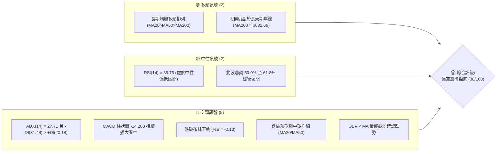
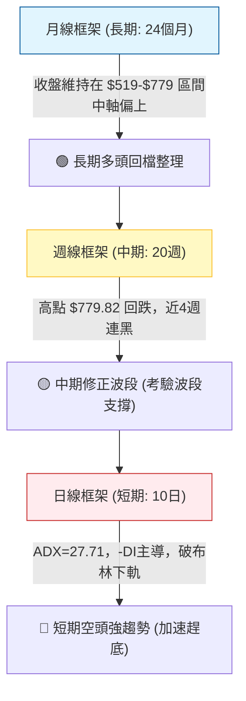
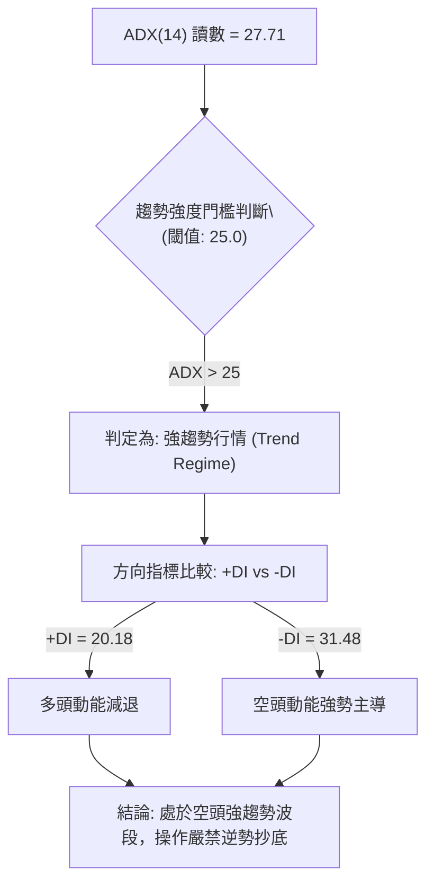
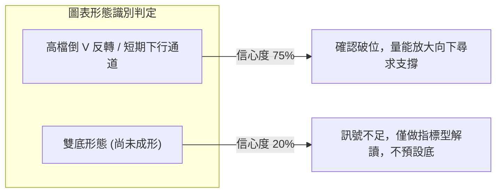
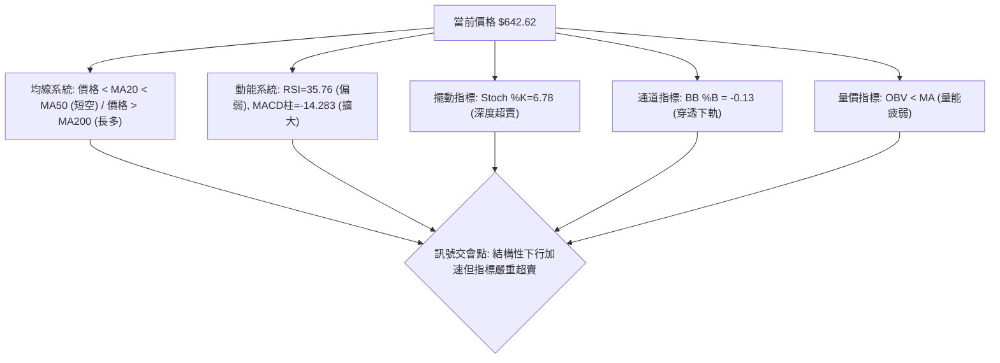
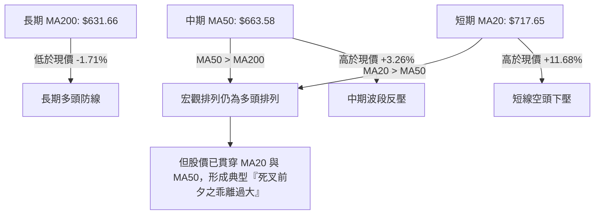
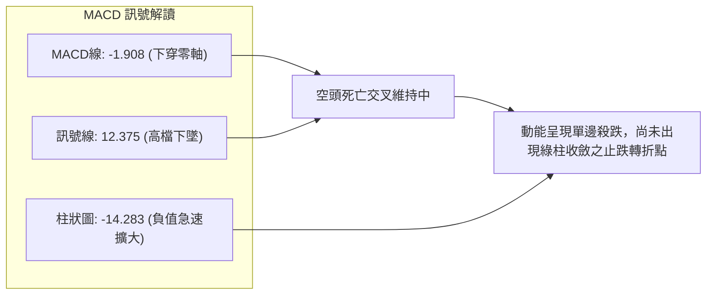
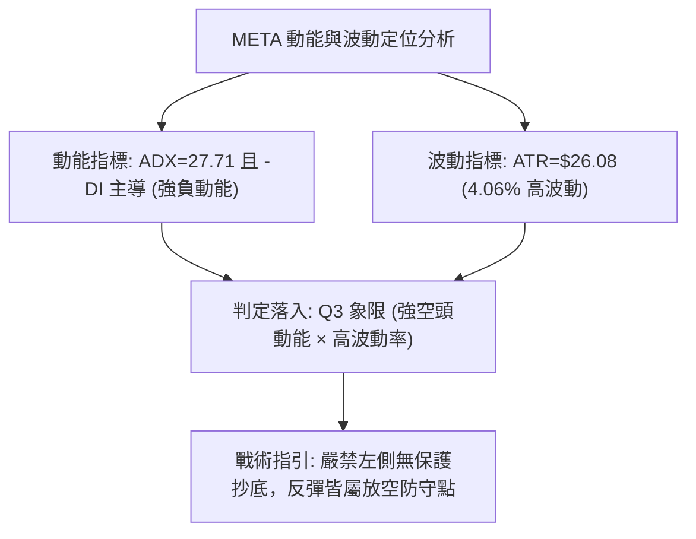
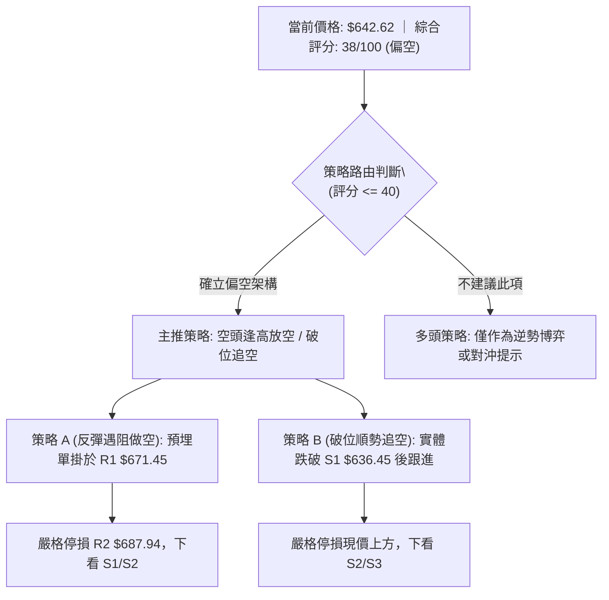
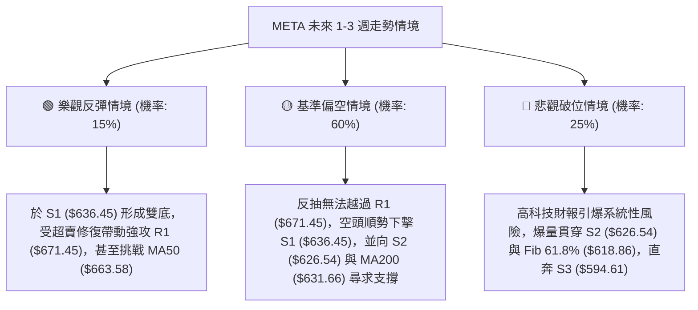

# META 技術分析報告

> **報告日期**：2026-10-26 ｜ **語言**：繁體中文 ｜ **數據來源**：Yahoo Finance ｜ **當前價格**：$642.62 USD

---

## 目錄

| 章節 | 內容 |
|------|------|
| [1. 技術面概覽](#1-技術面概覽) | 訊號儀表板、核心指標、評分卡 |
| [2. 趨勢分析](#2-趨勢分析) | 多時框趨勢、長中短期走勢 |
| [3. 圖表形態分析](#3-圖表形態分析) | 形態識別、K線組合、目標價 |
| [4. 支撐與阻力](#4-支撐與阻力) | 關鍵價位、斐波那契回調 |
| [5. 技術指標深度解讀](#5-技術指標深度解讀) | MA/RSI/MACD/布林/成交量 |
| [6. 動能與波動率](#6-動能與波動率) | 動能評估、ATR、Beta |
| [7. 多時框架總結](#7-多時框架總結) | 時框架評分矩陣 |
| [8. 交易策略建議](#8-交易策略建議) | 多空策略、風險報酬比 |
| [9. 風險提示與監控](#9-風險提示與監控) | 監控指標、風險場景 |

---

## 1. 技術面概覽

### 🎯 技術訊號儀表板



### 📊 核心指標速覽表

| 指標類別 | 指標名稱 | 當前數值 | 訊號 | 解讀 |
|----------|----------|----------|------|------|
| **價格** | 當前收盤價 | $642.62 | 🔴 | 跌破 50% 斐波那契位 ($649.59)，短線承壓 |
| **均線** | MA20 | $717.65 | 🔴 | 價格低於 MA20 達 -10.45%，短線空頭趨勢強烈 |
| **均線** | MA50 | $663.58 | 🔴 | 價格低於 MA50，中期波段進入修正回檔 |
| **均線** | MA200 | $631.66 | 🟢 | 價格高於 MA200 達 +1.74%，長期牛市基底尚未跌破 |
| **動能** | RSI(14) | 35.76 | 🟡 | 中性偏弱，逼近超賣門檻（30），尚未出現止跌背離 |
| **動能** | MACD (12,26,9) | -1.908 / 12.375 | 🔴 | 快線跌破慢線呈負值，柱狀圖 -14.283 強烈看空 |
| **擺動** | Stoch %K / %D | 6.78 / 10.66 | 🟡 | 深度超賣區（<20），存在技術性抽頭反彈需求 |
| **趨勢** | ADX(14) / ±DI | 27.71 (強趨勢) | 🔴 | -DI (31.48) 大幅壓制 +DI (20.18)，空頭主導動能 |
| **通道** | Bollinger %B | -0.13 | 🔴 | 跌破下軌 ($658.37)，極度超賣並呈現通道向下開口 |
| **成交量**| 量比 (20日均量) | 0.77x (14.76M) | 🔴 | 反彈無量或下跌量縮，OBV 處於均線下方，動能匱乏 |
| **波動** | ATR(14) | $26.08 (4.06%) | 🟡 | 日間真實波幅大，顯示下行過程伴隨劇烈價格洗盤 |

### 🏆 技術評分卡

```
╔══════════════════════════════════════════════════════════════╗
║              技術評分卡 — META (2026-10-26)                  ║
╠══════════════════════════════════════════════════════════════╣
║ 趨勢強度 (Trend)      ███████░░░░░░░░░░░░░  36/100  🔴 空頭主導║
║ 動能指標 (Momentum)   ██████░░░░░░░░░░░░░░  30/100  🔴 強烈看空║
║ 支撐穩定度 (Support)  █████████░░░░░░░░░░░  45/100  🟡 臨近考驗║
║ 成交量配合 (Volume)   ███████░░░░░░░░░░░░░  35/100  🔴 量能疲弱║
║ 形態完整度 (Pattern)  ███████░░░░░░░░░░░░░  35/100  🔴 高檔破線║
║ 均線排列 (MA System)  █████████░░░░░░░░░░░  47/100  🟡 長多短空║
╠══════════════════════════════════════════════════════════════╣
║ 綜合評分 (Overall)    ███████░░░░░░░░░░░░░  38/100  🔴 偏空修正║
╚══════════════════════════════════════════════════════════════╝
```
*註：綜合評分係依據規則 18，由六項維度算術平均計算：(36 + 30 + 45 + 35 + 35 + 47) ÷ 6 = 38.0。*

---

## 2. 趨勢分析

### 🌐 多時框趨勢分析



### 📈 長期趨勢 — 12個月走勢圖（Unicode）

以下為 META 自 2025 年 11 月至 2026 年 10 月之月線收盤價歷史走勢圖：

```
META 月線收盤走勢圖（2025-11 至 2026-10）
價格軸 ($)
$780 ┤                                      
$740 ┤                                  ● $725.18
$700 ┤             ● $714.66                
$660 ┤● $645.76 ● $658.40 ● $646.52             ● $642.62 (現價)
$620 ┤                     ● $610.86 ● $631.43
$580 ┤         ● $571.15         ● $571.89  
$540 ┤                     ● $562.85 ● $556.27
     └─┬────┬────┬────┬────┬────┬────┬────┬────┬────┬────┬────┬───
      11   12   01   02   03   04   05   06   07   08   09   10 (月份)
     [── 2025 ──] [──────────────── 2026 ────────────────]
```

#### 走勢特徵分析表

| 階段區間 | 月份跨度 | 價格起訖 ($) | 區間漲跌幅 | 主要技術特徵與驅動因素 |
|----------|----------|--------------|------------|------------------------|
| **高檔整理** | 2025/11 - 2026/01 | $645.76 → $714.66 | +10.67% | 震盪衝高，挑戰 $700 心理整數關卡 |
| **深度回調** | 2026/01 - 2026/03 | $714.66 → $571.15 | -20.08% | 快速回吐漲幅，跌破當時中期均線 |
| **築底盤整** | 2026/03 - 2026/08 | $571.15 → $571.89 | +0.13% | 於 $550 - $630 區間反覆震盪打底（52W低點 $519.37 上方）|
| **主升爆發** | 2026/08 - 2026/09 | $571.89 → $725.18 | +26.80% | 出現大陽線單月飆升，月成交量擴大，創 52W 新高 $779.82 |
| **急遽拉回** | 2026/09 - 2026/10 | $725.18 → $642.62 | -11.38% | 獲利了結賣壓湧現，長黑回落考驗 50% 斐波那契回調位 |

### 📊 中期趨勢（週線分析）

中期技術面以 2026-09-25 創下的 52 週波段高點 $779.82 為分水嶺。近 4 週收盤價依序為 $728.08、$718.67、$709.33、$642.62，形成連續向下跳水架構，週 MACD 柱狀圖由正轉負（自 +11.729 暴跌至 -14.283），確認中期進入波段回撤階段。

```
近期週線壓力與支撐示意圖
══════════════════════════════════════════════════════════════
 52W 高點 ──────── $779.82 (波段天花板)
                     │
 阻力區間 R3 ──── $708.60 (前波跌破跳空平台)
 阻力區間 R1 ──── $671.45 (週線反彈第一道重壓)
                     │
 當前現價 ─────── $642.62 ◄ (收盤穿透 Fib 50% $649.59)
                     │
 關鍵支撐 S1 ──── $636.45 (波段密集低點防線)
 長期均線 ─────── $631.66 (MA200 牛熊分水嶺)
 強支撐 S2 ────── $626.54 (Fib 61.8% $618.86 之上方屏障)
══════════════════════════════════════════════════════════════
```

### ⚡ 趨勢強度評估（ADX 解讀）



#### ADX 指標強度對照分析

| 指標名稱 | 數值 | 參考標準 | 狀態評估 | 實戰交易含義 |
|----------|------|----------|----------|--------------|
| **ADX(14)** | 27.71 | > 25.0 為強趨勢；< 20 為盤整無趨勢 | 強趨勢確立 🟢 | 否定震盪盤整策略，必須遵從單邊趨勢模型 |
| **+DI(14)** | 20.18 | 多方進攻意願 | 疲弱下行 🔴 | 多頭買盤力道衰退，無法形成有效推升推力 |
| **-DI(14)** | 31.48 | 空方打壓力道 | 強勢擴張 🔴 | 空方處於絕對控制地位，賣壓具備連續性 |
| **DI差值** | -11.30 | +DI 減 -DI 之差 | 負向擴大 🔴 | 趨勢斜率陡峭向下，反彈逢高易遭空頭截擊 |

---

## 3. 圖表形態分析

### 🔍 形態識別系統

在日線與週線結構上，自高點 $779.82 快速拉回形成高檔「穿頭破底之倒 V 型尖頂拉回」形態。



#### 圖表形態信心度分析表

| 形態名稱 | 信心度 | 判斷依據（引用數據） | 完成度 | 目標價（附計算式） |
|----------|--------|----------------------|--------|--------------------|
| **高檔倒V頂破位** | 75% | 2026-09-25 創高 $779.82 後連跌 4 週，近10日破 MA20 ($717.65) 與 MA50 ($663.58) | 100% (已破位) | 由形態回撤推算：頸線 R1 $671.45 − (高點 $779.82 − 頸線 $671.45) = $563.08。短線第一滿足區鎖定 S1 $636.45 與 S2 $626.54 |
| **中期雙底結構** | 20% | 歷史低點曾於 2026/06 ($549.82) 與 2026/08 ($549.47) 出現，但當前距該位置過遠 | 訊號不足 | 數據不足以確認次級雙底，僅做指標型超賣解讀，不預設雙底成立 |

### 🕯️ 重要K線形態分析

嚴格依據數據中「近10根日K」與「近8根週K」之開高低收進行精確形態識別：

#### 近10根日K形態分析

| 日期 | 開盤價 | 最高價 | 最低價 | 收盤價 | K線形態名稱 | 技術解讀 | 訊號 |
|------|--------|--------|--------|--------|-------------|----------|------|
| 2026-10-12 | 728.50 | 752.24 | 727.64 | 742.96 | 中紅棒 | 高檔向上試探，實體飽滿，多頭最後推升 | 🟢 |
| 2026-10-13 | 735.99 | 771.27 | 734.84 | 762.50 | 長上影紅棒 | 衝高 $771.27 受阻回落，顯現強烈逢高解套賣壓 | 🟡 |
| 2026-10-14 | 760.75 | 761.50 | 734.29 | 737.54 | 高檔大黑棒 | 跳空開平走低，實體吞噬前日大部分漲幅 | 🔴 |
| 2026-10-15 | 726.56 | 743.97 | 715.58 | 736.72 | 紡錘十字星 | 低檔震盪抵抗，但無法收復前一日高點 | 🟡 |
| 2026-10-16 | 736.70 | 738.49 | 702.71 | 709.33 | 長黑貫穿棒 | 實體跌破 $710 心理關卡，空頭全面主導日線 | 🔴 |
| 2026-10-19 | 707.16 | 708.83 | 693.86 | 705.44 | 弱勢小紅星 | 反彈無力，受制於前一日收盤價附近，量縮觀望 | 🟡 |
| 2026-10-20 | 694.98 | 696.51 | 681.05 | 694.25 | 下探黑棒 | 跌破 $700 整數關卡，最低見 $681.05 | 🔴 |
| 2026-10-21 | 697.60 | 713.22 | 689.68 | 697.52 | 長上影墓碑星 | 盤中反彈至 $713.22 遭遇巨量空頭伏擊，成交量激增 | 🔴 |
| 2026-10-22 | 676.35 | 681.07 | 639.69 | 648.85 | 爆量長黑跳水棒 | 成交量激增至 40.57M，長黑摜破 MA50 與布林下軌 | 🔴 |
| 2026-10-23 | 638.18 | 648.04 | 633.27 | 642.62 | 低檔十字小紅線 | 創波段新低 $633.27 後微幅收斂，呈現初步超賣抵抗 | 🟡 |

#### 近8根週K形態分析

| 週末日期 | 開盤價 | 最高價 | 最低價 | 收盤價 | 週K形態名稱 | 技術解讀 | 訊號 |
|----------|--------|--------|--------|--------|-------------|----------|------|
| 2026-09-04 | 577.17 | 618.97 | 555.66 | 616.28 | 長紅起漲棒 | 出現週線突破信號，週成交量達 81.43M | 🟢 |
| 2026-09-11 | 615.72 | 663.72 | 609.26 | 647.52 | 連續推進中長紅 | 站穩 $640 之上，多頭價量齊揚 | 🟢 |
| 2026-09-18 | 657.31 | 689.61 | 648.71 | 665.23 | 續漲紅K棒 | 推進至 $665.23，週均線發散向上 | 🟢 |
| 2026-09-25 | 680.30 | 779.82 | 679.60 | 751.66 | 爆量避雷針週K | 週量暴增至 168.30M 創天量，衝上 $779.82 後收留長上影 | 🔴 |
| 2026-10-02 | 750.04 | 750.58 | 713.19 | 728.08 | 高檔反轉長黑 | 高檔跳空開低破線，確立 52W 高點為波段假突破頂部 | 🔴 |
| 2026-10-09 | 727.71 | 747.60 | 711.68 | 718.67 | 弱勢下探黑K | 週線連續兩週收黑，重心下移 | 🔴 |
| 2026-10-16 | 728.50 | 771.27 | 702.71 | 709.33 | 假反彈長黑棒 | 盤中回抽 $771.27 失敗，終場重挫收最低附近 | 🔴 |
| 2026-10-23 | 707.16 | 713.22 | 633.27 | 642.62 | 加速殺跌大長黑 | 週量達 117.84M，單週重挫 -9.4%，摜破 Fib 50% 水平 | 🔴 |

### 📉 ASCII 走勢形態示意圖

```
META 日線高檔破位下行結構圖
$780 ┬                   [頂部: $779.82 / $771.27 雙頂受阻]
     │                      ╭─╮      ╭─╮
$740 ┼─────────────────────╯  ╰──────╯  ╰───
     │                                        ╲
$700 ┼─────────────────────────────────────────╲───── [頸線區破位: R3 $708.60]
     │                                           ╲
$660 ┼────────────────────────────────────────────╲── [破 MA50: $663.58]
     │                                              ╲
$640 ┼───────────────────────────────────────────────● 現價: $642.62
     │                                              │
$630 ┴──────────────────────────────────────────────┴── [考驗 S1 $636.45 / MA200 $631.66]
```

### 🎯 形態目標價計算

根據日線自 2026-10-13 高點 $771.27 回落至 2026-10-23 低點 $633.27 的下行脈衝波段：
1. **第一波跌幅測算（高度 H1）**：高點 $771.27 − 跌破頸線點 R3 $708.60 = 形態落差 $62.67。
2. **第一階段測幅滿足點**：頸線 R3 $708.60 − $62.67 = $645.93（已於 2026-10-22 抵達並穿透至現價 $642.62）。
3. **擴展延伸波測算（等長下行目標）**：若自 2026-10-21 反彈高點 $713.22 起算延伸跌幅：
   $713.22 − (771.27 − 708.60) = $713.22 − $62.67 = $650.55（已被摜破）。
   次級等長下行測幅：$708.60 − ($762.50 − 681.05) = $708.60 − $81.45 = $627.15，緊貼數據中的支撐位 **S2: $626.54**。

---

## 4. 支撐與阻力

### 🗺️ 關鍵價位分布圖（Unicode）

```
META 價位結構分布圖（嚴格依據 OHLCV 聚類計算數據）
══════════════════════════════════════════════════════════════
$779.82  ║████████████████████████║ 52W 歷史天花板 (52W High)
$718.35  ║████████████████████    ║ 斐波那契 23.6% 回調位
$708.60  ║████████████████████████║ 強阻力 R3 (高檔震盪頸線聚類區)
$687.94  ║████████████████        ║ 阻力 R2 (反彈第一密集解套套牢區)
$671.45  ║████████████            ║ 關鍵阻力 R1 (短期波段高點/前支撐轉阻力)
$649.59  ║┈┈┈┈┈┈┈┈┈┈┈┈┈┈┈┈┈┈┈┈┈┈┈┈║ 斐波那契 50.0% 關鍵平衡位 (剛被擊穿)
$642.62  ╠════════════════════════╣ ◄ 當前收盤價 (Last Close)
$636.45  ║▓▓▓▓▓▓▓▓▓▓▓▓            ║ 近期支撐 S1 (近一年波段低點聚類線)
$631.66  ║▓▓▓▓▓▓▓▓▓▓▓▓▓▓▓▓        ║ 牛熊防線 MA200 年線
$626.54  ║████████████████        ║ 強支撐 S2 (波段次低點聚類線)
$618.86  ║████████████████████    ║ 斐波那契 61.8% 黃金分割強支撐
$594.61  ║████████████████████████║ 極限防禦支撐 S3 (中長線深幅護城河)
══════════════════════════════════════════════════════════════
```

### 🚧 阻力位分析表

所有價位均直接引用數據「關鍵價位」區塊之波段高點聚類：

| 阻力級別 | 價位 ($) | 距現價幅度 | 形成原因與籌碼解構 | 突破難度 | 重要性 |
|----------|----------|------------|--------------------|----------|--------|
| **阻力 R1** | **$671.45** | +4.49% | 2026-10-22 開盤長黑起跌點 ($676.35 鄰近) 與日線均線 MA50 ($663.58) 密集反壓區 | 🟡 中等 | ★★★★☆ |
| **阻力 R2** | **$687.94** | +7.05% | 10月中旬盤整區下緣，多次下探低點聚類轉化之密集換手套牢帶 | 🔴 較高 | ★★★☆☆ |
| **阻力 R3** | **$708.60** | +10.27% | 2026-10-16 跌破點 ($709.33) 與整數心理關卡，週線級別強阻力區 | 🔴 極高 | ★★★★★ |

### 🛡️ 支撐位分析表

所有價位均直接引用數據「關鍵價位」區塊之波段低點聚類：

| 支撐級別 | 價位 ($) | 距現價幅度 | 形成原因與籌碼解構 | 守住機率 | 重要性 |
|----------|----------|------------|--------------------|----------|--------|
| **支撐 S1** | **$636.45** | -0.96% | 2026-10-23 當日最低點 $633.27 上方之多頭抵抗密集區，短線第一道防線 | 55% | ★★★☆☆ |
| **支撐 S2** | **$626.54** | -2.50% | 緊鄰 MA200 ($631.66) 與 MA120 ($627.21)，為機構法人長線資產配置核心防守線 | 70% | ★★★★★ |
| **支撐 S3** | **$594.61** | -7.47% | 2026 年 7-8 月震盪底部的最後防護網，跌破代表牛市週期徹底終結 | 85% | ★★★★☆ |

### 📐 斐波那契回調位分析

依據 52 週波段低點 **$519.37** 至波段高點 **$779.82** 計算之斐波那契回調水準：

| 回調比例 | 斐波那契價位 ($) | 現價相對位置 | 結構意義解讀 |
|----------|------------------|--------------|--------------|
| **0.0% (高點)** | $779.82 | +21.35% | 52 週天花板，波段牛市極限頂部 |
| **23.6%** | $718.35 | +11.78% | 強勢多頭防守位，已於 10 月中旬被長黑慣性擊穿 |
| **38.2%** | $680.33 | +5.87% | 中度修正平衡點，目前轉化為強大反彈阻力 |
| **50.0%** | **$649.59** | +1.08% | **關鍵多空分水嶺**，最新收盤價 ($642.62) 剛小幅收破此處 |
| **61.8%** | **$618.86** | -3.70% | **黃金分割最後支撐**，若 S2 ($626.54) 失守，將回踩此終極防禦線 |
| **78.6%** | $575.11 | -10.51% | 深度回調警戒區，回測 2026 年 8 月起漲起點 |
| **100.0% (低點)**| $519.37 | -19.18% | 52 週最低點，全週期趨勢歸零防線 |

**解讀結論**：現價 **$642.62** 正好落於 **50.0% ($649.59)** 與 **61.8% ($618.86)** 之間的「黃金緩衝帶」。由於 50% 關卡收盤宣告失守，技術結構強制將防禦焦點下移至 S1 ($636.45) 以及 MA200 ($631.66) 乃至 61.8% ($618.86) 水平。

---

## 5. 技術指標深度解讀

### 🎛️ 指標訊號總覽



### 📈 移動平均線排列分析



#### 各期均線當前狀態表

| 均線名稱 | 數值 ($) | 偏離現價幅度 | 走勢軌跡 | 多空屬性 |
|----------|----------|--------------|----------|----------|
| **MA 5** | $677.74 | -5.18% | 陡峭向下 ▁▁▂▂ | 🔴 極弱短空壓制 |
| **MA 10** | $707.77 | -9.21% | 快速下行 ▁▁▂▂ | 🔴 短線加速趕底 |
| **MA 20** | $717.65 | -10.45% | 下行拐頭 ▁▁▁▂ | 🔴 月線級別反壓 |
| **MA 60** | $650.80 | -1.26% | 震盪微跌 ▁▁▁▁ | 🔴 季線宣告失守 |
| **MA 120** | $627.21 | +2.46% | 穩定上行 ▁▁▁▁ | 🟢 半年線穩固支撐 |
| **MA 200** | $631.66 | +1.74% | 緩步上揚 ▃▂▂▁ | 🟢 終極牛熊分水嶺 |
| **MA 240** | $632.98 | +1.52% | 底部墊高 ▃▂▂▁ | 🟢 年線基準防禦 |

### 📉 RSI(14) 分析

當前 RSI(14) 讀數為 **35.76**（Wilder 計算法）。

```
RSI(14) 強度計量器:
[ 0 ──────── 30 ─────── 35.76 ──────── 70 ─────── 100 ]
  超賣區       極度低檔     ▲ 當前讀數      超買區
████████████████░░░░░░░░░░░░░░░░░░░░░░░░░░░░░░░░░ 35.76%
```

- **區間評估**：RSI 處於 30 至 70 的中性區間偏下緣，已逼近 30 超賣臨界點。
- **背離判斷**：對比近 20 根 K 棒，價格自高點 $771.27 跌至 $633.27，RSI 亦自 70 以上同步下墜至 35.76，**無明顯底背離**現象（數據顯示：無明顯背離）。這表示跌勢由真實賣盤驅動，並非主力洗盤誘空。

### 📊 MACD(12/26/9) 訊號解讀

- **MACD 快線**：-1.908
- **MACD Signal (慢線)**：12.375
- **MACD Histogram (柱狀圖)**：**-14.283**（🔴 強烈看空）



### 📦 布林通道分析

- **布林上軌**：$776.93
- **布林中軌 (MA20)**：$717.65
- **布林下軌**：$658.37
- **當前價格**：$642.62
- **布林 %B 指標**：**-0.13**（小於 0 代表已跌破下軌）

```
META 日線布林通道結構示意圖
$780 ┬─────────────────────── $776.93 (BB 上軌)
     │
$740 ┼ - - - - - - - - - - - 
     │
$718 ┼─────────────────────── $717.65 (BB 中軌: MA20 反壓)
     │
$660 ┼─────────────────────── $658.37 (BB 下軌)
     │  ▲ 現價: $642.62 (%B = -0.13，脫離下軌開口向下擴張)
$620 ┴───────────────────────
```

**解讀**：%B 讀數為 **-0.13**，股價連續兩日貫穿布林下軌（10-22 收 $648.85，10-23 收 $642.62）。通道開口顯著擴大，呈現典型「沿下軌向下巡航」之極端下行態勢，通常意味著短線將有均值回歸的超跌抽腳修復，但中軌 $717.65 已成中長期難以逾越之鐵板。

### 💹 成交量分析（量價配合度）

- **最新成交量**：14,761,500 股
- **20日均量**：19,253,865 股（量比：**0.77x**）
- **50日均量**：20,217,516 股
- **OBV 能量潮狀態**：**OBV < MA**，量能疲弱

**量價解讀**：
1. **下殺爆量，反彈量縮**：2026-10-22 股價大跌時，日成交量爆發至 **40,571,000 股**（超過 2 倍日均量），顯現恐慌籌碼湧出；而 10-23 試圖收十字星時，成交量迅速萎縮至 **14.76M**（僅 0.77x 量比）。
2. **量價背離缺失**：OBV 跌破其移動平均線，且均量線持續下滑，顯示目前無大級別買盤進場承接，僅為空頭獲利回補造成的微幅抵抗。

---

## 6. 動能與波動率

### ⚡ 動能評估四象限

動能評估模型將市場標的依「趨勢動能（Directional Momentum）」與「波動率（Volatility）」劃分為四個狀態區間：

| 象限 | 動能方向與強度 | 波動率水準 | 當前狀態判定 | 交易策略評估 |
|------|----------------|------------|--------------|--------------|
| **Q1 (進攻區)** | 強勁向上 (Bullish) | 低 / 穩定 | 否 | 最佳趨勢波段持有與加碼點 |
| **Q2 (盤整區)** | 弱勢無方向 | 低 / 沉寂 | 否 | 區間高拋低吸或觀望突破 |
| **Q3 (風險釋放區)**| **強勁向下 (Bearish)** | **高 (ATR=4.06%)** | **✓ 當前 META 處於此區** | **高風險高波動，空頭主導，順勢偏空或空倉防守** |
| **Q4 (變盤觀望區)**| 弱勢向下 | 高 / 發散 | 否 | 避免隨意搶反彈，謹防二次補跌 |



### 📊 ATR 波動率分析

- **ATR(14) 讀數**：**$26.08**（Wilder 計算法）
- **佔股價比重**：**4.06%**

**實戰止損與波動距離設定建議**：
- **短線交易止損安全邊際（1.0 × ATR）**：$26.08。若在反彈點建立空單，停損應設於進場點上方至少 $26.08 處以避開日內噪聲。
- **波段保護止損距離（1.5 × ATR）**：1.5 × $26.08 = **$39.12**。
- **日內洗盤波幅預估**：預期交易日內震盪區間達 ±$26.08，意味著股價在 $630 至 $670 之間的震盪均屬正常波動範疇，部位規模必須嚴格縮減以承受此等幅度。

### 📐 Beta 與市場相關性

- **Beta 係數**：**1.185**
- **市場屬性解讀**：META 具備典型高貝塔成長型科技巨頭特徵，對大盤（S&P 500 / Nasdaq）之波動敏感度高出 18.5%。當市場整體避險情緒升溫時，META 之拋售壓力將顯著放大；當前大盤在微軟、谷歌、亞馬遜財報前夕多空交戰，高 Beta 意味著短線下檔波動放大風險極高。

---

## 7. 多時框架總結

### 📋 時框架評分表

| 時框架 | 趨勢方向 | 動能狀態 | 均線排列 | 關鍵形態 | 評分 | 操作指引 |
|--------|----------|----------|----------|----------|------|----------|
| **月線 (長期)** | 🟢 偏多回調 | 🟡 中性減弱 | 🟢 多頭排列 | 大區間箱型內震盪 | 60/100 | 長期資產配置者關注 MA200 防線 |
| **週線 (中期)** | 🔴 快速修正 | 🔴 MACD柱轉負 | 🟡 高檔死叉前夕 | 52W 高點避雷針反轉 | 35/100 | 嚴控持倉風險，逢反彈降低槓桿 |
| **日線 (短期)** | 🔴 單邊下行 | 🔴 -DI 強勢主導 | 🔴 破 MA20/MA50 | 破布林下軌加速趕底 | 25/100 | 順應強空頭趨勢，嚴禁逆勢摸底 |
| **綜合評分** | 🔴 偏空修正 | 🔴 空方控盤 | 🟡 長多短空交織 | 倒 V 頂下破回調 | **38/100** | **逢反彈布局空頭或空倉防守** |

### 🔲 綜合訊號矩陣

```
訊號一致性矩陣分析：
┌─────────────┬─────────────┬─────────────┬─────────────┐
│   維度      │  短期 (日線)│  中期 (週線)│  長期 (月線)│
├─────────────┼─────────────┼─────────────┼─────────────┤
│ 均線方向    │   🔴 空頭   │   🟡 走平   │   🟢 多頭   │
│ 動能方向    │   🔴 暴跌   │   🔴 轉弱   │   🟡 中性   │
│ 量能配合    │   🔴 疲弱   │   🔴 賣壓擴大│   🟢 健全   │
│ 支撐防守    │   🔴 貫穿   │   🟡 考驗中 │   🟢 穩固   │
└─────────────┴─────────────┴─────────────┴─────────────┘
結論：長多框架依然存在，但中短期遭受嚴重破壞，訊號出現顯著「時框衝突」。
```

### ⚖️ 多時框收斂結論

依據多時框收斂規則（嚴格要求 14）：
1. **行情性質判定**：當前 ADX(14) 讀數為 **27.71 > 25.0**，明確確立目前處於**「強趨勢行情（Trend Regime）」**而非無方向之盤整行情。
2. **時框優先級權重**：在 ADX > 25 之趨勢格局下，長週期均線提供戰略底線，但中期趨勢全面向下破位，日線更呈現急遽下行通道；此時操作必須遵從「中短期趨勢主導」原則，不可因長期 MA200 尚未跌破而盲目做多。
3. **唯一方向性結論**：**偏空（Bearish）**。市場目前由空方動能主導，所有短線拉升均視為反彈修正而非反轉，戰術主軸為**「反彈逢阻力做空」**或等待 S1/S2 徹底打底完成。此結論與第 8 章之主策略完全收斂一致。

---

## 8. 交易策略建議

### 🗺️ 策略決策流程圖



### 🧭 策略路由（依評分卡分流）

> **當前主策略方向 = 空頭防禦與逢反彈布空（依綜合評分 38/100，落入 ≤ 40 之偏空範疇）**

根據客觀技術指標，ADX(14) = 27.71 確認強趨勢，-DI(31.48) 處於強勢壓制地位，MACD 負向柱狀圖放大至 -14.283，且布林通道嚴重向下破軌。因此，**本報告嚴格禁止在現階段發布積極做多主策略**。報告主推「反彈遇阻做空」與「破位順勢加空」兩套空頭操作計劃；多頭僅列為風險反轉情境之對沖觸發提示。

### 🎯 價格情境階梯（Price Scenarios）

所有價位均嚴格取自數據「關鍵價位」與「斐波那契回調位」之真實數據：

| 觸發條件 | 下一目標 | 後續延伸 | 情境含義 |
|----------|----------|----------|----------|
| **強勢突破 R1 ($671.45)** | 阻力 R2 ($687.94) | 阻力 R3 ($708.60) | 短線超跌強勁修復，空頭部位必須全面減碼或止損 |
| **弱勢反抽受阻於 R1 ($671.45)** | 跌回現價 ($642.62) | 測試 S1 ($636.45) | 典型逢高空點，確認下行中繼形態 |
| **跌破近期支撐 S1 ($636.45)** | 強支撐 S2 ($626.54) | 斐波那契 61.8% ($618.86) | 空頭趨勢延續，考驗年線 MA200 ($631.66) 防守 |
| **有效摜破強支撐 S2 ($626.54)** | S3 ($594.61) | 52W 低點區間 ($519.37) | 中長期多頭結構徹底瓦解，步入深度熊市走勢 |

### 📊 情境機率分佈

| 情境 | 機率 | 主要技術依據 |
|------|------|--------------|
| **空頭下行尋求支撐 (探底波)** | **60%** | ADX=27.71 強趨勢確立；-DI=31.48 掌控盤面；MACD 柱 -14.283 發散；OBV < MA |
| **低檔弱勢區間震盪 (盤整底)** | **25%** | Stoch %K=6.78 深度超賣；布林 %B=-0.13 具備均值回歸修復拉力；S1 $636.45 臨近 |
| **單邊強力 V 轉反彈 (反轉波)** | **15%** | 50% 斐波那契位已被跌破；成交量比僅 0.77x 缺乏大機構搶籌買盤，機率極低 |

### 🟢 主策略詳情（空頭交易策略）

所有價位完全引用自「關鍵價位」區塊數值，風險報酬比均依公式嚴密計算：

| 策略要素 | 策略 A：反彈遇阻做空（首選） | 策略 B：跌破支撐追空（突破） |
|----------|------------------------------|------------------------------|
| **進場條件** | 價格反彈至 R1 遇阻回落，K線收上影線 | 日線實體收盤跌破近期支撐 S1 |
| **進場價格** | **$671.45** (精準引用 R1 阻力位) | **$636.45** (精準引用 S1 支撐位) |
| **目標價 T1** | **$636.45** (精準引用 S1 支撐位) | **$626.54** (精準引用 S2 支撐位) |
| **目標價 T2** | **$626.54** (精準引用 S2 支撐位) | **$594.61** (精準引用 S3 支撐位) |
| **止損價格** | **$687.94** (精準引用 R2 阻力位) | **$642.62** (精準引用當前收盤價) |
| **風險報酬比**| **1 : 2.12（以 T1 計）** <br>*(671.45 − 636.45) ÷ (687.94 − 671.45) = 35.00 ÷ 16.49 = 2.12* | **1 : 1.61（以 T1 計）** <br>*(636.45 − 626.54) ÷ (642.62 − 636.45) = 9.91 ÷ 6.17 = 1.61* |
| **T2 風險報酬比**| 1 : 2.72（以 T2 計） <br>*(671.45 − 626.54) ÷ 16.49 = 44.91 ÷ 16.49 = 2.72* | 1 : 6.78（以 T2 計） <br>*(636.45 − 594.61) ÷ 6.17 = 41.84 ÷ 6.17 = 6.78* |
| **成功機率** | 65% | 55% |
| **建議倉位** | 15% 總資金 | 10% 總資金 |

### 🔴 反向風險觸發點（對沖提示）

若出現以下訊號，主推之空頭策略立即失效，投資人應即刻平倉空單並反手評估多頭防禦避險：
1. **價位警報**：日線收盤價強勢站回 **R1 ($671.45)** 之上，且盤中上破 **R2 ($687.94)**。
2. **指標轉折**：RSI(14) 突破 50 中軸，且 MACD 柱狀圖由 -14.283 快速收斂至 -5.000 以內並形成底背離金叉。
3. **成交量異動**：單日成交量放大至 3,000 萬股以上（量比 > 1.5x）並拉出實體長紅吞噬 K 線。

### ⭐ 整體訊號強度評星

```
做多訊號強度：★☆☆☆☆  (1/5星 - 嚴禁無防護逆勢做多)
做空訊號強度：★★★★☆  (4/5星 - 順應 ADX 趨勢，高勝率)
整體可信度：  ★★★★☆  (4/5星 - 指標共振一致看空)
```

---

## 9. 風險提示與監控

### ✅ 關鍵監控指標 Checklist

```
╔══════════════════════════════════════════════════════════════╗
║               每日盤後技術監控清單 (Checklist)               ║
╠══════════════════════════════════════════════════════════════╣
║ [ ] 價格防線：是否跌破 S1 ($636.45) 或進一步下探 MA200 ($631.66)║
║ [ ] 均線動態：價格是否持續受制於 5日均線 ($677.74) 下方      ║
║ [ ] 動能監測：MACD 柱狀圖是否跌勢趨緩（負值縮小至 -10 以內） ║
║ [ ] 擺動指標：Stoch %K 是否自超賣區（6.78）形成向上交叉金叉  ║
║ [ ] 通道狀況：布林通道 %B 是否自 -0.13 回升至 0.00（站回下軌） ║
║ [ ] 量能驗證：反彈時成交量是否低於 1,925 萬股（量縮假反彈）  ║
╚══════════════════════════════════════════════════════════════╝
```

### ⚠️ 風險場景分析



### 🛡️ 風險管理重要提醒

1. **波動率管理（ATR 風險控制）**：
   當前 ATR 達 **$26.08**，代表單日正常晃動即逾 4%。若單筆交易最大允許虧損為總資金之 1.5%，以停損距離 $16.49（策略 A）計算，持倉部位上限不得超過總資產之 **15%**；嚴禁滿倉或高倍槓桿操作。
2. **財報與外圍科技股連動風險**：
   近期新聞顯示微軟、谷歌、亞馬遜等巨頭即將發布財報，市場對 AI 資本支出（Meta TTM 資本支出高達 $104.44B）之投資回報率產生廣泛質疑。宏觀情緒脆弱，高 Beta (1.185) 屬性極易導致跳空缺口出現，持倉過夜必須做好對沖或預留保護性停損。
3. **假突破與超賣抽頭風險**：
   隨着 Stoch %K 跌至 **6.78** 極端低位，技術性短軋空隨時可能發生。若採取破位追空策略（策略 B），務必等待日線「實體收盤」確認破線，切忌盤中急跌追單，以防陷入假突破的長下影線多頭陷阱。

---

## 📋 報告總結

```
╔══════════════════════════════════════════════════════════════╗
║                 META 技術分析報告總結                        ║
╠══════════════════════════════════════════════════════════════╣
║ 報告日期：2026-10-26                                         ║
║ 當前價格：$642.62 USD                                        ║
║ 分析評級：🔴 偏空修正 (綜合評分: 38/100)                     ║
╠══════════════════════════════════════════════════════════════╣
║ 關鍵結論：                                                   ║
║ ├─ 長期趨勢：🟢 宏觀牛市格局維持 (股價高於 MA200 $631.66)    ║
║ ├─ 中期趨勢：🔴 高檔反轉確認 (自 $779.82 展開 4 週連續下跌) ║
║ ├─ 短期趨勢：🔴 單邊強空頭 (ADX 27.71，布林破下軌，MACD弱)   ║
║ ├─ 關鍵支撐：S1: $636.45 ｜ S2: $626.54 ｜ S3: $594.61       ║
║ ├─ 關鍵阻力：R1: $671.45 ｜ R2: $687.94 ｜ R3: $708.60       ║
║ └─ 分析師目標：平均 $844.26 (低標: $629.06 / 高標: $1050.00) ║
╠══════════════════════════════════════════════════════════════╣
║ 最優策略組合：                                               ║
║ 1. 🥇 最佳機會：策略 A (逢反彈至 R1 $671.45 遇阻布空，風報比 1:2.12)║
║ 2. 🥈 次選機會：策略 B (跌破 S1 $636.45 順勢追空至 S2，風報比 1:1.61)║
║ 3. 🥉 保守選擇：完全空倉觀望，靜待股價回踩 MA200/S2 打底訊號 ║
╚══════════════════════════════════════════════════════════════╝
```

---

> ⚠️ **免責聲明**：本報告為技術分析研究，所有數據、圖表及估算均基於歷史價格資訊與量化技術模型客觀產出。本報告**僅供研究與學術參考**，**不構成任何要約、招攬或投資建議**。金融市場具有高度風險，投資人應審慎評估自身財務狀況與風險承受能力，獨立作出投資決策並自負盈虧。

---

*報告生成時間：2026-10-26 ｜ 數據來源：Yahoo Finance ｜ 分析框架：多時框技術分析體系*