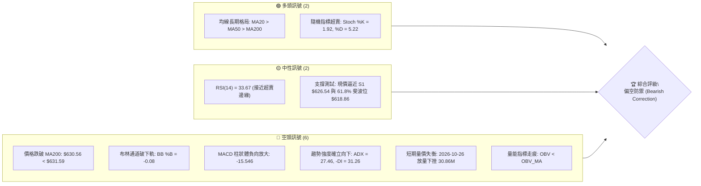
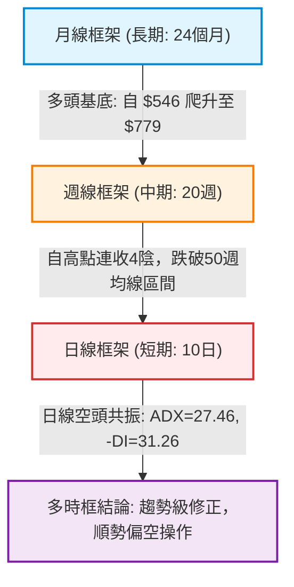
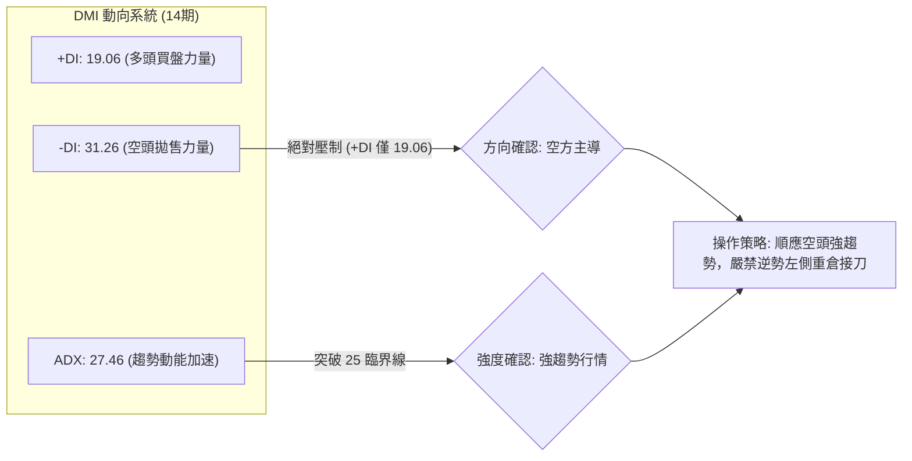
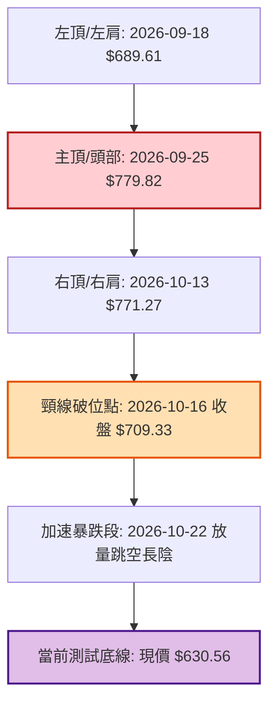
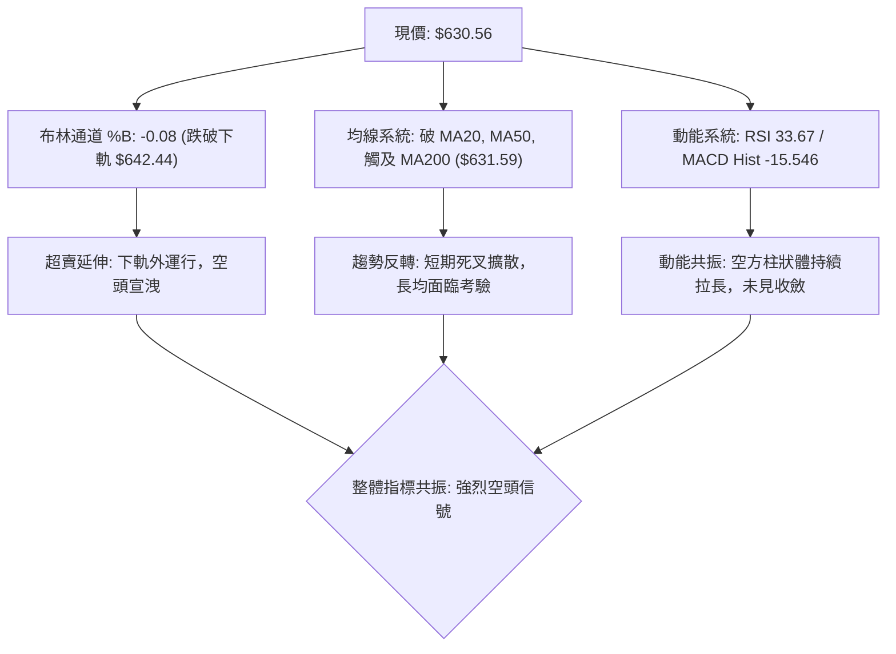
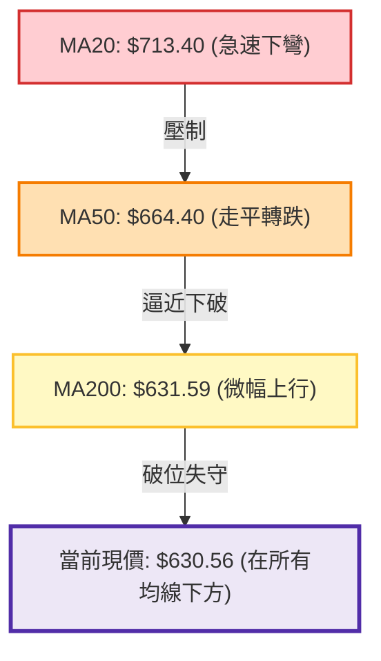
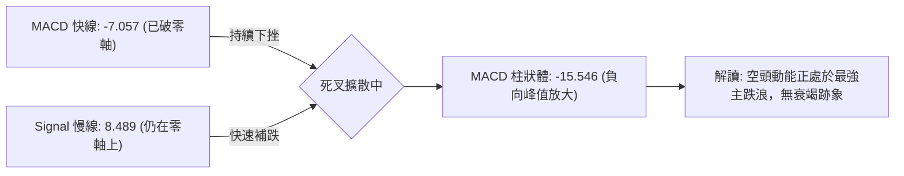
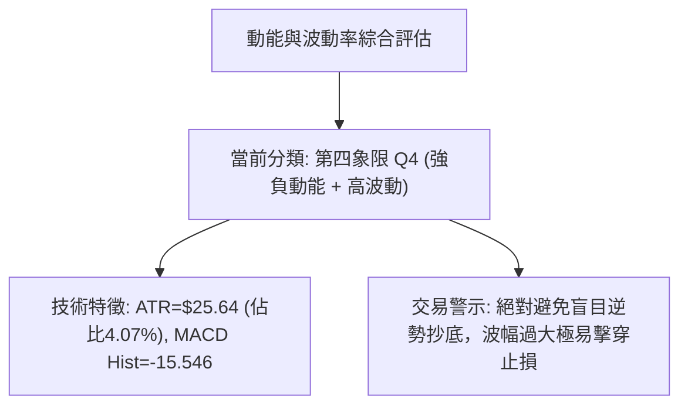
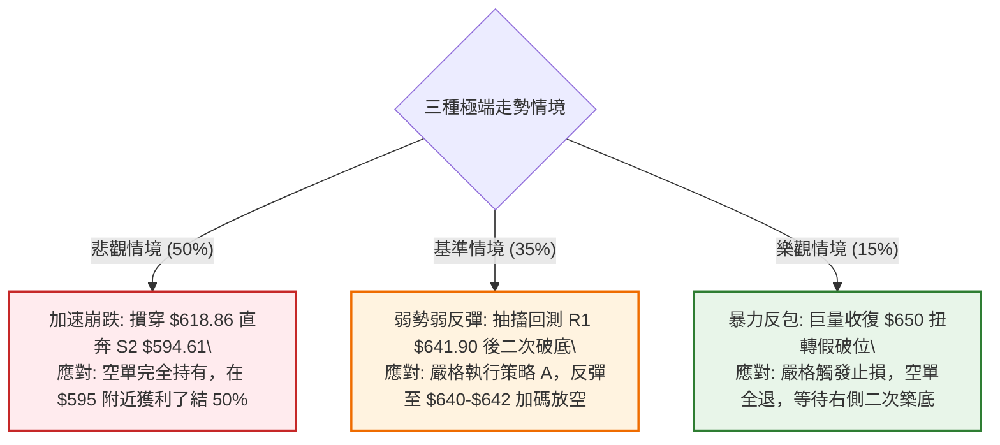

# META 技術分析報告

> **報告日期**：2026-10-27 ｜ **語言**：繁體中文 ｜ **數據來源**：Yahoo Finance ｜ **當前價格**：$630.56

---

## 目錄

| 章節 | 內容 |
|------|------|
| [1. 技術面概覽](#1-技術面概覽) | 訊號儀表板、核心指標、評分卡 |
| [2. 趨勢分析](#2-趨勢分析) | 多時框趨勢、長中短期走勢 |
| [3. 圖表形態分析](#3-圖表形態分析) | 形態識別、K線組合、目標價 |
| [4. 支撐與阻力](#4-支撐與阻力) | 關鍵價位、斐波那契回調 |
| [5. 技術指標深度解讀](#5-技術指標深度解讀) | MA/RSI/MACD/布林/成交量 |
| [6. 動能與波動率](#6-動能與波動率) | 動能評估、ATR、Beta |
| [7. 多時框架總結](#7-多時框架總結) | 時框架評分矩陣 |
| [8. 交易策略建議](#8-交易策略建議) | 多空策略、風險報酬比 |
| [9. 風險提示與監控](#9-風險提示與監控) | 監控指標、風險場景 |

---

## 1. 技術面概覽

### 🎯 技術訊號儀表板

當前 META 呈現顯著的「中長期多頭均線架構下的短線急跌破位」格局。價格在 2026 年 9 月下旬衝擊 52 週歷史高點 $779.82 後快速回落，目前跌破 MA20、MA50，並直接下測 MA200 與布林通道下軌，空方在短中期維度取得全面主導權。



---

### 📊 核心指標速覽表

| 指標類別 | 指標名稱 | 當前數值 | 訊號 | 解讀 |
|:---|:---|:---|:---:|:---|
| **價格** | 當前收盤價 | $630.56 | 🔴 | 跌破 MA200 關鍵防線，處於 52 週區間之 42.7% 分位 |
| **均線系統** | MA20 (短線生命線) | $713.40 | 🔴 | 現價大幅偏離 -11.61%，短線嚴重受制於下彎阻力 |
| **均線系統** | MA50 (中線趨勢線) | $664.40 | 🔴 | 現價低於 MA50 約 -5.09%，中期波段多頭遭到破壞 |
| **均線系統** | MA200 (長期牛熊線)| $631.59 | 🔴 | 現價跌破 MA200 約 -0.16%，牛市生命線面臨失守考驗 |
| **動能指標** | RSI(14) | 33.67 | 🟡 | 進入弱勢鈍化區間（30–40），尚未觸發實質底背離 |
| **動能指標** | MACD (12,26,9) | -7.057 | 🔴 | 快慢線死叉下行（Signal: 8.489），Hist: -15.546 空頭擴散 |
| **波動指標** | ATR(14) | $25.64 | 🔴 | 波動佔股價 4.07%，每日振幅劇烈，下行洗盤風險高 |
| **通道指標** | 布林通道 %B | -0.08 | 🔴 | 價格跌穿下軌 $642.44，處於極端超賣與超跌延伸段 |
| **量能指標** | 成交量 / 20日均量 | 1.59x | 🔴 | 放量下殺（30.86M vs 19.40M），籌碼出現機構級拋售 |

---

### 🏆 技術評分卡

依據嚴格技術評分規則，六項子評分權重均等，綜合評分採算術平均計算：

$$
\text{綜合評分} = \frac{25 + 25 + 45 + 35 + 30 + 35}{6} = \frac{195}{6} = 32.5 \approx 33
$$

```
╔════════════════════════════════════════════════════════════════╗
║             技術評分卡 — META (2026-10-27)                    ║
╠════════════════════════════════════════════════════════════════╣
║ 趨勢強度 (ADX/DMI)  █████░░░░░░░░░░░░░░░  25/100 🔴 空頭強趨勢 ║
║ 動能指標 (RSI/MACD) █████░░░░░░░░░░░░░░░  25/100 🔴 動能加速下行║
║ 支撐穩定度 (S1/Fib) █████████░░░░░░░░░░░  45/100 🟡 瀕臨破位邊緣║
║ 成交量配合 (OBV/VOL)███████░░░░░░░░░░░░░  35/100 🔴 放量殺跌背離║
║ 形態完整度 (頭部破位)██████░░░░░░░░░░░░░  30/100 🔴 頂部頸線跌破║
║ 均線排列 (扣抵與位階)███████░░░░░░░░░░░░  35/100 🔴 均線反轉糾結║
╠════════════════════════════════════════════════════════════════╣
║ 綜合評分            ███████░░░░░░░░░░░░  33/100 🔴 偏空防禦評級 ║
╚════════════════════════════════════════════════════════════════╝
```

---

## 2. 趨勢分析

### 🌐 多時框趨勢分析

當前多時框架呈現嚴重的週期衝突。依據多時框收斂原則（ADX = 27.46 > 25，趨勢行情生效）：日線級別為強烈單邊下行趨勢，週線處於自歷史高點回撤的深幅修正，月線則仍保留大週期多頭火種。



---

### 📈 長期趨勢 — 12個月走勢圖（Unicode）

以下為 META 過去 12 個月（2025-11 至 2026-10）收盤價月線 ASCII 走勢圖，標注歷史頂部及近期急跌位置：

```
META 月線走勢圖（過去12個月收盤價變動）
價格軸 ($)
$780 ┤                                      ● (2026-09: $725.18 / 盤中高 $779.82)
$750 ┤                                     ╱ ╲
$720 ┤          ● (2026-01: $714.66)      ╱   ╲
$690 ┤         ╱ ╲                       ╱     ╲
$660 ┤  ●─────●   ● (2026-02: $646.52)  ╱       ●← 現價 ($630.56, 2026-10)
$630 ┤ ╱                               ● (2026-05: $631.43)
$600 ┤╱                               ╱
$570 ┤                               ● (2026-04: $610.86)
$540 ┤      ● (2026-03: $571.15)    ● (2026-07: $556.27 / 52W低點聚類)
     └─────────────────────────────────────────────────────────────
       11   12   01   02   03   04   05   06   07   08   09   10  (月份)
      2025 2025 2026 2026 2026 2026 2026 2026 2026 2026 2026 2026
```

#### 走勢特徵分析表格

| 階段區間 | 起訖月份 | 起訖價格 ($) | 漲跌幅 (%) | 形態特徵與量價解讀 |
|:---|:---:|:---:|:---:|:---|
| **第一階段：高位箱體** | 2025-11 ~ 2026-01 | $645.76 → $714.66 | +10.67% | 築造次級雙頂，量能遞減，籌碼於 $700 大關上方開始換手 |
| **第二階段：春季回調** | 2026-01 ~ 2026-03 | $714.66 → $571.15 | -20.08% | 快速下殺探底，於 $571.15 獲得季線等級強力支撐 |
| **第三階段：築底蓄勢** | 2026-03 ~ 2026-07 | $571.15 → $556.27 | -2.61% | 形成大週期雙重底（2026-07 收 $556.27，逼近 52W 低點 $519.37） |
| **第四階段：主升浪狂飆** | 2026-07 ~ 2026-09 | $556.27 → $725.18 | +30.36% | 機構買盤暴力推升，單月暴漲突破 $725，觸發 52W 新高 $779.82 |
| **第五階段：倒V型崩落** | 2026-09 ~ 2026-10 | $725.18 → $630.56 | -13.05% | 頂部高位獲利了結狂潮，單月急跌近百點，回測 MA200 牛熊分界線 |

---

### 📊 中期趨勢（週線分析）

中期走勢圖展現出自 2026 年 9 月 25 日創出 52 週天價 $779.82 以來的懸崖式下跌。週線連收 4 根長陰，徹底抹去 9 月份主升浪的近 70% 漲幅。

```
週線級別價格壓力與支撐階梯圖
════════════════════════════════════════════════════════════════
$779.82 ║ 52W 最高點 (2026-09-25 週K高點，長上影避雷針)
        ║      ↓
$718.35 ║ 斐波那契 23.6% 回調位 / 週線跌破口
        ║      ↓
$680.33 ║ 斐波那契 38.2% 回調位 / MA50 中期均線反壓 ($664.40)
        ║      ↓
$642.62 ║ 上週收盤位 (2026-10-23) / 布林通道下軌 ($642.44)
────────╫────────────────────────────────────────────────────────
$630.56 ║ ◄ 當前價格位置 (破 MA200: $631.59，測試 S1: $626.54)
────────╫────────────────────────────────────────────────────────
$618.86 ║ 斐波那契 61.8% 黃金分割回調線 (極關鍵牛熊底線)
        ║      ↓
$594.61 ║ S2 次級強支撐位 (前波平台低點聚類)
════════════════════════════════════════════════════════════════
```

---

### ⚡ 趨勢強度評估（ADX 解讀）

當前日線 ADX(14) 讀數為 **27.46**，根據技術分析經典定義，數值跨越 25.0 門檻即確認進入「強趨勢行情（Trending Market）」。結合方向性指標 +DI 與 -DI 的擴散表現，當前行情為**標準單邊空頭強趨勢**。



#### ADX 趨勢強度量化對照表

| 指標變數 | 當前數值 | 參考臨界值 | 狀態評估 | 戰術意義 |
|:---|:---:|:---:|:---:|:---|
| **ADX(14)** | **27.46** | > 25.0 | 🟢 強趨勢生效 | 波動脫離盤整無序狀態，進入單邊動能釋放期 |
| **+DI (多方)** | **19.06** | < 20.0 | 🔴 多頭動能匱乏 | 買盤衰竭，多方毫無定價權與反擊力道 |
| **-DI (空方)** | **31.26** | > 30.0 | 🔴 空頭極度強勢 | 賣盤佔據主導，高拋籌碼源源不絕湧出 |
| **方向差距 (ΔDI)**| **-12.20** | -DI 遠高於 +DI| 🔴 空頭剪刀差擴大 | 趨勢斜率極為陡峭，反彈均視為弱勢修正 |

---

## 3. 圖表形態分析

### 🔍 形態識別系統

在日線與週線結構上，META 構築了極其標準的「雙重頂（M頭）疊加頭肩頂破位」複合形態，頸線位置精確錨定於歷史波段成交密集區 $709.33 至 $713.22 區間。



#### 圖表形態信心度與目標價計算表

| 識別形態名稱 | 信心度 (%) | 判斷依據（嚴格引用 OHLCV 數據） | 形態完成度 | 理論目標價（附精確計算式） |
|:---|:---:|:---|:---:|:---|
| **雙重頂 (Double Top)** | **85%** | 兩次衝頂高點分別為 2026-09-25 的 $779.82 與 2026-10-13 的 $771.27（均於 $770-$780 阻力受阻）；隨後於 2026-10-16 實體陰線收盤 $709.33 正式跌破中間回調低點頸線。 | 90% (已完全破位) | 頸線 $709.33 − 形態高度 ($779.82 − $709.33 = $70.49) = **$638.84**（此目標已於 2026-10-23 觸及並貫穿） |
| **頭肩頂破位延伸** | **75%** | 左肩高點 2026-09-18 ($689.61)，頭部 2026-09-25 ($779.82)，右肩 2026-10-13 ($771.27)。頸線取波段回撤低點 $680.30。 | 85% (量能急遽放大確認) | 破位點 $680.30 − 形態高度 ($779.82 − $680.30 = $99.52) = **$580.78**（高度接近 S3 支撐位 $577.95） |
| **下降旗形 / 跌破** | **45%** | 2026-10-23 小陽反彈後，2026-10-26 再次放量殺出光腳大陰線，旗形整理宣告失敗。 | 30% | 訊號不足，僅做指標型超賣解讀，不預設多頭旗形反轉。 |

---

### 🕯️ 重要 K 線形態分析

嚴格依據數據中「近 10 根日 K」與「近 8 根週 K」之開、高、低、收精確數據進行專業蠟燭線解讀：

#### 近 10 根日 K 線形態深度解析

| 日期 (日K) | 開盤價 ($) | 最高價 ($) | 最低價 ($) | 收盤價 ($) | 成交量 (股) | K 線形態名稱 | 技術面實質解讀 | 訊號方向 |
|:---:|:---:|:---:|:---:|:---:|:---:|:---:|:---|:---:|
| **2026-10-13** | 735.99 | 771.27 | 734.84 | 762.50 | 22,706,200 | 長上影大陽線 | 多頭衝刺雙頂失敗，高位留下 $8.77 上影線，賣壓顯現 | 🟡 轉折預警 |
| **2026-10-14** | 760.75 | 761.50 | 734.29 | 737.54 | 16,236,300 | 烏雲蓋頂 / 實體長陰 | 開盤反撲無力，單日暴跌 $24.96，完全吞噬前日大部分陽線 | 🔴 頂部確立 |
| **2026-10-15** | 726.56 | 743.97 | 715.58 | 736.72 | 16,891,500 | 孕線十字小陽星 | 縮量抵抗，反彈無力觸及前陰線中軸，多方困獸之鬥 | 🟡 弱勢整理 |
| **2026-10-16** | 736.70 | 738.49 | 702.71 | 709.33 | 20,643,800 | 破位光頭大陰線 | 實體跌穿 $710 頸線支撐，收盤逼近全天最低，機構撤退 | 🔴 頸線跌破 |
| **2026-10-19** | 707.16 | 708.83 | 693.86 | 705.44 | 16,260,900 | 弱勢下飄小陰星 | 跳空低開弱勢整理，反彈高點受制於破位頸線 $709.33 | 🔴 弱勢確認 |
| **2026-10-20** | 694.98 | 696.51 | 681.05 | 694.25 | 17,049,100 | 下影長十字星 | 盤中下探 $681 獲短暫支撐，但收盤仍無法收復 $700 關卡 | 🟡 暫止跌 |
| **2026-10-21** | 697.60 | 713.22 | 689.68 | 697.52 | 29,203,900 | 放量射擊之星 | 盤中衝高至 $713.22 誘多，尾盤遭遇巨量砸盤壓回收平 | 🔴 誘多失敗 |
| **2026-10-22** | 676.35 | 681.07 | 639.69 | 648.85 | 40,571,000 | 斷頭鍘刀巨量長陰 | 跳空暴跌，單日重挫近 50 點，成交量暴增至 40M 爆量殺跌 | 🔴 恐慌拋售 |
| **2026-10-23** | 638.18 | 648.04 | 633.27 | 642.62 | 14,791,600 | 縮量低檔十字陽 | 超跌喘息，量能急縮至 14.79M，顯示買盤極度謹慎觀望 | 🟡 超跌反彈 |
| **2026-10-26** | 638.36 | 647.69 | 627.80 | 630.56 | 30,862,600 | 放量破位大陰線 | 再次爆量 30.86M 摜破前低，收盤 $630.56 跌穿 MA200 牛熊線 | 🔴 空方續跌 |

#### 近 8 根週 K 線形態摘要

| 日期 (週末) | 開盤價 ($) | 最高價 ($) | 最低價 ($) | 收盤價 ($) | 週成交量 (股) | 週 K 線形態解讀 |
|:---:|:---:|:---:|:---:|:---:|:---:|:---|
| **2026-09-25** | 680.30 | 779.82 | 679.60 | 751.66 | 168,307,000 | 天量天價長上影陽線，主力完成高位拉高出貨籌碼分發 |
| **2026-10-02** | 750.04 | 750.58 | 713.19 | 728.08 | 96,199,700 | 高位包覆性中陰線，宣告 52 週主升浪終結進入調整 |
| **2026-10-09** | 727.71 | 747.60 | 711.68 | 718.67 | 69,671,000 | 縮量高位弱勢十字陰線，多頭無法回補上方套牢籌碼 |
| **2026-10-16** | 728.50 | 771.27 | 702.71 | 709.33 | 101,360,200 | 二次衝高回落長上影大陰線，確立右肩雙頂反轉破位 |
| **2026-10-23** | 707.16 | 713.22 | 633.27 | 642.62 | 117,876,500 | 放量無抵抗懸崖大陰線，跌幅達 9.4%，多頭防線全面瓦解 |
| **2026-10-26** | 638.36 | 647.69 | 627.80 | 630.56 | 30,862,600 | （單日即計入週）延續空頭動能，直接摜破 MA200 長期防線 |

---

### 📉 ASCII 走勢形態示意圖

```
META 雙重頂頸線破位與當前價格空間解構
價格 ($)
$780 ┼                    ┌─── 雙頂壓制區 ($771.27 - $779.82)
     │                   ╭●╮           ╭●╮
$740 ┼                  ╱   ╲         ╱   ╲
     │                 ╱     ╲       ╱     ╲
$710 ┼────────────────┼───────●───────┼───────●──── 關鍵頸線位 ($709.33) ──
     │               ╱         ╲     ╱         ╲
$680 ┼              ╱           ╲   ╱           ╲── 破位加速點 ($676.35)
     │             ╱             ╰─╯             ╲
$650 ┼            ╱                                ╲
$642 ┼───────────┼──────────────────────────────────●── 布林下軌 ($642.44) ──
$630 ┼───────────┼───────────────────────────────────● 現價: $630.56 (跌破MA200)
$626 ┼ - - - - - ┼ - - - - - - - - - - - - - - - - - - S1 支撐位 ($626.54)
$618 ┼ - - - - - ┼ - - - - - - - - - - - - - - - - - - 61.8% 斐波那契 ($618.86)
$594 ┼ - - - - - ┼ - - - - - - - - - - - - - - - - - - S2 強支撐位 ($594.61)
     └───────────┴──────────────────────────────────────────────
```

---

## 4. 支撐與阻力

### 🗺️ 關鍵價位分布圖（Unicode）

本節嚴格採用系統計算之波段高低點聚類與斐波那契回調位，呈現多空結構防禦梯度：

```
META 價位結構分布圖 (由 OHLCV 與斐波那契嚴格計算)
═════════════════════════════════════════════════════════════════════
$687.94 ║██████████████████████████████║ 強阻力 R3 (波段頂部套牢籌碼區)
$680.33 ║▒▒▒▒▒▒▒▒▒▒▒▒▒▒▒▒▒▒▒▒▒▒▒▒▒▒▒▒▒▒║ 斐波那契 38.2% 回調位
$671.45 ║██████████████████████        ║ 阻力 R2 (10-22 跳空缺口起跌點)
$649.59 ║▒▒▒▒▒▒▒▒▒▒▒▒▒▒▒▒▒▒▒▒▒▒        ║ 斐波那契 50.0% 關鍵平衡分水嶺
$641.90 ║████████████████              ║ 關鍵阻力 R1 (布林下軌 $642.44 共振)
════════╬══════════════════════════════╬════════════════════════════
$630.56 ╠══════════════════════════════╣ ◄ 當前收盤價 (MA200: $631.59 爭奪)
════════╬══════════════════════════════╬════════════════════════════
$626.54 ║▓▓▓▓▓▓▓▓▓▓▓▓▓▓▓▓▓▓▓▓          ║ 近期核心支撐 S1 (距現價 -0.64%)
$618.86 ║▒▒▒▒▒▒▒▒▒▒▒▒▒▒▒▒▒▒▒▒▒▒▒▒      ║ 斐波那契 61.8% 黃金分割回調線
$594.61 ║██████████████████████        ║ 強支撐 S2 (波段前低平台支撐)
$577.95 ║██████████████████████████████║ 極限強支撐 S3 (距現價 -8.34%)
═════════════════════════════════════════════════════════════════════
```

---

### 🚧 阻力位分析表

所有價位均嚴格取自 OHLCV 高點聚類：

| 阻力級別 | 價位 ($) | 距離現價 (%) | 形成原因與籌碼解讀 | 突破難度 | 重要性 |
|:---:|:---:|:---:|:---|:---:|:---:|
| **R1** | **$641.90** | +1.80% | 2026-10-23 反彈高點 $648.04 遇阻後的密集壓力帶，與布林下軌 $642.44 及 MA200 $631.59 形成反轉反壓共振區。 | 🟡 中等 | ★★★★☆ |
| **R2** | **$671.45** | +6.48% | 2026-10-22 跳空崩跌大陰線之上緣開盤壓力（$676.35 鄰近），同時重合 50 日均線 MA50 ($664.40) 的下彎阻力。 | 🔴 極高 | ★★★★★ |
| **R3** | **$687.94** | +9.10% | 10 月中旬破位前之雙頂頸線下緣，伴隨巨量換手套牢盤（2026-10-21 長上影天量區間），機構反彈解套拋壓沉重。 | 🔴 極高 | ★★★★☆ |

---

### 🛡️ 支撐位分析表

所有價位均嚴格取自 OHLCV 低點聚類：

| 支撐級別 | 價位 ($) | 距離現價 (%) | 形成原因與籌碼解讀 | 守住機率 | 重要性 |
|:---:|:---:|:---:|:---|:---:|:---:|
| **S1** | **$626.54** | -0.64% | 近一年波段低點聚類線，今日盤中最低下探 $627.80，距離此支撐僅一步之遙，為短線多頭最後一道日內防線。 | 🔴 35% (偏脆弱) | ★★★★☆ |
| **S2** | **$594.61** | -5.70% | 2026 年夏季（7月下旬）強勢回調時的波段低點（2026-07-24 收盤 $594.72），機構大週期建倉成本底線。 | 🟢 65% (較穩固) | ★★★★★ |
| **S3** | **$577.95** | -8.34% | 2026 年 6 月中旬起漲點平台低點（2026-06-18 收盤 $576.76），重合 78.6% 斐波那契回調位 $575.11，具極強防禦力。 | 🟢 85% (極堅固) | ★★★★☆ |

---

### 📐 斐波那契回調位分析

依據 52 週完整波動區間（最低點 $519.37 → 最高點 $779.82，總波幅 $260.45）進行嚴密黃金分割位比對：

| 斐波那契比率 | 精確計算價位 ($) | 當前價格相對位置 | 技術意涵與防禦效用評估 |
|:---:|:---:|:---:|:---|
| **0.0% (52W High)** | **$779.82** | +23.67% | 歷史頂部，空頭回補最高警戒點 |
| **23.6%** | **$718.35** | +13.92% | 週線前波跌破點，目前轉化為強大長期天花板阻力 |
| **38.2%** | **$680.33** | +7.89% | 弱勢修正回調極限，跌破後確認本輪行情為深度反轉修正 |
| **50.0%** | **$649.59** | +3.02% | 多空強弱生死線，日前遭 10-22 大陰線暴力跌穿，多頭喪失中線優勢 |
| **61.8%** | **$618.86** | -1.86% | **黃金分割回調位**：多頭大週期防守底線，通常具備強勁技術性反彈動能 |
| **78.6%** | **$575.11** | -8.79% | 深度回撤極限，若失守將徹底摧毀過去 12 個月多頭成果 |
| **100.0% (52W Low)**| **$519.37** | -17.63% | 52 週最低點，終極長期價值支撐基石 |

**現價區間解讀**：現價 $630.56 正好夾在 **50.0% ($649.59)** 與 **61.8% ($618.86)** 之間。在技術分析中，破位 50% 意味著上行波段趨勢遭到實質破壞，價格重心將不可避免地下探 61.8%（$618.86）。若 $618.86 宣告失守，下方恐將加速下墜尋找 S2 ($594.61) 乃至 S3 ($577.95) 的支撐。

---

## 5. 技術指標深度解讀

### 🎛️ 指標訊號總覽



---

### 📈 移動平均線排列分析

當前移動平均線呈現「**中長期殘留多頭排列，但短中期全面死叉崩塌**」的紊亂與強空壓制態勢：



#### 各期均線參數及位階詳細解讀

| 均線名稱 | 當前價位 ($) | 與現價距離 (%) | 短期趨勢向量 | 技術解讀與扣抵影響 |
|:---|:---:|:---:|:---:|:---|
| **MA 5** | $662.76 | -4.86% | ▼ 急速下行 (-32.20) | 短線極度下壓，日線連續 5 日受制於 5 日線下方 |
| **MA 10** | $696.53 | -9.47% | ▼ 崩跌下墜 (-65.97) | 兩週內均線斜率呈 -45 度重力下挫，反彈天花板 |
| **MA 20** | $713.40 | -11.61% | ▼ 拐頭向下 (-82.84) | 月線生命線遭擊穿，均線差乖離率高達 -11.61% |
| **MA 50** | $664.40 | -5.09% | ▼ 走平轉弱 (-21.47) | 中期波段強弱分水嶺，跌破宣告中期多頭波段結束 |
| **MA 60** | $652.03 | -3.29% | ▼ 下彎扣高 (-21.47) | 季線下移，構成短線反彈首要密集成交壓力帶 |
| **MA 120** | $627.43 | +0.50% | ▲ 緩步爬升 (+3.13) | 半年線支撐，目前與 S1 $626.54 重合為多頭最後盾牌 |
| **MA 200** | $631.59 | -0.16% | ▼ 轉弱下移 (-2.43) | **年線牛熊分界線**：現價微幅跌破，空頭試圖扭轉年級牛市 |
| **MA 240** | $632.99 | -0.38% | ▼ 停滯下彎 (-2.43) | 長期均線出現鈍化壓制，若持續低於此線將引發機構調降評級 |

---

### 📉 RSI(14) 分析

當前 RSI(14) 讀數為 **33.67**（Wilder 計算方法），處於偏空但尚未完全跌穿 30.0 傳統超賣線的「弱勢鈍化擴散段」。

```
RSI(14) 動能進度條
33.67 / 100 區間: 弱勢區間 (Bearish Momentum)
[0] ──────────────[30]──●──────────────[70]───────────── [100]
    極度超賣區間       當前: 33.67        超買警戒區間
進度條: ███████████░░░░░░░░░░░░░░░░░░░░░ (33.67%)
```

#### 背離狀態判定（嚴格依據近 20 根 K 棒審查）
- **背離結論**：**無明顯底背離（No Bullish Divergence）**。
- **具體依據**：比對近 20 根 K 棒，價格從 2026-10-13 高點 $771.27 連續暴跌至 2026-10-26 低點 $627.80（創近期新低），而 RSI(14) 數值由 71.4（週線級/日線高位）同步崩落至 33.67（創近期新低）。指標低點與價格低點同步創新低，未出現「價格創新低而 RSI 抬高」的底背離結構，顯示當前下殺純屬實質賣盤推動，尚未出現動能衰竭信號。

---

### 📊 MACD(12,26,9) 訊號解讀

MACD 當前處於標準的「**零軸下死叉且柱狀體加速負向擴散**」之惡劣形態：



- **MACD 快線**：-7.057（跌破零軸，進入實質空頭控制區）。
- **Signal 慢線**：8.489（滯後下行，兩線剪刀差大幅拉開至 15.546 點）。
- **MACD 柱狀體 (Histogram)**：**-15.546**。柱狀體呈現連續 5 根長度遞增（由 10-16 的 -6.088 擴大至當前 -15.546），這表明空頭拋售動能尚未見頂，屬於典型「空中落刀」階段，嚴禁左側猜底。

---

### 📦 布林通道分析

當前布林通道 (20, 2) 呈現「**通道張口擴大、價格沿下軌向下突破**」之極端行情：

```
META 布林通道結構分布示意圖 ($)
$784.35 ┼ ──────────────────────────────────────── 上軌 (Upper Band)
        │
$713.40 ┼ ════════════════════════════════════════ 中軌 MA20 (Mid Band)
        │
$642.44 ┼ ──────────────────────────●───────────── 下軌 (Lower Band)
        │                          ╱
$630.56 ┼ ─ ─ ─ ─ ─ ─ ─ ─ ─ ─ ─ ─ ● ◄ 現價 ($630.56, %B = -0.08)
════════╧══════════════════════════════════════════════════════════
```

- **上軌 (BB Upper)**：$784.35
- **中軌 (BB Mid / MA20)**：$713.40
- **下軌 (BB Lower)**：$642.44
- **當前布林位置 %B**：**-0.08**
  - **解讀**：%B 數值跌入負值區（< 0.0），代表價格已經跌破布林下軌（$642.44），目前處於下軌外軌道運行。雖然極端負值常伴隨技術性超跌反抽，但在強趨勢中（ADX > 25），這通常意味著「布林帶下軌開口下行」，價格將沿著下軌持續向下「溜滑梯」，直到出現實體陽線收回下軌之內。

---

### 💹 成交量分析（量價配合度）

量價配合度分析直接印證了機構出逃特徵：

```
成交量動態比對圖 (股)
最新量 (10-26) ║██████████████████████████████ 30,862,600 (放量 1.59x)
20日均量       ║███████████████████            19,401,345
50日均量       ║████████████████████           20,660,210
恐慌拋售 (10-22)║████████████████████████████████████████ 40,571,000 (天量長陰)
```

1. **量比放大殺跌**：2026-10-26 成交量達 30,862,600 股，相較於 20 日均量（19,401,345 股）之量比高達 **1.59 倍**。在跌破均線之際放量，代表拋盤來自大體量機構止損盤，而非散戶惜售行情。
2. **量價背離與 OBV 趨勢**：
   - 官方數據明確標記：`OBV趨勢: OBV < MA → 量能疲弱`。
   - 能量潮指標（OBV）跌破其移動平均線，且週線級別 OBV 創 3 個月新低，確認「量先於價行」的量能撤退訊號，價格的反彈缺乏增量資金支持。

---

## 6. 動能與波動率

### ⚡ 動能評估四象限

根據技術動能（RSI/MACD 動能強度）與市場波動率（ATR/歷史波幅）建立矩陣評估：

| 象限標籤 | 動能維度 | 波動維度 | 適用技術狀態 | 當前 META 位置評估 |
|:---:|:---:|:---:|:---|:---:|
| **Q1 (最佳順勢)** | 強動能 (多頭) | 低波動 | 穩定上升趨勢通道，機構穩健推升 | 否 |
| **Q2 (盤整觀望)** | 弱動能 (無序) | 低波動 | 區間窄幅震盪，均線高度糾纏黏合 | 否 |
| **Q3 (主升爆發)** | 強動能 (多頭) | 高波動 | 主升浪狂飆，乖離率急速放大 | 否 |
| **Q4 (空頭宣洩)** | **極強 (負向)** | **高波動** | **單邊破位暴跌，放量踩踏洗盤 (當前狀態)** | **✓ (落入此象限)** |



---

### 📊 ATR 波動率分析

- **ATR(14) 當前值**：**$25.64**（Wilder 計算）。
- **ATR 佔股價比率**：**4.07%**（屬於大型權值股中之**極高波動**水平）。
- **日內振幅量化分析**：在近 10 個交易日內，單日高低價差常態化超過 $30-$40（例如 2026-10-22 日內波動達 $41.38）。
- **止損距離建議**：
  - **保守型交易者**：建議給予 **1.5 倍 ATR** = $38.46 的防守容忍緩衝空間。
  - **進取型波段者**：最低止損距離不得小於 **1.0 倍 ATR** = $25.64，否則極易在日內雜訊震盪中被洗出場。

---

### 📐 Beta 與市場相關性

- **Beta 係數**：**1.185**。
- **市場屬性解讀**：
  - META 具備比大盤（S&P 500 / Nasdaq 100）高出 **18.5%** 的高彈性波幅特性。
  - 當前美股大盤處於 AI 樂觀情緒與財報季博弈階段，Beta 1.185 意味著在納斯達克指數走跌或震盪時，META 將承受 1.2 倍左右的下行放大槓桿。
  - **空頭避險屬性**：在機構去槓桿週期中，高 Beta 科技巨頭往往成為首要提款對象，這進一步解釋了近期連續巨量陰線的資金來源。

---

## 7. 多時框架總結

### 📋 時框架評分表

| 時框架 | 趨勢方向 | 動能狀態 | 均線排列狀況 | 形態學結構 | 綜合評分 | 操作戰術建議 |
|:---:|:---:|:---:|:---:|:---:|:---:|:---|
| **短期 (日線)** | 🔴 強烈看跌 | 🔴 MACD負向擴大 | 短期均線崩塌 (MA5<10<20) | 破位斷頭鍘刀 | **20/100** | 順勢逢反彈做空，嚴禁左側做多 |
| **中期 (週線)** | 🔴 轉入回調 | 🔴 連續四週收陰 | 跌破 20 週線，測試 50 週線 | 歷史天價天量回撤 | **35/100** | 減碼觀望，耐心等待 61.8% 止跌 |
| **長期 (月線)** | 🟡 多頭修正 | 🟡 仍處長期通道 | 守在 MA120/MA200 之上 | 24個月大震盪平台 | **55/100** | 長線多頭防禦基石，等待築底企穩 |

---

### 🔲 綜合訊號矩陣

```
時框架訊號交叉驗證矩陣
════════════════════════════════════════════════════════════════
技術維度          短期 (Daily)       中期 (Weekly)      長期 (Monthly)
────────────────────────────────────────────────────────────────
趨勢方向          🔴 強烈向下        🔴 破位下行        🟢 總體向上
動能強度          🔴 空頭加速        🔴 動能衰退        🟡 衝高回落
均線位階          🔴 破 MA20/50/200   🔴 破 MA20         🟢 高於 MA120
布林位置          🔴 跌破下軌 (%B<0) 🟡 逼近下軌        🟢 處於中軌上方
成交量配合        🔴 放量下殺        🔴 連續增量陰線    🟢 長期累積籌碼
════════════════════════════════════════════════════════════════
```

---

### ⚖️ 多時框收斂結論

**嚴格依據多時框收斂優先級規則（Rule 14）**：
1. **趨勢/盤整判定**：當前 ADX(14) = **27.46 > 25**，市場處於明確的「**強趨勢行情**」，非區間無方向盤整。
2. **時框優先級權重**：在強趨勢中，以中長期方向與長期均線（MA200、週線）為主導，日線層級負責精確錨定進場位置與防守節奏。
3. **收斂取捨分析**：雖然月線長期處於自 $519.37 展開的宏觀牛市，但中期週線已於 $779.82 確認大週期見頂，且日線級別以極大動能（ADX 27.46、-DI 31.26）擊穿了年線 MA200 ($631.59)。
4. **唯一方向性結論**：**強烈偏空防禦（Bearish Dominance）**。日線的反彈均應視為次級折返，操作策略以「**反彈阻力位沽空**」或「**跌破支撐追空**」為主軸，完全排除左側長線抄底買盤。此結論與第 8 章交易策略嚴格一致。

---

## 8. 交易策略建議

### 🗺️ 策略決策流程圖

```mermaid
graph TD
    START["策略路由: 綜合評分 33/100 (≤ 40 偏空格局)"] --> ROUTE["主推空頭策略 (Main Short Strategy)"]
    
    ROUTE --> CHECK_PRICE{"價格運行情境監控"}
    
    CHECK_PRICE -->|"情境 A: 弱勢反彈承壓"| STRAT_A["策略 A: R1 阻力位反彈逢高沽空"]
    CHECK_PRICE -->|"情境 B: 破位加速殺跌"| STRAT_B["策略 B: S1 支撐位跌破順勢追空"]
    
    STRAT_A --> TGT_A["目標 T1: $626.54 / T2: $594.61"]
    STRAT_B --> TGT_B["目標 T1: $618.86 / T2: $594.61"]
    
    ROUTE -.->|"極端反轉對沖警戒"| HEDGE["反向風險提示: 強勢突破收復 MA200 & R1"]
    
    style START fill:#fce4ec,stroke:#c2185b,stroke-width:2px;
    style ROUTE fill:#ffebee,stroke:#d32f2f,stroke-width:2px;
    style STRAT_A fill:#fff3e0,stroke:#f57c00,stroke-width:2px;
    style STRAT_B fill:#ede7f6,stroke:#512da8,stroke-width:2px;
```



---

### 🧭 策略路由（依評分卡分流，嚴格遵守規則 18）

> **當前主策略方向 = 【做空 / 偏空防禦】（依技術評分卡綜合評分 33/100 判定）**

依據評分卡規則：綜合評分 33/100 屬於 **≤ 40** 區間，多頭趨勢遭到實質瓦解，順勢交易原則下**主推空頭做空策略**。多頭操作僅限於超賣技術反彈之極小倉位超短線博弈，不作為官方推薦策略。

---

### 🎯 價格情境階梯（Price Scenarios）

價位嚴格錨定第 4 章計算之波段高低點與斐波那契點位：

| 觸發條件 | 下一目標 | 後續延伸 | 情境含義與技術定性 |
|:---|:---:|:---:|:---|
| **向上反抽受阻於 R1 ($641.90)** | S1 ($626.54) | 61.8% Fib ($618.86) | 反抽確認破位阻力有效，空頭最佳加碼做空點 |
| **強勢放量突破 R1 ($641.90)** | R2 ($671.45) | R3 ($687.94) | 空頭回補，跌勢暫緩，轉為寬幅低位箱體震盪 |
| **向下實體跌破 S1 ($626.54)** | 61.8% Fib ($618.86)| S2 ($594.61) | 跌破一年低點聚類防線，觸發停損盤加速下瀉 |
| **失守 61.8% 斐波線 ($618.86)** | S2 ($594.61) | S3 ($577.95) | 長期牛市架構破壞，展開百點級別深幅清算 |

---

### 📊 情境機率分佈

| 運行情境分類 | 機率預估 | 主要技術依據與數據驗證 |
|:---|:---:|:---|
| **回落探底 / 破位續跌 (主情境)** | **60%** | ADX = 27.46 確立強趨勢，-DI (31.26) 壓制，MACD 柱狀體擴大至 -15.546，放量下殺無底背離。 |
| **區間震盪 / 超跌修復 (次情境)** | **25%** | 價格進入布林下軌外 (%B = -0.08) 極度超賣，隨機指標 Stoch %K (1.92) 鈍化，短線存在弱勢抽蓄可能。 |
| **直接強勢反轉上行 (小機率)** | **15%** | MA20 ($713.40) 與 MA50 ($664.40) 呈瀑布下彎，上方套牢籌碼沉重，缺乏基本面突發利好難以直接 V 轉。 |

---

### 🟢 主策略詳情（精確量化與嚴格風報比計算）

所有價位均精確取自第 4 章數據，風報比嚴格依據定義計算：

$$
\text{做空風報比} = \frac{\text{進場價} - \text{目標價 T1}}{\text{止損價} - \text{進場價}}
$$

| 策略要素 | 策略 A：反彈 R1 阻力沽空 (Rebound Short) | 策略 B：跌破 S1 順勢追空 (Breakdown Short) |
|:---|:---|:---|
| **進場條件** | 盤中反彈測試 R1 阻力帶滯漲、遇阻回落時進場 | 實體日 K 線跌破 S1 支撐位確認破位時順勢追空 |
| **進場價格** | **$641.90**（精確對齊 R1 阻力位） | **$626.54**（精確對齊 S1 支撐位） |
| **目標價 T1** | **$626.54**（精確對齊 S1 支撐位） | **$618.86**（精確對齊 61.8% 斐波那契回調位） |
| **目標價 T2** | **$594.61**（精確對齊 S2 強支撐位） | **$594.61**（精確對齊 S2 強支撐位） |
| **止損價格** | **$649.59**（精確對齊 50% 斐波那契分水嶺） | **$631.59**（精確對齊 MA200 年線位置） |
| **風險空間** | $\$649.59 - \$641.90 = \$7.69$ | $\$631.59 - \$626.54 = \$5.05$ |
| **獲利空間(T1)** | $\$641.90 - \$626.54 = \$15.36$ | $\$626.54 - \$618.86 = \$7.68$ |
| **風險報酬比** | **1 : 2.00（以 T1 計）**；(以 T2 計為 1 : 6.15) | **1 : 1.52（以 T1 計）**；(以 T2 計為 1 : 6.33) |
| **成功機率預估**| **65%** | **55%** |
| **建議配置倉位**| 總交易資金之 **10% - 15%** | 總交易資金之 **5% - 8%**（跌破追空防假突破） |

---

### 🔴 反向風險觸發點（對沖與風控提示）

若市場出現非預期之強勢買盤，以下關鍵點位將推翻當前做空主邏輯，必須無條件執行空頭避險：
1. **第一空頭警戒線**：日線收盤價強勢站回 **$641.90 (R1)** 且伴隨成交量縮小，應立即將空單保護性止損下移至成本保本點。
2. **第二翻多翻轉點**：若價格帶量突破收復 **$649.59 (50% 斐波位)** 與 **$664.40 (MA50)**，代表本次破位為機構高階「假突破空頭陷阱」，原有頭肩頂形態失效，所有空單必須全數止損離場，空倉觀望。

---

### ⭐ 整體訊號強度評星

```
做多訊號強度：★☆☆☆☆  (1/5星 - 僅存超賣指標鈍化，均線與動能全面潰敗)
做空訊號強度：★★★★☆  (4/5星 - ADX強趨勢確認，放量跌破關鍵年線與頸線)
整體可信度：  ★★★★☆  (4/5星 - 價量指標多時框高度共振，下行趨勢扎實)
```

---

## 9. 風險提示與監控

### ✅ 關鍵監控指標 Checklist

```
╔════════════════════════════════════════════════════════════════╗
║                每日盤面核心監控指標 CHECKLIST                  ║
╠════════════════════════════════════════════════════════════════╣
║ [ ] 價位維度: 收盤是否收回 MA200 ($631.59) 之上？            ║
║ [ ] 支撐維度: 盤中是否摜破 S1 ($626.54) 與 61.8% ($618.86)？  ║
║ [ ] 動能維度: RSI(14) 是否跌破 30.0 進入實質極度超賣鈍化？    ║
║ [ ] 指標維度: MACD 負向柱狀體是否出現首根「縮短」翻紅特徵？   ║
║ [ ] 通道維度: 布林 %B 是否由負值 (-0.08) 重新攀回 0.0 以上？   ║
║ [ ] 量能維度: 日成交量是否萎縮至 20日均量 (19.4M) 之下呈現惜售？║
╚════════════════════════════════════════════════════════════════╝
```

---

### ⚠️ 風險場景分析



---

### 🛡️ 風險管理重要提醒

1. **嚴禁左側抄底**：在 ADX 高達 27.46 且 -DI 絕對主導之際，市場動量極其殘酷。抄底往往抄在半山腰，任何沒有「雙重底」或「底背離」確認的進場均為高風險博弈。
2. **隔夜跳空防範**：近期科技股面臨財報季消息面密集催化，ATR 高達 $25.64。持倉隔夜必須控制部位上限（不得超過整體投資組合之 15%），防止被突發跳空打穿保證金。
3. **分批止盈紀律**：空單若順利下探至 61.8% 斐波位（$618.86）或 S2（$594.61），務必遵循 50% 減碼鎖定獲利原則，並將剩餘倉位之移動止損拉至進場成本點，確保立於不敗之地。

---

## 📋 報告總結

```
╔════════════════════════════════════════════════════════════════╗
║                   META 技術分析報告總結                        ║
╠════════════════════════════════════════════════════════════════╣
║ 報告日期：2026-10-27                                           ║
║ 當前價格：$630.56 USD                                          ║
║ 綜合評分：33/100 (算術平均精確計算，規則 18)                   ║
║ 分析評級：🔴 偏空防禦 (Bearish Correction) — 順勢做空           ║
╠════════════════════════════════════════════════════════════════╣
║ 關鍵結論：                                                     ║
║ ├─ 長期趨勢：🟡 月線高位修正，年線 MA200 ($631.59) 瀕臨失守    ║
║ ├─ 中期趨勢：🔴 週線四連陰破位，雙頂形態頸線確立失守          ║
║ ├─ 短期趨勢：🔴 ADX=27.46 強空趨勢，布林跌破下軌 (%B=-0.08)    ║
║ ├─ 關鍵支撐：S1: $626.54 ｜ 61.8%斐波位: $618.86 ｜ S2: $594.61║
║ ├─ 關鍵阻力：R1: $641.90 ｜ 50%斐波位: $649.59 ｜ R2: $671.45  ║
║ └─ 分析師目標：華爾街均價 $845.50 (低 $629.06 / 高 $1050.00)  ║
╠════════════════════════════════════════════════════════════════╣
║ 最優策略組合：                                                 ║
║ 1. 🥇 最佳機會：策略 A (反彈 R1 $641.90 做空，風報比 1:2.00)  ║
║ 2. 🥈 次選機會：策略 B (跌破 S1 $626.54 追空，風報比 1:1.52)  ║
║ 3. 🥉 防守對策：現價跌破 MA200，多頭全面停看聽，嚴禁左側摸底  ║
╚════════════════════════════════════════════════════════════════╝
```

---

> ⚠️ **免責聲明**：本報告為 AI 自動生成之技術分析研究，所有數據指標及價位估算均嚴格基於所提供之歷史交易數據計算。本報告**僅供研究、學術探討與風險教學參考**，**不構成任何個人化投資建議或買賣邀約**。金融市場瞬息萬變，技術指標存在滯後性，投資人應獨立評估財務狀況並自負投資盈虧風險。

---

*報告生成時間：2026-10-27 ｜ 數據來源：Yahoo Finance ｜ 分析框架：多時框架技術分析 (CFA Framework)*