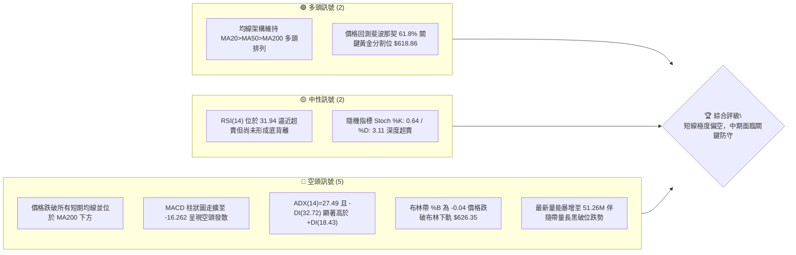
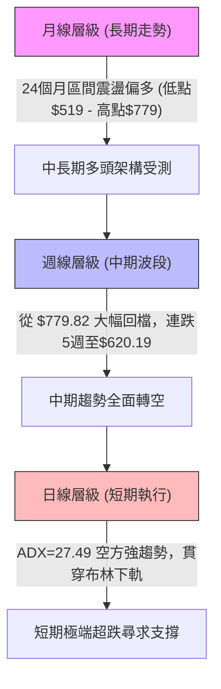
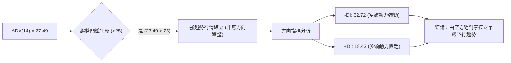
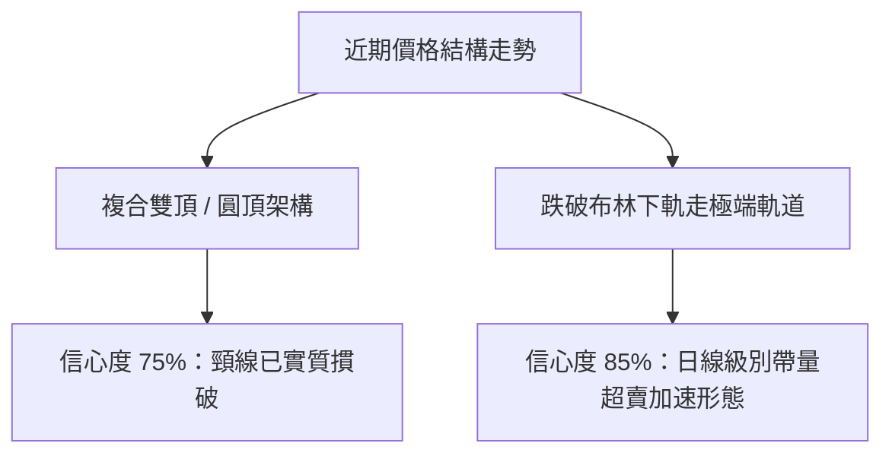
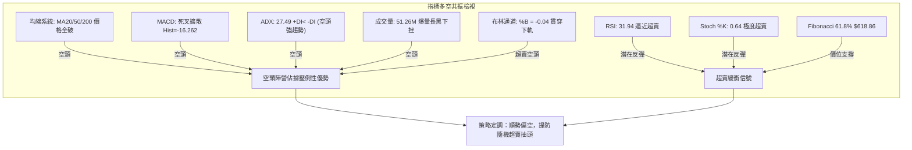
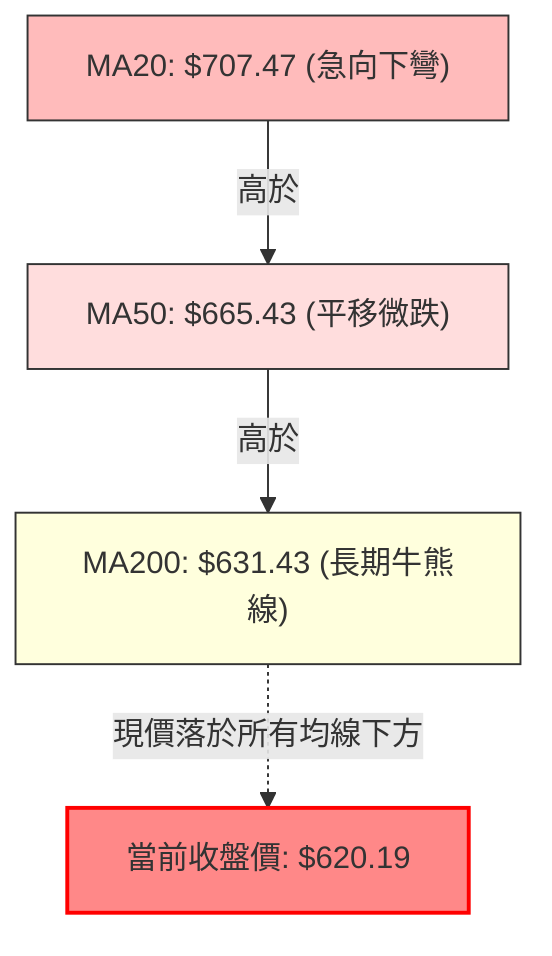
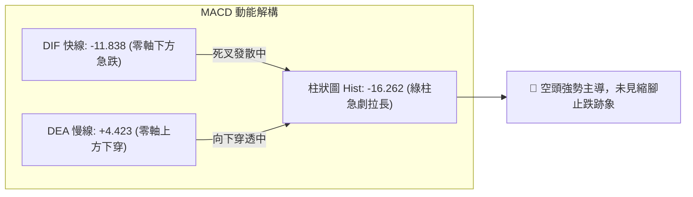
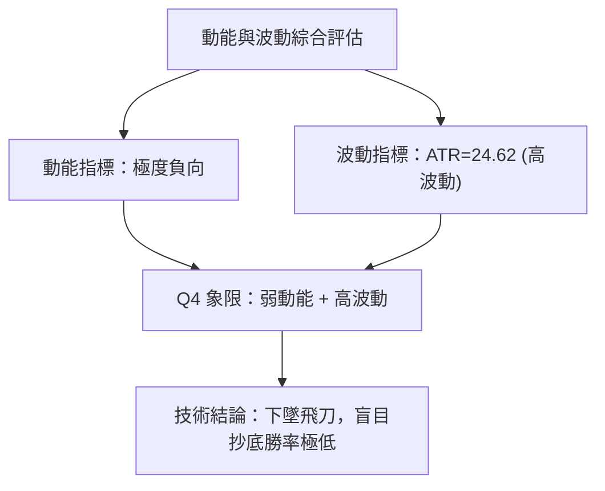
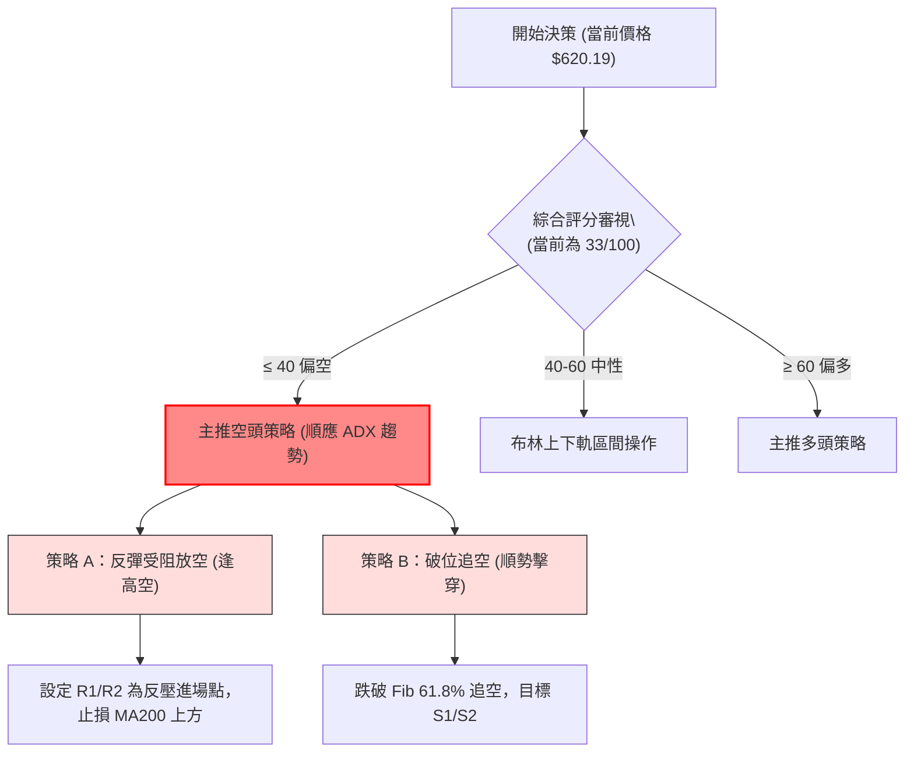
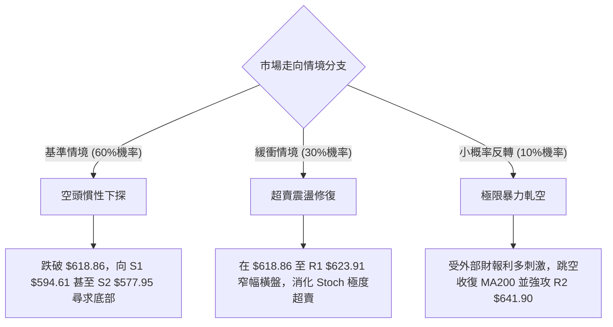

# META 技術分析報告

> **報告日期**：2026-10-28 ｜ **語言**：繁體中文 ｜ **數據來源**：Yahoo Finance ｜ **當前價格**：$620.19

---

## 目錄

| 章節 | 內容 |
|------|------|
| [1. 技術面概覽](#1-技術面概覽) | 訊號儀表板、核心指標、評分卡 |
| [2. 趨勢分析](#2-趨勢分析) | 多時框趨勢、長中短期走勢 |
| [3. 圖表形態分析](#3-圖表形態分析) | 形態識別、K線組合、目標價 |
| [4. 支撐與阻力](#4-支撐與阻力) | 關鍵價位、斐波那契回調 |
| [5. 技術指標深度解讀](#5-技術指標深度解讀) | MA/RSI/MACD/布林/成交量 |
| [6. 動能與波動率](#6-動能與波動率) | 動能評估、ATR、Beta |
| [7. 多時框架總結](#7-多時框架總結) | 時框架評分矩陣 |
| [8. 交易策略建議](#8-交易策略建議) | 多空策略、風險報酬比 |
| [9. 風險提示與監控](#9-風險提示與監控) | 監控指標、風險場景 |
| [10. 報告總結](#10-報告總結) | 核心結論與策略總覽 |

---

## 1. 技術面概覽

### 🎯 技術訊號儀表板



### 📊 核心指標速覽表

| 指標類別 | 指標名稱 | 當前數值 | 訊號 | 解讀 |
|:---|:---|:---:|:---:|:---|
| **價格** | 當前價格 | $620.19 | 🔴 | 跌破 52 週高點 $779.82 回檔幅度達 20.47%，落於區間下緣 38.7% 分位 |
| **均線** | MA20 | $707.47 | 🔴 | 價格低於 MA20 達 -12.34%，短線嚴重負乖離，月線趨勢急劇下彎 |
| **均線** | MA50 | $665.43 | 🔴 | 價格低於 MA50 達 -6.80%，跌破中期波段支撐樞紐 |
| **均線** | MA200 | $631.43 | 🔴 | 價格跌破牛熊分界線 MA200（乖離率 -1.78%），長期上升架構受到實質威脅 |
| **動能** | RSI(14) | 31.94 | 🟡 | 進入超賣邊緣（中性偏弱），短線下殺動能劇烈但尚未出現衰竭止跌跡象 |
| **動能** | MACD (12,26,9) | -11.838 / 4.423 | 🔴 | DIF 下穿 Signal 線，Histogram 擴大至 -16.262，典型空頭主導格局 |
| **趨勢** | ADX(14) / ±DI | 27.49 | 🔴 | ADX > 25 確認為強趨勢行情，-DI (32.72) 壓制 +DI (18.43)，空頭趨勢強烈 |
| **通道** | Bollinger Bands | %B: -0.04 | 🔴 | 現價 $620.19 貫穿下軌 $626.35，呈現極端開口擴張向下之「空頭走軌」 |
| **量能** | 當日量 / 20日均量 | 2.47x | 🔴 | 爆量下殺（51.26M vs 20.78M），OBV < MA，反映機構籌碼顯著拋售 |
| **波動** | ATR(14) | $24.62 | 🟡 | ATR 佔股價 3.97%，日內價格擺盪劇烈，操作停損空間需放大 |

### 🏆 技術評分卡

```
╔════════════════════════════════════════════════════════════════╗
║                   技術評分卡 — META (2026-10-28)               ║
╠════════════════════════════════════════════════════════════════╣
║ 趨勢強度 (ADX=27.49, 空頭走勢確立) ██████░░░░░░░░░░░░░░ 30/100 🔴 ║
║ 動能指標 (MACD死叉擴大, RSI超賣)   ████░░░░░░░░░░░░░░░░ 20/100 🔴 ║
║ 支撐穩定度 (考驗Fib 61.8%與S1支撐) ██████████░░░░░░░░░░ 50/100 🟡 ║
║ 成交量配合 (帶量下挫, OBV疲弱)     ████░░░░░░░░░░░░░░░░ 20/100 🔴 ║
║ 形態完整度 (頭部頸線跌破形態完成) ██████░░░░░░░░░░░░░░ 30/100 🔴 ║
║ 均線排列 (長期架構多頭,短中期破位) ██████████░░░░░░░░░░ 50/100 🟡 ║
╠════════════════════════════════════════════════════════════════╣
║ 綜合評分 (六項指標算術平均)        ██████░░░░░░░░░░░░░░ 33/100 🔴 ║
║ 評級結論：短線強烈看空（主推防禦或做空策略，緊盯反彈止損）     ║
╚════════════════════════════════════════════════════════════════╝
```

*計算依據：(30 + 20 + 50 + 20 + 30 + 50) ÷ 6 = 33.33，四捨五入為 33/100。*

---

## 2. 趨勢分析

### 🌐 多時框趨勢分析



### 📈 長期趨勢 — 12個月走勢圖（Unicode）

```
META 月線走勢圖（2025-11 至 2026-10）
價格軸 ($)
$780 ┤                                              
$740 ┤                                              
$700 ┤        ●(2026-01: $714.66)                   ●(2026-09: $725.18)
$660 ┤  ●  ●                                        
$620 ┤━━━━━━━━━━━━━━━━━━━━━━━━━━●(2026-05: $631.43)━━━━━━━━━━━●←現價 $620.19
$580 ┤                    ●(2026-03: $571.15)   ●(2026-08: $571.89)
$540 ┤                                    ●(2026-07: $556.27)
     └──────────────────────────────────────────────────────────────
       11  12  01  02  03  04  05  06  07  08  09  10  (月份)
```

**走勢特徵分析表格**：

| 階段區間 | 走勢特徵 | 區間起訖收盤價 | 漲跌幅 | 結構性技術意義 |
|:---|:---|:---:|:---:|:---|
| **2025/11 - 2026/01** | 歲末強勢攻堅 | $645.76 → $714.66 | +10.67% | 確立突破 2025 年第四季整理平台 |
| **2026/01 - 2026/03** | 首季深度拉回 | $714.66 → $571.15 | -20.08% | 跌破多條短期均線，回測長期價值均線 |
| **2026/03 - 2026/05** | 春季技術反彈 | $571.15 → $631.43 | +10.55% | 構築箱體中軸，但受制於 $650 阻力群 |
| **2026/05 - 2026/07** | 二次下探破底 | $631.43 → $556.27 | -11.90% | 創出波段低點 $556.27，接近 52 週最低 $519.37 |
| **2026/07 - 2026/09** | 爆發式噴射上漲 | $556.27 → $725.18 | +30.36% | 單季暴漲，突破 $700 大關並創下波段歷史次高點 |
| **2026/09 - 2026/10** | 斷崖式急殺回跌 | $725.18 → $620.19 | -14.48% | 短短一個月吐回過半漲幅，跌破月線及半年線 |

### 📊 中期趨勢（週線分析）

週線走勢呈現典型的「衝高假突破後之急遽反轉」。
- **頂部訊號**：2026-09-25 當週爆出 168.31M 歷史級天量，盤中觸及 52 週最高點 $779.82，收盤於 $751.66。隨後一週（2026-10-02）開盤 $750.04 即見高回落收 $728.08，MACD 週線柱狀圖由正轉負（+11.729 驟降至 -0.743），形成量能竭盡頂部。
- **均線支撐考驗**：自 10 月以來連續 4 週長黑摜破短中期均線，最新週 K（2026-10-27）低點來到 $619.21，收盤 $620.19，週線 RSI 降至 31.9，週線 MACD 柱進一步深陷至 -16.262，確認中期多頭波段已遭徹底瓦解。

```
週線近期壓力與支撐示意圖
══════════════════════════════════════════════════════
$779.82 ┬────────────────── 天量天價頂部（2026-09-25 高點）
        │
$709.33 ┼────────────────── 頸線跌破點（2026-10-16 收盤價）
        │
$642.62 ┼────────────────── 上週收盤平台阻力（2026-10-23）
        │
$620.19 ┼─── 現價 $620.19 (受困於 MA200 $631.43 之下)
        │
$594.61 ┴────────────────── 下方波段核心支撐（S1）
══════════════════════════════════════════════════════
```

### ⚡ 趨勢強度評估（ADX 解讀）



| ADX 數值區間 | 當前數值 (27.49) 位置 | 市場狀態 | 操作指導原則 |
|:---:|:---:|:---|:---|
| 0 – 20 | ░░░░░░░░░░ | 無趨勢 / 雜訊震盪 | 觀望或區間高拋低吸 |
| 20 – 25 | ░░░░░░░░░░ | 趨勢醞釀期 | 突破進場準備 |
| **25 – 40** | **████████░░ (27.49)** | **強趨勢行情 (當前狀態)** | **順勢操作，嚴禁逆勢摸底** |
| 40 – 60 | ░░░░░░░░░░ | 極強單邊爆發 | 移動停利，提防超買反噬 |
| > 60 | ░░░░░░░░░░ | 趨勢耗盡竭盡區 | 準備反轉操作 |

---

## 3. 圖表形態分析

### 🔍 形態識別系統



| 形態類別 | 信心度 | 判斷依據（引用數據） | 完成度 | 目標價（附計算式） |
|:---|:---:|:---|:---:|:---|
| **雙重頂 / M頭** | 75% | 左頂 $770.31 (2025-07) 與右頂 $779.82 (2026-09-25) 構築大週期雙頂；頸線為波段低點聚集區間約 $641.90 (R2) 及週線平台 $642.62，已於 10-26、10-27 帶量實質跌破。 | 90% | 依形態高度推算：頸線 $641.90 − (右頂 $779.82 − 頸線 $641.90) = $641.90 − $137.92 = **$503.98**（波段理論目標）。 |
| **短期下降通道破位** | 85% | 自 2026-10-14 高點 $761.50 連續 10 個交易日壓制在均線下方，近 3 個交易日跌速加劇，成交量放大至 51.26M。 | 100% | 形態已向下完全展開，首要目標鎖定歷史波段支撐 **$594.61 (S1)**。 |
| **頭肩底 / 頭肩頂** | 30% | 數據中左肩與右肩結構對稱性欠缺，無法成立標準頭肩型態。 | N/A | **訊號不足，僅做指標型解讀**（不強行預測目標價）。 |

### 🕯️ 重要K線形態分析

嚴格依據數據中「近 10 根日 K」與「近 8 根週 K」之實際 OHLC 價格分析：

| 日期（時框） | 開 | 高 | 低 | 收 | K線形態 | 解讀 | 訊號 |
|:---|:---:|:---:|:---:|:---:|:---|:---|:---:|
| **2026-10-16 (週K)** | 728.50 | 771.27 | 702.71 | 709.33 | **長上影線陰線** | 盤中衝高回落達 62 點，實體收於低位，多頭最後反撲遭遇沉重解套拋壓。 | 🔴 |
| **2026-10-21 (日K)** | 697.60 | 713.22 | 689.68 | 697.52 | **長上下影陀螺線** | 多空在 $700 關卡劇烈爭奪，高低振幅達 $23.54，最終平盤報收，方向未決。 | 🟡 |
| **2026-10-22 (日K)** | 676.35 | 681.07 | 639.69 | 648.85 | **跳空長黑大陰線** | 跳空低開低走，盤中重挫近 37 點，爆出 40.57M 巨量，實質跌破 MA50 與 MA200。 | 🔴 |
| **2026-10-23 (週K)** | 707.16 | 713.22 | 633.27 | 642.62 | **週線光腳大黑K** | 單週重挫 66.71 點，成交量高達 117.88M，多頭防線全線潰散。 | 🔴 |
| **2026-10-26 (日K)** | 638.36 | 647.69 | 627.80 | 630.56 | **低開破位小陰線** | 反抽受制於 $647.69，收盤再次刷出波段新低，量能維持 30.91M 高位。 | 🔴 |
| **2026-10-27 (日K)** | 627.07 | 628.46 | 619.21 | 620.19 | **空方實體下殺黑K** | 開盤 $627.07 即為全日次高點，收盤 $620.19 逼近最低點 $619.21，成交量放大至 51.26M。 | 🔴 |

### 📉 ASCII 走勢形態示意圖

```
雙重頂部破位向下走勢圖 (2026-09 至 2026-10)
$780 ┼                    ▲ 52W High $779.82 (天量見頂 09-25)
$760 ┤                   / \
$740 ┤                  /   \     ▲ 右肩高點 $761.50 (10-14)
$720 ┤                 /     \   / \
$700 ┤                /       \_/   \
$680 ┤               /               \
$660 ┤              /                 \
$641.90 ┼──────────/───────────────────\─── 頸線/關鍵阻力 R2 (失守跌破)
$630 ┤            /                     \
$620.19 ┼────────/───────────────────────● 現價 $620.19 (帶量破位下殺中)
$600 ┤          /                         \
$594.61 ┼──────/───────────────────────────▼ 下方目標支撐 S1
════════════════════════════════════════════════════════════════
```

### 🎯 形態目標價計算

1. **短線下降測量目標**：
   - 前期平台破位點：$648.85 (2026-10-22 收盤價)
   - 前期震盪高點：$713.22 (2026-10-21 高點)
   - 短線波段幅度 = $713.22 − $648.85 = $64.37
   - 跌破點向下一倍等幅投射 = $648.85 − $64.37 = **$584.48**（落於支撐 S1: $594.61 與 S2: $577.95 之間）。
2. **大週期 M 頭測距目標**：
   - 頸線位置：$641.90 (R2)
   - 形態最高點：$779.82
   - 垂直高度 = $779.82 − $641.90 = $137.92
   - 理論滿足點 = $641.90 − $137.92 = **$503.98**（此數值低於 52 週低點 $519.37，顯示若空頭完全宣洩，長期回檔空間極深）。

---

## 4. 支撐與阻力

### 🗺️ 關鍵價位分布圖（Unicode）

```
META 價位結構分布圖 (由 OHLCV 聚類計算)
═══════════════════════════════════════════════════════════
$671.45 ║██████████████████████████████║ 強阻力 R3 (+8.26%)
$641.90 ║████████████████████          ║ 頸線阻力 R2 (+3.50%)
$623.91 ║████████████████████████      ║ 關鍵短壓 R1 (+0.60%)
$620.19 ╠══════════════════════════════╣ ◄ 現價收盤 $620.19
$618.86 ║▒▒▒▒▒▒▒▒▒▒▒▒▒▒▒▒▒▒▒▒▒▒▒▒▒▒▒▒▒▒║ 斐波那契 61.8% 樞紐 (-0.21%)
$594.61 ║▓▓▓▓▓▓▓▓▓▓▓▓▓▓▓▓▓▓▓▓          ║ 波段首要支撐 S1 (-4.12%)
$577.95 ║████████████████████████      ║ 強支撐 S2 (-6.81%)
$555.86 ║██████████████████████████████║ 極強防線 S3 (-10.37%)
═══════════════════════════════════════════════════════════
```

### 🚧 阻力位分析表

所有價位嚴格引用自數據之「關鍵價位」與「均線系統」：

| 阻力級別 | 價位 | 形成原因 | 突破難度 | 重要性 |
|:---|:---:|:---|:---:|:---|
| **R1** | **$623.91** | 近一年波段高點聚類位，距離現價僅 +0.60%，為當前日線反彈首道門檻。 | 🟡 中等 | 短線多頭重返攻勢之第一哨所，必須日線實體收復。 |
| **R2** | **$641.90** | 近一年波段高點密集區，亦為前期 M 頭頸線平台與上週收盤平台（$642.62）。 | 🔴 極高 | 波段強弱分水嶺，累積大量被套牢之融資與多頭籌碼。 |
| **R3** | **$671.45** | 波段高點聚類區，疊加中期 MA50 ($665.43) 下降反壓帶。 | 🔴 極高 | 中期波段防線，若未有效帶量站回，中期空頭格局不變。 |

### 🛡️ 支撐位分析表

所有價位嚴格引用自數據之「關鍵價位」：

| 支撐級別 | 價位 | 形成原因 | 守住機率 | 重要性 |
|:---|:---:|:---|:---:|:---|
| **S1** | **$594.61** | 近一年波段低點聚類位（距現價 -4.12%），亦為 2026-07-24 當週回測低點附近。 | 60% | 多頭第一道防禦壁壘，守穩則有望構築超賣技術性反彈。 |
| **S2** | **$577.95** | 近一年波段低點聚類位（距現價 -6.81%），接近斐波那契 78.6% 回調位 ($575.11)。 | 75% | 核心波段鐵底，對應 2026 年 3 月 ($571.15) 與 8 月 ($571.89) 雙重底部。 |
| **S3** | **$555.86** | 近一年極端波段低點聚類位（距現價 -10.37%），對應 2026-07 月線收盤底 ($556.27)。 | 85% | 戰略級牛市最終防線，失守將面臨回測 52 週最低點 $519.37。 |

### 📐 斐波那契回調位分析

依據 52 週極值區間：起點最低 $519.37 至最高點 $779.82，計算出的回調水位如下：

```
斐波那契回調水位階梯圖
  0.0%  $779.82  (52W High — 歷史天花板)
        │
 23.6%  $718.35  (弱度回調位 — 已失守)
        │
 38.2%  $680.33  (強勢回調位 — 已失守)
        │
 50.0%  $649.59  (多空均衡位 — 已失守)
        │
 61.8%  $618.86  ◄◄◄ 現價 $620.19 緊貼此處（黃金分割關鍵支撐）
        │
 78.6%  $575.11  (深度防守位 — 接近 S2 $577.95)
        │
100.0%  $519.37  (52W Low — 起漲原點)
```

- **位置解讀**：現價 $620.19 恰好落於 **61.8% 回調位 ($618.86)** 與 **50.0% 回調位 ($649.59)** 之間，且現價距離 61.8% 黃金分割點僅差 $1.33 (+0.21%)。
- **技術意義**：黃金分割 61.8% 位是技術派多頭的「最後生命線」。若 61.8% ($618.86) 在日線級別帶量跌破收不回，代表自 $519.37 上攻至 $779.82 的整個年度牛市波段被定性為「假突破行情」，市場將進一步滑向 78.6% ($575.11) 尋找支撐。

---

## 5. 技術指標深度解讀

### 🎛️ 指標訊號總覽



### 📈 移動平均線排列分析



- **均線走勢現狀**：
  - MA5: $647.95 (偏離現價 -4.28%)
  - MA10: $682.30 (偏離現價 -9.10%)
  - MA20: $707.47 (偏離現價 -12.34%)
  - MA60: $652.54 (偏離現價 -4.96%)
  - MA120: $627.50 (偏離現價 -1.17%)
  - MA200: $631.43 (偏離現價 -1.78%)
  - MA240: $632.97 (偏離現價 -2.02%)
- **排列深度分析**：儘管長期形態帳面上仍維持 `MA20 > MA50 > MA200` 的名義多頭排列，但短中期均線（MA5、10、20）已呈現陡峭下行瀑布線。現價 $620.19 不僅跌破了 MA20 與 MA50，甚至實質性下穿 MA120 ($627.50) 與長期分水嶺 MA200 ($631.43)。這表明短期市場持倉者全線處於套牢虧損狀態，若現價無法於 3 個交易日內重返 MA200 之上，MA20 將面臨加速死叉 MA50 與 MA200 的「死亡交叉」風險。

### 📉 RSI(14) 分析

- **當前讀數**：RSI(14) = 31.94（採用 Wilder 平滑演算法）。
- **進度條展示**：
  ```
  超賣區 (0-30)        中性區 (30-70)                 超買區 (70-100)
  ├───┼───────────────┼──────────────────────────────┼───┤
  ██████████░░░░░░░░░░░░░░░░░░░░░░░░░░░░░░░░░░░░░░░░░░ 31.94%
  ```
- **狀態解讀**：數值 31.94 緊貼 30 超賣門檻，技術上處於「極度疲弱但尚未完全鈍化」的邊界。
- **背離分析判斷**：
  - 根據近 20 根 K 棒的首尾價格與 RSI 走向比對：價格自 10 月中旬 $760 一線連續走低，RSI 由 70 附近同步下墜至 31.94，價格新低伴隨 RSI 新低。
  - **背離結論**：**無明顯背離**（既無頂背離亦無底背離）。屬於動能與價格同向發散的「健康下跌」走勢，未見左側反轉訊號。

### 📊 MACD(12/26/9) 訊號解讀

- **數值指標**：DIF (MACD 線) = -11.838，DEA (訊號線) = 4.423，Histogram (柱狀圖) = -16.262。



- **深度解析**：DIF 快線已摜破零軸來到 -11.838，而 DEA 慢線仍在 +4.423，兩線形成高位死叉後的寬幅開口。柱狀圖自上週五的 -14.283 繼續擴大至當前的 -16.262，顯示當前空頭慣性仍在釋放，中線調整尚未結束。

### 📦 布林通道分析

- **參數結構**：通道期間 20，標準差 2。
  - 上軌：$788.58
  - 中軌 (MA20)：$707.47
  - 下軌：$626.35
  - 通道帶寬：%B = -0.04，通道寬度 = $162.23 ($788.58 − $626.35)

```
ASCII 布林通道走勢結構
$788.58 ┬──────────────────────────────────────── 上軌 (BB Upper)
        │                 
        │                 
$707.47 ┼──────────────────────────────────────── 中軌 (MA20 - 下壓中)
        │                 
$626.35 ┼──────────────────────────────────────── 下軌 (BB Lower)
$620.19 ┴─ ● 現價 $620.19 (%B = -0.04 貫穿下軌破位運行)
═══════════════════════════════════════════════════════════════
```

- **技術含義**：%B 呈現負值 (-0.04)，代表股價已擊穿常規統計學 95.4% 的波動分佈下邊界。這並非單純的「超跌可買」，而是在高波動環境下的「走軌現象（Walking the Lower Band）」，表明下行動能極度強橫。

### 💹 成交量分析（量價配合度）

- **量能數值對照**：
  - 最新日成交量：51,263,800 股
  - 20 日成交均量：20,787,530 股（**量比高達 2.47 倍**）
  - 50 日成交均量：21,341,994 股
- **量價關係判定**：
  - **放量破位**：在股價跌破 MA200 與前期平台時，成交量創出近期日線新高（51.26M），屬於量價配合的「放量下跌」，顯示大機構部位正進行實質性減倉清算。
  - **OBV 走勢**：數據明確標示「OBV < MA → 量能疲弱」。OBV 能量潮持續運行在其移動平均線下方，證實無主力買盤進場承接，資金呈現淨流出狀態。

---

## 6. 動能與波動率

### ⚡ 動能評估四象限

| 象限標籤 | 動能狀態 | 波動率狀態 | 市場環境特徵 | 當前 META 位置歸屬 |
|:---:|:---:|:---:|:---|:---:|
| **Q1** | 強 (多頭) | 低波動 | 穩健牛市單邊慢漲 | ── |
| **Q2** | 弱 (多頭) | 低波動 | 縮量盤整、無方向震盪 | ── |
| **Q3** | 強 (多/空) | 高波動 | 暴漲暴跌、情緒極端激化 | ── |
| **Q4** | **弱 (空頭主導)** | **高波動** | **恐慌殺跌、破位加速釋放** | **✓ 當前歸屬 Q4 象限** |



### 📊 ATR 波動率分析

- **ATR(14) 數值**：**$24.62**（Wilder 計算法）。
- **波動比例**：ATR 佔當前收盤價的比率為 **3.97%**。這意味著 META 平均每日的正常擺動幅度接近 25 美元。
- **風控與停損距離設定指引**：
  - **日內防噪音停損**：1.0 × ATR = **$24.62**
  - **波段標準停損**：1.5 × ATR = **$36.93**
  - **寬幅防守停損**：2.0 × ATR = **$49.24**
  - **交易實務應用**：任何策略進場點若設定在 $620 一線，其停損空間不得小於 $24.62，否則極易在市場常態日內雜訊中被無謂震洗出場。

### 📐 Beta 與市場相關性

- **Beta 係數**：**1.185**。
- **市場屬性解析**：Beta > 1 顯示 META 相較於標普 500 指數具有更高的高彈性與系統性風險敏感度。當美股大盤走弱時，META 的回檔放大效應為 1.185 倍。當前大盤面臨 Fed 利率會議與科技巨頭財報週之重大不確定性，較高的 Beta 意味著短期下檔波動將進一步加劇。

---

## 7. 多時框架總結

### 📋 時框架評分表

| 時框架 | 趨勢方向 | 動能指標 | 均線排列 | 形態結構 | 綜合評分 | 建議 |
|:---|:---:|:---:|:---:|:---|:---:|:---|
| **長期 (月線)** | 🟢 震盪偏多 | 🟡 中性平緩 | 🟢 長期偏多 | 箱體區間高位受阻回落 | 60/100 | 長期投資者暫緩加碼 |
| **中期 (週線)** | 🔴 明顯偏空 | 🔴 快速走弱 | 🟡 均線開口收斂 | 天量見頂後的 M 頭下跌 | 30/100 | 波段多頭應減倉避險 |
| **短期 (日線)** | 🔴 極端偏空 | 🔴 動能發散 | 🔴 均線空頭下穿 | 帶量破位下殺走下軌 | 20/100 | 短線順勢做空或空手觀望 |

### 🔲 綜合訊號矩陣

| 技術分析維度 | 短期 (日線) | 中期 (週線) | 長期 (月線) | 多時框一致性解讀 |
|:---|:---:|:---:|:---:|:---|
| **趨勢方向** | 🔴 空頭下行 | 🔴 轉入下行 | 🟢 震盪上行 | 短中期與長期趨勢出現嚴重衝突 |
| **動能狀態** | 🔴 MACD負擴 | 🔴 MACD翻負 | 🟡 RSI高位回落 | 動能由上至下全面退潮 |
| **支撐強度** | 🔴 跌破短期支撐 | 🟡 逼近61.8%防線 | 🟢 距離52W低點尚遠 | 正面臨中長線核心防線考驗 |
| **量價結構** | 🔴 爆量殺跌 | 🔴 巨量出貨 | 🟡 月均量放大 | 機構資金主導撤退 |

### ⚖️ 多時框收斂結論

- **趨勢 vs 盤整判定**：日線 ADX(14) 數值為 **27.49**，明確大於 25 臨界線，根據嚴格收斂規則 14，市場處於**「強趨勢行情」**而非無方向盤整。
- **時框優先級權重**：在此條件下，交易主軸必須依循中長期（週線級別及 MA50、MA200）方向。當前中期週線已確立 M 頭跌破，日線價格全面跌破 MA200 ($631.43)，均線多頭保護全面失效。
- **唯一方向性結論**：**【全面偏空，逢反彈做空或觀望】**。日線的極端超賣（Stoch %K=0.64）僅適合作為「獲利空單回補」或「等待反彈更高價位再次進空」的時間窗口，嚴禁在趨勢轉空當下盲目逆勢做多。此結論與第 1 章評分卡（綜合 33 分）完全契合。

---

## 8. 交易策略建議

### 🗺️ 策略決策流程圖



### 🧭 策略路由（依評分卡分流，不得兩頭下注）

> **當前主策略方向 = 【偏空主導，順勢做空】（依綜合評分 33/100，處於 ≤ 40 區間）**

依據規則，因綜合評分僅 33/100，系統**主推空頭策略**。多頭反彈僅作為空單建倉機會或風險提示，不列入主策略推薦。

### 🎯 價格情境階梯（Price Scenarios）

價位嚴格引用自「關鍵價位」與「斐波那契回調」：

| 觸發條件 | 下一目標 | 後續延伸 | 情境含義 |
|:---|:---:|:---:|:---|
| **反彈受阻於 R1 $623.91 且無法收復** | S1 $594.61 | S2 $577.95 | 短線弱勢反彈夭折，重啟單邊下探跌勢 |
| **向上反抽觸及 R2 $641.90 / MA200** | R1 $623.91 | S1 $594.61 | 頸線位技術性回抽確認阻力，形成中級空點 |
| **直接實質跌破 Fib 61.8% $618.86** | S1 $594.61 | S2 $577.95 | 年度上漲波段徹底宣告失敗，觸發停損賣壓 |
| **向下貫穿波段首要支撐 S1 $594.61** | S2 $577.95 | S3 $555.86 | 中期結構二次探底，尋求 2026 年夏季雙底 |

### 📊 情境機率分佈

| 情境劃分 | 機率 | 主要依據 |
|:---|:---:|:---|
| **延續跌勢 / 破位探底** | **60%** | ADX(14)=27.49 確立強勢下行，-DI(32.72) 壓制，成交量 2.47 倍放量殺跌，OBV 疲軟。 |
| **超賣弱反彈 / 區間震盪** | **30%** | Stoch %K(0.64) 極端鈍化超賣，現價貼近斐波那契 61.8% ($618.86) 強支撐帶引發技術修復。 |
| **V型強勢反轉** | **10%** | 上方阻力重重（MA200 $631.43、頸線 R2 $641.90、MA50 $665.43），缺乏基本面突發利多難以突破。 |

### 🟢 主策略詳情（空頭交易策略）

所有價位均嚴格取自數據庫計算值：

| 策略要素 | 策略 A：反彈阻力位放空（逢高進空） | 策略 B：跌破支撐順勢追空（破位空） |
|:---|:---:|:---:|
| **進場條件** | 盤中反抽受阻於 R1 $623.91 至 R2 $641.90 區間遇阻回落 | 實體跌破斐波那契 61.8% 水位 $618.86 後順勢跟進 |
| **進場價格** | **$632.91**（以區間中點計：($623.91+$641.90)/2） | **$618.86** |
| **目標價 T1** | **$594.61**（引用 S1 支撐位） | **$594.61**（引用 S1 支撐位） |
| **目標價 T2** | **$577.95**（引用 S2 支撐位） | **$577.95**（引用 S2 支撐位） |
| **止損價格** | **$648.85**（2026-10-22 收盤價阻力平台之上） | **$628.46**（2026-10-27 當日最高價） |
| **風險報酬比** | **1 : 2.40**（以 T1 計）<br>*[(632.91−594.61) ÷ (648.85−632.91) = 38.30 ÷ 15.94]*<br>*至 T2 為 1 : 3.45* | **1 : 2.53**（以 T1 計）<br>*[(618.86−594.61) ÷ (628.46−618.86) = 24.25 ÷ 9.60]*<br>*至 T2 為 1 : 4.26* |
| **成功機率** | 65% | 60% |
| **建議倉位** | 10% - 15% 總資金 | 5% - 10% 總資金 |

### 🔴 反向風險觸發點（對沖與停損提示）

若出現以下情境，則本報告之偏空主策略被實質推翻，空單必須立即無條件停損離場：
1. **價位警訊**：日線收盤價帶量重新站上 **$641.90 (R2)** 頸線，且伴隨成交量縮窄或突破。
2. **均線警訊**：價格連續 2 日收復 **MA200 ($631.43)**，將當前跌破定性為日線級別「空頭陷阱（Bear Trap）」。
3. **指標反轉**：日線 RSI 重新回升至 50 之上，且 MACD 柱狀圖連續 3 日強勢縮腳。

### ⭐ 整體訊號強度評星

```
做多訊號強度：★☆☆☆☆  (1/5星) — 僅剩極度超賣與 Fib 61.8% 支撐弱抗衡
做空訊號強度：★★★★☆  (4/5星) — 破位、均線死叉、放量、動能發散全面共振
整體可信度：  ★★★★☆  (4/5星) — 數據多時框指向一致，趨勢明朗
```

---

## 9. 風險提示與監控

### ✅ 關鍵監控指標 Checklist

```
╔══════════════════════════════════════════════════════════════════╗
║                   每日交易前技術監控清單 (Checklist)               ║
╠══════════════════════════════════════════════════════════════════╣
║ [ ] 斐波那契 61.8% ($618.86)：觀察開盤是否直接跳空破位            ║
║ [ ] 阻力位 R1 ($623.91)：反彈是否在此遇阻收長上影線              ║
║ [ ] 均線 MA200 ($631.43)：是否構成向上反抽的銅牆鐵壁反壓          ║
║ [ ] MACD 柱狀圖：觀察柱狀圖數值是否縮小至 -10 以內（跌勢趨緩訊號） ║
║ [ ] 隨機指標 Stoch %K (0.64)：是否出現低位超賣向上金叉 %D         ║
║ [ ] 成交量比率：量能是否萎縮至 20M 均量以下（確認拋壓衰竭）       ║
╚══════════════════════════════════════════════════════════════════╝
```

### ⚠️ 風險場景分析



### 🛡️ 風險管理重要提醒

1. **財報與宏觀事件疊加**：技術面雖極度疲弱，但當前市場正值科技巨頭財報季節與利率決議前夕，個股消息面具備瞬間逆轉技術型態的能力。因此空單務必以「輕倉、嚴格止損」為紀律。
2. **防範流動性軋空風險**：Stoch %K 降至 0.64 極端罕見低點，隨時可能因空頭獲利平盤引發日內 $15-$25 美元（約 1.0 ATR）的快速抽升，嚴禁在 $620 附近低點重倉追空。
3. **單筆風險限制**：任何單一部位之最大虧損金額，絕不可超過整體交易帳戶淨值的 1.5%。以當前 ATR $24.62 計算，部位規模應縮減至平常的 60% 左右。

---

## 10. 📋 報告總結

```
╔══════════════════════════════════════════════════════════════════╗
║                   META 技術分析報告總結                          ║
╠══════════════════════════════════════════════════════════════════╣
║ 報告日期：2026-10-28                                             ║
║ 當前價格：$620.19                                                ║
║ 技術評分：33 / 100                                               ║
║ 分析評級：🔴 強烈偏空（順勢做空，逢高放空）                     ║
╠══════════════════════════════════════════════════════════════════╣
║ 關鍵結論：                                                       ║
║ ├─ 長期趨勢：🟡 中性偏多（24個月大箱體高位回落）                 ║
║ ├─ 中期趨勢：🔴 全面偏空（天量見頂，M頭頸線失守）               ║
║ ├─ 短期趨勢：🔴 極端偏空（跌破 MA200，走布林下軌加速下殺）       ║
║ ├─ 關鍵支撐：S1: $594.61 ｜ S2: $577.95 ｜ Fib 61.8%: $618.86   ║
║ ├─ 關鍵阻力：R1: $623.91 ｜ R2: $641.90 ｜ MA200: $631.43      ║
║ └─ 華爾街共識：分析師均價 $846.79（與技術走勢產生嚴重背離）      ║
╠══════════════════════════════════════════════════════════════════╣
║ 最優策略組合：                                                   ║
║ 1. 🥇 最佳機會（策略 A）：等待反彈至 $632.91 遇阻進空，          ║
║    目標 $594.61，止損 $648.85（風報比 1 : 2.40）                 ║
║ 2. 🥈 次選機會（策略 B）：有效跌破 $618.86 順勢追空，            ║
║    目標 $594.61，止損 $628.46（風報比 1 : 2.53）                 ║
║ 3. 🥉 保守選擇：完全空手觀望，靜待股價跌至 S2 $577.95            ║
║    或日線築出雙底形態後，再行評估左側多頭進場。                  ║
╚══════════════════════════════════════════════════════════════════╝
```

---

> ⚠️ **免責聲明**：本報告為技術分析研究成果，所有引據價格、支撐阻力位與指標數值均基於歷史 OHLCV 數據演化推導。市場瞬息萬變，本報告**僅供研究參考與決策輔助**，**不構成任何要約或投資買賣建議**。金融交易存在本金虧損風險，投資人應獨立評估自身風險承受度並嚴格執行風控紀律。

---

*報告生成時間：2026-10-28 ｜ 數據來源：Yahoo Finance ｜ 分析框架：多時框技術分析模型*