# META 技術分析報告

> **報告日期**：2026-10-29 ｜ **語言**：繁體中文 ｜ **數據來源**：Yahoo Finance ｜ **當前價格**：$612.49

---

## 目錄

| 章節 | 內容 |
|------|------|
| [1. 技術面概覽](#1-技術面概覽) | 訊號儀表板、核心指標、評分卡 |
| [2. 趨勢分析](#2-趨勢分析) | 多時框趨勢、長中短期走勢 |
| [3. 圖表形態分析](#3-圖表形態分析) | 形態識別、K線組合、目標價 |
| [4. 支撐與阻力](#4-支撐與阻力) | 關鍵價位、斐波那契回調 |
| [5. 技術指標深度解讀](#5-技術指標深度解讀) | MA/RSI/MACD/布林/成交量 |
| [6. 動能與波動率](#6-動能與波動率) | 動能評估、ATR、Beta |
| [7. 多時框架總結](#7-多時框架總結) | 時框架評分矩陣 |
| [8. 交易策略建議](#8-交易策略建議) | 多空策略、風險報酬比 |
| [9. 風險提示與監控](#9-風險提示與監控) | 監控指標、風險場景 |

---

## 1. 技術面概覽

### 🎯 技術訊號儀表板

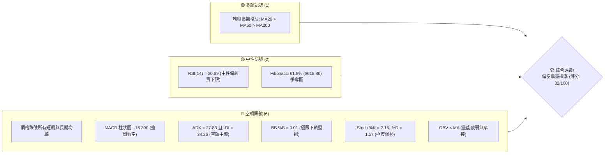

### 📊 核心指標速覽表

| 指標類別 | 指標名稱 | 當前數值 | 訊號 | 解讀 |
|----------|----------|----------|------|------|
| **價格** | 當前價格 | $612.49 | 🔴 | 位於 52 週區間 35.8%，自波段高點 $779.82 顯著修正 -21.46% |
| **均線** | MA20 | $701.83 | 🔴 | 價格低於 MA20 達 -12.73%，短線乖離擴大，短期下行趨勢嚴峻 |
| **均線** | MA50 | $666.82 | 🔴 | 價格低於 MA50 達 -8.15%，中期生命線遭實體長黑摜破 |
| **均線** | MA200 | $631.29 | 🔴 | 價格低於牛熊分界線 MA200 達 -2.98%，長多架構遭受實質威脅 |
| **動能** | RSI(14) | 30.69 | 🟡 | 位於中性與超賣交界處，雖逼近 30 閾值但未見反轉訊號 |
| **動能** | MACD | -16.064 | 🔴 | 快線與慢線(0.326)呈高檔死叉開口，Hist: -16.390 顯示空方動能強盛 |
| **動能** | 隨機指標 | %K: 2.15 / %D: 1.57 | 🔴 | 進入個位數鈍化區間，呈現極度弱勢之盤跌特徵 |
| **趨勢** | ADX / DMI | ADX: 27.83 (-DI: 34.26) | 🔴 | ADX > 25 確認為單邊趨勢行情，-DI 遠高於 +DI(17.59)，空頭完全主導 |
| **通道** | 布林通道 | %B: 0.01 (下軌 $610.84) | 🔴 | 價格緊貼下軌邊界運行，出現通道向下開口擴張之「行軌下挫」態勢 |
| **量能** | OBV 與量比 | 量比: 1.62x (OBV < MA) | 🔴 | 下跌放量（最新成交量 35.00M 高於 20 日均量），量能萎靡無結構買盤 |
| **波動** | ATR(14) | $23.96 (3.91%) | 🔴 | 波動度放大，每日平均震幅近 24 美元，操作容錯空間壓縮 |

### 🏆 技術評分卡

```
╔══════════════════════════════════════════════════════════════╗
║              技術評分卡 — META (2026-10-29)                  ║
╠══════════════════════════════════════════════════════════════╣
║ 趨勢強度 (ADX=27.83, -DI=34.26)  ████████░░░░░░░░░░░░  40/100 🔴 ║
║ 動能指標 (RSI=30.69, MACD死叉)   ████░░░░░░░░░░░░░░░░  20/100 🔴 ║
║ 支撐穩定度 (逼近S1 $594.61)      ████████░░░░░░░░░░░░  40/100 🟡 ║
║ 成交量配合 (放量下跌, OBV疲弱)   ██████░░░░░░░░░░░░░░  30/100 🔴 ║
║ 形態完整度 (自高檔下挫, 頂部確認)██████░░░░░░░░░░░░░░  30/100 🔴 ║
║ 均線排列 (全線跌破, 僅名義多排)  ██████░░░░░░░░░░░░░░  30/100 🔴 ║
╠══════════════════════════════════════════════════════════════╣
║ 綜合評分 (六項算術平均四捨五入)  ██████░░░░░░░░░░░░░░  32/100 🔴 ║
║ 綜合評級：偏空架構 (Bearish Breakdown)                       ║
╚══════════════════════════════════════════════════════════════╝
```

*評分算術平均計算：(40 + 20 + 40 + 30 + 30 + 30) ÷ 6 = 190 ÷ 6 = 31.67，四捨五入至整數為 32/100。*

---

## 2. 趨勢分析

### 🌐 多時框趨勢分析

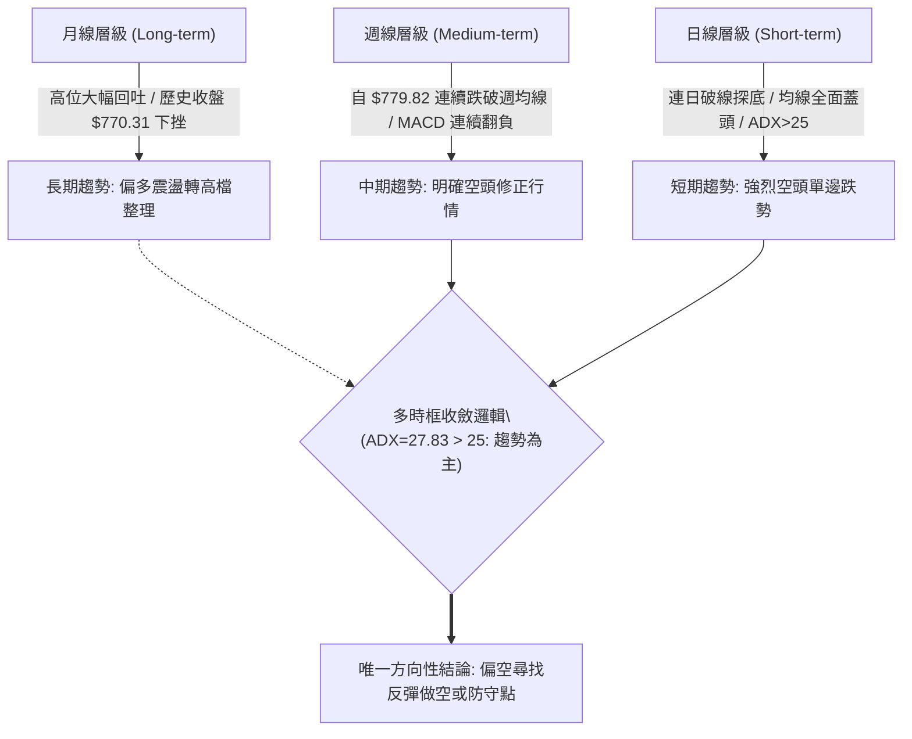

### 📈 長期趨勢 — 12個月走勢圖（Unicode）

```
META 月線走勢圖（過去12個月：2025-11 至 2026-10）
價格軸 ($)
$750 ┤                                      
$700 ┤              ● (2026-01: $714.66)               ● (2026-09: $725.18)
$650 ┤●(2025-11) ●       ●                    ●
$600 ┤      ●                 ● (2026-04)   ●       ●←現價 $612.49 (2026-10)
$550 ┤                            ●(2026-03)    ●(2026-07: $556.27)
     └─────────────────────────────────────────────────────────────────
       11   12   01   02   03   04   05   06   07   08   09   10  (月份)
```

**走勢特徵分析表格**：

| 時間區間 | 起訖收盤價 ($) | 區間漲跌幅 | 走勢形態與關鍵特徵解讀 |
|----------|----------------|------------|------------------------|
| **2025-11 ~ 2026-01** | $645.76 → $714.66 | +10.67% | 歲末年初多頭推升波段，突破 $700 心理關卡，動能充沛。 |
| **2026-01 ~ 2026-03** | $714.66 → $571.15 | -20.08% | 一季度出現快速估值修正，回撤近 143 美元，確立中期波動加劇。 |
| **2026-03 ~ 2026-05** | $571.15 → $631.43 | +10.55% | 跌深反彈波，受制於 $630 上方均線密集區，呈現弱勢修復。 |
| **2026-05 ~ 2026-07** | $631.43 → $556.27 | -11.90% | 二度探底測試 52 週低點聚類，最低見 $556.27，構築堅實底部架構。 |
| **2026-07 ~ 2026-09** | $556.27 → $725.18 | +30.36% | 強烈 V 型反轉，創下年內單月最高漲幅，並在 9 月下旬衝出歷史高點區。 |
| **2026-09 ~ 2026-10** | $725.18 → $612.49 | -15.54% | 遭遇高檔獲利了結與資本支出擔憂，單月暴跌逾 112 美元，破壞多頭結構。 |

### 📊 中期趨勢（週線分析）

週線層級自 2026 年 9 月 25 日創出歷史天價 $779.82 以來，呈現連四週實體黑棒的快速崩解走勢。近 8 週週 K 棒由頂部 $751.66 收盤價急速重挫至當前的 $612.49，跌幅達到 -18.52%。

```
週線關鍵支撐與壓力幾何階梯示意：
$779.82 ═══════════════════════════════════ (歷史高點 52W High)
        ║ 週線空頭主導，下行通道展開
$671.45 ----------------------------------- (阻力 R3 / 50週防線反壓)
        ║
$641.90 ----------------------------------- (阻力 R2)
        ║
$623.91 ----------------------------------- (阻力 R1 / 跌破之週頸線)
$612.49 ◄─── 當前價格（爭奪斐波那契 61.8% $618.86）
        ║
$594.61 =================================== (支撐 S1 / 近一年密集低點聚類)
        ║
$577.95 =================================== (強支撐 S2)
$555.86 ═══════════════════════════════════ (週線強支撐 S3)
```

### ⚡ 趨勢強度評估（ADX 解讀）

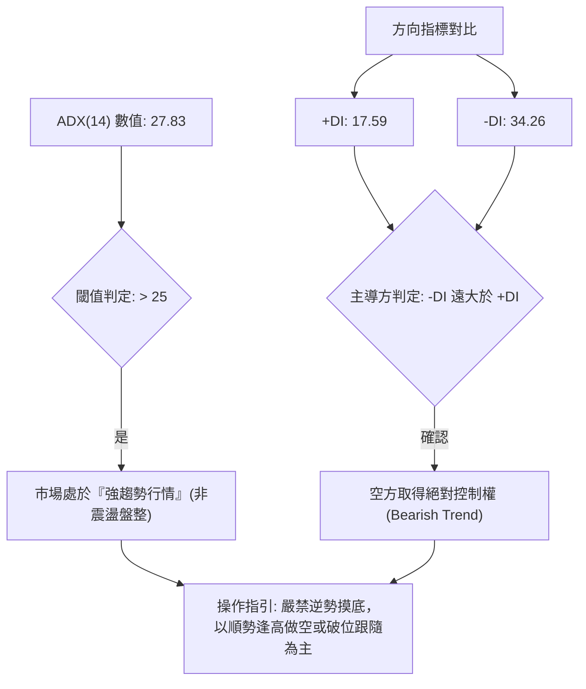

**ADX 趨勢強度量化對照表**：

| ADX 數值區間 | 當前讀數 (27.83) | 趨勢狀態 | 交易策略指導原則 |
|--------------|------------------|----------|------------------|
| 0 – 20 | 否 | 無趨勢 / 弱盤整 | 適合網格、區間擺盪指標操作 |
| 20 – 25 | 否 | 趨勢萌芽 / 方向未明 | 觀望或等待突破信號確認 |
| **25 – 50** | **符合 (27.83)** | **強趨勢 (Strong Trend)** | **依照主導方向（-DI=34.26）順勢交易，忌逆勢攤平** |
| 50 – 75 | 否 | 極強趨勢 (Extreme Trend) | 防範動能耗竭與極端回抽 |
| 75 – 100 | 否 | 超級單邊行情 | 多為暴跌或暴漲末期，注意流動性反轉 |

---

## 3. 圖表形態分析

### 🔍 形態識別系統

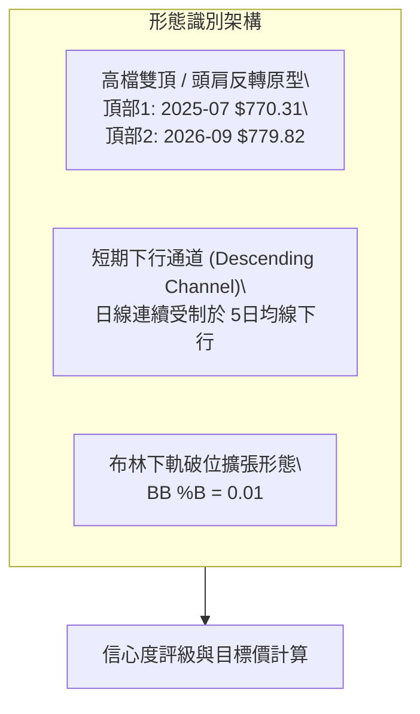

**圖表形態信心度評估表**（依規則 15）：

| 形態名稱 | 信心度 (%) | 判斷依據（嚴格引用歷史數據） | 完成度 (%) | 目標價（附嚴謹計算式） |
|----------|------------|------------------------------|------------|------------------------|
| **長週期雙頂形態 (Double Top)** | 75% | 2025-07 高點 $770.31 與 2026-09 高點 $779.82 構成雙峰；2026-07 谷底低點 $556.27 為頸線。目前自次峰下挫跌破 50MA/200MA。 | 60% | 由形態高度推算：頸線 $556.27 − (雙頂峰值 $779.82 − 頸線 $556.27) = $556.27 − $223.55 = $332.72（長期極限推算，中途受關鍵支撐 S1/S2/S3 攔截）。 |
| **短期急跌旗形 (Bear Flag)** | 55% | 10/22 大陰線摜破後，於 10/23-10/26 進行微幅弱勢整理（高點 $648.04-$647.69），隨後 10/27-10/28 續破前低。 | 70% | 由形態高度推算：旗桿起點 10/21 高點 $713.22 至 10/23 低點 $633.27（高差 $79.95）；旗形突破點 10/26 收盤 $630.56 − $79.95 = $550.61（逼近支撐位 S3: $555.86）。 |
| **頭肩頂形態 (Head and Shoulders)** | 40% | 左肩 2026-01 ($714.66)、頭部 2026-09 ($779.82)，但右肩結構不對稱且數據不足以確立完整頸線幾何。 | 35% | 訊號不足，僅做指標型解讀（不列入目標價推算）。 |

### 🕯️ 重要K線形態分析

嚴格依據「近 10 根日 K」與「近 8 根週 K」之實際 OHLCV 進行解讀：

| 日期（日K/週K） | 開 | 高 | 低 | 收 | K線形態 | 解讀 | 訊號 |
|-----------------|----|----|----|----|---------|------|------|
| **2026-10-21 (日K)** | 697.60 | 713.22 | 689.68 | 697.52 | 長上影十字星 (Doji-like) | 盤中多頭試圖反攻 $713.22 遭遇沈重空頭拋壓，終場收在開盤價附近，多頭力竭。 | 🔴 |
| **2026-10-22 (日K)** | 676.35 | 681.07 | 639.69 | 648.85 | 跳空大實體長黑 (Bearish Marubozu) | 帶量（40.57M）跳空低開低走，暴跌逾 48 美元，直接摜破 MA50 與 MA200，空頭實質突破。 | 🔴 |
| **2026-10-23 (日K)** | 638.18 | 648.04 | 633.27 | 642.62 | 縮量低檔孕線 (Harami) | 成交量急縮至 14.79M，多空於前日長黑實體下半部暫時觀望，缺乏實質承接買盤。 | 🟡 |
| **2026-10-26 (日K)** | 638.36 | 647.69 | 627.80 | 630.56 | 下破中黑棒 | 放量至 30.91M 跌破 10/23 低點 $633.27，確認孕線向下破位，空頭波段延續。 | 🔴 |
| **2026-10-27 (日K)** | 627.07 | 628.46 | 619.21 | 620.19 | 爆量下挫中陰棒 | 成交量放大至 51.33M（近 10 日最高量），空頭恐慌殺盤湧現，收盤貼近當日最低。 | 🔴 |
| **2026-10-28 (日K)** | 621.85 | 624.42 | 609.00 | 612.49 | 破底長黑收下軌 | 最低觸及 $609.00，收盤 $612.49 跌破斐波那契 61.8% ($618.86)，賣壓依然強勁。 | 🔴 |
| **2026-10-16 (週K)** | 728.50 | 771.27 | 702.71 | 709.33 | 巨幅倒錘頭/避雷針 | 衝擊歷史高位後遭徹底砸回，留有長達近 62 美元之長上影線，形成頂部確立之致命信號。 | 🔴 |
| **2026-10-23 (週K)** | 707.16 | 713.22 | 633.27 | 642.62 | 週線級別實體長陰棒 | 一舉貫穿三條週移動平均線，成交量放大至 1.17 億股，確立中期下行波段展開。 | 🔴 |

### 📉 ASCII 走勢形態示意圖

```
META 近期破位下跌形態解析示意圖
$779.82 ─────────● (2026-09-25 創歷史天價)
                  ╲
                   ╲ 避雷針倒錘 (10-16: 高點 $771.27)
                    ●
                     ╲
$701.83 ──────────────┼─────── MA20 / 布林中軌
                       ╲
                        ╲ 10-22 跳空跳水長陰 ($648.85)
$631.29 ─────────────────┼───── MA200 牛熊分水嶺破位
                          ╲ 
$618.86 ───────────────────┼─── 斐波那契 61.8% 跌破
$612.49 ────────────────────● 當前收盤價 (緊貼布林下軌 $610.84)
                             │
$594.61 ─────────────────────┴─── 關鍵支撐 S1 (目標防守位)
```

### 🎯 形態目標價計算

1. **短期急跌旗形目標價推算**：
   - 旗桿起算點：2026-10-21 高點 $713.22
   - 旗桿底點：2026-10-23 低點 $633.27
   - 旗桿垂直高度 = $713.22 − $633.27 = $79.95
   - 跌破點（旗面破位日 2026-10-26 收盤）：$630.56
   - **等長推算目標價** = $630.56 − $79.95 = **$550.61**
   - *此價位與關鍵支撐區 S3 ($555.86) 高度吻合。*

2. **區間破位階段性目標價**：
   - 短期盤整箱體：$648.04（10/23高）~ $627.80（10/26低），箱體高度 = $20.24
   - **破位 1 倍推算目標** = $627.80 − $20.24 = **$607.56**（10/28 最低價 $609.00 已精確兌現此目標）。
   - **破位 2 倍推算目標** = $627.80 − ($20.24 × 2) = **$587.32**（落在關鍵支撐 S1: $594.61 與 S2: $577.95 之間）。

---

## 4. 支撐與阻力

### 🗺️ 關鍵價位分布圖（Unicode）

```
META 價位結構分布圖（嚴格引用 OHLCV 計算之關鍵價位）
═══════════════════════════════════════════════════════════════════
$671.45 ║████████████████████████║ 強阻力 R3 (波段高點聚類 / 50MA防線)
$641.90 ║████████████████████    ║ 阻力 R2 (10-23的反彈高點/前支撐轉阻力)
$623.91 ║████████████████████████║ 關鍵阻力 R1 (10-28反彈高點/短線解套賣壓)
$618.86 ╟────────────────────────╢ 斐波那契 61.8% 關鍵回調位
$612.49 ╠════════════════════════╣ ◄ 當前收盤價 (Last Close)
$610.84 ╟┄┄┄┄┄┄┄┄┄┄┄┄┄┄┄┄┄┄┄┄┄┄╢ 布林通道下軌 (Band Lower)
$594.61 ║▓▓▓▓▓▓▓▓▓▓▓▓▓▓▓▓        ║ 近期支撐 S1 (近一年波段低點聚類)
$577.95 ║████████████████████████║ 強支撐 S2 (波段強防守位)
$555.86 ║████████████████████████║ 極限強支撐 S3 (2026-07 波段底部低點)
═══════════════════════════════════════════════════════════════════
```

### 🚧 阻力位分析表

價位嚴格引用技術數據中「關鍵價位」區塊之波段高點聚類：

| 阻力級別 | 價位 ($) | 距現價幅跌 (%) | 形成原因與籌碼解讀 | 突破難度 | 重要性 |
|----------|----------|----------------|--------------------|----------|--------|
| **R1** | $623.91 | +1.86% | 10/28 當日高點 $624.42 聚類區，亦為 10/27-10/28 分時密集換手之解套賣壓帶。 | 🟡 中等 | ★★★☆☆ |
| **R2** | $641.90 | +4.80% | 10/23 反彈高點 $648.04 與 10/22 大陰線收盤 $648.85 構築的頸線反壓區，多空換手轉折點。 | 🔴 偏高 | ★★★★☆ |
| **R3** | $671.45 | +9.63% | 波段重要高點聚類，緊鄰下降的 MA50 ($666.82) 與 10/20-10/21 下跌啟動平台。 | 🔴 極高 | ★★★★★ |

### 🛡️ 支撐位分析表

價位嚴格引用技術數據中「關鍵價位」區塊之波段低點聚類：

| 支撐級別 | 價位 ($) | 距現價幅跌 (%) | 形成原因與籌碼解讀 | 守住機率 | 重要性 |
|----------|----------|----------------|--------------------|----------|--------|
| **S1** | $594.61 | -2.92% | 近一年密集低點聚類，接近 $600 整數心理心理防線，為多頭短期抵抗第一道陣地。 | 🟡 45% | ★★★★☆ |
| **S2** | $577.95 | -5.64% | 波段強支撐，對應 2026-08 底反彈起漲點（08/28 收盤 $577.56）與斐波那契 78.6% ($575.11)。 | 🟢 65% | ★★★★★ |
| **S3** | $555.86 | -9.25% | 近一年核心波段低點聚類，精確對應 2026-07-31 週線低點收盤 $556.27，為年內中期多頭最後底線。 | 🟢 85% | ★★★★★ |

### 📐 斐波那契回調位分析

依據 52 週完整波段高低點（Low: $519.37 → High: $779.82，總垂直跨度 $260.45）進行回調定位：

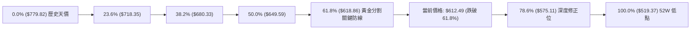

**斐波那契價位深度解讀**：
- **當前位置**：現價 **$612.49** 正好跌破了極具技術象徵意義的 **61.8% 回調位 ($618.86)**，目前落在 **61.8% ($618.86)** 與 **78.6% ($575.11)** 之間的「弱勢下沉區間」。
- **技術含義**：在傳統道氏理論與技術分析中，回調跌破 61.8% 意味著先前的整段上升趨勢（$519.37 → $779.82）遭到了結構性破壞，已無法單純視為「強勢回檔」，而演變為「深度週期性修正」。若日內無法迅速以長紅棒反包收復 $618.86，價格將依斐波那契引力原理，向下尋求 78.6% 回調位 ($575.11) 與支撐位 S2 ($577.95) 的共振支撐。

---

## 5. 技術指標深度解讀

### 🎛️ 指標訊號總覽

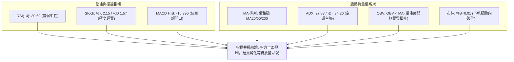

### 📈 移動平均線排列分析

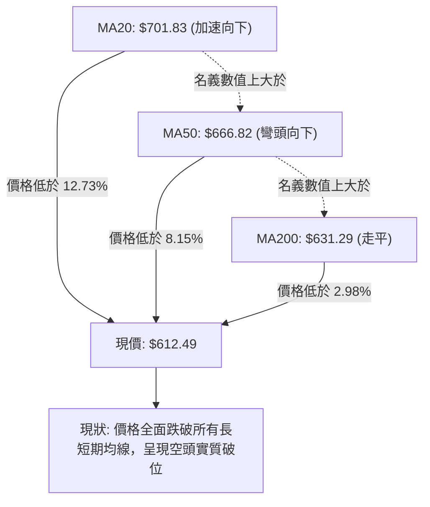

**均線系統詳細參數表**：

| 均線名稱 | 當前價格數值 ($) | 距現價差額 ($) | 偏離幅度 (%) | 短期微觀走勢特徵 | 訊號解讀 |
|----------|------------------|----------------|--------------|------------------|----------|
| **MA 5** | $630.94 | -$18.45 | -2.92% | 極速陡峭下挫，形成超短期直接壓制 | 🔴 強烈看空 |
| **MA 10** | $669.80 | -$57.31 | -8.56% | 高檔快速向下扣抵，壓制短期反彈空間 | 🔴 強烈看空 |
| **MA 20** | $701.83 | -$89.34 | -12.73% | 嚴重負乖離，月線級別多頭成本全線套牢 | 🔴 強烈看空 |
| **MA 50** | $666.82 | -$54.33 | -8.15% | 中期趨勢線被實體黑棒跌破，失去支撐作用 | 🔴 中期看空 |
| **MA 60** | $652.96 | -$40.47 | -6.20% | 季線失守，中線多方棄守 | 🔴 看空 |
| **MA 120**| $627.47 | -$14.98 | -2.39% | 半年線失守，中長線買盤防線被穿透 | 🔴 看空 |
| **MA 200**| $631.29 | -$18.80 | -2.98% | 年線牛熊分水嶺遭跌破，多頭核心架構動搖 | 🔴 長期轉空 |
| **MA 240**| $632.99 | -$20.50 | -3.24% | 兩年線被壓制在上方，全均線空頭覆蓋 | 🔴 看空 |

*解讀：儘管靜態參數顯示 MA20 ($701.83) > MA50 ($666.82) > MA200 ($631.29) 仍保有長週期的名義多頭排列，但現價 $612.49 已貫穿全部均線，短期均線 MA5 至 MA20 呈現極陡峭的空頭發散，若短期無法迅速反抽站回 MA200 之上，MA20 將迅速下穿 MA50 形成中長期的「死亡交叉」。*

### 📉 RSI(14) 分析

- **當前讀數**：**30.69** (Wilder 平滑法)
- **強度進度條**：`██████░░░░░░░░░░░░░░ 30.69%` (瀕臨超賣臨界點 30.00)
- **區間評估**：技術上處於 30 至 70 之中性偏弱區間底端。雖然數值極低，但尚未出現典型低於 20 的恐慌性極限超賣。
- **背離分析判斷**：
  - 根據技術數據檢驗：「近 20 根 K 棒首尾的價格與 RSI 方向比較」，價格自 10 月中旬 $736.72 一路暴跌至 $612.49，RSI 自 60 以上同步重挫至 30.69。
  - **明確結論：當前 RSI「無明顯背離」**。價格創新低的同時指標同步下墜，代表目前屬於單邊空頭動能的正常釋放，尚未出現價格跌破而指標低點墊高的「底背離」止跌訊號。

### 📊 MACD(12/26/9) 訊號解讀

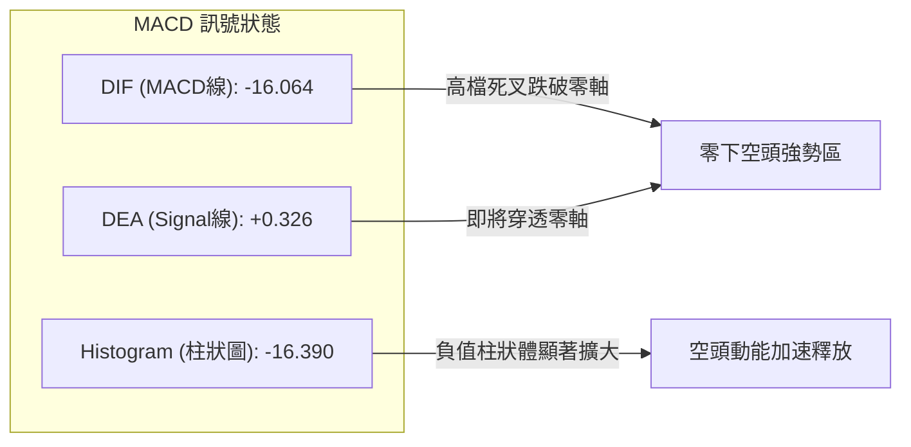

- **數值結構**：MACD 線 (-16.064) 與信號線 (0.326) 呈現巨大開口的空頭交叉，且雙線快速向零軸下方俯衝；柱狀圖達 **-16.390** 之極度負值。
- **動能解讀**：負向柱狀圖連續四週顯著拉長（近 4 週週線柱狀圖分別為 -5.784 → -6.088 → -14.283 → -16.390），證明空方殺盤能量不僅未見耗竭，反而在破位後呈現二度加速發散，典型順勢空頭主導。

### 📦 布林通道分析

```
META 日線布林通道 (20, 2) 結構示意圖
$792.82 ┬────────────────────────────────────────────── BB 上軌 (Upper)
        │
$701.83 ┼────────────────────────────────────────────── BB 中軌 (MA20)
        │
        │                                  ● 10-15 ($736.72)
        │                                   ╲
        │                                    ╲
        │                                     ╲
$612.49 ┼──────────────────────────────────────●─────── 現價 ($612.49, %B=0.01)
$610.84 ┴─────────────────────────────────────┴──────── BB 下軌 (Lower)
```

- **通道參數狀況**：上軌 $792.82，中軌 $701.83，下軌 $610.84。
- **通道指標數值**：%B 當前為 **0.01**（0 代表下軌，$610.84；1 代表上軌，$792.82）。
- **解讀與形態**：%B 僅有 0.01 說明收盤價幾乎嚴格嵌在布林下軌之上。這種現象在強趨勢下稱為「騎乘布林通道下軌（Band Walking）」，並非單純的買入超賣訊號，而是布林通道開口向下急劇放大、空頭沿著外軌單邊摜壓的極端強勢空頭表徵。

### 💹 成交量分析（量價配合度）

```
近 5 交易日量價對比：
10-21: $697.52 ( 29.20M ) █
10-22: $648.85 ( 40.57M ) ████ (放量跳水破線)
10-23: $642.62 ( 14.79M ) █ (無力反彈縮量)
10-26: $630.56 ( 30.91M ) ███ (破位續跌放量)
10-27: $620.19 ( 51.33M ) ████████ (恐慌殺盤爆量)
10-28: $612.49 ( 35.00M ) ████ (持續放量貼軌)
```

- **最新成交量表現**：最新成交量為 **35,004,200** 股，相較於 20 日均量 (21,576,605) 放大至 **1.62 倍**。
- **量價關係解讀**：
  1. 10/22 與 10/27 兩次關鍵破位均伴隨 40M-50M 股以上的巨大成交量，呈現標準的「價跌量增」空頭擴張格局。
  2. 10/23 縮量至 14.79M 弱勢反彈，隨即引來更大規模的拋售，反映籌碼結構出現機構性清倉。
  3. **OBV（能量潮）狀態**：技術指標明確顯示「OBV < MA → 量能疲弱」，表明累計量能處於均線下方，機構買盤並未進場吸收籌碼，主力資金呈現實質淨流出。

---

## 6. 動能與波動率

### ⚡ 動能評估四象限

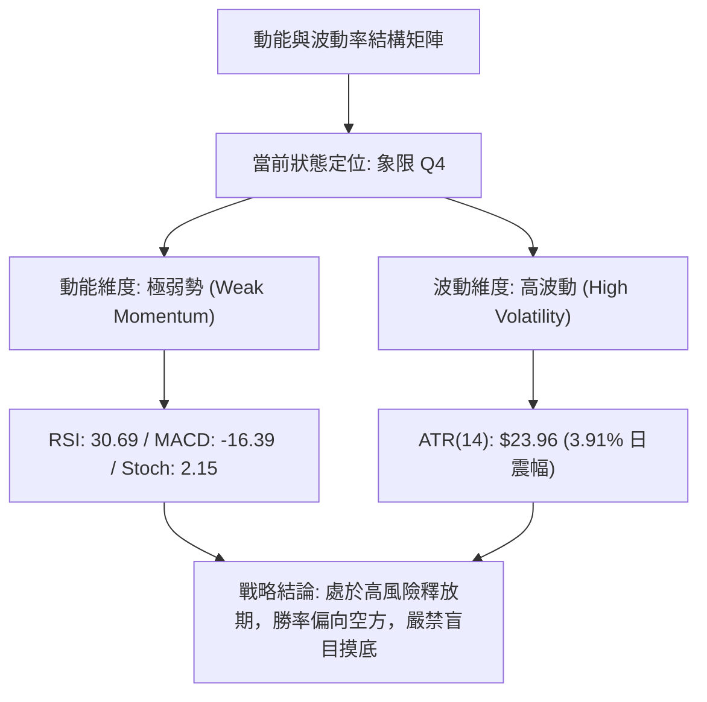

| 象限 | 動能維度 | 波動維度 | 歷史定義特徵 | META 當前吻合度 | 交易指導方針 |
|------|----------|----------|--------------|-----------------|--------------|
| **Q1** | 強動能 | 低波動 | 穩定上升推升期 | 否 | 最佳波段持股環境 |
| **Q2** | 弱動能 | 低波動 | 縮量橫盤築底期 | 否 | 觀望等待方向突破 |
| **Q3** | 強動能 | 高波動 | 快速主升狂熱期 | 否 | 緊跟趨勢但須擴大止盈 |
| **Q4** | **弱動能** | **高波動** | **單邊破位下殺期** | **✓ 完全吻合** | **避免多頭進場，嚴格執行防守或逢高放空** |

### 📊 ATR 波動率分析

- **ATR(14) 絕對數值**：**$23.96**（基於 Wilder 平滑計算）。
- **ATR 佔價格比率**：$23.96 ÷ $612.49 = **3.91%**。
- **波動特徵評估**：對於市值達 1.59 兆美元的超大型科技股而言，日均 3.91%（近 24 美元）的真實波動幅度屬於顯著「高波動」區間。這表明市場內部存在分歧與機構倉位調整，價格容易產生盤中劇烈抽洗。
- **風控與止損距離建議**：
  - **日內/超短線止損**：以 1.0 × ATR 計算，安全邊際距離為 **$23.96**。
  - **波段防守止損**：以 1.5 × ATR 至 2.0 × ATR 計算，建議距離為 **$35.94 ~ $47.92**。在做空或反彈搶短時，若未預留至少 1.5 個 ATR 的震盪空間，極易遭遇假突破掃損。

### 📐 Beta 與市場相關性

- **Beta 數值**：**1.185**。
- **大盤相關性與彈性解讀**：
  - Beta 為 1.185 顯示 META 相較於標普 500 指數具備更高的波動彈性（約高出 18.5%）。
  - 在大盤整體承壓或科技巨頭財報/資本支出疑慮期間，META 往往承擔更高的系統性貝塔回撤。若大盤指數下跌 1%，在當前弱勢架構下，META 盤中回調幅度易放大至 1.18% 至 1.5% 之間。

---

## 7. 多時框架總結

### 📋 時框架評分表

| 時框架 | 趨勢方向 | 動能狀態 | 均線排列特徵 | 形態完成度 | 綜合評分 | 操作建議與戰略定位 |
|--------|----------|----------|--------------|------------|----------|--------------------|
| **月線 (長期)** | 🟢 多頭轉整理 | 🟡 中性減弱 | MA 結構完好 (仍處於長週期上升軌跡) | 雙頂雛形 (高位 $779.82 遇阻) | 60/100 | 長線底倉保留，暫停加碼 |
| **週線 (中期)** | 🔴 明確看空 | 🔴 柱狀擴大 | 連跌破週 MA，空頭扣抵展開 | 連四黑實體貫穿多條均線 | 30/100 | 中期波段減倉，尋求防守 |
| **日線 (短期)** | 🔴 強烈看空 | 🔴 超賣鈍化 | 價格全線跌破 MA5~MA240 | 緊貼布林下軌破位，無底背離 | 20/100 | 順勢偏空操作，反彈即賣點 |

### 🔲 綜合訊號矩陣

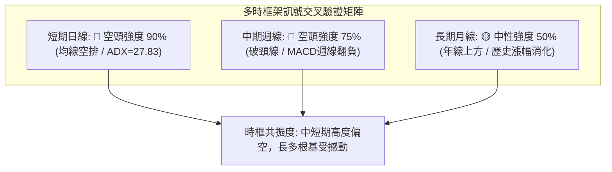

### ⚖️ 多時框收斂結論

依據多時框收斂規則第 14 條嚴格執行收斂：
1. **行情屬性判定**：當前日線 **ADX(14) 讀數為 27.83**，明確大於 25 臨界線，技術架構定義為標準的**「單邊強趨勢行情」**（排除無方向之盤整行情）。
2. **時框優先級權衡**：在 ADX > 25 之趨勢格局下，以中長期趨勢（週線及 MA50/MA200）方向為依歸。週線級別自 $779.82 連跌四週，MACD 負向柱狀擴大至 -16.390；日線級別更於 10/22 正式摜破 MA200 牛熊分界線 ($631.29)。長中短三個層級中，週線與日線同步發出重大破位訊號。
3. **唯一方向性結論**：**【強烈偏空觀望，策略以逢高反彈做空或破位順勢空為主】**。日線目前的超賣（RSI=30.69，Stoch %K=2.15）僅能視為隨時可能引發技術性「死貓跳（Dead Cat Bounce）」之微觀干擾，絕不可作為逆勢抄底依據；日線的反抽僅用來提供做空或多頭解套的進場契機。此結論與第 1 章技術評分卡（32/100）及後續第 8 章交易策略完全一致。

---

## 8. 交易策略建議

### 🗺️ 策略決策流程圖

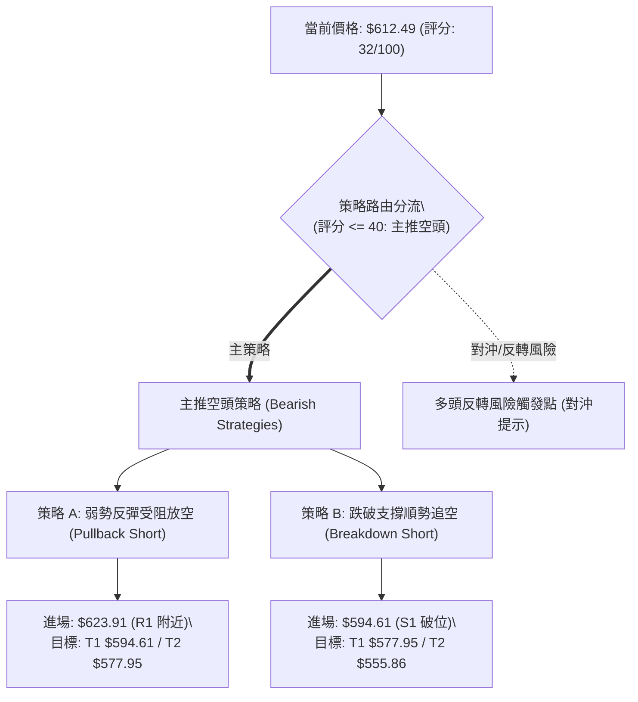

### 🧭 策略路由（依評分卡分流）

> **當前主策略方向 = 【主推空頭策略】（依據第 1 章技術綜合評分 32/100，評分 ≤ 40 嚴格觸發放空與防守流程，多頭僅列為反轉風險對沖提示，嚴禁兩頭模糊下注）。**

### 🎯 價格情境階梯（Price Scenarios）

價位嚴格引用第 4 章「關鍵價位」區塊之波段高低點數值：

| 觸發條件 | 下一目標 | 後續延伸 | 情境技術含義與市場行為解讀 |
|----------|----------|----------|----------------------------|
| **強勢突破 R1 ($623.91)** | 阻力 R2 ($641.90) | 阻力 R3 ($671.45) | 短線超賣引發空頭回補，但進入 MA200 ($631.29) 壓力區，屬技術性反抽。 |
| **受制於現價至 R1 區間** | 支撐 S1 ($594.61) | 支撐 S2 ($577.95) | 典型沿布林下軌震盪陰跌，空方完全控盤，籌碼持續沉澱。 |
| **有效跌破 S1 ($594.61)** | 支撐 S2 ($577.95) | 支撐 S3 ($555.86) | 確立中期頭部破位，斐波那契 78.6% 回調考驗展開，恐慌盤全面湧出。 |

### 📊 情境機率分佈

| 價格運行情境 | 發生機率 | 主要技術與量價指標依據 |
|--------------|----------|------------------------|
| **情境一：直接回落 / 跌破 S1 再探底** | **60%** | ADX 高達 27.83 (-DI=34.26)，MACD 柱狀體擴大至 -16.390，OBV 疲弱無資金承接，均線全面蓋頭。 |
| **情境二：弱勢反抽至 R1 後受阻震盪** | **30%** | RSI(14) 降至 30.69 瀕臨超賣，Stoch %K 跌至 2.15 出現微幅技術修復需求，布林下軌出現摩擦。 |
| **情境三：強勢反彈收復 MA200 與 R2** | **10%** | 需極端外生消息面或機構爆發性報復回補（成交量需大於 50M），目前無任何量價跡象支撐。 |

### 🟢 主策略詳情（空頭專屬策略）

*注：做空之風險報酬比嚴格定義為 = (進場價 − 目標價 T1) ÷ (止損價 − 進場價)。*

| 策略要素 | 策略 A：反彈受阻高空策略 (反抽阻力放空) | 策略 B：跌破支撐破位追空策略 (順勢動能放空) |
|----------|-----------------------------------------|---------------------------------------------|
| **進場條件** | 價格反彈至阻力 R1 受阻，日 K 出現長上影線或黑棒確認 | 實體日 K 收盤跌破關鍵支撐 S1，放量確認破位 |
| **進場價格** | **$623.91** (引用阻力 R1) | **$594.61** (引用支撐 S1) |
| **目標價 T1** | **$594.61** (引用支撐 S1) | **$577.95** (引用支撐 S2) |
| **目標價 T2** | **$577.95** (引用支撐 S2) | **$555.86** (引用支撐 S3) |
| **止損價格** | **$638.56** (由 R1 + 0.61×ATR $14.65 推算，越過 MA200) | **$606.59** (由 S1 + 0.50×ATR $11.98 推算，假跌破防守) |
| **風險報酬比** | **1 : 2.00（以 T1 計）** <br>*計算式：($623.91 − $594.61) ÷ ($638.56 − $623.91) = $29.30 ÷ $14.65 = 2.00* | **1 : 1.39（以 T1 計）** <br>*計算式：($594.61 − $577.95) ÷ ($606.59 − $594.61) = $16.66 ÷ $11.98 = 1.39* |
| **成功機率** | **65%** | **60%** |
| **建議倉位** | **15% - 20%** (標準波段倉位) | **10%** (突破動能倉位) |

*補充說明（以 T2 計之風險報酬比）：*
- *策略 A 至 T2 ($577.95)：($623.91 − $577.95) ÷ $14.65 = $45.96 ÷ $14.65 = **1 : 3.14（以 T2 計）**。*
- *策略 B 至 T2 ($555.86)：($594.61 − $555.86) ÷ $11.98 = $38.75 ÷ $11.98 = **1 : 3.23（以 T2 計）**。*

### 🔴 反向風險觸發點（對沖提示）

本部分非推薦多頭進場，僅作為空頭部位之**嚴格風控預警線**與現貨投資者之對沖參考：
1. **空頭全面減倉/止盈訊號**：若價格以帶量長紅實體有效收復 **R1 ($623.91)** 並站上 **MA200 ($631.29)**，說明空頭波段跌勢受挫，可能展開對 MA50 ($666.82) 的深幅反抽，所有空單應無條件離場。
2. **潛在底背離訊號**：若價格跌破 S1 ($594.61) 創下新低，但 RSI(14) 不破前低反而回升至 35 以上，即構成日線級「底背離」，此時嚴禁追空，需提防 V 型反轉風險。

### ⭐ 整體訊號強度評星

```
做多訊號強度：★☆☆☆☆  (1/5星 - 極弱，逆勢摸底風險極大)
做空訊號強度：★★★★☆  (4/5星 - 強烈，順應 ADX 趨勢與均線破位)
整體可信度：  ★★★★☆  (4/5星 - 技術指標高度共振確認)
```

---

## 9. 風險提示與監控

### ✅ 關鍵監控指標 Checklist

```
╔══════════════════════════════════════════════════════════════╗
║              META 日常盤面關鍵監控清單 (Checklist)           ║
╠══════════════════════════════════════════════════════════════╣
║ [ ] 價格能否有效收復斐波那契 61.8% ($618.86) 與 R1 ($623.91) ║
║ [ ] 跌破 $600 整數關卡後，支撐 S1 ($594.61) 處之換手量能是否放大 ║
║ [ ] RSI(14) 是否正式跌入 < 30 之極端超賣區並引發鈍化         ║
║ [ ] 日線成交量是否縮減至 20M 以下（代表恐慌殺盤減緩）        ║
║ [ ] MACD 負向柱狀圖（當前 -16.390）是否出現首次收縮長度       ║
║ [ ] 布林通道下軌 ($610.84) 是否由向下張口轉為平緩走平        ║
║ [ ] 大盤 Nasdaq/SPX 是否同步出現破位之連鎖系統性風險         ║
╚══════════════════════════════════════════════════════════════╝
```

### ⚠️ 風險場景分析

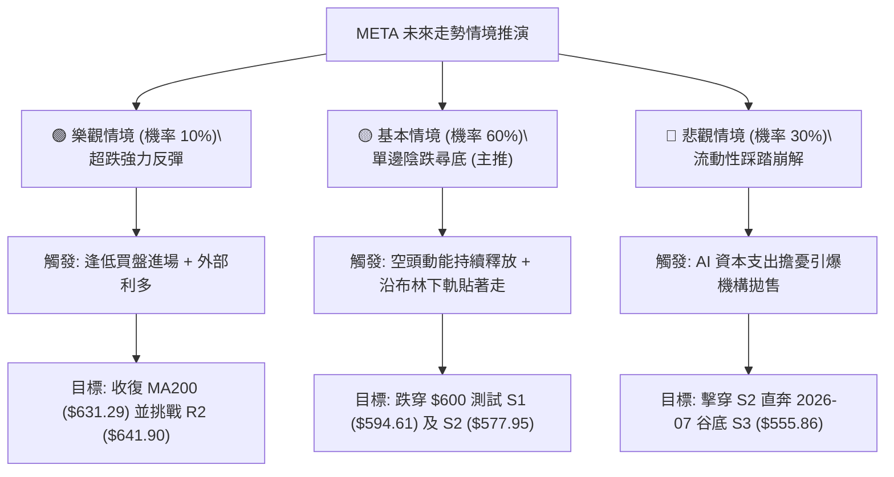

### 🛡️ 風險管理重要提醒

1. **破位市場中的超賣陷阱**：在 ADX = 27.83 的趨勢市場中，「指標超賣」絕非買入理由。Stoch %K 降至 2.15 說明空方力量已達極致，容易形成長達數週的指標低檔鈍化，逆勢摸底如同「徒手接落下的飛刀」。
2. **波動度放大下的部位控制**：當前 ATR 高達 $23.96 (3.91%)，單日價格震盪劇烈。為防止單筆虧損超過總資金之 1%–1.5%，必須實施**反向倉位縮減**。建議將單一交易之總曝險倉位嚴格限制在 10%–20% 之間，並堅決執行預設之止損價位。
3. **重大事件與財報時程規避**：近期科技巨頭資本支出與 AI 變現疑慮重重，若面臨 FOMC 利率決策或重大財報公告，應於盤前減持倉位至 5% 以下或透過買入保護性看跌期權（Protective Put）鎖定下行風險。

---

## 📋 報告總結

```
╔════════════════════════════════════════════════════════════════╗
║                   META 技術分析報告總結                        ║
╠════════════════════════════════════════════════════════════════╣
║ 報告日期：2026-10-29                                           ║
║ 當前價格：$612.49                                              ║
║ 分析評級：🔴 偏空弱勢格局 (Bearish Breakdown / 評分: 32/100)   ║
╠════════════════════════════════════════════════════════════════╣
║ 關鍵技術結論：                                                 ║
║ ├─ 長期趨勢：🟡 多頭高位遭受侵蝕，考驗 200 日線長期牛熊防線    ║
║ ├─ 中期趨勢：🔴 週線四連黑摜破均線，自高點 $779.82 修正逾 21%  ║
║ ├─ 短期趨勢：🔴 跌破所有日 MA，ADX=27.83 空方主導，貼布林下軌  ║
║ ├─ 關鍵支撐：S1: $594.61  ｜  S2: $577.95  ｜  S3: $555.86     ║
║ ├─ 關鍵阻力：R1: $623.91  ｜  R2: $641.90  ｜  R3: $671.45     ║
║ └─ 外部分析師目標：均價 $848.38 (低 $629.06 / 高 $1050.00)     ║
╠════════════════════════════════════════════════════════════════╣
║ 最優策略組合（嚴格依評分卡 32/100 路由分流）：                 ║
║ 1. 🥇 最佳機會：策略 A (反彈受阻放空)                          ║
║    進場 $623.91 ｜ 止損 $638.56 ｜ 目標 T1 $594.61 (風報比 1:2.00)║
║ 2. 🥈 次選機會：策略 B (破位順勢追空)                          ║
║    進場 $594.61 ｜ 止損 $606.59 ｜ 目標 T1 $577.95 (風報比 1:1.39)║
║ 3. 🥉 保守選擇：空手觀望，靜待價格於 S2 ($577.95) 出現底背離   ║
╚════════════════════════════════════════════════════════════════╝
```

---

> ⚠️ **免責聲明**：本報告為 AI 自動生成之技術分析研究，所有數據指標及價位估算均嚴格基於所提供之歷史交易資訊（Yahoo Finance）。本報告**僅供學術研究與專業投資策略探討參考**，**絕對不構成任何實質性之買賣邀約或投資建議**。金融市場瞬息萬變，技術指標存在滯後性與失效風險，投資人應依個人風險承受度獨立判斷，並自行承擔交易結果。

---

*報告生成時間：2026-10-29 ｜ 數據來源：Yahoo Finance ｜ 分析框架：多時框技術分析體系 (CFA/CMT 規範)*