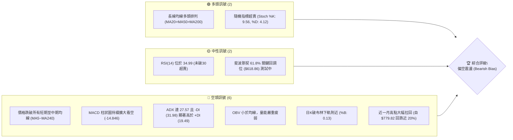
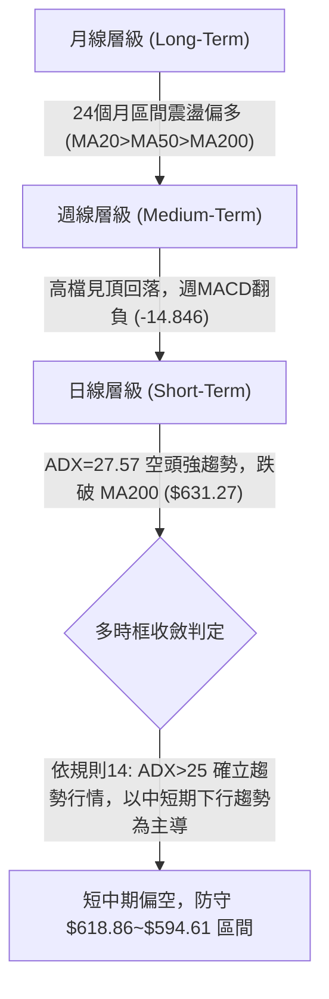
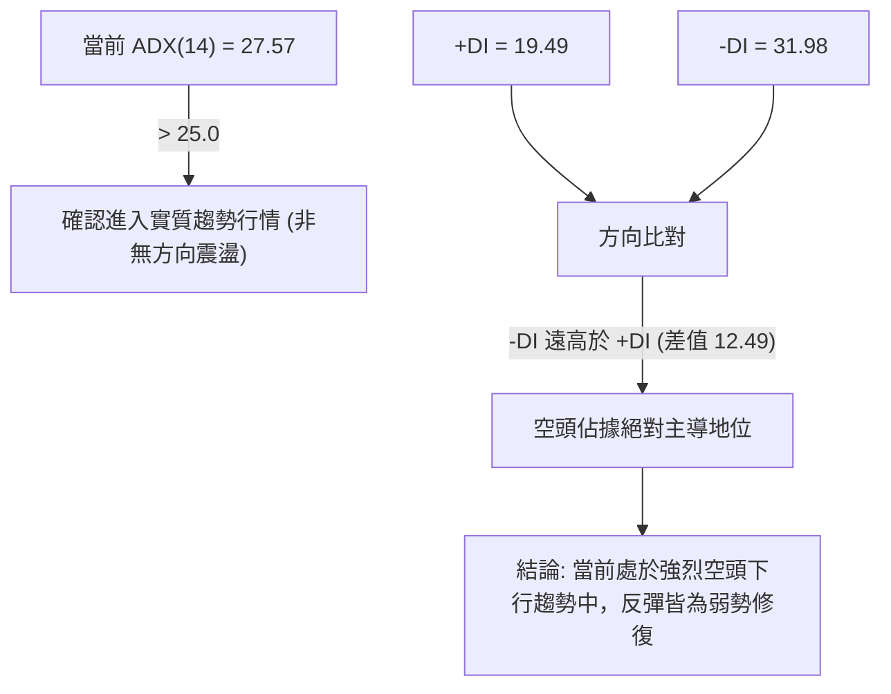
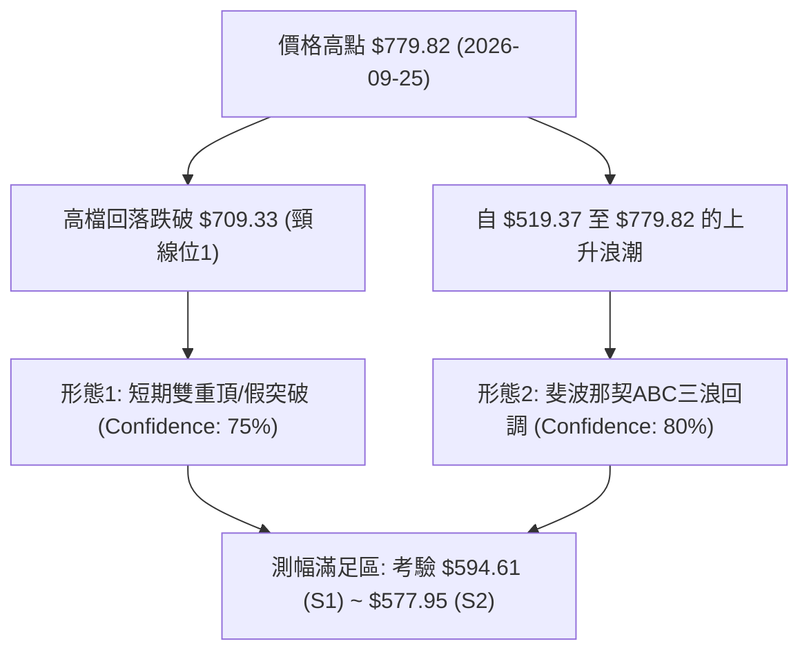
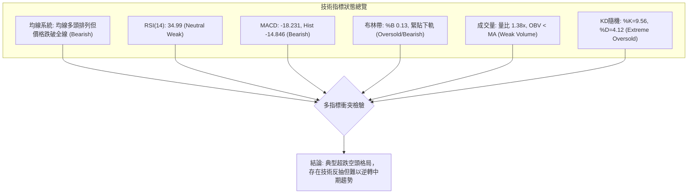
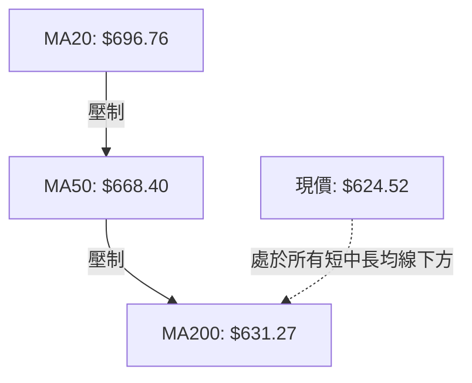
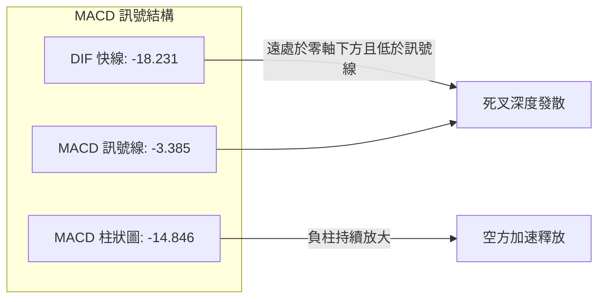
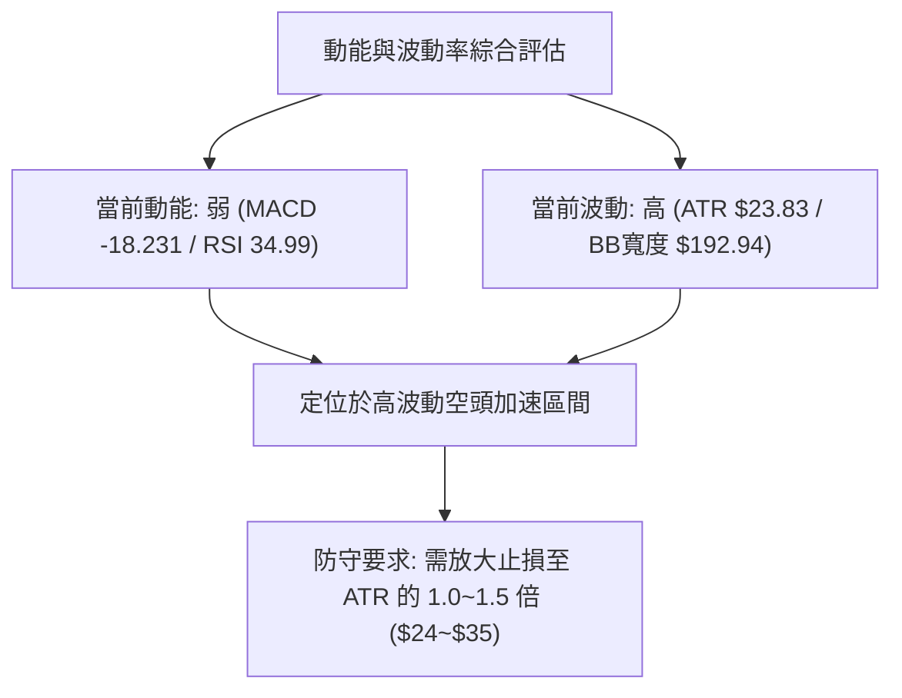
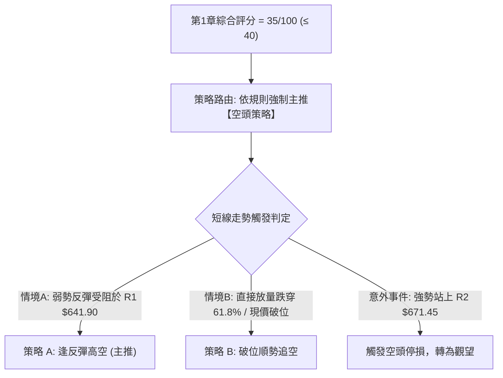
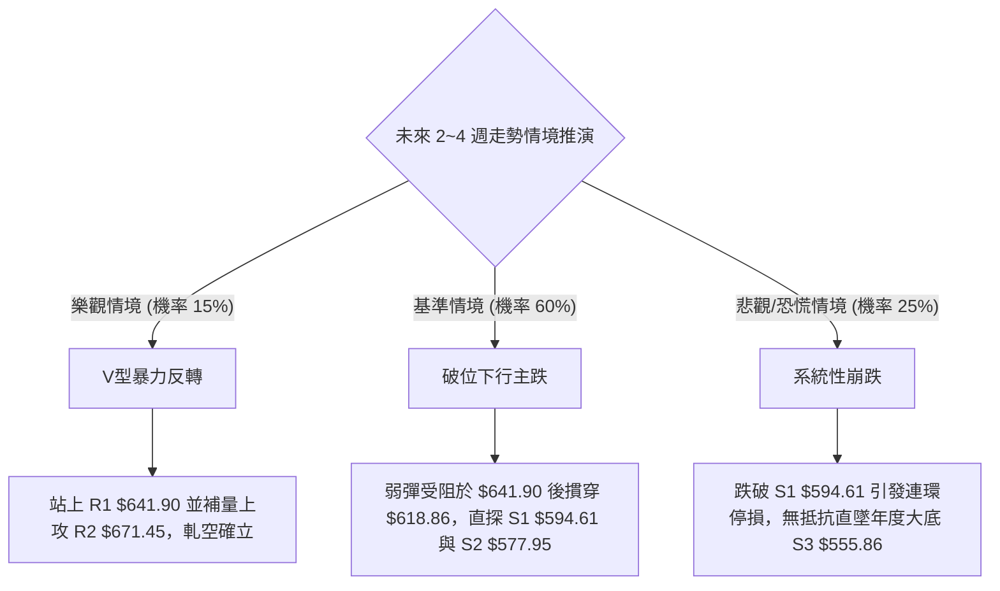

# META 技術分析報告

> **報告日期**：2026-10-30 ｜ **語言**：繁體中文 ｜ **數據來源**：Yahoo Finance ｜ **當前價格**：$624.52

---

## 目錄

| 章節 | 內容 |
|------|------|
| [1. 技術面概覽](#1-技術面概覽) | 訊號儀表板、核心指標、評分卡 |
| [2. 趨勢分析](#2-趨勢分析) | 多時框趨勢、長中短期走勢 |
| [3. 圖表形態分析](#3-圖表形態分析) | 形態識別、K線組合、目標價 |
| [4. 支撐與阻力](#4-支撐與阻力) | 關鍵價位、斐波那契回調 |
| [5. 技術指標深度解讀](#5-技術指標深度解讀) | MA/RSI/MACD/布林/成交量 |
| [6. 動能與波動率](#6-動能與波動率) | 動能評估、ATR、Beta |
| [7. 多時框架總結](#7-多時框架總結) | 時框架評分矩陣 |
| [8. 交易策略建議](#8-交易策略建議) | 多空策略、風險報酬比 |
| [9. 風險提示與監控](#9-風險提示與監控) | 監控指標、風險場景 |

---

## 1. 技術面概覽

### 🎯 技術訊號儀表板



### 📊 核心指標速覽表

| 指標類別 | 指標名稱 | 當前數值 | 訊號 | 解讀 |
|----------|----------|----------|------|------|
| **價格** | 當前價格 | $624.52 | 🔴 | 位於52週區間 40.4% 水平，自高點回跌顯著 |
| **均線** | MA20 | $696.76 | 🔴 | 價格遠在 MA20 下方 (-10.37%)，短期空頭強勢 |
| **均線** | MA50 | $668.40 | 🔴 | 價格在 MA50 下方 (-6.57%)，中期下行壓力沉重 |
| **均線** | MA200 | $631.27 | 🔴 | 價格跌破長期生命線 MA200，多頭結構面臨嚴峻考驗 |
| **動能** | RSI(14) | 34.99 | 🟡 | 位於中性偏弱區間，尚未進入低於 30 的極端超賣區 |
| **動能** | MACD Hist | -14.846 | 🔴 | MACD線 (-18.231) 低於訊號線 (-3.385)，柱狀圖深度負值 |
| **動能** | Stoch %K/%D | 9.56 / 4.12 | 🟢 | 進入極度超賣區間，隨時具備技術性短彈契機 |
| **趨勢** | ADX(14) | 27.57 | 🔴 | ADX > 25，-DI(31.98) 壓制 +DI(19.49)，確立空頭趨勢行情 |
| **通道** | 布林 %B | 0.13 | 🔴 | 逼近下軌 $600.29，通道開口放大，下行尋求支撐 |
| **波動** | ATR(14) | $23.83 | 🟡 | 佔股價 3.82%，每日波幅大，需配置寬裕止損空間 |
| **成交量**| 量比 (Volume Ratio) | 1.38x | 🔴 | 放量下挫，最新量達 3,116 萬股，高於 20 日均量 |

### 🏆 技術評分卡

```
技術評分卡 — META (2026-10-30)
════════════════════════════════════════════════════
趨勢強度      ██████░░░░░░░░░░░░░░  30/100  🔴 空頭主導強趨勢
動能指標      ██████░░░░░░░░░░░░░░  30/100  🔴 MACD弱勢，超賣微彈
支撐穩定度    ████████░░░░░░░░░░░░  40/100  🟡 考驗61.8%回調與S1
成交量配合    ██████░░░░░░░░░░░░░░  30/100  🔴 放量下跌，OBV衰竭
形態完整度    ████████░░░░░░░░░░░░  40/100  🟡 短期破位，下探箱底
均線排列      ████████░░░░░░░░░░░░  40/100  🟡 大均線仍多，短均全破
════════════════════════════════════════════════════
綜合評分      ███████░░░░░░░░░░░░░  35/100  🔴 偏空弱勢（依規則18算術平均）
════════════════════════════════════════════════════
```
*計算依據：(30 + 30 + 40 + 30 + 40 + 40) ÷ 6 = 35.00，四捨五入為 35/100。*

---

## 2. 趨勢分析

### 🌐 多時框趨勢分析



### 📈 長期趨勢 — 12個月走勢圖（Unicode）

```
META 月線走勢圖（過去12個月：2025-11 至 2026-10）
價格軸 ($)
$780 ┤                                      ● (2026-09 $725.18，盤中最高 $779.82)
$730 ┤              ● (2026-01 $714.66)     │
$680 ┤              │                       │
$630 ┤● (2025-11)   │       ● (2026-05)     │   ●←當前 (2026-10 $624.52)
$580 ┤   ● (2025-12)│   ● (2026-04)         │
$530 ┤              ● (2026-03 $571.15)     ● (2026-07 $556.27)
     └─────────────────────────────────────────────────────────────
       11   12   01   02   03   04   05   06   07   08   09   10  (月份)
```

#### 過去 12 個月走勢特徵分析表格

| 階段 | 期間 | 起訖收盤價 | 漲跌幅 | 走勢特徵與技術解讀 |
|------|------|------------|--------|--------------------|
| 階段一 | 2025-11 ~ 2026-01 | $645.76 → $714.66 | +10.67% | 年底拉升突破，月線級別多頭強勢上攻 |
| 階段二 | 2026-01 ~ 2026-03 | $714.66 → $571.15 | -20.08% | 首季大幅獲利回吐，快速下探半年度低點 |
| 階段三 | 2026-03 ~ 2026-05 | $571.15 → $631.43 | +10.55% | 震盪回升，反彈受阻於 $630 關卡 |
| 階段四 | 2026-05 ~ 2026-07 | $631.43 → $556.27 | -11.90% | 二度探底，打出 2026 全年低位 $556.27 |
| 階段五 | 2026-07 ~ 2026-09 | $556.27 → $725.18 | +30.36% | 主升浪行情，週成交量暴增創 52W 高點 $779.82 |
| 階段六 | 2026-09 ~ 2026-10 | $725.18 → $624.52 | -13.88% | 衝高見頂急速下墜，連續跌破關鍵均線 |

### 📊 中期趨勢（週線分析）

從近 8 週 K 棒觀察，META 自 2026-09-25 創下 $779.82 的 52 週新高後，展開連續 5 週的回調行情。週成交量在 9 月底放大至 1.68 億股的歷史天量後逐漸萎縮，但在近一週（10-29）再度放大至 1.48 億股下殺，顯示中期多頭獲利了結並伴隨機構籌碼鬆動。週線 MACD 柱狀圖由正轉負（從 +11.729 暴跌至 -14.846），RSI 由 71.4 超買急速降至 35.0，中期趨勢已由單邊多頭反轉為下行修正格局。

```
週線支撐與壓力空間示意圖
$779.82 ────────────────────────────── 52W 最高點（週線天花板）
         ▲
         │ 週線空頭回壓區間 (-19.9%)
         ▼
$642.62 ────────────────────────────── 前週低點反壓
$624.52 ══════════════════════════════ 【現價】考驗 61.8% 斐波回調 ($618.86)
         ▼
$594.61 ────────────────────────────── S1 支撐位（中期箱體防線）
$556.27 ────────────────────────────── 2026-07 週線低點
```

### ⚡ 趨勢強度評估（ADX 解讀）



#### ADX 強度對照表

| ADX 數值區間 | 趨勢性質 | 當前狀態判定 | 交易指引 |
|--------------|----------|--------------|----------|
| 0 ~ 20 | 無趨勢 / 雜訊盤整 | 否 | 適合區間網格操作 |
| 20 ~ 25 | 趨勢萌芽 / 微弱趨勢 | 否 | 觀察均線方向與突破訊號 |
| **25 ~ 50** | **強趨勢 (Strong Trend)** | **✓ (27.57，-DI主導)** | **順勢操作，嚴格執行空頭策略** |
| 50 ~ 75 | 極強趨勢 (Very Strong) | 否 | 注意超買超賣鈍化 |
| 75 ~ 100 | 單邊極端噴出/崩跌 | 否 | 防範極端耗竭反轉 |

---

## 3. 圖表形態分析

### 🔍 形態識別系統



#### 形態識別信心度與目標價評估

| 形態 | 信心度 | 判斷依據（引用數據） | 完成度 | 目標價（附計算式） |
|------|--------|----------------------|--------|--------------------|
| **高檔雙頂/假突破** | 75% | 9/25 創高 $779.82 後，10/16 再次上探 $771.27 無力突破，隨後帶量跌穿雙頂頸線（10/16收盤 $709.33） | 85% | 頸線 $709.33 − 形態高度 ($779.82 − $709.33 = $70.49) = **$638.84**（已跌破）；次級測幅目標看 S1 **$594.61** |
| **ABC回調浪 (浪C下殺)** | 80% | 浪A自 $779.82 下殺至 $713.19 (10/02低點)，浪B弱勢反彈至 $771.27 (10/16高點)，當前處於浪C主跌段 | 70% | 浪C等長測幅：$771.27 − ($779.82 − $713.19 = $66.63) = **$704.64** (已破)；浪C擴展1.618倍：$771.27 − (66.63 × 1.618 = $107.81) = **$663.46** (已破)；終極延伸測幅指向 S1 **$594.61** 與 S2 **$577.95** |
| **頭肩底 (長線逆轉)** | < 40% | 數據中未偵測到完整的右肩架構，訊號不足，僅做指標型解讀 | 0% | 訊號不足，不予計算 |

### 🕯️ 重要K線形態分析

依規則 19，完全依據提供的「近10根日K」與「近8根週K」實際開高低收進行形態識別：

#### 近 10 根日 K 線形態解析

| 日期 | 開 | 高 | 低 | 收 | 成交量 | K線形態 | 解讀 | 訊號 |
|------|----|----|----|----|--------|---------|------|------|
| 2026-10-16 | 736.70 | 738.49 | 702.71 | 709.33 | 20,643,800 | 長黑實體K | 盤中下探破位，高檔籌碼大舉鬆動 | 🔴 |
| 2026-10-19 | 707.16 | 708.83 | 693.86 | 705.44 | 16,260,900 | 窄幅陰線 | 縮量陰跌，空頭持續主導，無承接力道 | 🔴 |
| 2026-10-20 | 694.98 | 696.51 | 681.05 | 694.25 | 17,049,100 | 小黑星線 | 跌破 $690 心理關卡，反彈乏力 | 🔴 |
| 2026-10-21 | 697.60 | 713.22 | 689.68 | 697.52 | 29,203,900 | 帶長上影倒十字 | 試圖反抽 $713 未果，爆量留上影線形成強壓 | 🔴 |
| 2026-10-22 | 676.35 | 681.07 | 639.69 | 648.85 | 40,571,000 | 崩跌大長黑 | 跳空放量重挫 48 點，形成空頭吞噬與破位缺口 | 🔴 |
| 2026-10-23 | 638.18 | 648.04 | 633.27 | 642.62 | 14,791,600 | 縮量十字星 | 暴跌後的低檔喘息，量能萎縮表明買盤觀望 | 🟡 |
| 2026-10-26 | 638.36 | 647.69 | 627.80 | 630.56 | 30,913,600 | 中黑棒下探 | 放量續跌，跌破 10/23 低點，空方重啟攻擊 | 🔴 |
| 2026-10-27 | 627.07 | 628.46 | 619.21 | 620.19 | 51,334,100 | 放量長陰 | 5,133萬股天量殺盤，直逼 $618.86 斐波支撐 | 🔴 |
| 2026-10-28 | 621.85 | 624.42 | 609.00 | 612.49 | 35,110,900 | 創低長下影星 | 探底 $609.00 後獲買盤收腳，初見支撐跡象 | 🟡 |
| 2026-10-29 | 621.29 | 634.68 | 616.80 | 624.52 | 31,162,500 | 溫和陽線反彈 | 站回 $620 之上，高點過昨高，呈現初步止跌信號 | 🟢 |

#### 近 8 根週 K 線形態解析

| 日期 | 開 | 高 | 低 | 收 | 成交量 | K線形態 | 解讀 | 訊號 |
|------|----|----|----|----|--------|---------|------|------|
| 2026-09-11 | 615.72 | 663.72 | 609.26 | 647.52 | 93,267,300 | 實體大長陽 | 突破啟動浪，放量站穩所有均線 | 🟢 |
| 2026-09-18 | 657.31 | 689.61 | 648.71 | 665.23 | 99,577,300 | 連續紅K線 | 穩健墊高，多頭買盤源源不絕 | 🟢 |
| 2026-09-25 | 680.30 | 779.82 | 679.60 | 751.66 | 168,307,000 | 暴量長上影陽K | 爆量噴出觸及 $779.82，留下近28點上影，主力出貨跡象 | 🟡 |
| 2026-10-02 | 750.04 | 750.58 | 713.19 | 728.08 | 96,199,700 | 高位孕線黑K | 漲勢停滯，多空換手，未能續創歷史新高 | 🔴 |
| 2026-10-09 | 727.71 | 747.60 | 711.68 | 718.67 | 69,671,000 | 縮量倒槌黑K | 弱勢反彈受阻，週線連續兩週收黑 | 🔴 |
| 2026-10-16 | 728.50 | 771.27 | 702.71 | 709.33 | 101,360,200 | 長上影十字陰K | 二次摸頂 $771.27 失敗，誘多完成宣告波段見頂 | 🔴 |
| 2026-10-23 | 707.16 | 713.22 | 633.27 | 642.62 | 117,876,500 | 破位崩跌週黑K | 週線暴跌 66 點，摜穿 MA20 與 MA50，確立波段轉空 | 🔴 |
| 2026-10-29 | 638.36 | 647.69 | 609.00 | 624.52 | 148,521,100 | 放量帶下影陰K | 探底 $609 後獲部分承接，但成交量放大顯示沉重解套賣壓 | 🔴 |

### 📉 ASCII 走勢形態示意圖

```
高檔假突破雙頂形態示意圖 (2026-09-25 ~ 2026-10-29)
$780 ┤               頂點1: $779.82
     │                 ▲            頂點2: $771.27
$740 ┤                / \              ▲
     │               /   \            / \
$700 ┤──────────────/─────\──────────/───\──────── 頸線位: $709.33 (已破位)
     │             /       \        /     \
$660 ┤            /         \      /       \
     │           /           \    /         \
$620 ┤──────────/─────────────\──/───────────●← 現價: $624.52 (測幅下探)
$580 ┤                                        │
     │                                        ▼ 形態延伸滿足區: S1 $594.61
```

### 🎯 形態目標價計算

1. **高檔雙頂破位測幅**：
   - 頂部最高點：$779.82
   - 頸線關鍵位：$709.33（2026-10-16 收盤價）
   - 垂直形態高度：$779.82 − $709.33 = $70.49
   - 第一跌幅滿足目標：$709.33 − $70.49 = **$638.84**（此目標已於 10/23 跌破，形成反壓）
   - 第二跌幅擴展目標（1.618 倍）：$709.33 − ($70.49 × 1.618) = $709.33 − $114.05 = **$595.28**（高度契合數據庫中已計算之支撐位 S1 **$594.61**）

---

## 4. 支撐與阻力

### 🗺️ 關鍵價位分布圖（Unicode）

```
META 價位結構分布圖
═══════════════════════════════════════════════════
$687.94 ║████████████████████████║ 強阻力 R3 (波段高點聚類)
$671.45 ║████████████████        ║ 阻力 R2 (反彈重壓區)
$641.90 ║████████████████████████║ 關鍵阻力 R1 (+2.78%，近期多空分水嶺)
$624.52 ╠════════════════════════╣ ◄ 當前收盤價
$618.86 ║▓▓▓▓▓▓▓▓▓▓▓▓▓▓▓▓▓▓▓▓    ║ 斐波那契 61.8% 關鍵黃金回調位
$594.61 ║▓▓▓▓▓▓▓▓▓▓▓▓▓▓▓▓        ║ 近期支撐 S1 (-4.79%，波段低點聚類)
$577.95 ║████████████████████████║ 強支撐 S2 (-7.46%，波段密集區)
$555.86 ║████████████████████████║ 核心防守 S3 (-10.99%，年度大底)
═══════════════════════════════════════════════════
```

### 🚧 阻力位分析表

*以下價位嚴格引用自數據庫「關鍵價位（由 OHLCV 計算）」區塊，嚴禁捏造：*

| 阻力級別 | 價位 | 與現價幅度 | 形成原因 | 突破難度 | 重要性 |
|----------|------|------------|----------|----------|--------|
| **R1** | **$641.90** | +2.78% | 近期日K密集起跌點聚類，近5日震盪高點區域 | 🟡 中等 | 極高（短線多頭反彈第一道關卡） |
| **R2** | **$671.45** | +7.51% | 前期破位平台，契合 MA50 ($668.40) 均線密集壓制 | 🔴 極高 | 高（中線空頭防守核心防線） |
| **R3** | **$687.94** | +10.15% | 10月中旬跌破的深層籌碼套牢區，契合 38.2% 斐波位 | 🔴 極難 | 中（趨勢反轉多頭終極目標） |

### 🛡️ 支撐位分析表

*以下價位嚴格引用自數據庫「關鍵價位（由 OHLCV 計算）」區塊，嚴禁捏造：*

| 支撐級別 | 價位 | 與現價幅度 | 形成原因 | 守住機率 | 重要性 |
|----------|------|------------|----------|----------|--------|
| **S1** | **$594.61** | -4.79% | 近一年波段低點聚類，整數心理關卡 $600 緩衝帶 | 🟡 55% | 極高（布林通道下軌 $600.29 共振區） |
| **S2** | **$577.95** | -7.46% | 2026年3月至8月多次回踩之籌碼密集底部結構 | 🟢 70% | 極高（若跌破將觸發全年中期破位） |
| **S3** | **$555.86** | -10.99% | 近一年最低點聚類，契合 2026-07-31 週線低點 | 🟢 85% | 核心（2026年年度多頭最後底線） |

### 📐 斐波那契回調位分析

依據 52 週完整區間（低點 $519.37 → 高點 $779.82，波幅 $260.45）計算之標準斐波那契回調位：

```
0.0% (52W High)  ────────────────────────────── $779.82
23.6%            ────────────────────────────── $718.35
38.2%            ────────────────────────────── $680.33
50.0% (半數回調) ────────────────────────────── $649.59
61.8% (黃金分割) ────────────────────────────── $618.86 ◄ 現價 ($624.52) 緊密考驗中
78.6% (深次回調) ────────────────────────────── $575.11
100.0% (52W Low) ────────────────────────────── $519.37
```

- **位置解讀**：現價 $624.52 恰好坐落於 **50.0% 回調位 ($649.59)** 與 **61.8% 黃金回調位 ($618.86)** 之間，距 61.8% 僅有不到 1% 的空間。
- **技術含義**：斐波那契 61.8% ($618.86) 為傳統牛市健康回調的極限生命線。10/28 價格一度下探至 $609.00（短暫刺穿 61.8%），但 10/29 隨即收復至 $624.52。若此處無法形成有效底部分型，則價格將不可避免地下探 78.6% 回調位 ($575.11)，與支撐位 S2 ($577.95) 形成重疊共振。

---

## 5. 技術指標深度解讀

### 🎛️ 指標訊號總覽



### 📈 移動平均線排列分析



雖然數據顯示歷史長週期均線仍呈「多頭排列 MA20 > MA50 > MA200」，但此排列屬於長線滯後現象。當前價格 $624.52 已經以「跳水」方式接連摜穿短期、中期以及長期均線：
- **短週期均線全面蓋頭**：MA5 ($626.08)、MA10 ($658.58)、MA20 ($696.76) 呈陡峭下行角度，對現價構成強烈動態壓迫。
- **失守年線 MA200**：MA200 位於 $631.27，現價跌破 MA200 (-1.07%)，宣告長達半年的強勢上攻走勢正式中斷，機構防守防線全面退守。

### 📉 RSI(14) 分析

- **當前 RSI(14)**：34.99（Wilder 平滑法）
- **強度指示**：
  ```
  超賣區 (0-30)        弱勢區 (30-50)         強勢區 (50-70)        超買區 (70-100)
  [████████████░░░░░░░░░░░░░░░░░░░░░░░░░░░░░░░░░░░░░░░░░] 34.99%
  ```
- **區間評估**：RSI 處於 30 至 50 之間的弱勢區間。指標雖接近超賣，但未見低於 30 的極端恐慌性拋售，表明下行動能尚未完全耗盡。
- **背離判斷**：依據近 20 根 K 棒的首尾比對，價格自高點 $771.27 回落至 $624.52，RSI 亦由 50.3 降至 35.0，方向高度一致，**確認無底背離，亦無頂背離**，屬於典型的動能順勢回調。

### 📊 MACD(12/26/9) 訊號解讀



MACD 快線已深跌至 -18.231，訊號線亦轉為負值 -3.385，柱狀圖達到 -14.846 的深度負值區域。近 5 週週線 MACD 柱狀圖由 +11.729 → -0.743 → -5.784 → -6.088 → -14.283 → -14.846，顯示中期賣壓不僅未見收斂，反而呈現滾雪球般的空頭強化現象。

### 📦 布林通道分析

```
布林通道結構圖 (參數: 20, 2)
$793.23 ┬──────────────────────────────────────── 上軌 (BB Upper)
        │
$696.76 ┼──────────────────────────────────────── 中軌 (MA20 Baseline)
        │
$624.52 ┼──────────────● ◄ 現價 (BB %B = 0.13)
$600.29 ┴──────────────────────────────────────── 下軌 (BB Lower)
```

- **軌道狀態**：布林帶帶寬高達 $192.94，上下軌呈現開口向外發散狀態（通道走擴），是下行趨勢正在加速的典型特徵。
- **%B 指標**：%B 為 0.13，價格緊貼布林通道下軌運行。雖然未發生「穿軌」後的即刻向內收斂，但 %B < 0.15 顯示市場處於短期極度超賣邊緣，下軌 $600.29 將與支撐位 S1 ($594.61) 形成堅固的雙重防線。

### 💹 成交量分析（量價配合度）

- **最新日成交量**：31,162,500 股
- **20 日均量**：22,519,645 股（量比 1.38x）
- **50 日均量**：21,787,536 股
- **OBV 趨勢解讀**：數據明確標註「OBV < MA → 量能疲弱」。
  - 10/22 大跌時爆出 4,057 萬股巨量，10/27 續跌爆出 5,133 萬股天量，而 10/29 試圖收陽時成交量萎縮至 3,116 萬股。
  - 這構成了教科書式的「下跌帶量、反彈縮量」之量價背離結構，籌碼從大資金流向散戶承接盤，量能指標完全未能確認多頭具備逆轉能力。

---

## 6. 動能與波動率

### ⚡ 動能評估四象限

| 象限 | 動能維度 | 波動維度 | 歷史定義特徵 | 當前狀態評估 | 策略指引 |
|------|----------|----------|--------------|--------------|----------|
| **Q1 (最佳擴張)** | 強動能 (上行) | 低波動 | 穩健單邊主升浪 | ✕ 不符合 | 順勢加碼做多 |
| **Q2 (盤整觀望)** | 弱動能 (無方向) | 低波動 | 縮量窄幅箱體整理 | ✕ 不符合 | 區間高拋低吸 |
| **Q3 (極限搏殺)** | 強動能 (趨勢) | 高波動 | 暴量下殺或噴出 | **✓ 完美符合 (Q3-空頭版)** | **嚴禁逆勢摸底，防範波動洗盤** |
| **Q4 (衰竭耗盡)** | 弱動能 | 高波動 | 行情末端劇烈洗盤 | ✕ 暫不符合 | 等待突破確認 |



### 📊 ATR 波動率分析

- **當前 ATR(14)**：$23.83（佔股價比例 3.82%，Wilder 平滑）
- **波動特徵**：單日平均波動近 24 美元，意味著日內波幅極大。若交易者使用過於緊湊的止損（如 1% 或 5 美元），極易被常態性市場雜訊掃出場。
- **止損與倉位風控指引**：
  - **保守型止損距離**：1.5 × ATR = $35.75
  - **激進型/短線止損距離**：1.0 × ATR = $23.83
  - **倉位管理**：由於 ATR 偏高，單筆交易名義曝險應縮減至常態部位的 50%~60%，以防範隔夜跳空風險。

### 📐 Beta 與市場相關性

- **Beta 係數**：1.185（對應 S&P 500 指數）
- **市場特徵**：Beta > 1 顯示 META 具備顯著的高進攻性與放大波動特質。在大盤下挫時，META 通常會呈現 1.18 倍的放大跌幅；而在空頭行情中，高 Beta 股票往往成為機構調倉或應對贖回時優先拋售的流動性來源。

---

## 7. 多時框架總結

### 📋 時框架評分表

| 時框架 | 趨勢方向 | 動能狀態 | 均線排列 | 圖表形態 | 綜合評分 | 戰略建議 |
|--------|----------|----------|----------|----------|----------|----------|
| **月線 (長期)** | 🟢 多頭震盪 | 🟡 動能轉弱 | 🟢 多頭 (MA20>50>200) | 寬幅大箱體震盪 | 60/100 | 長期基本面護城河深厚，回調至極值為長線買點 |
| **週線 (中期)** | 🔴 明顯下行 | 🔴 MACD柱加速收負 | 🟡 MA20失守，測MA50 | 高檔雙頂假突破 | 35/100 | 中期波段獲利了結賣壓沉重，禁止盲目大舉抄底 |
| **日線 (短期)** | 🔴 空頭強趨勢 | 🟡 KD超賣，RSI弱勢 | 🔴 全均線失守 (< MA200)| 破位尋底走勢 | 30/100 | 反彈即是空點，僅適合短線超跌博弈 |

### 🔲 綜合訊號矩陣

```
時框維度與技術要素一致性矩陣
要素           短期 (日線)       中期 (週線)       長期 (月線)       跨時框一致性
────────────────────────────────────────────────────────────────────────
趨勢方向        🔴 下行空頭       🔴 轉向空頭       🟢 震盪多頭       🟡 中短空長多 (衝突)
動能指標        🔴 MACD死叉       🔴 柱狀圖暴跌     🟡 動能消退       🔴 偏空共振
均線系統        🔴 全線破位       🟡 跌破MA20       🟢 多頭排列       🟡 短期向下乖離
成交量能        🔴 放量下殺       🔴 天量見頂       🟡 均量平穩       🔴 空方量能主導
```

### ⚖️ 多時框收斂結論

**嚴格依據「規則 14」執行收斂判斷**：
1. **趨勢/盤整判定**：當前 ADX(14) 數值為 **27.57**（明確大於關鍵閾值 25.0），且 -DI (31.98) 顯著高於 +DI (19.49)，系統判定當前處於**確鑿的空頭趨勢行情**，而非無方向的盤整震盪。
2. **時框主導權取捨**：依規則 14，在強趨勢行情下，交易邏輯**以中長期方向與均線防線為主導**，日線級別的指標超賣僅能作為「尋找短線反彈進場點或空頭減倉點」之輔助依據，不可顛覆中期空頭下行格局。
3. **最終方向性結論**：**【偏空主導，順勢做空或逢反彈放空】**。
   - 儘管月線長期多頭均線尚未破壞，但中期週線雙頂成形，日線已實質性擊穿 MA200 ($631.27)。在日線未能帶量收復關鍵阻力 R1 ($641.90) 之前，所有日內或次日反彈皆定義為「技術性弱勢反抽」。此結論與第 1 章綜合評分（35/100）保持嚴格一致。

---

## 8. 交易策略建議

### 🗺️ 策略決策流程圖



### 🧭 策略路由

> **當前主策略方向 = 偏空主導（依綜合評分 35/100，評級 ≤ 40 主推空頭策略）**
> 
> *註：依規則要求，此處主推空頭策略，多頭僅於下方列出「反轉風險觸發點」作為風控防守依據。*

### 🎯 價格情境階梯（Price Scenarios）

*本表格所有價位嚴格引用自數據庫「關鍵價位」與「斐波那契回調」區塊，嚴禁捏造：*

| 觸發條件 | 下一目標 | 後續延伸 | 情境含義 |
|----------|----------|----------|----------|
| **強勢突破 R1 ($641.90)** | R2 ($671.45) | R3 ($687.94) | 短線超跌強勁反彈，空方暫退，空單需無條件停損 |
| **受阻於 R1 ($641.90) ~ 現價震盪** | 測試斐波 61.8% ($618.86) | S1 ($594.61) | 弱勢反抽確認阻力有效，空頭重啟下行趨勢 |
| **放量摜破 S1 ($594.61)** | S2 ($577.95) | S3 ($555.86) | 中期支撐崩解，引發恐慌性停損盤，直探年度大底 |

### 📊 情境機率分佈

| 情境 | 機率 | 主要依據 |
|------|------|----------|
| **反彈受阻回落 / 跌破再探底** | **60%** | ADX 達 27.57 確立空頭趨勢；MACD 柱狀圖深度擴散 (-14.846)；量價呈現「跌帶量、彈無量」 |
| **區間弱勢震盪 ($600~$640)** | **25%** | Stoch %K/%D 處於極端超賣 (9.56/4.12)；布林帶觸及下軌，面臨技術性修正乖離需求 |
| **強勢 V 型反轉向上** | **15%** | 均線系統短中期全面破位，OBV 疲軟，缺乏主力大資金逆勢承接證據，機率偏低 |

### 🟢 主策略詳情（空頭主推）

依據嚴格規則 17 之精確公式：
$$\text{做空風險報酬比} = \frac{\text{進場價} - \text{目標價 T1}}{\text{止損價} - \text{進場價}}$$

| 策略要素 | 策略 A：反彈遇阻做空（首選推薦） | 策略 B：跌破追空（順勢激進） |
|----------|----------------------------------|------------------------------|
| **進場條件** | 價格反彈至 R1 附近出現長上影線或黑K確認受阻 | 日K放量跌破斐波 61.8% 回調位 ($618.86) |
| **進場價格** | **$641.90**（引用自阻力位 R1） | **$618.86**（引用自 61.8% 斐波那契位） |
| **止損價格** | **$668.40**（引用自中期阻力均線 MA50） | **$631.27**（引用自跌破的長線生命線 MA200） |
| **目標價 T1** | **$594.61**（引用自近期支撐 S1） | **$594.61**（引用自近期支撐 S1） |
| **目標價 T2** | **$577.95**（引用自強支撐 S2） | **$577.95**（引用自強支撐 S2） |
| **風險報酬比** | **1 : 1.78（以 T1 計）** <br>*(計算式: (641.90-594.61)/(668.40-641.90) = 47.29/26.50)* <br>*(以 T2 計則為 1 : 2.41)* | **1 : 1.95（以 T1 計）** <br>*(計算式: (618.86-594.61)/(631.27-618.86) = 24.25/12.41)* <br>*(以 T2 計則為 1 : 3.29)* |
| **成功機率** | 65% | 58% |
| **建議倉位** | 15% 總資金倉位 | 10% 總資金倉位 |

### 🔴 反向風險觸發點（對沖提示）

若出現以下情境，宣告空頭主策略完全失效，空單必須立刻全數離場：
1. **關鍵價位收復**：日K收盤價強勢站穩阻力位 **R1 ($641.90)** 之上，且成交量突破 3,500 萬股。
2. **均線金叉反轉**：短期 MA5 向上穿過 MA10，且日線 MACD 柱狀圖連續 3 日縮腳翻紅。
3. **對沖操作指引**：若持有多頭現貨底倉不願停損者，當價格反彈至 **$641.90** 時，應買入等量 Delta 的看跌期權（Put）或建立相應數額的空頭避險合約。

### ⭐ 整體訊號強度評星

```
做多訊號強度：★★☆☆☆  (2/5 星 - 僅有極端超賣具備博弈價值，勝率低)
做空訊號強度：★★★★☆  (4/5 星 - 趨勢、均線、動能三重偏空共振)
整體可信度：  ★★★★☆  (4/5 星 - 指標一致性高，ADX趨勢確認清晰)
```

---

## 9. 風險提示與監控

### ✅ 關鍵監控指標 Checklist

```
╔══════════════════════════════════════════════════════════════╗
║              META 關鍵技術監控 CHECKLIST                     ║
╠══════════════════════════════════════════════════════════════╣
║ [ ] 監控價位 1: 斐波那契 61.8% ($618.86) 是否遭實體陰線擊穿   ║
║ [ ] 監控價位 2: 阻力位 R1 ($641.90) 反抽測試是否帶長上影線   ║
║ [ ] 動能指標: MACD 柱狀圖負值是否持續放大 (當前 -14.846)     ║
║ [ ] 趨勢指標: ADX(14) 是否持續維持在 25 以上並擴大 -DI 領先   ║
║ [ ] 量能指標: 下跌日成交量是否再度超出 20 日均量 (22.5M)     ║
║ [ ] 通道狀態: 布林 %B 是否自下軌 (<0.1) 出現反彈收斂跡象    ║
╚══════════════════════════════════════════════════════════════╝
```

### ⚠️ 風險場景分析



### 🛡️ 風險管理重要提醒

1. **基本面與大盤外部衝擊**：
   - 數據中顯示 META 的資本支出（Capex TTM）高達 $104.44B，近期新聞聚焦於微軟、亞馬遜等巨頭的 AI 資本開支激增與發債潮，市場對 AI 變現能力與巨額資本開支疑慮加劇。
   - 公司 Short Ratio 僅 1.32，Short % Float 為 1.3%，做空擁擠度極低，這意味著當前下殺主要來自機構長線資金的獲利了結，非單純散戶或空頭投機，賣壓具備持久性。
2. **倉位與停損紀律**：
   - 單一標的交易風險不應超過投資組合淨資產的 **1.5%**。
   - 由於當前 ATR 高達 **$23.83**，市場隨機雜訊極寬，切勿使用「手動心理止損」，必須於進場同時預設**硬性條件單（Hard Stop-Loss）**。
   - 若價格跌破 S1 **$594.61**，切勿盲目以「價值投資」心態進行攤平加碼，必須等待日線出現明確的雙底或帶量長下影破底翻結構後，方可重新評估。

---

## 📋 報告總結

```
META 技術分析報告總結
════════════════════════════════════════════════════════
報告日期：2026-10-30
當前價格：$624.52
分析評級：⚖️ 偏空弱勢 (Bearish Bias) ｜ 技術綜合評分：35/100

關鍵結論：
├─ 長期趨勢：🟢 震盪偏多 (月線 MA20>MA50>MA200 仍存，但遭受衝擊)
├─ 中期趨勢：🔴 確立轉空 (週線雙頂破位，MACD柱深度負值擴大)
├─ 短期趨勢：🔴 強烈空頭 (ADX=27.57，價格跌破 MA200，全均線失守)
├─ 關鍵支撐：S1 $594.61 ｜ S2 $577.95 ｜ S3 $555.86
├─ 關鍵阻力：R1 $641.90 ｜ R2 $671.45 ｜ R3 $687.94
└─ 華爾街目標：平均 $848.38 ｜ 最低 $629.06 (現價已跌穿最低目標價)

最優策略組合：
1. 🥇 最佳機會：逢反彈至 R1 $641.90 遇阻建立空頭倉位，停損設 MA50 $668.40，
              目標下看 S1 $594.61 (風險報酬比 1 : 1.78)。
2. 🥈 次選機會：實體日K跌破斐波那契 61.8% ($618.86) 後順勢追空，
              停損設 MA200 $631.27，目標 S1 $594.61 (風報比 1 : 1.95)。
3. 🥉 保守選擇：空手觀望，靜待股價回踩 S1 ($594.61) ~ S2 ($577.95) 
              築底訊號確認，切忌逆勢抄底接飛刀。
════════════════════════════════════════════════════════
```

---

> ⚠️ **免責聲明**：本報告為 AI 自動生成之技術分析，所有數據及估算均基於提供的歷史價格資訊。本報告**僅供研究與學術參考**，**不構成任何投資建議**。投資有風險，入市需謹慎。

---

*報告生成時間：2026-10-30 ｜ 數據來源：Yahoo Finance ｜ 分析框架：多時框技術分析*