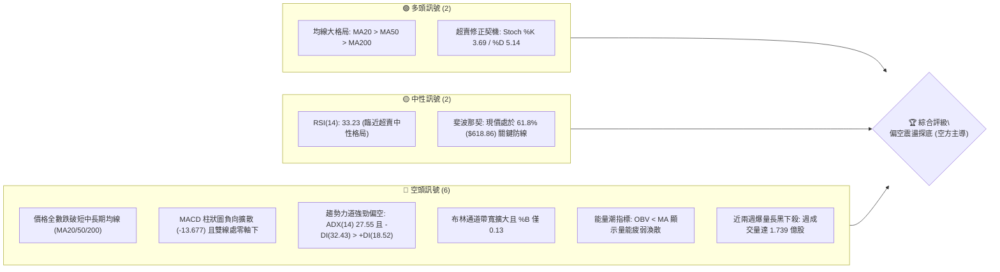
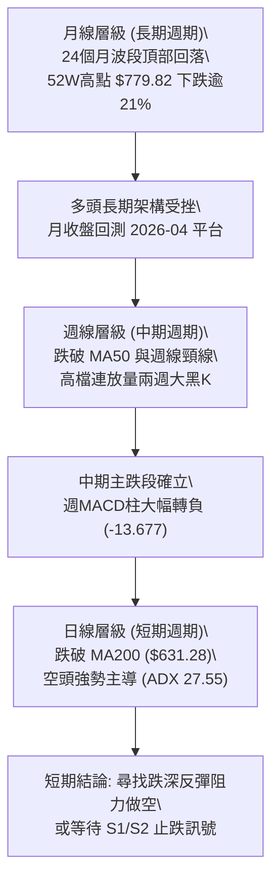
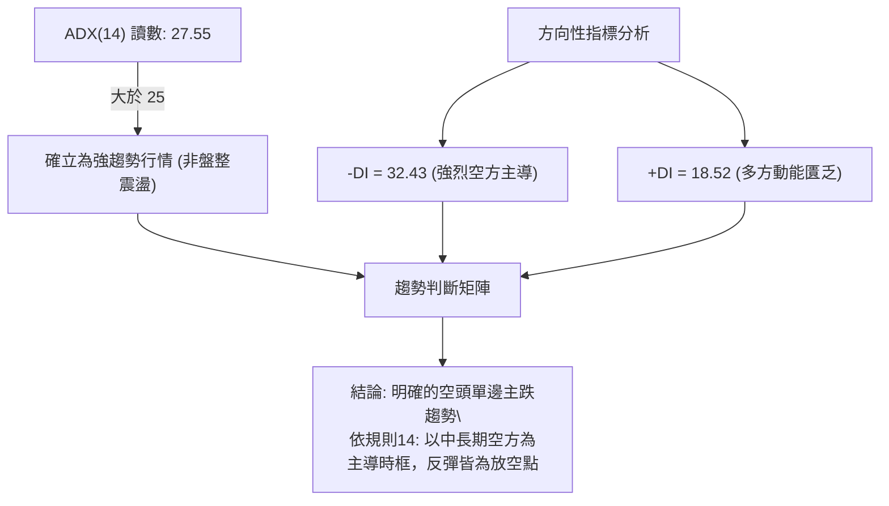
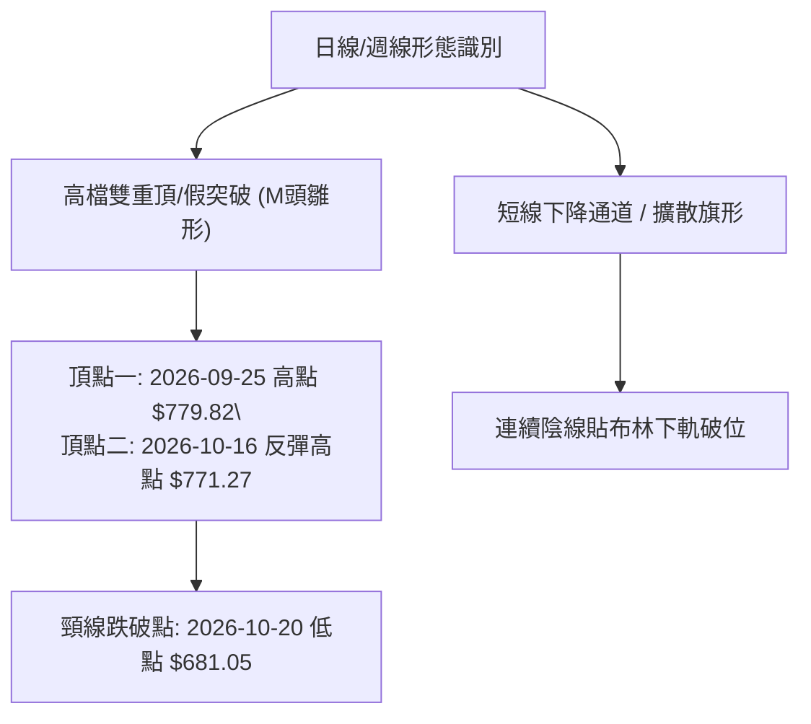
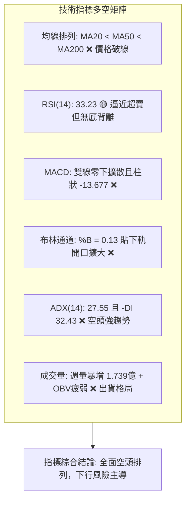
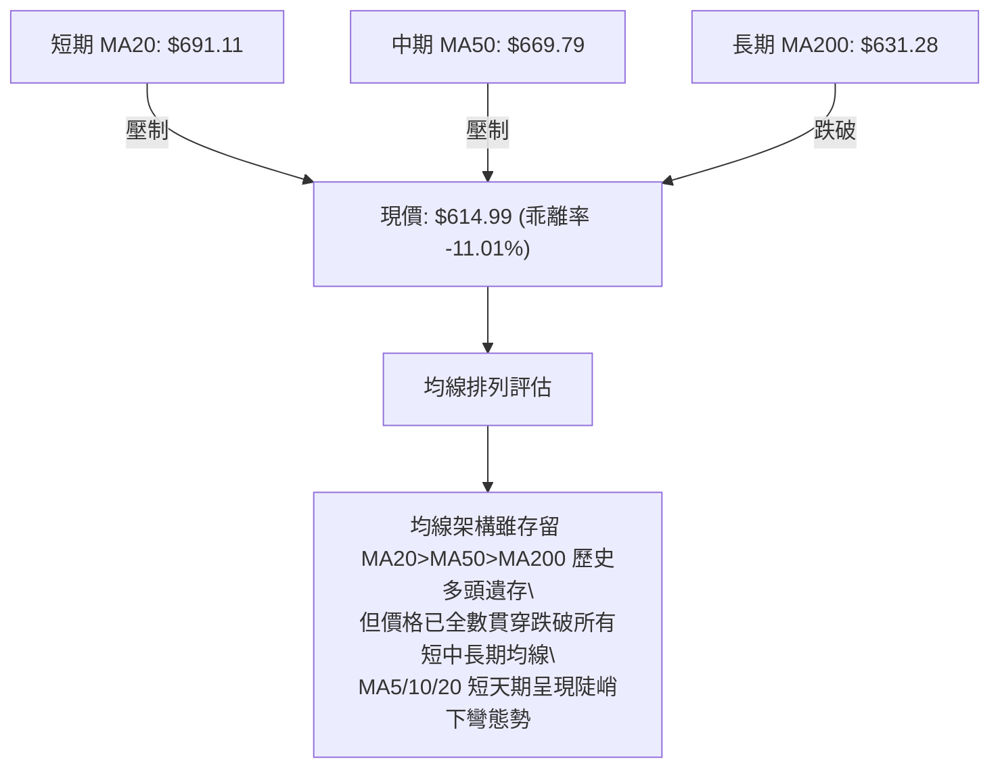
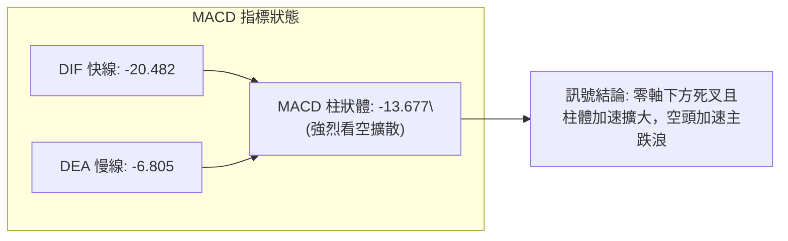
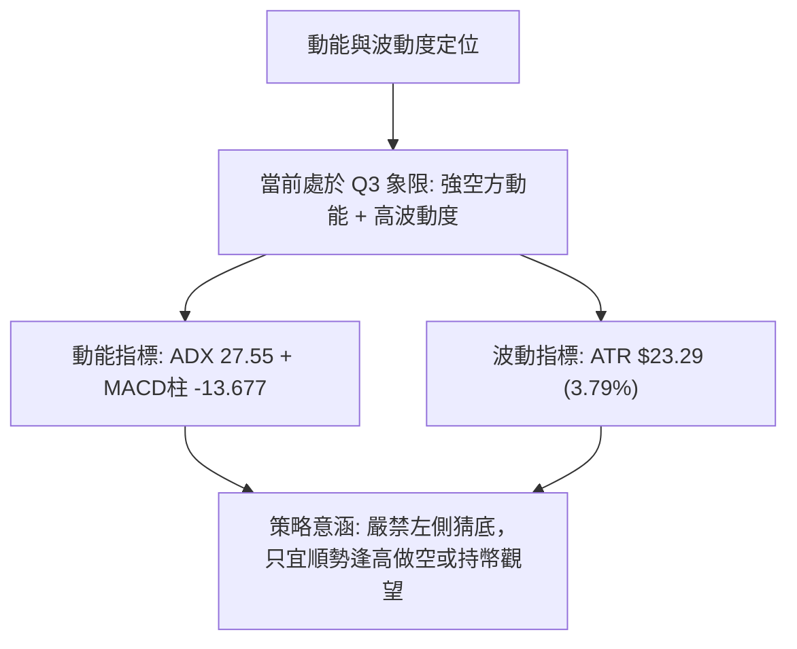
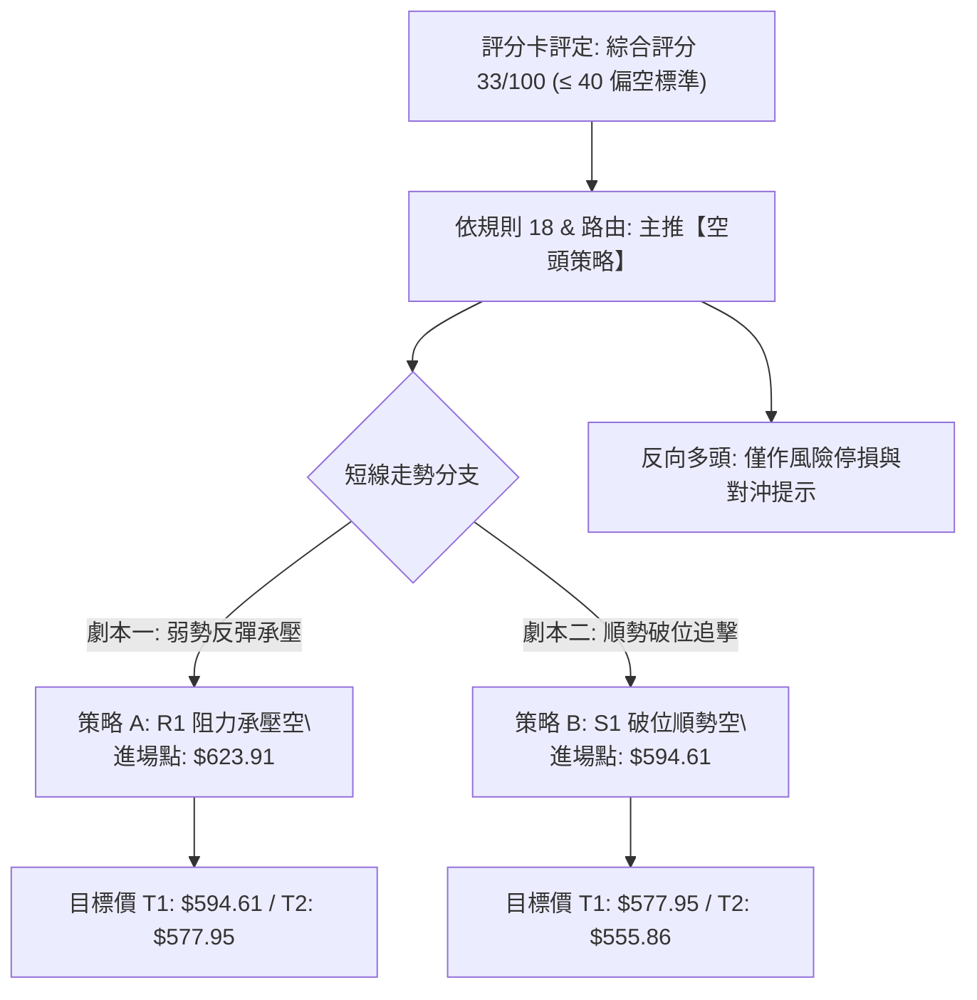
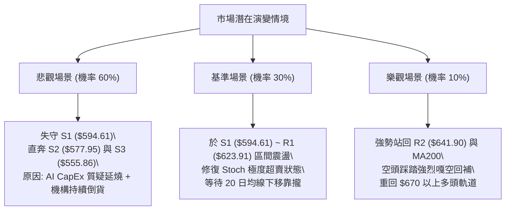

# META 技術分析報告

> **報告日期**：2026-11-01 ｜ **語言**：繁體中文 ｜ **數據來源**：Yahoo Finance ｜ **當前價格**：$614.99

---

## 目錄

| 章節 | 內容 |
|------|------|
| [1. 技術面概覽](#1-技術面概覽) | 訊號儀表板、核心指標、評分卡 |
| [2. 趨勢分析](#2-趨勢分析) | 多時框趨勢、長中短期走勢 |
| [3. 圖表形態分析](#3-圖表形態分析) | 形態識別、K線組合、目標價 |
| [4. 支撐與阻力](#4-支撐與阻力) | 關鍵價位、斐波那契回調 |
| [5. 技術指標深度解讀](#5-技術指標深度解讀) | MA/RSI/MACD/布林/成交量 |
| [6. 動能與波動率](#6-動能與波動率) | 動能評估、ATR、Beta |
| [7. 多時框架總結](#7-多時框架總結) | 時框架評分矩陣 |
| [8. 交易策略建議](#8-交易策略建議) | 多空策略、風險報酬比 |
| [9. 風險提示與監控](#9-風險提示與監控) | 監控指標、風險場景 |

---

## 1. 技術面概覽

### 🎯 技術訊號儀表板



### 📊 核心指標速覽表

| 指標類別 | 指標名稱 | 當前數值 | 訊號 | 解讀 |
|----------|----------|----------|------|------|
| **價格** | 當前收盤價 | $614.99 | 🔴 | 位於52週區間 36.7%，跌破斐波那契 61.8% 關鍵回調位 |
| **均線** | MA20 | $691.11 | 🔴 | 現價大幅落後 MA20 達 -11.01%，短線遭強烈壓制 |
| **均線** | MA50 | $669.79 | 🔴 | 現價落後 MA50 達 -8.18%，中期多頭波段遭到破壞 |
| **均線** | MA200 | $631.28 | 🔴 | 現價跌破牛熊分界線 MA200 達 -2.58%，長線結構亮紅燈 |
| **動能** | RSI(14) | 33.23 | 🟡 | 位於中性偏弱弱勢區（接近 30 超賣門檻），尚未觸發底背離 |
| **動能** | MACD (12,26,9) | -20.482 / -6.805 | 🔴 | MACD 柱為 -13.677，雙線於零軸下方持續發散，空頭加速 |
| **動能** | Stoch %K / %D | 3.69 / 5.14 | 🟢 | 深度超賣，短線技術性乖離過大，隨時存在技術反彈需求 |
| **趨勢** | ADX (14) | 27.55 | 🔴 | ADX > 25 且 -DI (32.43) 遠高於 +DI (18.52)，空頭強趨勢 |
| **通道** | Bollinger Bands | 上軌 $792.95 / 下軌 $589.26 | 🔴 | %B 為 0.13，價格緊貼下軌運行，通道開口放大 |
| **量能** | OBV / 量比 | 25.29M / 1.09x (20MA) | 🔴 | OBV 走勢低於均線，週K線連兩週放量大跌，機構籌碼派發 |
| **波動** | ATR(14) | $23.29 (3.79%) | 🔴 | 日內波動顯著加劇，下檔風險釋放尚未完全衰竭 |

### 🏆 技術評分卡

```
╔══════════════════════════════════════════════════════════════╗
║              技術評分卡 — META (2026-11-01)                 ║
╠══════════════════════════════════════════════════════════════╣
║ 趨勢強度      ██████░░░░░░░░░░░░░░  30/100  🔴 空頭強趨勢   ║
║ 動能指標      ██████░░░░░░░░░░░░░░  30/100  🔴 動能負向發散 ║
║ 支撐穩定度    ████████░░░░░░░░░░░░  40/100  🟡 臨近S1考驗   ║
║ 成交量配合    ██████░░░░░░░░░░░░░░  30/100  🔴 爆量下殺出貨 ║
║ 形態完整度    ██████░░░░░░░░░░░░░░  30/100  🔴 頂部破位加速 ║
║ 均線排列      ████████░░░░░░░░░░░░  40/100  🟡 均線扣抵下彎 ║
╠══════════════════════════════════════════════════════════════╣
║ 綜合評分      ██████░░░░░░░░░░░░░░  33/100  🔴 強烈偏空     ║
║ (依規則18：算術平均 (30+30+40+30+30+40)/6 = 33.33 -> 33)    ║
╚══════════════════════════════════════════════════════════════╝
```

---

## 2. 趨勢分析

### 🌐 多時框趨勢分析



### 📈 長期趨勢 — 12個月走勢圖（Unicode）

```
META 月線走勢圖（過去12個月：2025-11 至 2026-10）
價格軸 ($)
$750 ┤                                                 
$725 ┤                             ● 725.18            
$700 ┤        ● 714.66                                 
$675 ┤                                                 
$650 ┤ ● 645.76     ● 646.52             ● 631.43     
$625 ┤          ● 658.40             ● 610.86     ● 614.99 (現價)
$600 ┤                                                 
$575 ┤                   ● 571.15             ● 571.89 
$550 ┤                                ● 562.85 ● 556.27
     └─────────────────────────────────────────────────
       11   12   01   02   03   04   05   06   07   08   09   10
      (2025)    (2026)                                (2026)
```

**12個月走勢特徵分析表格**：

| 階段區間 | 時間區間 | 起訖收盤價 | 漲跌幅 | 走勢特徵與結構解讀 |
|----------|----------|------------|--------|--------------------|
| 階段一：跨年衝高 | 2025-11 ~ 2026-01 | $645.76 → $714.66 | +10.67% | 年底拉抬突破七百大關，機構資金推動多頭波段 |
| 階段二：春季大幅回撤 | 2026-01 ~ 2026-03 | $714.66 → $571.15 | -20.08% | 快速破位下殺，獲利了結賣壓湧現，擊穿六百關卡 |
| 階段三：箱型築底震盪 | 2026-03 ~ 2026-08 | $571.15 → $571.89 | +0.13% | 於 $550 - $630 寬幅震盪築底，7月創下波段低點 $556.27 |
| 階段四：秋季主升爆發 | 2026-08 ~ 2026-09 | $571.89 → $725.18 | +26.80% | 單月暴力拉升突破盤整區，9月週K一度創下 $779.82 年度新高 |
| 階段五：高檔假突破爆量崩跌 | 2026-09 ~ 2026-10 | $725.18 → $614.99 | -15.20% | 創高後機構全面倒貨，單月下挫逾百元，抹平秋季大半漲幅 |

### 📊 中期趨勢（週線分析）

```
META 週線阻力與支撐架構圖
══════════════════════════════════════════════════════════════
$779.82 ───────────────────────────────────── 52W 年度高點（強烈阻力）
          │  2026-09-25 爆量長十字天花板 (168M 成交量)
$671.45 ───────────────────────────────────── R3 / 密集換手頸線阻力
          │  下破起跌帶，反彈強阻力區
$641.90 ───────────────────────────────────── R2 / 前波破位起跌點
$623.91 ───────────────────────────────────── R1 / 短線反彈第一道天花板
$614.99 ═════════════════════════════════════ ◄ 當前價格 ($614.99)
$594.61 ───────────────────────────────────── S1 / 近期波段低點防禦線
$577.95 ───────────────────────────────────── S2 / 8月築底平台強支撐
$555.86 ───────────────────────────────────── S3 / 7月起漲低點防守線
$519.37 ───────────────────────────────────── 52W 年度低點（極限支撐）
══════════════════════════════════════════════════════════════
```

週線層面自 2026-09-25 創下 $779.82 天價以來，週K線連續出現「陰線吞噬」與快速崩跌，尤其在 2026-10-23 與 2026-10-30 兩週分別爆出 1.178 億與 1.739 億股的驚人拋售量，週 MACD 柱急遽翻負至 -13.677，顯示中期上升浪潮已宣告瓦解，正式進入週線級別的空頭修正浪。

### ⚡ 趨勢強度評估（ADX 解讀）



**ADX 趨勢強度對照解讀**：
- **ADX(14) = 27.55**：數值跨越 25 臨界線，顯示當前市場脫離無趨勢泥淖，形成高動能定向單邊行情。
- **+DI (18.52) vs -DI (32.43)**：空方指標 -DI 居於絕對支配地位，兩者差值高達 13.91，表明每一次盤中反彈均被空方龐大賣壓無情壓制。

---

## 3. 圖表形態分析

### 🔍 形態識別系統



**形態信心度與目標價評估表格**：

| 形態名稱 | 信心度 | 判斷依據（引用數據） | 完成度 | 目標價（附計算式） |
|----------|--------|----------------------|--------|--------------------|
| 高檔雙頂 (M-Top) | 85% | 9/25 高點 $779.82 與 10/16 高點 $771.27 形成雙峰，10/22 大陰線放量跌破頸線 $681.05 | 100% (已破位) | 頸線 $681.05 - 形態高度 ($779.82 - $681.05 = $98.77) = **$582.28**（接近S2 $577.95） |
| 下降通道破位 | 75% | 近10根日K呈現高點遞減（$713.22 → $648.04 → $634.68 → $626.37）與低點破底（$609.00） | 90% | 由通道破位推算測試波段支撐 **S1: $594.61** |
| 三尊頭肩頂 | 40% | 左肩 $750 區域欠缺清晰等高左對稱架構 | 35% | 訊號不足，僅做指標型解讀 |

### 🕯️ 重要K線形態分析

嚴格依據數據中「近10根日K」與「近8根週K」之精確 OHLC 數據進行解讀：

| 日期（日K/週K） | 開 | 高 | 低 | 收 | K線形態 | 解讀 | 訊號 |
|-----------------|----|----|----|----|---------|------|------|
| **2026-10-22 (日K)** | 676.35 | 681.07 | 639.69 | 648.85 | 放量破位長黑棒 | 實體跌破 $650，放量 40.57M 股，關鍵失守訊號 | 🔴 |
| **2026-10-23 (日K)** | 638.18 | 648.04 | 633.27 | 642.62 | 弱勢孕線十字 | 暴跌後的極弱勢抗跌，多頭無力展開反撲 | 🟡 |
| **2026-10-26 (日K)** | 638.36 | 647.69 | 627.80 | 630.56 | 下跌反曲陰線 | 開高走低，實體再度破底，量能 30.91M 股 | 🔴 |
| **2026-10-27 (日K)** | 627.07 | 628.46 | 619.21 | 620.19 | 爆量長黑K | 單日暴跌成交量達 51.33M 股，機構無情斬倉 | 🔴 |
| **2026-10-28 (日K)** | 621.85 | 624.42 | 609.00 | 612.49 | 探底長下影小黑 | 創近兩月低點 $609.00，尾盤雖有抵抗但仍收黑 | 🔴 |
| **2026-10-29 (日K)** | 621.29 | 634.68 | 616.80 | 624.52 | 多頭反彈小陽線 | 盤中反彈觸碰 $634.68 遇阻，留下長上影線 | 🟡 |
| **2026-10-30 (日K)** | 614.51 | 626.37 | 610.13 | 614.99 | 弱勢小陽吊頸 | 反彈無力，收盤跌破開盤重心，受制於 R1 | 🔴 |
| **2026-09-25 (週K)** | 680.30 | 779.82 | 679.60 | 751.66 | 爆量長上影天王線 | 成交量 1.683 億股，高檔天量倒貨假突破 | 🔴 |
| **2026-10-16 (週K)** | 728.50 | 771.27 | 702.71 | 709.33 | 倒錘頭高檔滯漲 | 次高點 $771.27 誘多確認，形成雙頂結構 | 🔴 |
| **2026-10-23 (週K)** | 707.16 | 713.22 | 633.27 | 642.62 | 大陰線破線灌壓 | 週跌幅達 66.71 元，正式跌破 MA20/MA50 | 🔴 |
| **2026-10-30 (週K)** | 638.36 | 647.69 | 609.00 | 614.99 | 爆量探底長黑 | 成交量激增至 1.739 億股，長黑貫穿直逼下軌 | 🔴 |

### 📉 ASCII 走勢形態示意圖

```
META 雙頂破位與通道加速下殺形態
價格
$780 ┤                Peak 1: $779.82
$760 ┤               ╭───╮             Peak 2: $771.27
$740 ┤              ╭╯   ╰╮           ╭───╮
$720 ┤             ╭╯     ╰╮         ╭╯   ╰╮
$700 ┤            ╭╯       ╰╮       ╭╯     ╰╮
$680 ┤───────────╭╯─────────╰───────╭╯───────╰───── 雙頂頸線 ($681.05)
$660 ┤          ╭╯           ╰╮   ╭╯         ╰╮
$640 ┤         ╭╯             ╰───╯           ╰╮ 10/22 放量跳空破位
$620 ┤        ╭╯                               ╰╮ ◄ 現價: $614.99
$600 ┤       ╭╯                                 ╰── 測 S1: $594.61
$580 ┤──────╭╯───────────────────────────────────── 形態測幅目標: $582.28
     └─────────────────────────────────────────────────────────── 時間
```

### 🎯 形態目標價計算

依據標準幾何計量模型推導：
1. **雙重頂 (M-Top) 形態高度推算**：
   - 頂部最高峰（Peak 1）：$779.82
   - 頸線支撐破位點（Neckline）：$681.05
   - 形態垂直幅度 $H = \$779.82 - \$681.05 = \$98.77$
   - 跌破頸線後之等幅向下測量目標價：
     $$\text{Target} = \text{Neckline} - H = \$681.05 - \$98.77 = \mathbf{\$582.28}$$
   - 此數值高度共振數據中的波段強支撐 **S2: $577.95**。

---

## 4. 支撐與阻力

### 🗺️ 關鍵價位分布圖（Unicode）

```
META 價位結構分布圖
═══════════════════════════════════════════════════
$671.45 ║████████████████████████║ 強阻力 R3 (+9.18%)
$649.59 ║▓▓▓▓▓▓▓▓▓▓▓▓▓▓▓▓▓▓▓▓    ║ 50% 斐波那契回調位
$641.90 ║████████████████████    ║ 阻力 R2 (+4.38%)
$631.28 ║▓▓▓▓▓▓▓▓▓▓▓▓▓▓▓▓        ║ 關鍵均線 MA200 (牛熊分水嶺)
$623.91 ║████████████████████████║ 關鍵阻力 R1 (+1.45%)
$618.86 ║▒▒▒▒▒▒▒▒▒▒▒▒▒▒▒▒▒▒▒▒▒▒▒▒║ 61.8% 斐波那契黃金分割位
$614.99 ╠════════════════════════╣ ◄ 當前收盤價 ($614.99)
$594.61 ║▓▓▓▓▓▓▓▓▓▓▓▓▓▓▓▓        ║ 近期波段支撐 S1 (-3.31%)
$589.26 ║▒▒▒▒▒▒▒▒▒▒▒▒▒▒▒▒        ║ 布林帶下軌 (極端波動界限)
$577.95 ║████████████████████████║ 強支撐 S2 (-6.02%)
$575.11 ║▓▓▓▓▓▓▓▓▓▓▓▓▓▓▓▓▓▓▓▓    ║ 78.6% 斐波那契回調位
$555.86 ║████████████████████████║ 長期強支撐 S3 (-9.62%)
═══════════════════════════════════════════════════
```

### 🚧 阻力位分析表

價位嚴格引用數據中「關鍵價位」區塊之 R1 / R2 / R3：

| 阻力級別 | 價位 | 形成原因 | 突破難度 | 重要性 |
|----------|------|----------|----------|--------|
| **R1** | **$623.91** | 近一年波段高點聚類，與 10/28、10/30 多次反彈受阻高點重疊 | 🟡 中等偏高 | 短線空頭第一道防線，未能收復則弱勢格局不變 |
| **R2** | **$641.90** | 10/23 破位反彈高點聚類，上方密集套牢解套賣壓源 | 🔴 極高 | 跌破後的反轉頸線，需巨量配合方可攻克 |
| **R3** | **$671.45** | 接近 MA50 ($669.79)，且為 10/22 大陰線開盤防守區 | 🔴 極難 | 中期多空重分嶺，此處未收復前中期全面看空 |

### 🛡️ 支撐位分析表

價位嚴格引用數據中「關鍵價位」區塊之 S1 / S2 / S3：

| 支撐級別 | 價位 | 形成原因 | 守住機率 | 重要性 |
|----------|------|----------|----------|--------|
| **S1** | **$594.61** | 近一年波段低點聚類，接近 $600 整數心理防線與布林下軌 ($589.26) | 55% | 跌破此位將加速引發順勢程式單賣壓 |
| **S2** | **$577.95** | 8月盤整底部密集區聚類，亦為雙頂形態測幅目標 $582.28 承接區 | 65% | 中期關鍵多頭防線，失守將面臨長線破位 |
| **S3** | **$555.86** | 7月波段極端低點 ($556.27) 聚類，年度多頭最後碉堡 | 80% | 一旦失守，將直測 52W 低點 $519.37 |

### 📐 斐波那契回調位分析

依據 52 週完整波動區間（低點 **$519.37** → 高點 **$779.82**），黃金分割位數據如下：

- **0.0% (52W High)**: $779.82
- **23.6%**: $718.35
- **38.2%**: $680.33（與雙頂頸線 $681.05 完美重合）
- **50.0%**: $649.59
- **61.8% (黃金分割位)**: $618.86 ◄ **現價 ($614.99) 落點**
- **78.6%**: $575.11（緊鄰強支撐 S2: $577.95）
- **100.0% (52W Low)**: $519.37

**位置深度解讀**：
當前收盤價 **$614.99** 正好跌破了極具戰略意義的 **61.8% 黃金分割回調位 ($618.86)**，目前價格運行於 **61.8% ($618.86) 至 78.6% ($575.11)** 的深次回撤區間。在經典道氏與斐波那契理論中，跌破 61.8% 代表過去一年的整段多頭上升行情已遭實質破壞，價格若不能迅速在 3 個交易日內收復 $618.86，則大概率將慣性下探 **78.6% 回調位 ($575.11)** 與支撐位 **S2 ($577.95)**。

---

## 5. 技術指標深度解讀

### 🎛️ 指標訊號總覽



### 📈 移動平均線排列分析



**均線乖離與動態演變表**：

| 均線名稱 | 當前價格 | 偏離金額 | 乖離率 (%) | 走勢微型圖表 | 技術意涵解讀 |
|----------|----------|----------|------------|--------------|--------------|
| **MA 5** | $620.55 | -$5.56 | -0.90% | ▅▅▆▇████▇▇▇▇▇▇▇▇▇███▇▆▆▅▄▃▂▁▁▁ | 極短期下壓動能強，首要反彈阻力 |
| **MA 10** | $649.14 | -$34.15 | -5.26% | ▂▃▄▅▆▆▇███████▇██████▇▇▆▆▅▃▂▁▁ | 短期下降斜率陡峭，反彈逢高減碼區 |
| **MA 20** | $691.11 | -$76.12 | -11.01% | ▁▁▂▂▃▄▄▅▅▆▆▇▇▇▇█████████▇▇▆▆▆▅ | 負乖離達到極端值 (-11%)，醞釀技術修正 |
| **MA 60** | $653.99 | -$39.00 | -5.96% | ▁▁▂▂▃▃▃▄▄▄▄▅▅▅▅▅▆▆▆▇▇▇▇███████ | 中期生命線遭帶量擊穿，趨勢轉空 |
| **MA120** | $627.75 | -$12.76 | -2.03% | ▁▁▂▂▃▄▄▄▅▅▅▆▆▆▆▆▇▇▇▇██████████ | 半年線失守，長期支撐防線瓦解 |
| **MA200** | $631.28 | -$16.29 | -2.58% | ▁▁▁▂▂▂▃▃▃▃▄▄▄▃▃▃▃▃▄▅▆▇▇███████ | 牛熊分界線告破，確認中期轉熊 |

### 📉 RSI(14) 分析

- **RSI(14) 當前讀數**：**33.23**（Wilder 平滑）
- **RSI 強度進度條**：
  ```
  [0] ░░░░░░░░░░ [30] █░░░░░░░░░ [70] ░░░░░░░░░░ [100]  33.23% (弱勢區)
  ```
- **超買超賣區間評估**：
  RSI 自 9 月底的超買區 **71.4** 連續崩落，當前數值 33.23 正處於 30–70 中性弱勢邊界，尚未正式跌入 <30 的絕對超賣區，顯示空方動能釋放雖然劇烈，但下檔尚未出現籌碼力竭之買盤抵抗。
- **背離判斷**：
  比對近 20 根 K 棒走勢，價格自高檔快速滑落連續創新低，RSI 指標同步由 60+ 陡峭滑落至 33.23，**無任何底背離跡象**（數據確認：「RSI 背離：無明顯背離」）。這意味著當前的下跌是健康的單邊順勢拋售，切忌盲目摸底。

### 📊 MACD(12/26/9) 訊號解讀



- **DIF (-20.482) vs DEA (-6.805)**：快慢線雙雙落入負值深水區，差值持續拉大。
- **柱狀圖 (Histogram) = -13.677**：負向柱體處於持續擴張階段（由 -0.743 → -5.784 → -14.283 → -13.677），雖近一週柱體跌幅微幅收斂 0.606，但絕對值仍處於高位，並未出現多頭翻揚的金叉訊號。

### 📦 布林通道分析

```
META 布林通道 (Bollinger Bands, 20, 2)
═════════════════════════════════════════════════════════════════
$792.95 ────────────────────────────────────────── BB 上軌
          │
$691.11 ────────────────────────────────────────── BB 中軌 (MA20)
          │
$614.99 ═════════════════════════════════════════ ◄ 現價 (%B = 0.13)
$589.26 ────────────────────────────────────────── BB 下軌
═════════════════════════════════════════════════════════════════
```
- **布林帶寬度 (Bandwidth)**：$(792.95 - 589.26) / 691.11 = 29.47\%$，通道呈現劇烈張口發散狀態。
- **%B 指標**：**0.13**，價格緊緊壓制在下軌（$589.26）上方微幅震盪，為標準的「沿下軌鈍化」空頭強勢走勢。

### 💹 成交量分析（量價配合度）

1. **量價關係**：
   - 最新日成交量：**25,295,900 股**，相較 20 日均量（23,141,920 股）量比為 **1.09x**。
   - 週成交量更呈現異常爆量下殺：10/23 當週成交 **1.178 億股**，10/30 當週進一步暴增至 **1.739 億股**，創下近半年最大拋售量，表明大資金具有堅決的機構離場意圖。
2. **能量潮指標 (OBV)**：
   - 官方數據確認：「OBV < MA → 量能疲弱」。OBV 跌破其移動平均線，量價配合呈現典型的「價跌量增（放量破位）」與「量能渙散」格局，確認當前價跌由主動性拋盤所主導。

---

## 6. 動能與波動率

### ⚡ 動能評估四象限

| 象限 | 動能強度 | 波動率水準 | 當前狀態標註 | 操作意涵與策略評估 |
|------|----------|------------|--------------|--------------------|
| **Q1 (最佳順勢)** | 強（多方） | 低 | — | 多頭溫和推升，最佳持股階段 |
| **Q2 (盤整觀望)** | 弱 | 低 | — | 狹幅箱型整理，欠缺方向性 |
| **Q3 (空頭釋放)** | **強（空方）** | **高** | **✓ (當前處於此象限)** | **強烈下行動能伴隨高波動，順勢做空或嚴格防禦** |
| **Q4 (底部博弈)** | 弱（鈍化） | 高 | — | 超跌後震盪築底，適合右側左側小倉試單 |



### 📊 ATR 波動率分析

- **當前 ATR(14)**：**$23.29**（佔當前股價之 **3.79%**，採 Wilder 計算法）。
- **日內真實波動幅度分析**：近 10 根日 K 中，如 10/22 單日高低震盪達 $41.38，10/26 震盪 $19.89，10/28 震盪 $15.42。高達 $23.29 的 ATR 表明價格日內雜訊與假突破機率大幅提高。
- **交易風控距離建議**：
  - **短線防守止損距離**：$1.0 \times \text{ATR} = \$23.29$
  - **波段防守止損距離**：$1.5 \times \text{ATR} = \$34.94$
  - **做空保護止損點**：若於阻力位 R1 ($623.91) 附近做空，止損應至少拉開至 R1 + 1.0 ATR 之上（即 > $647.20），以防日內高波動遭掃損。

### 📐 Beta 與市場相關性

- **Beta 係數**：**1.185**。
- **市場敏感性評估**：META 表現出高於標普 500 大盤 18.5% 的系統性波動風險。在當前大科技股面臨 AI 資本支出（TTM 資本支出達 $1,044.4 億美元）投資回報質疑、債務與現金流承壓之環境下，其高 Beta 屬性放大了股價的下行折價壓力。

---

## 7. 多時框架總結

### 📋 時框架評分表

| 時框架 | 趨勢方向 | 動能狀態 | 均線排列狀況 | 形態特徵 | 綜合評分 | 操作建議 |
|--------|----------|----------|--------------|----------|----------|----------|
| **月線 (長期)** | 🟡 震盪偏多 | 轉弱減速 | 價格回測 MA120/MA240 支撐區 | 24個月高位雙峰假突破回調 | 50/100 | 長期多單減碼防禦 |
| **週線 (中期)** | 🔴 明確看空 | 負向擴散 | 跌破週線 MA20 與 MA50 | 雙頂破位大陰線灌壓 | 25/100 | 反彈逢高減持或避險 |
| **日線 (短期)** | 🔴 強勢空頭 | 嚴重受阻 | 價格低於所有均線 (MA5~MA200) | 下降通道沿布林下軌破底 | 20/100 | 順勢逢高沽空 |

### 🔲 綜合訊號矩陣

```
訊號維度對齊矩陣：
┌────────────┬─────────────┬─────────────┬─────────────┐
│ 分析維度   │ 短期 (日線) │ 中期 (週線) │ 長期 (月線) │
├────────────┼─────────────┼─────────────┼─────────────┤
│ 趨勢方向   │   🔴 破位   │   🔴 轉空   │   🟡 修正   │
│ 動能強度   │   🔴 強空   │   🔴 強空   │   🟡 中性   │
│ 量能配合   │   🔴 爆量殺 │   🔴 機構出 │   🟡 換手   │
│ 支撐測試   │   S1考驗    │   S2考驗    │   MA200考驗 │
└────────────┴─────────────┴─────────────┴─────────────┘
```

### ⚖️ 多時框收斂結論

**依嚴格要求 14 之收斂原則**：
1. **行情定性**：當前日線 **ADX(14) = 27.55 > 25**，確立市場為高能量之「**強烈趨勢行情**」，絕非區間盤整。
2. **主導時框判定**：在趨勢行情下，嚴格以**中長期方向（週線大破位 / 跌破 MA200 $631.28）為主導**，日線所有的超賣讀數（如 Stoch %K 3.69）僅能視為超跌反彈之雜訊，不可作為反轉猜底依據。
3. **唯一方向性結論**：**強烈偏空（以反彈空為主主軸）**。此結論與第 1 章技術評分卡（33/100 偏空）高度共振，並直接決定第 8 章之主交易策略。

---

## 8. 交易策略建議

### 🗺️ 策略決策流程圖



### 🧭 策略路由（依評分卡分流）

> **當前主策略方向 = 強烈偏空（依綜合評分 33/100，嚴格符合 ≤40 偏空門檻）**
> 
> 因綜合評分僅 33/100，本報告**主推空頭策略**（反彈沽空與破位順勢空），嚴禁盲目左側抄底；多頭部分僅列為極端反轉之風控對沖提示。

### 🎯 價格情境階梯（Price Scenarios）

價位嚴格引用自下方「關鍵價位」區塊之精準數值：

| 觸發條件 | 下一目標 | 後續延伸 | 情境含義 |
|----------|----------|----------|----------|
| **反彈受阻於 R1 ($623.91)** | **S1 ($594.61)** | **S2 ($577.95)** | 短線超跌修正結束，空頭主跌浪延續 |
| **有效跌破 S1 ($594.61)** | **S2 ($577.95)** | **S3 ($555.86)** | 跌破整數關卡，雙頂測幅目標加速兌現 |
| **帶量向上突破 R1 ($623.91)** | **R2 ($641.90)** | **R3 ($671.45)** | 短線超賣引發空頭回補，轉為寬幅震盪 |

### 📊 情境機率分佈

| 情境 | 機率 | 主要依據 |
|------|------|----------|
| **延續下行 / 跌破探底** | **60%** | ADX 27.55 強空趨勢、-DI 佔優、週K連續爆量大長黑、跌破 MA200、MACD 柱負向擴散 |
| **弱勢區間震盪整理** | **30%** | Stoch %K (3.69) 與 %D (5.14) 嚴重超賣，布林通道貼下軌引發均值回歸修復需求 |
| **強烈反轉向上突破** | **10%** | 空頭動能未見衰竭，無底背離形態支撐，大額資本支出消息持續壓制買盤 |

### 🔴 主策略詳情（空頭主導）

所有價位均精確引用第 4 章關鍵價位，風險報酬比嚴格依規則 17 計算：
- 空頭風險報酬比公式：$$\text{RRR} = \frac{\text{進場價} - \text{目標價 T1}}{\text{止損價} - \text{進場價}}$$

| 策略要素 | 策略 A（反彈阻力承壓空） | 策略 B（支撐破位順勢空） |
|----------|--------------------------|--------------------------|
| **交易邏輯** | 股價短線超跌反彈至關鍵阻力 R1 遇阻回落做空 | 跌破關鍵低點聚類 S1 後順勢加碼追空 |
| **進場價格** | **$623.91**（以阻力位 R1 精確進場） | **$594.61**（以跌破支撐位 S1 精確進場） |
| **止損價格** | **$638.56**（R1 加上約 0.63 ATR 防守空間） | **$607.00**（跌破 S1 後之回抽止損線） |
| **目標價 T1** | **$594.61**（支撐位 S1） | **$577.95**（支撐位 S2） |
| **目標價 T2** | **$577.95**（強支撐位 S2） | **$555.86**（長期強支撐位 S3） |
| **風險報酬比** | **1 : 2.00（以 T1 計）**<br>計算式：$(623.91 - 594.61) / (638.56 - 623.91) = 29.30 / 14.65 = 2.00$<br>*(註：以 T2 計為 1 : 3.14)* | **1 : 1.35（以 T1 計）**<br>計算式：$(594.61 - 577.95) / (607.00 - 594.61) = 16.66 / 12.39 = 1.345 \approx 1.35$<br>*(註：以 T2 計為 1 : 3.13)* |
| **成功機率** | 65% | 60% |
| **建議倉位** | 15% | 10% |

### 🟢 反向風險觸發點（對沖提示）

- **多頭反轉觸發價位**：**$631.28**（MA200 牛熊線）及 **$641.90**（阻力位 R2）。
- **觸發後處置**：若日線收盤價強勢帶量站回 $631.28 之上，且 MACD 柱翻紅，代表高檔假突破形態被破壞，空頭策略必須全數停損離場，空單轉為觀望或建立小額對沖多單。

### ⭐ 整體訊號強度評星

```
做多訊號強度：★☆☆☆☆  (1/5星 - 僅有超賣指標支撐，均線全面破位)
做空訊號強度：★★★★☆  (4/5星 - 趨勢指標、量能、破位形態全面共振)
整體可信度：  ★★★★☆  (4/5星 - 多時框週期趨勢明確收斂)
```

---

## 9. 風險提示與監控

### ✅ 關鍵監控指標 Checklist

```
╔══════════════════════════════════════════════════════════════╗
║               META 技術風控即時監控清單                      ║
╠══════════════════════════════════════════════════════════════╣
║ [ ] 價位監控：收盤價是否跌破 S1 ($594.61)？                  ║
║ [ ] 價位監控：反彈是否受制於 R1 ($623.91)？                  ║
║ [ ] 牛熊底線：是否有效突破 MA200 ($631.28)？                 ║
║ [ ] 均線動態：MA5 ($620.55) 與 MA10 ($649.14) 下降斜率是否趨緩？║
║ [ ] 動能背離：日線 RSI 是否在 <30 區間形成經典底背離？         ║
║ [ ] 動能收斂：MACD 柱狀圖是否收斂至 -5.00 以上？              ║
║ [ ] 趨勢強度：ADX(14) 是否持續維持於 25 以上？                ║
║ [ ] 量能異動：日成交量是否異常萎縮至 1,500 萬股以下（惜售）？  ║
╚══════════════════════════════════════════════════════════════╝
```

### ⚠️ 風險場景分析



### 🛡️ 風險管理重要提醒

1. **波動放大風險**：
   - 當前 ATR 高達 **$23.29 (3.79%)**，市場日內洗盤劇烈。任何短線操作的止損幅度不得小於 1.0 ATR，避免因早盤流動性雜訊而被無謂震盪洗出場。
2. **基本面資本開支利空發酵**：
   - 財務數據顯示 Meta 資本支出 (Capex) 達 **$1,044.4 億美元**，自由現金流承壓（FCF 僅 $286.5 億美元），信用與現金流擔憂成為近期機構（近一週 1.739 億股）瘋狂拋售的主因，技術面破位背後有強烈的籌碼基本面驅動。
3. **嚴格禁止左側摸底**：
   - 儘管當前股價自 52 週高點 $779.82 回檔幅度已達 21.14%，但空方趨勢強度 ADX 仍高達 27.55 且 -DI 居高不下。在日線級別出現明確的「W底築底完成」或「MACD零下金叉」前，任何猜底買入均屬於極高風險行為。

---

## 📋 報告總結

```
╔══════════════════════════════════════════════════════════════╗
║                 META 技術分析報告總結                        ║
╠══════════════════════════════════════════════════════════════╣
║ 報告日期：2026-11-01                                         ║
║ 當前價格：$614.99                                            ║
║ 分析評級：🔴 強烈偏空（技術綜合評分：33 / 100）              ║
║                                                              ║
║ 關鍵結論：                                                   ║
║ ├─ 長期趨勢：🟡 高檔雙頂回調，年線 MA200 宣告失守           ║
║ ├─ 中期趨勢：🔴 週線爆量長黑，跌破 61.8% 斐波那契回調位     ║
║ ├─ 短期趨勢：🔴 ADX 27.55 空頭強趨勢，沿布林通道下軌弱勢運行║
║ ├─ 關鍵支撐：S1: $594.61  /  S2: $577.95  /  S3: $555.86     ║
║ ├─ 關鍵阻力：R1: $623.91  /  R2: $641.90  /  R3: $671.45     ║
║ └─ 分析師目標：均價 $848.38（技術面與基本面產生重大分歧）    ║
║                                                              ║
║ 最優策略組合：                                               ║
║ 1. 🥇 最佳機會：策略 A（反彈至 R1 $623.91 遇阻做空，        ║
║                  止損 $638.56，目標 $594.61，風報比 1:2.00） ║
║ 2. 🥈 次選機會：策略 B（跌破 S1 $594.61 順勢追空，          ║
║                  止損 $607.00，目標 $577.95，風報比 1:1.35） ║
║ 3. 🥉 保守選擇：空手觀望，靜待股價回測 S2 $577.95 出現      ║
║                  日線底背離止跌訊號再行決策                  ║
╚══════════════════════════════════════════════════════════════╝
```

---

> ⚠️ **免責聲明**：本報告為 AI 自動生成之技術分析，所有數據及估算均基於提供的歷史價格資訊。本報告**僅供研究與學術參考**，**不構成任何投資建議**。投資有風險，入市需謹慎。

---

*報告生成時間：2026-11-01 ｜ 數據來源：Yahoo Finance ｜ 分析框架：多時框技術分析*