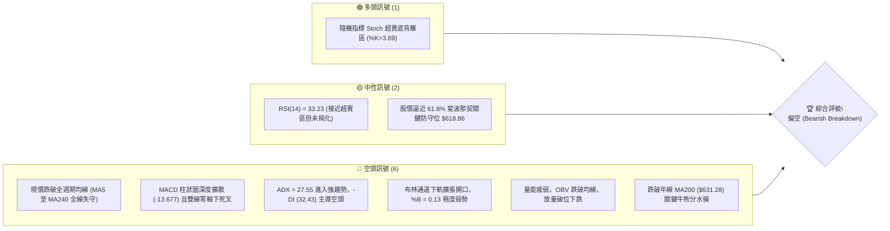
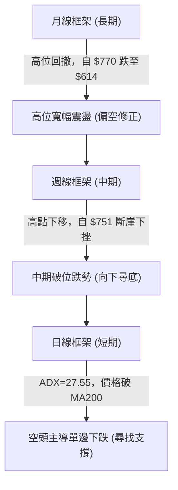
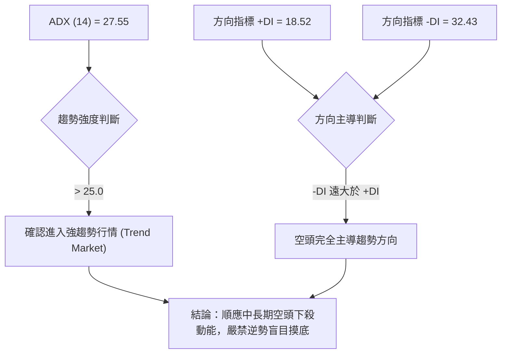
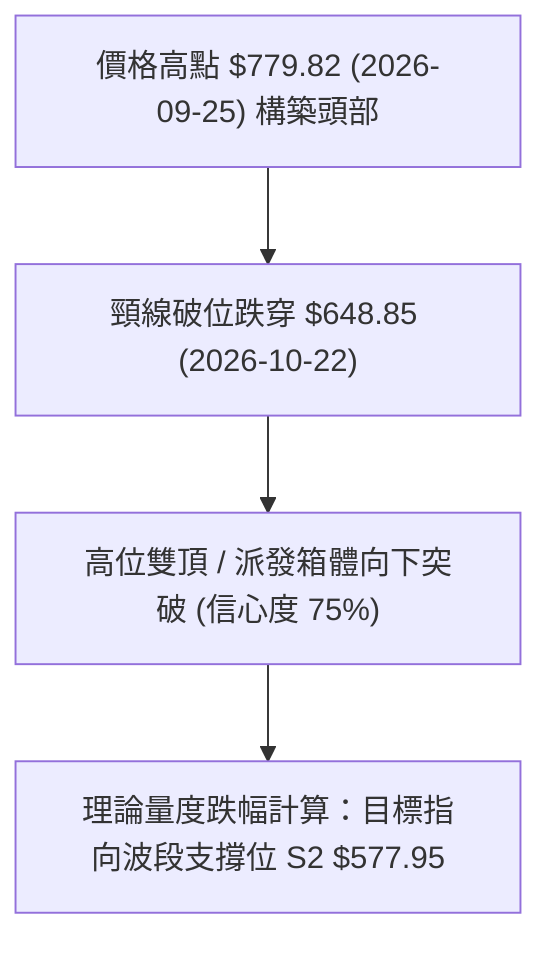
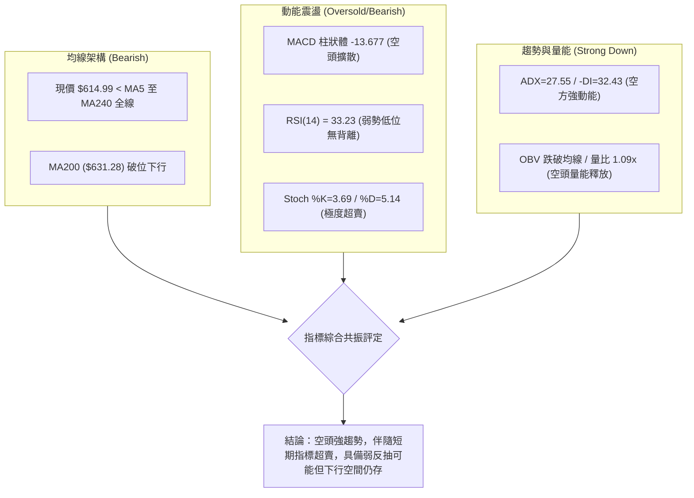
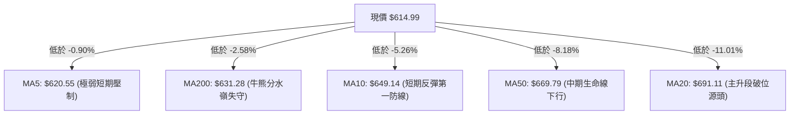
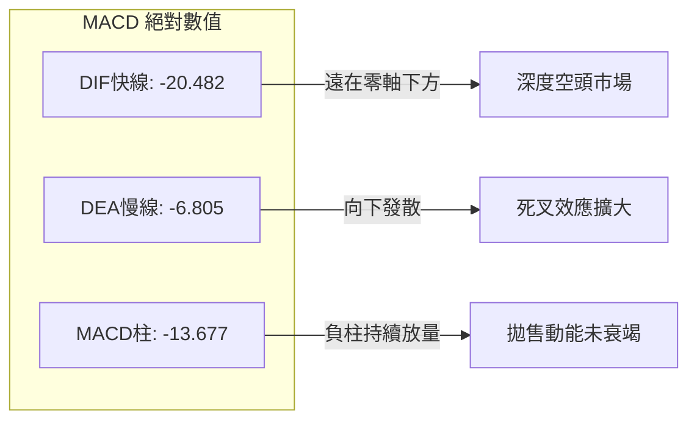
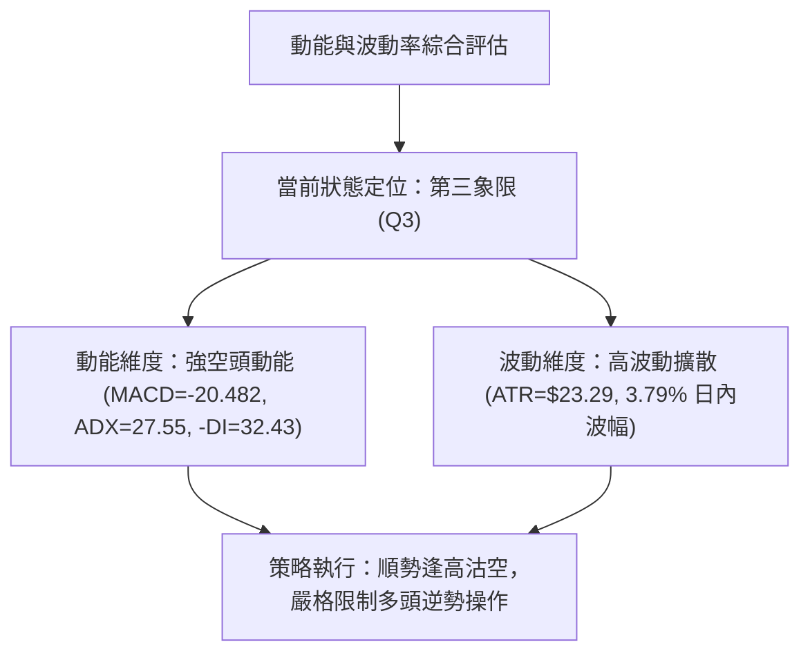
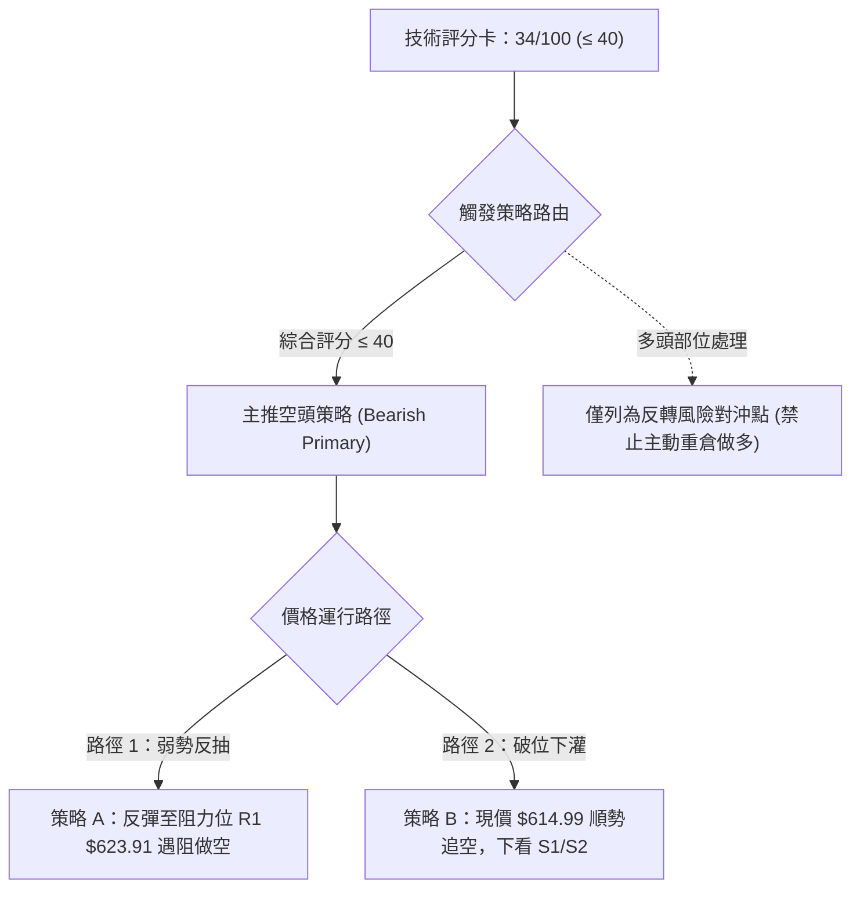
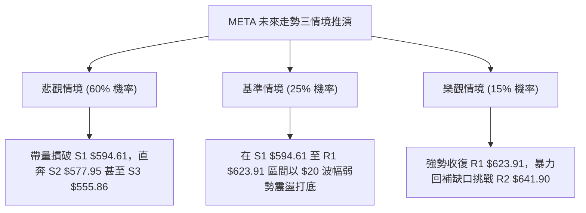

# META 技術分析報告

> **報告日期**：2026-11-02 ｜ **語言**：繁體中文 ｜ **數據來源**：Yahoo Finance ｜ **當前價格**：$614.99

---

## 目錄

| 章節 | 內容 |
|------|------|
| [1. 技術面概覽](#1-技術面概覽) | 訊號儀表板、核心指標、評分卡 |
| [2. 趨勢分析](#2-趨勢分析) | 多時框趨勢、長中短期走勢、ADX 解讀 |
| [3. 圖表形態分析](#3-圖表形態分析) | 形態識別、K線組合、目標價推算 |
| [4. 支撐與阻力](#4-支撐與阻力) | 關鍵價位結構、斐波那契回調 |
| [5. 技術指標深度解讀](#5-技術指標深度解讀) | MA/RSI/MACD/布林通道/成交量 |
| [6. 動能與波動率](#6-動能與波動率) | 動能四象限、ATR 波動率、Beta |
| [7. 多時框架總結](#7-多時框架總結) | 時框架矩陣、多時框收斂結論 |
| [8. 交易策略建議](#8-交易策略建議) | 主策略路由、情境階梯、風報比 |
| [9. 風險提示與監控](#9-風險提示與監控) | 監控清單、情境分析、風控準則 |

---

## 1. 技術面概覽

### 🎯 技術訊號儀表板



---

### 📊 核心指標速覽表

| 指標類別 | 指標名稱 | 當前數值 | 訊號 | 解讀 |
|----------|----------|----------|------|------|
| **價格** | 當前收盤價 | $614.99 | 🔴 | 位於 52 週區間 36.7% 分位，失守所有主要均線支撐 |
| **均線** | MA20 | $691.11 | 🔴 | 現價大幅低於 MA20 (-11.01%)，中期空頭掌控 |
| **均線** | MA50 | $669.79 | 🔴 | 現價低於 MA50 (-8.18%)，季線下行形成強大中期反壓 |
| **均線** | MA200 | $631.28 | 🔴 | 現價跌破長週期牛熊線 (-2.58%)，長期結構轉弱 |
| **趨勢** | ADX (14) | 27.55 | 🔴 | ADX > 25 且 -DI (32.43) 遠高於 +DI (18.52)，空頭強趨勢 |
| **動能** | RSI (14) | 33.23 | 🟡 | 位於弱勢中性區，尚未出現超賣拐頭訊號 |
| **動能** | MACD (12,26,9) | -20.482 / -6.805 | 🔴 | 柱狀圖 -13.677 持續擴大，空頭動能尚未衰竭 |
| **動能** | Stoch %K / %D | 3.69 / 5.14 | 🟢 | 進入極度超賣區間 (<20)，隨時具備技術性反抽動能 |
| **通道** | 布林通道 | 下軌 $589.26 | 🔴 | %B = 0.13，沿下軌單邊下挫，帶狀開口持續發散 |
| **波動** | ATR (14) | $23.29 (3.79%) | 🟡 | 日內波幅達 3.79%，波動度維持高位，洗盤風險高 |
| **量能** | OBV / 量比 | 1.09x (OBV < MA) | 🔴 | 成交量比略微放大，但 OBV 呈下行破位，資金外流 |

---

### 🏆 技術評分卡

```
╔══════════════════════════════════════════════════════════════╗
║              技術評分卡 — META (2026-11-02)                  ║
╠══════════════════════════════════════════════════════════════╣
║ 趨勢強度      ███████░░░░░░░░░░░░░  35/100  🔴 空頭強趨勢主導 ║
║ 動能指標      █████░░░░░░░░░░░░░░░  25/100  🔴 MACD重度下散  ║
║ 支撐穩定度    █████████░░░░░░░░░░░  45/100  🟡 臨近S1與斐波位║
║ 成交量配合    ███████░░░░░░░░░░░░░  35/100  🔴 下跌放量OBV弱 ║
║ 形態完整度    ██████░░░░░░░░░░░░░░  30/100  🔴 頭部頸線破位  ║
║ 均線排列      ███████░░░░░░░░░░░░░  34/100  🔴 價格全線破均  ║
╠══════════════════════════════════════════════════════════════╣
║ 綜合評分      ███████░░░░░░░░░░░░░  34/100  🔴 評級：強烈偏空 ║
╚══════════════════════════════════════════════════════════════╝
```
*(註：綜合評分由六項子評分算術平均計算：(35 + 25 + 45 + 35 + 30 + 34) ÷ 6 = 204 ÷ 6 = 34 分，依規則 18 四捨五入為整數 34/100，評級屬顯著偏空區間 ≤40)*

---

## 2. 趨勢分析

### 🌐 多時框趨勢分析



---

### 📈 長期趨勢 — 12個月走勢圖（Unicode）

依據月度收盤價歷史數據，過去 12 個月（2025-11 至 2026-10）價格軌跡如下：

```
META 月線收盤走勢圖（過去12個月：2025-11 至 2026-10）
價格軸 ($)
$750 ┤                                      ● $725.18 (2026-09)
$720 ┤                  ● $714.66 (2026-01) │
$690 ┤                  │                   │
$660 ┤          ●$658.40│   ● $646.52       │
$630 ┤ ● $645.76│       │   │       ●$631.43│       ● $614.99 (當前)
$600 ┤          │       │   │   ●$610.86    │       │
$570 ┤          │       │   ●$571.15        │   ●$571.89
$540 ┤          │       │                   ●$556.27(波段低點 2026-07)
     └──────────┴───────┴───┴───┴───┴───┴───┴───┴───┴───────
        2025-11  12    01  02  03  04  05  06  07  08  09  10 (2026)
```

#### 走勢特徵分析表格

| 階段區間 | 月度起訖 | 起訖收盤價 | 區間漲跌幅 | 主要走勢特徵 |
|----------|----------|------------|------------|--------------|
| **第 1 階段：年初衝高** | 2025-11 → 2026-01 | $645.76 → $714.66 | +10.67% | 沿中期均線穩步推升，創出波段收盤高點 $714.66 |
| **第 2 階段：春季回殺** | 2026-01 → 2026-03 | $714.66 → $571.15 | -20.08% | 出現斷崖式快速去槓桿，直接回吐前三個月全部漲幅 |
| **第 3 階段：夏季築底** | 2026-03 → 2026-07 | $571.15 → $556.27 | -2.60% | 區間於 $550–$630 劇烈洗盤，7月探出波段低點 $556.27 |
| **第 4 階段：秋季拉抬** | 2026-07 → 2026-09 | $556.27 → $725.18 | +30.36% | 強力軋空噴出，觸及 52 週最高價 $779.82，月收 $725.18 |
| **第 5 階段：當前跳水** | 2026-09 → 2026-10 | $725.18 → $614.99 | -15.19% | 突發性放量跳空急跌，失守 $650 關口與長短期各均線 |

---

### 📊 中期趨勢（週線分析）

```
META 近期週線結構與關鍵價位示意圖
══════════════════════════════════════════════════════════════════
 52W 高點 $779.82 ───────────────┐ (09-25 週衝頂遇阻)
                                 │
 反彈阻力 R3 $671.45 ────────────┼────────── 週線反彈極限
                                 │
 關鍵頸線 R2 $641.90 ────────────┼────────── 10-23 週收盤位 $642.62
                                 │
 短線阻力 R1 $623.91 ────────────┼────────── 10-30 週實體高點反壓
                                 │
 當前收盤 $614.99 ───────────────★ ◄ 現價 (10-30 週收)
                                 │
 關鍵支撐 S1 $594.61 ────────────┼────────── 07-24 週收盤支撐
                                 │
 強度支撐 S2 $577.95 ────────────┼────────── 08-28 週收盤支撐
                                 │
 52W 低點區 S3 $555.86 ──────────┴────────── 07-31 週低位防線
══════════════════════════════════════════════════════════════════
```

- **中期均線狀態**：儘管長期均線呈現 MA20 ($691.11) > MA50 ($669.79) > MA200 ($631.28) 的多頭遺留架構，但價格以大陰線直接摜破 MA200，形成了典型的**「均線多頭排列下的價格破位反轉」**。
- **週線動能逆轉**：週線 MACD 柱狀圖在 2026-09-25 達到頂點 +11.729 後，僅用 5 週時間迅速翻負至 -13.677；週線 RSI 從 71.4 崩跌至 33.2，顯示中期多頭籌碼全面瓦解。

---

### ⚡ 趨勢強度評估（ADX 解讀）



#### ADX 趨勢強度對照表

| 指標名稱 | 實際數據 | 閾值標準 | 狀態確認 | 策略含義 |
|----------|----------|----------|----------|----------|
| **ADX (14)** | **27.55** | > 25.0 | 🟢 強趨勢生效 | 市場已脫離無趨勢震盪，屬於高動能單邊運行 |
| **+DI (14)** | **18.52** | < 20.0 | 🔴 多頭動能匱乏 | 多方缺乏推進力，反彈缺乏連續性買盤 |
| **-DI (14)** | **32.43** | > 30.0 | 🔴 空頭極度強勢 | 空方拋壓沈重，主導市場定價權 |
| **趨勢綜合** | **空頭趨勢** | -DI 領先 13.91 | 🔴 空方單邊行情 | **依規則 14：ADX > 25 判定為趨勢行情，以中長期空向為主導，日線僅用來尋找逢高放空時機** |

---

## 3. 圖表形態分析

### 🔍 形態識別系統



#### 形態識別與信心度評估表

| 形態名稱 | 信心度 | 判斷依據（引用數據） | 完成度 | 目標價（附計算式） |
|----------|--------|----------------------|--------|--------------------|
| **高位破位雙頂 / 派發形態** | **75%** | 2026-09-25 創高 $779.82 後回落，10-16 週再次反抽至高點 $771.27 未能破頂形成雙頂；隨後 10-22 日K長黑跌破頸線低點聚類 | **85%** | 頸線聚類 $641.90 (R2) − 形態波幅 ($671.45 − $641.90 = $29.55) = **$612.35**（現價 $614.99 已基本達成第一量度），進一步延伸測幅指向 S2 **$577.95** |
| **頭肩頂形態** | **35%** | 左肩約 $713–$750，頭部 $779.82，右肩 $771.27；但左右肩寬度極不對稱，時間結構不足 | **30%** | **訊號不足，僅做指標型解讀（依規則 15，信心度 < 50% 不予採納幾何測幅）** |
| **均線死叉空頭排列** | **85%** | 現價連破 MA5 ($620.55)、MA10 ($649.14)、MA20 ($691.11)、MA200 ($631.28) | **90%** | 指標型空頭共振，反抽壓力在 R1 $623.91 與 R2 $641.90 |

---

### 🕯️ 重要 K 線形態分析

嚴格依據提供的「近10根日K」與「近8根週K」原始開高低收數據進行組合識別：

#### 近 10 根日 K 線形態解讀

| 日期 | 開盤價 | 最高價 | 最低價 | 收盤價 | K線形態名稱 | 技術解讀 | 訊號 |
|:---:|:---:|:---:|:---:|:---:|:---:|:---|:---:|
| **2026-10-19** | 707.16 | 708.83 | 693.86 | 705.44 | 小陰十字線 | 700 關口多空拉鋸，實體狹小，顯露上攻乏力 | 🟡 |
| **2026-10-20** | 694.98 | 696.51 | 681.05 | 694.25 | 帶下影陰線 | 跳空低開跌破 700 關口，盤中回踩 681 獲短暫抵抗 | 🔴 |
| **2026-10-21** | 697.60 | 713.22 | 689.68 | 697.52 | 長上影十字星 | 多頭試圖反抽 713.22 遭空頭迎頭痛擊，誘多確認 | 🔴 |
| **2026-10-22** | 676.35 | 681.07 | 639.69 | 648.85 | **放量大陰線** | **跳空低開 21 點，成交量放大至 4,057 萬股，形成斷崖式破位** | 🔴 |
| **2026-10-23** | 638.18 | 648.04 | 633.27 | 642.62 | 孕線小陽線 | 縮量至 1,479 萬股，恐慌拋盤暫歇，技術性抵抗 | 🟡 |
| **2026-10-26** | 638.36 | 647.69 | 627.80 | 630.56 | 下行破位小陰 | 再次跌破前一日低點，下探 627.80，反彈夭折 | 🔴 |
| **2026-10-27** | 627.07 | 628.46 | 619.21 | 620.19 | **巨量空頭灌壓陰** | **成交量暴增至 5,133 萬股，跌破 620，機構不計代價出逃** | 🔴 |
| **2026-10-28** | 621.85 | 624.42 | 609.00 | 612.49 | 破底陰錘頭星 | 創出波段新低 609.00，尾盤雖有回抽但仍收低於 613 | 🔴 |
| **2026-10-29** | 621.29 | 634.68 | 616.80 | 624.52 | 短陽反彈線 | 嘗試反撲 MA5，高見 634.68 遇阻回落，成交量未見放大 | 🟡 |
| **2026-10-30** | 614.51 | 626.37 | 610.13 | 614.99 | 弱勢小陰線 | 再次受制於 MA5 ($620.55)，收盤逼近 610 低位，空方續抱 | 🔴 |

#### 近 8 根週 K 線形態解讀

| 週結束日 | 開盤價 | 最高價 | 最低價 | 收盤價 | 週K形態名稱 | 宏觀技術解讀 | 訊號 |
|:---:|:---:|:---:|:---:|:---:|:---:|:---|:---:|
| **2026-09-11** | 615.72 | 663.72 | 609.26 | 647.52 | 突破長陽週K | 突破 630 均線聚集區，開啟強勢上攻 | 🟢 |
| **2026-09-18** | 657.31 | 689.61 | 648.71 | 665.23 | 續漲實體陽K | 均線向上發散，多方主力加速進場推升 | 🟢 |
| **2026-09-25** | 680.30 | 779.82 | 679.60 | 751.66 | **爆量噴出長陽** | **成交量暴增至 1.68 億股，觸及 52W 高點 $779.82，出現竭盡性買盤** | 🟡 |
| **2026-10-02** | 750.04 | 750.58 | 713.19 | 728.08 | 高位流星倒錘 | 衝高無力，收盤跌破開盤，量縮滯漲 | 🔴 |
| **2026-10-09** | 727.71 | 747.60 | 711.68 | 718.67 | 頂部整理陰線 | 週線形成高位次高點，成交量萎縮，買盤不濟 | 🔴 |
| **2026-10-16** | 728.50 | 771.27 | 702.71 | 709.33 | **假突破長上影** | **最高觸及 $771.27 形成次高雙頂，隨後大跳水收最低，誘多套牢** | 🔴 |
| **2026-10-23** | 707.16 | 713.22 | 633.27 | 642.62 | **週線斷頭鍘刀** | **暴跌 66.71 點 (-9.40%)，一舉摜破 MA20 與 MA50** | 🔴 |
| **2026-10-30** | 638.36 | 647.69 | 609.00 | 614.99 | **巨量下挫破位K** | **週成交量放大至 1.739 億股，實體收低跌破 MA200，空頭全勝** | 🔴 |

---

### 📉 ASCII 走勢形態示意圖

```
META 近兩個月日線雙頂派發與破位下挫走勢圖
================================================================================
$780 ┤               ▲ 頭部 09-25 ($779.82)
$760 ┤              / \             ▲ 次高雙頂 10-16 ($771.27)
$740 ┤             /   \           / \
$720 ┤            /     \         /   \
$700 ┤           /       ●───────●     \ 
$680 ┤          /         10-02  10-09  \
$660 ┤         /                         \
$640 ┤════════●═══════════════════════════▼ 頸線位破位 10-22 ($648.85)
$620 ┤       /                             \      
$600 ┤      /                               ●───★ 現價 $614.99 (10-30)
$580 ┤     /                                     │ (向下尋找 S1 $594.61)
     └─────┴─────────────────────────────────────┴──────────────────────────────
         09-11 09-18 09-25 10-02 10-09 10-16 10-23 10-30 (日期)
================================================================================
```

---

### 🎯 形態目標價計算

1. **破位頸線計算基準**：以高位震盪平台下緣、10-22 跳空破位前的多重低點聚類確定為阻力位 R2 **$641.90**。
2. **形態高度測算**：形態頂部次高點高點聚類為阻力位 R3 **$671.45**，形態波幅高度 $H = \$671.45 - \$641.90 = \$29.55$。
3. **第一下行目標價 (T1)**：
   $$\text{目標價 T1} = \text{頸線 R2} - H = \$641.90 - \$29.55 = \$612.35$$
   *(當前收盤價 $614.99 已精準回測至該測幅點位附近，最低見 $609.00，基本完成第一量度跌幅)*。
4. **第二下行目標價 (T2)**：若進一步跌破第一支撐位 S1 **$594.61**，則按 52 週波段斐波那契回調空間尋求支撐，對應關鍵支撐位 S2 **$577.95**。

---

## 4. 支撐與阻力

### 🗺️ 關鍵價位分布圖（Unicode）

```
META 價位結構分布圖（嚴格依據 OHLCV 聚類計算數值）
══════════════════════════════════════════════════════════════════════
$671.45 ║████████████████████████████████████████║ 強阻力 R3 (波段高點/形態上沿)
$641.90 ║████████████████████████████            ║ 阻力 R2 (頸線阻力/跳空缺口)
$623.91 ║████████████████                        ║ 關鍵阻力 R1 (MA5反壓/近期回抽高點)
$614.99 ╠════════════════════════════════════════╣ ◄ 當前收盤價 (現價)
$594.61 ║▓▓▓▓▓▓▓▓▓▓▓▓▓▓▓▓                        ║ 近期支撐 S1 (近一年波段低點聚類)
$577.95 ║████████████████████████                ║ 強支撐 S2 (78.6%斐波重合支撐)
$555.86 ║████████████████████████████████████    ║ 終極強支撐 S3 (52W底部防線)
══════════════════════════════════════════════════════════════════════
```

---

### 🚧 阻力位分析表

*(嚴格引用數據中「關鍵價位」區塊數值)*

| 阻力級別 | 具體價位 | 距離現價 | 形成原因 | 突破難度 | 重要性評級 |
|:---:|:---:|:---:|:---|:---:|:---:|
| **R1** | **$623.91** | +1.45% | 近 5 日反彈高點聚類、MA5 ($620.55) 與 61.8% 斐波回調位 ($618.86) 重合反壓 | 中等 | ★★★☆☆ |
| **R2** | **$641.90** | +4.38% | 10-23 週收盤位、10-22 跳空長黑實體下邊界、MA200 ($631.28) 破位反抽阻力 | 極高 | ★★★★☆ |
| **R3** | **$671.45** | +9.18% | 波段成交密集峰頂、MA50 ($669.79) 季線反壓、中期頭部頸線最高聚類 | 堅不可摧 | ★★★★★ |

---

### 🛡️ 支撐位分析表

*(嚴格引用數據中「關鍵價位」區塊數值)*

| 支撐級別 | 具體價位 | 距離現價 | 形成原因 | 守住機率 | 重要性評級 |
|:---:|:---:|:---:|:---|:---:|:---:|
| **S1** | **$594.61** | -3.31% | 近一年波段低點聚類、整數心理關卡 $600 下方防守墊、布林下軌 ($589.26) 區域 | 50% | ★★★☆☆ |
| **S2** | **$577.95** | -6.02% | 2026-08-28 週線收盤支撐位、斐波那契 78.6% 回調位 ($575.11) 強共振區 | 70% | ★★★★☆ |
| **S3** | **$555.86** | -9.62% | 2026-07-31 週線波段極限低點 ($556.27)、52 週區間底層實體防線 | 85% | ★★★★★ |

---

### 📐 斐波那契回調位分析

依據 52 週極值區間（低點 **$519.37** → 高點 **$779.82**，總垂直落差 **$260.45**）精確計算之回調位分布如下：

| 斐波那契回調級別 | 精確價位 | 距離現價 | 技術含義與當前狀態解析 |
|:---:|:---:|:---:|:---|
| **0.0% (52W High)** | **$779.82** | +26.80% | 歷史多頭衝頂極值，2026-09-25 創下，目前構成長期絕對頂部天花板 |
| **23.6%** | **$718.35** | +16.81% | 第一淺度回調位，10-09 週收盤跌破後，標誌多頭主升浪正式終結 |
| **38.2%** | **$680.33** | +10.62% | 關鍵強弱分界線，與 MA20 ($691.11) 共同構成反彈不可逾越的鴻溝 |
| **50.0%** | **$649.59** | +5.63% | 多空平衡中軸，與 MA10 ($649.14) 精準重疊，失守後宣告多方棄守中樞 |
| **61.8% (黃金分割)** | **$618.86** | +0.63% | **當前價格核心爭奪位**：現價 $614.99 已小幅擊穿 61.8% 黃金分割點位！依道氏理論與技術幾何原則，一旦收盤連續實體跌破 61.8%，行情大概率向 78.6% 尋底 |
| **78.6%** | **$575.11** | -6.48% | 深度防禦回調位，與強支撐 S2 ($577.95) 形成雙重共振，為空頭終極防禦緩衝區 |
| **100.0% (52W Low)**| **$519.37** | -15.55% | 52 週年度最低點，全年生死線 |

---

## 5. 技術指標深度解讀

### 🎛️ 指標訊號總覽



---

### 📈 移動平均線排列分析



#### 均線矩陣詳細狀態

| 均線名稱 | 數值 | 現價乖離率 | 走勢特徵 | 訊號方向 | 技術含義解讀 |
|:---|:---:|:---:|:---|:---:|:---|
| **MA5** | $620.55 | -0.90% | 下行 | 🔴 | 超短線動態反壓，近 5 日收盤始終受壓於該線下方 |
| **MA10** | $649.14 | -5.26% | 陡峭下行 | 🔴 | 與 50% 斐波位重疊，短線空頭防守主要線位 |
| **MA20** | $691.11 | -11.01% | 拐頭向下 | 🔴 | 月線中樞完全失守，布林中軌所在位置 |
| **MA60** | $653.99 | -5.96% | 下行 | 🔴 | 季線下移，確認中期籌碼已全線套牢 |
| **MA120**| $627.75 | -2.03% | 平緩轉跌 | 🔴 | 半年線支撐遭直接貫穿，支撐轉為反壓 |
| **MA200**| $631.28 | -2.58% | 走平走弱 | 🔴 | **長線牛熊線失守**，機構資金防守線被擊穿 |
| **MA240**| $633.09 | -2.86% | 停滯轉弱 | 🔴 | 年線失守，宣告過去一年多頭趨勢終結 |

---

### 📉 RSI(14) 分析

- **RSI 數值**：**33.23** (Wilder 計算法)
- **進度條展示**：
  ```
  0 [█████████████░░░░░░░░░░░░░░░] 100  (當前 RSI: 33.23 — 弱勢區間)
  ```
- **超買超賣狀態**：指標雖已跌至 30 附近，但**尚未進入 30 以下的嚴格超賣區間**，說明賣盤力量尚未出現枯竭現象，仍有向下摜壓動能。
- **背離判斷**：
  - 根據近 20 根 K 棒的首尾對比（2026-10-19 收 $705.44，RSI 在 50 以上；2026-10-30 收 $614.99，RSI 跌至 33.23），**價格持續創波段新低，RSI 同步創波段新低，呈現標準的「同向破位運行」，無任何底背離或頂背離跡象**。

---

### 📊 MACD(12/26/9) 訊號解讀



- **柱狀圖解讀**：MACD Hist 為 **-13.677**，柱狀體處於顯著負向擴張態勢，顯示空頭下墜的加速度並未出現收斂，空頭能量釋放充分。
- **零軸關係**：DIFF (-20.482) 與 DEA (-6.805) 雙雙跌破零軸並持續擴大負向間距，確認當前屬於極度危險的「零下雙線發散死叉」階段，此階段的反彈多為「誘多弱抽」。

---

### 📦 布林通道分析

```
META 布林通道結構示意圖 (日線參數: 20, 2)
══════════════════════════════════════════════════════════════════
 $792.95 ────────────────────────────────────── BB 上軌 (極度偏離)
                                                ▲
                                                │
 $691.11 ────────────────────────────────────── BB 中軌 (MA20 基準反壓)
                                                │
                                                ▼
 $614.99 ──────────────────────────────★ 現價 (%B = 0.13)
 $589.26 ────────────────────────────────────── BB 下軌 (動態下行支撐)
══════════════════════════════════════════════════════════════════
```

- **帶狀特徵**：通道帶寬極度張開（上軌 $792.95，下軌 $589.26，通道寬度達 $203.69），顯示市場正在經歷單邊強烈擴散。
- **%B 指標解析**：當前 **%B = 0.13**，極度逼近 0（下軌）。股價緊貼下軌運行，尚未出現收進通道內側的止跌長下影，說明下行軌道通暢，下軌 $589.26 將成為空頭慣性下衝的直接引力位。

---

### 💹 成交量分析（量價配合度）

- **最新成交量**：**25,295,900 股**。
- **均量對比**：相較於 20 日均量 (23,141,920 股)，量比達到 **1.09x**；相較於 50 日均量 (22,018,284 股)，維持在 1.15x。
- **量價關係**：
  - 在 10-22（4,057 萬股）與 10-27（5,133 萬股）的急跌過程中，成交量均呈現倍數級放大，顯露出顯著的**「放量破位殺跌」**特徵。
  - 10-30 週線成交量更是爆出 **1.739 億股**的天量，顯示大級別資金進行籌碼出清。
- **OBV 能量潮解讀**：
  - 數據明確顯示 **OBV < MA**，能量潮均線空頭排列，量能結構嚴重疲弱，資產處於持續失血狀態，量價出現同向下行的空頭共振。

---

## 6. 動能與波動率

### ⚡ 動能評估四象限

| 象限分區 | 動能維度 (Momentum) | 波動率維度 (Volatility) | META 當前狀態 | 評估含義與戰術指示 |
|:---:|:---:|:---:|:---:|:---|
| **第一象限 (Q1)** | 強多頭動能 | 低波動 | — | 最佳趨勢抱牢機會 |
| **第二象限 (Q2)** | 弱多頭動能 | 低波動 | — | 橫盤死水，謹慎觀望 |
| **第三象限 (Q3)** | **強空頭動能** | **高波動** | **✓ (當前所處象限)** | **高風險高波動下跌浪：空頭掌控，波動加劇，順勢放空或空倉防禦** |
| **第四象限 (Q4)** | 弱動能鈍化 | 高波動 | — | 洗盤震盪，避免被雙巴 |



---

### 📊 ATR 波動率分析

- **當前 ATR(14)**：**$23.29**（佔現價比率達 **3.79%**，採 Wilder 平滑計算法）。
- **波動特性分析**：每日近 $24 美元的平均波動空間，代表短期盤中容易出現超過 15–20 美元的「毛刺」干擾。
- **風控止損建議**：
  - **超短線策略**：止損幅度不可小於 0.75× ATR（約 $17.47）。
  - **波段趨勢策略**：建議採用 **1.0× 至 1.5× ATR**（約 **$23.29 – $34.94**）作為保護性止損間距，避免在盤中正常隨機雜訊中被非理性震出。

---

### 📐 Beta 與市場相關性

- **Beta 係數**：**1.185**。
- **市場連動含義**：
  - META 屬於典型的**高貝塔 (High-Beta) 權值成長股**，其價格波動幅度高於標普 500 指數約 18.5%。
  - 當前市場整體情緒受到「AI 支出受質疑（AI Spenders Get Spooked）」等科技股利空消息衝擊，高貝塔屬性將導致 META 在大盤回調階段承受更劇烈的去槓桿槓桿式放大殺跌。

---

## 7. 多時框架總結

### 📋 時框架評分表

| 時框架 | 趨勢方向 | 動能狀態 | 均線排列 | 形態結構 | 綜合評分 | 戰術建議 |
|:---:|:---:|:---:|:---:|:---:|:---:|:---|
| **月線 (長期)** | 🟡 高位偏空 | RSI 50附近走弱 | MA 多頭排列但鬆動 | 雙頂高位派發初現 | **45/100** | 長線多頭防禦，減倉保本 |
| **週線 (中期)** | 🔴 明確下行 | MACD 負向急劇發散 | 摜破 MA20 / MA50 | 巨量大陰線切入下行 | **30/100** | 中期逢高做空，禁止抄底 |
| **日線 (短期)** | 🔴 空頭強趨勢 | ADX=27.55 / Stoch超賣 | 均線全空頭壓制 | 單邊沿下軌破位下挫 | **34/100** | 尋找 R1/R2 反彈枯竭點做空 |

---

### 🔲 綜合訊號矩陣

```
時框收斂與維度確認矩陣：
┌──────────────┬──────────────┬──────────────┬──────────────┐
│  分析維度    │  長期 (月線) │  中期 (週線) │  短期 (日線) │
├──────────────┼──────────────┼──────────────┼──────────────┤
│  趨勢方向    │   🟡 中立偏弱│   🔴 強烈看空│   🔴 強烈看空│
│  動能強弱    │   🟡 偏弱減速│   🔴 加速下行│   🔴 空方擴散│
│  均線狀態    │   🟢 尚在年線上│   🔴 跌破中期均│   🔴 全線失守│
│  量價結構    │   🟡 量縮回調│   🔴 放量破位│   🔴 OBV破均 │
│  通道位置    │   🟡 偏離頂部│   🔴 跌破中軌│   🔴 貼緊下軌│
└──────────────┴──────────────┴──────────────┴──────────────┘
```

---

### ⚖️ 多時框收斂結論

**嚴格依據「嚴格要求 14」進行多時框優先級收斂：**
1. **行情性質判定**：當前日線 ADX 為 **27.55 > 25**，符合標準**「趨勢行情 (Trend Market)」**定義，而非震盪行情。
2. **優先級取捨**：依規則，當 ADX > 25 時，**必須以中長期（週線 / MA50、MA200）方向為主導，日線僅用來尋找進場時機**。目前週線大陰線貫穿關鍵均線，MA200 ($631.28) 宣告失守，中長期動能全面向下收斂。
3. **唯一方向性結論**：**【強烈偏空 (Strong Bearish)】**。
   - 日線超賣指標（如 Stoch %K=3.69）僅能視為超跌過程中的次級反抽雜訊，不可作為逆勢做多的理由；所有日線層級的反彈均應定位為空頭回補誘多，戰略方向徹底傾向逢高放空。此結論與第 8 章交易策略完全一致。

---

## 8. 交易策略建議

### 🗺️ 策略決策流程圖



---

### 🧭 策略路由

> **當前主策略方向 = 【主推空頭策略】（依第 1 章技術評分卡綜合評分：34/100，嚴格觸發 ≤40 強烈偏空分流路由）。**
> *(多頭策略全線退居防禦，僅於下方列出關鍵多頭反轉停損與對沖提示)*

---

### 🎯 價格情境階梯（Price Scenarios）

*(價位嚴格引用第 4 章由 OHLCV 計算之實際聚類數值)*

| 觸發條件 | 下一目標 | 後續延伸 | 情境技術含義與應對措施 |
|:---|:---:|:---:|:---|
| **上破 R1 $623.91** | R2 $641.90 | R3 $671.45 | **短線超跌反彈**：觸碰 MA5/MA200 重合區，為空頭提供最佳次級加碼點 |
| **徘徊現價 $614.99** | S1 $594.61 | — | **弱勢橫盤派發**：沿布林下軌單邊滑落，考驗 61.8% 斐波位 ($618.86) 有效性 |
| **跌破 S1 $594.61** | S2 $577.95 | S3 $555.86 | **中期破位加速**：觸發機構止損賣盤，全面向 78.6% 斐波位深度探底 |

---

### 📊 情境機率分佈

| 運行情境 | 發生機率 | 主要技術依據 |
|:---|:---:|:---|
| **情境一：順勢回落 / 再探新低** | **60%** | ADX 27.55 強勢主導，-DI (32.43) 壓制，MACD 負向柱狀圖持續擴散，現價全線跌破均線 |
| **情境二：區間弱震 / 抵抗整理** | **25%** | 隨機指標 Stoch %K=3.69 極度超賣，現價位於 61.8% 斐波那契點位附近，存在技術性弱抽抵抗 |
| **情境三：強勢反彈 / V型反轉** | **15%** | OBV 疲弱且週線成交量高達 1.739 億股巨量套牢，缺乏實質利多刺激難以逆轉中期均線反壓 |

---

### 🟢 主策略詳情（空頭交易策略）

*(注：風險報酬比嚴格按規則 17 定義計算：空頭風報比 = $(\text{進場價} - \text{目標價 T1}) \div (\text{止損價} - \text{進場價})$，以「1 : X.XX（以 T1 計）」格式呈現)*

| 策略要素 | 策略 A（反彈高空 — 穩健型） | 策略 B（順勢破位放空 — 激進型） |
|:---|:---:|:---:|
| **操作邏輯** | 逢超跌弱反彈至 MA5 與 R1 阻力區受阻沽空 | 跌破 61.8% 斐波位與現價直接順勢進場建立空頭 |
| **進場價格** | **$623.91** (阻力位 R1 處) | **$614.99** (當前市價進場) |
| **目標價 T1** | **$594.61** (近期支撐 S1) | **$594.61** (近期支撐 S1) |
| **目標價 T2** | **$577.95** (強支撐 S2) | **$577.95** (強支撐 S2) |
| **止損價格** | **$641.90** (阻力位 R2 突破止損) | **$623.91** (阻力位 R1 上破止損) |
| **價差風險計算** | 風險 = $641.90 − $623.91 = $17.99<br>利潤 T1 = $623.91 − $594.61 = $29.30<br>利潤 T2 = $623.91 − $577.95 = $45.96 | 風險 = $623.91 − $614.99 = $8.92<br>利潤 T1 = $614.99 − $594.61 = $20.38<br>利潤 T2 = $614.99 − $577.95 = $37.04 |
| **風險報酬比** | **1 : 1.63（以 T1 計）**<br>*(另注：以 T2 計為 1 : 2.55)* | **1 : 2.28（以 T1 計）**<br>*(另注：以 T2 計為 1 : 4.15)* |
| **歷史勝率估計** | **65%** | **55%** |
| **建議倉位** | **總資金之 10%–15%** | **總資金之 5%–8%** |

---

### 🔴 反向風險觸發點（對沖提示）

- **多頭反轉關鍵確認點**：若日線級別收盤價強勢突破阻力位 R2 **$641.90**，並站上 MA200 牛熊線（$631.28），則宣告當前空頭單邊結構被破壞，空頭策略必須**無條件全數止損離場**。
- **對沖保護機制**：持有現貨多頭底倉的投資人，若現價跌破 **$609.00**（近 10 日最低點），建議買入行權價為 S1 ($594.61) 之認沽期權 (Put Option) 進行下行尾部風險對沖。

---

### ⭐ 整體訊號強度評星

```
╔══════════════════════════════════════════════════════════════╗
║ 做多訊號強度：★☆☆☆☆  (1/5星 — 僅具備超賣反抽動能，結構偏空) ║
║ 做空訊號強度：★★★★☆  (4/5星 — 趨勢確立，破位共振，空間暢通) ║
║ 整體可信度：  ★★★★☆  (4/5星 — 成交量與各期指標高度收斂吻合) ║
╚══════════════════════════════════════════════════════════════╝
```

---

## 9. 風險提示與監控

### ✅ 關鍵監控指標 Checklist

```
╔══════════════════════════════════════════════════════════════════╗
║                  每日盤面關鍵監控清單 (Checklist)                 ║
╠══════════════════════════════════════════════════════════════════╣
║ [ ] 監控 1：收盤價是否有效失守黃金分割位 $618.86 (跌破確認下探)  ║
║ [ ] 監控 2：日內反彈是否被 MA5 ($620.55) 或 R1 ($623.91) 精準壓制 ║
║ [ ] 監控 3：MACD 負向柱狀圖是否收斂至 -10 以內 (判斷空頭衰竭)     ║
║ [ ] 監控 4：成交量是否在跌破 S1 ($594.61) 時暴增 (確認恐慌盤湧出) ║
║ [ ] 監控 5：日線 Stoch %K 是否向上突破 %D (觀察超賣金叉弱反抽)    ║
║ [ ] 監控 6：盤後新聞是否出現 AI 資本支出或財報預期之利空發酵      ║
╚══════════════════════════════════════════════════════════════════╝
```

---

### ⚠️ 風險場景分析



---

### 🛡️ 風險管理重要提醒

1. **波動放大風險**：當前 ATR 高達 **$23.29 (3.79%)**，市場定價極其敏感，單日巨震常態化，持倉切忌使用高槓桿，任何策略均不可取消止損委託。
2. **基本面事件擾動**：近期新聞提及科技巨頭「AI 資本支出引發市場擔憂（AI Spenders Get Spooked）」以及「S&P 對 Meta 現金流看法轉向負面」，基本面情緒明顯偏向防禦，機構持股比重高達 77.5%，機構調倉拋壓可能引發流動性踩踏。
3. **倉位管理守則**：嚴格執行**單筆交易虧損不超過總資產 1.5%** 的鐵律。以策略 A 為例，若進場點 $623.91、止損點 $641.90（單股風險 $17.99），每 10 萬美元賬戶最大持倉量不得超過 80 股，將整體淨風險嚴格鎖定在可控範疇。

---

## 📋 報告總結

```
╔══════════════════════════════════════════════════════════════════╗
║                    META 技術分析報告總結                         ║
╠══════════════════════════════════════════════════════════════════╣
║ 報告日期：2026-11-02                                             ║
║ 當前價格：$614.99                                                ║
║ 綜合技術評分：34/100                                             ║
║ 分析評級：🔴 強烈偏空（破位空頭趨勢行情）                        ║
╠══════════════════════════════════════════════════════════════════╣
║ 關鍵結論：                                                       ║
║ ├─ 長期趨勢：🟡 高位回撤偏空，考驗 52 週中樞防線                 ║
║ ├─ 中期趨勢：🔴 週線斷頭長黑摜破 MA200，空方全面掌控             ║
║ ├─ 短期趨勢：🔴 ADX=27.55 強空趨勢，沿布林下軌單邊滑落          ║
║ ├─ 關鍵支撐：S1: $594.61 ｜ S2: $577.95 ｜ S3: $555.86          ║
║ ├─ 關鍵阻力：R1: $623.91 ｜ R2: $641.90 ｜ R3: $671.45          ║
║ └─ 分析師目標：華爾街平均目標價 $848.38（技術面與基本面極度脫節） ║
╠══════════════════════════════════════════════════════════════════╣
║ 最優策略組合：                                                   ║
║ 1. 🥇 最佳機會：策略 A — 反彈至 R1 $623.91 逢高放空，風報比 1:1.63║
║ 2. 🥈 次選機會：策略 B — 現價 $614.99 順勢追空，風報比 1:2.28   ║
║ 3. 🥉 保守選擇：場外空倉觀望，耐心等待價格於 S2 $577.95 出現底背離║
╚══════════════════════════════════════════════════════════════════╝
```

---

> ⚠️ **免責聲明**：本報告為技術分析研究，所有數據、圖表及價位測算均基於歷史價格與客觀技術指標計算。本報告**僅供研究與學術參考**，**不構成任何要約、招攬或投資建議**。市場具有高度不確定性與風險，投資人應獨立評估自身風險承受能力並自負盈虧。

---

*報告生成時間：2026-11-02 ｜ 數據來源：Yahoo Finance ｜ 分析框架：多時框架量化技術分析*