# META 技術分析報告

> **報告日期**：2026-11-03 ｜ **語言**：繁體中文 ｜ **數據來源**：Yahoo Finance ｜ **當前價格**：$606.73

---

## 目錄

| 章節 | 內容 |
|------|------|
| [1. 技術面概覽](#1-技術面概覽) | 訊號儀表板、核心指標、評分卡 |
| [2. 趨勢分析](#2-趨勢分析) | 多時框趨勢、長中短期走勢 |
| [3. 圖表形態分析](#3-圖表形態分析) | 形態識別、K線組合、目標價 |
| [4. 支撐與阻力](#4-支撐與阻力) | 關鍵價位、斐波那契回調 |
| [5. 技術指標深度解讀](#5-技術指標深度解讀) | MA/RSI/MACD/布林/成交量 |
| [6. 動能與波動率](#6-動能與波動率) | 動能評估、ATR、Beta |
| [7. 多時框架總結](#7-多時框架總結) | 時框架評分矩陣 |
| [8. 交易策略建議](#8-交易策略建議) | 多空策略、風險報酬比 |
| [9. 風險提示與監控](#9-風險提示與監控) | 監控指標、風險場景 |

---

## 1. 技術面概覽

### 🎯 技術訊號儀表板

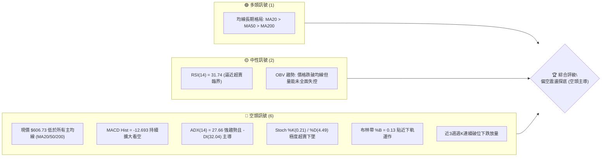

### 📊 核心指標速覽表

| 指標類別 | 指標名稱 | 當前數值 | 訊號 | 解讀 |
|----------|----------|----------|------|------|
| **價格** | 當前價格 | $606.73 | 🔴 | 位於52W區間33.5%處，短線加速回調，受制於多道上方均線 |
| **均線** | MA20 | $684.35 | 🔴 | 現價大幅落後 MA20 達 -11.34%，短線呈嚴重負乖離下墜 |
| **均線** | MA50 | $670.93 | 🔴 | 現價跌破中期生命線 MA50 達 -7.26%，中期多頭結構遭破壞 |
| **均線** | MA200 | $631.21 | 🔴 | 現價已跌破長期牛熊分水嶺 MA200，結構由多轉空防守 |
| **動能** | RSI(14) | 31.74 | 🟡 | Wilder RSI 位於 31.74，逼近 30 超賣門檻，短線具技術反彈預期但無背離 |
| **動能** | MACD(12,26,9) | -22.671 / -9.978 | 🔴 | DIF 與 DEA 雙雙處於零軸下方，柱狀圖 -12.693 擴大看空 |
| **波動** | ATR(14) | $22.72 | 🔴 | 佔價格 3.74%，日均振幅擴大，處於高波動回撤週期 |

### 🏆 技術評分卡

```
╔══════════════════════════════════════════════════════════════╗
║                技術評分卡 — META (2026-11-03)               ║
╠══════════════════════════════════════════════════════════════╣
║ 趨勢強度 (ADX=27.66, -DI主導) ██████░░░░░░░░░░░░░░  30/100 🔴 ║
║ 動能指標 (MACD柱走弱, KD超賣) ████░░░░░░░░░░░░░░░░  20/100 🔴 ║
║ 支撐穩定度 (考驗S1 $594.61)   ████████░░░░░░░░░░░░  40/100 🟡 ║
║ 成交量配合 (量比0.83, OBV疲弱)██████░░░░░░░░░░░░░░  30/100 🔴 ║
║ 形態完整度 (自高點回調ABC波)  ████████░░░░░░░░░░░░  40/100 🟡 ║
║ 均線排列 (長均仍多頭但全跌破) ██████░░░░░░░░░░░░░░  30/100 🔴 ║
╠══════════════════════════════════════════════════════════════╣
║ 綜合評分 (六項算術平均)       ██████░░░░░░░░░░░░░░  32/100 🔴 ║
║ 評級結論：技術面顯著偏空 (Strong Bearish / Short Setup)     ║
╚══════════════════════════════════════════════════════════════╝
```

---

## 2. 趨勢分析

### 🌐 多時框趨勢分析

```mermaid
graph TD
    A["月線框架 (長線)"] -->|"24個月區間震盪偏多 (現價 $606.73)"| B["高檔回檔：2025-07創高 $770.31 後高檔震盪整理"]
    B --> C["週線框架 (中線)"]
    C -->|"2026-09創高 $779.82 後連跌5週"| D["中期趨勢轉空：跌破週線多道波段支撐，放量下殺"]
    D --> E["日線框架 (短線)"]
    E -->|"ADX("14")=27.66 (-DI=32.04)"| F["強勢空頭趨勢：連續受制於MA5，沿布林下軌探底"]
    F --> G["收斂結論：中短期完全由空方掌控，嚴禁逆勢盲目摸底"]
```

### 📈 長期趨勢 — 12個月走勢圖（Unicode）

```
META 月線走勢圖（過去12個月：2025-12 至 2026-11）
價格軸 ($)
$780 ┤                                              ● (2026-09 高點 $725.18, 52W高 $779.82)
$740 ┤                        ● (2026-01 $714.66)  / \
$700 ┤                       / \                  /   \
$660 ┤  ● (2025-12 $658.40) /   ● (2026-02 $646) /     \
$620 ┤                      /     \   ●($610) ●($631)    ● (2026-10 $614.99)
$580 ┤                     /       ● (2026-03 $571)       \
$540 ┤                    /         \  ●($562) ●($556)     ●←現在 (2026-11 $606.73)
     └─────────────────────────────────────────────────────────────────────────────
        12M    11M   10M    9M    8M    7M    6M    5M    4M    3M    2M   當前月
      (25-12)(26-01)(26-02)(26-03)(26-04)(26-05)(26-06)(26-07)(26-08)(26-09)(26-10)(26-11)
```

**走勢特徵分析表格**：

| 階段時間 | 月收盤價變動 | 區間漲跌幅 | 走勢特徵與量價行為 |
|----------|--------------|------------|--------------------|
| **2025-12 ~ 2026-01** | $658.40 → $714.66 | +8.55% | 年初衝高，延續強勢多頭動能，挑戰 $700 大關 |
| **2026-01 ~ 2026-03** | $714.66 → $571.15 | -20.08% | 首季大幅回撤，獲利了結賣壓湧現，擊穿多道短期均線 |
| **2026-03 ~ 2026-05** | $571.15 → $631.43 | +10.55% | 築底反彈波段，動能溫和回升，重回 $600 關卡之上 |
| **2026-05 ~ 2026-07** | $631.43 → $556.27 | -11.90% | 二度回測波段底部，2026-07 探至 $556.27 築雙底支撐 |
| **2026-07 ~ 2026-09** | $556.27 → $725.18 | +30.36% | 強勁主升浪，突破前高並創出 52 週新高 $779.82，放量大漲 |
| **2026-09 ~ 2026-11** | $725.18 → $606.73 | -16.33% | 高檔崩跌，AI Capex 擔憂引發機構拋售，週線連收長黑 |

### 📊 中期趨勢（週線分析）

中期走勢顯示，META 在 2026 年 9 月最後一週創下 52 週高點 $779.82（週成交量達 1.68 億股）後，形成明顯的放量「流星線/假突破」型態。隨後四週連續收陰，特別是 2026-10-23 當週暴跌 -9.4%（收盤 $642.62），跌破 50% 斐波那契回調位 $649.59；2026-10-30 當週更以 1.74 億股巨量摜破 61.8% 關鍵回調位 $618.86。

```
近期週線壓力與支撐示意圖：
[強阻力區]  $779.82  ══════════════════════════ 52W 最高點 / 頂部巨量假突破區
                      │
[頸線阻力]  $680.33  ────────────────────────── 38.2% 斐波那契 / BB 中軌 (MA20 $684.35)
                      │
[破位阻力]  $618.86  ────────────────────────── 61.8% 斐波那契關鍵黃金分割位
                      │
[當前現價]  $606.73  ◄─── 現價徘徊於下軌附近，面臨持續下探風險
                      │
[近期支撐]  $594.61  ┄┄┄┄┄┄┄┄┄┄┄┄┄┄┄┄┄┄┄┄┄┄┄┄ 波段支撐 S1 (整數心理關卡前哨)
                      │
[波段強支]  $575.11  ══════════════════════════ 78.6% 斐波那契 / 波段支撐 S2 ($577.95)
```

### ⚡ 趨勢強度評估（ADX 解讀）

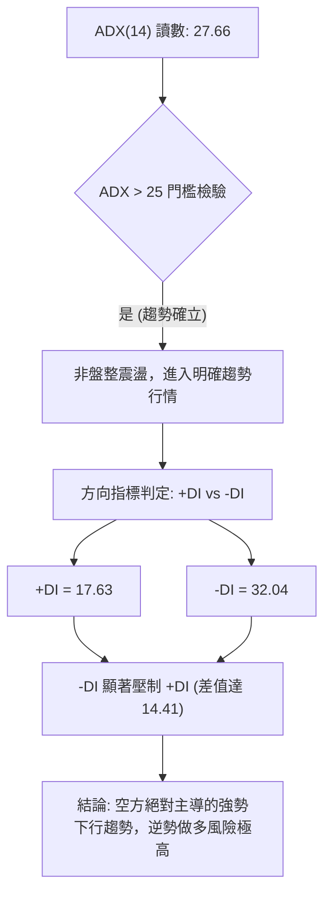

**ADX 趨勢強度量化對照表**：

| 指標變數 | 當前數值 | 參考門檻 | 狀態判斷 | 操作涵義 |
|----------|----------|----------|----------|----------|
| **ADX(14)** | 27.66 | > 25.00 | 強趨勢 (Strong Trend) | 趨勢策略優先，震盪逆勢指標失效 |
| **+DI** | 17.63 | < 20.00 | 多方動能極度渙散 | 買盤缺乏承接意願 |
| **-DI** | 32.04 | > 30.00 | 空方動能完全掌控 | 拋壓持續釋放，下行慣性強烈 |
| **方向差 (DMI)** | -14.41 | < 0 | 空頭擴散階段 | 順勢偏空操作，嚴禁左側抄底 |

---

## 3. 圖表形態分析

### 🔍 形態識別系統

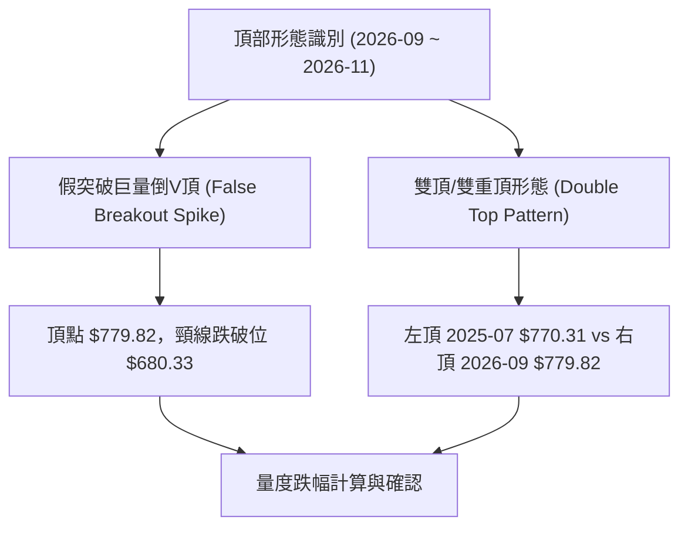

**形態信心度評估表**：

| 形態名稱 | 信心度 | 判斷依據（引用數據） | 完成度 | 目標價（附計算式） |
|----------|--------|----------------------|--------|--------------------|
| **週線雙重頂** | 85% | 左頂 2025-07 高點 $770.31，右頂 2026-09 52W高點 $779.82；頸線跌破 38.2% 回調位 $680.33 及波段點 | 90% | 依形態高度 ($779.82 - $680.33 = $99.49) 推算：頸線 $680.33 - $99.49 = **$580.84**（極度接近 S2 $577.95 及 78.6% 回調位 $575.11） |
| **短線下行通道** | 75% | 沿日線布林通道下軌運行，連續多日受制於 MA5 ($615.78) 與阻力 R1 $608.64 | 85% | 依通道下軌延伸推算目標為支撐位 **S1 $594.61** |
| **頭肩頂形態** | 40% | 左右肩結構不對稱，僅有 2026-01 與 2026-10 局部高點，訊號不足 | 30% | 訊號不足，依規則 15 僅做指標型解讀，不預設幾何目標價 |

### 🕯️ 重要K線形態分析

嚴格依據提供的「近10根日K」與「近8根週K」四價數據進行專業形態判定：

#### 近10根日K形態解析

| 日期（日K） | 開 | 高 | 低 | 收 | 成交量 | K線形態 | 解讀與訊號 |
|-------------|----|----|----|----|--------|---------|------------|
| **2026-10-20** | 694.98 | 696.51 | 681.05 | 694.25 | 17,049,100 | 長下影紡錘線 | 測試 $681 支撐後回抽，縮量盤整 🟡 |
| **2026-10-21** | 697.60 | 713.22 | 689.68 | 697.52 | 29,203,900 | 衝高長上影十字 | 盤中衝過 $713 遭機構強烈拋售，反轉前兆 🔴 |
| **2026-10-22** | 676.35 | 681.07 | 639.69 | 648.85 | 40,571,000 | 跳空放量大陰線 | 低開低走破位，放量 4057 萬股暴跌 -6.9% 🔴 |
| **2026-10-23** | 638.18 | 648.04 | 633.27 | 642.62 | 14,791,600 | 縮量低檔孕線 | 跌勢暫歇，量能驟減，弱勢整理 🟡 |
| **2026-10-26** | 638.36 | 647.69 | 627.80 | 630.56 | 30,913,600 | 破底流星中陰 | 盤中反抽 $647 失敗，尾盤收於當日低點 🔴 |
| **2026-10-27** | 627.07 | 628.46 | 619.21 | 620.19 | 51,334,100 | 爆量長黑下挫 | 放量至 5133 萬股巨量擊穿 $620 關口 🔴 |
| **2026-10-28** | 621.85 | 624.42 | 609.00 | 612.49 | 35,110,900 | 光頭中陰破線 | 跌破 $610 創波段新低，空頭完全控盤 🔴 |
| **2026-10-29** | 621.29 | 634.68 | 616.80 | 624.52 | 31,276,200 | 弱勢小陽反抽 | 受阻於 $634.68，反彈無力，屬下跌中繼 🟡 |
| **2026-10-30** | 614.51 | 626.37 | 610.13 | 614.99 | 25,364,700 | 上影小陰線 | 再度受壓於 MA5，反彈動能衰竭 🔴 |
| **2026-11-02** | 614.44 | 621.69 | 606.41 | 606.73 | 19,440,300 | 光腳近破底陰線 | 收於全天最低點附近 $606.73，預示續跌 🔴 |

#### 近8根週K形態解析

| 日期（週K） | 開 | 高 | 低 | 收 | 週成交量 | K線形態 | 解讀與訊號 |
|-------------|----|----|----|----|----------|---------|------------|
| **2026-09-18** | 657.31 | 689.61 | 648.71 | 665.23 | 99,577,300 | 實體中陽線 | 主升浪推進，量價齊揚 🟢 |
| **2026-09-25** | 680.30 | 779.82 | 679.60 | 751.66 | 168,307,000 | 爆量巨幅長上影 | 創 52W 高點 $779.82 後放巨量滯漲，出貨訊號 🔴 |
| **2026-10-02** | 750.04 | 750.58 | 713.19 | 728.08 | 96,199,700 | 高位吞噬陰線 | 跌破前週實體，確認頂部成立 🔴 |
| **2026-10-09** | 727.71 | 747.60 | 711.68 | 718.67 | 69,671,000 | 縮量陰十字星 | 高位震盪抵抗，缺乏買盤支撐 🟡 |
| **2026-10-16** | 728.50 | 771.27 | 702.71 | 709.33 | 101,360,200 | 長上影倒鎚頭 | 二次衝高 $771.27 失敗，多頭徹底力竭 🔴 |
| **2026-10-23** | 707.16 | 713.22 | 633.27 | 642.62 | 117,876,500 | 破位瀑布大長陰 | 放量跌穿 $680 頸線，確立中期空頭浪 🔴 |
| **2026-10-30** | 638.36 | 647.69 | 609.00 | 614.99 | 173,999,500 | 爆天量續跌長陰 | 週換手 1.74 億股，跌破 61.8% 斐波位 $618.86 🔴 |
| **2026-11-02** | 614.44 | 621.69 | 606.41 | 606.73 | 19,440,300 | 開週續黑微下影 | 延續單邊尋底格局，尚未出現止跌K線 🔴 |

### 📉 ASCII 走勢形態示意圖

```
META 近期雙頂與破位下行結構示意圖
$780 ┤                [右頂 $779.82 (2026-09-25)]
$740 ┤               / \
$700 ┤              /   \        [反抽高點 $713.22 (2026-10-21)]
$680 ┤═════════════/═════\═══════[頸線位 $680.33 被放量摜破]════════
$640 ┤                    \      / \
$620 ┤                     \    /   \    [破位 61.8% $618.86]
$600 ┤                      \  /     \      ● 現價 $606.73 (測試 S1 $594.61)
$580 ┤                       \/       \    ▼
$560 ┤                                 ▼ 雙頂量度目標價 $580.84 / 支撐 S2 $577.95
     └─────────────────────────────────────────────────────────────
```

### 🎯 形態目標價計算

根據經典技術分析幾何形態量度規則，雙重頂跌破後之最小等距跌幅計算如下：
1. **頂部最高點 (Head / Peak)**：$779.82（2026-09-25 創下）
2. **形態頸線位 (Neckline)**：取斐波那契 38.2% 回調位與 2026-10-20 平臺低點聚類處 **$680.33**
3. **垂直形態高度 (Pattern Height, H)**：
   $$H = 779.82 - 680.33 = 99.49$$
4. **理論量度跌幅目標價 (Measured Target Price)**：
   $$\text{Target} = \text{Neckline} - H = 680.33 - 99.49 = 580.84$$
5. **關鍵支撐驗證**：計算得出之理論目標價 **$580.84** 與下方「關鍵價位」區塊的波段強支撐位 **S2 $577.95** 以及 78.6% 斐波那契回調位 **$575.11** 形成高度共振密集帶（誤差僅 0.5%），證實該形態具有極高的量化參考價值。

---

## 4. 支撐與阻力

### 🗺️ 關鍵價位分布圖（Unicode）

```
META 價位結構分布圖（OHLCV 精確計算）
══════════════════════════════════════════════════════════════════
$649.59 ║██████████████████████████████║ 50.0% 斐波那契中樞強阻力
$641.90 ║████████████████████████      ║ 強阻力 R3 (近一年波段高點聚類)
$623.91 ║████████████████              ║ 阻力 R2 (反彈第一道重要防線)
$618.86 ║████████████████████          ║ 618.86 (61.8% 黃金分割回調線)
$608.64 ║██████████                    ║ 關鍵阻力 R1 (日內近距反壓)
╠═══════╬══════════════════════════════╣ ◄ 現價 $606.73
$594.61 ║▓▓▓▓▓▓▓▓▓▓▓▓                  ║ 近期支撐 S1 (整數心理防線前哨)
$578.82 ║▓▓▓▓▓▓▓▓▓▓▓▓▓▓▓▓▓▓            ║ 布林通道下軌動態支撐
$577.95 ║████████████████████████      ║ 強支撐 S2 (波段雙底低點聚類)
$575.11 ║██████████████████████████    ║ 78.6% 斐波那契最後防守位
$555.86 ║██████████████████████████████║ 極限強支撐 S3 (2026-07 探底低點聚類)
══════════════════════════════════════════════════════════════════
```

### 🚧 阻力位分析表

依據「關鍵價位（由 OHLCV 計算）」數據列出：

| 阻力級別 | 價位 | 形成原因 | 突破難度 | 重要性 |
|----------|------|----------|----------|--------|
| **R1** | $608.64 | 近一年波段高點聚類，與 2026-10-28 低點破位後轉化之反壓重合 (+0.31%) | 中等 | 短線多頭弱反彈的第一道測試關卡 |
| **R2** | $623.91 | 波段高點聚類，接近 2026-10-29 反彈高點 $634 下方成交密集區 (+2.83%) | 高 | 若能站穩方可確認短線超跌反彈成形 |
| **R3** | $641.90 | 波段高點聚類，2026-10-23 破位跳空缺口下沿及整數關卡 (+5.80%) | 極高 | 空方重要堡壘，未收復前中線趨勢不翻多 |

### 🛡️ 支撐位分析表

依據「關鍵價位（由 OHLCV 計算）」數據列出：

| 支撐級別 | 價位 | 形成原因 | 守住機率 | 重要性 |
|----------|------|----------|----------|--------|
| **S1** | $594.61 | 近一年波段低點聚類，跌破後將直逼 $600 整數心理防線 (-2.00%) | 45% | 短線多方最後喘息窗口，跌破加速尋底 |
| **S2** | $577.95 | 近一年波段低點聚類，與布林下軌 $578.82 及 78.6% 斐波位高度共振 (-4.74%) | 75% | 核心多重支撐共振帶，雙頂形態目標位 |
| **S3** | $555.86 | 2026-07 月線波段低點 ($556.27) 聚類形成的年度極限防守區 (-8.38%) | 90% | 長期多頭生死線，失守將考驗 52W 低點 $519.37 |

### 📐 斐波那契回調位分析

依據 52 週區間 **$519.37（低） → $779.82（高）** 實際計算之回調位：

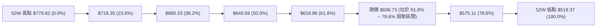

**回調位深度解讀**：
1. **現價位置**：當前收盤價 **$606.73** 已正式跌破黃金分割最重要的生死分水嶺 **61.8%（$618.86）**，落入 **$575.11（78.6%）至 $618.86（61.8%）** 的深度回調弱勢區。
2. **技術涵義**：在道氏理論與斐波那契體系中，回調跌破 61.8% 意味著自 2026 年 7 月以來的「主升浪」性質已被完全破壞，走勢由「牛市回檔」正式劣化為「趨勢性大級別反轉波」或「深度 ABC 修復浪」。
3. **下行引力**：跌破 $618.86 後，理論上的下一個強力支撐靶心即為 **78.6% 回調位 $575.11**，該價位與波段支撐 **S2 $577.95** 形成強大向下引力。

---

## 5. 技術指標深度解讀

### 🎛️ 指標訊號總覽

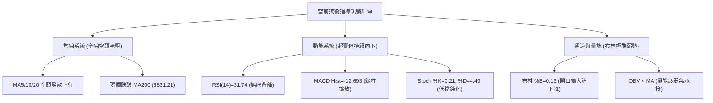

### 📈 移動平均線排列分析

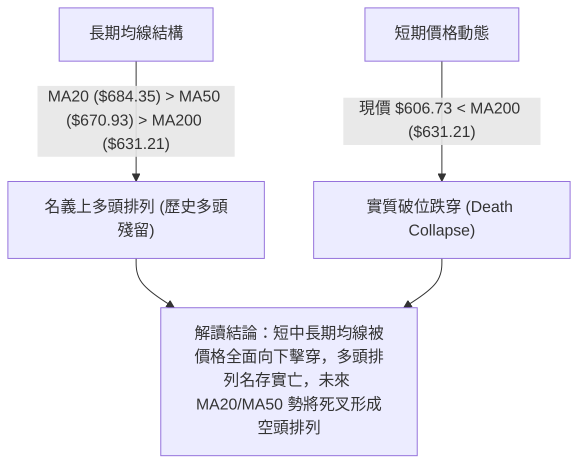

**均線詳細數據分析表**：

| 均線週期 | 數值 | 現價偏離幅度 | 方向走勢 | 技術解讀 |
|----------|------|--------------|----------|----------|
| **MA 5** | $615.78 | -1.47% | ▼ 下行加速 | 極短線動態壓制線，未站上代表單邊下跌未停 |
| **MA 10** | $639.27 | -5.09% | ▼ 下行加速 | 短期波段下行趨勢軌道，壓制反彈 |
| **MA 20** | $684.35 | -11.34% | ▼ 調頭向下 | 短線生命線被遠拋身後，乖離率達 -11.34% |
| **MA 50** | $670.93 | -7.26% | ▼ 由平走低 | 中期支撐正式瓦解，轉化為中期極強阻力 |
| **MA 60** | $654.24 | -7.26% | ▼ 快速走低 | 季線下彎，中期資金全面套牢 |
| **MA 120**| $627.79 | -3.35% | ▼ 走勢偏弱 | 半年線失守，長期防線鬆動 |
| **MA 200**| $631.21 | -4.17% | ▼ 走平轉下 | **牛熊分水嶺失守**，自 2026-10-26 以來連續 6 日運行於其下方 |
| **MA 240**| $633.12 | -4.17% | ▼ 壓制下行 | 年線關卡宣告破位 |

### 📉 RSI(14) 分析

- **RSI 數值進度條展示**：
  ```
  RSI(14) = 31.74 : ▓▓▓▓▓▓░░░░░░░░░░░░░░ 31.74%  🟡 臨界超賣區
  [0 ────────── 30(超賣臨界) ────────── 50(多空平衡) ────────── 70(超買) ────────── 100]
                     ▲
                 現價 RSI (31.74)
  ```
- **超買超賣區間分析**：Wilder RSI 數值為 **31.74**，目前緊貼在 30 臨界超賣值上方。雖然數值偏低暗示市場拋壓達到短線極值，但在強趨勢下跌行情（ADX > 25）中，RSI 經常會出現「低檔鈍化」或沿著 30 邊緣持續震盪破底，不能單憑 RSI 接近 30 盲目抄底。
- **背離判斷**：
  - 根據系統近 20 根 K 棒數據比對，**RSI 無明顯背離**。
  - 價格近兩週由 $697.52 跌至 $606.73 連創新低，RSI 由 50.3 同步下挫至 31.74，價格創低同時 RSI 同步創低，**不存在底背離**（Bullish Divergence）特徵。
  - 結論：量價動能完全吻合下行趨勢，未出現趨勢衰竭反轉訊號。

### 📊 MACD(12/26/9) 訊號解讀

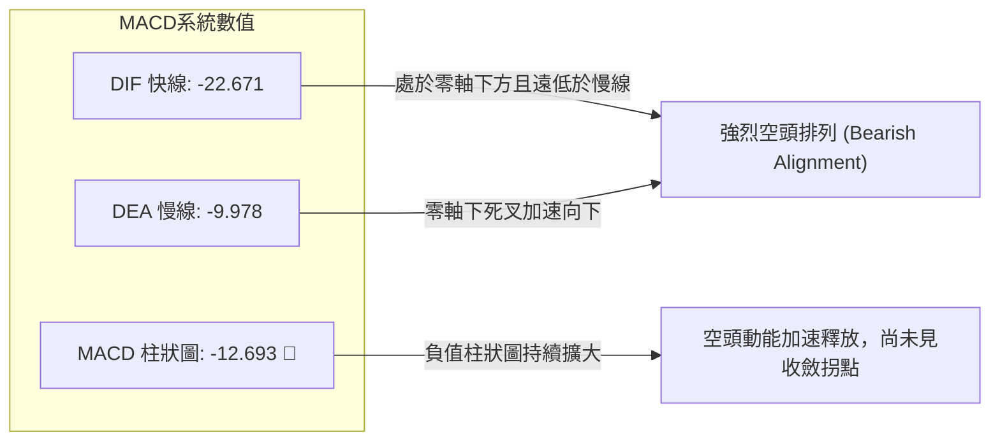

**MACD 結構深度解析**：
1. **雙線狀態**：DIF (-22.671) 與 DEA (-9.978) 均深陷零軸（0.00）下方，且 DIF 正以陡峭斜率加速遠離 DEA，表明下跌慣性強烈。
2. **柱狀圖（Histogram）**：最新一根日線柱狀圖為 **-12.693**，連續多日保持深度負值，柱狀圖並未出現顯著縮短跡象（前週五為 -13.677，收斂幅度極其微弱），顯示空方主控權依然固若金湯。
3. **背離檢驗**：MACD 指標與日線價格同步俯衝破底，無任何底背離跡象，排除指標反轉可能。

### 📦 布林通道分析

```
META 日線布林通道 (20, 2) 結構圖
價格 ($)
$789.88 ┼───────────────────────────────────────────── BB 上軌
        │
$684.35 ┼───────────────────────────────────────────── BB 中軌 (MA20)
        │
$606.73 ┼───────────────────● 現價 (BB %B = 0.13)
        │
$578.82 ┼───────────────────────────────────────────── BB 下軌
```

**布林通道特徵量化解讀**：
1. **通道帶寬與位置**：BB 上軌為 $789.88，中軌為 $684.35，下軌為 $578.82。通道帶寬高達 $211.06（帶寬比達 30.8%），呈現劇烈張口擴張狀態（Band Expansion）。
2. **%B 位置指標**：目前 **%B = 0.13**（0 代表下軌，0.5 代表中軌，1.0 代表上軌）。數值 0.13 代表現價極度貼近下軌運行，屬於標準的「沿下軌單邊暴跌」形態（Riding the lower band）。
3. **支撐效應評估**：布林下軌目前位於 **$578.82**，與波段強支撐 **S2 $577.95** 形成強烈空間重合。在現價 $606.73 尚未實質觸及下軌前，空間上仍有向下尋求下軌支撐的慣性。

### 💹 成交量分析（量價配合度）

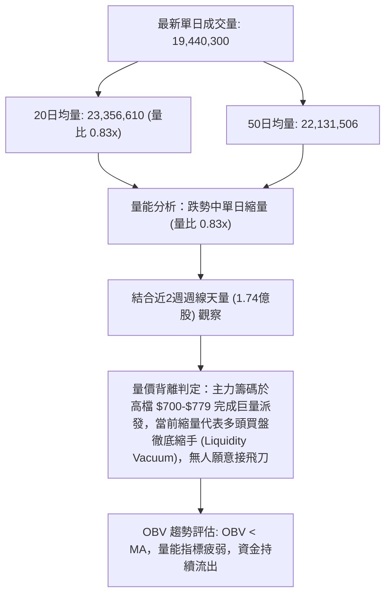

**量價行為矩陣**：
- **下跌放量（Panic Selling）**：2026-10-27 放出 5133 萬股巨量長黑，2026-10-30 週線爆出 1.74 億股天量，確認機構資金堅決獲利了結。
- **反彈無量（Weak Pullback）**：2026-10-29 小幅收高時成交量僅 3127 萬股，反彈縮量而下跌帶量，呈現標準空頭價量關係。
- **量能枯竭（Buyer Exhaustion）**：最新交易日成交量萎縮至 1944 萬股（量比 0.83x），並非止跌信號，而是多頭承接意願渙散的流動性真空。

---

## 6. 動能與波動率

### ⚡ 動能評估四象限

動能評估四象限分析旨在釐清 META 目前在「動能強度」與「市場波動率」結構中所處的市場環境：

| 象限 | 動能方向與強度 | 波動率狀態 | 當前符合狀態 | 風險特徵與操作評估 |
|------|----------------|------------|--------------|--------------------|
| **Q1 (最佳擴展區)** | 強勁多頭動能 | 低波動穩步抬升 | ─ | 最佳做多機會，趨勢順暢 |
| **Q2 (整理觀察區)** | 動能平淡/中性 | 低波動收斂橫盤 | ─ | 謹慎觀望，等待突破方向確認 |
| **Q3 (極度高危區)** | 強勁空頭動能 (-DI=32) | **高波動擴張 (ATR=3.74%)** | **✓ (當前狀態)** | **高風險高損耗：趨勢性殺跌階段，嚴禁左側抄底，只宜順勢空或空倉防守** |
| **Q4 (鈍化超賣區)** | 動能衰退竭盡 | 波動率大幅驟降 | ─ | 恐慌末端，準備尋求左側試倉機會 |

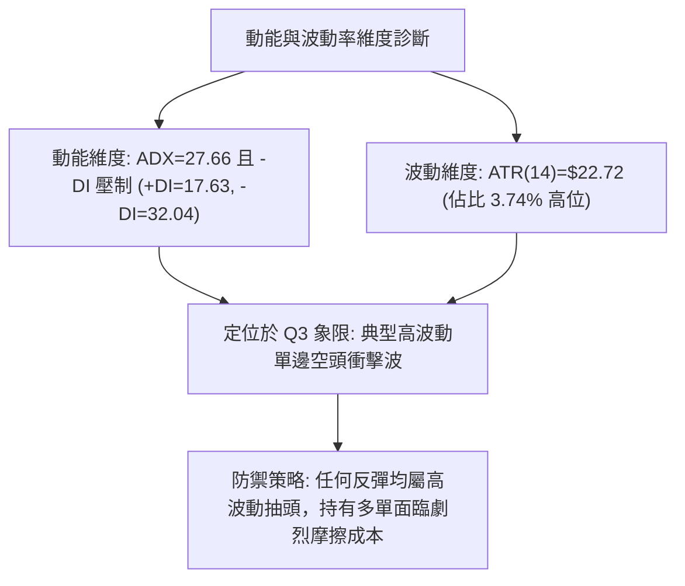

### 📊 ATR 波動率分析

- **ATR(14) 核心數值**：**$22.72**（佔當前股價 $606.73 的 **3.74%**，採 Wilder 平滑算法）。
- **日內預期波動空間**：基於最新收盤價，單一交易日內正常波動範圍約為 **$584.01 ~ $629.45**。
- **止損距離建議**：
  - **極短線（日內/1-2日）**：1.0 × ATR = **$22.72**
  - **波段交易（Swing Trading）**：1.5 × ATR = **$34.08**
  - **防洗盤安全緩衝距離**：2.0 × ATR = **$45.44**
- **波動率含義解讀**：ATR 達到 3.74% 的較高水平，顯示受 AI Capex 資本支出擔憂影響，市場情緒高度不穩定。過大的日內振幅意味著進場點位必須極度精確，否則極易被日內噪聲掃出止損。

### 📐 Beta 與市場相關性

- **Beta 係數**：**1.279**（高於大盤基準 1.00，屬高彈性成長股屬性）。
- **市場相關性解讀**：
  - META 相對於 S&P 500 指數具備 27.9% 的額外波動放大效應。
  - 當科技板塊（如 NASDAQ 100）受 Capex 議題拖累走弱時，META 的回撤幅度將顯著大於指數平均水準。
  - 當前美股大盤受利率與地緣政治擾動，高 Beta 屬性使得 META 在大盤未止跌前承受更沉重的乘數拋售壓力。

---

## 7. 多時框架總結

### 📋 時框架評分表

| 時框架 | 趨勢方向 | 動能狀態 | 均線排列 | 關鍵形態特徵 | 綜合評分 | 操作建議 |
|--------|----------|----------|----------|--------------|----------|----------|
| **月線 (長期)** | 🟡 震盪回調 | MACD高檔走平 | MA多頭但逼近支撐 | 歷史高位巨幅寬幅箱體震盪 | 55/100 | 長線長多未死，但高估值修正中，觀望 |
| **週線 (中期)** | 🔴 明確破位 | MACD柱連5週負擴大 | 跌破 50/60 週均線 | 雙重頂 ($779.82) 跌破頸線 $680.33 | 25/100 | 中線賣出訊號，反彈減磅或做空 |
| **日線 (短期)** | 🔴 強烈空頭 | ADX=27.66, KD低檔鈍化 | 均線全空，壓在MA5下 | 沿布林下軌單邊下瀉，光腳大陰線 | 20/100 | 嚴禁逆勢做多，等待超跌反抽受阻做空 |

### 🔲 綜合訊號矩陣

```
時框訊號一致性矩陣：
┌─────────────┬───────────┬───────────┬───────────┬───────────────────────┐
│ 分析維度    │ 短期 (日) │ 中期 (週) │ 長期 (月) │ 時框共振方向判定      │
├─────────────┼───────────┼───────────┼───────────┼───────────────────────┤
│ 趨勢方向    │    🔴     │    🔴     │    🟡     │ 中短期完全共振向下 🔴 │
│ 動能強度    │    🔴     │    🔴     │    🟡     │ 空頭加速釋放中 🔴     │
│ 均線位置    │    🔴     │    🔴     │    🟢     │ 短中期均線全數失守 🔴 │
│ 量價結構    │    🔴     │    🔴     │    🟡     │ 破位放量，反彈無量 🔴 │
│ 通道位置    │    🔴     │    🔴     │    🟡     │ 緊貼下軌運作 🔴       │
└─────────────┴───────────┴───────────┴───────────┴───────────────────────┘
```

### ⚖️ 多時框收斂結論

嚴格執行「嚴格要求 14」之多時框收斂規則：
1. **趨勢/盤整性質判斷**：日線 ADX(14) 讀數為 **27.66**（> 25.00），明確判定當前市場**不是**處於無方向的盤整震盪行情，而是處於**強烈的趨勢行情（空頭趨勢）**。
2. **主導時框取捨**：依規則，趨勢行情下應以中長期（週線 / MA50 / MA200）方向為主導，日線僅用於尋找精準進場節奏。
   - 週線自 $779.82 出現雙重頂頸線破位，跌破週線多重均線；日線則已全面跌穿 MA200（$631.21）。
   - 中期趨勢方向與短期趨勢方向達成完全的**空頭共振**（中空 + 短空）。
3. **唯一收斂結論**：**強烈偏空（Bearish Setup）**。
   - 日線超賣狀態不可作為抄底依據，必須完全服從週線破位的空頭主導格局。
   - 交易主線鎖定於「反彈受阻放空」或「破位順勢跟進」，此結論與第 8 章策略方向維持絕對一致。

---

## 8. 交易策略建議

### 🗺️ 策略決策流程圖

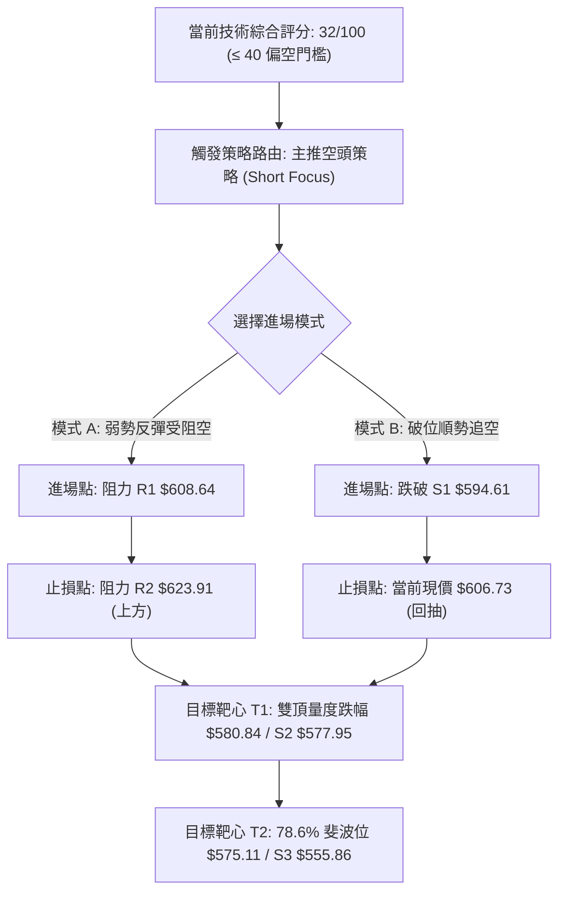

### 🧭 策略路由（依評分卡分流）

> **當前主策略方向 = 主推空頭策略（依綜合評分 32/100 ≤ 40 偏空區間判定，多頭僅列為反轉對沖提示）**

鑑於第 1 章技術評分卡綜合評分僅為 **32/100**，技術面處於顯著空頭主導格局，嚴格執行規則 18，**禁止兩頭下注**。策略主體全面聚焦於「逢反彈做空」與「破位追空」兩套方案，拒絕任何左側抄底建議。

### 🎯 價格情境階梯（Price Scenarios）

價位嚴格引用第 4 章及「關鍵價位」區塊的數值：

| 觸發條件 | 下一目標 | 後續延伸 | 情境技術含義 |
|----------|----------|----------|--------------|
| **反彈受阻於 R1 $608.64** | S1 $594.61 | S2 $577.95 | 短線超跌微弱反彈無力，空方再度下擊，順勢放空 |
| **強勢突破 R1 衝至 R2 $623.91** | R3 $641.90 | 61.8% ($618.86) | 展開技術性回抽 MA200 測試，給予更高盈虧比的做空點位 |
| **直接摜破 S1 $594.61** | S2 $577.95 | S3 $555.86 | 跌破 $600 關卡引發停損賣盤，空頭加速奔向雙頂理論目標價 |

### 📊 情境機率分佈

| 情境 | 機率 | 主要依據（指標狀態） |
|------|------|----------------------|
| **回落 / 再探底 (主情境)** | **65%** | ADX=27.66 強趨勢且 -DI=32.04 主導；MACD 柱 -12.693 擴散；量能 OBV 疲弱且週線連黑放量。 |
| **區間弱勢震盪 (次情境)** | **25%** | RSI(14)=31.74 與 Stoch %K=0.21 逼近極度超賣區，空方短線可能在 $594 ~ $618 區間整固蓄勢。 |
| **強烈反轉上行 (極端小概率)** | **10%** | 現價已跌破 MA200，所有週期均線向下反壓，需要極端天量與基本面重大扭轉方能形成反轉。 |

### 🟢 主策略詳情（空頭交易策略）

所有價位均嚴格取自數據庫中之關鍵阻力與支撐，風險報酬比嚴格按規則 17 定義計算：
$$\text{做空風險報酬比} = \frac{\text{進場價} - \text{目標價 T1}}{\text{止損價} - \text{進場價}}$$

| 策略要素 | 策略 A：反彈受阻放空（反彈沽空） | 策略 B：跌破支撐追空（破位空） |
|----------|----------------------------------|--------------------------------|
| **策略類型** | 順勢逢高沽空 (Sell on Rebound) | 順勢破位追擊 (Breakout Short) |
| **進場條件** | 股價弱勢反抽至 R1 遇阻回落收上影線 | 日K收盤跌破支撐位 S1 且成交量放大 |
| **進場價格** | **$608.64**（引用阻力 R1） | **$594.61**（引用支撐 S1） |
| **止損價格** | **$623.91**（引用阻力 R2，保護距離 $15.27） | **$606.73**（引用當前現價，保護距離 $12.12） |
| **目標價 T1** | **$577.95**（引用支撐 S2 / 雙頂目標共振位） | **$575.11**（引用 78.6% 斐波那契回調位） |
| **目標價 T2** | **$555.86**（引用支撐 S3 / 極限支撐位） | **$555.86**（引用支撐 S3） |
| **風險報酬比 (以 T1 計)** | **1 : 2.01** [計算式: (608.64-577.95)/(623.91-608.64) = 30.69/15.27] | **1 : 1.61** [計算式: (594.61-575.11)/(606.73-594.61) = 19.50/12.12] |
| **風險報酬比 (以 T2 計)** | **1 : 3.46** [計算式: (608.64-555.86)/(623.91-608.64) = 52.78/15.27] | **1 : 3.20** [計算式: (594.61-555.86)/(606.73-594.61) = 38.75/12.12] |
| **預估勝率** | 65% | 60% |
| **建議倉位** | 10% ~ 15% 總資金 | 8% ~ 10% 總資金 |

### 🔴 反向風險觸發點（對沖與風控提示）

本小節僅供持有空單或防禦型投資者之風控參考，非推薦逆勢做多：
1. **空單全面停損/離場點**：若日K線以實體長陽強勢收復 **$623.91（阻力 R2）** 及 61.8% 斐波位 **$618.86**，宣告短線下行通道破壞，空單必須無條件止損離場。
2. **中期趨勢翻多先決條件**：價格必須回升至 **$649.59（50% 斐波位）** 及 **$684.35（MA20 中軌）** 之上，且 MACD 出現零下金叉伴隨日均量放大至 3000 萬股以上，方具備右側戰略性建多倉價值。

### ⭐ 整體訊號強度評星

```
做多訊號強度：★☆☆☆☆  (1/5星 - 均線全破，指標無背離，強行做多勝率極低)
做空訊號強度：★★★★☆  (4/5星 - 中短期共振破位，ADX強趨勢，盈虧比極佳)
整體可信度：  ★★★★☆  (4/5星 - 週日線數據高度收斂，成交量結構完全吻合)
```

---

## 9. 風險提示與監控

### ✅ 關鍵監控指標 Checklist

```
╔══════════════════════════════════════════════════════════════╗
║              META 交易日常監控清單 (Checklist)               ║
╠══════════════════════════════════════════════════════════════╣
║ [ ] 價格是否跌破 S1 $594.61 心理支撐關口                     ║
║ [ ] RSI(14) 跌破 30 後是否出現量價底背離信號                ║
║ [ ] 日成交量是否萎縮至 1500 萬股以下（出現地量止跌）          ║
║ [ ] MACD 柱狀圖是否開始出現連續 3 日的由負收斂                ║
║ [ ] 盤中反彈是否受壓於阻力 R1 $608.64 或 MA5 ($615.78)        ║
║ [ ] 纳斯達克科技板塊與 AI Capex 新聞輿情是否進一步惡化       ║
╚══════════════════════════════════════════════════════════════╝
```

### ⚠️ 風險場景分析

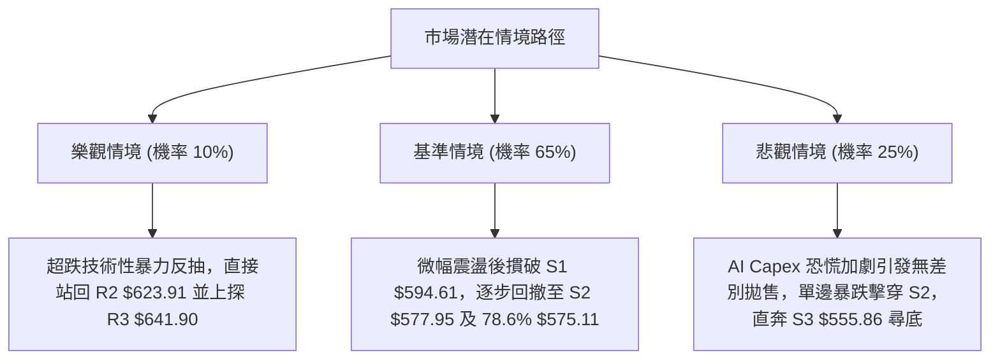

### 🛡️ 風險管理重要提醒

1. **嚴禁逢低攤平（Don't Catch a Falling Knife）**：
   目前技術數據顯示 -DI 高達 32.04 且 ADX=27.66，這是標準的加速趨勢下跌形態。均線系統自 $779.82 下跌以來未見任何多頭抵抗力量，左側猜底往往面臨巨大的浮虧擴大風險。
2. **波動率放大的倉位管理**：
   ATR 目前高達 $22.72（3.74%），意味著每日正常價格波動即可引發 3% 以上的資產波動。建議將單筆交易風險敞口控制在總資產的 **1.0% ~ 1.5%** 以內，計算公式如下：
   $$\text{最大持股股數} = \frac{\text{總投資組合資產} \times 1.0\%}{\text{進場價} - \text{止損價}}$$
3. **宏觀與板塊聯動風險**：
   新聞輿情顯示，摩根士丹利發出 AI 股警訊，且市場對科技巨頭資本支出（Capex）的可持續性高度擔憂。META 短期內受產業資本週期利空壓制，技術面超賣難以迅速轉化為多頭行情，順應板塊趨勢是保護資本的第一準則。

---

## 📋 報告總結

```
╔══════════════════════════════════════════════════════════════╗
║                   META 技術分析報告總結                      ║
╠══════════════════════════════════════════════════════════════╣
║ 報告日期：2026-11-03                                         ║
║ 當前價格：$606.73                                            ║
║ 分析評級：🔴 強烈偏空 (Strong Bearish / Setup for Short)      ║
║ 技術評分：32 / 100                                           ║
╠══════════════════════════════════════════════════════════════╣
║ 關鍵結論：                                                   ║
║ ├─ 長期趨勢：🟡 月線高位寬幅震盪，牛市格局遭遇顯著回調       ║
║ ├─ 中期趨勢：🔴 週線自 $779.82 雙頂頸線破位，連收 5 週長黑   ║
║ ├─ 短期趨勢：🔴 日線全面跌破所有均線 (含MA200)，空方主導     ║
║ ├─ 關鍵阻力：R1 $608.64 ｜ R2 $623.91 ｜ R3 $641.90          ║
║ ├─ 關鍵支撐：S1 $594.61 ｜ S2 $577.95 ｜ S3 $555.86          ║
║ └─ 形態目標：雙頂最小量度目標價 $580.84 (與 S2/78.6% 共振)   ║
╠══════════════════════════════════════════════════════════════╣
║ 最優策略組合：                                               ║
║ 1. 🥇 最佳機會：策略 A (反彈至 R1 $608.64 受阻放空，盈虧比 1:2.01)║
║ 2. 🥈 次選機會：策略 B (跌破 S1 $594.61 追空至 $575.11，盈虧比 1:1.61)║
║ 3. 🥉 保守選擇：空倉觀望，嚴格等待股價於 S2 $577.95 止跌訊號 ║
╚══════════════════════════════════════════════════════════════╝
```

---

> ⚠️ **免責聲明**：本報告為 AI 自動生成之技術分析，所有數據及估算均基於提供的歷史價格資訊。本報告**僅供研究與學術參考**，**不構成任何投資建議**。投資有風險，入市需謹慎。

---

*報告生成時間：2026-11-03 ｜ 數據來源：Yahoo Finance ｜ 分析框架：多時框技術分析*