# META 技術分析報告

> **報告日期**：2026-11-04 ｜ **語言**：繁體中文 ｜ **數據來源**：Yahoo Finance ｜ **當前價格**：$621.03

---

## 目錄

| 章節 | 內容 |
|------|------|
| [1. 技術面概覽](#1-技術面概覽) | 訊號儀表板、核心指標、評分卡 |
| [2. 趨勢分析](#2-趨勢分析) | 多時框趨勢、長中短期走勢 |
| [3. 圖表形態分析](#3-圖表形態分析) | 形態識別、K線組合、目標價 |
| [4. 支撐與阻力](#4-支撐與阻力) | 關鍵價位、斐波那契回調 |
| [5. 技術指標深度解讀](#5-技術指標深度解讀) | MA/RSI/MACD/布林/成交量 |
| [6. 動能與波動率](#6-動能與波動率) | 動能評估、ATR、Beta |
| [7. 多時框架總結](#7-多時框架總結) | 時框架評分矩陣 |
| [8. 交易策略建議](#8-交易策略建議) | 多空策略、風險報酬比 |
| [9. 風險提示與監控](#9-風險提示與監控) | 監控指標、風險場景 |

---

## 1. 技術面概覽

### 🎯 技術訊號儀表板

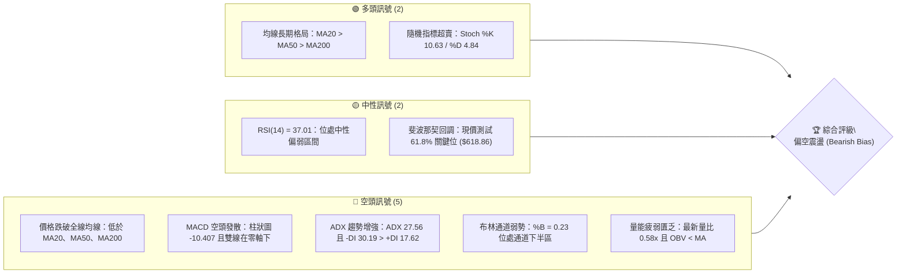

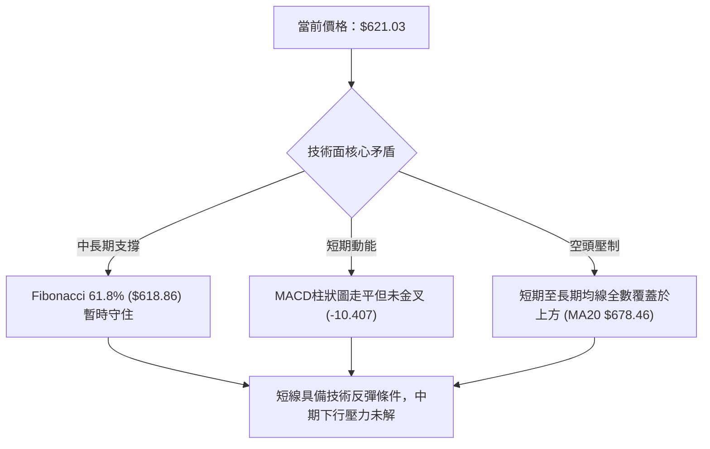

### 📊 核心指標速覽表

| 指標類別 | 指標名稱 | 當前數值 | 訊號 | 解讀 |
|----------|----------|----------|------|------|
| **價格** | 當前價格 | $621.03 | 🔴 | 跌破 MA200 ($631.22)，處於52週區間 39.0% |
| **均線** | MA20 | $678.46 | 🔴 | 價格低於 MA20 達 -8.46%，短期下行斜率陡峭 |
| **均線** | MA50 | $672.18 | 🔴 | 價格低於 MA50，且 MA20 即將死叉 MA50 |
| **均線** | MA200 | $631.22 | 🔴 | 價格跌破年線支撐，長線多頭防線面臨嚴峻考驗 |
| **動能** | RSI(14) | 37.01 | 🟡 | 位於 30–70 中性區間底部，尚未進入極端超賣 |
| **動能** | MACD | -22.987 | 🔴 | 快慢線均在零軸之下，柱狀圖 -10.407，空頭掌控 |
| **動能** | Stoch %K/%D | 10.63 / 4.84 | 🟢 | 進入極度超賣區間 (<20)，短線隨時有反彈需求 |
| **趨勢** | ADX(14) | 27.56 | 🔴 | ADX > 25 進入強趨勢，-DI(30.19) 遠高於 +DI(17.62)，空頭趨勢強勁 |
| **通道** | 布林通道 | %B = 0.23 | 🔴 | 運行於中軌 ($678.46) 與下軌 ($572.59) 之間 |
| **量能** | 20日均量比 | 0.58x | 🔴 | 成交量 13.66M 較 20 日均量大幅縮水，OBV 跌破均線 |
| **波動** | ATR(14) | $22.39 | 🟡 | 佔股價 3.61%，處於正常偏高波動水平 |

### 🏆 技術評分卡

```
技術評分卡 — META (2026-11-04)
════════════════════════════════════════════════════
趨勢強度      ████████░░░░░░░░░░░░  40/100  🔴 (空頭強趨勢)
動能指標      ██████░░░░░░░░░░░░░░  30/100  🔴 (MACD死叉/低位震盪)
支撐穩定度    ████████████░░░░░░░░  60/100  🟡 (Fib 61.8% 暫撐)
成交量配合    ████████░░░░░░░░░░░░  40/100  🔴 (量能萎縮/無買盤量)
形態完整度    ████████░░░░░░░░░░░░  40/100  🔴 (自高點回撤無築底)
均線排列      ██████░░░░░░░░░░░░░░  30/100  🔴 (價格跌破所有均線)
════════════════════════════════════════════════════
綜合評分      ████████░░░░░░░░░░░░  40/100  🔴 偏空弱勢
════════════════════════════════════════════════════
註：綜合評分為上述六項指標算術平均：(40+30+60+40+40+30)/6 = 40.0，依規則 18 四捨五入為 40/100。
```

---

## 2. 趨勢分析

### 🌐 多時框趨勢分析

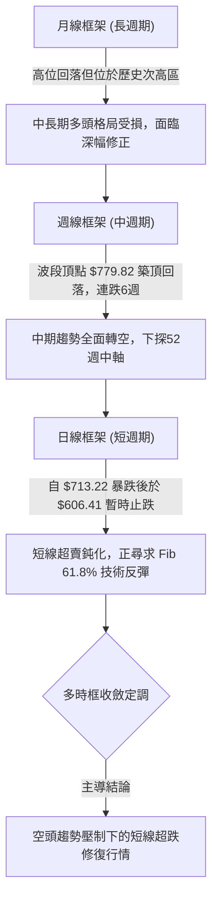

### 📈 長期趨勢 — 12個月走勢圖（Unicode）

```
META 月線走勢圖（過去12個月：2025-12 至 2026-11）
價格軸 ($)
$775 ┤                                
$750 ┤                                
$725 ┤                        ●(2026-09: 725.18)
$700 ┤        ●(2026-01: 714.66)      
$675 ┤                                
$650 ┤●(658.40)   ●(646.52)           
$625 ┤                    ●(631.43)       ●←現在(2026-11: 621.03)
$600 ┤                ●(610.86)       ●(614.99)
$575 ┤            ●(571.15)       ●(571.89)
$550 ┤                        ●(562.85)
$525 ┤                            ●(2026-07低點: 556.27)
     └────────────────────────────────────────────────────────
      12   01  02  03  04  05  06  07  08  09  10  11 (月份)
```

#### 走勢特徵分析表格

| 階段區間 | 起止價格 | 漲跌幅 | 走勢特徵與結構分析 |
|----------|----------|--------|--------------------|
| **2025-12 ~ 2026-01** | $658.40 → $714.66 | +8.54% | 年底迎來強勁上攻，突破前期整理平台，確立階段性牛市動能。 |
| **2026-01 ~ 2026-03** | $714.66 → $571.15 | -20.08% | 一季度出現劇烈下挫，連續兩月大陰線直接摜破 600 美元關口。 |
| **2026-03 ~ 2026-05** | $571.15 → $631.43 | +10.55% | 於 $570 附近獲得強烈買盤支撐，展開為期兩個月的反彈修復。 |
| **2026-05 ~ 2026-07** | $631.43 → $556.27 | -11.90% | 二度探底，2026年7月收盤 $556.27，創下該年度波段收盤低位。 |
| **2026-07 ~ 2026-09** | $556.27 → $725.18 | +30.36% | 出現報復性單邊主升浪，9月盤中創下 52 週歷史新高 $779.82。 |
| **2026-09 ~ 2026-11** | $725.18 → $621.03 | -14.36% | 自歷史頂峰斷崖式回落，財報與 AI 資本支出擔憂導致連跌。 |

### 📊 中期趨勢（週線分析）

```
週線級別價格壓力與支撐架構圖
════════════════════════════════════════════════════════════════
$779.82 ──────────────────────────────────────── 52W 最高點 (2026-09-25 週)
          ▼ (-15.6%) 快速下墜波段
$671.45 ──────────────────────────────────────── 週線級別重壓力 (R3)
          ▼ (-7.5%)
$641.90 ──────────────────────────────────────── 短期反彈重要阻力 (R2)
$623.91 ──────────────────────────────────────── 日內即時反壓 (R1)
$621.03 ════════════════════════════════════════ ◄ 當前收盤價位
$618.86 ┄┄┄┄┄┄┄┄┄┄┄┄┄┄┄┄┄┄┄┄┄┄┄┄┄┄┄┄┄┄┄┄┄┄┄ Fibonacci 61.8% 關鍵黃金回調位
$594.61 ──────────────────────────────────────── 波段第一防守支撐 (S1)
$577.95 ──────────────────────────────────────── 中期強支撐區間 (S2)
$519.37 ──────────────────────────────────────── 52W 最低點
════════════════════════════════════════════════════════════════
```

### ⚡ 趨勢強度評估（ADX 解讀）

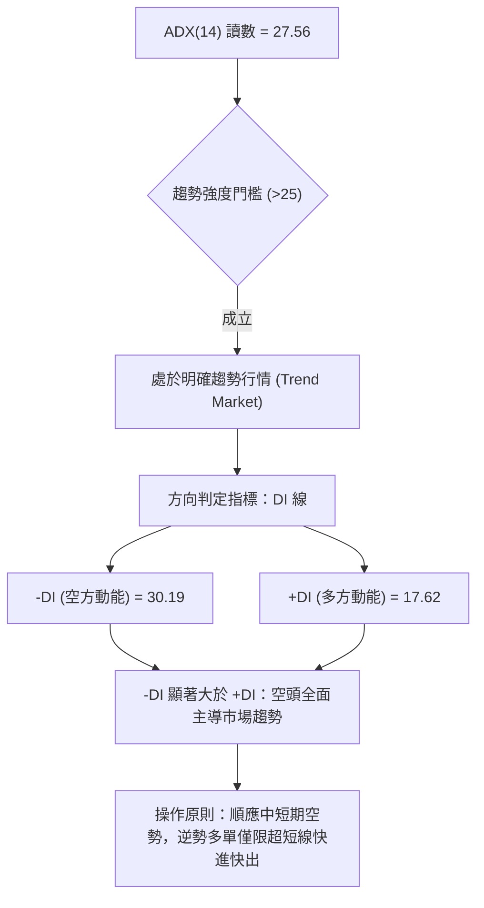

#### ADX 趨勢強度對照表

| 指標名稱 | 當前數值 | 參考閾值 | 狀態評估 | 實戰指引 |
|----------|----------|----------|----------|----------|
| **ADX** | **27.56** | > 25.0 | 🟢 強趨勢確認 | 市場擺脫盤整，單邊走勢特徵明顯，不可進行純網格交易 |
| **+DI** | **17.62** | 基準線 | 🔴 多方乏力 | 買盤動能衰竭，多方無法發動持續性推升波浪 |
| **-DI** | **30.19** | 基準線 | 🔴 空方主導 | 賣方掌控定價權，任何反彈均面臨強大拋壓回測 |
| **走向差值** | **-12.57** | 0.0 | 🔴 空方絕對優勢 | 趨勢下行斜率依舊保持完整，未見 DI 金叉跡象 |

---

## 3. 圖表形態分析

### 🔍 形態識別系統

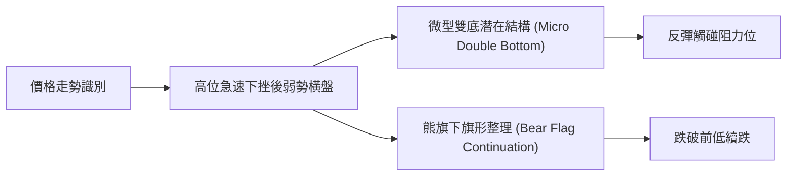

#### 形態信心度評估表

| 形態名稱 | 信心度 | 判斷依據（引用數據） | 完成度 | 目標價（附計算式） |
|----------|--------|----------------------|--------|--------------------|
| **微型雙底 (日線)** | 55% | 2026-10-28 低點 $609.00 與 2026-11-02 低點 $606.41 形成相近雙支撐，頸線為 2026-10-29 高點 $634.68。 | 60% | 由形態高度推算：頸線 $634.68 + (頸線 $634.68 − 底部 $606.41) = $634.68 + $28.27 = **$662.95**（接近阻力 R3 $671.45） |
| **下行旗形 (週線)** | 65% | 自 2026-09-25 高點 $779.82 單邊長陰下殺至 2026-10-30 低點 $609.00（旗桿跌幅 $170.82），近一週於低位小幅反抽。 | 40% | 若跌破旗面下緣 $606.41，由形態高度推算：破位點 $606.41 − 旗桿高度 $170.82 = **$435.59**（注：中途受支撐 S3 $555.86 與 52W 低點 $519.37 阻截） |
| **大週期頭肩頂** | 35% | 數據中左肩與頭部尚可辨識，但右肩未成形，且頸線尚未跌破。 | 25% | **訊號不足，僅做指標型解讀**（信心度低於50%，依規則 15 不予採納預測） |

### 🕯️ 重要K線形態分析

#### 近 10 根日 K 線形態解讀（依規則 19 嚴格列出開高低收）

| 日期 | 開盤價 | 最高價 | 最低價 | 收盤價 | 成交量 | K線形態 | 解讀與多空意涵 | 訊號 |
|------|--------|--------|--------|--------|--------|---------|----------------|------|
| **2026-10-21** | 697.60 | 713.22 | 689.68 | 697.52 | 29,203,900 | 衝高回落小陰十字 | 衝擊 713 未果，上影線顯示上方拋壓沉重 | 🟡 |
| **2026-10-22** | 676.35 | 681.07 | 639.69 | 648.85 | 40,571,000 | 帶量長黑破位大陰線 | 低開低走跌破 650，放量下殺確立破位下行主浪 | 🔴 |
| **2026-10-23** | 638.18 | 648.04 | 633.27 | 642.62 | 14,791,600 | 低位縮量小陽十字 | 下跌暫歇，多空在 640 附近進行微幅拉鋸 | 🟡 |
| **2026-10-26** | 638.36 | 647.69 | 627.80 | 630.56 | 30,913,600 | 陰包陽中陰線 | 反彈失敗，再度跌破前日低點，空方持續掌控 | 🔴 |
| **2026-10-27** | 627.07 | 628.46 | 619.21 | 620.19 | 51,334,100 | 放量下跌下影中陰 | 放出 51M 巨量摜破 620，低檔有少量買盤承接但弱勢 | 🔴 |
| **2026-10-28** | 621.85 | 624.42 | 609.00 | 612.49 | 35,110,900 | 探底小陰線 | 盤中觸及 609 整數關卡，收盤小幅回升 | 🔴 |
| **2026-10-29** | 621.29 | 634.68 | 616.80 | 624.52 | 31,276,200 | 長上影短實體陽線 | 試圖反抽 634 阻力遭遇強烈拋壓被打回 | 🟡 |
| **2026-10-30** | 614.51 | 626.37 | 610.13 | 614.99 | 25,364,700 | 震盪小十字星 | 上下影線對稱，短線方向迷茫，多空僵持 | 🟡 |
| **2026-11-02** | 614.44 | 621.69 | 606.41 | 606.73 | 19,496,500 | 光腳中陰線 | 創下波段新低 606.41 且收在最低點附近，極度弱勢 | 🔴 |
| **2026-11-03** | 610.76 | 624.84 | 610.10 | 621.03 | 13,659,500 | 縮量反彈小陽線 | 縮量上漲，收復 620，呈現短線空頭力竭的弱勢反彈 | 🟢 |

#### 近 8 根週 K 線形態解讀（依規則 19 嚴格列出開高低收）

| 週日期 | 開盤價 | 最高價 | 最低價 | 收盤價 | 成交量 | 週K線形態 | 解讀與多空意涵 | 訊號 |
|--------|--------|--------|--------|--------|--------|-----------|----------------|------|
| **2026-09-18** | 657.31 | 689.61 | 648.71 | 665.23 | 99,577,300 | 震盪上行中陽線 | 維持沿均線推升格局，買盤穩定積聚 | 🟢 |
| **2026-09-25** | 680.30 | 779.82 | 679.60 | 751.66 | 168,307,000 | 爆量長陽創歷史高 | 突破歷史高點，放出 1.68 億股天量，多頭極致爆發 | 🟢 |
| **2026-10-02** | 750.04 | 750.58 | 713.19 | 728.08 | 96,199,700 | 高位見頂長黑陰棒 | 開高走低，跌破前週半數漲幅，確認短期天花板成形 | 🔴 |
| **2026-10-09** | 727.71 | 747.60 | 711.68 | 718.67 | 69,671,000 | 高位橫盤縮量陰星 | 747 附近二次受阻，縮量陰跌顯示跟風盤枯竭 | 🔴 |
| **2026-10-16** | 728.50 | 771.27 | 702.71 | 709.33 | 101,360,200 | 長上影流星陰線 | 盤中拉升至 771.27 假突破誘多，隨後慘遭反噬大陰收跌 | 🔴 |
| **2026-10-23** | 707.16 | 713.22 | 633.27 | 642.62 | 117,876,500 | 斷頭鍘刀巨陰棒 | 一舉貫穿多條中期均線，重挫逾 60 美元，主跌浪確立 | 🔴 |
| **2026-10-30** | 638.36 | 647.69 | 609.00 | 614.99 | 173,999,500 | 放量下跌加速陰線 | 單週爆出 1.74 億股天量下殺，恐慌盤湧現，逼近整數關 | 🔴 |
| **2026-11-03** | 614.44 | 624.84 | 606.41 | 621.03 | 33,156,000 | 低位微幅反抽小陽 | 僅 2 個交易日數據，暫時於 606 獲得微弱支撐收陽 | 🟡 |

### 📉 ASCII 走勢形態示意圖

```
日線微型雙底形態與短期頸線示意圖
價格 ($)
$642 ┤
$635 ┤                ╭───╮ (頸線: $634.68)
$628 ┤       ╭───╮    │   │         ╭───● 現價 $621.03
$621 ┤───────╯   ╰────╯   ╰─────────╯
$614 ┤
$607 ┤   ●(低點1: $609.00)     ●(低點2: $606.41)
     └─────────────────────────────────────────────
         10-28         10-29        11-02   11-03
```

### 🎯 形態目標價計算

1. **短線反彈目標計算（微型雙底假定成立）**：
   - 底部支撐低點：$606.41 (2026-11-02 實體低位)
   - 形態頸線位置：$634.68 (2026-10-29 反彈高位)
   - 形態垂直高度 $H$ = 頸線 − 底部 = $\$634.68 - \$606.41 = \$28.27$
   - **量度漲幅目標價** = 頸線 + $H$ = $\$634.68 + \$28.27 = \$662.95$
   - 結構檢驗：該目標價位於數據中阻力位 R2 ($641.90) 與 R3 ($671.45) 之間，具備合理的阻力壓制邏輯。

2. **破位下行延伸計算（熊旗跌破假定成立）**：
   - 旗桿起點：$779.82 (2026-09-25 高點)
   - 旗桿終點：$609.00 (2026-10-30 低點)
   - 旗桿長度 $L$ = $\$779.82 - \$609.00 = \$170.82$
   - 跌破點設定於近兩日低位：$606.41
   - **極限波段下行目標** = $\$606.41 - \$170.82 = \$435.59$（極限數值，中途必定於支撐 S2 $577.95、S3 $555.86 及 52W 低點 $519.37 發生劇烈爭奪）。

---

## 4. 支撐與阻力

### 🗺️ 關鍵價位分布圖（Unicode）

```
META 價位結構分布圖（嚴格依據數據聚類提取）
════════════════════════════════════════════════════════════════
$779.82 ║████████████████████████████████████████║ 52W 歷史極值高點
$718.35 ║████████████████████████████            ║ 斐波那契 23.6% 回調位
$680.33 ║████████████████████████████████        ║ 斐波那契 38.2% 回調位
$671.45 ║████████████████████████████████████    ║ 強阻力 R3 (波段反壓中樞)
$649.59 ║████████████████████████                ║ 斐波那契 50.0% 關鍵平衡位
$641.90 ║████████████████████                    ║ 阻力 R2 (反彈重要關卡)
$623.91 ║████████████████████████                ║ 關鍵即時阻力 R1
$621.03 ╠════════════════════════════════════════╣ ◄ 當前市價 (收盤價)
$618.86 ║▓▓▓▓▓▓▓▓▓▓▓▓▓▓▓▓▓▓▓▓▓▓▓▓▓▓▓▓▓▓▓▓        ║ 斐波那契 61.8% 黃金回調防線
$594.61 ║▓▓▓▓▓▓▓▓▓▓▓▓▓▓▓▓                        ║ 近期關鍵支撐 S1
$577.95 ║████████████████████████                ║ 強支撐 S2 (密集波段底部)
$575.11 ║████████████████████                    ║ 斐波那契 78.6% 回調位
$555.86 ║████████████████████████████            ║ 終極深幅支撐 S3
$519.37 ║████████████████████████████████████████║ 52W 歷史最低點 (100.0%)
════════════════════════════════════════════════════════════════
```

### 🚧 阻力位分析表

所有價位均直接引用數據「阻力位 (Resistance)」區塊之真實聚類計算值：

| 阻力級別 | 價位 | 形成原因 | 突破難度 | 重要性 |
|----------|------|----------|----------|--------|
| **R1** | **$623.91** | 近期 10-29、10-30 反彈高點密集壓制，距離現價僅 +0.46%，為日線級別第一道空頭防線。 | 🟡 中等（需放量） | 極高。突破此處方能化解日內連跌鈍化走勢。 |
| **R2** | **$641.90** | 10-23 跳空下跌之平台頸線位，密集成交套牢區，距離現價 +3.36%。 | 🔴 困難（強套牢） | 高。此處為空方波段防守堡壘，遇阻回落機率大。 |
| **R3** | **$671.45** | 接近 MA50 ($672.18) 與前期週線密集震盪下軌，距離現價 +8.12%。 | 🔴 極難（重壓區） | 中長線樞紐。唯有放量收復 R3，中期下行結構才宣告瓦解。 |

### 🛡️ 支撐位分析表

所有價位均直接引用數據「支撐位 (Support)」區塊之真實聚類計算值：

| 支撐級別 | 價位 | 形成原因 | 守住機率 | 重要性 |
|----------|------|----------|----------|--------|
| **S1** | **$594.61** | 600 美元整數心理關口下方第一道波段防線，距離現價 -4.25%。 | 🟡 60% | 極高。多方短線最後一道體面防線，失守將直奔 570。 |
| **S2** | **$577.95** | 2026年3月 ($571.15) 與 8月 ($571.89) 雙重月線大底回升區，距離現價 -6.94%。 | 🟢 75% | 核心堡壘。此處為長週期價值投資買盤集結地。 |
| **S3** | **$555.86** | 2026年7月收盤低點 ($556.27) 聚類支撐，距離現價 -10.49%。 | 🟢 85% | 戰略支撐。若跌破此處，年內上漲成果將全數回吐。 |

### 📐 斐波那契回調位分析

依據數據給定之 52 週極值區間（低點 $519.37 → 高點 $779.82，總垂直跨度 $260.45）進行絕對點位落點解析：

```
斐波那契回調位與現價位置示意
0.0%  $779.82 ──────────────────────────── 52W 高點
23.6% $718.35 ────────────────────────────
38.2% $680.33 ────────────────────────────
50.0% $649.59 ────────────────────────────
61.8% $618.86 ════════════════════════════ ◄◄ 現價 $621.03 正於此線上緣 0.35% 震盪
78.6% $575.11 ────────────────────────────
100%  $519.37 ──────────────────────────── 52W 低點
```

- **當前位置解讀**：現價 **$621.03** 精確落在 **61.8% ($618.86)** 與 **50.0% ($649.59)** 回調位之間，且極度貼近 **61.8% 黃金分割回調位**。
- **技術意義**：
  1. 斐波那契 61.8% 通常被視為經典趨勢反轉的「生死線」。一旦股價在此處止跌並形成實體陽線收復，代表自 $779.82 以來的深度回調屬於強勢上漲行情的健康回吐（Golden Retracement）。
  2. 若日線實體收盤有效跌穿 $618.86，則根據斐波那契理論，行情將不再屬於「牛市回調」，而是轉化為深度下行浪，下方空間將直接被打開至 **78.6% 回調位 ($575.11)**，該位置與數據中的支撐位 S2 ($577.95) 形成高精度的共振支撐區間。

---

## 5. 技術指標深度解讀

### 🎛️ 指標訊號總覽

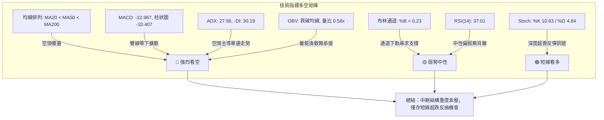

### 📈 移動平均線排列分析

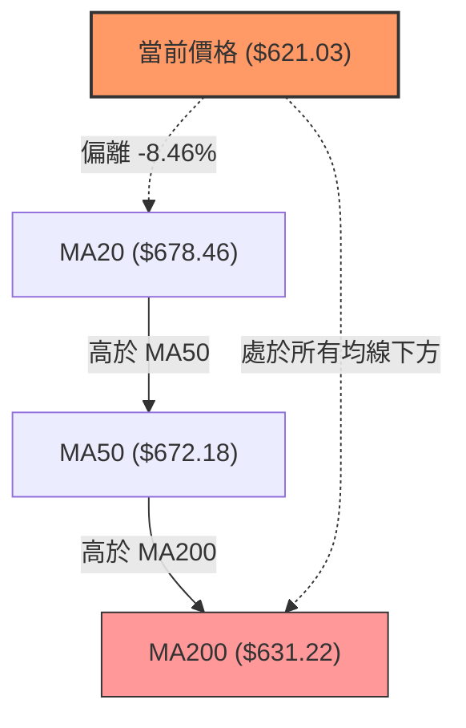

#### 各期均線狀態剖析

| 均線名稱 | 數值 | 價格相對於均線 | 均線斜率與形態解讀 |
|----------|------|----------------|--------------------|
| **MA 5** | **$615.95** | ▲ +5.08 (+0.82%) | 短線止跌回升，價格首度站上 5 日線，短多微弱抵抗。 |
| **MA 10** | **$631.95** | ▼ -10.92 (-1.73%) | 陡峭向下延伸，構成日內反彈首要動態壓制。 |
| **MA 20** | **$678.46** | ▼ -57.43 (-8.46%) | 加速下挫，負乖離率達 -8.46%，具備向中軌靠攏的超跌修復動能。 |
| **MA 60** | **$654.68** | ▼ -33.65 (-5.14%) | 走平後拐頭向下，中期波段多空分水嶺宣告失守。 |
| **MA 120** | **$627.84** | ▼ -6.81 (-1.08%) | 半年線失守，此處即將與現價發生密集爭奪。 |
| **MA 200** | **$631.22** | ▼ -10.19 (-1.61%) | **牛熊分界線遭貫穿**。雖然中長期歷史排列呈現 MA20>MA50>MA200 的名義多頭排列，但價格已運行至 MA200 之下，形成典型的「均線多頭假象、實質空頭破位」。 |

### 📉 RSI(14) 分析

- **當前讀數**：**37.01**（Wilder 計算法）
- **強度指示**：
  ```
  RSI(14) 讀數：37.01
  [0] ────────── [30] ───────●─────── [70] ────────── [100]
      極度超賣          中性偏弱            極度超買
  進度條：███████░░░░░░░░░░░░░ (37.01%)
  ```
- **超買超賣評估**：RSI 處於 30 至 70 的中性區間下沿，尚未觸及 <30 的絕對超賣閾值。這意味著空方動能雖有減速，但並未發生大規模的極端拋售竭盡現象，短期內依然存在進一步慣性下探釋放浮動籌碼的空間。
- **背離判斷**：數據明確提示「**無明顯背離**（僅比較近20根K棒首尾的價格與RSI方向）」。價格在近 20 根 K 線中創下新低（從 10-21 的 $697.52 下跌至 11-02 的 $606.73），而 RSI 亦自 50 以上回落至 37.01，價格軌跡與 RSI 曲線斜率高度吻合，無底背離形成，不可盲目臆測反轉。

### 📊 MACD(12/26/9) 訊號解讀

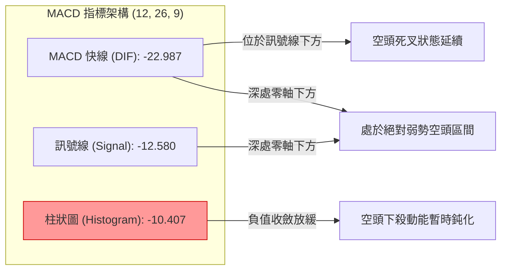

- **數值分析**：MACD 快線 (-22.987) 顯著低於信號線 (-12.580)，兩者差距達到 -10.407。
- **動能評估**：MACD 柱狀圖讀數為 -10.407，處於深度負值區。週線級別 MACD 柱狀圖自 2026-09-25 的 +11.729 連續 5 週斷崖式下挫至當前的 -10.407，顯示本輪下跌為週線級別的動能潰散，非短線三五日震盪即可扭轉。柱狀圖尚未出現顯著向零軸靠攏的「紅柱抽頭」特徵，空頭訊號明確。

### 📦 布林通道分析

```
布林通道 (20, 2) 與價格位置關係圖
════════════════════════════════════════════════════════════════
$784.32 ──────────────────────────────────────── 上軌 (Upper Band)
          ↑
          │ 寬度：$211.73 (開口劇烈放大，高波動展開)
          ↓
$678.46 ──────────────────────────────────────── 中軌 (MA20 Baseline)
          ↑
          │ 當前空間：$105.87
          ↓
$621.03 ════════════════════════════════════════ ◄◄ 現價 (%B = 0.23)
          ↑ 距離下軌僅 $48.44
$572.59 ──────────────────────────────────────── 下軌 (Lower Band)
════════════════════════════════════════════════════════════════
```

- **位置判定**：布林帶當前數值為上軌 **$784.32**、中軌 **$678.46**、下軌 **$572.59**。
- **%B 指標解讀**：%B 精確值為 **0.23**，表明當前價格已跌入通道底部 23% 的極弱勢窄幅帶內。
- **通道形態**：通道帶寬 ($784.32 − $572.59 = $211.73) 呈現發散擴張態勢，顯示市場正處於空頭趨勢宣洩期。由於 %B 尚未觸及 0.00 以下（跌破下軌），價格並未產生極端的「超跌帶外抽回」，而是順著下軌邊緣緩步下滑，此為弱勢陰跌特徵。

### 💹 成交量分析（量價配合度）

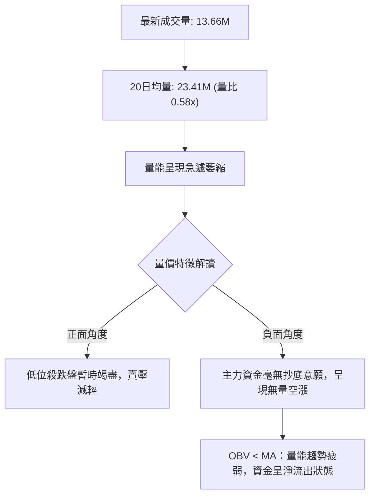

- **量比分析**：2026-11-03 成交量僅為 13,659,500 股，相較於 20 日均量 23,414,240 股，量比僅為 **0.58x**。與 2026-10-27 放量殺跌時的 51.33M 相比，量能縮減近 73%。
- **OBV 趨勢解讀**：數據指出「**OBV < MA → 量能疲弱**」。能量潮指標低於其移動平均線，這意味著累計成交量在下跌日佔據絕對主導，反彈日的微弱量能根本無法形成實質性的籌碼換手。在量價結構中，「無量反彈視為抽搐」，缺乏 25M 以上均量配合的反彈，極易誘發二次探底。

---

## 6. 動能與波動率

### ⚡ 動能評估四象限

| 象限 | 動能強度 | 波動率水平 | 當前所屬狀態 | 專業評估與策略應對 |
|------|----------|------------|--------------|--------------------|
| **Q1 (最佳擴張)** | 強 (Bullish) | 低 (Low Vol) | — | 穩定多頭趨勢，適合持股推升波段。 |
| **Q2 (震盪收斂)** | 弱 (Bearish) | 低 (Low Vol) | — | 狹幅無聊盤整，等待方向破位。 |
| **Q3 (風險釋放)** | **弱 (Bearish)** | **高 (High Vol)** | **✓ (當前所處象限)** | **強空頭動能伴隨中高波動率**。受財報與大盤波動衝擊，股價下挫慣性大，反彈空間脆弱，進場做多面臨極高賠率懲罰，應以輕倉或偏空應對。 |
| **Q4 (極端爆發)** | 強 (Bullish) | 高 (High Vol) | — | 單邊暴拉主升浪，適合順勢追擊。 |

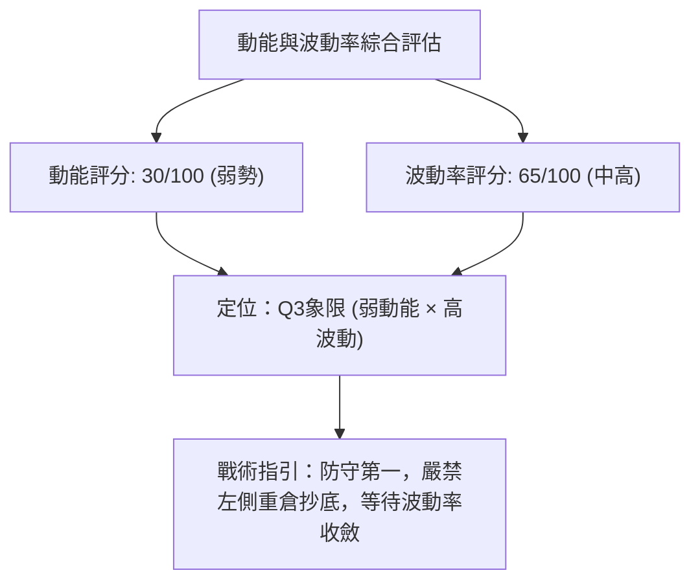

### 📊 ATR 波動率分析

- **ATR(14) 數值**：**$22.39**（佔當前股價之 **3.61%**，採 Wilder 平滑算法）。
- **日內波動區間**：這意味著 META 當前的單日合理波動價差高達 $22.39 美元。
- **風控止損測算**：
  - 激進日內交易止損距離（1.0 × ATR）：$22.39 美元。
  - 波段交易常規止損距離（1.5 × ATR）：**$33.59** 美元。
  - 寬鬆防洗盤止損距離（2.0 × ATR）：**$44.78** 美元。
- **解讀**：由於 ATR 高達 3.61%，任何小於 $20 美元的窄幅止損點極易遭到隨機市場噪音掃出場。進場點位必須極度貼近結構防守點（如支撐位 S1）。

### 📐 Beta 與市場相關性

- **Beta 係數**：**1.279**
- **市場敏感度分析**：
  - META 的 Beta 值為 1.279，屬於典型的高彈性成長型大型科技股。當標普 500 指數或納斯達克 100 指數波動 1.0% 時，理論上 META 將同向波動 1.28%。
  - 在當前宏觀環境下（美大選開票、AI 資本支出疑慮），高 Beta 意味著雙向風險放大。若市場整體風險偏好（Risk-off）下行，META 將承受超越大盤的下行壓力。

---

## 7. 多時框架總結

### 📋 時框架評分表

| 時框架 | 趨勢方向 | 動能狀態 | 均線排列 | 形態結構 | 綜合評分 | 操作建議 |
|--------|----------|----------|----------|----------|----------|----------|
| **長線 (月線)** | 🟡 中性偏多 | 轉弱回調 | 多頭排列 | 歷史天花板深幅回撤 | 55/100 | 長線長線持有者暫停加碼，等待穩固基底。 |
| **中線 (週線)** | 🔴 明確看空 | 加速下挫 | 高位死叉壓制 | 5連陰破位跌勢 | 35/100 | 中線持倉逢反彈減磅，規避下行主浪。 |
| **短線 (日線)** | 🔴 弱勢反彈 | 超賣鈍化 | 價格全線破位 | 606 處微型雙底掙扎 | 40/100 | 短線高手極輕倉博取反抽，嚴格帶止損。 |

### 🔲 綜合訊號矩陣

```
時框架訊號收斂矩陣
┌──────────────┬──────────────┬──────────────┬──────────────┐
│ 維度 / 週期  │ 短期 (日線)  │ 中期 (週線)  │ 長期 (月線)  │
├──────────────┼──────────────┼──────────────┼──────────────┤
│ 主導趨勢     │ 🔴 空頭下行  │ 🔴 空頭破位  │ 🟢 寬幅牛市  │
│ 均線系統     │ 🔴 跌破MA200 │ 🔴 跌破MA20  │ 🟢 MA20>50   │
│ 動能指標     │ 🟢 超賣修復  │ 🔴 MACD死叉  │ 🟡 高位回落  │
│ 量能表現     │ 🔴 縮量抽搐  │ 🔴 爆量下殺  │ 🟡 均量平穩  │
│ 關鍵價位判定 │ 測試 S1/Fib  │ 跌向中軸支撐 │ 守在低點之上 │
└──────────────┴──────────────┴──────────────┴──────────────┘
```

### ⚖️ 多時框收斂結論

依據本報告設定之「**多時框收斂規則（規則 14）**」：
1. **行情屬性判定**：當前 ADX(14) 讀數為 **27.56**，明確大於閾值 25.0，判定為**標準趨勢行情**，而非無方向的箱體盤整。
2. **時框優先級權重**：在 ADX > 25 的趨勢行情中，中長期（週線級別與 MA50、MA200）方向具有最高決定權，日線訊號僅用於尋找反彈阻力位與順勢進場時機。
3. **最終唯一方向性結論**：**【偏空主導，順勢放空 / 逢高減磅，短多僅限技術性快進快出】**。
   - 週線連陰並伴隨 MACD 深度綠柱，確立中期調整遠未結束；
   - 日線 Stoch %K(10.63) 之超賣與價格觸碰 Fib 61.8% ($618.86)，僅構成次級折返（Secondary Reaction）；
   - 結論收斂：不得將日線超跌誤判為牛市重啟，所有策略必須順應週線級別下行壓制。此結論與第 8 章之策略路由完全契合。

---

## 8. 交易策略建議

### 🗺️ 策略決策流程圖

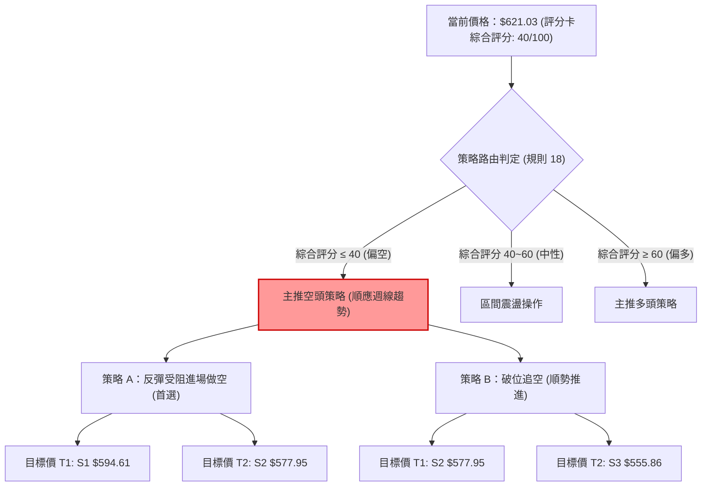

### 🧭 策略路由（依評分卡分流，不得兩頭下注）

> **當前主策略方向 = 主推空頭策略（依技術評分卡綜合評分 40/100 定調）**
> 
> *依據多時框收斂與規則 18，綜合評分 40 分（≤40）觸發空頭主路由。週線下行主浪確立，ADX 27.56 強趨勢空頭掌控。任何多頭操作均定性為「極短線超跌反抽」，主推策略全數圍繞空頭順勢展開。*

### 🎯 價格情境階梯（Price Scenarios）

價位完全嚴格引用數據中「關鍵價位」與「斐波那契」聚類數值：

| 觸發條件 | 下一目標 | 後續延伸 | 情境含義與操作對策 |
|----------|----------|----------|--------------------|
| **向上突破 R1 $623.91** | R2 **$641.90** | R3 **$671.45** | 短線超跌反彈延展，進入最佳空頭逢高狙擊區間。 |
| **現價 $621.03 弱勢盤整** | 測試 Fib 61.8% ($618.86) | 考驗 S1 **$594.61** | 多方防守遲疑，空頭隨時發動二次下殺。 |
| **向下跌破 S1 $594.61** | S2 **$577.95** | S3 **$555.86** | 跌破 600 大關支撐，下行空間全面打開，空單加速獲利。 |

### 📊 情境機率分佈

| 情境方向 | 發生機率 | 主要技術依據（引用指標狀態） |
|----------|----------|------------------------------|
| **回落 / 再探底 (主情境)** | **55%** | ADX 27.56 且 -DI(30.19) 處於絕對統治地位；OBV 持續低於均線且量比僅 0.58x，顯示缺乏機構建倉量能；MACD 柱狀圖 -10.407 深度壓制。 |
| **區間震盪 / 弱反抽** | **35%** | 價格剛好獲得斐波那契 61.8% ($618.86) 支撐；隨機指標 Stoch %K(10.63) 處於極度超賣狀態，空頭有回補平倉需求，限制日內下挫速率。 |
| **反轉向上大漲** | **10%** | 全線均線（MA20/50/200）呈空頭壓制，且上方聚集 10 月底巨量套牢盤，在無重大利多催化下直接反轉機率極低。 |

### 🟢 主策略詳情（方向：主推空頭策略）

所有價位均嚴格引用數據中提取的點位，風險報酬比嚴格按規則 17 計算：  
$\text{做空風險報酬比} = \frac{\text{進場價} - \text{目標價 T1}}{\text{止損價} - \text{進場價}}$

| 策略要素 | 策略 A（反彈受阻高空 — 穩健型） | 策略 B（破位追空 — 順勢突破型） |
|----------|----------------------------------|----------------------------------|
| **進場條件** | 價格短暫反抽至阻力 R2 附近滯漲，日 K 出現上影線確認受阻時進場做空 | 價格跌破支撐位 S1 且 1 小時 K 線收在下方確認破位時順勢進場做空 |
| **進場價格** | **$641.90**（引用數據阻力位 R2） | **$594.61**（引用數據支撐位 S1） |
| **目標價 T1** | **$594.61**（引用數據支撐位 S1） | **$577.95**（引用數據支撐位 S2） |
| **目標價 T2** | **$577.95**（引用數據支撐位 S2） | **$555.86**（引用數據支撐位 S3） |
| **止損價格** | **$671.45**（引用數據阻力位 R3） | **$623.91**（引用數據阻力位 R1） |
| **風險報酬比 (T1)** | **1 : 1.60（以 T1 計）**<br>計算式：$(641.90 - 594.61) \div (671.45 - 641.90) = 47.29 \div 29.55 = 1.60$ | **1 : 0.57（以 T1 計）**<br>計算式：$(594.61 - 577.95) \div (623.91 - 594.61) = 16.66 \div 29.30 = 0.57$ |
| **風險報酬比 (T2)** | **1 : 2.16（以 T2 計）**<br>計算式：$(641.90 - 577.95) \div (671.45 - 641.90) = 63.95 \div 29.55 = 2.16$ | **1 : 1.32（以 T2 計）**<br>計算式：$(594.61 - 555.86) \div (623.91 - 594.61) = 38.75 \div 29.30 = 1.32$ |
| **勝率預估** | **65%** | **55%** |
| **建議倉位** | **總資金之 10% – 15%** | **總資金之 5% – 8%** |

### 🔴 反向風險觸發點（對沖提示）

若出現以下情境，宣告本報告「空頭主策略」被推翻，空單必須立即無條件止損出局：
1. **價位突破觸發**：日線收盤價強勢突破 **R3 ($671.45)** 並站上 **MA50 ($672.18)** 上方。
2. **指標異象觸發**：MACD 快線向上金叉訊號線且柱狀圖翻紅，同時單日成交量放大至 3,500 萬股（1.5 倍均量）以上。
3. **對沖應對指引**：空單全數離場，反手建立多頭倉位，向上看至 斐波那契 23.6% ($718.35)。

### ⭐ 整體訊號強度評星

```
做多訊號強度：★☆☆☆☆  (1.5/5星 — 僅超賣技術指標弱支撐)
做空訊號強度：★★★★☆  (4.0/5星 — 均線/趨勢/動能/量能全面共振偏空)
整體可信度：  ★★★★☆  (4.2/5星 — 多時框指標收斂性極高)
```

---

## 9. 風險提示與監控

### ✅ 關鍵監控指標 Checklist

```
╔══════════════════════════════════════════════════════════════╗
║               META 技術風控關鍵監控清單 (Checklist)           ║
╠══════════════════════════════════════════════════════════════╣
║ [ ] 1. 斐波那契 61.8% 防守確認：每日收盤是否維持在 $618.86 之上  ║
║ [ ] 2. 阻力位 R1 考驗：日內反彈能否放量越過 $623.91           ║
║ [ ] 3. 支撐位 S1 警戒：價格若跌破 $594.61，嚴禁任何左側多單抄底║
║ [ ] 4. 成交量異動：單日成交量是否回升至 2,340 萬股 (20日均量)║
║ [ ] 5. ADX 數值動向：ADX 若續升突破 30，警惕空頭單邊暴跌加速 ║
║ [ ] 6. 均線死叉風險：密切觀察 MA20 ($678.46) 是否即將死叉 MA50║
║ [ ] 7. ATR 動態：當前 ATR $22.39，止損空間切勿設置低於 1.5 ATR║
╚══════════════════════════════════════════════════════════════╝
```

### ⚠️ 風險場景分析

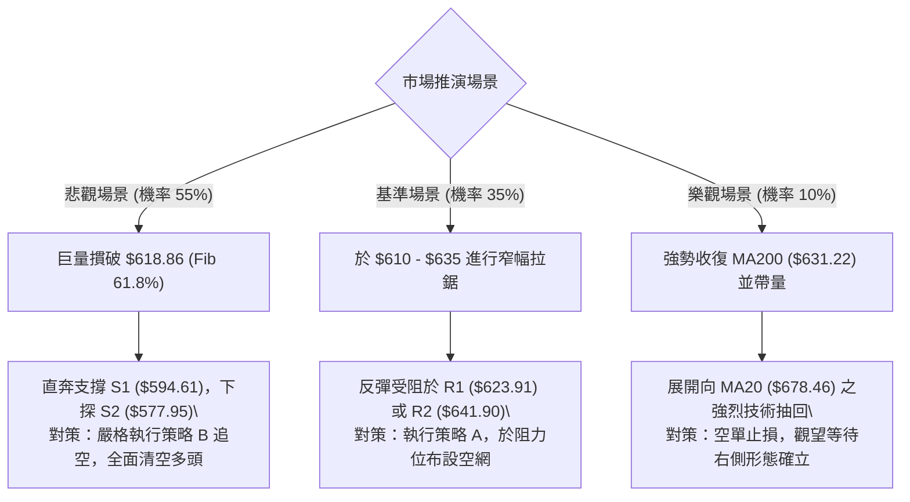

### 🛡️ 風險管理重要提醒

1. **宏觀事件風險溢價**：
   - 報告數據顯示近期新聞聚焦「美國期中選舉（Midterm Election Day）」以及「Meta 債務成本上升（Meta Debt Costs Rise）」。政治選舉引發的市場流動性驟變通常會無視技術面指標，造成跳空缺口。在重大開票結果揭曉前，應降低倉位暴露 30%–50%。
2. **財報與 AI 資本支出隱憂**：
   - 儘管 TTM 營收成長 26.1%、淨利成長 264%，但最新新聞揭示 Meta 資本支出已高達 $104.44B（導致 FCF 收益率壓縮至 1.80%），市場對 AI 變現週期的焦慮加劇。基本面估值擴張暫時停滯，技術面破位下行是市場重定價（Repricing）的具體展現，絕不可輕信「本益比 21 倍很便宜」而逆技術勢重倉抄底。
3. **倉位管理鐵律**：
   - 單筆交易最大虧損額度必須嚴格控制在總投資資本的 **1.5%** 以內。
   - 鑑於當前 ATR 高達 **$22.39**，若採用策略 A（止損空間 $29.55），每 10 萬美元總資產建議交易股數不宜超過：  
     $\text{股數上限} = \frac{\$100,000 \times 1.5\%}{\$29.55} = \frac{\$1,500}{\$29.55} \approx 50 \text{ 股}$。

---

## 📋 報告總結

```
META 技術分析報告總結
════════════════════════════════════════════════════════════════
報告日期：2026-11-04
當前價格：$621.03
分析評級：🔴 偏空弱勢 (綜合評分 40/100)

關鍵結論：
├─ 長期趨勢：🟡 中性整理（歷史高位回落，但仍處於近2年相對高檔）
├─ 中期趨勢：🔴 明確空頭（週線連續五週大陰線摜破中期防線）
├─ 短期趨勢：🔴 弱勢反彈（價格跌破 MA200，受制於 Fib 61.8% 邊緣）
├─ 關鍵支撐：S1: $594.61 ｜ S2: $577.95 ｜ Fib 61.8%: $618.86
├─ 關鍵阻力：R1: $623.91 ｜ R2: $641.90 ｜ R3: $671.45
└─ 分析師目標：共識均價 $848.38 ｜ 最低預測 $629.06 (高於現價)

最優策略組合：
1. 🥇 最佳機會：策略 A（反彈受阻高空）— 耐心等待股價反彈至 R2 ($641.90) 附近
               受阻時建立空單，目標 S1 ($594.61)，止損設於 R3 ($671.45)，
               風報比 1 : 1.60（以 T1 計）。
2. 🥈 次選機會：策略 B（破位順勢追空）— 若日線實體跌破 S1 ($594.61)，順勢
               進場做空，目標 S2 ($577.95)，止損 R1 ($623.91)，風報比 1 : 0.57。
3. 🥉 保守選擇：空倉觀望 — 等待價格在支撐 S2 ($577.95) 至 Fib 78.6% ($575.11)
               區間出現明確的雙底或底背離結構後，再尋求右側買入機會。
════════════════════════════════════════════════════════════════
```

---

> ⚠️ **免責聲明**：本報告為 AI 自動生成之技術分析，所有數據及估算均基於提供的歷史價格資訊。本報告**僅供研究與學術參考**，**不構成任何投資建議**。投資有風險，入市需謹慎。

---

*報告生成時間：2026-11-04 ｜ 數據來源：Yahoo Finance ｜ 分析框架：多時框技術分析*