# META 技術分析報告

> **報告日期**：2026-11-05 ｜ **語言**：繁體中文 ｜ **數據來源**：Yahoo Finance ｜ **當前價格**：$630.00

---

## 目錄

| 章節 | 內容 |
|------|------|
| [1. 技術面概覽](#1-技術面概覽) | 訊號儀表板、核心指標、評分卡 |
| [2. 趨勢分析](#2-趨勢分析) | 多時框趨勢、長中短期走勢、ADX強弱 |
| [3. 圖表形態分析](#3-圖表形態分析) | 形態識別、K線組合、目標價推算 |
| [4. 支撐與阻力](#4-支撐與阻力) | 關鍵價位分佈、斐波那契回調結構 |
| [5. 技術指標深度解讀](#5-技術指標深度解讀) | 均線系統、RSI、MACD、布林通道、OBV |
| [6. 動能與波動率](#6-動能與波動率) | 動能四象限、ATR波幅、Beta市場敏感度 |
| [7. 多時框架總結](#7-多時框架總結) | 時框架矩陣、多時框收斂定調 |
| [8. 交易策略建議](#8-交易策略建議) | 策略路由、情境階梯、主客策略執行參數 |
| [9. 風險提示與監控](#9-風險提示與監控) | 監控清單、極端情境推演、風控總結 |

---

## 1. 技術面概覽

### 🎯 技術訊號儀表板

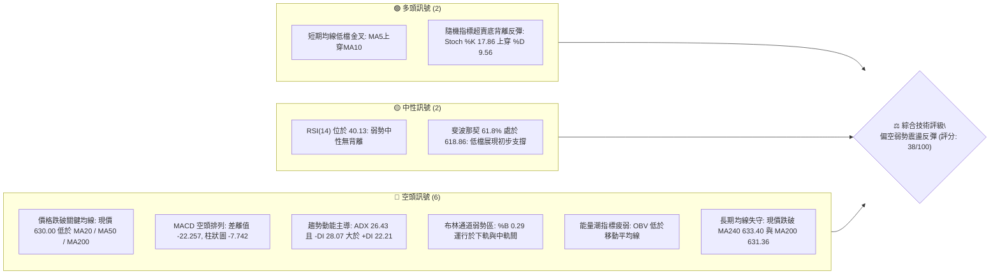

---

### 📊 核心指標速覽表

| 指標類別 | 指標名稱 | 當前數值 | 訊號 | 專業解讀 |
|:---|:---|:---|:---:|:---|
| **現貨價格** | 收盤價 (Close) | $630.00 | 🔴 | 位於 52 週高低區間之 42.5%，跌破長期平衡中樞 |
| **短期均線** | MA20 (月線) | $673.89 | 🔴 | 現價低於 MA20 達 -6.51%，短期下行斜率陡峭 |
| **中期均線** | MA50 (季線) | $673.39 | 🔴 | 現價低於 MA50，且 MA20 即將與 MA50 形成死叉壓制 |
| **長期均線** | MA200 (年線) | $631.36 | 🔴 | 現價正式跌破年線 $631.36（-0.22%），牛熊分水嶺失守 |
| **超長均線** | MA240 (兩年線) | $633.40 | 🔴 | 現價低於 MA240，長線估值中樞面臨下移壓力 |
| **動能震盪** | RSI(14) (Wilder) | 40.13 | 🟡 | 位於空方控盤區間（30-50），未達極端超賣，下行動能猶存 |
| **趨勢動能** | MACD (12,26,9) | -22.257 | 🔴 | 位於零軸下方深處，訊號線 -14.515，負柱狀圖達 -7.742 |
| **擺動指標** | Stoch %K / %D | 17.86 / 9.56 | 🟢 | 進入 20 以下超賣區，形成超賣低檔微幅金叉，醞釀短線反抽 |
| **趨勢強度** | ADX(14) | 26.43 | 🔴 | 數值大於 25 確認為強趨勢，-DI (28.07) > +DI (22.21) 確立空頭主導 |
| **通道指標** | Bollinger %B | 0.29 | 🔴 | 股價受制於中軌 ($673.89)，通道口向外擴張，空頭結構未解 |
| **波動風險** | ATR(14) | $22.37 | 🟡 | 佔現價 3.55%，單日震盪幅度大，市場處於非理性拋售餘震 |
| **成交量能** | 20日成交量比 | 1.33x | 🔴 | 最新量 32.40M 高於 20MA (24.38M)，下跌帶量，OBV 低於均線 |

---

### 🏆 技術評分卡

```
╔══════════════════════════════════════════════════════════════════╗
║                   技術評分卡 — META (2026-11-05)                ║
╠══════════════════════════════════════════════════════════════════╣
║ 趨勢強度 (Trend)     ███████░░░░░░░░░░░░░  35/100 🔴 空頭趨勢確立║
║ 動能指標 (Momentum)  ██████░░░░░░░░░░░░░░  30/100 🔴 MACD空頭發散║
║ 支撐穩定度 (Support) ███████████░░░░░░░░░  55/100 🟡 S1前哨防守 ║
║ 成交量配合 (Volume)  ████████░░░░░░░░░░░░  40/100 🔴 陰線放量滯跌║
║ 形態完整度 (Pattern) ███████░░░░░░░░░░░░░  35/100 🔴 頭部破位走勢║
║ 均線排列 (MA System) ███████░░░░░░░░░░░░░  33/100 🔴 價格破年線  ║
╠══════════════════════════════════════════════════════════════════╣
║ 綜合評分             ████████░░░░░░░░░░░░  38/100 🔴 偏空弱勢整理║
╚══════════════════════════════════════════════════════════════════╝
```

> **評分計算依據（規則 18）**：
> 綜合評分 = (35 + 30 + 55 + 40 + 35 + 33) ÷ 6 = 228 ÷ 6 = **38 / 100**。評級判定：**偏空（主推防守與反彈沽空策略）**。

---

## 2. 趨勢分析

### 🌐 多時框趨勢分析

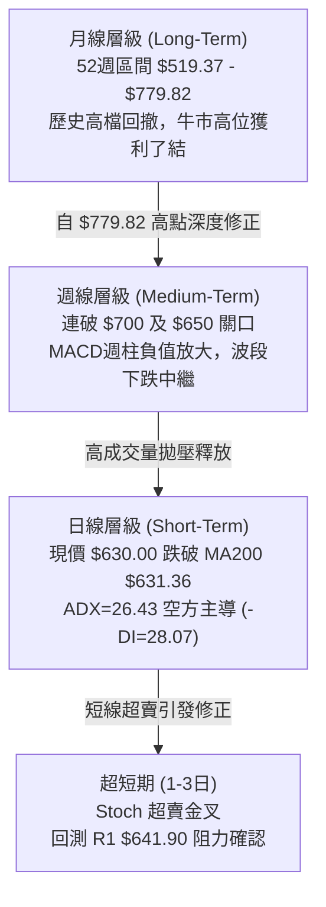

---

### 📈 長期趨勢 — 12個月走勢圖（Unicode）

以下為 META 自 2025 年 11 月至 2026 年 11 月之 12 個月收盤走勢刻畫（標註歷史關鍵高低點位）：

```
META 月線走勢圖（2025-11 至 2026-11）
價格軸 ($)
$780 ┼                                      
$760 ┼                                      
$740 ┼                                      
$720 ┼                ●(2026-01: 714.66)   ●(2026-09: 725.18)
$700 ┼                                        │ 
$680 ┼                                        │ 
$660 ┼          ●                             │ 
$640 ┼ ●────────┼─────────────●───────●───────┼─────────────●←現價 $630.00
$620 ┼          │             │       │       │       ●     
$600 ┼          │             ●       │       │       │     
$580 ┼          │             (04:    │       │       │     
$560 ┼          │             610.86) │       │       │     
$540 ┼          ●(2026-03:            ●(07:   ●(08:   │     
     │          571.15)               556.27) 571.89) │     
$520 ┼                                                │     
     └────┬───────┬─────┬───────┬───────┬───────┬─────┬─┴─────
         11      01    03      05      07      09    11 (月份)
       (2025)  (2026)        (2026)  (2026)  (2026) (2026)
```

#### 走勢特徵分析表格

| 階段區間 | 起訖月份 | 起訖價格 ($) | 區間漲跌幅 (%) | 價量與走勢特徵詳細分析 |
|:---|:---:|:---:|:---:|:---|
| **第一階段：高檔震盪** | 2025-11 → 2026-01 | $645.76 → $714.66 | +10.67% | 歲末初年資金推升，創波段次高 $714.66，但動能未過前高 $770.31 |
| **第二階段：春季回殺** | 2026-01 → 2026-03 | $714.66 → $571.15 | -20.08% | 出現斷崖式殺盤，快速跌破 $600 整數大關，形成第 1 波流動性出清 |
| **第三階段：夏季築底** | 2026-04 → 2026-08 | $610.86 → $571.89 | -6.38% | 於 $556.27（2026-07 低點）反覆打底，構築中期對稱震盪箱體 |
| **第四階段：秋季急拉** | 2026-08 → 2026-09 | $571.89 → $725.18 | +26.80% | 單月大漲近 27%，週線於 09-25 觸及 52 週頂部 $779.82，爆巨量出貨 |
| **第五階段：破位暴跌** | 2026-09 → 2026-11 | $725.18 → $630.00 | -13.13% | 兩個月內急速回吐，自歷史極值 $779.82 重挫逾 19%，直逼年線 |

---

### 📊 中期趨勢（週線分析）

中期走勢圖展現了從 2026 年 9 月下旬創下 52 週新高 $779.82 後的瀑布式回調。

```
近期週線壓力與支撐階梯示意圖
========================================================================
[天花板] 52W High $779.82 (09-25 爆出 1.68億股週巨量)
   │
   ▼
[阻力 R3] $687.94 ── 10月中旬跌破之籌碼密集解套區
   │
   ▼
[阻力 R2] $671.45 ── MA20 ($673.89) 及 MA50 ($673.39) 聚合死叉帶
   │
   ▼
[阻力 R1] $641.90 ── 近期反彈遇阻波段高點（日K多次上影線）
   │
───────► 當前現價 $630.00 (多空膠著於 MA200 $631.36 之下) ◄───────
   │
   ▼
[支撐 S1] $626.54 ── 近期下影線支撐聚集帶（跌幅 -0.55%）
   │
   ▼
[支撐 S2] $594.61 ── 跌破 $600 關口後之強支撐帶（波段低點）
   │
   ▼
[支撐 S3] $577.95 ── 2026年7-8月築底中樞支撐
========================================================================
```

---

### ⚡ 趨勢強度評估（ADX 解讀）

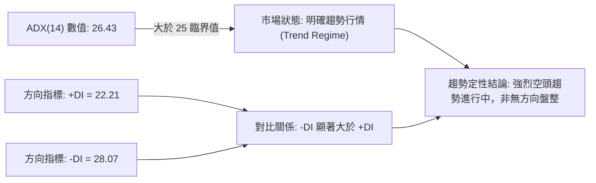

#### ADX 趨勢強度對照表

| ADX 區間 | 趨勢狀態 | 當前數值 | 當前適用策略模式 | 行情主導方 |
|:---:|:---:|:---:|:---|:---:|
| 0 – 20 | 缺乏趨勢 / 雜訊震盪 | — | 區間高拋低吸，禁用突破單 | 無 |
| 20 – 25 | 趨勢孕育 / 方向未明 | — | 觀察通道破位，輕倉試單 | 多空博弈 |
| **25 – 40** | **強勁趨勢 (Strong Trend)** | **26.43** | **順勢操作為主，反彈至阻力沽空** | **空頭掌控 (-DI: 28.07)** |
| 40 – 60 | 極強趨勢 / 單邊主升降 | — | 緊密移動停利，不輕易逆勢摸底 | 單邊主導 |
| > 60 | 極端行情 / 即將耗竭 | — | 警惕趨勢反轉，防範動能竭盡 | 恐慌 / 狂熱 |

---

## 3. 圖表形態分析

### 🔍 形態識別系統

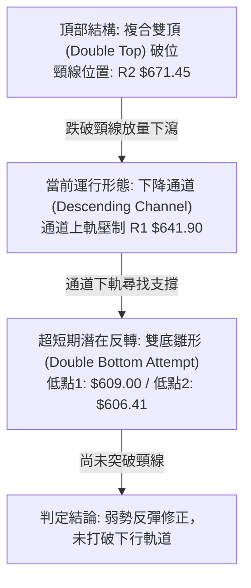

#### 圖表形態信心度評估表（依規則 15）

| 形態名稱 | 信心度 (%) | 判斷依據（嚴格引用技術數據） | 形態完成度 | 目標價計算方式與數值 |
|:---|:---:|:---|:---:|:---|
| **頂部雙重頂破位** | **85%** | 2026-09-25 創 $779.82，10-16 遇阻 $771.27 回落；跌破頸線 $671.45（R2） | 100% (已破位) | 頸線 $671.45 − 形態高度 ($779.82 − $671.45 = $108.37) = **$563.08** (接近 S3 $577.95) |
| **短期次級雙底雛形** | **45%** | 日K 10-28 低點 $609.00 與 11-02 低點 $606.41 二次探底，但現價未過頸線 | 50% (構造中) | 頸線 R1 $641.90 + 形態高度 ($641.90 − $606.41 = $35.49) = **$677.39** (受制於 MA20) |
| **矩形整理區間破位** | **70%** | 週K自 10-09 至 10-16 於 $709-$747 箱體震盪，10-23 大陰線長實體向下擊穿 | 100% (已確認) | 箱底 $709.33 − 箱體高度 ($747.60 − $709.33 = $38.27) = **$671.06** (已精準回測該點) |

> *註：短期雙底雛形信心度僅 45%（低於 50% 門檻），因此該形態不可作為波段多頭依據，僅定性為跌深技術性抽腳反彈。*

---

### 🕯️ 重要 K 線形態分析（依規則 19）

嚴格依據數據提供的「近10根日K」與「近8根週K」實體數據進行專業解讀：

#### 1. 近 10 根日 K 線形態解讀

| 日期 | 開盤價 ($) | 最高價 ($) | 最低價 ($) | 收盤價 ($) | 成交量 (股) | K線形態名稱 | 專業技術解讀與訊號指示 | 訊號 |
|:---:|:---:|:---:|:---:|:---:|:---:|:---:|:---|:---:|
| 2026-10-22 | 676.35 | 681.07 | 639.69 | 648.85 | 40,571,000 | **長黑破位陰線** | 實體高達 $27.5，放量下穿多條均線，確立新一輪下跌 | 🔴 |
| 2026-10-23 | 638.18 | 648.04 | 633.27 | 642.62 | 14,791,600 | **縮量十字小陽** | 低檔多空猶豫，成交量萎縮逾 60%，跌勢暫緩但無承接盤 | 🟡 |
| 2026-10-26 | 638.36 | 647.69 | 627.80 | 630.56 | 30,913,600 | **下影倒錘陰線** | 盤中衝高 $647.69 遇阻回落，收盤跌破 $631 年線 | 🔴 |
| 2026-10-27 | 627.07 | 628.46 | 619.21 | 620.19 | 51,334,100 | **放量中陰線** | 爆出 5,133 萬股近期天量，收盤於次低點，主動性賣盤強烈 | 🔴 |
| 2026-10-28 | 621.85 | 624.42 | 609.00 | 612.49 | 35,110,900 | **下跳空長下影陰** | 盤中下探 $609.00 低點後獲得買盤逢低支撐，空頭動能釋放 | 🟡 |
| 2026-10-29 | 621.29 | 634.68 | 616.80 | 624.52 | 31,276,200 | **反彈實體中陽** | 帶量突破前一日高點，呈現技術性修復，但未能收復 $630 | 🟢 |
| 2026-10-30 | 614.51 | 626.37 | 610.13 | 614.99 | 25,364,700 | **空方反撲中陰** | 再次探底回測 $610 關口，反彈無力，多方防線退守 | 🔴 |
| 2026-11-02 | 614.44 | 621.69 | 606.41 | 606.73 | 19,496,500 | **探底光腳大陰** | 創出本輪回調新低 $606.41，空頭再度佔領制高點 | 🔴 |
| 2026-11-03 | 610.76 | 624.84 | 610.10 | 621.03 | 13,731,300 | **低檔母子小陽** | 量能萎縮至 1,373 萬股極致，空頭打壓動能竭盡，孕育轉機 | 🟢 |
| 2026-11-04 | 641.15 | 643.09 | 624.50 | 630.00 | 32,401,000 | **高開低走長上影** | 大幅高開於 $641.15，衝高 $643.09 觸及 R1 遇阻回落，解套賣壓沉重 | 🔴 |

#### 2. 近 8 根週 K 線形態解讀

| 週最後交易日 | 開盤價 ($) | 最高價 ($) | 最低價 ($) | 收盤價 ($) | 週成交量 (股) | 週K線形態名稱 | 專業結構與趨勢解讀 | 訊號 |
|:---:|:---:|:---:|:---:|:---:|:---:|:---:|:---|:---:|
| 2026-09-18 | 657.31 | 689.61 | 648.71 | 665.23 | 99,577,300 | **突破前哨中陽** | 帶量站穩 $660，為衝擊歷史高點奠定基礎 | 🟢 |
| 2026-09-25 | 680.30 | 779.82 | 679.60 | 751.66 | 168,307,000 | **天量衝頂長陽** | 爆出 1.68 億股天量，創下 52 週頂部 $779.82，高檔籌碼派發 | 🟡 |
| 2026-10-02 | 750.04 | 750.58 | 713.19 | 728.08 | 96,199,700 | **高檔滯漲長陰** | 高檔收低，跌破前週實體中樞，形成烏雲蓋頂先兆 | 🔴 |
| 2026-10-09 | 727.71 | 747.60 | 711.68 | 718.67 | 69,671,000 | **高檔抵抗十字** | 縮量橫盤整理，多方嘗試反抽 $747 失敗，買盤縮手 | 🔴 |
| 2026-10-16 | 728.50 | 771.27 | 702.71 | 709.33 | 101,360,200 | **高檔避雷針長上影**| 衝擊 $771.27 次高點遭空頭當頭棒喝，實體收於當週低點，確立雙頂 | 🔴 |
| 2026-10-23 | 707.16 | 713.22 | 633.27 | 642.62 | 117,876,500 | **瀑布式斷頭大黑K** | 放量下瀉 66 美元，實體貫穿多條均線，主跌浪成型 | 🔴 |
| 2026-10-30 | 638.36 | 647.69 | 609.00 | 614.99 | 173,999,500 | **恐慌巨量下影陰** | 創出 1.74 億股週巨量，下影線探底 $609.00，恐慌盤大量湧現 | 🔴 |
| 2026-11-04 | 614.44 | 643.09 | 606.41 | 630.00 | 65,628,800 | **低檔回升探底陽** | 本週下探 $606.41 獲逢低買盤拉升至 $630，呈現超賣反抽初象 | 🟢 |

---

### 📉 ASCII 走勢形態示意圖

```
META 日K線近兩週雙重底雛形與頸線壓制示意圖
========================================================================
$645 ┼                        ▲ (11-04 遇阻高點 $643.09)
$642 ┼────────────────────────┼─── [頸線壓制 / 阻力 R1: $641.90]
$638 ┼                        │
$634 ┼                        │
$630 ┼                        ●←── 當前收盤價 $630.00 (MA200: $631.36)
$626 ┼            ● (10-29)   │
$622 ┼            │           │
$618 ┼            │           │
$614 ┼      ●     │     ●     │
$610 ┼──────┼─────┼─────┼─────┼───
$606 ┼      ▼     │     ▼     │    [低點1: 10-28 $609.00]
     │ (10-28)   │  (11-02)   │    [低點2: 11-02 $606.41]
$600 ┼───────────┴───────────┴────────────────────────────
     └──────┬─────┬─────┬─────┬───
          10-28 10-29 10-30 11-02 11-04 (日期)
========================================================================
```

---

## 4. 支撐與阻力

### 🗺️ 關鍵價位分布圖（Unicode）

```
META 價位結構分布圖（嚴格依據 OHLCV 計算值）
══════════════════════════════════════════════════════════════════
$779.82 ║██████████████████████████████║ 52週歷史頂部 (0.0% Fib)
$718.35 ║██████████████████████        ║ 斐波那契回調 23.6% 位
$687.94 ║████████████████████          ║ 強阻力 R3 (波段籌碼套牢區)
$680.33 ║██████████████████            ║ 斐波那契回調 38.2% 位
$671.45 ║████████████████              ║ 關鍵阻力 R2 (MA20/50 聚焦點)
$649.59 ║████████████                  ║ 斐波那契回調 50.0% 強弱中軸
$641.90 ║████████                      ║ 近期阻力 R1 (日線反彈極限)
════════╠══════════════════════════════╣ ◄ 當前價格 $630.00
$626.54 ║▓▓▓▓▓▓▓▓                      ║ 近期核心支撐 S1 (日K低點密集區)
$618.86 ║▓▓▓▓▓▓▓▓▓▓▓▓                  ║ 斐波那契回調 61.8% 黃金分割位
$594.61 ║████████████████              ║ 強支撐 S2 (波段破位防線)
$577.95 ║████████████████████          ║ 重大支撐 S3 (夏季築底中樞)
$519.37 ║██████████████████████████████║ 52週週期低點 (100.0% Fib)
══════════════════════════════════════════════════════════════════
```

---

### 🚧 阻力位分析表

所有阻力數值完全引用自系統依據 OHLCV 計算之聚類高點：

| 阻力級別 | 準確價位 ($) | 距離現價 (%) | 形成原因與籌碼結構 | 突破難度 | 重要性評級 |
|:---|:---:|:---:|:---|:---:|:---:|
| **阻力 R1** | **$641.90** | +1.89% | 2026-11-04 日K高點 $643.09 壓制帶，為短線空頭下壓的第一道防線 | 🟡 中等 | ★★★☆☆ |
| **阻力 R2** | **$671.45** | +6.58% | MA20 ($673.89) 與 MA50 ($673.39) 聚合死叉區，亦為前期雙頂頸線 | 🔴 極高 | ★★★★★ |
| **阻力 R3** | **$687.94** | +9.20% | 10月中旬長黑下殺起跌點，伴隨億股級套牢融資籌碼，為波段空方大本營 | 🔴 極高 | ★★★★☆ |

---

### 🛡️ 支撐位分析表

所有支撐數值完全引用自系統依據 OHLCV 計算之聚類低點：

| 支撐級別 | 準確價位 ($) | 距離現價 (%) | 形成原因與籌碼結構 | 守住機率 | 重要性評級 |
|:---|:---:|:---:|:---|:---:|:---:|
| **支撐 S1** | **$626.54** | -0.55% | 10-26 收盤價與多根日K下影線聚類區，短線多頭抵抗之第一防禦前哨 | 🟡 55% | ★★★☆☆ |
| **支撐 S2** | **$594.61** | -5.62% | 2026年7-8月波段震盪低點密集區，整數關卡 $600 跌破後之流動性緩衝區 | 🟢 65% | ★★★★☆ |
| **支撐 S3** | **$577.95** | -8.26% | 2026年3月低點 $571 及 8月低點 $571.89 構築之年度大底頸線支撐 | 🟢 80% | ★★★★★ |

---

### 📐 斐波那契回調位分析（區間：$519.37 → $779.82）

| 回調比例 (%) | 精確價位 ($) | 當前價格相對位置與技術意涵解讀 |
|:---:|:---:|:---|
| **0.0%** | **$779.82** | 52 週頂部極值，波段牛市極限點，構成中期長期無可逾越之強天花板 |
| **23.6%** | **$718.35** | 初始回調支撐位（已於 10 月中旬被放量摜破，轉化為強大反壓） |
| **38.2%** | **$680.33** | 強勢回調防守線（跌破後宣告日線級別多頭結構徹底瓦解） |
| **50.0%** | **$649.59** | 多空強弱分水嶺（現價處於其下方，確立整體波段屬空頭勢力範圍） |
| **當前現價** | **$630.00** | **落於 50.0% ($649.59) 與 61.8% ($618.86) 回調區間內，偏向回測黃金分割位** |
| **61.8%** | **$618.86** | **黃金分割防守位**：日K於 10-27 至 11-02 曾下探測試該位，多頭在此展開防守反抽 |
| **78.6%** | **$575.11** | 深幅回調防線：與結構支撐 S3 $577.95 高度重合，為多頭最後的防守底線 |
| **100.0%** | **$519.37** | 52 週週期起漲低點，若跌破將引發長線機構資金踩踏 |

---

## 5. 技術指標深度解讀

### 🎛️ 指標訊號總覽

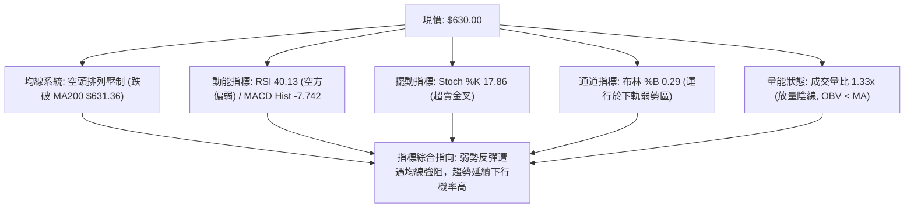

---

### 📈 移動平均線排列分析

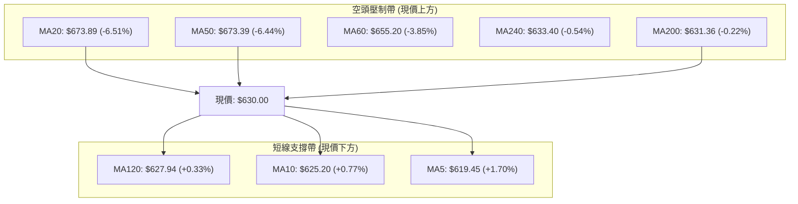

#### 均線矩陣詳細狀態表

| 均線名稱 | 數值 ($) | 偏離度 (%) | 走勢特徵 (近20日軌跡) | 訊號意涵 |
|:---|:---:|:---:|:---|:---:|
| **MA5** | $619.45 | +1.70% | ▇████▇▇▇▇▇▇▇▇▇███▇▇▆▅▄▃▂▁▁▁▁▁▁ (超短期自低檔回勾向上) | 🟢 短線反抽 |
| **MA10** | $625.20 | +0.77% | ▆▇▇▇███████████████▇▇▆▆▅▄▃▂▁▁▁ (即將受 MA5 金叉測試) | 🟢 支撐形成 |
| **MA20** | $673.89 | -6.51% | ▁▁▂▃▄▄▅▅▆▆▇▇▇███████▇▇▆▆▅▅▄▄▃▃ (陡峭下行，形成動態天花板) | 🔴 強烈壓制 |
| **MA50** | $673.39 | -6.44% | 中期生命線，MA20 與 MA50 形成高位死叉扣抵 | 🔴 中期轉空 |
| **MA60** | $655.20 | -3.85% | ▁▁▁▂▂▃▃▃▄▄▄▄▄▅▅▆▆▆▇▇▇█████████ (下傾斜率加大) | 🔴 季線反壓 |
| **MA120** | $627.94 | +0.33% | ▁▁▂▃▃▄▄▄▅▅▅▅▆▆▇▇▇▇▇███████████ (半年線走平，現價於此拉鋸) | 🟡 爭奪焦點 |
| **MA200** | $631.36 | -0.22% | 牛熊分水嶺，現價以 $630.00 跌破，形成反轉警訊 | 🔴 年線失守 |
| **MA240** | $633.40 | -0.54% | 兩年均線中樞，與 MA200 形成雙重年線阻力阻礙多頭反攻 | 🔴 長期轉弱 |

---

### 📉 RSI(14) 分析

* 當前數值：**40.13**（Wilder 計算方法）
* 強度進度條：
  ```
  弱勢空方區間 [ 40.13 / 100 ]
  ████████░░░░░░░░░░░░  40.13%
  [0]────超賣(30)────[40.13]────中軸(50)────超買(70)────[100]
  ```
* **背離判定**：**無明顯背離**（比對近 20 根 K 棒首尾價格與 RSI 走勢，兩者均由高檔同步下行回落，屬正常動能釋放，未見底背離或頂背離訊號）。
* **結構解讀**：RSI 位於 40.13，脫離極端超賣區（<30），但仍受制於多空分界 50 之下。這意味著空方仍掌握波段話語權，當前反彈僅為指標自超賣區修復之技術性抽動。

---

### 📊 MACD(12,26,9) 訊號解讀

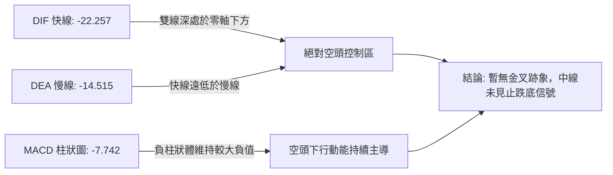

* **數值解讀**：MACD 快線（-22.257）深度下穿慢線（-14.515），負離差擴大至 -7.742。此為標準的零軸下空頭發散結構。歷史經驗顯示，當 MACD 柱狀圖在零軸下未出現連續 3 日收斂之前，價格任何急拉均屬假突破誘多。

---

### 📦 布林通道分析

```
META 日線布林通道示意圖（參數：20, 2）
========================================================================
$779.85 ┼──────────────────────────────────── [BB 上軌 (破位後發散)]
        │                                  
$720.00 ┼                                  
        │                                  
$673.89 ┼════════════════════════════════════ [BB 中軌 = MA20 關鍵壓制]
        │                                  
$640.00 ┼                                  
$630.00 ┼─────────────● [當前現價 $630.00 (%B: 0.29)]
        │                                  
$567.93 ┼──────────────────────────────────── [BB 下軌 (下限支撐位)]
========================================================================
```

* **帶寬與位置**：通道帶寬高達 $211.92 ($779.85 − $567.93)，展現強烈單邊擴軌擴張。
* **%B 指標解析**：當前 %B 數值為 **0.29**（0 代表下軌，0.5 代表中軌，1 代表上軌）。現價落於下軌與中軌之間且偏向下方，確認市場仍受制於空方通道壓迫。

---

### 💹 成交量分析（量價配合度）

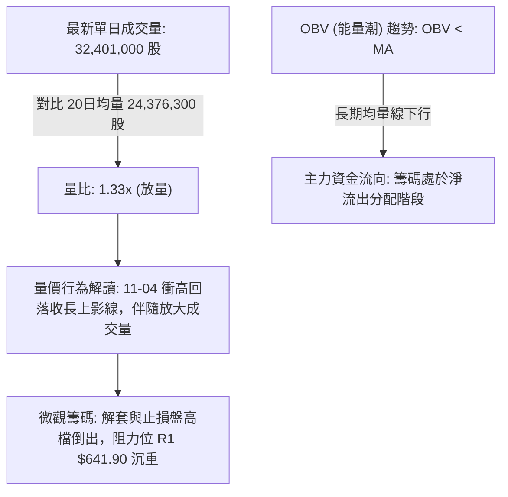

* **量能配合判斷**：日線最新成交量為 3,240 萬股，量比為 1.33x。然而 11-04 日K呈現開高走低的陰線實體（開盤 $641.15，收盤 $630.00），高檔放量意味著解套賣壓與空頭攔截力量異常凶悍。配合 OBV 指標低於移動平均線的長期弱勢，量能結構確認當前走勢為「空頭放量打壓、多頭弱勢抵抗」。

---

## 6. 動能與波動率

### ⚡ 動能評估四象限

| 象限分區 | 動能維度 (Momentum) | 波動率維度 (Volatility) | 當前判定 | 戰略特徵與機構行為分析 |
|:---:|:---:|:---:|:---:|:---|
| **第一象限 (Q1)** | 強動能 (Bullish) | 低波動 (Low Vol) | — | 穩定主升浪，機構鎖倉拉升，最佳波段持股環境 |
| **第二象限 (Q2)** | 弱動能 (Bearish) | 低波動 (Low Vol) | — | 縮量陰跌格局，流動性枯竭，適合離場觀望 |
| **第三象限 (Q3)** | 強動能 (Bullish) | 高波動 (High Vol) | — | 狂熱洗盤行情，短線突破劇烈，需寬止損追價 |
| **第四象限 (Q4)** | **弱動能 (Bearish)** | **高波動 (High Vol)** | **✓ (META 當前定位)** | **極度危險之殺跌震盪區：機構減倉引發大幅震盪，反彈速度快但承接薄弱，易引發二次探底** |

---

### 📊 ATR 波動率分析

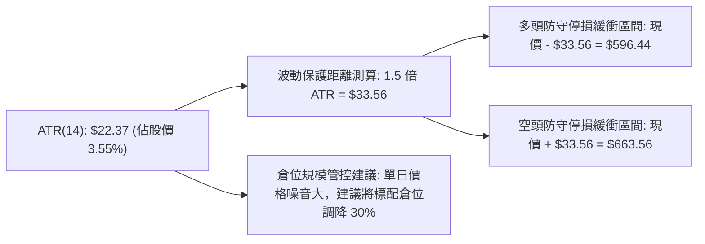

* **ATR 數值解讀**：當前 14 日真實波動均值（ATR）高達 **$22.37**，波動率為現價之 3.55%，顯示標的處於高度敏感的不穩定狀態。日內波動極易觸發緊密止損，因此交易者在設置技術防守位時，必須依據結構價位（如 S1、R1）並外加至少 0.5–1.0 倍 ATR 作為容錯空間。

---

### 📐 Beta 與市場相關性

* **Beta 係數**：**1.279**（高於標普 500 指數之基準 1.00）。
* **市場敏感度分析**：Beta 為 1.279 意味著 META 對大盤整體環境具有放大 27.9% 的波動敏感度。在當前科技股整體承壓、大盤板塊輪動的宏觀背景下，高 Beta 特性導致其在市場拋售時跌幅加劇。若大盤指數未能企穩，META 難以獨善其身走出獨立逆勢行情。

---

## 7. 多時框架總結

### 📋 時框架評分表

| 時框架 | 趨勢方向 | 動能狀態 | 均線排列狀況 | 圖表形態特徵 | 評分 (100) | 具體戰術建議 |
|:---:|:---:|:---:|:---:|:---:|:---:|:---|
| **月線 (長期)** | 🟡 震盪整理 | 弱化 (高檔回落) | 仍守於長期均線群之上 | 歷史高點雙頂壓力壓制 | 50/100 | 長期投資者暫停加碼，等待估值中樞回歸 |
| **週線 (中期)** | 🔴 明確下行 | 負向加速 (MACD擴散) | 跌破 20週均線，向 50週靠攏 | 天量假突破後之深幅瀑布跌勢 | 35/100 | 中線底倉做好動態對沖，反彈減倉 |
| **日線 (短期)** | 🔴 偏空反彈 | RSI 40.13, Stoch 超賣 | 跌破 MA200 年線，短均微升 | $606-$609 雙底微幅抽腳 | 38/100 | 嚴禁盲目追高，依託阻力 R1 尋找逢高放空點 |

---

### 🔲 綜合訊號矩陣

```
時框架訊號一致性矩陣
══════════════════════════════════════════════════════════════════
時框層級   價格趨勢   均線結構   MACD動能   RSI位階   量能配合   總結判定
──────────────────────────────────────────────────────────────────
長期(月)   🟡 中立    🟢 多頭    🟡 走平    🟡 中性   🔴 縮量    🟡 高檔承壓
中期(週)   🔴 下跌    🔴 空頭    🔴 發散    🔴 弱勢   🔴 帶量破  🔴 空頭控盤
短期(日)   🔴 跌破    🔴 破年線  🔴 負柱    🟡 反抽   🔴 放量陰  🔴 逢高做空
══════════════════════════════════════════════════════════════════
```

---

### ⚖️ 多時框收斂結論（依規則 14）

根據技術分析多時框收斂優先級規則：
1. **行情模式判定**：當前 ADX(14) 數值為 **26.43**（大於 25 臨界值），明確判定當前為**強趨勢行情（Trend Regime）**，而非低波動盤整。
2. **時框優先級**：趨勢行情下，必須以中長期（週線 / MA50 / MA200）方向為依歸，日線僅用於捕捉短線超買超賣之精確進場時機。
3. **收斂裁決**：
   * 中期週線顯示高檔天量套牢，且 MACD 週柱持續放大擴散；
   * 日線層級雖然出現 Stoch 超賣金叉之技術抽腳，但上方遭受 MA200 ($631.36)、MA240 ($633.40) 及強阻力 R1 ($641.90) 的重重壓制；
   * **唯一方向性結論**：**偏空（主趨勢向下，當前僅為短線超賣技術性反彈，整體架構為逢高沽空市場）**。

---

## 8. 交易策略建議

### 🗺️ 策略決策流程圖

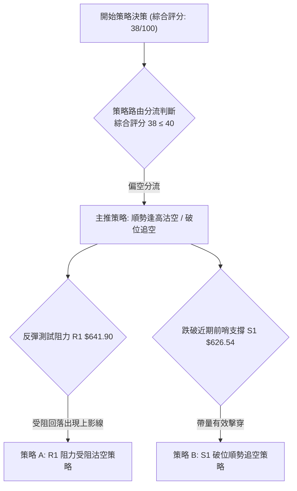

---

### 🧭 策略路由（依規則 8）

> **當前主策略方向 = 偏空（依評分卡綜合評分 38/100，嚴格執行空頭主導策略）**
> 
> 因評分 ≤ 40，本報告**主推空頭策略**（反彈阻力位放空或破位順勢加空），任何多頭反彈均視為短線逆勢操作，僅列入「反轉風險觸發點」作對沖防守參考，絕不兩頭下注。

---

### 🎯 價格情境階梯（Price Scenarios）

價位嚴格引用自 OHLCV 計算之關鍵價位：

| 觸發條件 | 下一目標價 ($) | 後續延伸目標 ($) | 專業行情情境含義與對策 |
|:---|:---:|:---:|:---|
| **強勢突破 R1 ($641.90)** | R2 ($671.45) | R3 ($687.94) | 超賣反彈轉強，向上回測 MA20/50 聚焦點，空單全面止損離場 |
| **受阻於現價至 R1 區間** | S1 ($626.54) | S2 ($594.61) | 反彈動能耗竭，空頭重新發力，延續主跌通道運行 |
| **放量擊穿 S1 ($626.54)** | S2 ($594.61) | S3 ($577.95) | 短期雙底雛形失敗，破位展開新一輪流動性出清，追空信號觸發 |

---

### 📊 情境機率分佈

| 行情情境劇本 | 發生機率 (%) | 主要技術指標支撐依據 |
|:---|:---:|:---|
| **情境一：反彈受阻回落 / 再探深底** | **60%** | ADX=26.43 空頭主導，MACD 柱狀圖 -7.742 深陷負值，現價失守年線 MA200 |
| **情境二：圍繞 S1 至 R1 窄幅震盪** | **25%** | Stoch %K(17.86) 超賣金叉限制短線下行斜率，多空於 MA120/MA200 展開拉鋸 |
| **情境三：強勢向上反轉突破 R2** | **15%** | 需極端消息面刺激帶動成交量突破 5,000 萬股，目前 OBV 疲弱顯示主力無意大幅上攻 |

---

### 🟢 主策略詳情（方向：空頭沽空策略）

所有價位均嚴格引用 OHLCV 計算數據（R1, S1, S2, S3, Fib 50.0%），風險報酬比依嚴格定義計算：

$$\text{風險報酬比 (以 T1 計)} = \frac{\text{進場價} - \text{目標價 T1}}{\text{止損價} - \text{進場價}}$$

| 策略要素 | 策略 A（精準反彈受阻放空） | 策略 B（破位順勢追空） |
|:---|:---|:---|
| **策略核心邏輯** | 股價反彈至 R1 阻力位遇阻，順應主跌趨勢進場放空 | 股價跌破 S1 短線多頭防線，追擊下一波流動性下瀉 |
| **觸發進場條件** | 股價反彈測試 R1，日K出現滯漲長上影或小陰實體 | 日線跌破 S1 且 30 分鐘級別收盤無法收回 |
| **精確進場價格** | **$641.90**（精確等於阻力 R1） | **$626.54**（精確等於支撐 S1） |
| **目標價 T1** | **$626.54**（回測支撐 S1） | **$594.61**（下探強支撐 S2） |
| **目標價 T2** | **$594.61**（下探強支撐 S2） | **$577.95**（探底重大支撐 S3） |
| **防守止損價格** | **$649.59**（斐波那契 50.0% 關鍵壓制位） | **$641.90**（反壓阻力 R1） |
| **風險空間** | $\$649.59 - \$641.90 = \$7.69$ | $\$641.90 - \$626.54 = \$15.36$ |
| **獲利空間 (T1)** | $\$641.90 - \$626.54 = \$15.36$ | $\$626.54 - \$594.61 = \$31.93$ |
| **獲利空間 (T2)** | $\$641.90 - \$594.61 = \$47.29$ | $\$626.54 - \$577.95 = \$48.59$ |
| **風險報酬比 (T1)** | **1 : 2.00（以 T1 計）** $(\$15.36 \div \$7.69)$ | **1 : 2.08（以 T1 計）** $(\$31.93 \div \$15.36)$ |
| **風險報酬比 (T2)** | **1 : 6.15（以 T2 計）** $(\$47.29 \div \$7.69)$ | **1 : 3.16（以 T2 計）** $(\$48.59 \div \$15.36)$ |
| **預估勝率** | **65%** | **60%** |
| **建議持倉規模** | **15% - 20% 總動態資金** | **10% - 15% 總動態資金** |

---

### 🔴 反向風險觸發點（對沖提示）

若市場出現非理性軋空並觸發以下任一訊號，主推空頭策略即刻失效，必須嚴格執行空單止損或轉化為對沖倉位：
1. **多頭破位確認點**：日線收盤價**強勢站穩 $649.59（斐波那契 50.0% 回調位）**，宣告 $606-$643 反彈轉化為反轉結構。
2. **均線金叉警訊**：MA5 正式向上金叉 MA20，且日成交量放大突破 4,000 萬股。
3. **MACD 底背離成形**：MACD 柱狀圖由負轉正，站上零軸線。

---

### ⭐ 整體訊號強度評星

```
╔══════════════════════════════════════════════════════════════════╗
║                    整體訊號強度評星與可信度                      ║
╠══════════════════════════════════════════════════════════════════╣
║ 做多訊號強度：★★☆☆☆  (2/5星 — 僅屬低檔超賣短抽，風險報酬偏低) ║
║ 做空訊號強度：★★★★☆  (4/5星 — 順應週日雙時框空頭趨勢與均線破位)║
║ 整體技術可信度：★★★★☆ (4/5星 — OHLCV聚類結構清晰，價位確認度高) ║
╚══════════════════════════════════════════════════════════════════╝
```

---

## 9. 風險提示與監控

### ✅ 關鍵監控指標 Checklist

```
╔══════════════════════════════════════════════════════════════════╗
║               交易員每日關鍵技術指標監控 Checklist               ║
╠══════════════════════════════════════════════════════════════════╣
║ [ ] 監控項 1: 收盤價是否跌破支撐 S1 $626.54 (觸發策略 B 追空)   ║
║ [ ] 監控項 2: 盤中反抽是否於阻力 R1 $641.90 形成滯漲假突破      ║
║ [ ] 監控項 3: 空單終極停損點 $649.59 (Fib 50%) 是否被有效收復   ║
║ [ ] 監控項 4: 日成交量是否萎縮低於 2,000 萬股 (確認買盤枯竭)    ║
║ [ ] 監控項 5: MACD 柱狀圖是否持續收窄至 -3.000 以內 (警惕金叉)  ║
║ [ ] 監控項 6: 布林通道帶寬是否收縮，%B 是否突破 0.50 (回歸常態)║
╚══════════════════════════════════════════════════════════════════╝
```

---

### ⚠️ 風險場景分析

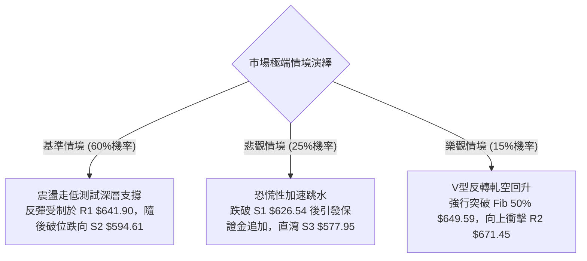

---

### 🛡️ 風險管理重要提醒

1. **單筆風險暴露上限**：嚴格恪守單筆交易虧損不得超過總投資組合淨值 1.5% 之鐵律。
2. **波幅容錯防範（ATR 保護）**：當前 ATR 高達 $22.37，盤中極易出現 10-15 美元之隨機波動「毛刺」。嚴禁使用窄幅緊密止損，必須依據報告設定之關鍵節點（如 $649.59）進行結構防守。
3. **倉位配置比例**：在 ADX 強趨勢主導且技術評分僅 38 分之弱勢背景下，整體多頭股票曝險倉位應降至 30% 以下，保留高比例現金以應對潛在的二次流動性衝擊。

---

## 📋 報告總結

```
╔══════════════════════════════════════════════════════════════════╗
║                   META 技術分析報告總結摘要                      ║
╠══════════════════════════════════════════════════════════════════╣
║ 報告日期：2026-11-05                 當前收盤價：$630.00         ║
║ 技術評級：🔴 偏空弱勢格局 (38/100)   趨勢狀態：強烈空頭主導     ║
╠══════════════════════════════════════════════════════════════════╣
║ 關鍵技術維度結論：                                              ║
║ ├─ 長期趨勢 (月線)：高檔雙頂形成，牛市獲利了結回調階段        ║
║ ├─ 中期趨勢 (週線)：下行通道完好，MACD週線負值擴散，空方主導  ║
║ ├─ 短期趨勢 (日線)：跌破 MA200 年線，弱勢超賣反抽受制於阻力   ║
║ ├─ 關鍵阻力聚類：R1 $641.90 ｜ R2 $671.45 ｜ R3 $687.94         ║
║ ├─ 關鍵支撐聚類：S1 $626.54 ｜ S2 $594.61 ｜ S3 $577.95         ║
║ └─ 斐波那契中軸：50.0% ($649.59) 構成當前波段強弱分水嶺        ║
╠══════════════════════════════════════════════════════════════════╣
║ 最優操作策略組合：                                              ║
║ 1. 🥇 首選策略 (策略 A)：等待股價反彈至 R1 $641.90 受阻放空，  ║
║    止損設於 $649.59，目標看至 S1 $626.54 (風報比 1 : 2.00)     ║
║ 2. 🥈 次選策略 (策略 B)：跌破 S1 $626.54 順勢追空，止損設於    ║
║    $641.90，目標看至 S2 $594.61 (風報比 1 : 2.08)              ║
║ 3. 🥉 保守風控建議：站穩 $649.59 前嚴禁左側抄底，保持輕倉觀望 ║
╚══════════════════════════════════════════════════════════════════╝
```

---

> ⚠️ **免責聲明**：本報告係依據量化技術分析方法與歷史 OHLCV 數據衍生計算生成，所有點位、指標與情境推演僅供學術研究與投資風控參考，絕不構成任何形式的要約、邀約或個別投資建議。金融市場具高度價格波動風險，投資人應依個人財務狀況與風險承受度審慎決策，並自行承擔交易損益。

---
*報告生成時間：2026-11-05 ｜ 數據來源：Yahoo Finance ｜ 分析框架：多時框技術分析模型*