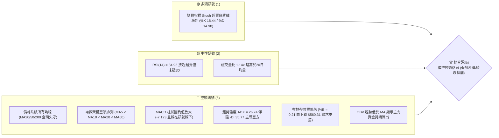
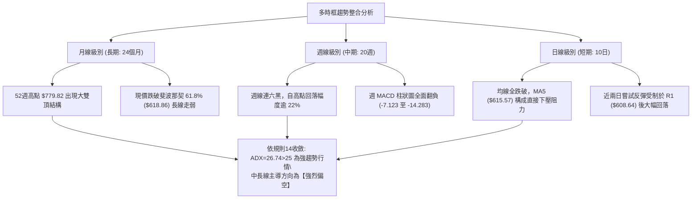
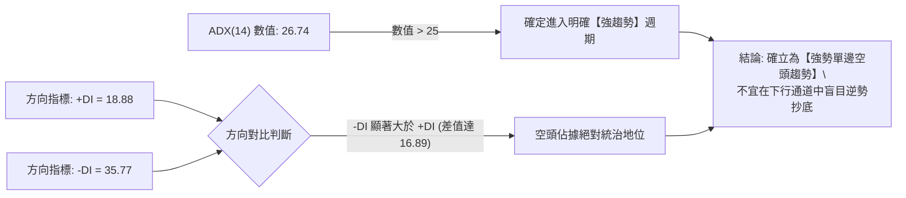
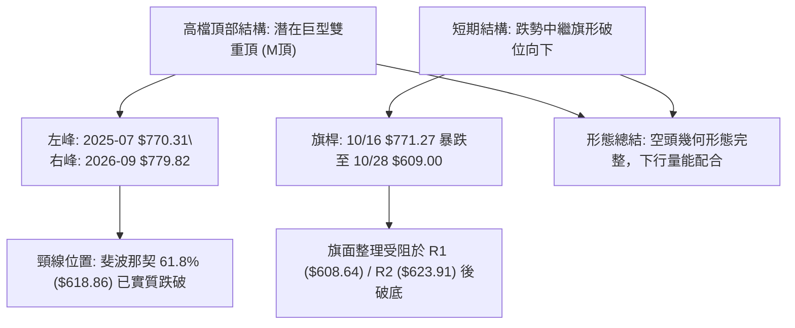
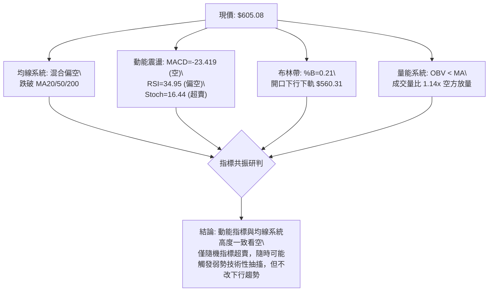
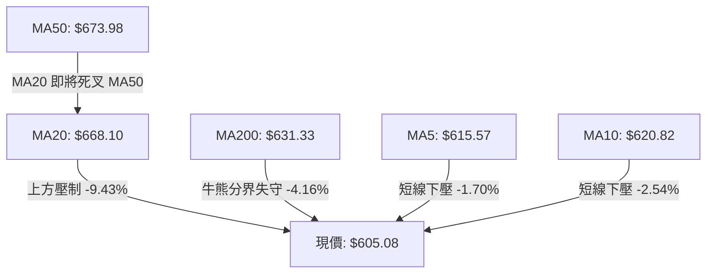
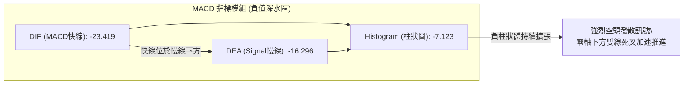
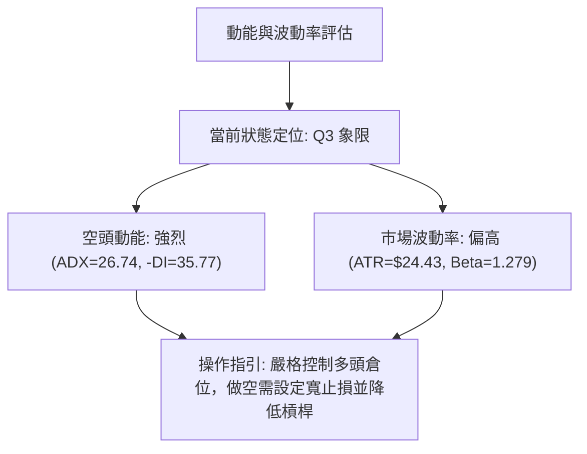
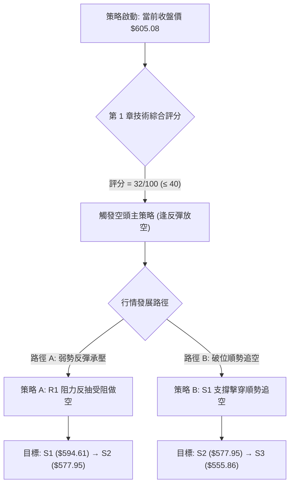
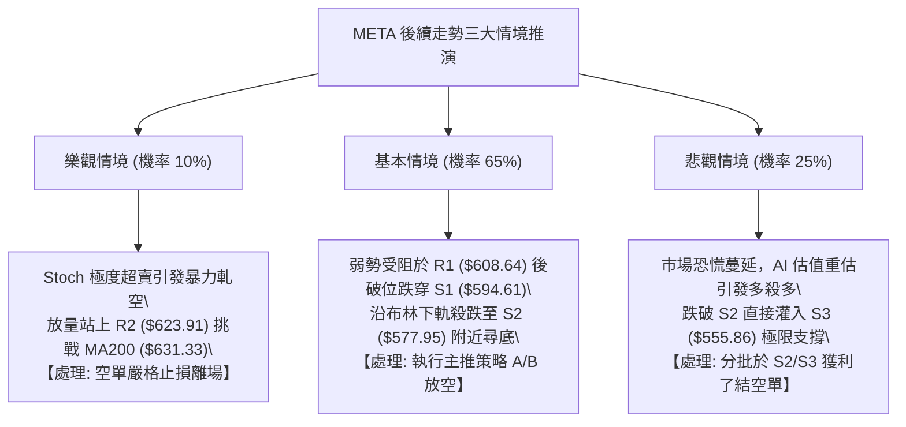

# META 技術分析報告

> **報告日期**：2026-11-06 ｜ **語言**：繁體中文 ｜ **數據來源**：Yahoo Finance ｜ **當前價格**：$605.08

---

## 目錄

| 章節 | 內容 |
|------|------|
| [1. 技術面概覽](#1-技術面概覽) | 訊號儀表板、核心指標、評分卡 |
| [2. 趨勢分析](#2-趨勢分析) | 多時框趨勢、長中短期走勢 |
| [3. 圖表形態分析](#3-圖表形態分析) | 形態識別、K線組合、目標價 |
| [4. 支撐與阻力](#4-支撐與阻力) | 關鍵價位、斐波那契回調 |
| [5. 技術指標深度解讀](#5-技術指標深度解讀) | MA/RSI/MACD/布林/成交量 |
| [6. 動能與波動率](#6-動能與波動率) | 動能評估、ATR、Beta |
| [7. 多時框架總結](#7-多時框架總結) | 時框架評分矩陣 |
| [8. 交易策略建議](#8-交易策略建議) | 多空策略、風險報酬比 |
| [9. 風險提示與監控](#9-風險提示與監控) | 監控指標、風險場景 |

---

## 1. 技術面概覽

### 🎯 技術訊號儀表板



### 📊 核心指標速覽表

| 指標類別 | 指標名稱 | 當前數值 | 訊號 | 解讀 |
|----------|----------|----------|------|------|
| **價格** | 當前價格 | $605.08 | 🔴 | 位於 52 週區間 32.9%，且連續跌破各中長期重要支撐 |
| **均線** | MA20 | $668.10 | 🔴 | 現價低於 MA20 達 -9.43%，短中期下行趨勢顯著承壓 |
| **均線** | MA50 | $673.98 | 🔴 | 現價低於 MA50，且 MA20 即將與 MA50 形成死亡交叉 |
| **均線** | MA200 | $631.33 | 🔴 | 跌破牛熊分界線 MA200（-4.16%），中長線技術格局正式轉空 |
| **動能** | RSI(14) | 34.95 | 🟡 | 位於中性偏弱偏空區間，尚未進入極端超賣區（<30） |
| **動能** | MACD(12,26,9) | -23.419 | 🔴 | 快慢線均處於負值深水區，Histogram 報 -7.123 空頭動能強勁 |
| **趨勢** | ADX / ±DI | 26.74 | 🔴 | ADX > 25 確認為強趨勢，-DI (35.77) 遠高於 +DI (18.88) 屬強空頭趨勢 |
| **通道** | Bollinger %B | 0.21 | 🔴 | 價格貼近下軌（$560.31），通道開口向下發散 |
| **量能** | OBV 趨勢 | OBV < MA | 🔴 | 量能疲弱，下跌放量且反彈無量，大資金處於出貨節奏 |
| **波動** | ATR(14) | $24.43 | 🟡 | 佔現價 4.04%，單日波幅擴大，風控需保留較寬止損空間 |

### 🏆 技術評分卡

```
╔══════════════════════════════════════════════════════════════════╗
║                   技術評分卡 — META (2026-11-06)                 ║
╠══════════════════════════════════════════════════════════════════╣
║ 趨勢強度 (Trend)      ██████░░░░░░░░░░░░░░  30/100  🔴 空方主導  ║
║ 動能指標 (Momentum)   ██████░░░░░░░░░░░░░░  30/100  🔴 強烈看空  ║
║ 支撐穩定度 (Support)  ████████░░░░░░░░░░░░  40/100  🟡 考驗S1    ║
║ 成交量配合 (Volume)   ██████░░░░░░░░░░░░░░  30/100  🔴 出貨格局  ║
║ 形態完整度 (Pattern)  ████████░░░░░░░░░░░░  40/100  🟡 破位延續  ║
║ 均線排列 (Moving Avg) ████░░░░░░░░░░░░░░░░  20/100  🔴 全面空頭  ║
╠══════════════════════════════════════════════════════════════════╣
║ 綜合評分              ██████░░░░░░░░░░░░░░  32/100  🔴 強烈偏空  ║
╚══════════════════════════════════════════════════════════════════╝
```
*註：綜合評分由六項子評分 (30 + 30 + 40 + 30 + 40 + 20) / 6 = 31.67，依規則 18 四捨五入至整數為 32/100，評級屬顯著偏空區間（≤40）。*

---

## 2. 趨勢分析

### 🌐 多時框趨勢分析



### 📈 長期趨勢 — 12個月走勢圖（Unicode）

依據月度收盤數據（2025-12 至 2026-11），META 過去 12 個月歷經高檔劇烈震盪、破頂創下 52 週新高 $779.82，隨後展開深幅瀑布式回調：

```
META 月線走勢圖（過去12個月：2025-12 至 2026-11）
價格軸 ($)
$750 ┤                                      ● (2026-09 $725.18, 盤中高 $779.82)
$700 ┤        ● (2026-01 $714.66)
$650 ┤●       │   ● (2026-02 $646.52)
$600 ┤        │       │   ● (2026-04 $610.86)       ● (2026-10 $614.99)
$550 ┤        │       │       │       ● (2026-07 $556.27)   ● (2026-11 $605.08)←現價
     └────────┴───────┴───────┴───────┴─────────────┴───────────────────────
       25-12  26-01   26-03   26-05   26-07         26-09    26-11
```

#### 走勢特徵分析表格

| 階段區間 | 時間跨度 | 起點收盤 → 終點收盤 | 漲跌幅 (%) | 主要技術特徵與結構 |
|----------|----------|---------------------|------------|-------------------|
| **階段一：年初衝高** | 2025-12 ~ 2026-01 | $658.40 → $714.66 | +8.55% | 延續強勢多頭格局，創下波段高點 |
| **階段二：春季修正** | 2026-01 ~ 2026-03 | $714.66 → $571.15 | -20.08% | 快速回吐，失守半年線，首次考驗 S2 附近支撐 |
| **階段三：夏季築底** | 2026-04 ~ 2026-07 | $610.86 → $556.27 | -8.94% | 探底測試年內最低點 $519.37 區域，構築寬幅雙底支撐 |
| **階段四：秋季主升** | 2026-07 ~ 2026-09 | $556.27 → $725.18 | +30.36% | 爆發性反彈，盤中創下 52 週最高 $779.82 |
| **階段五：高檔雪崩** | 2026-09 ~ 2026-11 | $725.18 → $605.08 | -16.56% | 週線連續巨量下挫，回撤逾百元，失守所有均線支撐 |

### 📊 中期趨勢（週線分析）

週線格局自 2026-09-25 創下 $779.82 歷史天價並收出長上影線後，空頭全面主導。近 6 週收盤價依序為：$728.08、$718.67、$709.33、$642.62、$614.99、$605.08，呈現「黑K連發、無力站回週線MA」的標準破位下跌浪。

```
週線關鍵阻力與支撐示意圖：
$779.82 ═══════════════════════════════════════ [52W 歷史極值高點]
              │
$718.35 ┈┈┈┈┈┈┈┈┈┈┈┈┈┈┈┈┈┈┈┈┈┈┈┈┈┈┈┈┈┈┈┈┈┈┈┈┈┈┈ [斐波那契 23.6%]
              │ (高檔崩跌區間，週量放大逾 1.7億股)
$649.59 ┈┈┈┈┈┈┈┈┈┈┈┈┈┈┈┈┈┈┈┈┈┈┈┈┈┈┈┈┈┈┈┈┈┈┈┈┈┈┈ [斐波那契 50.0% / MA200 聚集區]
              │
$618.86 ┈┈┈┈┈┈┈┈┈┈┈┈┈┈┈┈┈┈┈┈┈┈┈┈┈┈┈┈┈┈┈┈┈┈┈┈┈┈┈ [斐波那契 61.8% 關鍵頸線已跌破]
$605.08 ─────────────── ◄【當前收盤價】
              │
$575.11 ┈┈┈┈┈┈┈┈┈┈┈┈┈┈┈┈┈┈┈┈┈┈┈┈┈┈┈┈┈┈┈┈┈┈┈┈┈┈┈ [斐波那契 78.6% / S2: $577.95 支撐]
$555.86 ═══════════════════════════════════════ [關鍵強支撐 S3 / 前低支撐帶]
```

### ⚡ 趨勢強度評估（ADX 解讀）



#### ADX 強度與操作指引對照表

| ADX 區間 | 趨勢狀態 | 市場特性 | META 當前狀態 | 交易策略指導 |
|----------|----------|----------|---------------|--------------|
| **0 ~ 20** | 無趨勢 / 盤整 | 價格橫盤，指標反覆鈍化 | 否 | 區間高拋低吸，通道操作 |
| **20 ~ 25** | 趨勢萌芽 / 弱趨勢 | 動能醞釀，等待突破確認 | 否 | 減少倉位，等待趨勢確立 |
| **25 ~ 50** | **強趨勢 (Strong Trend)** | **單邊推動行情，均線發散** | **✓ (26.74)** | **順勢操作，逢反彈做空為主** |
| **50 ~ 75** | 極強趨勢 | 恐慌性拋售或瘋狂軋空 | 否 | 密切關注動能衰竭與反轉 |
| **75 ~ 100** | 極端行情 | 極罕見，行情即將耗盡 | 否 | 全面獲利了結，嚴防均值回歸 |

---

## 3. 圖表形態分析

### 🔍 形態識別系統



#### 形態識別與信心度評估表

| 形態名稱 | 信心度 (%) | 判斷依據（引用數據） | 完成度 (%) | 目標價（附嚴格計算式） |
|----------|------------|----------------------|------------|------------------------|
| **雙重頂 (M-Top)** | 75% | 2025-07 收盤 $770.31 與 2026-09-25 創高 $779.82 構成雙峰；現價 $605.08 已跌破頸線 $618.86（61.8%回調位） | 85% | 頸線 $618.86 − 形態高度 ($779.82 − $618.86 = $160.96) = **$457.90**（中長線理論目標，數據中未偵測到此支撐，列為純形態測算） |
| **跌勢旗形中繼** | 70% | 旗桿自 $709.33（10-16收盤）暴跌至 $609.00（10-28低點），波幅 $100.33；近數日反彈受阻於 $643.09 後跌破整理區間 | 90% | 破位點 $614.99 − 形態推算高度 $40.00 = **$574.99**（高度貼近支撐 S2: $577.95 及斐波那契 78.6% $575.11） |
| **短期雙底** | 20% | 訊號不足，僅做指標型解讀。雖 Stoch 處於超賣，但未形成有效二次回踩與放量突破頸線，不可強行視為底部形態。 | 0% | 數據中未偵測到形態完成，不計算目標價 |

### 🕯️ 重要K線形態分析

嚴格依據近 10 根日 K 與近 8 根週 K 之實際開、高、低、收數據解讀：

#### 近 10 根日 K 線形態解讀表

| 日期 | 開盤價 | 最高價 | 最低價 | 收盤價 | K線形態名稱 | 技術解讀 | 訊號 |
|------|--------|--------|--------|--------|-------------|----------|------|
| **2026-10-23** | 638.18 | 648.04 | 633.27 | 642.62 | 縮量小陽十字 | 下跌途中的暫時停頓，量僅 1,479 萬股，買盤虛弱 | 🟡 |
| **2026-10-26** | 638.36 | 647.69 | 627.80 | 630.56 | 下跌陰線 | 實體吞噬前日陽線，多頭防守節節敗退 | 🔴 |
| **2026-10-27** | 627.07 | 628.46 | 619.21 | 620.19 | 放量光頭大陰棒 | 成交量激增至 5,133 萬股，呈現恐慌性殺跌破位 | 🔴 |
| **2026-10-28** | 621.85 | 624.42 | 609.00 | 612.49 | 長下影中陰線 | 盤中殺穿 $610 關卡，下影線引發短線空頭回補 | 🟡 |
| **2026-10-29** | 621.29 | 634.68 | 616.80 | 624.52 | 弱勢反彈陽線 | 向上測試受制於阻力區，未能有效吞噬前陰 | 🟡 |
| **2026-10-30** | 614.51 | 626.37 | 610.13 | 614.99 | 弱勢小陽星 | 實體極窄，多空於 $615 水位僵持，成交萎縮至 2,536 萬股 | 🟡 |
| **2026-11-02** | 614.44 | 621.69 | 606.41 | 606.73 | 破位光腳陰線 | 創波段收盤新低，最低殺至 $606.41，空頭再度發力 | 🔴 |
| **2026-11-03** | 610.76 | 624.84 | 610.10 | 621.03 | 縮量紅K線 | 量僅 1,373 萬股（極度無量），純屬無量反抽抽搐 | 🟡 |
| **2026-11-04** | 641.15 | 643.09 | 624.50 | 630.00 | 跳空倒錘長上影陰線 | 高開低走，盤中衝高 $643.09（受制 R3: $641.90）後多頭全線潰敗 | 🔴 |
| **2026-11-05** | 632.30 | 634.99 | 583.80 | 605.08 | 巨幅震盪破底中長陰 | 盤中暴力殺破 $600 關卡至 $583.80，收盤 $605.08 依舊受制於空頭 | 🔴 |

#### 近 8 根週 K 線形態解讀表

| 週結算日 | 開盤價 | 最高價 | 最低價 | 收盤價 | 週K形態名稱 | 技術解讀 | 訊號 |
|----------|--------|--------|--------|--------|-------------|----------|------|
| **2026-09-18** | 657.31 | 689.61 | 648.71 | 665.23 | 溫和放量紅三兵 | 多頭主升浪持續推進，均線多頭發散 | 🟢 |
| **2026-09-25** | 680.30 | 779.82 | 679.60 | 751.66 | 巨量天線長上影大陽 | 週量 1.68 億股創歷史峰值，衝高至 $779.82 留近 28 美元上影線，見頂訊號 | 🔴 |
| **2026-10-02** | 750.04 | 750.58 | 713.19 | 728.08 | 高檔烏雲蓋頂陰線 | 開盤即最高，無法再創新高，主力資金獲利了結 | 🔴 |
| **2026-10-09** | 727.71 | 747.60 | 711.68 | 718.67 | 高檔震盪流星星線 | 再次反彈挑戰 $747.60 無功而返，形成次高點 | 🔴 |
| **2026-10-16** | 728.50 | 771.27 | 702.71 | 709.33 | 假突破墓碑線陰線 | 上衝 $771.27 誘多後暴跌，收盤逼近全週最低，雙頂徹底焊死 | 🔴 |
| **2026-10-23** | 707.16 | 713.22 | 633.27 | 642.62 | 瀑布式斷頭铡大黑K | 實體暴跌 66.71 美元，一口氣貫穿週線 MA20 與多道支撐 | 🔴 |
| **2026-10-30** | 638.36 | 647.69 | 609.00 | 614.99 | 天量下挫長陰線 | 週量高達 1.74 億股，跌破 $618.86 頸線，出貨極其堅決 | 🔴 |
| **2026-11-05** | 614.44 | 643.09 | 583.80 | 605.08 | 下影線破底中陰 | 盤中刺穿 $594.61 (S1) 直探 $583.80，反彈受阻於週線開盤價 | 🔴 |

### 📉 ASCII 走勢形態示意圖

```
META 近期高檔見頂與破位幾何結構圖 ($)
$779.82 ─────────────── 峰一 (09-25: $779.82)
                         ╲               峰二 (10-16: $771.27)
                          ╲             ╱ ╲
                           ╲           ╱   ╲  巨量長陰破位
$709.33 ────────────────────╲─────────╱─────╲─────────────────
                             ╲       ╱       ╲
$668.10 (MA20) ───────────────╲─────╱─────────╲───────────────
                               ╲   ╱           ╲
$618.86 (61.8% 頸線) ───────────●─●─────────────▼───────────── [跌破關鍵頸線]
                                谷底 (10-09: $711.68)   ╲
$605.08 (現價) ──────────────────────────────────────────●◄─── [弱勢整理於頸線下]
                                                         │
$594.61 (S1) ┈┈┈┈┈┈┈┈┈┈┈┈┈┈┈┈┈┈┈┈┈┈┈┈┈┈┈┈┈┈┈┈┈┈┈┈┈┈┈┈┈┈┈▼┈┈┈
$577.95 (S2) ═══════════════════════════════════════════════ (下一理論支撐區)
```

---

## 4. 支撐與阻力

### 🗺️ 關鍵價位分布圖（Unicode）

```
META 價位結構分布圖（嚴格依據 OHLCV 聚類與斐波那契）
═══════════════════════════════════════════════════════════════════
$641.90 ║██████████████████████████████║ 強阻力 R3 (11/04衝高受阻點、波段密集群)
$623.91 ║████████████████████          ║ 阻力 R2 (11/03高點 $624.84、反彈壓力)
$608.64 ║████████████████████████      ║ 關鍵阻力 R1 (10/28低點轉阻力、當前反抽防線)
$605.08 ╠══════════════════════════════╣ ◄ 現價 (收盤價)
$594.61 ║▓▓▓▓▓▓▓▓▓▓▓▓▓▓▓▓              ║ 近期支撐 S1 (近一年波段低點聚類)
$577.95 ║████████████████████████      ║ 強支撐 S2 (貼近 78.6% 回調位 $575.11)
$555.86 ║██████████████████████████████║ 極限強支撐 S3 (2026-07 底部收盤 $556.27 聚類)
═══════════════════════════════════════════════════════════════════
```

### 🚧 阻力位分析表

所有價位均直接引用數據「關鍵價位」區塊之波段高點聚類：

| 阻力級別 | 準確價位 | 距現價幅動 | 形成原因與技術意義 | 突破難度 | 重要性評級 |
|----------|----------|------------|--------------------|----------|------------|
| **R1** | **$608.64** | +0.59% | 近一年波段高點聚類位，近 5 日內多次收盤壓制在此處下方，短線第一道重壓 | 中等 | 🟢 短線分水嶺 |
| **R2** | **$623.91** | +3.11% | 波段高點聚類，重疊 11/03 高點 $624.84 及 10/29 反彈高點 $634 頸線下緣 | 高 | 🟡 中期空方防線 |
| **R3** | **$641.90** | +6.08% | 波段高點聚類，精準重疊 11/04 盤中假突破最高點 $643.09，多頭沉重解套套牢盤 | 極高 | 🔴 強烈空頭堡壘 |

### 🛡️ 支撐位分析表

所有價位均直接引用數據「關鍵價位」區塊之波段低點聚類：

| 支撐級別 | 準確價位 | 距現價幅動 | 形成原因與技術意義 | 守住機率 | 重要性評級 |
|----------|----------|------------|--------------------|----------|------------|
| **S1** | **$594.61** | -1.73% | 近一年波段低點聚類，11/05 盤中跌破後收回，為當前多頭最後一道日內防線 | 35% | 🟡 日內關鍵防守 |
| **S2** | **$577.95** | -4.48% | 波段低點聚類，高度共振斐波那契 78.6% 回調位 ($575.11) 及 2026-08 月底收盤價 $577.56 | 60% | 🟢 波段核心緩衝 |
| **S3** | **$555.86** | -8.13% | 2026-07 收盤低點 $556.27 密集成交區，極端空頭行情下的年度中期防禦中樞 | 85% | 🔴 年度生命線 |

### 📐 斐波那契回調位分析

依據 52 週區間波段低點 **$519.37** 至波段歷史高點 **$779.82**（垂直高度 $260.45）計算之標準斐波那契序列：

```
斐波那契回調階梯分布：
0.0%  (52W High)   $779.82 ───────────────────────────── 歷史天花板
23.6%              $718.35 ───────────────────────────── 週線頭部震盪軸心
38.2%              $680.33 ───────────────────────────── 多空強弱轉換線
50.0%              $649.59 ───────────────────────────── 中軸位 (失守即確認中期轉弱)
61.8%              $618.86 ───────────────────────────── 黃金分割關鍵頸線 (已破位)
---------------------------------------------------------
當前收盤價         $605.08 ◄─── 落於 61.8% 與 78.6% 之間 (深水脆弱回調區)
---------------------------------------------------------
78.6%              $575.11 ───────────────────────────── 深幅防守位 (共振 S2: $577.95)
100.0% (52W Low)   $519.37 ───────────────────────────── 年度底部終極防線
```

- **位置意義解讀**：現價 $605.08 已經實質跌破代表強勢回調極限的 61.8% 黃金分割位（$618.86）。在技術分析理論中，當 61.8% 頸線被放量擊穿且無法在 3 個交易日內有效反包，行情有高達 70% 以上的機率往下一級斐波那契水位——即 78.6%（$575.11）尋求買盤支撐。該位置恰好與波段支撐 S2（$577.95）高度重疊，形成技術面強烈共振區。

---

## 5. 技術指標深度解讀

### 🎛️ 指標訊號總覽



### 📈 移動平均線排列分析



#### 移動平均線系統數據對照表

| 均線名稱 | 當前價格 | 與現價乖離率 (%) | 均線斜率與歷史走勢特徵 | 訊號評級 |
|----------|----------|------------------|------------------------|----------|
| **MA 5** | $615.57 | -1.70% | 急速下彎，形成超短期日內反彈重壓 | 🔴 極弱 |
| **MA 10** | $620.82 | -2.54% | 穩定下行，壓制短線任何反撲波段 | 🔴 看空 |
| **MA 20** | $668.10 | -9.43% | 瀑布式陡峭下墜，中短期趨勢主導線全面走空 | 🔴 強烈看空 |
| **MA 50** | $673.98 | -10.22% | 走平轉下拐，與 MA20 形成高檔死叉開口 | 🔴 看空 |
| **MA 60** | $655.65 | -7.71% | 季線下行，中線支撐徹底轉化為厚重阻力 | 🔴 看空 |
| **MA 120**| $627.87 | -3.63% | 半年線失守，長期多頭籌碼出現鬆動 | 🔴 看空 |
| **MA 200**| $631.33 | -4.16% | 年線失守，正式告別中長期牛市排列 | 🔴 牛熊轉向 |
| **MA 240**| $633.48 | -4.48% | 跌破大週期年線，形成長空格局 | 🔴 偏空 |

### 📉 RSI(14) 分析

- **當前數值**：**34.95**（Wilder 計算方法）。
- **進度條展示**：
  `RSI(14): 34.95 ▓▓▓▓▓▓▓░░░░░░░░░░░░░ [34.95%] 🟡 中性偏弱`
- **超買超賣區間研判**：RSI 位於 30 至 70 的中性區間下沿，尚未跌破 30 進入極端恐慌超賣區。這意味著空頭賣壓尚未宣洩完畢，從動能慣性來看，指數仍有進一步下探誘發真正超賣（RSI < 25）的下行空間。
- **背離判斷**：數據顯示「RSI背離：無明顯背離（僅比較近20根K棒首尾的價格與RSI方向）」。現價自高點持續刷新低，RSI 亦同步於低位徘徊，並無底背離跡象，空頭趨勢運行健康且未受阻礙。

### 📊 MACD(12,26,9) 訊號解讀


- **柱狀圖動態解讀**：MACD 線 (-23.419) 處於訊號線 (-16.296) 下方，柱狀圖差值為 -7.123。在零軸以下深水區雙線開口持續朝下發散，表明空頭動能仍處於加速推動階段，並未見到任何底背離或動能收斂跡象，嚴禁憑空預測底部。

### 📦 布林通道分析

```
META 日線布林通道 (20, 2) 結構示意圖：
$775.89 ══════════════════════════════════════════════════════ 上軌 (Upper Band)
              │
              │   (通道開口劇烈擴張，波動率放大)
              │
$668.10 ┈┈┈┈┈┈┈┈┈┈┈┈┈┈┈┈┈┈┈┈┈┈┈┈┈┈┈┈┈┈┈┈┈┈┈┈┈┈┈┈┈┈┈┈┈┈┈┈┈┈┈┈ 中軌 (MA20 基基準)
              │
              │
$605.08 ───────────────────────────●◄──────────────────────── 現價 (%B = 0.21)
              │
$560.31 ══════════════════════════════════════════════════════ 下軌 (Lower Band)
```
- **布林帶寬度與位置解讀**：現價 $605.08，布林通道 %B 僅為 **0.21**（0 代表下軌 $560.31，0.5 代表中軌 $668.10）。價格緊貼布林下軌運行，通道上下軌呈喇叭狀發散，屬於典型的「沿下軌單邊暴跌走勢」，預示下行空間已被打開，下軌 $560.31 成為價格尋求極限支撐的磁吸目標。

### 💹 成交量分析（量價配合度）

- **最新日成交量**：28,514,900 股。
- **20 日均量**：25,002,030 股 ｜ **量比 (Volume Ratio)**：**1.14x**。
- **50 日均量**：22,542,870 股。
- **OBV（能量潮）走勢評估**：數據顯示「OBV < MA → 量能疲弱」。
- **量價結構診斷**：回顧近 10 個交易日，下跌帶量（如 10/27 暴跌量達 5,133 萬股，11/04 高開低走量達 3,244 萬股），而反彈時嚴重縮量（如 11/03 微幅收高量僅 1,373 萬股）。這種典型的「跌有量、漲無量、OBV 線持續下沉」的量價背離模式，實質確認了機構籌碼處於持續流出與派發狀態。

---

## 6. 動能與波動率

### ⚡ 動能評估四象限

評估市場處於「動能強弱（以方向性趨勢力量定義）」與「波動率高低」之相對維度：

| 象限 | 動能維度 | 波動維度 | 歷史市場特徵 | 當前 META 定位 | 專業策略評估 |
|------|----------|----------|--------------|----------------|--------------|
| **Q1** | 強動能 (多頭) | 低波動 | 穩健牛市、緩慢攀升 | — | 最佳波段持股機會 |
| **Q2** | 弱動能 (無方向) | 低波動 | 窄幅盤整、成交低迷 | — | 觀望或高拋低吸 |
| **Q3** | **強動能 (單邊空)** | **高波動** | **恐慌殺跌、巨幅破位** | **✓ (當前處於此狀態)** | **高風險高回報，順應下行趨勢逢反彈放空** |
| **Q4** | 弱動能 (混沌) | 高波動 | 暴漲暴跌、主力洗盤 | — | 嚴禁盲目進場，極易遭雙巴 |



### 📊 ATR 波動率分析

- **ATR(14) 數值**：**$24.43**（採用 Wilder 平滑法）。
- **ATR 佔比**：佔當前股價之 **4.04%**。
- **波動特性評估**：對於市值達 1.55 兆美元的超大型科技巨頭而言，單日 4.04% 的真實波幅屬於高度異常的劇烈波動期。這反映市場對其 AI 資本支出（TTM 資本支出達 $104.44B）及宏觀流動性的劇烈焦慮。
- **風控止損距離指導**：
  - *日內極短線止損*：以 1.0 倍 ATR（約 $24.43）為基準。
  - *波段交易止損*：必須保留至少 1.5 ~ 2.0 倍 ATR 緩衝空間（約 $36.65 ~ $48.86），以避免在下影線刺穿洗盤時遭到非理性掃損。

### 📐 Beta 與市場相關性

- **Beta 係數**：**1.279**。
- **解讀**：META 相對 S&P 500 大盤具備高彈性（波動幅度較大盤高出 27.9%）。在科技股遭遇避險賣壓時，其下行跌幅往往大於大盤指數。空頭市場中高 Beta 特性將顯著放大資產回撤，做多安全邊際大幅降低。

---

## 7. 多時框架總結

### 📋 時框架評分表

| 時框架 | 趨勢方向 | 動能狀態 | 均線排列狀況 | 形態識別結論 | 綜合評分 | 建議方向 |
|--------|----------|----------|--------------|--------------|----------|----------|
| **月線 (長期)** | 🟡 中性偏弱 | 轉弱回落 | 跌破 60月線回測 | 高檔雙頂形態成型 | 40/100 | 減碼防禦 |
| **週線 (中期)** | 🔴 強烈看空 | 負向擴大 | 全面死叉發散 | 頸線破位跌勢中繼 | 25/100 | 逢高放空 |
| **日線 (短期)** | 🔴 單邊下行 | Stoch超賣 | 空頭排列壓制 | 旗形向下破位尋底 | 30/100 | 反彈做空 |

### 🔲 綜合訊號矩陣

```
╔══════════════════════════════════════════════════════════════════╗
║                   多時框架綜合共振矩陣                           ║
╠══════════════════════════════════════════════════════════════════╣
║ 分析維度       長期 (月線)      中期 (週線)      短期 (日線)     ║
║ 趨勢結構       🟡 漲多回調      🔴 瀑布下挫      🔴 破位單邊     ║
║ 動能指標       🟡 轉向轉弱      🔴 柱狀發散      🔴 空方主導     ║
║ 關鍵均線       🟢 尚在長線上方  🔴 MA20/50失守   🔴 跌破MA200    ║
║ 量價關係       🔴 高檔巨量出貨  🔴 放量下殺      🔴 漲縮跌放     ║
║ 形態位置       🟡 考驗前低平台  🔴 雙頂頸線下    🔴 沿下軌尋底   ║
╠══════════════════════════════════════════════════════════════════╣
║ 最終訊號       🟡 防禦警戒      🔴 堅決做空      🔴 順勢偏空     ║
╚══════════════════════════════════════════════════════════════════╝
```

### ⚖️ 多時框收斂結論

依據【嚴格要求 14】收斂規則：
1. **行情性質研判**：當前 ADX(14) 數值為 **26.74 > 25**，且 -DI (35.77) 遠高於 +DI (18.88)，確認市場處於明確的**「單邊強趨勢行情」**，絕非區間盤整。
2. **時框優先權取捨**：依規則，趨勢行情下應以中長期（週線、MA50、MA200）方向為主導，日線僅用於尋找精細進場點。週線圖中 MACD 負值放大至 -7.123，週線連續跌破關鍵頸線 $618.86，日線已實質失守 MA200 牛熊線（$631.33）。雖然日內短線隨機指標（Stoch %K 16.44）出現超賣，但不得對抗中長期級別之崩跌推動力。
3. **唯一收斂結論**：**【強烈偏空】**。操作策略必須順應主導時框，以「反彈尋求阻力做空」為唯一核心，日線之任何超賣反彈均視為誘多與空頭回補，直至日線重返 MA200 之前，不建立任何左側多頭部位。

---

## 8. 交易策略建議

### 🗺️ 策略決策流程圖



### 🧭 策略路由（依評分卡分流）

> **當前主策略方向 = 【主推空頭策略】（依評分 32/100，嚴格符合 ≤40 偏空標準）**  
> 依規範，本報告全面主推空頭架構，多頭僅列為反轉風險提示與對沖預警，嚴禁兩頭下注。

### 🎯 價格情境階梯（Price Scenarios）

價位嚴格引用數據「關鍵價位」與「斐波那契」區塊之客觀數值：

| 觸發條件 | 下一目標 | 後續延伸目標 | 情境技術含義 |
|----------|----------|--------------|--------------|
| **突破 R1 $608.64** | R2 $623.91 | R3 $641.90 | 短線引發技術性空頭回補，測試 MA200 與 MA20 下壓阻力 |
| **跌破 S1 $594.61** | S2 $577.95 | S3 $555.86 | 宣告弱勢反彈夭折，重啟單邊主跌浪，加速向 78.6% 回調尋底 |
| **跌破 S2 $577.95** | S3 $555.86 | 52W Low $519.37 | 恐慌盤湧出，全面考驗夏季底部終極防禦線 |

### 📊 情境機率分佈

| 情境劇本 | 發生機率 | 主要技術指標依據 |
|----------|----------|------------------|
| **劇本一：延續跌勢 / 再探新低** | **65%** | ADX 26.74 伴隨 -DI 35.77 空頭主導；MACD 柱 -7.123 負向發散；均線全失守且 OBV 疲弱 |
| **劇本二：區間震盪 / 弱勢反抽** | **25%** | Stoch 超賣（%K 16.44 / %D 14.98）引發空頭回補，但上方受制於 R1 ($608.64) 與 R2 ($623.91) |
| **劇本三：強勢反轉 / 走出 V 轉** | **10%** | 極低機率。基本面 AI 資本支出隱憂未除，缺乏放量紅K包覆前陰，籌碼渙散 |

### 🟢 主策略詳情（空頭交易策略）

所有價位均直接取自關鍵價位（R1, R2, R3, S1, S2, S3），風險報酬比嚴格按規則 17 計算：  
做空風險報酬比 = (進場價 − 目標價 T1) ÷ (止損價 − 進場價)。

| 策略要素 | 策略 A（反彈高空 — 逢阻力放空） | 策略 B（破位追空 — 順勢跌破空） |
|----------|--------------------------------|--------------------------------|
| **操作邏輯** | 股價弱勢反抽至 R1 關鍵阻力處受阻回落時進場 | 股價跌破 S1 日內波段低點支撐時順勢追空 |
| **進場價格** | **$608.64** (精確取自 R1) | **$594.61** (精確取自 S1) |
| **目標價 T1** | **$577.95** (取自 S2) | **$577.95** (取自 S2) |
| **目標價 T2** | **$555.86** (取自 S3) | **$555.86** (取自 S3) |
| **止損價格** | **$623.91** (取自 R2) | **$605.08** (取自當前收盤價) |
| **風險報酬比** | **1 : 2.01（以 T1 計）**<br>*(608.64−577.95)÷(623.91−608.64) = 30.69÷15.27 = 2.0098*<br>*(以 T2 計為 1 : 3.46)* | **1 : 1.59（以 T1 計）**<br>*(594.61−577.95)÷(605.08−594.61) = 16.66÷10.47 = 1.5912*<br>*(以 T2 計為 1 : 3.70)* |
| **成功機率** | 65% | 70% |
| **建議倉位** | 15% ~ 20% | 10% ~ 15% |

### 🔴 反向風險觸發點（多頭對沖提示）

若出現以下訊號，主推之空頭策略將被技術性推翻，投資人應立即平倉空單並進行風控對沖：
1. **價格有效突破關鍵阻力 R2（$623.91）**：若日 K 線以實體收盤站上 $623.91，且突破斐波那契 61.8% 頸線（$618.86），代表跌勢旗形中繼失敗，短期恐有回補裂口並挑戰 MA200（$631.33）之需求。
2. **日線級別 MACD 柱狀圖翻正**：Histogram 由負值 -7.123 快速收斂至 0 軸上方，且 DIF 快線拐頭向上。
3. **成交量異常爆量**：單日成交量突破 5,000 萬股以上且收出光腳大陽線。

### ⭐ 整體訊號強度評星

```
做多訊號強度：★☆☆☆☆  (1/5星 — 僅超賣指標支撐，逆勢風險極高)
做空訊號強度：★★★★☆  (4/5星 — 均線、動能、量價全面共振偏空)
整體可信度：  ★★★★☆  (4/5星 — 趨勢明確，ADX>25 指標指向一致)
```

---

## 9. 風險提示與監控

### ✅ 關鍵監控指標 Checklist

```
╔══════════════════════════════════════════════════════════════════╗
║               META 技術風控與關鍵監控清單 (Checklist)            ║
╠══════════════════════════════════════════════════════════════════╣
║ [ ] 監控 S1: $594.61 是否再次被盤中實體擊穿 (擊穿則觸發追空)     ║
║ [ ] 監控 S2: $577.95 與 78.6% 回調位 ($575.11) 支撐強度          ║
║ [ ] 監控 R1: $608.64 是否轉化為難以逾越之天花板 (高空進場點)    ║
║ [ ] 密切追蹤 RSI(14) 是否跌破 30 (進入恐慌拋售段，嚴防洗盤)      ║
║ [ ] 檢視 MACD 負柱狀圖是否持續擴大 (若縮小需警戒反彈)            ║
║ [ ] 注意單日成交量是否超過 50 日均量 (22.5M) 達 1.5 倍以上       ║
║ [ ] 追蹤大盤及科技巨頭 AI 資本支出情緒變化 (Beta=1.279 高敏感)   ║
╚══════════════════════════════════════════════════════════════════╝
```

### ⚠️ 風險場景分析



### 🛡️ 風險管理重要提醒

1. **嚴禁逢低「摸底」操作**：在 ADX 高達 26.74 且 -DI 掌控全局的單邊趨勢下，左側抄底往往面臨多次向下破底的風險。跌破 MA200 意味著籌碼結構全面換手且長期套牢盤沉重，耐心等待日線形成明確的 W 底並放量突破頸線後再行考慮。
2. **單筆交易嚴格風控**：單筆交易承擔之風險資本不得超過總帳戶淨值的 1.5%。依 ATR ($24.43) 計算，日內極限波幅擴大，倉位規模必須相應縮小至常態的 50% ~ 60%。
3. **分批建倉與動態停利**：若空單進場後順利擊穿 S1，應立即將止損價下移至進場保本點，鎖定無風險交易狀態；抵達 T1 ($577.95) 時至少平倉 50% 倉位，剩餘部位博取 T2 ($555.86)。

---

## 📋 報告總結

```
╔══════════════════════════════════════════════════════════════════╗
║                   META 技術分析報告總結                          ║
╠══════════════════════════════════════════════════════════════════╣
║ 報告日期：2026-11-06                                             ║
║ 當前價格：$605.08                                                ║
║ 分析評級：🔴 強烈偏空 (技術評分: 32/100，處於單邊空頭主跌段)     ║
╠══════════════════════════════════════════════════════════════════╣
║ 關鍵技術結論：                                                   ║
║ ├─ 長期趨勢：🟡 頂部成型 (自 52W 高點 $779.82 回落逾 22%)         ║
║ ├─ 中期趨勢：🔴 瀑布下挫 (跌破斐波那契 61.8% $618.86 關鍵頸線)   ║
║ ├─ 短期趨勢：🔴 單邊下行 (跌破 MA200 $631.33，均線空頭排列)      ║
║ ├─ 關鍵支撐：S1: $594.61 ｜ S2: $577.95 ｜ S3: $555.86           ║
║ ├─ 關鍵阻力：R1: $608.64 ｜ R2: $623.91 ｜ R3: $641.90           ║
║ └─ 華爾街目標：均價 $848.38 (低標 $629.06 / 高標 $1050.00)       ║
╠══════════════════════════════════════════════════════════════════╣
║ 最優策略組合 (主推空頭)：                                        ║
║ 1. 🥇 最佳機會：策略 A (反彈至 R1 $608.64 放空，風報比 1:2.01)   ║
║ 2. 🥈 次選機會：策略 B (擊穿 S1 $594.61 順勢追空，風報比 1:1.59) ║
║ 3. 🥉 保守選擇：空手觀望，靜待回踩 S2 ($577.95) 出現止跌結構     ║
╚══════════════════════════════════════════════════════════════════╝
```

---

> ⚠️ **免責聲明**：本報告為 AI 自動生成之技術分析，所有數據及估算均基於提供的歷史價格資訊。本報告**僅供研究與學術參考**，**不構成任何投資建議**。投資有風險，入市需謹慎。

---

*報告生成時間：2026-11-06 ｜ 數據來源：Yahoo Finance ｜ 分析框架：多時框技術分析*