# META 技術分析報告

> **報告日期**：2026-11-07 ｜ **語言**：繁體中文 ｜ **數據來源**：Yahoo Finance ｜ **當前價格**：$610.15

---

## 目錄

| 章節 | 內容 |
|------|------|
| [1. 技術面概覽](#1-技術面概覽) | 訊號儀表板、核心指標、評分卡 |
| [2. 趨勢分析](#2-趨勢分析) | 多時框趨勢、長中短期走勢 |
| [3. 圖表形態分析](#3-圖表形態分析) | 形態識別、K線組合、目標價 |
| [4. 支撐與阻力](#4-支撐與阻力) | 關鍵價位、斐波那契回調 |
| [5. 技術指標深度解讀](#5-技術指標深度解讀) | MA/RSI/MACD/布林/成交量 |
| [6. 動能與波動率](#6-動能與波動率) | 動能評估、ATR、Beta |
| [7. 多時框架總結](#7-多時框架總結) | 時框架評分矩陣 |
| [8. 交易策略建議](#8-交易策略建議) | 多空策略、風險報酬比 |
| [9. 風險提示與監控](#9-風險提示與監控) | 監控指標、風險場景 |

---

## 1. 技術面概覽

### 🎯 技術訊號儀表板

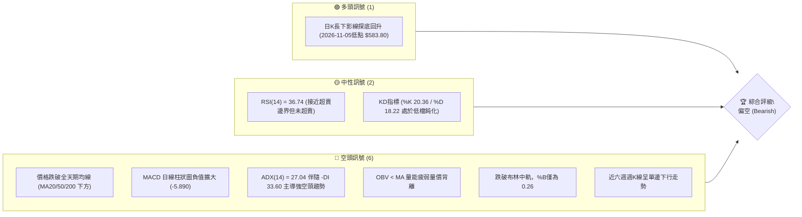

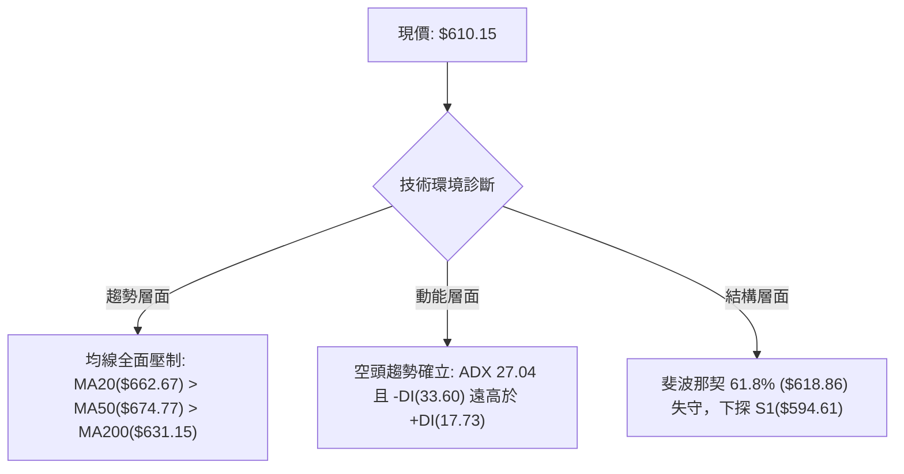

### 📊 核心指標速覽表

| 指標類別 | 指標名稱 | 當前數值 | 訊號 | 解讀 |
|----------|----------|----------|------|------|
| **價格** | 當前收盤價 | $610.15 | 🔴 | 位於 52 週高低區間之 34.9% 水位，弱勢區間運行 |
| **均線** | MA20 | $662.67 | 🔴 | 價格在 MA20 下方 -7.93%，短中期空頭排列壓制 |
| **均線** | MA50 | $674.77 | 🔴 | 價格在 MA50 下方，中期趨勢嚴重受阻 |
| **均線** | MA200 | $631.15 | 🔴 | 跌破年線 ($631.15)，長期牛市結構遭遇實質考驗 |
| **動能** | RSI(14) | 36.74 | 🟡 | 進入弱勢中性區間（30–40），尚未觸及 30 極端超賣 |
| **動能** | MACD (12,26,9) | -23.659 / -17.769 | 🔴 | DIF 位於訊號線下方，柱狀圖 -5.890，空方動能主導 |
| **波動** | ATR(14) | $24.15 (3.96%) | 🟡 | 波動率處於中高水平，單日震幅擴大，需加大防守空間 |
| **趨勢** | ADX(14) | 27.04 (-DI: 33.60) | 🔴 | ADX > 25 且 -DI 占絕對優勢，空頭強趨勢運行中 |
| **通道** | 布林通道 %B | 0.26 (下軌 $554.68) | 🔴 | 價格貼近下半軌，中軌 ($662.67) 構成沉重反壓 |
| **成交量** | OBV 趨勢 | OBV < MA | 🔴 | 量能無法配合價格反彈，資金持續呈淨流出狀態 |

### 🏆 技術評分卡

```
╔══════════════════════════════════════════════════════════════════╗
║                技術評分卡 — META (2026-11-07)                   ║
╠══════════════════════════════════════════════════════════════════╣
║ 趨勢強度 (ADX=27.04, -DI主導)   ████████░░░░░░░░░░░░  35/100 🔴 ║
║ 動能指標 (RSI=36.74, MACD死叉)  ██████░░░░░░░░░░░░░░  30/100 🔴 ║
║ 支撐穩定度 (守住S1/年線下探)     ████████████░░░░░░░░  50/100 🟡 ║
║ 成交量配合 (OBV疲弱, 量比0.62)  ████████░░░░░░░░░░░░  35/100 🔴 ║
║ 形態完整度 (雙頂頸線破位走勢)   ████████░░░░░░░░░░░░  35/100 🔴 ║
║ 均線排列 (全線跌破, 混合偏空)   ██████░░░░░░░░░░░░░░  25/100 🔴 ║
╠══════════════════════════════════════════════════════════════════╣
║ 綜合評分 (六項算術平均，規則18)  ███████░░░░░░░░░░░░░  35/100 🔴 ║
║ 評級結論：偏空 (Bearish) — 空頭強趨勢主導，反彈逢高減碼          ║
╚══════════════════════════════════════════════════════════════════╝
```
*計算依據：(35 + 30 + 50 + 35 + 35 + 25) ÷ 6 = 35.0，四捨五入為 35/100。*

---

## 2. 趨勢分析

### 🌐 多時框趨勢分析

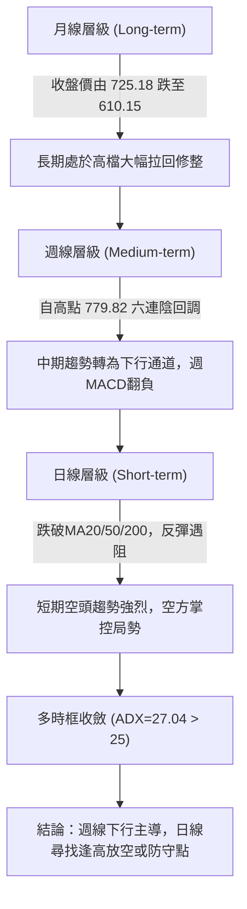

### 📈 長期趨勢 — 12個月走勢圖（Unicode）

```
META 月線走勢圖（過去12個月：2025-12 至 2026-11）
價格軸 ($)
$750 ┤                                      ● (2026-09 $725.18)
$700 ┤            ● (2026-01 $714.66)      ╱ ╲
$650 ┤● (658.40) ╱ ╲ (02: 646.52)         ╱   ● (2026-10 $614.99)
$600 ┤          ╱   ╲                    ╱     ╲
$550 ┤         ╱     ● (03: 571.15)     ╱       ●←當前 (2026-11 $610.15)
$500 ┤        ╱       ╲  (05: 631.43)  ╱
$450 ┤       ╱         ●──────●       ╱
$400 ┤      ╱           (06: 562.85) ╱
     └──────┬─────┬─────┬─────┬─────┬─────┬─────┬─────┬─────┬─────┬─────┬─────
          25-12 26-01 26-02 26-03 26-04 26-05 26-06 26-07 26-08 26-09 26-10 26-11
```

**過去 12 個月走勢特徵分析表格**：

| 時間區間 | 起始收盤 ($) | 結束收盤 ($) | 漲跌幅 (%) | 趨勢特徵與結構意涵 |
|----------|--------------|--------------|------------|--------------------|
| 2025-12 至 2026-01 | $658.40 | $714.66 | +8.55% | 跨年多頭衝刺，突破 $700 整數關卡 |
| 2026-01 至 2026-03 | $714.66 | $571.15 | -20.08% | 首輪大幅急殺回調，波段跌破 $600 支撐 |
| 2026-03 至 2026-05 | $571.15 | $631.43 | +10.55% | 跌深反彈，構築中繼反彈平台 |
| 2026-05 至 2026-07 | $631.43 | $556.27 | -11.90% | 二次下探低點，測試 52 週低點防線 ($519.37之上) |
| 2026-07 至 2026-09 | $556.27 | $725.18 | +30.36% | 主升浪強勁爆發，9月盤中創下 52W 高點 $779.82 |
| 2026-09 至 2026-11 | $725.18 | $610.15 | -15.86% | 高檔雙頂後爆量重挫，貫穿年線，確立週線級回調 |

### 📊 中期趨勢（週線分析）

```
META 中期週線支撐與壓力分布示意圖
價格 ($)
$780 ┼──────────────────────────────────── 高點聚類阻力 $779.82 (52W High)
     │        ▲ 2026-09-25 高點 $779.82
$720 ┼───────┼──────────────────────────── 關鍵頸線回測位 R3 ($671.45) / 斐波 38.2% ($680.33)
     │       ╱ ╲     ▲ 2026-10-16 反彈次高 $771.27
$660 ┼──────╱───╲───┼──────────────────── 中期均線反壓區 MA20 ($662.67) / MA50 ($674.77)
     │     ╱     ╲ ╱ ╲
$610 ┼────╱───────V───╲──────────────── 現價 ($610.15) 爭奪區間 / 斐波 61.8% ($618.86)
     │   ╱               ▼ 2026-11-05 探底低點 $583.80
$550 ┼──╱──────────────────────────────── 波段密集支撐區 S2 ($577.95) / S3 ($555.86)
```

週線數據顯示，META 自 2026-09-25 創下 52 週新高 $779.82 以來，週成交量放大至 168,307,000 股並收長上影線。隨後在 10 月中旬反彈至 $771.27 未能破頂，構成明確的波段頂部特徵。近 6 週收盤價由 $751.66 → $728.08 → $718.67 → $709.33 → $642.62 → $614.99 → $610.15，週 MACD 柱狀圖由正轉負（自 +11.729 暴跌至 -14.283 後收斂至 -5.890），週線 RSI 自 71.4 超買區急墜至 36.7，中期趨勢完全被空方壓制。

### ⚡ 趨勢強度評估（ADX 解讀）

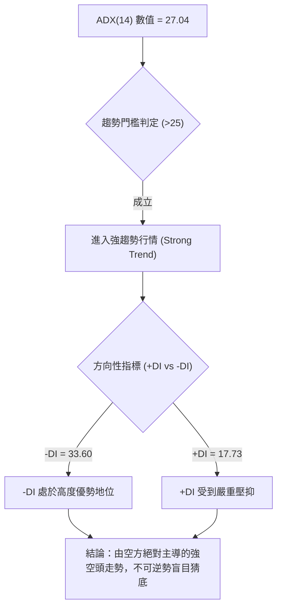

**ADX 趨勢強度對照表**：

| 指標變數 | 當前讀數 | 門檻區間 | 技術含義解讀 |
|----------|----------|----------|--------------|
| **ADX(14)** | **27.04** | > 25.0 | 突破 25 臨界值，確認市場告別震盪整理，展開方向明確的單邊趨勢 |
| **+DI** | **17.73** | < 20.0 | 多頭進攻意願極低，買盤無法在反彈時形成有效連續推升 |
| **-DI** | **33.60** | > 30.0 | 空頭拋售壓力極為強勁，盤面處於主動拋售與停損觸發狀態 |
| **DI 差值** | **-15.87** | 負值擴大 | 空多力量差距懸殊，下行動能處於發散加速階段 |

---

## 3. 圖表形態分析

### 🔍 形態識別系統

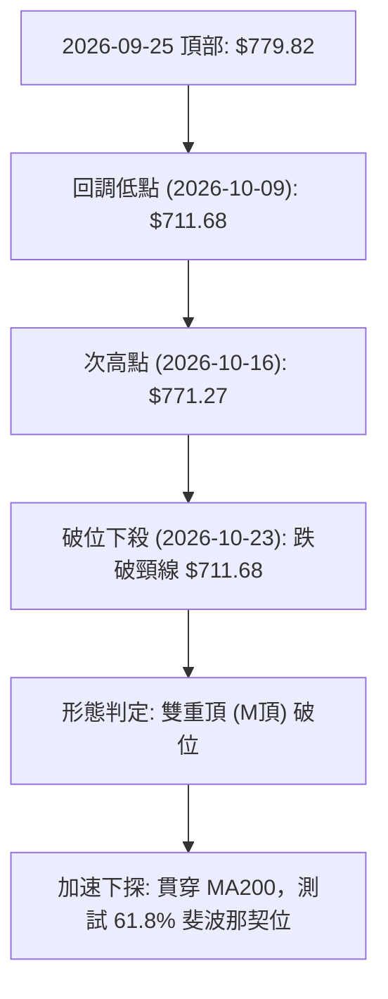

**圖表形態信心度與測算表**：

| 形態名稱 | 信心度 | 判斷依據（引用數據） | 完成度 | 目標價（附精確計算式） |
|----------|--------|----------------------|--------|------------------------|
| **雙重頂 (M頂)** | **85%** | 週K線 2026-09-25 高點 $779.82 與 2026-10-16 高點 $771.27 形成雙峰；中間頸線低點為 2026-10-09 低點 $711.68。該頸線於 2026-10-23 週以大陰線 ($642.62) 跌破。 | **100% (已破位執行中)** | 形態高度 = $779.82 − $711.68 = $68.14。<br>跌破頸線之量度目標 = 頸線 $711.68 − 形態高度 $68.14 = **$643.54**（已達標）。<br>等幅擴展目標 (1.5倍) = $711.68 − ($68.14 × 1.5) = **$609.47**（當前現價 $610.15 恰處於該目標位附近）。 |
| **短線下降旗形** | **60%** | 日K線於 2026-10-28 至 2026-11-04 期間於 $606.41 至 $643.09 窄幅反彈旗面整理，隨後 2026-11-05 跌破旗面下軌長黑殺低至 $583.80。 | **90%** | 旗桿高點 $647.69 (10-26) 至旗桿低點 $609.00 (10-28) 差值 $38.69。<br>突破點 $624.50 (11-04低) − $38.69 = **$585.81**（與 11-05 實體最低 $583.80 極度吻合）。 |
| **底背離反轉形態** | **15%** | 數據中 RSI 背離明確記載為「無明顯背離」，日線與週線均無多頭反轉幾何形態。 | **0%** | **訊號不足，僅做指標型解讀**（依規則 15，不強行預測幾何底部）。 |

### 🕯️ 重要K線形態分析

根據「近10根日K」與「近8根週K」之精確 OHLC 數據進行逐根特徵檢視：

| 日期（日K/週K） | 開 | 高 | 低 | 收 | K線形態 | 解讀 | 訊號 |
|-----------------|----|----|----|----|---------|------|------|
| **2026-10-23 (週K)** | 707.16 | 713.22 | 633.27 | 642.62 | **崩跌大陰線** | 一舉跌破 $700 及 $670 雙重關卡，帶量長黑實體達 $64.54，確認高檔頭部正式確立。 | 🔴 |
| **2026-10-30 (週K)** | 638.36 | 647.69 | 609.00 | 614.99 | **放量下行黑K** | 週成交量爆出 173,999,500 股的天量，低點下探至 $609.00，空方拋壓持續傾瀉。 | 🔴 |
| **2026-11-06 (週K)** | 614.44 | 643.09 | 583.80 | 610.15 | **長下影錘頭型週K** | 最低探至 $583.80 後拉回至 $610.15，下影線長達 $26.35，顯示 $580-$590 存在低接買盤。 | 🟡 |
| **2026-10-27 (日K)** | 627.07 | 628.46 | 619.21 | 620.19 | **空頭延續黑K** | 成交量放大至 5,133 萬股，實體收低，均線壓制明顯。 | 🔴 |
| **2026-11-03 (日K)** | 610.76 | 624.84 | 610.10 | 621.03 | **低檔縮量反彈陽K** | 成交量僅 1,373 萬股（極度萎縮），呈現弱勢無量反抽，反彈動能衰竭。 | 🟡 |
| **2026-11-04 (日K)** | 641.15 | 643.09 | 624.50 | 630.00 | **衝高回落倒錘頭** | 跳空開高至 $641.15 後受阻於阻力區，留下長上影線收黑，多頭反攻遭逢空頭狙擊。 | 🔴 |
| **2026-11-05 (日K)** | 632.30 | 634.99 | 583.80 | 605.08 | **極端長下影恐慌長黑** | 盤中恐慌殺破 $600 關卡至 $583.80，尾盤收回 $605.08，實體下影線長達 $21.28。 | 🟡 |
| **2026-11-06 (日K)** | 607.33 | 625.60 | 606.66 | 610.15 | **窄幅整理微型小陽** | 成交量急縮至 1,568 萬股（量比 0.62x），多空於現價暫時拉鋸，等待週線收斂。 | 🟡 |

### 📉 ASCII 走勢形態示意圖

```
META 雙重頂破位與測幅走勢示意圖
$780 ┼                    左頂 ($779.82)
     │                     ╭───╮             右頂 ($771.27)
$750 ┼                    ╱     ╲             ╭───╮
     │                   ╱       ╲           ╱     ╲
$710 ┼──────────────────╱─────────╲─────────╱───────╲───── 頸線 ($711.68)
     │                 ╱           ╲       ╱         ╲
$670 ┼                ╱             ╰───┬─╯           ╲ (跌破頸線)
     │               ╱                  頸線低點       ╲
$630 ┼──────────────╱───────────────────────────────────╲───── MA200 ($631.15)
     │             ╱                                     ╲
$610 ┼────────────╱───────────────────────────────────────● 現價 ($610.15)
     │           ╱                                         ╲
$580 ┼──────────╯                                           ▼ 11-05 低點 ($583.80)
     └───────────────────────────────────────────────────────────
```

### 🎯 形態目標價計算

雙重頂幾何測算解析：
- **頂部最高點**：$779.82 (2026-09-25)
- **頭部頸線點**：$711.68 (2026-10-09 週低點)
- **頭部垂直幅度**：$779.82 − $711.68 = **$68.14**
- **第一量度目標 (1.0x 跌幅)**：$711.68 − $68.14 = **$643.54**
  - *驗證*：2026-10-23 當週收盤恰為 $642.62，完美回測並貫穿此第一目標價。
- **第二擴展目標 (1.5x 跌幅)**：$711.68 − ($68.14 × 1.5) = **$609.47**
  - *驗證*：當前收盤價 $610.15，距此擴展目標僅差 $0.68，顯示空頭形態幅度已大致宣洩完畢，進入極度關鍵的爭奪帶。

---

## 4. 支撐與阻力

### 🗺️ 關鍵價位分布圖（Unicode）

```
META 價位結構分布圖
═══════════════════════════════════════════════════
$671.45 ║████████████████████████║ 強阻力 R3 (波段高點聚類 / 接近MA50 $674.77)
$641.90 ║████████████████████    ║ 阻力 R2 (近週反彈高點聚類 / 近MA200 $631.15)
$623.91 ║████████████████████████║ 關鍵阻力 R1 (日K近期密集成交高點聚類)
$618.86 ║────────────────────────║ 斐波那契 61.8% 關鍵分水嶺
$610.15 ╠════════════════════════╣ ◄ 現價 (收盤價)
$594.61 ║▓▓▓▓▓▓▓▓▓▓▓▓▓▓▓▓        ║ 近期支撐 S1 (波段低點聚類)
$577.95 ║████████████████████████║ 強支撐 S2 (波段低點聚類 / 斐波 78.6% $575.11)
$555.86 ║████████████████████████║ 極限強支撐 S3 (波段低點聚類 / 布林下軌 $554.68)
═══════════════════════════════════════════════════
```

### 🚧 阻力位分析表

所有價位均嚴格引用提供之技術數據數值：

| 阻力級別 | 價位 | 與現價距離 | 形成原因與技術意涵 | 突破難度 | 重要性 |
|----------|------|------------|--------------------|----------|--------|
| **R1** | **$623.91** | +2.26% | 近一年波段高點聚類；近10日多根日K（10-27高 $628.46、10-28高 $624.42、11-03收 $621.03）反覆遇阻回落區。 | 中等 | 🟢 短線多空分水嶺 |
| **R2** | **$641.90** | +5.20% | 近一年波段高點聚類；11-04 日K衝高高點 $643.09 處，緊鄰長期生命線 MA200 ($631.15)，具備強大解套賣壓。 | 偏高 | 🟡 中期空頭防線 |
| **R3** | **$671.45** | +10.05% | 近一年波段高點聚類；重疊短期 MA20 ($662.67) 與 MA50 ($674.77)，為多頭徹底扭轉空勢的終極強阻力。 | 極高 | 🔴 多空牛熊轉換樞紐 |

### 🛡️ 支撐位分析表

所有價位均嚴格引用提供之技術數據數值：

| 支撐級別 | 價位 | 與現價距離 | 形成原因與技術意涵 | 守住機率 | 重要性 |
|----------|------|------------|--------------------|----------|--------|
| **S1** | **$594.61** | -2.55% | 近一年波段低點聚類；整數心理關卡 $600 下方之緩衝買盤密集帶，2026-11-05 長下影線關鍵承接平台。 | 55% | 🟡 短期生命線 |
| **S2** | **$577.95** | -5.28% | 近一年波段低點聚類；緊密對應 52 週斐波那契 78.6% 回調位 ($575.11)，歷史多個月份（如 2026-03 $571.15、2026-08 $571.89）築底區。 | 70% | 🟢 中期強固底座 |
| **S3** | **$555.86** | -8.90% | 近一年波段低點聚類；重疊當前布林通道下軌 ($554.68) 及 2026-07 收盤低點 ($556.27)，為年度多頭最後防線。 | 85% | 🔴 長期牛市極限防護 |

### 📐 斐波那契回調位分析

依據 52 週區間波段低點 $519.37 至波段高點 $779.82 進行黃金分割回調測算：


**斐波那契回調位階解讀**：
- **當前位置**：收盤價 $610.15 目前運行於 **61.8% ($618.86)** 與 **78.6% ($575.11)** 之間。
- **黃金分割 61.8% ($618.86) 失守分析**：
  61.8% 通常被視為強勢回調的極限閥值。當前價格 $610.15 跌破 $618.86，代表自 $519.37 起漲的整體多頭波段結構遭到嚴重破壞，市場已非強勢洗盤，而是進入深度修正。
- **向上回抽與向下空間**：
  若短線多頭反彈，61.8% 位階 $618.86 將即刻轉化為反壓（與阻力位 R1 $623.91 形成共振阻力帶）；若無法有效收復，價格重心將沿著弱勢路徑滑向 78.6% 回調位 **$575.11**（與支撐位 S2 $577.95 形成重疊共振支撐區）。

---

## 5. 技術指標深度解讀

### 🎛️ 指標訊號總覽

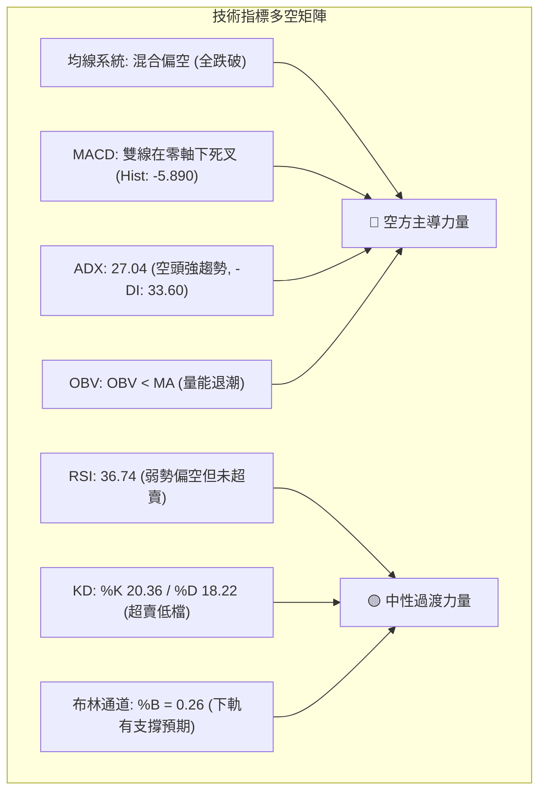

### 📈 移動平均線排列分析

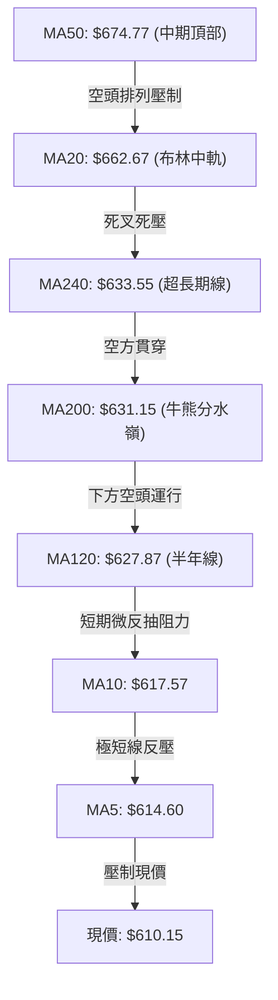

**移動平均線狀態詳解**：
- **短天期均線**：MA5 ($614.60) 與 MA10 ($617.57) 全面陡峭向下，且價格位於兩者下方，反映極短線空頭拋售慣性仍在延續。
- **中天期均線**：MA20 ($662.67) 與 MA60 ($655.91) 出現下彎，MA50 ($674.77) 更是高懸於上，形成巨大的中期籌碼套牢天花板。
- **長天期均線**：現價 $610.15 跌破 MA200 ($631.15) 與 MA240 ($633.55)。年線作為機構法人長線資產配置的重要風向標，一旦失守並停留於其下方，預示著中長線資金進入風險規避模式。

### 📉 RSI(14) 分析

```
RSI(14) 動能強度表：當前數值 36.74
0        20        30              50                      70       100
├────────┼─────────┼───────────────┼───────────────────────┼────────┤
│ 極端超賣│  超賣區  │   弱勢中性    │       強勢多頭        │ 超買區 │
├────────┼─────────┼───────────────┼───────────────────────┼────────┤
[███████████████████░░░░░░░░░░░░░░░░░░░░░░░░░░░░░░░░░] 36.74%
```

- **數值解讀**：RSI(14) 讀數為 **36.74**，處於 30 至 50 的弱勢空方主導區間。既未進入 70 以上的超買過熱區，也尚未跌破 30 觸發極度超賣報復性反彈條件，屬於典型的「弱勢陰跌」動能型態。
- **背離判斷**：數據明確標示「RSI 背離：無明顯背離（僅比較近20根K棒首尾的價格與RSI方向）」。價格在創下波段新低時，RSI 亦同步下行，指標真實反映價格動能，**無底背離或頂背離訊號**，意味著下行動能尚未發生動能衰竭。

### 📊 MACD(12/26/9) 訊號解讀

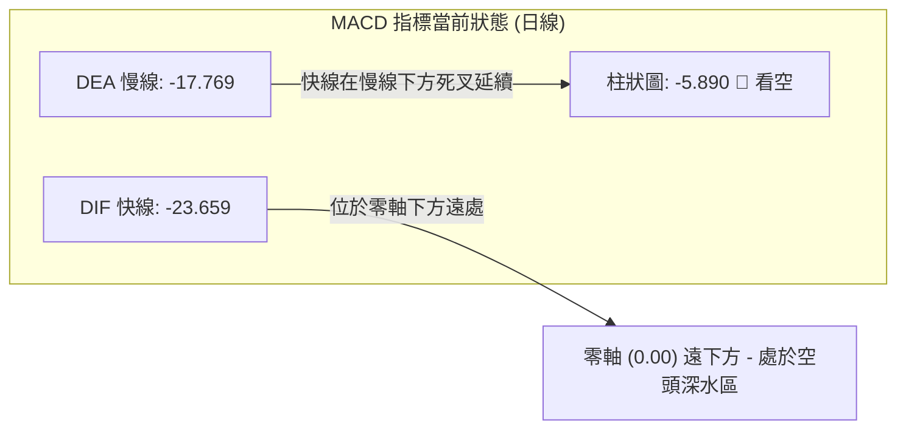

- **絕對數值解析**：DIF (-23.659) 與 DEA (-17.769) 雙雙深陷於零軸下方，說明大週期與小週期的均線動能全線處於負向發散狀態。
- **柱狀圖動能**：MACD Hist 為 **-5.890**，呈現負值狀態，空頭動能柱持續向外擴張，空頭綠柱尚未出現收斂拐點，短期仍須提防向下慣性。

### 📦 布林通道分析

```
META 布林通道結構示意圖 (Bollinger Bands 20, 2)
$770.67 ┬────────────────────────────────────────── BB 上軌 (Upper Band)
        │
$716.67 ┼
        │
$662.67 ┼────────────────────────────────────────── BB 中軌 (MA20 反壓線)
        │
$610.15 ┼─────────● 現價 (收盤價) [%B = 0.26]
        │
$554.68 ┴────────────────────────────────────────── BB 下軌 (Lower Band)
```

- **通道參數解讀**：
  - 上軌：**$770.67**
  - 中軌 (MA20)：**$662.67**
  - 下軌：**$554.68**
  - 通道帶寬 (Bandwidth) = $770.67 − $554.68 = $215.99（帶寬達 35.4%，處於擴張狀態）。
- **%B 指標分析**：
  當前 **%B = 0.26**。%B 位於 0.2 至 0.3 的低檔弱勢運行區，顯示價格受到中軌壓制並沿著通道下半區滑行。下軌 **$554.68** 構成極強的通道物理邊界支撐（與 S3 支撐位 $555.86 完全重疊）。

### 💹 成交量分析（量價配合度）

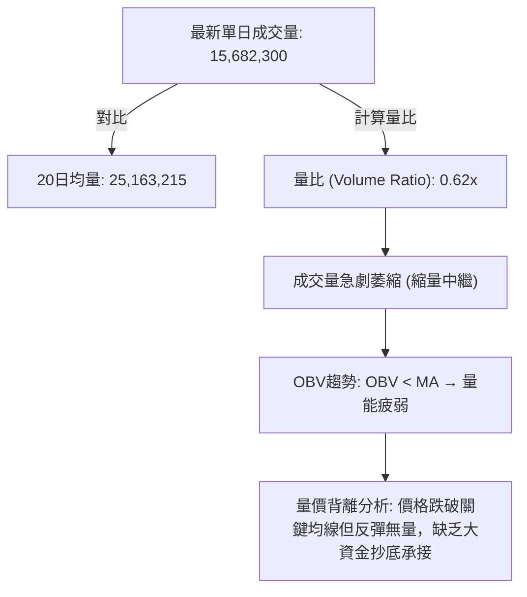

- **成交量對比**：最新日成交量僅 15,682,300 股，相較於 20 日均量 25,163,215 股，量比僅為 **0.62x**；相較於 50 日均量 22,555,314 股亦呈現大幅量縮。
- **OBV 量能分析**：數據顯示「OBV < MA → 量能疲弱」。OBV 能量潮處於其均線下方運行，說明在過去數週的下跌行情中，下跌放量（如 10-27 達 5,133 萬股、10-30 當週達 1.73 億股）而反彈量急縮（如 11-03 僅 1,373 萬股、11-06 僅 1,568 萬股）。這是標準的「放量下跌、縮量反抽」籌碼派發型態。

---

## 6. 動能與波動率

### ⚡ 動能評估

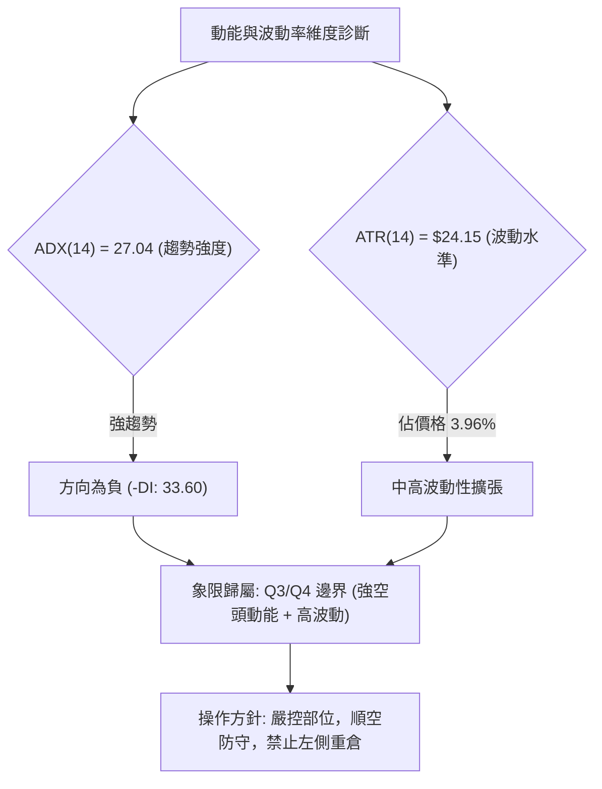

**動能評估狀態表格**：

| 象限 | 動能方向與強度 | 波動率水準 | 當前狀態標註 | 操作技術意涵評估 |
|------|----------------|------------|--------------|------------------|
| **Q1** | 強多頭動能 | 低波動穩固 | — | 最佳波段做多機會，穩步推升 |
| **Q2** | 弱多頭/弱動能 | 低波動盤整 | — | 區間震盪觀望，等待突破訊號 |
| **Q3** | 強空頭動能 (負向強) | 高波動擴大 | **✓ (當前歸屬)** | **空方宣洩主跌浪，高波動帶來巨大滑點風險，偏空操作** |
| **Q4** | 衰竭動能 | 極度高波動 | — | 恐慌末端，隨時醞釀V型反轉或暴跌 |

### 📊 ATR 波動率分析

- **ATR(14) 讀數**：**$24.15**（Wilder 計算法，佔現價之 **3.96%**）。
- **單日波動區間解讀**：意味著在 1 倍標準 ATR 範圍內，META 次日合理的波動震幅即高達約 ±$24.15。當前股價波動幅度顯著高於一般大型權值股水準。
- **風控止損空間設定依據**：
  - **超短線策略止損距**：1.0 × ATR = **$24.15**。
  - **波段交易防守止損距**：1.5 × ATR = **$36.23**。
  - **寬鬆趨勢防守止損距**：2.0 × ATR = **$48.30**。
  - *實戰意涵*：任何交易策略之停損設定不可小於 $24.15，否則極易在市場常態日內雜訊中被無謂掃出場。

### 📐 Beta 與市場相關性

- **Beta 係數**：**1.279**。
- **技術意義解析**：
  - META 的股價波動敏感度相較於標普 500 指數高出 **27.9%**。
  - 在科技板塊或總體市場承壓時，META 會承受 1.28 倍的放大下行壓力；反之，若大盤展開反彈，其彈性亦相對放大。高 Beta 結合當前 -DI 占優的格局，加劇了股價下探尋找強支撐的技術慣性。

---

## 7. 多時框架總結

### 📋 時框架評分表

| 時框架 | 趨勢方向 | 動能狀態 | 均線排列 | 形態特徵 | 綜合評分 | 操作建議方向 |
|--------|----------|----------|----------|----------|----------|--------------|
| **月線 (長期)** | 🟡 中性回調 | RSI 高檔滑落 | 跌破短期MA，守年線 | 長期大型上升通道內深度回調 | 50/100 | 長期投資者暫緩加碼 |
| **週線 (中期)** | 🔴 明確看空 | 週MACD柱走負 | 雙頂成形，中軌失守 | 雙重頂破位，直逼 1.5x 測幅點 | 30/100 | 中期順勢建立空頭防護 |
| **日線 (短期)** | 🔴 強空弱反 | RSI=36.74，ADX>25 | 全面空頭混合壓制 | 下降旗形破位後低檔縮量揉搓 | 35/100 | 短線反彈遇阻放空 |

### 🔲 綜合訊號矩陣

```
綜合訊號多時框一致性矩陣
維度              短期 (日線)          中期 (週線)          長期 (月線)
─────────────────────────────────────────────────────────────────
趨勢 (Trend)      🔴 空頭 (-DI=33.6)   🔴 下行六連陰        🟡 回踩年線帶
動能 (Momentum)   🔴 MACD柱狀負值      🔴 DIF快速下穿零軸   🟡 RSI自高檔回調
均線 (MA System)  🔴 均在下方 (-7.9%)  🔴 貫穿週MA20        🟡 測試MA240附近
量能 (Volume)     🔴 縮量無承接        🔴 破位週爆天量      🟢 長期結構量能尚存
形態 (Pattern)    🔴 旗形破位下探      🔴 雙頂頸線失守      🟡 長週期箱型上沿
─────────────────────────────────────────────────────────────────
一致性判定        【高空共振】日線與週線高度一致偏空，月線支撐尚未確認
```

### ⚖️ 多時框收斂結論

依據多時框收斂規則（規則 14）：
1. **趨勢/盤整判定**：當前 ADX(14) 數值為 **27.04**（大於 25 臨界值），嚴格判定為**「趨勢行情」**，而非盤整震盪行情。
2. **時框優先權**：在趨勢行情下，必須以中長期（週線 / MA50 / MA200）方向為主導，日線僅能用來尋找順應大趨勢的次級進場時機。
3. **時框取捨與方向唯一結論**：
   - 中期週線雙重頂確立，跌破頸線與年線 MA200 ($631.15)；
   - 日線雖於 11-05 出現長下影線探底，但 11-06 縮量且全天期均線全面反壓，日線微弱反彈無法推翻週線級別的空頭趨勢。
   - **唯一方向性結論：【偏空觀望 / 逢高偏空】（Bearish）**。此結論嚴格貫穿第 8 章交易策略。

---

## 8. 交易策略建議

### 🗺️ 策略決策流程圖

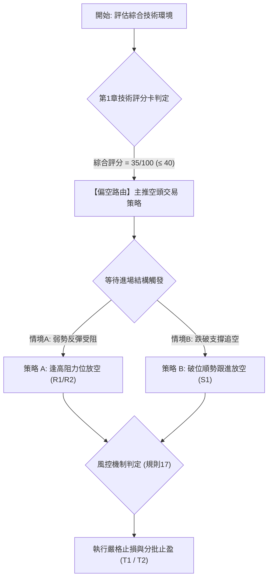

### 🧭 策略路由（依評分卡分流）

> **當前主策略方向 = 主推空頭策略（依綜合評分 35/100，落於 ≤ 40 偏空區間，規則 18）**

依據規則，多頭不作為主要交易推薦，僅在下方列出「反轉風險觸發點（空頭回補/多頭對沖提示）」，嚴禁兩頭下注。

### 🎯 價格情境階梯（Price Scenarios）

價位嚴格引用技術數據中之數值：

| 觸發條件 | 下一目標 | 後續延伸 | 情境含義 |
|----------|----------|----------|----------|
| **向上反抽受阻 R1 $623.91** | 現價 $610.15 | 測試 S1 $594.61 | 短線超跌反抽結束，重回空頭主跌波段 |
| **強勢向上突破 R1 $623.91** | 測試 R2 $641.90 | 挑戰 R3 $671.45 | 空頭結構遭遇抵抗，短線展開深度修正反彈 |
| **跌破 S1 $594.61** | 下測 S2 $577.95 | 探底 S3 $555.86 | 恐慌盤再次湧現，空方打開通往布林下軌空間 |

### 📊 情境機率分佈

| 情境 | 機率 | 主要依據（指標狀態） |
|------|------|----------------------|
| **回落 / 再探底 (空頭延續)** | **60%** | ADX=27.04 (-DI=33.60 強空主導)、MACD柱狀圖負值 (-5.890)、現價受制於全天期均線、OBV 疲弱。 |
| **區間震盪 (S1 至 R1 徘徊)** | **25%** | 日K出現長下影線（11-05低點 $583.80）、RSI(14)=36.74 接近低檔超賣區，空方短線動能需獲利消化。 |
| **強勁反彈 / 突破 R1 (多頭逆轉)** | **15%** | 成交量極度萎縮（量比 0.62x），多頭缺乏攻擊量能支持，突破 R1 且站穩之機率極低。 |

### 🟢 主策略詳情（空頭主推策略）

所有價位均精確引用數據中的阻力/支撐數值；風險報酬比嚴格按規則 17 計算：
- *空頭風報比公式 = (進場價 − 目標價 T1) ÷ (止損價 − 進場價)*

| 策略要素 | 策略 A（反彈高空 — 逢阻力布空） | 策略 B（破位跟空 — 順勢追空） |
|----------|---------------------------------|---------------------------------|
| **策略邏輯** | 股價弱勢反抽至 R1 關鍵阻力附近受阻，順應週線大空頭趨勢布局空單。 | 股價跌破 S1 密集支撐平台，空頭下行空間打開，順勢跟進。 |
| **進場條件** | 盤中反抽觸及 R1 阻力位遇阻回落，確認日K收長上影線。 | 日K實體跌破支撐位 S1，空方動能確認跌破。 |
| **進場價格** | **$623.91**（嚴格引用 R1） | **$594.61**（嚴格引用 S1） |
| **目標價 T1** | **$577.95**（嚴格引用 S2） | **$555.86**（嚴格引用 S3 / 布林下軌） |
| **目標價 T2** | **$555.86**（嚴格引用 S3） | **$519.37**（嚴格引用 52W Low） |
| **止損價格** | **$641.90**（嚴格引用 R2） | **$610.15**（嚴格引用 現價收盤價） |
| **風險報酬比** | **1 : 2.55（以 T1 計）**<br>*計算：(623.91 − 577.95) ÷ (641.90 − 623.91) = 45.96 ÷ 17.99 = 2.55*<br>*(另列：1 : 3.78 以 T2 計)* | **1 : 2.49（以 T1 計）**<br>*計算：(594.61 − 555.86) ÷ (610.15 − 594.61) = 38.75 ÷ 15.54 = 2.49*<br>*(另列：1 : 4.84 以 T2 計)* |
| **成功機率** | **65%** | **60%** |
| **建議倉位** | **15% - 20%** | **10% - 15%** |

### 🔴 反向風險觸發點（空頭對沖與回補提示）

若出現以下技術訊號，代表空頭結構可能遭外力破壞，應無條件執行空單停損或回補：
1. **價位警訊**：日線收盤價強勢突破並站穩 **$631.15 (MA200 年線)** 或 **$641.90 (R2 阻力)**。
2. **動能警訊**：日線 MACD 柱狀圖向上翻正，且 RSI(14) 強勢回升站上 50 中性軸。
3. **量能警訊**：突破 R1 時單日成交量暴增至 50 日均量（2,255 萬股）之 1.5 倍以上，形成標準的放量長陽吞噬形態。

### ⭐ 整體訊號強度評星

```
╔══════════════════════════════════════════════════════════════════╗
║ 做多訊號強度：★☆☆☆☆  (1/5星 — 均線全崩，僅下影線微弱防守)       ║
║ 做空訊號強度：★★★★☆  (4/5星 — ADX>25強空趨勢，週日空頭共振)    ║
║ 整體可信度：  ★★★★☆  (4/5星 — 量價動能方向高度吻合，無背離雜訊)  ║
╚══════════════════════════════════════════════════════════════════╝
```

---

## 9. 風險提示與監控

### ✅ 關鍵監控指標 Checklist

```
╔══════════════════════════════════════════════════════════════════╗
║              META 技術面關鍵監控清單 (Checklist)                 ║
╠══════════════════════════════════════════════════════════════════╣
║ [ ] 監控價位是否下破 S1: $594.61 (跌破則空方加速)                ║
║ [ ] 監控價位是否反彈碰觸 R1: $623.91 (空頭第一反抗防線)          ║
║ [ ] 監控年線 MA200: $631.15 是否形成實質強壓 (牛熊分野)          ║
║ [ ] 追蹤 ADX(14) 是否持續高於 25 且 -DI > +DI (強空趨勢延續)     ║
║ [ ] 觀察日成交量是否突破 20日均量 (25,163,215股) 產生異常放量    ║
║ [ ] 檢視 MACD 柱狀圖 (-5.890) 負值是否收斂轉綠                   ║
║ [ ] 留意布林通道下軌 $554.68 與 S3 $555.86 處的支撐反應         ║
╚══════════════════════════════════════════════════════════════════╝
```

### ⚠️ 風險場景分析

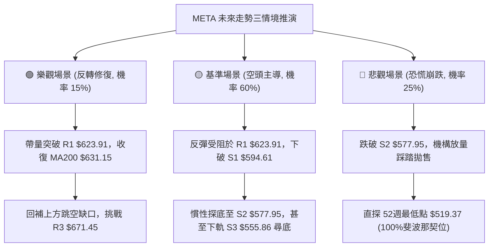

### 🛡️ 風險管理重要提醒

1. **嚴守 ATR 波動防護**：
   META 目前 ATR 高達 **$24.15**，單日價格震盪劇烈。無論採取何種策略，必須確保部位規模能承受至少 1.5 倍 ATR（約 $36.23）的常態波動，避免過度槓桿化。
2. **倉位管理原則**：
   在 ADX > 25 的強空頭單邊環境中，做空總部位不宜超過總資本的 20%，嚴格分批進場，切勿單點梭哈。多頭左側交易風險極大，現階段嚴禁逆勢重倉抄底。
3. **盈虧比強制執行**：
   嚴格遵守「風險報酬比 ≥ 1 : 2.0」的交易鐵律。若價格已逼近目標位（如逼近 S2 $577.95），切勿追空，應靜待反抽後之二次阻力確認。

---

## 📋 報告總結

```
╔══════════════════════════════════════════════════════════════════╗
║                    META 技術分析報告總結                         ║
╠══════════════════════════════════════════════════════════════════╣
║ 報告日期：2026-11-07                                             ║
║ 當前價格：$610.15                                                ║
║ 分析評級：🔴 偏空 (Bearish) — 綜合評分 35/100                    ║
║                                                                  ║
║ 關鍵技術結論：                                                   ║
║ ├─ 長期趨勢：🟡 中性回修 (高檔拉回，測試年線生命線)              ║
║ ├─ 中期趨勢：🔴 空頭主導 (週線雙重頂確立破位，下測測幅位)        ║
║ ├─ 短期趨勢：🔴 強空反抽 (均線全面壓制，ADX=27.04 空方發散)      ║
║ ├─ 關鍵支撐：S1: $594.61 ｜ S2: $577.95 ｜ S3: $555.86           ║
║ ├─ 關鍵阻力：R1: $623.91 ｜ R2: $641.90 ｜ R3: $671.45           ║
║ └─ 外資分析師目標價：均價 $848.38 ｜ 最低 $629.06 ｜ 最高 $1050.0║
║                                                                  ║
║ 最優策略組合（規則18評分路由：偏空主導）：                       ║
║ 1. 🥇 最佳機會：策略 A — 反彈至 R1 $623.91 受阻放空，風報比 1:2.55║
║ 2. 🥈 次選機會：策略 B — 破位 S1 $594.61 順勢追空，風報比 1:2.49 ║
║ 3. 🥉 保守選擇：空手觀望，靜待下探 S2 $577.95 ~ S3 $555.86 築底  ║
╚══════════════════════════════════════════════════════════════════╝
```

---

> ⚠️ **免責聲明**：本報告為技術分析研究成果，所有數據、圖表及價位推算均嚴格基於所提供之歷史 OHLCV 價格資訊。本報告**僅供研究與學術參考**，**不構成任何個人化投資建議或買賣邀約**。金融市場瞬息萬變，投資人應自行承擔交易風險，並落實嚴謹之資金管理。

---

*報告生成時間：2026-11-07 ｜ 數據來源：Yahoo Finance ｜ 分析框架：多時框技術分析體系*