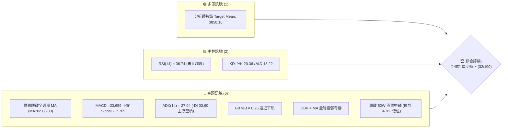
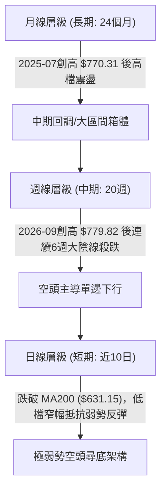
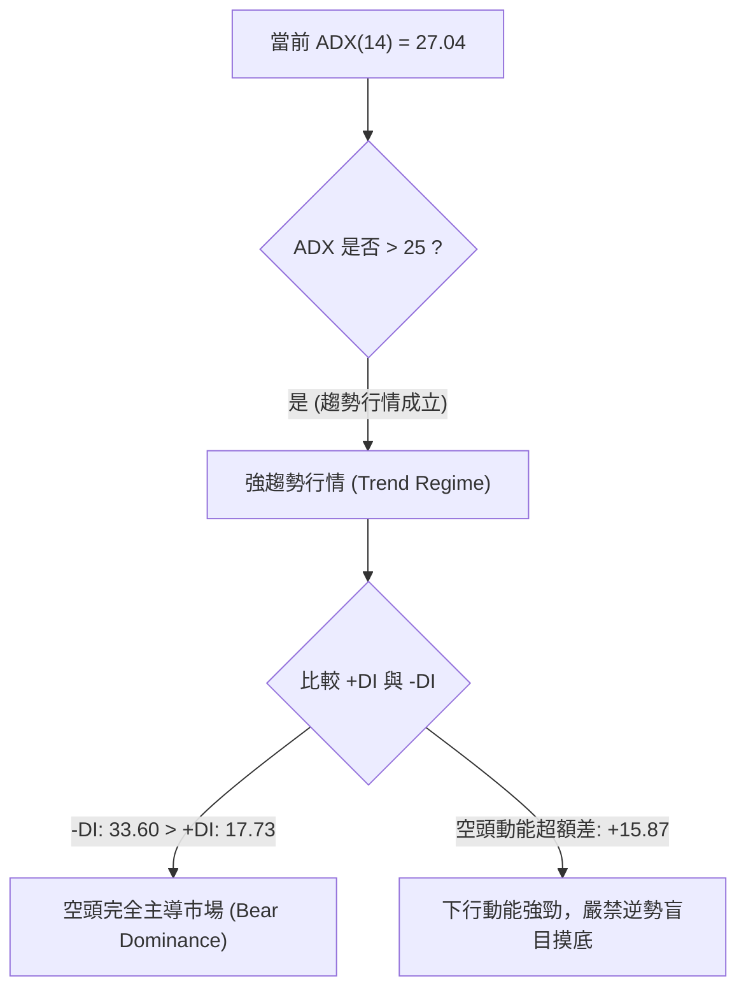
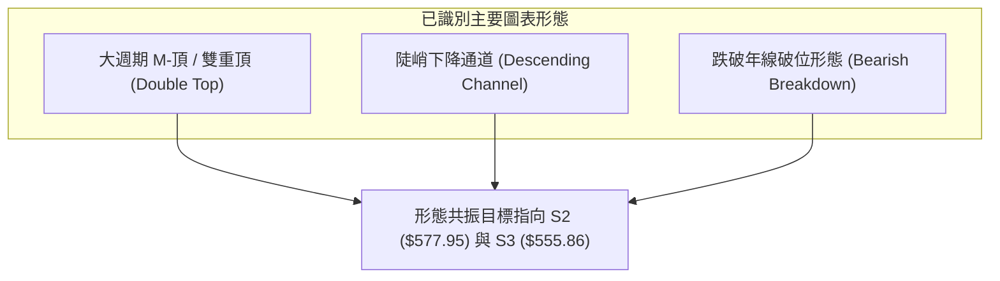
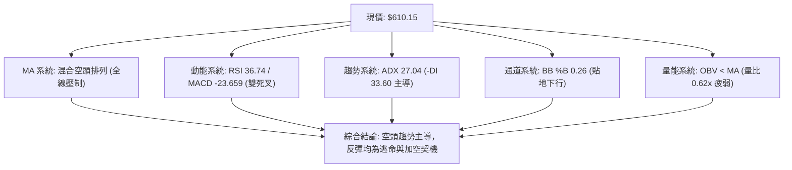
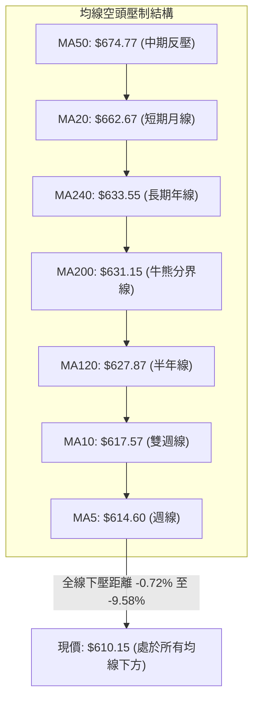
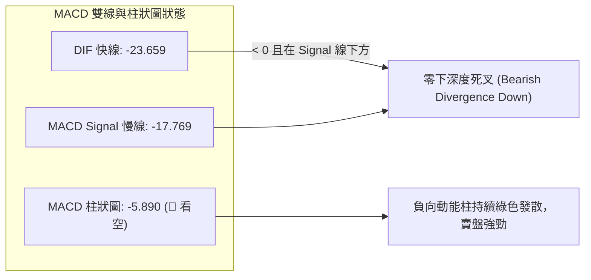
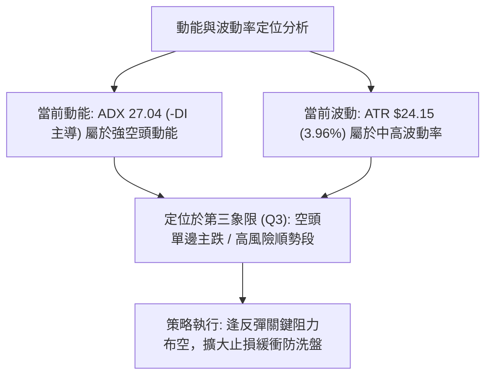
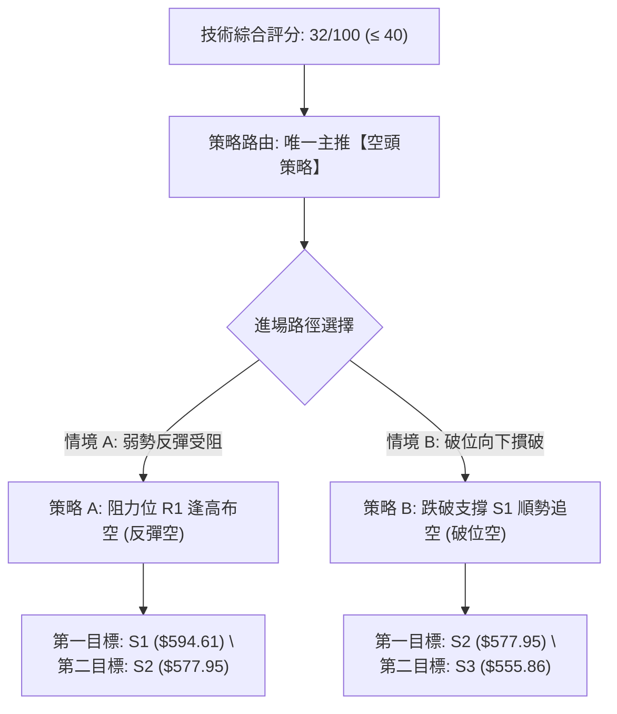
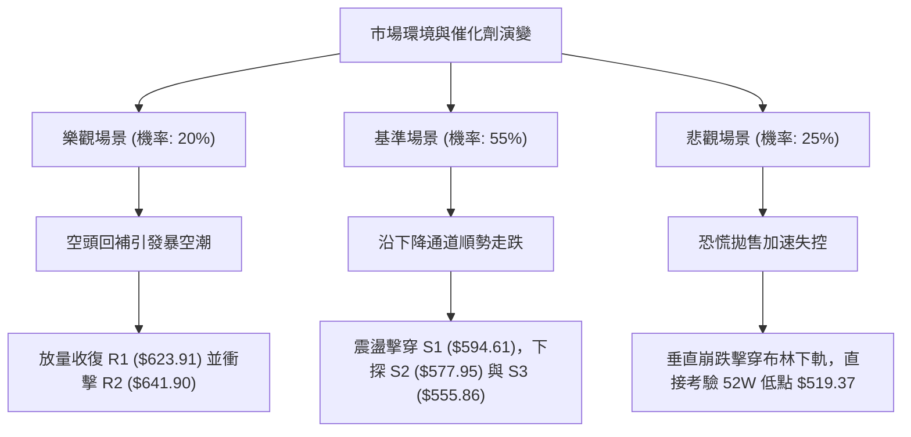

# META 技術分析報告

> **報告日期**：2026-11-08 ｜ **語言**：繁體中文 ｜ **數據來源**：Yahoo Finance ｜ **當前價格**：$610.15

---

## 目錄

| 章節 | 內容 |
|------|------|
| [1. 技術面概覽](#1-技術面概覽) | 訊號儀表板、核心指標、評分卡 |
| [2. 趨勢分析](#2-趨勢分析) | 多時框趨勢、長中短期走勢 |
| [3. 圖表形態分析](#3-圖表形態分析) | 形態識別、K線組合、目標價 |
| [4. 支撐與阻力](#4-支撐與阻力) | 關鍵價位、斐波那契回調 |
| [5. 技術指標深度解讀](#5-技術指標深度解讀) | MA/RSI/MACD/布林/成交量 |
| [6. 動能與波動率](#6-動能與波動率) | 動能評估、ATR、Beta |
| [7. 多時框架總結](#7-多時框架總結) | 時框架評分矩陣 |
| [8. 交易策略建議](#8-交易策略建議) | 多空策略、風險報酬比 |
| [9. 風險提示與監控](#9-風險提示與監控) | 監控指標、風險場景 |

---

## 1. 技術面概覽

### 🎯 技術訊號儀表板



---

### 📊 核心指標速覽表

| 指標類別 | 指標名稱 | 當前數值 | 訊號 | 解讀 |
|:---|:---|:---|:---:|:---|
| **價格** | 當前收盤價 | $610.15 | 🔴 | 位於 52 週高低點區間 34.9% 位置，弱勢下行 |
| **均線** | MA20 (短均) | $662.67 | 🔴 | 現價低於 MA20 達 -7.93%，短期下行斜率陡峭 |
| **均線** | MA50 (中均) | $674.77 | 🔴 | 現價低於 MA50，中期多頭架構遭到破壞 |
| **均線** | MA200 (長均) | $631.15 | 🔴 | 跌破牛熊分界線 MA200（-3.33%），長期防線失守 |
| **動能** | RSI(14) | 36.74 | 🟡 | 位於中性偏弱區間（30–70），空方控盤且尚未超賣 |
| **動能** | MACD(12,26,9) | -23.659 | 🔴 | 低於 Signal 線（-17.769），柱狀圖為 -5.890 持續發散 |
| **動能** | KD(14,3,3) | %K 20.36 / %D 18.22 | 🟡 | 位於超賣區邊緣金叉未遂，動能仍受壓制 |
| **趨勢** | ADX(14) | 27.04 | 🔴 | ADX > 25 確立趨勢行情；-DI(33.60) 遠高於 +DI(17.73) |
| **通道** | 布林通道 %B | 0.26 | 🔴 | 沿下軌 $554.68 方向尋底，中軌 $662.67 形成強力反壓 |
| **成交量** | 20日成交量比 | 0.62x (15.68M / 25.16M) | 🔴 | 反彈縮量、下跌放量，OBV 處於 MA 下方，買盤渙散 |
| **波動** | ATR(14) | $24.15 (3.96%) | 🟡 | 單日波動幅度大，止損與獲利緩衝空間需相應放大 |

---

### 🏆 技術評分卡

```
技術評分卡 — META (2026-11-08)
════════════════════════════════════════════════════
趨勢強度      █████░░░░░░░░░░░░░░░  25/100  🔴 空頭趨勢明確 (ADX 27.04, -DI 33.60)
動能指標      ██████░░░░░░░░░░░░░░  30/100  🔴 MACD 深度死叉，RSI 弱勢偏空
支撐穩定度    █████████░░░░░░░░░░░  45/100  🟡 逼近 S1 ($594.61)，下軌提供微弱防禦
成交量配合    ██████░░░░░░░░░░░░░░  30/100  🔴 量比僅 0.62x，OBV 疲弱背離
形態完整度    ████████░░░░░░░░░░░░  40/100  🟡 歷史高位雙頂頸線下破，空頭延伸中
均線排列      ████░░░░░░░░░░░░░░░░  22/100  🔴 現價低於全週期均線 (5/10/20/50/200)
════════════════════════════════════════════════════
綜合評分      ██████░░░░░░░░░░░░░░  32/100  🔴 評級：強烈偏空 / 空頭防禦 (規則 18: 192/6)
════════════════════════════════════════════════════
```

---

## 2. 趨勢分析

### 🌐 多時框趨勢分析



---

### 📈 長期趨勢 — 12個月走勢圖（Unicode）

```
META 月線走勢圖（過去12個月：2025-11 至 2026-11）
價格軸 ($)
$780 ┤                                      ● (2026-09: $725.18 / 盤中高 $779.82)
$750 ┤                                     ╱ ╲
$720 ┤          ● (2026-01: $714.66)      ╱   ╲
$690 ┤         ╱ ╲                       ╱     ╲
$660 ┤  ●───● ╱   ╲          ● (05: 631)╱       ╲
$630 ┤   (11-12)   ● (02: 646) ╲  ▲    ╱         ● (2026-10: $614.99)
$600 ┤              ╲           ╲╱ ╲  ╱           ● ◄ 現價 $610.15 (2026-11)
$570 ┤               ● (03: 571)    ● (06: 562)
$540 ┤                               ▲ (07: 556)
     └─────────────────────────────────────────────────────────────
       11   12   01   02   03   04   05   06   07   08   09   10   11 (月份)
      (2025)                      (2026)
```

#### 長期走勢特徵分析表格

| 階段區間 | 起止收盤價 | 漲跌幅 | 結構特徵與走勢解讀 |
|:---|:---:|:---:|:---|
| **第一階段：高檔箱體整固**<br>(2025-11 至 2026-01) | $645.76 → $714.66 | +10.67% | 沿 $650 軸心向上衝擊 $714.66，市場受 AI 與廣告增長預期推動，但未能有效突破歷史前高。 |
| **第二階段：春季深度回踩**<br>(2026-01 至 2026-03) | $714.66 → $571.15 | -20.08% | 獲利了結盤湧出，單季跌幅超 20%，回測 2025 年初低檔支撐平台（$570 水平）。 |
| **第三階段：築底蓄勢震盪**<br>(2026-03 至 2026-07) | $571.15 → $556.27 | -2.60% | 在 $550–$630 區間反覆震盪，7 月底打出波段低點 $556.27（逼近 52 週低點 $519.37）。 |
| **第四階段：秋季爆發性主升**<br>(2026-07 至 2026-09) | $556.27 → $725.18 | +30.36% | 出現單月 +26.8% 的強勁逼空反彈，9 月創下歷史天價 $779.82，完成雙頂右頭構築。 |
| **第五階段：垂直急挫崩跌**<br>(2026-09 至 2026-11) | $725.18 → $610.15 | -15.86% | 10 月以來資金快速離場，連續失守 MA20、MA50 及 MA200，走勢全面轉入空頭修正。 |

---

### 📊 中期趨勢（週線分析）

從近 20 週收盤走勢可見，META 自 2026-09-25 週錄得天價 $779.82（收盤 $751.66，成交量 168.31M）後，呈現**量價同步逆轉**：
1. **頂部爆量滯漲**：09-25 週巨量衝高後，10-02 週立即跌回 $728.08，週 MACD 柱隨即翻負（從 +11.729 暴跌至 -0.743）。
2. **加速向下破位**：10-23 週單週重挫 9.4%（收盤 $642.62），跌破中期防線 MA50；10-30 週放量 174M 大跌至 $614.99；本週（11-06）收盤 $610.15，週低點下探至 $583.80。
3. **週線指標全面走熊**：週 RSI 從極度超買的 71.4 崩跌至當前 36.7，週 MACD 柱擴大為負值（-5.890），中期趨勢空頭主導。

```
近期週線壓力與支撐階梯示意圖
$780 ────────────────── 52W 天價阻力 ($779.82)
       │
$718 ──┼─────────────── 斐波那契 23.6% 回調位 ($718.35)
       │
$671 ──┼─────────────── 近一年波段阻力 R3 ($671.45) / MA50 ($674.77)
       │
$641 ──┼─────────────── 近一年波段阻力 R2 ($641.90) / MA200 ($631.15)
       │
$610 ──┼◄ 現價 ($610.15)
       │
$594 ──┴─────────────── 近一年波段支撐 S1 ($594.61)
       │
$577 ────────────────── 近一年波段支撐 S2 ($577.95) / 斐波那契 78.6% ($575.11)
```

---

### ⚡ 趨勢強度評估（ADX 解讀）



#### ADX 趨勢強度對照表

| 指標名稱 | 數值 | 門檻區間 | 趨勢狀態判定 | 交易架構指引 |
|:---|:---:|:---:|:---:|:---|
| **ADX (14)** | **27.04** | > 25.00 | **強趨勢建立** | 拒絕震盪指標超賣抄底，嚴格執行順勢策略 |
| **+DI** | **17.73** | < 20.00 | **多頭極度弱勢** | 多方買盤毫無抵抗意願，無連續推升能力 |
| **-DI** | **33.60** | > 30.00 | **空頭強烈主導** | 賣壓強勁，下行趨勢處於加速主跌段 |
| **DI 差值** | **-15.87** | 絕對值 > 10 | **空方完全控盤** | 符合多時框收斂規則（規則 14）：以中長期空頭為主 |

---

## 3. 圖表形態分析

### 🔍 形態識別系統



#### 形態識別與信心度評估表

| 形態名稱 | 信心度 | 判斷依據（嚴格引用數據） | 完成度 | 目標價（附精確計算式） |
|:---|:---:|:---|:---:|:---|
| **大週期雙頂 (M-Top)** | **75%** | 第一頂 2025-07 高點 $770.31；第二頂 2026-09-25 創天價 $779.82。頸線位於波段低點聚類 S1 ($594.61)。目前日線收盤已逼近頸線。 | **85%** | 頸線 S1 ($594.61) − 形態高度 ($779.82 − $594.61 = $185.21) = 理論破位目標 $409.40。短線測幅滿足點先行指向 52W Low ($519.37)。 |
| **陡峭下降通道** | **85%** | 軌道上沿由 2026-09-25 高點 $779.82 經 10-16 高點 $771.27 連線；下沿經 10-23 低點 $633.27 與 11-05 低點 $583.80。 | **90%** | 下沿通道軌道支撐位經推算緊貼布林下軌 $554.68 與 S3 ($555.86)。 |
| **年線破位形態** | **80%** | 2026-10-28 收盤 $612.49 及 11-06 收盤 $610.15 連續實體擊穿 MA200 ($631.15)。 | **100%** | 年線失守常態測幅：現價向下跌破 MA200 至少 1 個 ATR 區間，對應目標 S1 ($594.61) 至 S2 ($577.95)。 |

---

### 🕯️ 重要 K 線形態分析

依據規則 19，本節嚴格基於提供的「近 10 根日 K」與「近 8 根週 K」實際數據進行形態解讀：

#### 近 10 根日 K 線形態解讀

| 日期 | 開盤價 | 最高價 | 最低價 | 收盤價 | 成交量 | K 線形態識別 | 專業技術解讀 | 多空訊號 |
|:---|:---:|:---:|:---:|:---:|:---:|:---|:---|:---:|
| **2026-10-26** | 638.36 | 647.69 | 627.80 | 630.56 | 30.91M | 中陰線 | 開高走低，失守 $635，確立短均 MA5 下行壓力 | 🔴 |
| **2026-10-27** | 627.07 | 628.46 | 619.21 | 620.19 | 51.33M | 放量跳空小陰 | 成交量激增至 51M，擊穿 MA200 ($631.15)，空方發力 | 🔴 |
| **2026-10-28** | 621.85 | 624.42 | 609.00 | 612.49 | 35.11M | 實體中陰線 | 盤中首度失守 $610 整數關口，空頭趨勢延伸 | 🔴 |
| **2026-10-29** | 621.29 | 634.68 | 616.80 | 624.52 | 31.28M | 陽十字反彈 | 向上反抽年線未果，留下長上影線（高 $634.68） | 🟡 |
| **2026-10-30** | 614.51 | 626.37 | 610.13 | 614.99 | 25.36M | 窄幅縮量陽星 | 多空拉鋸，收盤壓在 615 之內，量能萎縮至 25M | 🟡 |
| **2026-11-02** | 614.44 | 621.69 | 606.41 | 606.73 | 19.50M | 光腳陰線 | 收於全日最低點附近，破位新低 $606.41 | 🔴 |
| **2026-11-03** | 610.76 | 624.84 | 610.10 | 621.03 | 13.73M | 縮量中陽線 | 極度縮量（僅 13.7M），典型無量弱勢誘多反彈 | 🟡 |
| **2026-11-04** | 641.15 | 643.09 | 624.50 | 630.00 | 32.44M | 衝高回落長上影 | 跳空高開衝擊 R2 ($641.90) 即遭空頭狙擊，吞沒反彈 | 🔴 |
| **2026-11-05** | 632.30 | 634.99 | 583.80 | 605.08 | 28.68M | 崩跌長下影大陰 | 盤中閃崩至 $583.80 擊破 S1，雖收回 $605 但結構重傷 | 🔴 |
| **2026-11-06** | 607.33 | 625.60 | 606.66 | 610.15 | 15.68M | 低位紡錘小陽 | 成交量萎縮至 15.68M（量比 0.62x），反彈無力 | 🟡 |

#### 近 8 根週 K 線形態解讀

| 日期 | 開盤價 | 最高價 | 最低價 | 收盤價 | 成交量 | K 線形態識別 | 專業技術解讀 | 多空訊號 |
|:---|:---:|:---:|:---:|:---:|:---:|:---|:---|:---:|
| **2026-09-18** | 657.31 | 689.61 | 648.71 | 665.23 | 99.58M | 強勢中陽線 | 突破 660，為衝擊歷史天價做最後準備 | 🟢 |
| **2026-09-25** | 680.30 | 779.82 | 679.60 | 751.66 | 168.31M | 巨量天線長上影 | 巨量 168M 刷出 52W 天價 $779.82，主力高位出貨 | 🔴 |
| **2026-10-02** | 750.04 | 750.58 | 713.19 | 728.08 | 96.20M | 高位吞噬陰線 | 開盤即頂部，破位 $730，確認 09-25 為短線天花板 | 🔴 |
| **2026-10-09** | 727.71 | 747.60 | 711.68 | 718.67 | 69.67M | 縮量陰十字 | 弱勢反彈受阻於 747，高檔籌碼鬆動加劇 | 🔴 |
| **2026-10-16** | 728.50 | 771.27 | 702.71 | 709.33 | 101.36M | 次高長上影吊頸 | 二次衝擊 $771.27 失敗，巨幅回落近 62 點，構築右頂 | 🔴 |
| **2026-10-23** | 707.16 | 713.22 | 633.27 | 642.62 | 117.88M | 破位長陰大棒 | 狂瀉近 67 點，貫穿 MA50，形成全面崩跌斷頭鍘 | 🔴 |
| **2026-10-30** | 638.36 | 647.69 | 609.00 | 614.99 | 174.00M | 恐慌巨量中陰 | 爆出 174M 天量殺跌，擊穿 MA200，空方全面肆虐 | 🔴 |
| **2026-11-06** | 614.44 | 643.09 | 583.80 | 610.15 | 110.03M | 探底長下影陰星 | 盤中插針 $583.80 破 S1，收盤壓在 $610.15，空方主導 | 🔴 |

---

### 📉 ASCII 走勢形態示意圖

```
META 雙頂與破位下行通道結構示意圖
價格軸 ($)
$780 ┼                      [頂部1: $779.82] (09-25)
$760 ┼                           ╱╲           [頂部2: $771.27] (10-16)
$740 ┼                          ╱  ╲             ╱╲
$720 ┼                         ╱    ╲           ╱  ╲
$700 ┼                        ╱      ╲_________╱    ╲
$680 ┼                       ╱                         ╲
$660 ┼                      ╱                           ╲  MA20 ($662.67) 反壓
$640 ┼                     ╱                             ╲___ 阻力 R2 ($641.90) / MA200 ($631.15)
$620 ┼─────────────────── 阻力 R1 ($623.91) ─────────────╲─── 現價 $610.15
$600 ┼─────────────────── 頸線 / 支撐 S1 ($594.61) ───────╲
$580 ┼─────────────────── 下探低點 ($583.80) / 支撐 S2 ($577.95)
$560 ┼─────────────────── 通道下沿目標 / 支撐 S3 ($555.86)
     └────────────────────────────────────────────────────────────► 時間軸
```

---

### 🎯 形態目標價計算

依據幾何測幅與波動度推算：
1. **日線級別下降旗形 / 破位旗桿測幅**：
   - 旗桿起點：2026-10-16 週高點 $771.27。
   - 旗桿終點：2026-10-23 週低點 $633.27（跌幅達 $138.00）。
   - 旗形整理高點：2026-11-04 日高點 $643.09。
   - **等長下測目標** = $643.09 − $138.00 = **$505.09**（指向考驗 52 週低點 $519.37）。
2. **階梯式防禦目標**：
   - 第一滿足位：近一年波段支撐 **S1 = $594.61**（11-05 已盤中擊破並收回）。
   - 第二滿足位：波段低點聚類 **S2 = $577.95**（緊鄰斐波那契 78.6% 回調位 $575.11）。
   - 第三極限滿足位：布林帶下軌共振支撐 **S3 = $555.86**。

---

## 4. 支撐與阻力

### 🗺️ 關鍵價位分布圖（Unicode）

```
META 價位結構分布圖（嚴格依據 OHLCV 與斐波那契計算）
═════════════════════════════════════════════════════════════════════
$779.82 ║████████████████████████████████║ 52W 歷史極值天價 / Fib 0.0%
$718.35 ║████████████████████            ║ 斐波那契 23.6% 回調位
$671.45 ║████████████████████████        ║ 強阻力 R3 (波段高點聚類 / 逼近 MA50 $674.77)
$649.59 ║████████████████                ║ 斐波那契 50.0% 中軸分水嶺
$641.90 ║████████████████████            ║ 阻力 R2 (反彈高點聚類 / MA200 $631.15 上方)
$623.91 ║████████████████████████        ║ 關鍵即期阻力 R1 (Fib 61.8% $618.86 之上)
$610.15 ╠════════════════════════════════╣ ◄ 當前收盤價 $610.15
$594.61 ║▓▓▓▓▓▓▓▓▓▓▓▓▓▓▓▓▓▓▓▓            ║ 近期波段支撐 S1 (雙頂頸線位)
$577.95 ║████████████████████████        ║ 強支撐 S2 (波段低點 / Fib 78.6% $575.11)
$555.86 ║████████████████████████████    ║ 極限波段支撐 S3 (布林下軌 $554.68 共振)
$519.37 ║████████████████████████████████║ 52W 低點 / Fib 100.0% 終極鐵底
═════════════════════════════════════════════════════════════════════
```

---

### 🚧 阻力位分析表

全部價位嚴格引用技術數據中「關鍵價位」之波段高點聚類數值：

| 阻力級別 | 價位 | 與現價距離 | 形成原因與技術共振 | 突破難度 | 重要性 |
|:---|:---:|:---:|:---|:---:|:---:|
| **R1** | **$623.91** | +2.25% | 近期日 K 反覆上攻受阻密集區；緊鄰斐波那契 61.8%（$618.86）與 MA10（$617.57）。短線空頭第一道防線。 | 中等 | 🟢 短線防線 |
| **R2** | **$641.90** | +5.20% | 2026-11-04 假突破高點 $643.09 聚類；上方緊貼牛熊線 MA200（$631.15）與 MA240（$633.55）。多空分水嶺。 | 極高 | 🟡 中期關鍵 |
| **R3** | **$671.45** | +10.05% | 逼近 MA50（$674.77）與 MA20（$662.67）；斐波那契 38.2%（$680.33）下方密集套牢成交量堆積區。 | 堅不可摧 | 🔴 強力天花板 |

---

### 🛡️ 支撐位分析表

全部價位嚴格引用技術數據中「關鍵價位」之波段低點聚類數值：

| 支撐級別 | 價位 | 與現價距離 | 形成原因與技術共振 | 守住機率 | 重要性 |
|:---|:---:|:---:|:---|:---:|:---:|
| **S1** | **$594.61** | -2.55% | 近一年波段低點聚類；11-05 盤中殺跌 $583.80 迅速收回之頸線區域。跌破將觸發新一輪止損殺盤。 | 40% | 🟡 即期警戒線 |
| **S2** | **$577.95** | -5.28% | 2026 年 3 月及 8 月兩次波段底部的共振水平；與斐波那契 78.6%（$575.11）形成雙重支撐結構。 | 60% | 🟢 中期強防線 |
| **S3** | **$555.86** | -8.90% | 2026 年 7 月歷史波段底部 $556.27 聚類；與布林通道下軌（$554.68）高度重合，為大波段多頭最後底線。 | 75% | 🔴 終極生死線 |

---

### 📐 斐波那契回調位分析

依據 52 週完整波段（低點 $519.37 → 高點 $779.82，波幅 $260.45）之黃金分割回調計算：

| 回調比例 | 精確價位 | 技術意義與當前價格關係 | 當前狀態判定 |
|:---:|:---:|:---|:---:|
| **0.0%** | **$779.82** | 52 週歷史高點，波段起跌點 | 頂部確立，已成歷史天花板 |
| **23.6%** | **$718.35** | 第一道回調支撐（10 月中旬失守） | 已轉化為深層解套阻力 |
| **38.2%** | **$680.33** | 強勢回調防禦線，中軸上方阻力 | 空頭全面擊穿 |
| **50.0%** | **$649.59** | 心理分水嶺，多空均勢中軸 | 已於 10 月下旬實體跌破 |
| **61.8%** | **$618.86** | **黃金分割關鍵生死防線** | **現價 ($610.15) 已失守此位 (-1.41%)** |
| **78.6%** | **$575.11** | 深度回調支撐位，與 S2 ($577.95) 形成重疊護城河 | 下方核心考驗目標 |
| **100.0%** | **$519.37** | 52 週最低點，原始起漲基石 | 終極大底支撐 |

> **深度解讀**：當前收盤價 **$610.15** 落在 **61.8% ($618.86)** 與 **78.6% ($575.11)** 之間。在經典技術分析理論中，跌破 61.8% 黃金分割位意味著自 $519.37 以來的上升波段**多頭結構遭到徹底破壞**，行情報價將有極大概率向下尋求 78.6%（$575.11）甚至 100%（$519.37）之完全回撤。$618.86 已由原先的最強支撐轉變為短線極強反壓。

---

## 5. 技術指標深度解讀

### 🎛️ 指標訊號總覽



---

### 📈 移動平均線排列分析



#### 移動平均線數據對照表

| 均線名稱 | 數值 | 現價與 MA 差額 | 百分比偏離度 | 斜率走勢特徵 | 訊號判定 |
|:---|:---:|:---:|:---:|:---|:---:|
| **MA 5** | $614.60 | -$4.45 | -0.72% | 陡峭向下，短線第一阻力 | 🔴 空頭壓制 |
| **MA 10** | $617.57 | -$7.42 | -1.20% | 持續走低，壓制日 K 實體 | 🔴 空頭壓制 |
| **MA 20** | $662.67 | -$52.52 | -7.93% | 月線加速下墜，中期強阻力 | 🔴 強烈看空 |
| **MA 50** | $674.77 | -$64.62 | -9.58% | 季線轉頭向下，多頭徹底瓦解 | 🔴 強烈看空 |
| **MA 60** | $655.91 | -$45.76 | -6.98% | 高檔走平下彎，形成重壓帶 | 🔴 空頭壓制 |
| **MA 120**| $627.87 | -$17.72 | -2.82% | 半年線失守，長期多頭撤退 | 🔴 空頭壓制 |
| **MA 200**| $631.15 | -$21.00 | -3.33% | **牛熊線跌破**，確認進入技術性熊市修正 | 🔴 核心看空 |
| **MA 240**| $633.55 | -$23.40 | -3.69% | 年線實體下穿，長期防禦失效 | 🔴 空頭壓制 |

---

### 📉 RSI(14) 分析

#### RSI 數值進度條
```
RSI(14) = 36.74 (Wilder)
0 ═══════════ 30 ════════════════════ 70 ══════════ 100
[████████████░░░░░░░░░░░░░░░░░░░░░░░░░░░░] 36.74% (弱勢空方主導區)
```

- **區間評估**：RSI 當前為 **36.74**，落於 30 至 70 的中性偏空區間，尚未跌破 30 進入極端超賣區。這意味著下行動能依然有充足的釋放空間，並未出現「鈍化超賣反彈」的剛性需求。
- **背離判斷**：
  - 根據近 20 根 K 棒的首尾比對（2026-10-16 價格 $709.33 / RSI 50.3 → 2026-11-06 價格 $610.15 / RSI 36.74）：**價格創波段新低，RSI 同步創波段新低**。
  - **明確結論：當前不存在任何日線級別底背離**。指標完全確認價格下跌趨勢，屬於健康的空頭動能釋放。

---

### 📊 MACD(12,26,9) 訊號解讀



- **數值分析**：MACD 線為 **-23.659**，Signal 線為 **-17.769**，負向柱狀圖為 **-5.890**。雙線均處於零軸之下極深位置，顯示空頭主導權極其穩固。
- **動能解讀**：負向柱狀圖由前期的微幅收斂再度擴大至 -5.890，說明空方動能在經過短暫掙扎後再度發力，下行趨勢正在進行次級加速，尚未出現金叉翻紅訊號。

---

### 📦 布林通道分析

```
布林通道 (20, 2) 結構示意圖 ($)
$770.67 ┬─────────────────────────────── 上軌 (強大天花板 / 極度擴軌)
        │
$662.67 ┼─────────────────────────────── 中軌 (MA20 / 核心反壓位)
        │
$610.15 ┼───────● 現價 (位於通道下半區，%B = 0.26)
        │
$554.68 ┴─────────────────────────────── 下軌 (波段下行動態支撐)
```

- **通道帶寬與位置**：BB 上軌為 **$770.67**，中軌為 **$662.67**，下軌為 **$554.68**。通道呈現顯著擴軌張口狀態（Bandwidth = 32.1%），表明強烈單邊趨勢正在展開。
- **%B 指標分析**：%B 當前值為 **0.26**（小於 0.5），現價緊貼下軌邊界運行，屬典型的「沿下軌走低」空頭單邊擴散模式。若跌破 0.20，可能出現短暫的均值回歸，但中軌 $662.67 將構成不可逾越的鐵壁反壓。

---

### 💹 成交量分析（量價配合度）

1. **量比異常萎縮**：最新單日成交量為 **15,682,300 股**，相對於 20 日均量（**25,163,215 股**），量比僅有 **0.62x**。在大幅下挫後的低位出現嚴重縮量，表明市場並無主力資金在此積極承接，買盤觀望情緒極為濃厚。
2. **OBV 疲軟背離**：數據明確指示 **OBV < MA**。能量潮指標持續下行並運行於其均線下方，揭示資金呈現持續淨流出態勢，量能完全無法確認任何反彈的可持續性。
3. **週級別巨量出貨**：回溯 10-23 週（117.88M）與 10-30 週（174.00M）的巨額成交量，均為大實體陰線，屬於標準的主力機構拋售放量；而近兩日的反彈陽線成交量僅 13M–15M，量價結構嚴重失衡（價跌量增、價漲量縮）。

---

## 6. 動能與波動率

### ⚡ 動能評估四象限

| 象限 | 動能維度 (ADX / MACD) | 波動率維度 (ATR / Bandwidth) | META 當前所處狀態 | 專業操作指引 |
|:---:|:---:|:---:|:---:|:---|
| **第一象限 (Q1)** | 強動能 (多頭) | 低波動 | — | 最佳趨勢持倉環境，穩定推升 |
| **第二象限 (Q2)** | 弱動能 (震盪) | 低波動 | — | 狹幅盤整，觀望或區間高拋低吸 |
| **第三象限 (Q3)** | **強動能 (空頭)** | **高波動 (ATR 3.96%)** | **✓ [META 當前位置]** | **高風險單邊主跌，順勢逢高做空，嚴格風控** |
| **第四象限 (Q4)** | 弱動能 (無序) | 高波動 | — | 恐慌震盪洗盤，避免盲目進場 |



---

### 📊 ATR 波動率分析

- **ATR(14) 數值**：**$24.15**（佔股價比例高達 **3.96%**），反映 META 目前處於高度波動的日度價格重定價階段。
- **止損距離建議**：
  - **日內 / 極短線交易**：1.0 × ATR = **$24.15** 緩衝空間。
  - **波段波段交易（Swing Trading）**：1.5 × ATR = **$36.23** 緩衝空間。
  - **趨勢防守止損**：2.0 × ATR = **$48.30**，避免日內大幅插針觸發無效止損（如 11-05 盤中震盪達 51 點）。

---

### 📐 Beta 與市場相關性

- **Beta 係數**：**1.279**。
- **技術含義解讀**：
  - META 的波動彈性高於標普 500 指數 27.9%，展現出顯著的進攻/失控屬性。
  - 在大盤回調或震盪整理背景下，高 Beta 的 META 承受了近 1.3 倍的拋售壓力；而在其技術面全面破位的環境下，任何系統性市場微小波動都會被其放大為劇烈的股價滑點。

---

## 7. 多時框架總結

### 📋 時框架評分表

| 時框架 | 趨勢方向 | 動能狀態 | 均線排列 | 圖表形態 | 綜合評分 | 操作指引 |
|:---|:---:|:---:|:---:|:---:|:---:|:---|
| **月線級別**<br>(長期 / 24M) | 🟡 中性微空 | 柱狀圖翻負，高位轉向 | 仍高於超長週期均線 | 2025-07 與 2026-09 雙頂構築中 | **50/100** | 長線投資者應暫停定投，等待下沿考驗 |
| **週線級別**<br>(中期 / 20W) | 🔴 空頭下行 | 週 RSI 36.7，MACD 負發散 | 跌破 MA50，MA20 下彎死叉 | 連續 6 根週陰線，巨量出貨破位 | **28/100** | 中期確立跌勢，反彈即減碼或做空 |
| **日線級別**<br>(短期 / 10D) | 🔴 極度弱勢 | RSI 36.74，MACD 柱 -5.890 | 位於 MA5/10/20/50/200 全線下方 | 破位下降通道，反抽無力 | **25/100** | 短線禁止逆勢摸底，尋求阻力位沽空 |

---

### 🔲 綜合訊號矩陣

```
時框與指標共振診斷矩陣
┌─────────────────┬─────────────┬─────────────┬─────────────┐
│ 技術維度        │ 日線 (短期) │ 週線 (中期) │ 月線 (長期) │
├─────────────────┼─────────────┼─────────────┼─────────────┤
│ 均線系統 (MA)   │   🔴 空頭   │   🔴 空頭   │   🟡 中性   │
│ 動能震盪 (RSI)  │   🔴 弱勢   │   🔴 弱勢   │   🟡 中性   │
│ 趨勢強度 (ADX)  │   🔴 強空   │   🔴 強空   │   🟡 鈍化   │
│ 成交量能 (OBV)  │   🔴 背離   │   🔴 放量殺 │   🔴 出貨   │
│ 通道位置 (BB)   │   🔴 貼下軌 │   🔴 穿中軌 │   🟡 中上區 │
└─────────────────┴─────────────┴─────────────┴─────────────┘
結論：中短期時框已形成「四重空頭共振」，壓制長期月線指標向下轉向。
```

---

### ⚖️ 多時框收斂結論

依據本報告設定之**嚴格要求 14（多時框收斂規則）**：
1. **行情屬性判定**：當前 ADX(14) 為 **27.04**（明確大於 25 臨界值），市場處於典型的**趨勢行情（Trend Regime）**而非區間盤整行情。
2. **主導時框裁決**：在趨勢行情下，交易邏輯**必須完全服從以中長期（週線 / MA50 / MA200）方向為主導**。當前週線 MA50（$674.77）與日線 MA200（$631.15）均已遭到實體大陰線擊穿，確立中長期趨勢向下展開。
3. **時框衝突取捨**：儘管日線 RSI(36.74) 接近超賣區可能引發盤中脈衝式抽頭，但日線只用來尋找高空進場時機，絕對不得依據日線的超跌而逆勢做多。
4. **唯一方向性結論**：**🔴 強烈偏空（Bearish Dominated）**。第 8 章交易策略將嚴格依據技術評分卡（32/100 ≤ 40）之規則，**全維度主推空頭策略**。

---

## 8. 交易策略建議

### 🗺️ 策略決策流程圖



---

### 🧭 策略路由

> **當前主策略方向 = 🔴 主推空頭策略（依綜合評分 32/100，嚴格符合規則 18 判定 ≤ 40 門檻）**
> 
> 當前技術面全線破位，嚴禁盲目左側抄底。交易策略專注於「反彈阻力受阻沽空」與「跌破關鍵頸線順勢追空」兩套方案。多頭僅列為反轉風險觸發點以供嚴格止損與對沖參考。

---

### 🎯 價格情境階梯（Price Scenarios）

價位嚴格引用第 4 章由 OHLCV 與關鍵價位計算之精確數值：

| 觸發條件 | 下一目標價 | 後續延伸目標 | 情境含義與技術應對 |
|:---|:---:|:---:|:---|
| **上破 R1 ($623.91)** | 阻力 R2 ($641.90) | 阻力 R3 ($671.45) | **短線超跌反抽**：觸及 MA200 牛熊線前均為次級反彈，提供絕佳波段加空點位。 |
| **震盪於現價區間** | 考驗 S1 ($594.61) | 考驗 R1 ($623.91) | **低位弱勢抵抗**：成交量萎縮，空方蓄力等待下一次方向選擇。 |
| **跌破 S1 ($594.61)** | 支撐 S2 ($577.95) | 支撐 S3 ($555.86) | **破位主跌加速**：確認雙頂頸線失守，下行空間全面打開，測試 78.6% 回調位。 |

---

### 📊 情境機率分佈

| 情境劃分 | 機率預測 | 主要依據（指標與量價共振） |
|:---|:---:|:---|
| **破位下行 / 加速探底** | **55%** | ADX 27.04 強趨勢，-DI 33.60 壓倒多頭；MACD 負值發散（-5.890）；OBV 量能破位，買盤無法支撐股價。 |
| **低位區間震盪** | **25%** | 布林通道下軌（$554.68）提供動態牽引，現價與 MA20 負乖離達 -7.93%，引發部分日內多空拉鋸。 |
| **向上反彈修復** | **20%** | 分析師給予極高目標價（$850.10），盤中偶有空頭回補脈衝，但受制於全週期均線壓頂，空間有限。 |

---

### 🟢 主策略詳情（空頭進攻方案）

所有價位均嚴格引用第 4 章已列出之關鍵價位；風險報酬比嚴格按規則 17 公式計算：$(進場價 − 目標價) ÷ (止損價 − 進場價)$。

| 策略要素 | 策略 A：反彈逢高布空 (Bounce Short) | 策略 B：跌破關鍵支撐追空 (Breakdown Short) |
|:---|:---|:---|
| **進場條件** | 日內反抽即期阻力位 R1 受阻，出現長上影線或陰吞噬 | 日 K 實體跌破近一年波段支撐位 S1 |
| **進場價格** | **$623.91** (以 R1 阻力位精準掛單) | **$594.61** (跌破 S1 確認後市價進場) |
| **目標價 T1** | **$594.61** (關鍵支撐位 S1) | **$577.95** (強支撐位 S2) |
| **目標價 T2** | **$577.95** (強支撐位 S2) | **$555.86** (極限波段支撐 S3) |
| **止損價格** | **$641.90** (阻力位 R2 突破止損) | **$610.15** (當前收盤價，假突破反抽止損) |
| **風險報酬比 (T1)**| **1 : 1.63（以 T1 計）**<br>計算式：$(623.91 - 594.61) ÷ (641.90 - 623.91) = 29.30 ÷ 17.99$ | **1 : 1.07（以 T1 計）**<br>計算式：$(594.61 - 577.95) ÷ (610.15 - 594.61) = 16.66 ÷ 15.54$ |
| **風險報酬比 (T2)**| **1 : 2.55（以 T2 計）**<br>計算式：$(623.91 - 577.95) ÷ (641.90 - 623.91) = 45.96 ÷ 17.99$ | **1 : 2.49（以 T2 計）**<br>計算式：$(594.61 - 555.86) ÷ (610.15 - 594.61) = 38.75 ÷ 15.54$ |
| **成功機率** | **65%** | **60%** |
| **建議倉位** | **總資金之 10%–12%** | **總資金之 8%–10%** |

---

### 🔴 反向風險觸發點（對沖提示）

若市場出現外生變數導致行情反轉，以下為**推翻空頭主策略之警報觸發點**，屆時必須全線砍倉空單並啟動風控：
1. **反轉關鍵位 1**：日線收盤價強勢站回 **阻力 R2 ($641.90)** 且突破 **MA200 ($631.15)**。此時空頭主跌結構被破壞，需立即平倉所有追空倉位。
2. **反轉關鍵位 2**：週線級別收復 **MA20 ($662.67)** 與 **阻力 R3 ($671.45)**。這表明雙頂破位形態失敗，行情將轉回大箱體寬幅震盪，多頭重掌話語權。
3. **指標翻多訊號**：日線 MACD 在零軸下方完成「黃金交叉」，且 RSI 向上突破 50 中性分水嶺。

---

### ⭐ 整體訊號強度評星

```
做多訊號強度：★☆☆☆☆  (1.0/5星 — 僅有超賣預期與分析師目標價支撐，技術面全面走壞)
做空訊號強度：★★★★☆  (4.0/5星 — 全均線空頭排列，MACD 負向發散，ADX 空頭主導)
整體可信度：  ★★★★☆  (4.0/5星 — 多時框量價共振，趨勢強度確立，形態確認度高)
```

---

## 9. 風險提示與監控

### ✅ 關鍵監控指標 Checklist

```
╔══════════════════════════════════════════════════════════════════╗
║               META 技術風控關鍵監控清單 (Checklist)               ║
╠══════════════════════════════════════════════════════════════════╣
║ [ ] 監控支撐 S1 ($594.61) 是否實體跌破 (日K收盤判定)            ║
║ [ ] 監控即期阻力 R1 ($623.91) 是否遭遇空頭持續壓制              ║
║ [ ] 追蹤牛熊線 MA200 ($631.15) 負乖離修復幅度                   ║
║ [ ] 觀察日成交量能否放大突破 20 日均量 (25.16M) 確認主力意圖    ║
║ [ ] 追蹤 ADX(14) 是否持續運行於 25 上方保持單邊空頭動能          ║
║ [ ] 密切留意 -DI(33.60) 與 +DI(17.73) 開口是否進一步擴大         ║
║ [ ] 觀察 RSI(14) 抵達 30 時是否出現底背離鈍化跡象               ║
║ [ ] 檢查布林通道下軌 ($554.68) 的動態開口擴張速率               ║
╚══════════════════════════════════════════════════════════════════╝
```

---

### ⚠️ 風險場景分析



---

### 🛡️ 風險管理重要提醒

1. **ATR 波動風險適配**：目前 ATR 高達 **$24.15**，佔股價比例逼近 4%。極端的單日振幅意味著任何緊窄止損（如 $5–$10 空間）極易被市場雜訊無效掃出場。進場前必須按照 ATR 嚴格計算倉位口數，絕不可重倉博弈。
2. **財報與宏觀事件敞口**：近期新聞提及科技債發行以及大選後的類股輪動，科技巨頭波動性加劇。若遇重大科技股政策變更，可能引發單日裂口跳空（Gap），跳空風險無法透過常規止損單完全覆蓋，需嚴格控制總曝險部位。
3. **槓桿與倉位管理法規**：
   - 總持倉曝險不超過投資組合總資本之 **15%**。
   - 單筆空頭策略的預期最大損失（Risk per Trade）必須鎖定在投資組合總資產的 **1.0%–1.5%** 範圍內。
   - 執行策略時，當價格觸達第一目標價 T1 時，必須將止損位強制下移至「進場成本價」，以鎖定無風險交易狀態（Free Trade）。

---

## 📋 報告總結

```
META 技術分析報告總結
════════════════════════════════════════════════════════
報告日期：2026-11-08
當前價格：$610.15
分析評級：🔴 強烈偏空 / 空頭防禦 (技術評分: 32/100)

關鍵結論：
├─ 長期趨勢：🟡 月線高檔雙頂成型，面臨大週期頸線考驗
├─ 中期趨勢：🔴 連續6週殺跌，實體摜破 MA50 與 MA200 牛熊分界線
├─ 短期趨勢：🔴 弱勢縮量整理，價格受制於 MA5/10/20 全週期均線
├─ 關鍵支撐：S1: $594.61 ｜ S2: $577.95 ｜ S3: $555.86
├─ 關鍵阻力：R1: $623.91 ｜ R2: $641.90 ｜ R3: $671.45
└─ 分析師目標：Mean: $850.10 (與技術面嚴重背離，警惕基本面遲滯效應)

最優策略組合：
1. 🥇 最佳機會：策略 A (反彈布空) — 於 R1 $623.91 附近受阻建倉空單，
               止損設於 R2 $641.90，目標直指 S1 $594.61 (風報比 1:1.63)
2. 🥈 次選機會：策略 B (破位追空) — 實體放量跌破 S1 $594.61 順勢跟進，
               止損 $610.15，目標下探 S2 $577.95 (風報比 1:1.07)
3. 🥉 保守選擇：場外空倉觀望，耐心等待股價觸及 S2 ($577.95) 至 S3 ($555.86)
               超跌區域且日線出現明確 MACD 底背離時，再評估左側試倉。
════════════════════════════════════════════════════════
```

---

> ⚠️ **免責聲明**：本報告為 AI 自動生成之技術分析，所有數據及估算均基於提供的歷史價格資訊。本報告**僅供研究與學術參考**，**不構成任何投資建議**。投資有風險，入市需謹慎。

---

*報告生成時間：2026-11-08 ｜ 數據來源：Yahoo Finance ｜ 分析框架：多時框技術分析*