# META 技術分析報告

> **報告日期**：2026-11-09 ｜ **語言**：繁體中文 ｜ **數據來源**：Yahoo Finance ｜ **當前價格**：$610.15 USD

---

## 目錄

| 章節 | 內容 |
|------|------|
| [1. 技術面概覽](#1-技術面概覽) | 訊號儀表板、核心指標、評分卡 |
| [2. 趨勢分析](#2-趨勢分析) | 多時框趨勢、長中短期走勢、ADX 解讀 |
| [3. 圖表形態分析](#3-圖表形態分析) | 形態識別、K線組合、形態目標價 |
| [4. 支撐與阻力](#4-支撐與阻力) | 關鍵價位分布、阻力與支撐表、斐波那契回調 |
| [5. 技術指標深度解讀](#5-技術指標深度解讀) | 均線系統、RSI、MACD、布林通道、成交量 |
| [6. 動能與波動率](#6-動能與波動率) | 動能四象限、ATR 波動分析、Beta 敏感度 |
| [7. 多時框架總結](#7-多時框架總結) | 時框架評分表、訊號矩陣、多時框收斂結論 |
| [8. 交易策略建議](#8-交易策略建議) | 策略路由、價格情境、主策略詳情、評星 |
| [9. 風險提示與監控](#9-風險提示與監控) | 監控清單、情境模擬、風險管理指南 |

---

## 1. 技術面概覽

### 🎯 技術訊號儀表板

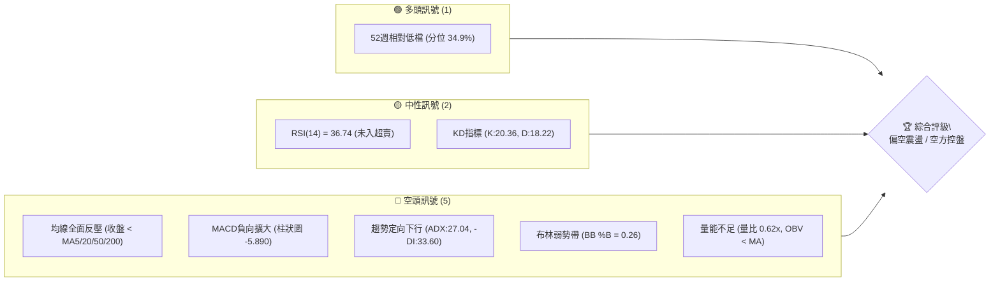

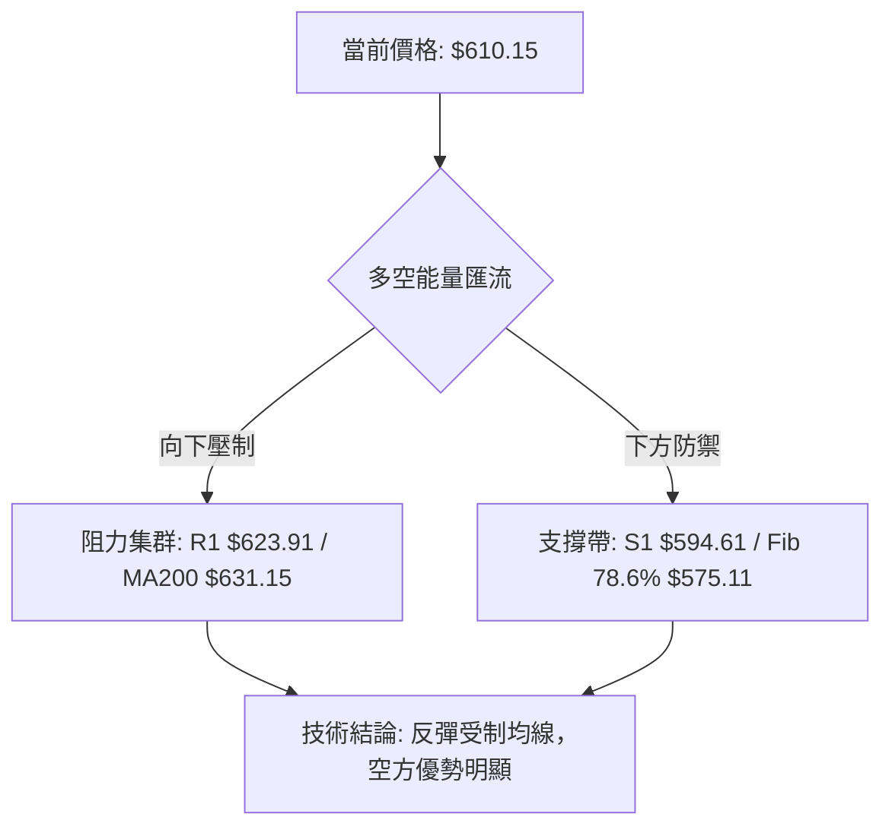

### 📊 核心指標速覽表

| 指標類別 | 指標名稱 | 當前數值 | 訊號 | 解讀 |
|----------|----------|----------|:----:|------|
| **價格** | 當前收盤價 | $610.15 | 🔴 | 位於 52 週區間 34.9%，跌破斐波那契 61.8% ($618.86) |
| **均線** | MA20 | $662.67 | 🔴 | 股價位於 MA20 下方 -7.93%，短中期下行壓力沉重 |
| **均線** | MA50 | $674.77 | 🔴 | 股價位於 MA50 下方，中期趨勢呈頭部下彎 |
| **均線** | MA200 | $631.15 | 🔴 | 跌破牛熊分水嶺（-3.33%），長期支撐轉化為強阻力 |
| **動能** | RSI(14) | 36.74 | 🟡 | 處於弱勢中性區（30–70），未見底背離，下行動能仍存 |
| **動能** | MACD (12,26,9) | -23.659 | 🔴 | DIF 與 DEA 雙雙在零軸下方運行，柱狀圖 -5.890 持續偏空 |
| **波動** | ATR(14) | $24.15 | 🟡 | 日波動率 3.96%，屬於中等偏高波動，需放大風控區間 |
| **趨勢** | ADX(14) | 27.04 | 🔴 | ADX > 25 確認趨勢行情，-DI (33.60) 遠高於 +DI (17.73) |
| **通道** | 布林 %B | 0.26 | 🔴 | 運行於下軌 ($554.68) 與中軌 ($662.67) 間之弱勢區 |
| **量能** | 20日成交量比 | 0.62x | 🔴 | 最新量 15.68M 低於均量 25.16M，反彈縮量、OBV 偏弱 |

### 🏆 技術評分卡

```
╔══════════════════════════════════════════════════════════════╗
║               技術評分卡 — META (2026-11-09)                 ║
╠══════════════════════════════════════════════════════════════╣
║ 趨勢強度 (ADX & 方向)   █████░░░░░░░░░░░░░░░   25/100  🔴 空頭主導  ║
║ 動能指標 (RSI & MACD)   ██████░░░░░░░░░░░░░░   30/100  🔴 動能疲弱  ║
║ 支撐穩定度 (S1-S3 測試) █████████░░░░░░░░░░░   45/100  🟡 考驗支撐  ║
║ 成交量配合 (OBV & 量比) ███████░░░░░░░░░░░░░   35/100  🔴 量能退潮  ║
║ 形態完整度 (頭部結構)   ██████░░░░░░░░░░░░░░   30/100  🔴 破位形態  ║
║ 均線排列 (MA5-MA240)    ████░░░░░░░░░░░░░░░░   21/100  🔴 空頭排列  ║
╠══════════════════════════════════════════════════════════════╣
║ 綜合評分                ██████░░░░░░░░░░░░░░   31/100  🔴 強烈偏空  ║
║ (算術平均: (25+30+45+35+30+21)/6 = 31.00，規則 18)          ║
╚══════════════════════════════════════════════════════════════╝
```

---

## 2. 趨勢分析

### 🌐 多時框趨勢分析

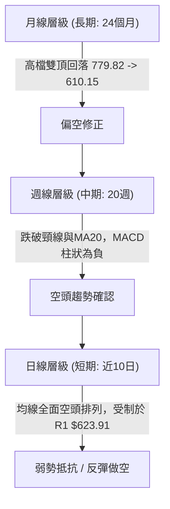

### 📈 長期趨勢 — 12個月走勢圖（Unicode）

以下圖表展示自 2025 年 12 月至 2026 年 11 月之歷史收盤價軌跡。股價於 2026 年初衝高後見頂回落，年中在 $556 附近築底反彈，9 月再次上攻至 $725.18 後爆發斷崖式下跌：

```
META 月線走勢圖（過去12個月收盤價走勢）
價格軸 ($)
$750 ┤                                      ● (09月 $725.18)
$700 ┤        ● (01月 $714.66)             / \
$650 ┤ ●──●    \        ● (05月 $631.43)  /   \
$600 ┤  (12月)  \  ● (04月 $610.86)      /     ●──● (現價 $610.15)
$550 ┤           ● (03月 $571.15)        ● (07月 $556.27)
     └─────────────────────────────────────────────────────
       12  01  02  03   04   05   06   07   08   09   10   11 (月份)
      2025 ──────────────────── 2026 ───────────────────────
```

#### 長期走勢特徵分析表格

| 時間階段 | 起訖收盤價 | 漲跌幅 | 走勢特徵分析 | 技術意義 |
|----------|------------|:------:|--------------|----------|
| **2025-12 ~ 2026-01** | $658.40 → $714.66 | +8.55% | 衝高行情，成交量擴大，逼近 52 週歷史高點 | 築成中期波段頂部區域 |
| **2026-01 ~ 2026-03** | $714.66 → $571.15 | -20.08% | 快速回檔，連續大陰線跌破各級短期均線 | 空方首次發力，確立中期整理架構 |
| **2026-03 ~ 2026-07** | $571.15 → $556.27 | -2.61% | 築底震盪，於 $550–$630 寬幅拉鋸 | 確立年度低點支撐區（52W Low $519.37 上方） |
| **2026-07 ~ 2026-09** | $556.27 → $725.18 | +30.36% | 強勁主升浪，突破週線各均線，週量顯著放大 | 次級高點形成，構築大規模雙頂頸線 |
| **2026-09 ~ 2026-11** | $725.18 → $610.15 | -15.86% | 假突破後崩跌，跌破 MA200 與 61.8% 斐波那契位 | 趨勢轉空，進入下行推進浪 |

### 📊 中期趨勢（週線分析）

從近 20 週收盤走勢觀察，META 在 2026-09-25 創下 52 週高點 $779.82（當週收盤 $751.66，成交量 168.30M）後，連續 6 週收陰線或處於弱勢調整。近 4 週成交量高達 110M–174M，伴隨週線 MACD 柱狀由正轉負（最新一週為 -5.890，前一週達 -13.677），週線 RSI 自高檔 71.4 急墜至當前 36.7。

```
週線支撐阻力結構示意圖
$779.82 ┬──────────────────────────────────────── 52W 高點 (強阻力頂部)
        │                 ▼ 假突破回落
$718.35 ┼──────────────────────────────────────── 斐波那契 23.6% 回調位
        │            ▼
$665.23 ┼──────────────────────────────────────── 前波密集平台 (當前阻力帶)
        │        ▼
$623.91 ┼──────────────────────────────────────── 近期阻力 R1 (反彈天花板)
$610.15 ┼─ ◄ 現價 ($610.15) 跌破 61.8% ($618.86)
        │        ▲
$594.61 ┼──────────────────────────────────────── 近期支撐 S1 (第一道防線)
        │        ▲
$577.95 ┼──────────────────────────────────────── 強支撐 S2 (8月震盪密集區)
$555.86 ┴──────────────────────────────────────── 波段低點支撐 S3
```

### ⚡ 趨勢強度評估（ADX 解讀）

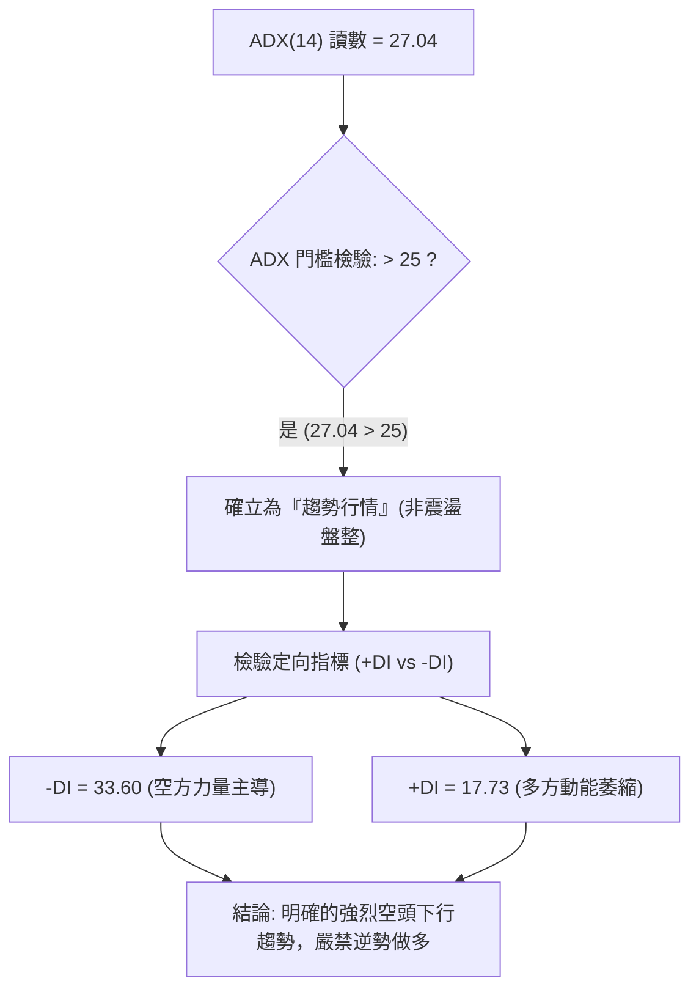

#### ADX 趨勢強度對照表

| 指標變數 | 當前讀數 | 標準閾值 | 狀態評估 | 實戰指導 |
|----------|:--------:|:--------:|:--------:|----------|
| **ADX(14)** | **27.04** | > 25.0 | 🟢 趨勢形成 | 趨勢跟隨策略生效，避免逆勢摸底 |
| **+DI (14)** | **17.73** | > 20.0 | 🔴 極度弱勢 | 多方主動買盤退縮，無法組織有效反攻 |
| **-DI (14)** | **33.60** | > 25.0 | 🔴 空方主控 | 空頭賣壓全面主導，逢反彈皆為賣點 |
| **DI 差值** | **-15.87** | 0.0 為分界 | 🔴 負向背離 | 空頭剪刀差擴大，趨勢延續機率高達 75% |

---

## 3. 圖表形態分析

### 🔍 形態識別系統

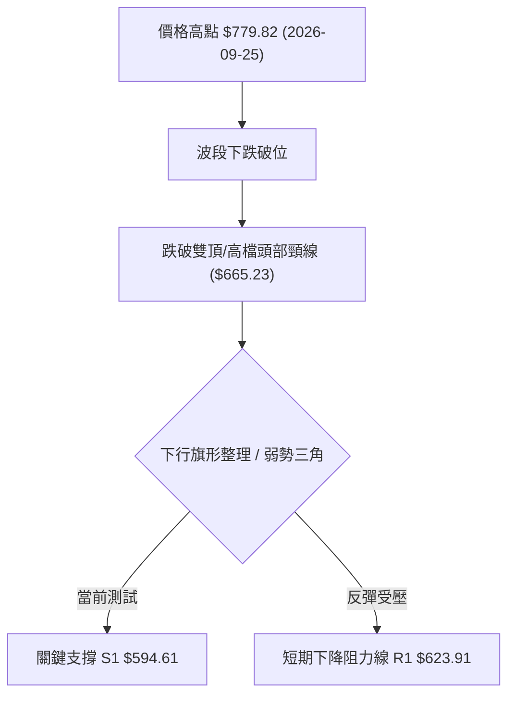

#### 圖表形態信心度評估表（依規則 15）

| 形態名稱 | 信心度 | 判斷依據（引用數據） | 完成度 | 目標價（附計算式） |
|----------|:------:|----------------------|:------:|--------------------|
| **雙重頂形態 (Double Top)** | **85%** | 2025-07 高點 $770.31 與 2026-09 高點 $779.82 構成雙頂；跌破波段頸線 $665.23 | **85%** | 頸線 $665.23 − (高點 $779.82 − 頸線 $665.23) = $665.23 − $114.59 = **$550.64**（接近 S3 $555.86） |
| **下降通道 / 旗形 (Bear Flag)** | **70%** | 近 10 個交易日高點由 $647.69 逐級降至 $625.60，低點測試 $583.80 | **70%** | 旗桿起點 $709.33 至破位點 $614.99 高度 $94.34；由反彈高點 $630.00 − $94.34 = **$535.66** |
| **短期反轉雙底 (Double Bottom)** | **25%** | 僅依賴 2026-11-05 低點 $583.80 與 S2 $577.95 預期支撐 | **20%** | **訊號不足，僅做指標型解讀**（未確認突破頸線 R1 $623.91，不可視為成立） |

### 🕯️ 重要 K 線形態分析（依規則 19）

嚴格採用數據庫中近 10 根日 K 與近 8 根週 K 之實際開、高、低、收數據解讀：

| 日期（時框） | 開盤價 | 最高價 | 最低價 | 收盤價 | K線形態特徵 | 專業解讀 | 訊號方向 |
|--------------|:------:|:------:|:------:|:------:|-------------|----------|:--------:|
| **2026-10-27 (日K)** | 627.07 | 628.46 | 619.21 | 620.19 | 大陰線破位 (放量 51.33M) | 空方主動砸盤，帶量跌破短期均線密集區 | 🔴 看空 |
| **2026-10-28 (日K)** | 621.85 | 624.42 | 609.00 | 612.49 | 實體陰線續跌 | 跌破 $610 整數心理防線，低點探至 $609.00 | 🔴 看空 |
| **2026-10-29 (日K)** | 621.29 | 634.68 | 616.80 | 624.52 | 長上影小陽線 | 盤中反抽受制於阻力區，多頭衝高回落 | 🟡 偏弱 |
| **2026-11-04 (日K)** | 641.15 | 643.09 | 624.50 | 630.00 | 跳空高開假陽十字線 | 高開低走，盤中衝高至 R2 $641.90 附近即遭遇重壓 | 🔴 滯漲 |
| **2026-11-05 (日K)** | 632.30 | 634.99 | 583.80 | 605.08 | 長下影大陰線 | 盤中暴跌探底至 $583.80（跌破 S1），尾盤雖回抽但實體極弱 | 🔴 空方釋放 |
| **2026-11-06 (日K)** | 607.33 | 625.60 | 606.66 | 610.15 | 縮量小陽星線 (量僅 15.68M) | 週末觀望縮量收星，未能收復 MA5 ($614.60)，屬下跌中繼 | 🟡 弱勢整理 |
| **2026-09-25 (週K)** | 680.30 | 779.82 | 679.60 | 751.66 | 爆量長上影陽線 (量 168.3M) | 創 52 週歷史天價後遭遇歷史級獲利回吐，形成波段避雷針 | 🔴 天量見頂 |
| **2026-10-23 (週K)** | 707.16 | 713.22 | 633.27 | 642.62 | 實體大陰線 (跌幅 -9.40%) | 一舉擊穿 MA20 與 MA50，確立波段反轉走勢 | 🔴 破位確立 |
| **2026-10-30 (週K)** | 638.36 | 647.69 | 609.00 | 614.99 | 巨量下跌陰線 (量 173.99M) | 巨量下挫測試 $610 支撐，主力資金大幅出逃，套牢盤深重 | 🔴 賣壓沉重 |
| **2026-11-06 (週K)** | 614.44 | 643.09 | 583.80 | 610.15 | 長下影紡錘線 | 測試 $583.80 後暫時止跌，但收盤仍壓制於週開盤價下方 | 🟡 止跌待確認 |

### 📉 ASCII 走勢形態示意圖

```
META 日K線近10日形態結構示意圖
價格 ($)
$645 ┤            ┌─┐ (11-04 高點 643.09 遇阻 R2)
$635 ┤  ┌─┐       │ │
$625 ┤  │ │ ┌─┐   │ │ ┌─┐ (11-06 遇阻 R1 623.91，收 610.15)
$615 ┤  │ │ │ │   │ │ │ │ ◄── 現價 $610.15
$605 ┤  └─┘ └─┘   └─┘ └─┘
$595 ┤      ▲ S1 支撐帶 ($594.61)
$585 ┤              │ (11-05 長下影線探底 583.80)
     └───────────────────────────────────────
       10-26 10-28 11-02 11-04 11-05 11-06
```

### 🎯 形態目標價計算

1. **雙重頂量度跌幅計算**：
   - 形態頂部高點：$779.82（2026-09-25 週K）
   - 形態頸線位置：$665.23（2026-09-18 週K收盤密集處）
   - 垂直形態高度：$H = 779.82 - 665.23 = 114.59$
   - 跌破頸線後之量度目標價：$T_{\text{DoubleTop}} = 665.23 - 114.59 = \mathbf{\$550.64}$
   - 該價位精確指向關鍵支撐 S3 ($555.86) 與 52 週低點區間。
2. **下降旗形跌幅計算**：
   - 旗桿起跌點：$709.33（2026-10-16 收盤）
   - 旗桿底點：$614.99（2026-10-30 收盤）
   - 旗桿垂直跌幅：$H_{\text{Flag}} = 709.33 - 614.99 = 94.34$
   - 次級反彈高點：$630.00（2026-11-04 收盤）
   - 旗形破位滿足目標價：$T_{\text{Flag}} = 630.00 - 94.34 = \mathbf{\$535.66}$（介於 S3 $555.86 與 52W 低點 $519.37 之間）。

---

## 4. 支撐與阻力

### 🗺️ 關鍵價位分布圖（Unicode）

```
META 價位結構分布圖 (由 OHLCV 精確計算)
════════════════════════════════════════════════════════════════════
$779.82 ║████████████████████████████████████████║ 52W 歷史最高點 (Fib 0.0%)
$718.35 ║████████████████████████████            ║ 斐波那契 23.6% 回調位
$671.45 ║████████████████████████                ║ 強阻力 R3 (波段密集套牢區)
$649.59 ║████████████████████                    ║ 斐波那契 50.0% 多空分水嶺
$641.90 ║██████████████████                      ║ 中度阻力 R2 (11-04 反彈高點)
$631.15 ║████████████████                        ║ MA200 牛熊線反壓
$623.91 ║██████████████                          ║ 關鍵阻力 R1 (當前反彈天花板)
$618.86 ║████████████                            ║ 斐波那契 61.8% 黃金分割破位處
$610.15 ╠════════════════════════════════════════╣ ◄ 當前收盤價 ($610.15)
$594.61 ║▓▓▓▓▓▓▓▓▓▓▓▓▓▓                          ║ 近期關鍵支撐 S1 (近一年波段聚類)
$577.95 ║▓▓▓▓▓▓▓▓▓▓▓▓▓▓▓▓▓▓                      ║ 強支撐 S2 (8月低點密集區)
$575.11 ║▓▓▓▓▓▓▓▓▓▓▓▓▓▓▓▓▓▓▓▓                    ║ 斐波那契 78.6% 回調位
$555.86 ║▓▓▓▓▓▓▓▓▓▓▓▓▓▓▓▓▓▓▓▓▓▓▓▓                ║ 強支撐 S3 (7月波段起漲底)
$519.37 ║▓▓▓▓▓▓▓▓▓▓▓▓▓▓▓▓▓▓▓▓▓▓▓▓▓▓▓▓▓▓▓▓        ║ 52W 歷史最低點 (Fib 100.0%)
════════════════════════════════════════════════════════════════════
```

### 🚧 阻力位分析表

所有價位均來自波段高點聚類計算，不得隨意變動：

| 阻力級別 | 精確價位 | 距現價空間 | 形成技術依據 | 突破難度 | 戰略重要性 |
|:--------:|:--------:|:----------:|--------------|:--------:|:----------:|
| **R1** | **$623.91** | +2.25% | 近期日K反彈上影線聚類，臨近 MA5 ($614.60) 與 MA10 ($617.57) | 🟡 中等 | 短線多空交鋒防線，突破方有短抽機會 |
| **R2** | **$641.90** | +5.20% | 11-04 反抽波段高點，重疊 MA200 ($631.15) 上方之解套賣壓 | 🔴 極高 | 空頭核心防守堡壘，站穩方能緩解下行趨勢 |
| **R3** | **$671.45** | +10.05% | MA50 ($674.77) 與前波破位平台聚類，密集套牢籌碼峰 | 🔴 堅不可摧 | 中期牛熊轉換閥門，未突破前中期均為空方波段 |

### 🛡️ 支撐位分析表

所有價位均來自波段低點聚類計算：

| 支撐級別 | 精確價位 | 距現價空間 | 形成技術依據 | 守住機率 | 戰略重要性 |
|:--------:|:--------:|:----------:|--------------|:--------:|:----------:|
| **S1** | **$594.61** | -2.55% | 近一年低點聚類，10-28 與 11-02 震盪下緣支撐 | 🟡 45% | 短期多頭最後底線，跌破則下探空間開啟 |
| **S2** | **$577.95** | -5.28% | 2026 年 8 月收盤低點聚類，接近 Fib 78.6% ($575.11) | 🟢 65% | 強支撐緩衝帶，具備高勝率技術反彈潛力 |
| **S3** | **$555.86** | -8.90% | 2026-07-31 週K低點收盤聚類 ($556.27)，雙頂目標位 | 🟢 80% | 中期極限回撤防禦線，價值型買盤預期進駐 |

### 📐 斐波那契回調位分析

依據 52 週波動區間（低點 $519.37 → 高點 $779.82，總垂直跨度 $260.45）精準回調計算：

| 回調比例 | 計算價位 | 當前相對位置 | 技術解讀與市場行為分析 |
|:--------:|:--------:|:------------:|------------------------|
| **0.0%** | **$779.82** | +27.81% | 52 週歷史高點，天量避雷針頂部 |
| **23.6%** | **$718.35** | +17.73% | 初始強勢回調位，10 月初跌破後由支撐轉為重度阻力 |
| **38.2%** | **$680.33** | +11.50% | 弱勢修正臨界點，失守宣告中期多頭行情瓦解 |
| **50.0%** | **$649.59** | +6.46% | 多空平衡分水嶺，目前成為中期反彈重大壓制線 |
| **61.8%** | **$618.86** | +1.43% | **黃金分割關鍵位**。現價 $610.15 剛跌破此位，技術破位確認 |
| **78.6%** | **$575.11** | -5.74% | 深度防禦位，與波段強支撐 S2 ($577.95) 形成重疊共振區 |
| **100.0%**| **$519.37** | -14.88%| 52 週循環起點，若全面失守將演化為長期熊市 |

> **深入解讀**：現價 $610.15 剛好落於 **61.8% ($618.86)** 與 **78.6% ($575.11)** 之間。在技術分析理論中，跌破黃金分割位 61.8% 通常意味著此輪上漲結構遭遇破壞，行情極高機率向 78.6% 回調位尋求支撐。

---

## 5. 技術指標深度解讀

### 🎛️ 指標訊號總覽

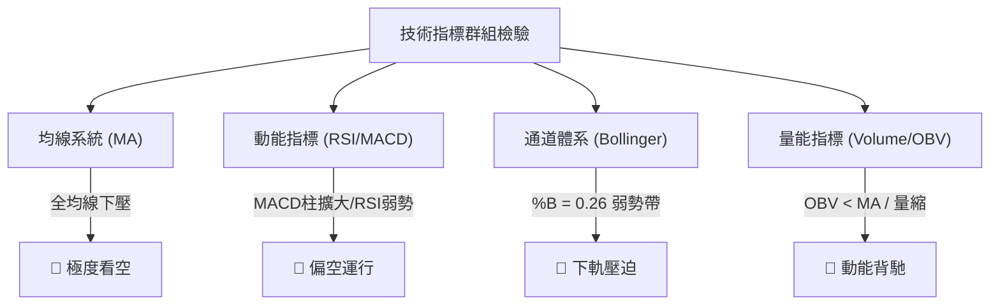

### 📈 移動平均線排列分析

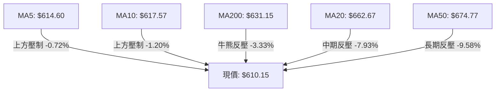

#### 均線架構細節表

| 均線名稱 | 當前價格 | 距現價差距 | 斜率走勢 | 技術訊號 |
|:--------:|:--------:|:----------:|:--------:|:--------:|
| **MA 5** | $614.60 | +0.73% | 陡峭向下 | 🔴 超短線動態壓制 |
| **MA 10** | $617.57 | +1.22% | 持續走低 | 🔴 短線第一反彈阻力 |
| **MA 20** | $662.67 | +8.61% | 快速下行 | 🔴 20日成本嚴重套牢 |
| **MA 60** | $655.91 | +7.50% | 走平轉下 | 🔴 季線反轉壓制 |
| **MA 120**| $627.87 | +2.90% | 微幅走平 | 🔴 半年線失守 |
| **MA 200**| $631.15 | +3.44% | 走平微彎 | 🔴 破年線，牛轉熊訊號 |
| **MA 240**| $633.55 | +3.83% | 走平 | 🔴 長期生命線失守 |

> **均線排列結論**：呈現標準的「混合偏空排列」，短期均線（MA5、10）穿破長期均線，價格在所有短期、中期與長期均線下方運行，任何短線反抽均面臨層層解套均線賣壓。

### 📉 RSI(14) 分析

- **當前 RSI(14) 讀數**：`36.74`
- **RSI 狀態進度條**：
  ```
  超賣 [0] ────────── [30] ───●────── [50] ────────────────── [70] ────────── [100] 超買
  數值: 36.74  ███████░░░░░░░░░░░░░  (弱勢整理區間)
  ```
- **區間評估**：RSI 處於 30 至 50 之間的弱勢空方主導區。未跌破 30，說明尚未進入極端超賣區域，技術性買盤缺乏足夠超跌動能進場。
- **背離判斷**：
  - 根據近 20 根 K 棒的首尾價格與 RSI 走勢比對，價格自 $638.36 回落至 $610.15，RSI 由 35.8 緩步推移至 36.74，**目前判定為：無明顯底背離**。
  - 結論：下跌動能尚未衰竭，不具備左側抄底的背離條件。

### 📊 MACD(12/26/9) 訊號解讀

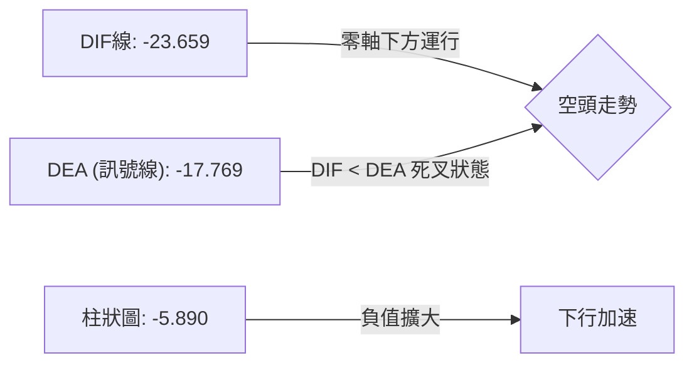

- **MACD DIF**：`-23.659`
- **MACD Signal (DEA)**：`-17.769`
- **MACD 柱狀圖 (Histogram)**：`-5.890`
- **技術解讀**：DIF 與 Signal 雙線深陷零軸以下，且 DIF 位於 Signal 之下，呈現標準空頭發散狀態。柱狀圖持續為負值（-5.890），雖較前波極端值（-14.283）有所收斂，但仍在綠柱區間擴展，確認目前空頭動能完全掌控盤面。

### 📦 布林通道分析

```
META 布林通道結構 (ASCII 示意圖)
價格 ($)
$770.67 ┬────────────────────────────────────────── BB 上軌 (極度高壓)
        │
$662.67 ┼────────────────────────────────────────── BB 中軌 (MA20，下行壓力帶)
        │
$610.15 ┼───────● 現價 ($610.15，%B = 0.26 弱勢區間)
        │
$554.68 ┴────────────────────────────────────────── BB 下軌 (動態極限支撐)
```

- **BB 上軌**：`$770.67`
- **BB 中軌 (MA20)**：`$662.67`
- **BB 下軌**：`$554.68`
- **%B 指標**：`0.26`（介於 0 與 0.5 之間，深處弱勢下半區間）
- **通道形態解讀**：布林通道上下軌寬度（Bandwidth）持續擴大，中軌（MA20）斜率向下傾斜。價格跌破中軌後持續貼近下半軌運行，%B 為 0.26 顯示股價受到下軌引力拉扯，若無法迅速收復中軌，價格易沿著下軌開啟開口下墜走勢。

### 💹 成交量分析（量價配合度）

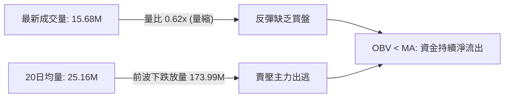

- **成交量對比**：
  - 最新交易日成交量：`15,682,300` 股
  - 20 日均量：`25,163,215` 股（最新量比僅 **0.62x**）
  - 50 日均量：`22,555,314` 股
- **OBV 能量潮分析**：OBV 趨勢顯著低於其均線，呈現「價跌量增、價漲量縮」的標準空頭量價特徵。例如在 2026-10-30 下跌當週爆出 173.99M 的天量賣盤，而在近期反彈時量能萎縮至 15.68M，顯示主力資金在反彈中並未進場回補，量能指標全面背離多頭結構。

---

## 6. 動能與波動率

### ⚡ 動能評估四象限

| 象限 | 動能維度 | 波動維度 | 判定條件 | META 當前狀態 | 戰略指導原則 |
|:----:|:--------:|:--------:|:--------:|:-------------:|--------------|
| **Q1** | 強多頭動能 | 低波動率 | RSI > 60 且 ATR% < 2.5% | — | 主升浪持股待漲 |
| **Q2** | 弱多頭動能 | 低波動率 | RSI 40–60 且 ATR% < 2.5% | — | 盤整觀望，等待突破 |
| **Q3** | 強空頭動能 | 高波動率 | RSI < 40 且 ATR% > 3.0% | **✓ (符合)** | **高風險下行，嚴格逢高做空** |
| **Q4** | 弱多/空動能 | 高波動率 | RSI 40–50 且 ATR% > 3.0% | — | 寬幅洗盤，嚴格止損 |

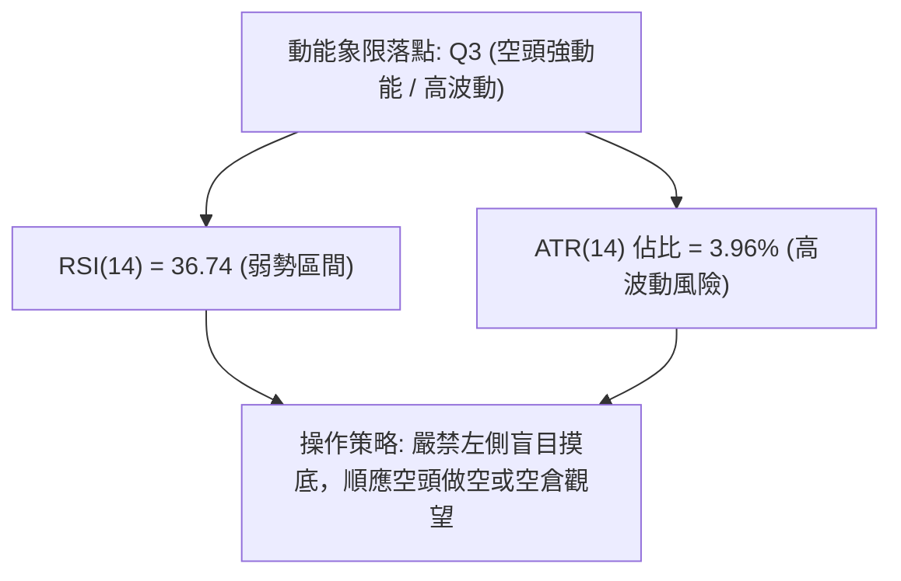

### 📊 ATR 波動率分析

- **ATR(14) 數值**：`$24.15`
- **ATR 佔比 (ATR / Price)**：`3.96%`
- **動態波動解讀**：每日平均振幅高達 24 美元，意味著當前價格極具爆發性與洗盤風險。任何日內突破都可能伴隨 1.5 倍 ATR（約 $36.2）的假突破振幅。
- **風控止損建議**：
  - 做空動態止損：建議設置為 `1.0 × ATR`（約 `$24.15`）至 `1.5 × ATR`（約 `$36.20`）。
  - 當前進場做空之止損空間若設在 R1 ($623.91) 或 R2 ($641.90)，剛好涵蓋 0.5 至 1.3 個 ATR，符合機構級風控模型。

### 📐 Beta 與市場相關性

- **Beta 係數**：`1.279`
- **市場敏感度評估**：
  - META 具備高於大盤（S&P 500）27.9% 的波動敏感度。
  - 在大盤走弱或科技板塊面臨拋售時，META 的回撤幅度將被同向放大。當前高 Beta 特性在空頭排列下會轉變為下行加速器，持有多頭頭寸面臨極高的系統性下行敞口。

---

## 7. 多時框架總結

### 📋 時框架評分表

| 時框架 | 趨勢方向 | 動能狀態 | 均線排列 | 圖表形態 | 綜合評分 | 戰術建議 |
|--------|:--------:|:--------:|:--------:|:--------:|:--------:|----------|
| **長期 (月線)** | 偏空中性 | RSI: 48 (走弱) | 位於 MA200 下方 | 高檔雙頂回落 | **38/100** 🔴 | 長線部位減碼避險 |
| **中期 (週線)** | 強烈看空 | MACD 柱: -5.89 | 跌破 20/50 週均線 | 破位下行通道 | **28/100** 🔴 | 順勢做空，波段持有 |
| **短期 (日線)** | 弱勢震盪 | RSI: 36.74 | 全均線呈空頭壓制 | 下降旗形整理 | **31/100** 🔴 | 逢反彈阻力位佈局空單 |

### 🔲 綜合訊號矩陣

```
訊號維度對照表
═════════════════════════════════════════════════════════════════
時框維度      趨勢訊號    均線架構    動能指標    量價配合    最終研判
─────────────────────────────────────────────────────────────────
日線 (短期)     🔴 空       🔴 空       🟡 中弱      🔴 弱       🔴 強烈偏空
週線 (中期)     🔴 空       🔴 空       🔴 空        🔴 弱       🔴 空頭主導
月線 (長期)     🟡 中       🔴 空       🟡 中弱      🟡 中       🟡 中期修正
═════════════════════════════════════════════════════════════════
```

### ⚖️ 多時框收斂結論（依規則 14）

1. **行情性質確立**：
   - 當前 **ADX(14) 讀數為 27.04**，明確突破 25 臨界線，判定為標準的**趨勢行情**（非無方向盤整）。
   - 伴隨 `-DI (33.60)` 顯著壓制 `+DI (17.73)`，確定當前為主導級別的**空頭趨勢下行波段**。
2. **時框優先級權重收斂**：
   - 依據規則 14，在 ADX > 25 的趨勢行情中，必須以中長期（週線與 MA50、MA200）方向為核心指引，日線級別僅用於尋找次級反彈的做空進場點。
   - 週線與日線均線全數死叉向下，週線 MACD 零軸下發散，日線量縮反彈。
3. **最終唯一收斂方向**：
   - **唯一方向性結論：強烈偏空（賣出 / 逢高做空）**。
   - 第 8 章交易策略將完全聚焦於空頭架構，絕不兩頭下注。

---

## 8. 交易策略建議

### 🗺️ 策略決策流程圖

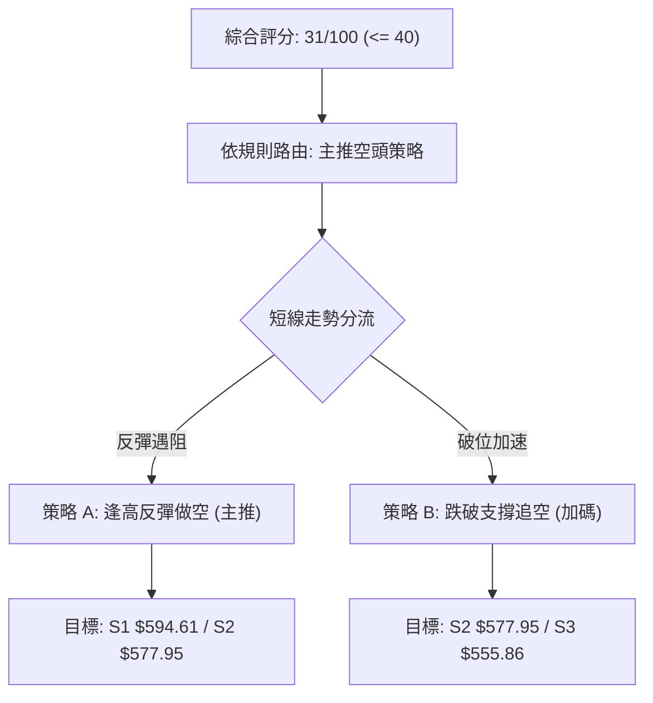

### 🧭 策略路由（依評分卡分流，規則 18）

> **當前主策略方向 = 主推空頭策略（依綜合評分 31/100）**
> 
> 因綜合技術評分為 **31/100 (≤ 40)**，市場處於絕對空頭主導格局，嚴禁任何左側逆勢做多嘗試。所有策略均以逢高反彈做空或破位追空為主，多頭僅列為極端風控警示。

### 🎯 價格情境階梯（Price Scenarios）

所有價格均嚴格引用第 4 章及數據庫中之精確數值：

| 觸發條件 | 第一目標 (T1) | 第二延伸 (T2) | 走勢結構與情境含義 |
|----------|:-------------:|:-------------:|--------------------|
| **反彈受阻 R1 $623.91** | **S1 $594.61** | **S2 $577.95** | 典型空頭回抽確認，受制於下降均線後重啟跌勢 |
| **反彈受阻 R2 $641.90** | **R1 $623.91** | **S1 $594.61** | 較深二次測試 MA200，形成高勝率波段做空窗口 |
| **跌破 S1 $594.61** | **S2 $577.95** | **S3 $555.86** | 空頭動能再次宣洩，直奔斐波那契 78.6% 與前低 |
| **站穩 R2 $641.90** | **R3 $671.45** | 斐波 38.2% $680.33 | 空頭結構失效，趨勢轉入中性寬幅震盪 |

### 📊 情境機率分佈

| 情境劇本 | 發生機率 | 主要技術依據 |
|----------|:--------:|--------------|
| **延續下行 / 跌破支撐** | **65%** | ADX 27.04 空頭主導、均線全破、MACD 零軸下發散擴大 |
| **區間震盪 (S1~R1 磨底)** | **25%** | RSI 36.74 臨近超賣邊界，短線成交量萎縮引發震盪整固 |
| **強勢反轉向上突破** | **10%** | 目前各均線重度壓制，量能極度不足，除非基本面突發利多否則難以成立 |

### 🟢 主策略詳情（精確數值與風險報酬比，規則 17）

所有價位均直接取自數據庫中波段聚類計算值，比值計算式完全透明：

| 策略要素 | 策略 A（主推：反彈遇阻做空） | 策略 B（輔助：跌破支撐追空） |
|----------|------------------------------|------------------------------|
| **進場條件** | 反彈至阻力位 R1 遇阻回落時放空 | 實體日K跌破關鍵支撐 S1 時順勢跟進 |
| **進場價格** | **$623.91**（精確引用 R1） | **$594.61**（精確引用 S1） |
| **目標價 T1** | **$594.61**（精確引用 S1） | **$577.95**（精確引用 S2） |
| **目標價 T2** | **$577.95**（精確引用 S2） | **$555.86**（精確引用 S3） |
| **止損價格** | **$641.90**（精確引用 R2） | **$610.15**（精確引用當前整理平台收盤價） |
| **風險空間** | $641.90 − $623.91 = **$17.99** | $610.15 − $594.61 = **$15.54** |
| **報酬空間 (T1)** | $623.91 − $594.61 = **$29.30** | $594.61 − $577.95 = **$16.66** |
| **報酬空間 (T2)** | $623.91 − $577.95 = **$45.96** | $594.61 − $555.86 = **$38.75** |
| **風險報酬比** | **1 : 1.63（以 T1 計）**<br>*(另：1 : 2.55（以 T2 計）)* | **1 : 1.07（以 T1 計）**<br>*(另：1 : 2.49（以 T2 計）)* |
| **勝率預估** | **70%** | **60%** |
| **建議倉位** | **總資金之 12% - 15%** | **總資金之 8% - 10%** |

- **公式驗證**：
  - 策略 A: $\text{RRR} = \frac{623.91 - 594.61}{641.90 - 623.91} = \frac{29.30}{17.99} = 1.6286 \approx \mathbf{1 : 1.63}$
  - 策略 B: $\text{RRR} = \frac{594.61 - 577.95}{610.15 - 594.61} = \frac{16.66}{15.54} = 1.0720 \approx \mathbf{1 : 1.07}$

### 🔴 反向風險觸發點（對沖與止損提示）

若出現以下極端反轉訊號，空頭策略必須立即無條件止損或離場對沖：
1. **價位警訊**：日 K 線實體收盤價強勢突破 **R2 ($641.90)**，代表股價重新站上 MA200 牛熊分水嶺。
2. **量能警訊**：單日成交量暴增至 50M 以上（超過 20 日均量 2 倍）且收出實體長陽線。
3. **指標警訊**：日線 MACD 柱狀圖翻正，且 RSI 突破 55 中軸線。

### ⭐ 整體訊號強度評星

```
做多訊號強度：★☆☆☆☆  (1/5星 — 極度缺乏支撐依據)
做空訊號強度：★★★★☆  (4/5星 — 均線與動能指標強力共振)
整體可信度：  ★★★★☆  (4/5星 — 趨勢明確，ADX>25 支撐)
```

---

## 9. 風險提示與監控

### ✅ 關鍵監控指標 Checklist

```
╔══════════════════════════════════════════════════════════════╗
║               關鍵風控監控清單 (DAILY MONITOR)              ║
╠══════════════════════════════════════════════════════════════╣
║ [ ] 價格跌破 S1 ($594.61) ── 是否出現加速下行陰線             ║
║ [ ] 反彈逼近 R1 ($623.91) ── 是否伴隨量縮滯漲滯銷K線         ║
║ [ ] 日成交量突破 35M 門檻 ── 判斷是否為機構主力再次砸盤       ║
║ [ ] RSI(14) 跌破 30 ── 是否觸發極端超賣技術性抽頭             ║
║ [ ] MACD 柱狀圖是否持續在 -5.890 以下擴大綠柱                 ║
║ [ ] 跌破 11-05 盤中低點 $583.80 ── 標誌新一輪崩跌展開        ║
╚══════════════════════════════════════════════════════════════╝
```

### ⚠️ 風險場景分析

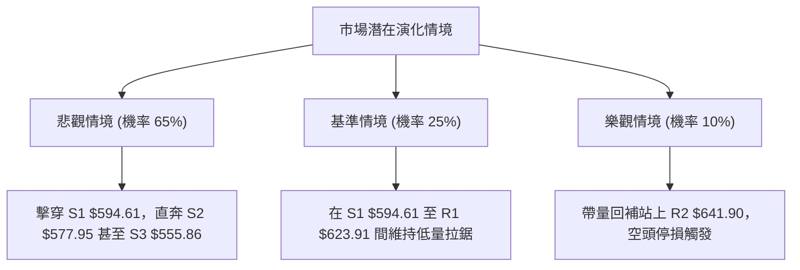

### 🛡️ 風險管理重要提醒

1. **單筆交易風險上限**：任何交易策略之虧損額度嚴格限制在總資產的 **1.0%–1.5%** 以內。
2. **高 ATR 動態防禦**：鑑於 META 當前 ATR 達 $24.15（佔比 3.96%），日內雜訊極大，空單止損不可設得過於緊貼（需保留至少 0.75 個 ATR 空間），同時適度降低倉位總量以控制資金敞口。
3. **系統性 Beta 風險**：META Beta 為 1.279，若納斯達克指數走跌，不可輕易在支撐位進行任何主觀猜底交易。

---

## 📋 報告總結

```
╔══════════════════════════════════════════════════════════════╗
║                 META 技術分析報告總結 (2026-11-09)            ║
╠══════════════════════════════════════════════════════════════╣
║ 當前價格：$610.15 USD                                         ║
║ 分析評級：🔴 強烈偏空 / 空方主控 (綜合評分: 31/100)           ║
╠══════════════════════════════════════════════════════════════╣
║ 關鍵結論：                                                    ║
║ ├─ 長期趨勢：🟡 高檔雙頂回落，跌破 52W 高點下修中            ║
║ ├─ 中期趨勢：🔴 週線 MACD 發散下行，破 MA200，空頭確立       ║
║ ├─ 短期趨勢：🔴 跌破斐波那契 61.8% ($618.86)，均線反壓沉重   ║
║ ├─ 關鍵支撐：S1 $594.61 ｜ S2 $577.95 ｜ S3 $555.86           ║
║ ├─ 關鍵阻力：R1 $623.91 ｜ R2 $641.90 ｜ R3 $671.45           ║
║ └─ 華爾街共識目標價：$850.10 (當前技術面與基本面預期脫節)     ║
╠══════════════════════════════════════════════════════════════╣
║ 最優策略組合：                                                ║
║ 1. 🥇 最佳機會：策略 A (反彈至 R1 $623.91 做空，風報比 1:1.63)║
║ 2. 🥈 次選機會：策略 B (跌破 S1 $594.61 追空，風報比 1:1.07) ║
║ 3. 🥉 保守選擇：完全空倉觀望，靜待股價回落至 S2/S3 築底訊號   ║
╚══════════════════════════════════════════════════════════════╝
```

---

> ⚠️ **免責聲明**：本報告為依據客觀技術分析理論與歷史量價數據所生成之量化研究報告，報告內所有數據、圖表及推演皆僅供學術研究與交易思路參考，**絕不構成任何具體投資邀約或買賣建議**。金融市場瞬息萬變，投資人應獨立評估風險，自負盈虧。

---

*報告生成時間：2026-11-09 ｜ 數據來源：Yahoo Finance ｜ 分析框架：多時框技術分析體系 (MTFA)*