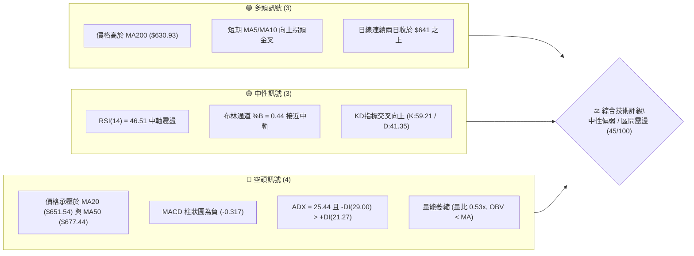
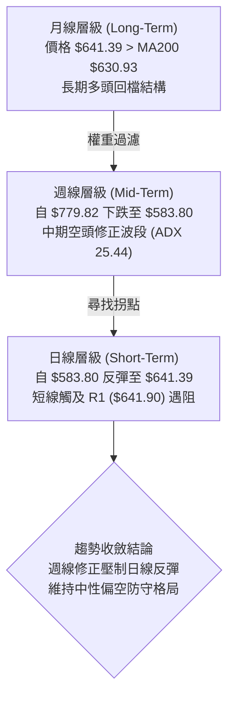
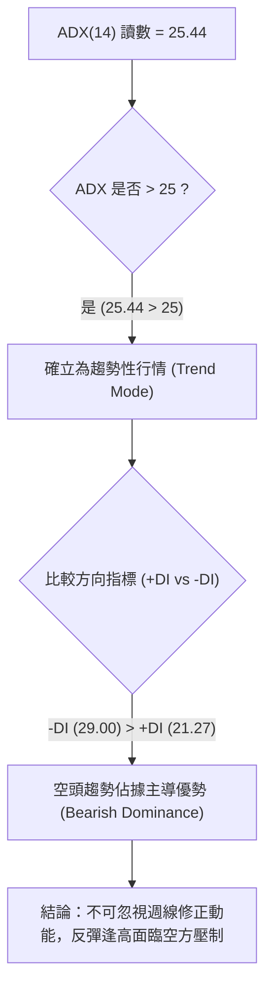
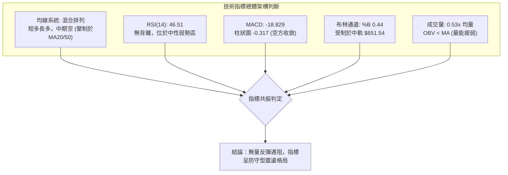
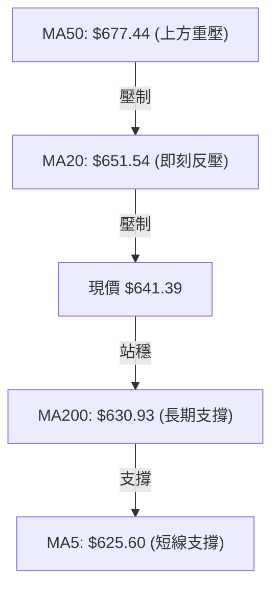
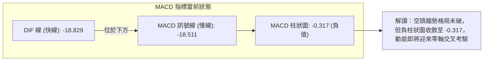
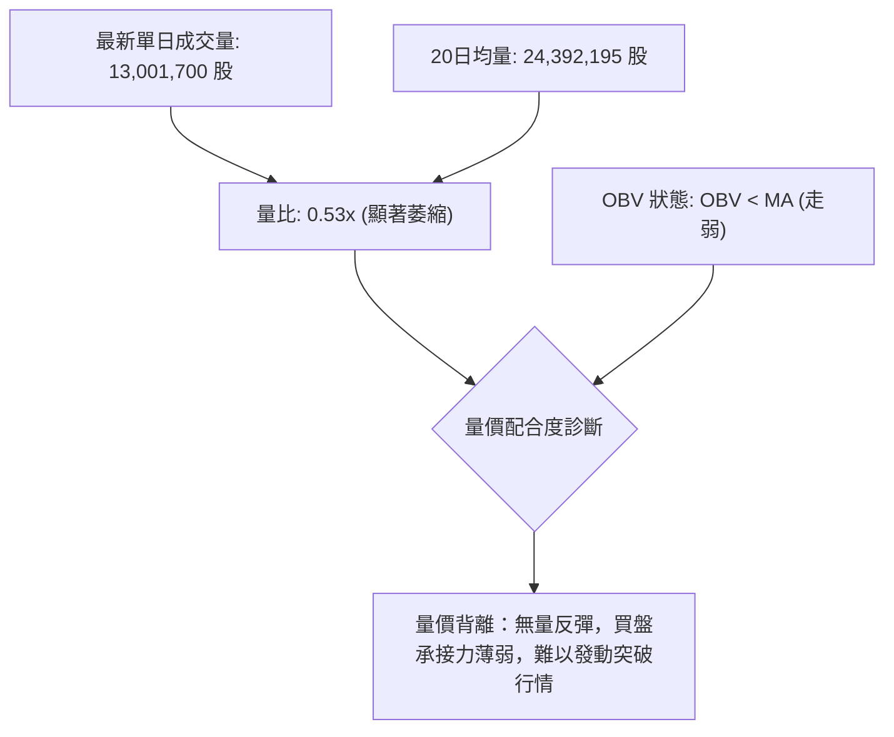
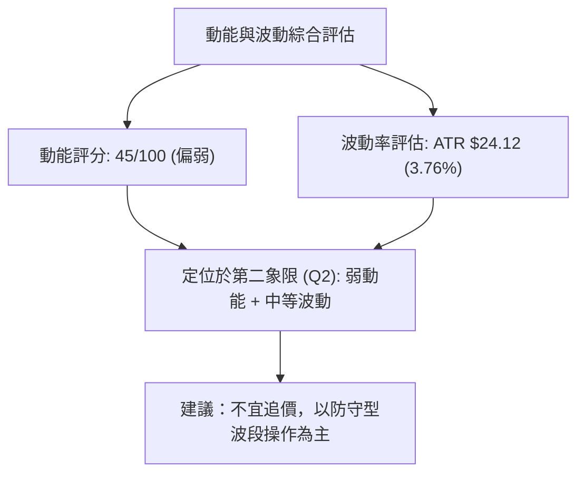
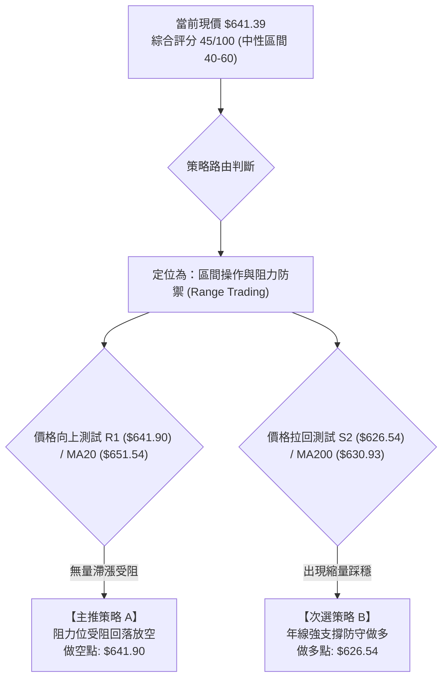
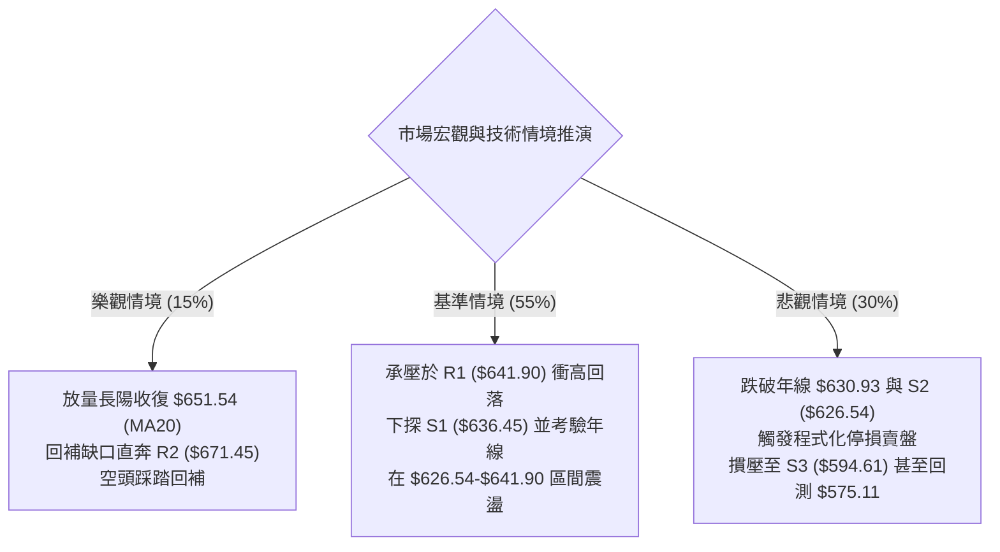

# META 技術分析報告

> **報告日期**：2026-11-11 ｜ **語言**：繁體中文 ｜ **數據來源**：Yahoo Finance ｜ **當前價格**：$641.39 USD

---

## 目錄

| 章節 | 內容 |
|------|------|
| [1. 技術面概覽](#1-技術面概覽) | 訊號儀表板、核心指標、評分卡 |
| [2. 趨勢分析](#2-趨勢分析) | 多時框趨勢、長中短期走勢、ADX 解讀 |
| [3. 圖表形態分析](#3-圖表形態分析) | 形態識別、K線組合、目標價推算 |
| [4. 支撐與阻力](#4-支撐與阻力) | 關鍵價位結構、斐波那契回調 |
| [5. 技術指標深度解讀](#5-技術指標深度解讀) | 均線系統、RSI、MACD、布林通道、成交量 |
| [6. 動能與波動率](#6-動能與波動率) | 動能四象限、ATR 波動率、Beta 分析 |
| [7. 多時框架總結](#7-多時框架總結) | 時框矩陣、多時框收斂與權重判定 |
| [8. 交易策略建議](#8-交易策略建議) | 策略路由、價格階梯、主客策略與風報比 |
| [9. 風險提示與監控](#9-風險提示與監控) | 關鍵監控清單、情境推演、風控規則 |

---

## 1. 技術面概覽

### 🎯 技術訊號儀表板



---

### 📊 核心指標速覽表

| 指標類別 | 指標名稱 | 當前數值 | 訊號 | 專業技術解讀 |
|----------|----------|----------|------|--------------|
| **價格** | 當前收盤價 | $641.39 | 🟡 | 位於52週區間 46.9%，逼近短線阻力 R1 ($641.90) |
| **均線** | MA20 (月線) | $651.54 | 🔴 | 價格低於 MA20 (-1.56%)，短期趨勢承壓 |
| **均線** | MA50 (季線) | $677.44 | 🔴 | 價格顯著低於 MA50，中期修正格局未扭轉 |
| **均線** | MA200 (年線)| $630.93 | 🟢 | 價格守在 MA200 之上 (+1.66%)，長期多頭防線尚存 |
| **動能** | RSI(14) | 46.51 | 🟡 | 處於 40–50 中性偏弱區間，未見超買或超賣 |
| **動能** | MACD (12,26,9)| -18.829 (柱 -0.317)| 🔴 | DIF 位於零軸下方且低於訊號線 (-18.511)，空方占優 |
| **趨勢** | ADX(14) | 25.44 (-DI: 29.00)| 🔴 | 趨勢強度突破 25，且 -DI 主導，空頭趨勢發酵 |
| **通道** | Bollinger Bands| 中軌 $651.54 / %B 0.44 | 🟡 | 位於通道下半區，正向上測試中軌壓力 |
| **波動** | ATR(14) | $24.12 (3.76%) | 🟡 | 每日平均波動幅度約 $24，處於歷史中等波動率水準 |
| **量能** | 當日成交量 | 13,001,700 (20MA比 0.53x)| 🔴 | 縮量反彈，OBV 低於均線，量價呈背馳傾向 |

---

### 🏆 技術評分卡

```
╔══════════════════════════════════════════════════════════════════╗
║                   技術評分卡 — META (2026-11-11)                 ║
╠══════════════════════════════════════════════════════════════════╣
║ 趨勢強度 (Trend)      ████████░░░░░░░░░░░░  40/100  🔴 空頭主導  ║
║ 動能指標 (Momentum)   █████████░░░░░░░░░░░  45/100  🟡 中性偏弱  ║
║ 支撐穩定度 (Support)  ████████████░░░░░░░░  60/100  🟡 季年線有守║
║ 成交量配合 (Volume)   ███████░░░░░░░░░░░░░  35/100  🔴 量能萎縮  ║
║ 形態完整度 (Pattern)  █████████░░░░░░░░░░░  45/100  🟡 區間收斂  ║
║ 均線排列 (MA System)  █████████░░░░░░░░░░░  45/100  🟡 混合排列  ║
╠══════════════════════════════════════════════════════════════════╣
║ 綜合評分 (Overall)    █████████░░░░░░░░░░░  45/100  ⚖️ 區間震盪  ║
║ 計算依據：(40 + 45 + 60 + 35 + 45 + 45) ÷ 6 = 45.0 (規則 18)     ║
╚══════════════════════════════════════════════════════════════════╝
```

---

## 2. 趨勢分析

### 🌐 多時框趨勢分析



---

### 📈 長期趨勢 — 12個月走勢圖（Unicode）

以下圖表記錄自 2025 年 12 月至 2026 年 11 月之月線收盤價走勢，明確標示年度高低點與當前價位位置：

```
META 月線收盤走勢圖（2025-12 至 2026-11）
價格 ($)
$750 ┤                                      ● $725.18 (09月波段高)
$700 ┤        ● $714.66 (01月)
$650 ┤●───────┼─────────● $646.52 ──────● $631.43 ───┼──────────● $641.39 (現價)
$600 ┤$658.40 │                   ● $610.86        │   ● $614.99 (10月)
$550 ┤        │          ● $571.15       ● $562.85 ┼───┘
$500 ┤        │                           ● $556.27 (07月波段底)
     └────────┴─────────┴─────────┴─────────┴─────────┴─────────►
        12月   01月      03月      05月    07月      09月      11月
        (2025) (2026)                      (波段谷底) (衝高回落) (當前)
```

#### 24個月波段走勢特徵分析

| 階段區間 | 起訖月份 | 起點價格 | 終點價格 | 區間漲跌幅 | 主要走勢技術特徵 |
|----------|----------|----------|----------|------------|------------------|
| 第一階段 | 2024-11 至 2025-07 | $570.58 | $770.31 | +35.00% | 強勢主升浪，突破新高，形成歷史高點聚類 |
| 第二階段 | 2025-07 至 2026-07 | $770.31 | $556.27 | -27.79% | 震盪下行修正，回測 52 週低點區間 ($519.37) |
| 第三階段 | 2026-07 至 2026-09 | $556.27 | $725.18 | +30.36% | 強力軋空反彈，9 月週K衝高至 52W 高點 $779.82 |
| 第四階段 | 2026-09 至 2026-11 | $725.18 | $641.39 | -11.55% | 獲利了結賣壓湧現，連續回調至 MA200 尋求支撐 |

---

### 📊 中期趨勢（週線分析）

從近 20 週收盤走勢可見，META 於 2026-09-25 創下 $779.82 的 52 週歷史高點（當週收盤 $751.66），隨後開啟連續 6 週的陰跌走勢，收盤價由 $751.66 下探至 2026-11-06 的 $610.15，波段最低觸及 $583.80。

```
週線級別關鍵價位分層示意圖
$779.82 ──────────────────────────────── 52W 最高點 (2026-09-25)
$718.35 ┈┈┈┈┈┈┈┈┈┈┈┈┈┈┈┈┈┈┈┈┈┈┈┈┈┈┈┈┈┈┈┈ 斐波那契 23.6% 回調位
$687.94 ──────────────────────────────── 關鍵阻力 R3
$671.45 ──────────────────────────────── 關鍵阻力 R2
$651.54 ┈┈┈┈┈┈┈┈┈┈┈┈┈┈┈┈┈┈┈┈┈┈┈┈┈┈┈┈┈┈┈┈ MA20 (週線修正反彈強壓)
$641.90 ──────────────────────────────── 關鍵阻力 R1 (當前考驗點)
$641.39 ◄═══════════════════════════════ 當前現價 (2026-11-10 收盤)
$636.45 ──────────────────────────────── 關鍵支撐 S1 (短線支撐)
$630.93 ┈┈┈┈┈┈┈┈┈┈┈┈┈┈┈┈┈┈┈┈┈┈┈┈┈┈┈┈┈┈┈┈ MA200 (長期多空分水嶺)
$626.54 ──────────────────────────────── 關鍵支撐 S2 (強支撐)
$594.61 ──────────────────────────────── 關鍵支撐 S3 (波段防守點)
$519.37 ──────────────────────────────── 52W 最低點 (2026 年底座)
```

---

### ⚡ 趨勢強度評估（ADX 解讀）



#### ADX 數值強度量化對照表

| 指標名稱 | 實際數值 | 參考標準區間 | 趨勢狀態判定 | 交易策略意涵 |
|----------|----------|--------------|--------------|--------------|
| **ADX(14)** | **25.44** | > 25: 趨勢形成 / < 20: 盤整 | 🟢 剛進入強趨勢門檻 | 順應中短期主趨勢操作，避免盲目逆勢摸底 |
| **+DI (多方)** | **21.27** | 數值越高多方越強 | 🔴 處於相對弱勢 | 買盤動能衰退，追價力道不足 |
| **-DI (空方)** | **29.00** | 數值越高空方越強 | 🟢 空方主導力量顯著 | 賣壓尚未完全釋放，反彈易遭空頭狙擊 |
| **DI 差值** | **-7.73** | 負值代表空頭占優 | 🔴 空方價差優勢 | 策略應以高拋低吸或防守型順勢放空為主 |

---

## 3. 圖表形態分析

### 🔍 形態識別系統

依據近 8 週與近 10 日之真實交易數據，針對 META 進行形態學辨識。


#### 形態識別信心度與目標價計算表

| 識別形態名稱 | 信心度 (%) | 判定依據（嚴格引用數據） | 形態完成度 | 形態目標價與精確計算式 |
|--------------|------------|--------------------------|------------|------------------------|
| **超跌反彈修復浪 (Bear Rally)** | **75%** | 自 11/05 低點 $583.80 快速回升至 11/10 高點 $647.28，日K連紅 | 85% | **$671.45 (R2)**<br/>計算式：由低點 $583.80 + 形態反彈高度 ($647.28 - $583.80 = $63.48) = $647.28；受制於前期密集套牢區，直接對齊數據阻力 **$671.45** |
| **中級 ABC 修正浪 (Weekly Correction)** | **70%** | 週線高點 $779.82 回落至 $583.80，反彈未過 MA20 ($651.54) | 60% | **$594.61 (S3)**<br/>計算式：若 B 浪反抽於 R1 ($641.90) 或 MA20 結束，C 浪下探測度目標為數據關鍵支撐 **$594.61** |
| **雙重底形態 (W-Bottom)** | **30%** | 僅有 11/05 單一波段低點 $583.80，未出現第二次探底確認 | 20% | **數據不足，僅做指標型解讀**（未滿足形態定義，不予推算） |

---

### 🕯️ 重要 K 線形態分析

嚴格依據提供的「近 10 根日 K」與「近 8 根週 K」真實 OHLCV 數據進行形態解讀：

#### 近 10 根日 K 線形態解讀

| 日期 (日K) | 開盤價 | 最高價 | 最低價 | 收盤價 | K線形態名稱 | 專業技術解讀 | 多空訊號 |
|------------|--------|--------|--------|--------|-------------|--------------|----------|
| 2026-10-28 | 621.85 | 624.42 | 609.00 | 612.49 | 陰線下挫 | 實體跌破 $615，空頭加速下行 | 🔴 空 |
| 2026-10-29 | 621.29 | 634.68 | 616.80 | 624.52 | 實體陽線 | 向上試探 $634.68 遇阻，短線回補買盤 | 🟡 平 |
| 2026-10-30 | 614.51 | 626.37 | 610.13 | 614.99 | 衝高回落陰十字 | 上影線達 $11.38，多方上攻受阻 | 🔴 空 |
| 2026-11-02 | 614.44 | 621.69 | 606.41 | 606.73 | 光腳中陰線 | 收於全日最低點附近，破位下行 | 🔴 空 |
| 2026-11-03 | 610.76 | 624.84 | 610.10 | 621.03 | 下影陽線 | 守住 $610 整數關卡，醞釀短線反彈 | 🟢 多 |
| 2026-11-04 | 641.15 | 643.09 | 624.50 | 630.00 | 跳空高開假陰線 | 跳空大漲但高位遭遇獲利拋壓 | 🟡 平 |
| 2026-11-05 | 632.30 | 634.99 | 583.80 | 605.08 | 長下影長陰線 | 最低摜壓至 $583.80，引發恐慌盤低吸 | 🟡 平 |
| 2026-11-06 | 607.33 | 625.60 | 606.66 | 610.15 | 低位孕線十字星 | 振幅收斂，低檔出現賣壓衰竭訊號 | 🟢 多 |
| 2026-11-09 | 631.05 | 647.25 | 630.00 | 641.37 | 跳空中陽線 | 向上跳空並突破 $640，確立短線反彈 | 🟢 多 |
| 2026-11-10 | 637.98 | 647.28 | 635.50 | 641.39 | 高位小陽星 | 兩度受阻於 $647.28，逼近 R1 ($641.90) 停滯 | 🟡 平 |

#### 近 8 根週 K 線形態解讀

| 日期 (週末) | 開盤價 | 最高價 | 最低價 | 收盤價 | 週K形態名稱 | 專業技術解讀 | 多空訊號 |
|------------|--------|--------|--------|--------|-------------|--------------|----------|
| 2026-09-25 | 680.30 | 779.82 | 679.60 | 751.66 | 歷史天量長陽衝頂 | 創 $779.82 天價，成交 1.68 億股，多頭竭盡 | 🟢 多 |
| 2026-10-02 | 750.04 | 750.58 | 713.19 | 728.08 | 高位流星陰線 | 高檔無法延續動能，確立短頂反轉 | 🔴 空 |
| 2026-10-09 | 727.71 | 747.60 | 711.68 | 718.67 | 連續陰線回落 | 反彈高點逐週降低 ($747.60)，中期轉弱 | 🔴 空 |
| 2026-10-16 | 728.50 | 771.27 | 702.71 | 709.33 | 假突破長上影線 | 上衝 $771.27 誘多失敗，重挫收低 | 🔴 空 |
| 2026-10-23 | 707.16 | 713.22 | 633.27 | 642.62 | 破位中長陰線 | 一舉跌破 $700 及 $650，多頭全面潰敗 | 🔴 空 |
| 2026-10-30 | 638.36 | 647.69 | 609.00 | 614.99 | 帶量下挫黑K | 創 1.73 億股巨量，恐慌性停損湧現 | 🔴 空 |
| 2026-11-06 | 614.44 | 643.09 | 583.80 | 610.15 | 超長下影錘頭週K | 最低觸及 $583.80 後強拉，跌勢初見減緩 | 🟢 多 |
| 2026-11-10 | 631.05 | 647.28 | 630.00 | 641.39 | 反彈小陽線 (週初) | 開盤於 MA200 上方，進行超跌技術修復 | 🟡 平 |

---

### 📉 ASCII 走勢形態示意圖

```
日線反彈與阻力相撞形態示意圖
價格 ($)
$671.45 ┤                                               ┌─ 強阻力 R2
        │                                               │
$651.54 ┤                                      ▲        ├─ MA20 / BB中軌
$647.28 ┤                               ┌─────●●───────┤  11/09-11/10 雙日高點遇阻
$641.90 ┤- - - - - - - - - - - - - - - ┼ - - ● 現價 $641.39 (緊貼 R1)
$636.45 ┤                           ▲  │               ├─ 關鍵支撐 S1
$626.54 ┤                     ┌─────┘  │               ├─ 關鍵支撐 S2
$605.08 ┤               ●─────┘       │               │
$583.80 ┤──────● (11/05 恐慌低點)      │               └─ V型反彈起點
        └──────┴────────┴──────────────┴───────────────►
             11/05    11/06          11/09   11/10
```

---

## 4. 支撐與阻力

### 🗺️ 關鍵價位分布圖（Unicode）

```
╔══════════════════════════════════════════════════════════════════╗
║               META 關鍵價位結構分布圖 (由 OHLCV 確定)            ║
╠══════════════════════════════════════════════════════════════════╣
║ $779.82 ║████████████████████████████████║ 52W 歷史極限高點     ║
║ $718.35 ║████████████████████████        ║ 斐波那契 23.6% 回調位 ║
║ $687.94 ║████████████████████            ║ 密集套牢強阻力 R3     ║
║ $680.33 ║██████████████████              ║ 斐波那契 38.2% 回調位 ║
║ $671.45 ║████████████████                ║ 波段高點阻力 R2       ║
║ $651.54 ║████████████                    ║ MA20 動態反壓 / BB中軌║
║ $649.59 ║██████████                      ║ 斐波那契 50.0% 多空中軸║
║ $641.90 ║████████                        ║ 關鍵即時阻力 R1       ║
║ $641.39 ╠════════════════════════════════╣ ◄ 當前收盤價 ($641.39) ║
║ $636.45 ║▓▓▓▓▓▓▓▓                        ║ 即時防守支撐 S1       ║
║ $630.93 ║▓▓▓▓▓▓▓▓▓▓                      ║ MA200 牛熊分水嶺      ║
║ $626.54 ║▓▓▓▓▓▓▓▓▓▓▓▓                    ║ 波段低點強支撐 S2     ║
║ $618.86 ║▓▓▓▓▓▓▓▓▓▓▓▓▓▓                  ║ 斐波那契 61.8% 黃金分割║
║ $594.61 ║▓▓▓▓▓▓▓▓▓▓▓▓▓▓▓▓                ║ 結構性深層支撐 S3     ║
║ $519.37 ║▓▓▓▓▓▓▓▓▓▓▓▓▓▓▓▓▓▓▓▓▓▓▓▓▓▓▓▓▓▓║ 52W 基準極限低點     ║
╚══════════════════════════════════════════════════════════════════╝
```

---

### 🚧 阻力位分析表

所有價位均嚴格引用自數據之「關鍵價位」與指標計算：

| 阻力級別 | 精確價位 | 距現價幅動 | 阻力形成原因與技術背景 | 突破難度 | 重要性權重 |
|----------|----------|------------|------------------------|----------|------------|
| **R1** | **$641.90** | +0.08% | 近期日線反彈密集高點聚類，與 11/10 高點 $647.28 形成短線天花板 | 🟡 中等 | ★★★☆☆ |
| **R2** | **$671.45** | +4.69% | 近一年多次波段高點聚類，接近 MA50 ($677.44) 形成的強力解套賣壓區 | 🔴 極高 | ★★★★☆ |
| **R3** | **$687.94** | +7.26% | 10月中旬盤整平台下沿，跌破後轉為極強反壓，亦臨近斐波 38.2% ($680.33) | 🔴 極限 | ★★★★★ |

---

### 🛡️ 支撐位分析表

| 支撐級別 | 精確價位 | 距現價幅動 | 支撐形成原因與技術背景 | 守住機率 | 重要性權重 |
|----------|----------|------------|------------------------|----------|------------|
| **S1** | **$636.45** | -0.77% | 11/10 日線回踩低點聚類 ($635.50)，短線多方防禦首道陣地 | 🟢 70% | ★★★☆☆ |
| **S2** | **$626.54** | -2.32% | 近一年波段低點聚類，緊鄰 MA200 ($630.93) 與 MA120 ($628.52) | 🟢 80% | ★★★★★ |
| **S3** | **$594.61** | -7.29% | 11/05 暴跌洗盤低點上方支撐，跌破將引發深淵式滑落 | 🟡 60% | ★★★★☆ |

---

### 📐 斐波那契回調位分析

依據 52 週完整波動區間（低點 $519.37 → 高點 $779.82，總波幅 $260.45）之黃金分割比率分析：

```
斐波那契回調梯隊與現價定位
$779.82 ─── 0.0%  (52W 最高點)
$718.35 ─── 23.6% (強勢修正極限)
$680.33 ─── 38.2% (多頭回檔第一防線)
$649.59 ─── 50.0% (多空平衡分水嶺) ◄── 阻力反壓區 ($641.39 ~ $649.59)
$641.39 ─── [ 當前收盤價位於 50.0% 與 61.8% 之間 ]
$618.86 ─── 61.8% (黃金分割關鍵支撐線)
$575.11 ─── 78.6% (深幅修正防守位)
$519.37 ─── 100.0%(52W 最低點)
```

#### 斐波那契回調技術解讀
1. **現價位置**：收盤價 **$641.39** 目前運行於 **50.0% 回調位 ($649.59)** 與 **61.8% 回調位 ($618.86)** 之間，屬於標準的「多空分水嶺爭奪區」。
2. **多空分野**：$649.59 恰好與 MA20 ($651.54) 形成重疊共振壓力。現價若無法有效放量收復 $649.59，技術架構將持續受壓於空方半區。
3. **下檔防護**：61.8% 黃金分割位 **$618.86** 距離 S2 ($626.54) 不遠，是中期多頭必須死守的底線；一旦失守 $618.86，跌勢恐將向 78.6% ($575.11) 擴展。

---

## 5. 技術指標深度解讀

### 🎛️ 指標訊號總覽



---

### 📈 移動平均線排列分析



#### 各週期均線數據與排列特徵表

| 均線名稱 | 當前價格 | 偏離度 (%) | 趨勢方向 | 均線角色與技術解讀 |
|----------|----------|------------|----------|--------------------|
| **MA5** | $625.60 | +2.52% | ▲ 快速向上 | 短線助漲支撐，反映近 3 日強勁反彈力道 |
| **MA10** | $620.78 | +3.32% | ▲ 向上拐頭 | 短期底部抬高，與 MA5 形成短天期金叉 |
| **MA20** | $651.54 | -1.56% | ▼ 持續向下 | 月線反壓，布林中軌所在，反彈首要障礙 |
| **MA50** | $677.44 | -5.32% | ▼ 下行加速 | 季線下彎，形成中期蓋頭下壓空頭排列 |
| **MA60** | $657.99 | -2.52% | ▼ 緩步下行 | 生命線承壓，壓制反彈空間 |
| **MA120** | $628.52 | +2.05% | ▲ 向上支撐 | 半年線支撐強勁，位於 S2 ($626.54) 附近 |
| **MA200** | $630.93 | +1.66% | ▲ 穩定向上 | 年線長期牛熊線，多頭最後戰略防線 |
| **MA240** | $633.71 | +1.21% | ▲ 長期向上 | 雙年線基底穩固，彰顯長期基本面支撐 |

**排列狀態結論**：當前屬於典型的「短期向上反彈、中期空頭下壓、長期多頭護盤」之**混合排列**。MA20 與 MA50 形成中檔死叉下行，壓制反彈斜率；下檔則受到 MA120/MA200/MA240 密集均線簇的堅實支撐。

---

### 📉 RSI(14) 分析

#### RSI 指標當前讀數進度條
```
RSI(14) = 46.51
0% ░░░░░░░░░░░░░░░░░░░░████████████████████░░░░░░░░░░░░░░░░░░░░ 100%
[超賣區 <30]       [中性弱勢區 46.51]         [超買區 >70]
```

- **超買超賣判定**：數值為 **46.51**，脫離 10 月底的超賣邊界（10/30 週 RSI 曾低至 33.2），回升至 40–50 中性平衡區，顯示超跌買盤已部分修復指標，但尚未進入 50 以上強勢多頭區。
- **背離分析判斷**：
  - 檢視近 20 根 K 棒走勢，價格於 11/05 創出波段低點 $583.80，收盤 $605.08，對應 RSI 約為 36–38 區間；現價反彈至 $641.39，RSI 升至 46.51。
  - **背離結論**：數據明確標示「**RSI 背離：無明顯背離**」。價格與指標方向同步抬升，屬於合理的技術性反抽，未構成強烈的指標底背離或頂背離反轉特徵。

---

### 📊 MACD(12,26,9) 訊號解讀



- **數值關係**：DIF (-18.829) < DEA (-18.511)，DIF 位於零軸下方極深位置，反映過去 6 週遭受巨量拋壓。
- **柱狀圖動態**：當前 Hist 為 **-0.317**（🔴 看空）。然而回顧 10/23 週 MACD 柱曾重挫至 -14.283，近週負值柱狀圖已出現劇烈收斂，顯示空方動能明顯減退，隨時可能在零下形成低位弱勢金叉。若未放量推升 DIF 站上零軸，此金叉僅能視為防禦型反彈。

---

### 📦 布林通道分析

```
布林通道 (Bollinger Bands 20, 2) 結構圖
$740.29 ┬────────────────────────────────────────── 布林上軌
        │
$680.00 ┤
        │
$651.54 ┼────────────────────────────────────────── 布林中軌 (MA20) ◄ 強反壓
$641.39 ┼ - - - - - - - - - - - - - - - - - - - - - 當前價格 ($641.39, %B: 0.44)
        │
$600.00 ┤
        │
$562.79 ┴────────────────────────────────────────── 布林下軌
```

- **通道帶寬與位置**：上軌 $740.29、中軌 $651.54、下軌 $562.79，通道寬度達 $177.50，顯示波動擴張後進入寬幅震盪。
- **%B 指標分析**：%B 為 **0.44**，表明現價位於通道下半區，且正逼近中軌 **$651.54**。在典型的空頭修正架構中，中軌往往是首個重大拋壓點，需觀察在 $651.54 附近是否會出現受阻回落。

---

### 💹 成交量分析（量價配合度）



- **量比與均量比較**：最新單日成交量僅 13,001,700 股，相對 20 日均量 (24,392,195 股) 之量比僅有 **0.53x**，幾近腰斬；亦顯著低於 50 日均量 (22,610,154 股)。
- **OBV 趨勢**：OBV 指標明確呈現「**OBV < MA → 量能疲弱**」。在 9 月下旬衝頂時週成交量高達 1.68 億股，而 11 月以來的反彈週量僅 3,214 萬股，量能呈現銳減。量價背馳特徵凸顯主力資金目前僅處於觀望與被動修復狀態，並未實質進場回補。

---

## 6. 動能與波動率

### ⚡ 動能評估四象限

| 象限分區 | 動能維度 | 波動率維度 | 當前技術狀態判定 | 交易策略行動指引 |
|----------|----------|------------|------------------|------------------|
| **第一象限 (Q1)** | 強動能 (Bullish) | 低波動 (Low Vol) | 未符合 | 趨勢穩健主升，積極做多持股 |
| **第二象限 (Q2)** | **弱動能 (Weak)** | **低/中波動 (Mid Vol)** | **✓ META 當前定位** | **謹慎觀望，嚴守區間高拋低吸** |
| **第三象限 (Q3)** | 強動能 (Explosive)| 高波動 (High Vol) | 未符合 (9月衝頂時屬於此區) | 順勢突破，高風險高收益波段追擊 |
| **第四象限 (Q4)** | 弱動能 (Bearish) | 高波動 (Panic) | 未符合 (11/05 暴跌時屬於此區)| 恐慌拋售，容易引發多殺多，避免接刀 |



---

### 📊 ATR 波動率分析與止損設定

- **ATR(14) 絕對數值**：**$24.12** USD（採 Wilder 計算）。
- **ATR 相對百分比**：佔當前收盤價之 **3.76%**。
- **波動特徵解讀**：每日平均波動超過 $24 美元，屬於大型權值股中相對活躍的波動等級。交易者必須給予足夠的市場雜訊容忍空間。

#### 基於 ATR 之精確交易防護距離計算

| 交易風格 | ATR 乘數倍數 | 精確止損點數距離 | 應用價位計算範例 (以多單現價 $641.39 為例) |
|----------|--------------|------------------|--------------------------------------------|
| **激進短線 (Scalp/Day)** | 1.0 × ATR | **$24.12** | $641.39 - $24.12 = **$617.27** (接近 Fib 61.8%) |
| **標準波段 (Swing Trade)** | 1.5 × ATR | **$36.18** | $641.39 - $36.18 = **$605.21** (接近 11/05 收盤) |
| **保守中長線 (Position)** | 2.0 × ATR | **$48.24** | $641.39 - $48.24 = **$593.15** (接近支撐 S3 $594.61) |

---

### 📐 Beta 與市場相關性

- **Beta 係數**：**1.279**。
- **市場特徵分析**：
  - META 的波動幅度高於大盤標普 500 指數約 27.9%，展現顯著的進攻性與敏感度。
  - 當前宏觀環境面臨「通膨升溫引發聯準會降息受阻」的市場回調風險（見新聞簡報），具備高 Beta 屬性的 META 面臨估值修正與系統性拋售之敏感度顯著高於防守板塊。

---

## 7. 多時框架總結

### 📋 時框架評分表

| 時框架 | 趨勢方向 | 動能狀態 | 均線排列特徵 | 形態完成度 | 綜合評分 | 戰略建議 |
|--------|----------|----------|--------------|------------|----------|----------|
| **短期 (日線)** | 🟡 震盪反彈 | RSI 46.51 / KD金叉 | MA5/10 拐頭，面臨 MA20 壓制 | 超跌反抽完成 85% | **55/100** | 逢高獲利了結，減碼觀望 |
| **中期 (週線)** | 🔴 下行修正 | MACD柱負 / -DI 領先 | MA20/50 蓋頭下壓 | ABC 下跌浪進行中 | **35/100** | 順應趨勢，逢反彈建立防禦空單 |
| **長期 (月線)** | 🟢 多頭守護 | 守於 MA200 之上 | MA120/200/240 多頭排列 | 處於歷史高位回調結構 | **65/100** | 核心防守位可分批長線布局 |

---

### 🔲 綜合訊號矩陣

```
時框架訊號共振矩陣
時框       價格 vs MA20   價格 vs MA200   RSI 狀態     MACD 訊號    ADX 趨勢強度
──────────────────────────────────────────────────────────────────────────
短期 (日線)    🔴 下方         🟢 上方      🟡 46.51中性   🔴 柱狀負值   🟢 ADX 25.44
中期 (週線)    🔴 下方         🟢 上方      🔴 36.7弱勢    🔴 DIF下行    🟢 空方主導
長期 (月線)    🟢 上方         🟢 上方      🟡 50附近      🟡 零軸回測   🟡 趨勢放緩
──────────────────────────────────────────────────────────────────────────
訊號一致性：短期反彈與中期空頭修正出現顯著衝突，長期多頭基底尚存但遭遇逆風。
```

---

### ⚖️ 多時框收斂結論

依據多時框收斂規則（規則 14）：
1. **行情模式判斷**：ADX(14) 讀數為 **25.44**，高於關鍵門檻 25，且 -DI (29.00) 顯著大於 +DI (21.27)，確認市場處於「**中中期空頭趨勢行情（Trend Mode）**」，而非單純的無趨勢洗盤。
2. **時框優先級權衡**：在強趨勢行情中，中長期時框（週線修正波、MA50/MA20 反壓）具備最高指導權重；日線層級連續兩日的超跌反彈僅能視為「**修正途中的次級折返走勢**」，是用來尋找高空防守或多頭解套的進出場時機，不可誤判為趨勢全面反轉。
3. **最終唯一收斂結論**：**中性偏空防守（Neutral-to-Bearish Defensive）**。整體操作以逢反彈減碼、或在阻力區間布建防禦型空單為優先基調。

---

## 8. 交易策略建議

### 🗺️ 策略決策流程圖



---

### 🧭 策略路由

> **當前主策略方向 = 中性偏空，以阻力位高拋/反彈逢高布空為主（依評分 45/100，規則 18 判定落入 40–60 區間震盪偏弱板塊）。**

依據評分卡 45/100，多空未達單邊單向閾值，但由於 ADX > 25 且 -DI 占優，策略首選為「**高空防守（策略 A）**」，次選為「**關鍵年線支撐之超短線博弈多單（策略 B）**」。

---

### 🎯 價格情境階梯（Price Scenarios）

價位完全採用數據提供之關鍵支撐、阻力及斐波那契點位：

| 觸發條件 | 即時路徑 | 下一目標點位 | 後續延伸極限 | 宏觀情境含義與技術定性 |
|----------|----------|--------------|--------------|------------------------|
| **強勢突破 R1 ($641.90)** | 攻克 MA20 ($651.54) | **R2 ($671.45)** | **R3 ($687.94)** | 短線超跌反彈擴大，空頭回補軋空 |
| **現價區間拉鋸** | 震盪於 S1 與 R1 之間 | **S1 ($636.45)** | **R1 ($641.90)** | 縮量橫盤盤整，籌碼換手等待方向 |
| **有效跌破 S1 ($636.45)** | 考驗 MA200 ($630.93)| **S2 ($626.54)** | **S3 ($594.61)** | 反彈夭折，中級 C 浪殺跌全面展開 |

---

### 📊 情境機率分佈

| 運行情境分類 | 機率估算 | 核心技術依據與數據指標支持 |
|--------------|----------|----------------------------|
| **回落 / 再探年線底座** | **55%** | ADX 25.44 空頭主導；量能僅 0.53x 均量嚴重背馳；MACD 柱仍為負 (-0.317)；上方遭遇 MA20 下壓 |
| **區間震盪收斂** | **30%** | RSI 46.51 處於平衡中軸；布林通道下軌與年線提供短線買盤緩衝 |
| **強勢連續突破上行** | **15%** | 缺乏成交量支持；大盤面臨通膨高企阻力；上方套牢盤龐大 ($671.45 密集阻力) |

---

### 🟢 交易策略詳情規格表

所有進場、止損、目標價皆嚴格引用關鍵價位，風報比嚴格依規則 17 計算：
- **做多風報比** = $(T1 - \text{進場價}) \div (\text{進場價} - \text{止損價})$
- **做空風報比** = $(\text{進場價} - T1) \div (\text{止損價} - \text{進場價})$

| 策略要素項目 | 【主推策略 A】阻力位受阻回落放空 (Short at Resistance) | 【次選策略 B】年線強支撐防守做多 (Long at MA200/S2) |
|--------------|-------------------------------------------------------|-----------------------------------------------------|
| **交易方向** | 做空 (Short / Put) | 做多 (Long / Call) |
| **進場條件** | 價格反彈至 R1 附近滯漲，未能突破 50% 斐波位 | 價格回調至關鍵支撐 S2 企穩，量縮止跌收十字星 |
| **進場價格** | **$641.90** (阻力位 R1) | **$626.54** (支撐位 S2) |
| **目標價 T1** | **$626.54** (支撐位 S2) | **$641.90** (阻力位 R1) |
| **目標價 T2** | **$594.61** (支撐位 S3) | **$671.45** (阻力位 R2) |
| **止損價格** | **$649.59** (斐波那契 50.0% 回調位) | **$618.86** (斐波那契 61.8% 黃金分割位) |
| **風險空間** | $649.59 - $641.90 = $7.69 | $626.54 - $618.86 = $7.68 |
| **利潤空間 (T1)**| $641.90 - $626.54 = $15.36 | $641.90 - $626.54 = $15.36 |
| **風險報酬比** | **1 : 2.00（以 T1 計）**<br/>*(以 T2 計為 1 : 6.15)* | **1 : 2.00（以 T1 計）**<br/>*(以 T2 計為 1 : 5.85)* |
| **歷史勝率估計** | **65%** | **50%** |
| **建議配置倉位** | **15%** (標準防守空單) | **10%** (試探性短多) |

---

### 🔴 反向風險觸發點（對沖與停損提示）

供風控與持有反向頭寸者之防禦參考：
1. **空頭認錯停損線**：若日線收盤價強勢帶量（單日成交量突破 2,400 萬股均量）突破 **$649.59**（斐波 50.0%）且站上 **$651.54**（MA20），證明反彈演化為反轉，所有空單必須即刻停損離場。
2. **多頭破位止損線**：若日線收盤實體跌破 **$626.54**（S2）與 **$618.86**（斐波 61.8%），確認長期支撐失效，中期 ABC 修正浪正式邁入主跌，所有多頭試探單必須無條件砍倉止損。

---

### ⭐ 整體訊號強度評星

```
╔══════════════════════════════════════════════════════════════════╗
║ 做多訊號強度：★★☆☆☆  (2/5星) ── 僅存超跌反抽，缺乏量能共振      ║
║ 做空訊號強度：★★★☆☆  (3/5星) ── 趨勢指標偏空，逢阻力空方勝率高  ║
║ 整體技術可信度：★★★☆☆  (3/5星) ── 均線混合拉鋸，處於變盤抉擇期  ║
╚══════════════════════════════════════════════════════════════════╝
```

---

## 9. 風險提示與監控

### ✅ 關鍵監控指標 Checklist

```
╔══════════════════════════════════════════════════════════════════╗
║                  每日盤面關鍵監控技術指標 CHECKLIST              ║
╠══════════════════════════════════════════════════════════════════╣
║ [ ] 價位檢驗：收盤價是否跌破支撐 S1 ($636.45) 或年線 ($630.93)   ║
║ [ ] 阻力檢驗：日內高點是否無法逾越 R1 ($641.90) 與 MA20 ($651.54)║
║ [ ] 動能監控：MACD 柱狀圖是否由 -0.317 翻正？翻正方有轉機        ║
║ [ ] 強度監控：ADX(14) 是否持續維持 >25 且 -DI 是否維持 > +DI     ║
║ [ ] 量能檢測：單日成交量是否回升至 2,400 萬股 (目前僅 1,300 萬)   ║
║ [ ] 波動預警：日內真實振幅是否超越 ATR 限制 ($24.12)              ║
╚══════════════════════════════════════════════════════════════════╝
```

---

### ⚠️ 風險場景推演分析



---

### 🛡️ 風險管理重要提醒

1. **量能萎縮陷阱**：在當前 0.53x 均量的極度縮量環境下，盤面容易受少數大單影響產生虛假突破（Fakeout）。未見連續兩日帶量突破 R1 之前，切忌在 $641 以上盲目追高。
2. **高 Beta 波動防護**：META 的 Beta 高達 1.279，配合當前市場對通膨升溫壓抑 Fed 降息預期的疑慮，大型科技股估值波動加劇。單筆交易嚴格限制最大曝險額度，總部位虧損警戒線應設定於本金的 1% 至 1.5% 內。
3. **ATR 動態倉位調節**：當前 ATR 為 $24.12，單日潛在波動達 3.76%。任何進場單均須以「目標止損價距」反推部位大小，嚴禁重倉孤注一擲。

---

## 📋 報告總結

```
╔══════════════════════════════════════════════════════════════════╗
║                     META 技術分析總結報告                        ║
╠══════════════════════════════════════════════════════════════════╣
║ 報告日期：2026-11-11                                            ║
║ 當前價格：$641.39 USD                                            ║
║ 技術評級：⚖️ 中性偏弱 / 區間震盪 (綜合評分: 45/100)               ║
╠══════════════════════════════════════════════════════════════════╣
║ 關鍵結論：                                                       ║
║ ├─ 長期趨勢：🟢 偏多守護 (價格守穩於 MA200 $630.93 之上)         ║
║ ├─ 中期趨勢：🔴 弱勢修正 (ADX 25.44，-DI 29.00 主導週線下行)    ║
║ ├─ 短期趨勢：🟡 超跌反彈 (近3日自低點回升，但量能嚴重萎縮)       ║
║ ├─ 關鍵支撐：S1 $636.45 ｜ S2 $626.54 ｜ S3 $594.61              ║
║ ├─ 關鍵阻力：R1 $641.90 ｜ R2 $671.45 ｜ R3 $687.94              ║
║ └─ 分析師共識目標：$850.10 (57位分析師，範圍 $629.06 - $1050.00) ║
╠══════════════════════════════════════════════════════════════════╣
║ 最優策略組合：                                                   ║
║ 1. 🥇 最佳機會：【主推策略 A】於 R1 $641.90 附近受阻放空，        ║
║                 目標 $626.54，止損 $649.59，風報比 1:2.00        ║
║ 2. 🥈 次選機會：【次選策略 B】拉回 S2 $626.54 守穩試探做多，     ║
║                 目標 $641.90，止損 $618.86，風報比 1:2.00        ║
║ 3. 🥉 保守選擇：空倉觀望，靜待日線放量收復 MA20 ($651.54) 或     ║
║                 有效跌破 MA200 ($630.93) 確認趨勢後再行順勢跟進  ║
╚══════════════════════════════════════════════════════════════════╝
```

---

> ⚠️ **免責聲明**：本報告為依據客觀量化技術指標生成之專業研報，所有數據與估算均源於所提供之歷史價格與成交量資訊。本報告**僅供研究與學術參考**，**不構成任何形式之投資邀約或買賣建議**。金融市場投資具備高度風險，投資人應自行評估財務狀況並自負盈虧。

---

*報告生成時間：2026-11-11 ｜ 數據來源：Yahoo Finance ｜ 分析框架：資深多時框架量化技術體系*