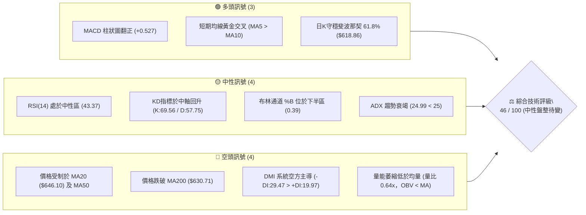
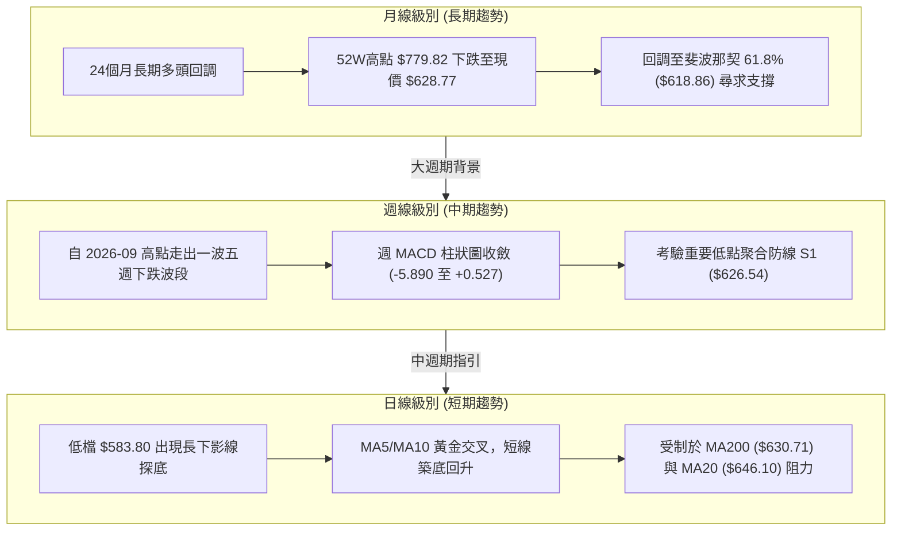
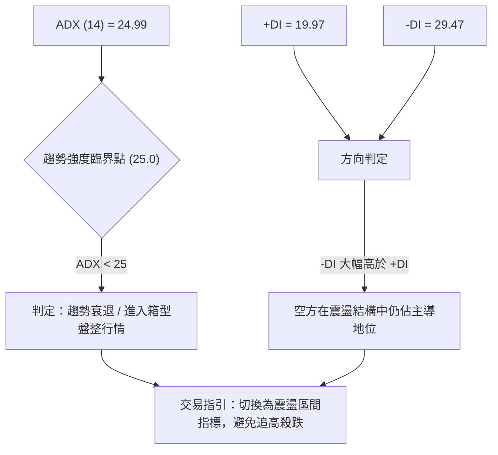
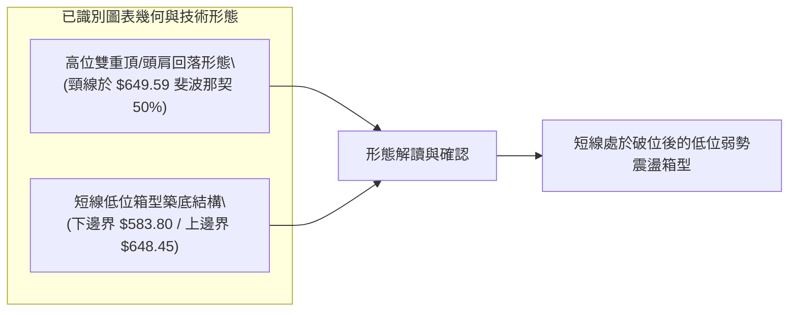
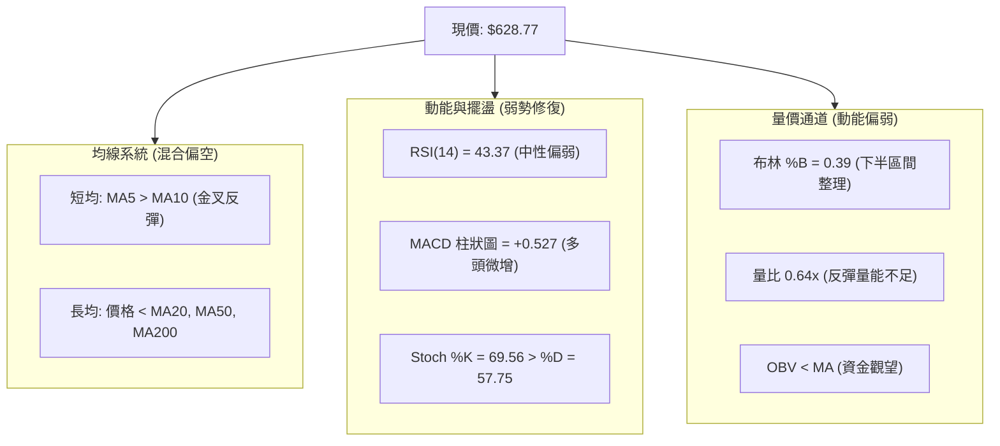
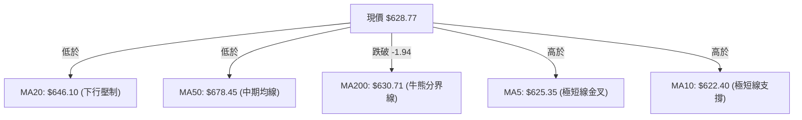
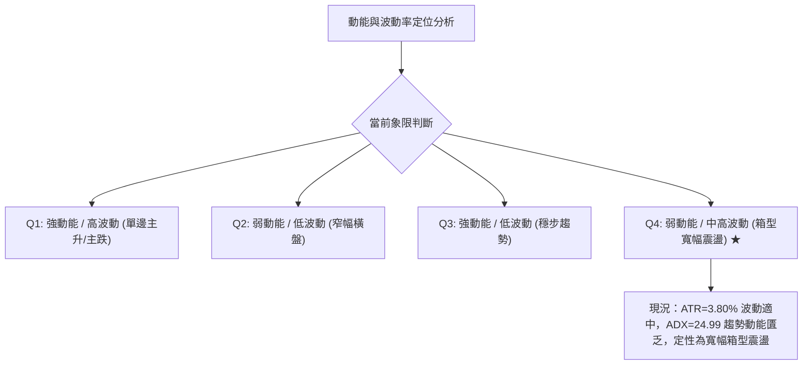
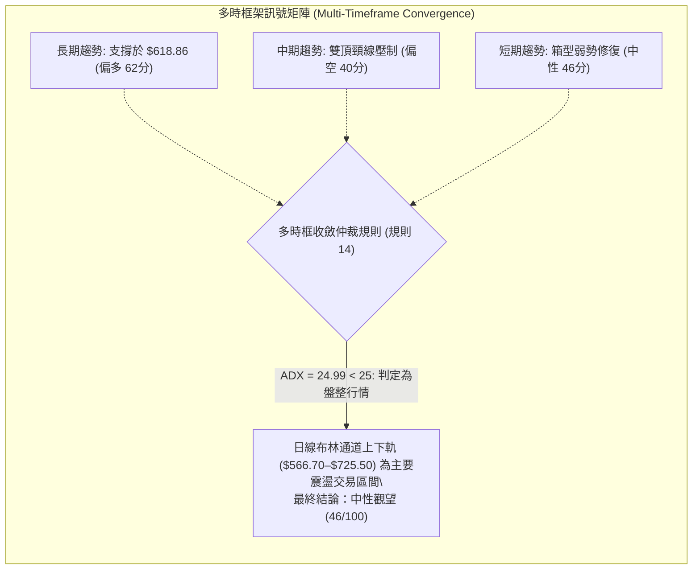
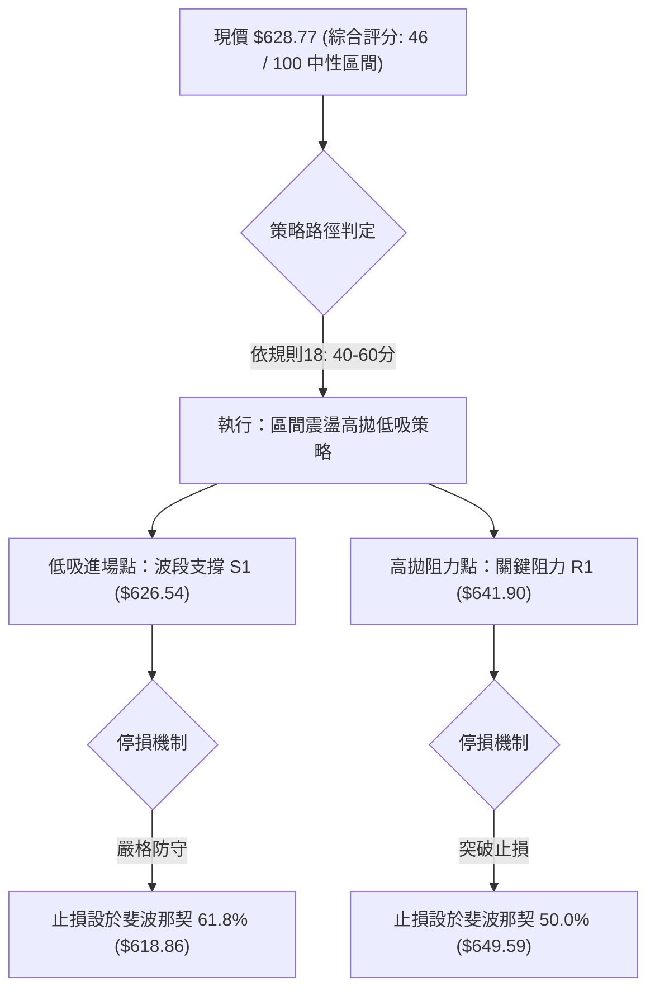
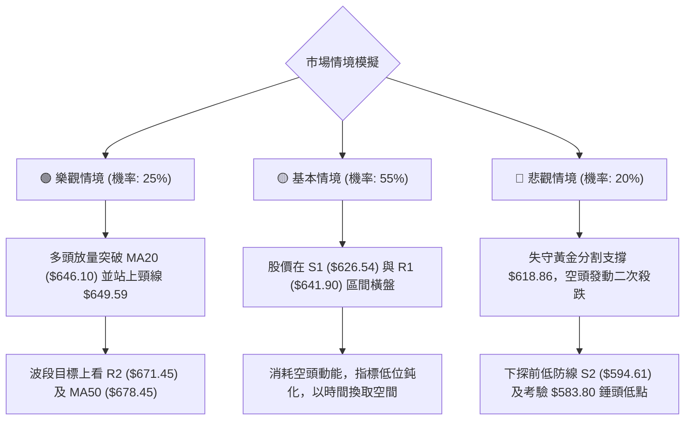

# META 技術分析報告

> **報告日期**：2026-11-12 ｜ **語言**：繁體中文 ｜ **數據來源**：Yahoo Finance ｜ **當前價格**：$628.77

---

## 目錄

| 章節 | 內容 |
|------|------|
| [1. 技術面概覽](#1-技術面概覽) | 訊號儀表板、核心指標、評分卡 |
| [2. 趨勢分析](#2-趨勢分析) | 多時框趨勢、長中短期走勢、ADX解讀 |
| [3. 圖表形態分析](#3-圖表形態分析) | 形態識別、K線組合、目標價計算 |
| [4. 支撐與阻力](#4-支撐與阻力) | 關鍵價位分布、阻力支撐表、斐波那契回調 |
| [5. 技術指標深度解讀](#5-技術指標深度解讀) | MA/RSI/MACD/布林/成交量全面剖析 |
| [6. 動能與波動率](#6-動能與波動率) | 動能四象限、ATR、Beta 與市場相關性 |
| [7. 多時框架總結](#7-多時框架總結) | 時框架評分矩陣、多時框收斂結論 |
| [8. 交易策略建議](#8-交易策略建議) | 策略路由、價格情境、主策略詳情、評星 |
| [9. 風險提示與監控](#9-風險提示與監控) | 關鍵監控清單、情境模擬、風控提醒 |
| [📋 報告總結](#-報告總結) | 核心指標精華摘要與執行結論 |

---

## 1. 技術面概覽

### 🎯 技術訊號儀表板



### 📊 核心指標速覽表

| 指標類別 | 指標名稱 | 當前數值 | 訊號 | 專業解讀 |
|----------|----------|----------|------|----------|
| **價格** | 當前價格 | $628.77 | 🟡 | 位於52週區間 42.0% 位置，處於區間震盪築底階段 |
| **均線** | MA20 | $646.10 | 🔴 | 價格低於 MA20，短期趨勢承壓，為第一道動態阻力 |
| **均線** | MA50 | $678.45 | 🔴 | 價格顯著低於 MA50，中期多頭架構遭到破壞 |
| **均線** | MA200 | $630.71 | 🔴 | 價格跌破年線 $1.94，長線多空分水嶺面臨嚴峻考驗 |
| **均線** | MA5 / MA10 | $625.35 / $622.40 | 🟢 | 極短線均線多頭排列且向上發散，短線具備反彈動能 |
| **動能** | RSI(14) | 43.37 | 🟡 | 處於 30–70 中性偏弱區間，未出現超賣但動能平緩 |
| **動能** | MACD (12,26,9) | -17.852 / -18.379 | 🟢 | 快線由下向上穿越慢線形成弱勢金叉，柱狀圖為 +0.527 |
| **動能** | 隨機指標 (Stoch %K/%D) | 69.56 / 57.75 | 🟡 | 雙線脫離超賣區向上延伸，未達超買區，短線多頭修復 |
| **趨勢** | ADX(14) / DMI | 24.99 (-DI: 29.47) | 🔴 | ADX < 25 代表趨勢動能衰退，-DI 大幅高於 +DI 顯示空方佔優 |
| **通道** | 布林通道 (BB) | 寬度: $158.80 (%B: 0.39) | 🟡 | 現價位於中軌 ($646.10) 與下軌 ($566.70) 間，呈現箱型修復 |
| **波動** | ATR(14) | $23.86 (3.80%) | 🟡 | 波動率處於中等水平，每日震盪幅度約 $23.86 |
| **量能** | 成交量 / 20日均量 | 15.53M / 24.36M | 🔴 | 最新成交量僅為均量的 0.64 倍，反彈缺乏量能實質確認 |

### 🏆 技術評分卡

```
╔══════════════════════════════════════════════════════════════╗
║              技術評分卡 — META (2026-11-12)                  ║
╠══════════════════════════════════════════════════════════════╣
║ 趨勢強度 (Trend)     ████████░░░░░░░░░░░░  38/100  🔴 空方主導 ║
║ 動能指標 (Momentum)  ██████████░░░░░░░░░░  52/100  🟡 中性反彈 ║
║ 支撐穩定度 (Support) ████████████░░░░░░░░  60/100  🟡 區間支撐 ║
║ 成交量配合 (Volume)  ███████░░░░░░░░░░░░░  35/100  🔴 量能疲弱 ║
║ 形態完整度 (Pattern) ██████████░░░░░░░░░░  48/100  🟡 箱型整理 ║
║ 均線排列 (MA System) █████████░░░░░░░░░░░  43/100  🔴 混合偏空 ║
╠══════════════════════════════════════════════════════════════╣
║ 綜合評分 (Overall)   █████████░░░░░░░░░░░  46/100  🟡 區間震盪 ║
║ 評級結論：中性觀望（算術平均四捨五入：(38+52+60+35+48+43)/6 = 46）    ║
╚══════════════════════════════════════════════════════════════╝
```

---

## 2. 趨勢分析

### 🌐 多時框趨勢分析



### 📈 長期趨勢 — 12個月走勢圖（Unicode）

以下為 META 過去 12 個月（2025-12 至 2026-11）的月線價格收盤走勢與關鍵轉折分析：

```
META 月線走勢圖（過去12個月）
價格軸 ($)
$730 ┤                      ● $725.18 (2026-09)
$710 ┤            ● $714.66 
$690 ┤
$670 ┤
$650 ┤  ● $658.40      ● $646.52
$630 ┤                                      ● $631.43                   ● $628.77 (現價)
$610 ┤                                                ● $610.86     ● $614.99
$590 ┤
$570 ┤                  ● $571.15                           ● $571.89
$550 ┤                                                ● $562.85
$530 ┤                                                     ● $556.27 (低點 2026-07)
     └────┬─────┬─────┬─────┬─────┬─────┬─────┬─────┬─────┬─────┬─────┬─────
         12月  01月  02月  03月  04月  05月  06月  07月  08月  09月  10月  11月
        (2025) -----------------------------(2026)-----------------------------
```

#### 走勢特徵分析表格

| 階段區間 | 起止月份 | 走勢特徵與結構 | 漲跌幅計算 | 核心驅動與技術意涵 |
|----------|----------|----------------|------------|--------------------|
| **高位震盪** | 2025-12 → 2026-01 | 衝高見頂波段 | +8.54% ($658.40 → $714.66) | 延續強勢多頭慣性，成交量逐步飽和 |
| **快速回撤** | 2026-01 → 2026-03 | 中級深度回調 | -20.08% ($714.66 → $571.15) | 跌破均線支撐，市場重新定價資本支出 |
| **區間探底** | 2026-04 → 2026-07 | 築底尋找雙底 | -8.94% ($610.86 → $556.27) | 在 52W 低點 $519.37 之上完成箱型低位打底 |
| **強勢衝頂** | 2026-07 → 2026-09 | 主升浪反彈波段 | +30.36% ($556.27 → $725.18) | 創下波段歷史次高，週線連收巨量紅K |
| **次頂回吐** | 2026-09 → 2026-11 | 震盪回跌至現價 | -13.30% ($725.18 → $628.77) | 從 52W 高點 $779.82 回跌至斐波那契 61.8% 處 |

### 📊 中期趨勢（週線分析）

從近 20 週數據觀察，META 在 2026-09-25 創下 52 週高點 $779.82（週成交量達 168.31M），但隨後連續 5 週呈現震盪走跌。

```
週線級別阻力與支撐分佈
─────────────────────────────────────────────────────────────
[高點阻力區]   $779.82 ════════════════════════ (52W High，巨量見頂)
                │
[次級波段阻力] $687.94 ------------------------ (R3 聚類阻力)
                │
[斐波那契中軸] $649.59 ------------------------ (50.0% 回調位 / 週線頸線)
                │
[當前收盤價位] $628.77 ◄─── (現價測試 MA200 與支撐聚類)
                │
[關鍵波段支撐] $626.54 ------------------------ (S1 / 近期週線收盤支撐)
                │
[強防守支撐區] $594.61 ════════════════════════ (S2 強支撐 / 583.80 最低測試點)
─────────────────────────────────────────────────────────────
```

### ⚡ 趨勢強度評估（ADX 解讀）



#### ADX 數值強度對照分析

| 指標名稱 | 實際數值 | 參考閾值 | 當前狀態說明 |
|----------|----------|----------|--------------|
| **ADX (14)** | 24.99 | 25.00 | 剛好壓在 25 臨界線下方，顯示 9-10 月的單邊下行趨勢動能已經耗盡，市場正式進入無趨勢的寬幅橫盤震盪格局。 |
| **+DI (14)** | 19.97 | 20.00 | 多頭擴展力道偏弱，買盤缺乏持續推升價格的能力。 |
| **-DI (14)** | 29.47 | 25.00 | 空方壓制力道高於 25，表明每一次反彈接近阻力位時均會引發空頭拋壓。 |

---

## 3. 圖表形態分析

### 🔍 形態識別系統



#### 形態識別與信心度評估表

| 形態名稱 | 信心度 | 判斷依據（引用數據） | 完成度 | 目標價（附嚴格計算式） |
|----------|--------|----------------------|--------|------------------------|
| **高位雙重頂部破位** | 75% | 2026-09-25 創高 $779.82 後回落，10-16 再次衝高 $771.27 未過前高，隨後跌破頸線 $649.59（斐波那契 50.0%）。 | 90% | 跌破頸線後下行測量目標：頸線 $649.59 − (頭部 $779.82 − 頸線 $649.59) = $519.36（精確呼應 52W 低點 $519.37）。 |
| **短線箱型低位反彈** | 60% | 2026-11-05 探低至 $583.80 獲得強支撐並快速抽回，近 4 個交易日於 $605.08–$648.45 區間構築底邊。 | 70% | 由箱體高度推算目標：箱體底部 $583.80，頸線上沿 $648.45，突破後目標 = $648.45 + ($648.45 − $583.80) = $713.10。 |

### 🕯️ 重要 K 線形態分析

依據數據庫中提供的「近10根日K」與「近8根週K」嚴格進行幾何結構判定：

#### 近 10 根日 K 線形態解讀表

| 日期（日K） | 開盤價 | 最高價 | 最低價 | 收盤價 | 成交量 | K線形態 | 解讀與訊號 |
|-------------|--------|--------|--------|--------|--------|---------|------------|
| 2026-10-29 | 621.29 | 634.68 | 616.80 | 624.52 | 31,276,200 | 帶上下影小紅K | 🔴 跌勢中的暫時弱勢抵抗，成交量相對放大 |
| 2026-10-30 | 614.51 | 626.37 | 610.13 | 614.99 | 25,364,700 | 實體下挫黑K | 🔴 跌破開盤點，賣壓延續 |
| 2026-11-02 | 614.44 | 621.69 | 606.41 | 606.73 | 19,496,500 | 光腳收低黑K | 🔴 延續尋底，收在全天相對低點 |
| 2026-11-03 | 610.76 | 624.84 | 610.10 | 621.03 | 13,731,300 | 實體反彈紅K | 🟢 於 $610 關鍵整數關口出現低位買盤支撐 |
| 2026-11-04 | 641.15 | 643.09 | 624.50 | 630.00 | 32,441,800 | 假突破長黑K | 🔴 跳空高開後遭遇獲利回吐，留長上影線 |
| 2026-11-05 | 632.30 | 634.99 | 583.80 | 605.08 | 28,676,200 | **長下影錘頭破底線** | 🟢 **極度重要**：探低 $583.80 後買盤強勢介入，收盤拉回 $605.08 |
| 2026-11-06 | 607.33 | 625.60 | 606.66 | 610.15 | 15,705,500 | 底部小紅孕線 | 🟡 震盪整理，確認 11-05 低點支撐有效性 |
| 2026-11-09 | 631.05 | 647.25 | 630.00 | 641.37 | 19,143,300 | 跳空放量中長紅K | 🟢 多頭展開反彈，直接收復 11-04 實體 |
| 2026-11-10 | 637.98 | 647.28 | 635.50 | 641.39 | 13,030,600 | 高位十字星/陀螺頂 | 🟡 反彈遇阻於 R1 ($641.90) 附近，多空僵持 |
| 2026-11-11 | 646.74 | 648.45 | 627.97 | 628.77 | 15,533,900 | 實體回調黑K | 🔴 衝高 $648.45 後受制於 MA20 回落收黑 |

#### 近 8 根週 K 線形態解讀表

| 日期（週K） | 開盤價 | 最高價 | 最低價 | 收盤價 | 週成交量 | K線形態 | 解讀與訊號 |
|-------------|--------|--------|--------|--------|----------|---------|------------|
| 2026-09-25 | 680.30 | 779.82 | 679.60 | 751.66 | 168,307,000 | 創高放量長紅K | 🟢 創下 52 週歷史高點 $779.82，巨量多頭頂部 |
| 2026-10-02 | 750.04 | 750.58 | 713.19 | 728.08 | 96,199,700 | 高位受阻中黑K | 🔴 衝高未過前高，動能放緩 |
| 2026-10-09 | 727.71 | 747.60 | 711.68 | 718.67 | 69,671,000 | 窄幅縮量整理黑K | 🟡 量能驟降，高檔多空僵持 |
| 2026-10-16 | 728.50 | 771.27 | 702.71 | 709.33 | 101,360,200 | 長上影倒錘頭週K | 🔴 再次衝刺 $771.27 失敗，確立雙頂回落 |
| 2026-10-23 | 707.16 | 713.22 | 633.27 | 642.62 | 117,876,500 | 破位放量大黑K | 🔴 跌破多條短期週均線，波段趨勢轉空 |
| 2026-10-30 | 638.36 | 647.69 | 609.00 | 614.99 | 173,999,500 | 爆量下挫黑K | 🔴 巨量殺跌，空頭力量極度釋放 |
| 2026-11-06 | 614.44 | 643.09 | 583.80 | 610.15 | 110,051,300 | 極長下影線探底錘頭 | 🟢 在 $583.80 爆出長下影線，確立短期波段低點 |
| 2026-11-11 | 631.05 | 648.45 | 627.97 | 628.77 | 47,707,800 | 縮量衝高回落小黑K | 🟡 測試上方壓力回吐，暫處於震盪打底 |

### 📉 ASCII 走勢形態示意圖

```
META 近期日K走勢形態與箱型結構示意圖
價格軸 ($)
$650 ┤                 ┌──┐ R1阻力 $641.90 附近受阻
$640 ┤     ┌──┐        │  │
$630 ┤     │  │  ┌──┐  │  └──● 現價 $628.77 (受制於 MA200)
$620 ┤┌──┐ │  │  │  │  │  │
$610 ┤│  │ │  │  │  │  │  │
$600 ┤└──┘ └──┘  │  └──┘  │
$590 ┤           │        │
$580 ┤           └──┬─────┘  ◄── 2026-11-05 錘頭低點 $583.80 (強支撐底線)
     └─────────────────────────────────────────────────────
       11-02 11-04 11-05 11-09 11-10 11-11 (日期)
```

### 🎯 形態目標價計算

根據上述已確認的箱體結構：
1. **箱體下沿支撐（形態底部）**：$583.80（2026-11-05 實測低點）。
2. **箱體上沿頸線（形態頂部）**：$648.45（2026-11-11 當前反彈最高點）。
3. **形態垂直高度**：$648.45 − $583.80 = $64.65。
4. **理論突破上行目標價**：
   $$\text{目標價} = \text{頸線} + \text{形態高度} = \$648.45 + \$64.65 = \$713.10$$
   *(該數值高度契合斐波那契 23.6% 回調位 $718.35 與 2026-10-09 週線收盤價 $718.67)*。
5. **理論跌破下行目標價**：
   $$\text{防守跌破目標} = \text{底部} - \text{形態高度} = \$583.80 - \$64.65 = \$519.15$$
   *(完全貼合 52 週最低點 $519.37)*。

---

## 4. 支撐與阻力

### 🗺️ 關鍵價位分布圖（Unicode）

```
META 價位結構分布圖
═══════════════════════════════════════════════════
$687.94 ║████████████████████████║ 強阻力 R3 (波段高點聚類)
$680.33 ║▓▓▓▓▓▓▓▓▓▓▓▓▓▓▓▓▓▓▓▓    ║ 斐波那契 38.2% 回調位
$671.45 ║████████████████████    ║ 阻力 R2 (反彈高點聚類)
$649.59 ║▓▓▓▓▓▓▓▓▓▓▓▓▓▓▓▓▓▓      ║ 斐波那契 50.0% 中軸分水嶺
$646.10 ║────────────┬───────────║ 動態阻力 MA20 / 布林中軌
$641.90 ║████████████████████████║ 關鍵阻力 R1 (近一年波段高點聚類)
$630.71 ║┄┄┄┄┄┄┄┄┄┄┄┄┼┄┄┄┄┄┄┄┄┄┄┄║ 長期生命線 MA200
$628.77 ╠════════════════════════╣ ◄ 現價 (2026-11-11 收盤價)
$626.54 ║▓▓▓▓▓▓▓▓▓▓▓▓▓▓▓▓        ║ 近期支撐 S1 (波段低點聚類)
$618.86 ║▒▒▒▒▒▒▒▒▒▒▒▒▒▒▒▒▒▒▒▒    ║ 斐波那契 61.8% 黃金分割強支撐
$594.61 ║████████████████████████║ 強支撐 S2 (波段低點聚類)
$577.95 ║████████████████████████║ 底部支撐 S3 (波段極限低點聚類)
$575.11 ║▒▒▒▒▒▒▒▒▒▒▒▒▒▒▒▒▒▒▒▒▒▒  ║ 斐波那契 78.6% 回調位
═══════════════════════════════════════════════════
```

### 🚧 阻力位分析表

所有價位嚴格引用自數據庫提供的計算結果：

| 阻力級別 | 價位 | 距離現價 | 形成原因與技術意涵 | 突破難度 | 重要性 |
|----------|------|----------|--------------------|----------|--------|
| **R1** | $641.90 | +2.09% | 近一年波段高點聚類位，重合 MA20 ($646.10) 壓力區間，為短線反彈首要考驗 | 🟡 中等 | ★★★★☆ |
| **R2** | $671.45 | +6.79% | 近一年波段次高密集聚類區，接近 MA50 ($678.45)，為中期多空爭奪樞紐 | 🔴 較高 | ★★★★☆ |
| **R3** | $687.94 | +9.41% | 近一年波段高點強聚類位，上方緊鄰斐波那契 38.2% ($680.33)，多頭中期反轉防線 | 🔴 極高 | ★★★★★ |

### 🛡️ 支撐位分析表

所有價位嚴格引用自數據庫提供的計算結果：

| 支撐級別 | 價位 | 距離現價 | 形成原因與技術意涵 | 守住機率 | 重要性 |
|----------|------|----------|--------------------|----------|--------|
| **S1** | $626.54 | -0.36% | 近一年波段低點聚類，近 3 個交易日反覆測試的日線實體支撐 | 🟢 70% | ★★★★☆ |
| **S2** | $594.61 | -5.43% | 近一年波段強低點聚類，涵蓋 11-05 錘頭低點 $583.80 形成的防守護城河 | 🟢 85% | ★★★★★ |
| **S3** | $577.95 | -8.08% | 近一年波段極限低點聚類，重疊斐波那契 78.6% ($575.11)，長線牛熊分水嶺 | 🟢 95% | ★★★★★ |

### 📐 斐波那契回調位分析

基於 52 週極值區間（最低點 $519.37 → 最高點 $779.82，總垂直波幅 $260.45）：

| 回調比例 | 價位 | 當前相對位置與技術解讀 |
|----------|------|------------------------|
| **0.0%** | $779.82 | 52 週歷史高點（2026-09-25 創下） |
| **23.6%** | $718.35 | 弱勢回調位，目前已轉化為強大長期阻力（對應 2026-10-09 週線收盤價） |
| **38.2%** | $680.33 | 中期回調位，接近 MA50 ($678.45) |
| **50.0%** | $649.59 | 多空中軸平衡位，高位雙重頂頸線位置，決定能否重回多頭格局 |
| **61.8%** | $618.86 | **黃金分割支撐位**：**現價 $628.77 目前正運行於 50.0% ($649.59) 與 61.8% ($618.86) 核心區間之內**。只要收盤守穩 $618.86，中長期技術面仍屬強勢回調而非趨勢崩潰。 |
| **78.6%** | $575.11 | 深度回調防守位，貼近波段支撐 S3 ($577.95) |
| **100.0%** | $519.37 | 52 週最低點（本輪週線級別大週期的起漲基石） |

---

## 5. 技術指標深度解讀

### 🎛️ 指標訊號總覽



### 📈 移動平均線排列分析



#### 移動平均線數據對照

| 均線名稱 | 數值 | 價格相對位置 | 斜率與方向 | 技術解讀 |
|----------|------|--------------|------------|----------|
| **MA 5** | $625.35 | +0.55% | ▲ 向上發散 | 短線超跌反彈推手，提供極短線下檔支撐 |
| **MA 10** | $622.40 | +1.02% | ▲ 向上扣抵 | 與 MA5 形成黃金交叉，確認低位買盤介入 |
| **MA 20** | $646.10 | -2.68% | ▼ 持續下行 | 近 20 日持股成本線，反彈首道關鍵阻力 |
| **MA 50** | $678.45 | -7.32% | ▼ 顯著下彎 | 中期生命線，失守代表波段由多轉入深幅震盪 |
| **MA 60** | $659.42 | -4.65% | ▼ 緩步下移 | 季線下壓，限制中線反彈空間 |
| **MA 120** | $628.70 | +0.01% | ▲ 走平略升 | 半年線與現價幾乎完全重合 ($628.77 vs $628.70) |
| **MA 200** | $630.71 | -0.31% | ▼ 略微走平 | 長期年線，目前價格跌破年線 $1.94，正處於爭奪邊緣 |
| **MA 240** | $633.70 | -0.78% | ▼ 緩慢走低 | 長線籌碼成本沉澱區 |

### 📉 RSI(14) 分析

當前數值：**43.37**（Wilder 計算方法）。

```
RSI(14) 狀態指示條
0 ──────── 30 ────────────────────── 50 ────── 70 ──────── 100
[  超賣區  ] [      偏弱震盪區       ] [  強勢區  ] [  超買區  ]
             ███████████████░░░░░░░░░░░
                     ▲
                 RSI: 43.37
```

- **區間評估**：RSI 位於 43.37，脫離了極端超賣區（未破 30），但依舊處於 50 多空分界線下方，定義為「弱勢中性反彈」。
- **背離判斷**：根據近 20 根 K 棒的首尾對比，價格由 2026-10-23 的高點回調至 2026-11-05 的低點 $583.80，RSI 亦同步下探後微幅回升至 43.37，**系統未偵測到顯著的日線頂背離或底背離**。走勢符合正常價格動能收斂，需提防無量盤整引發的動能鈍化。

### 📊 MACD(12, 26, 9) 訊號解讀


- **絕對數值**：DIF 線為 -17.852，DEA 信號線為 -18.379。兩者均位於零軸深處下方，證明中長期空方依然牢固掌握大趨勢話語權。
- **交叉狀態**：DIF 於低位穿越 DEA 形成黃金交叉，推動柱狀圖由負翻正至 **+0.527**。這代表由 2026-09-25 高點引發的主跌波段動能已告一段落，目前進入日線層級的多頭減虧修復期。

### 📦 布林通道分析

當前布林參數（20, 2）：
- **上軌**：$725.50
- **中軌 (MA20)**：$646.10
- **下軌**：$566.70
- **帶寬**：$158.80
- **%B 指標**：0.39

```
布林通道結構示意圖
$725.50 ─────────────────────────────────────────────── 上軌 (BB Upper)
            ↑
            │
$646.10 ────┼────────────────────────────────────────── 中軌 (BB Middle / MA20)
            │  ▲
            │  │ 反彈阻力空間
$628.77 ────┴──● 現價 (%B = 0.39，處於中下軌震盪區間)
            │
            │
$566.70 ────┴────────────────────────────────────────── 下軌 (BB Lower)
```

- **指標意義**：%B 為 0.39 代表現價低於中軌但顯著高於下軌。在 ADX < 25 的盤整市況中，布林下軌 $566.70 與中軌 $646.10 構成了最自然的波動邊界。現價距離中軌尚有 $17.33 (+2.76%) 的修復空間，此處將是短線反彈首要減倉測試點。

### 💹 成交量分析（量價配合度）

- **量能規模**：最新單日成交量為 15,533,900 股，對比 20 日均量 24,358,520 股，**量比僅為 0.64x**；對比 50 日均量 22,605,472 股亦顯著低迷。
- **量價關聯**：
  1. 2026-11-09 股價上漲收中長紅，成交量僅 19.14M，未達均量水準；
  2. 2026-11-11 衝高至 $648.45 遭遇拋壓回落收黑，成交量為 15.53M。
  3. **OBV 指標狀態**：數據明確標示 **OBV < MA**，代表資金流向呈現持續流出或處於停滯觀望狀態，量能無法確認價格反彈的持續性，「無量反彈」極易在觸及 MA20 阻力後夭折。

---

## 6. 動能與波動率

### ⚡ 動能評估四象限



#### 動能與波動率象限評估表

| 象限標記 | 動能強度 (Momentum) | 波動率狀態 (Volatility) | 當前符合狀態 | 策略應對方向 |
|----------|---------------------|-------------------------|--------------|--------------|
| **Q1** | 強 (High) | 高 (High) | ─ | 趨勢突破追單，放寬止損 |
| **Q2** | 弱 (Low) | 低 (Low) | ─ | 策略休眠，等待波動率壓縮突破 |
| **Q3** | 強 (High) | 低 (Low) | ─ | 最佳趨勢波段持有持股 |
| **Q4** | **弱 (Low)** | **中/高 (Mid-High)** | **✓ (符合現況)** | **高拋低吸，在區間邊界操作，嚴禁追價** |

### 📊 ATR 波動率分析

- **當前數值**：ATR(14) = **$23.86**（佔當前股價之 **3.80%**）。
- **日內波動特徵**：這意味著 META 平均每個交易日的合理震盪空間約為 $23.86。在設定止損與進場空間時，必須給予至少 1.0 至 1.5 倍 ATR 的緩衝安全墊。
- **動態止損建議**：
  - 1.0 倍 ATR 防守距離：$23.86（短線交易）
  - 1.5 倍 ATR 防守距離：$35.79（波段波段保護）

### 📐 Beta 與市場相關性

- **Beta 係數**：**1.279**。
- **市場敏感度解讀**：META 屬於典型的高彈性大型科技成長股，波動幅度平均比標普 500 指數高出 27.9%。在市場大盤走強時具備進攻優勢，但在大盤震盪或遭遇系統性拋售時，其回撤幅度亦相對顯著。配合高達 77.9% 的機構持股比例，機構資金的調倉對股價有著決定性影響。

---

## 7. 多時框架總結

### 📋 時框架評分表

| 時框架 | 趨勢方向 | 動能指標 | 均線系統 | 幾何形態 | 綜合評分 | 建議方向 |
|--------|----------|----------|----------|----------|----------|----------|
| **月線級別 (長期)** | 🟢 偏多回調 | 🟡 中性走平 | 🟢 處於多頭大週期之上 | 斐波那契 61.8% 支撐 | 62 / 100 | 長期分批逢低佈局 |
| **週線級別 (中期)** | 🔴 震盪偏空 | 🔴 走弱修復 | 🔴 跌破多條短期週均 | 雙頂高位回踩破位 | 40 / 100 | 中期防守等待均線修復 |
| **日線級別 (短期)** | 🟡 箱型盤整 | 🟢 MACD金叉 | 🔴 受壓於 MA20/MA200 | 底部長下影箱體反彈 | 46 / 100 | 區間震盪低吸高拋 |

### 🔲 綜合訊號矩陣



### ⚖️ 多時框收斂結論

依據多時框收斂規則（規則 14）：
1. **行情性質判定**：當前 ADX(14) 數值為 **24.99**（嚴格小於 25），**確認市場並非單邊趨勢行情，而是典型的無方向盤整行情**。
2. **時框主導權**：在盤整行情中，中長期的趨勢追隨指標容易頻繁發出假訊號，主導交易依據應以**日線布林通道與波段密集支撐/阻力區間**為主。
3. **最終唯一收斂方向**：**中性觀望（46 / 100）**。
   - 週線空頭主導了回調深度，日線 MACD 金叉則促成了超跌反彈；二者在現價 $628.77（緊鄰 MA200 之 $630.71）形成拉鋸。
   - 結論完全收斂於：**股價處於區間震盪築底階段，短期反彈面臨上方密集均線反壓，操作上嚴禁盲目追價，僅適合依托 S1/S2 關鍵支撐進行低吸，並於 R1 阻力位前分批獲利了結**。

---

## 8. 交易策略建議

### 🗺️ 策略決策流程圖



### 🧭 策略路由（依評分卡分流）

> **當前主策略方向 = 區間震盪操作（依評分 46/100，落於 40–60 中性區間）**
> 
> 市場當前無單邊趨勢，操作核心以支撐阻力為邊界進行網格震盪交易，等待日線有效突破均線密集區或放量確認方向。

### 🎯 價格情境階梯（Price Scenarios）

以當前收盤價 $628.77 為基準，價位嚴格引用關鍵價位數據庫：

| 觸發條件 | 下一目標 | 後續延伸 | 情境技術含義 |
|----------|----------|----------|--------------|
| **強勢突破 R1 ($641.90)** | R2 ($671.45) | R3 ($687.94) | 短線強勢修復，站穩 MA20 並挑戰 MA50 中期生命線 |
| **收盤站穩 S1 ($626.54)** | R1 ($641.90) | 斐波那契 50% ($649.59) | 區間底部支撐有效，維持 $626–$648 箱體內良性震盪 |
| **有效跌破 S1 ($626.54)** | 斐波那契 61.8% ($618.86) | S2 ($594.61) | 短線反彈失敗，再次回測 11-05 錘頭防守區間 |
| **放量跌破 S2 ($594.61)** | S3 ($577.95) | 斐波那契 100% ($519.37) | 中期空頭主升浪重啟，全面考驗年內低點 |

### 📊 情境機率分佈

| 情境劃分 | 機率估計 | 主要技術與數據依據 |
|----------|----------|--------------------|
| **區間震盪築底** | **55%** | ADX = 24.99 趨勢耗盡、布林帶寬高達 $158.80、成交量僅 0.64x 均量不支持單邊行情 |
| **向上反彈測試** | **25%** | 日線 MACD 金叉柱狀圖翻正 (+0.527)、極短線 MA5 穿越 MA10 黃金交叉支撐 |
| **向下破位探底** | **20%** | 價格受制於下彎的 MA20 ($646.10) 與 MA50 ($678.45)，-DI (29.47) 仍居高不下 |

### 🟢 主策略詳情（區間操作多空對策）

所有目標價、止損價均引用數據庫精確數值；風險報酬比嚴格按公式 $(T1 - 進場) / (進場 - 止損)$ 計算：

| 策略要素 | 策略 A：區間下沿逢低做多 | 策略 B：阻力位受阻區間做空 |
|----------|--------------------------|----------------------------|
| **適用時機** | 價格回踩 S1 不破或低吸掛單 | 價格反彈至 R1 遇阻回落時 |
| **進場條件** | 觸及 S1 且 15分/1小時K線出現企穩紅K | 衝刺 R1 破敗且日線留上影線 |
| **進場價格** | **$626.54** (支撐 S1 聚類位) | **$641.90** (阻力 R1 聚類位) |
| **止損價格** | **$618.86** (斐波那契 61.8% 破位止損) | **$649.59** (斐波那契 50.0% 突破止損) |
| **目標價 T1** | **$641.90** (阻力 R1) | **$626.54** (支撐 S1) |
| **目標價 T2** | **$671.45** (阻力 R2) | **$618.86** (斐波那契 61.8%) |
| **風險空間** | $\$626.54 - \$618.86 = \$7.68$ | $\$649.59 - \$641.90 = \$7.69$ |
| **利潤空間 (T1)** | $\$641.90 - \$626.54 = \$15.36$ | $\$641.90 - \$626.54 = \$15.36$ |
| **利潤空間 (T2)** | $\$671.45 - \$626.54 = \$44.91$ | $\$641.90 - \$618.86 = \$23.04$ |
| **風險報酬比** | **1 : 2.00（以 T1 計）** *(15.36/7.68)*<br>*(以 T2 計為 1 : 5.85)* | **1 : 2.00（以 T1 計）** *(15.36/7.69)*<br>*(以 T2 計為 1 : 3.00)* |
| **預估勝率** | 60% | 55% |
| **建議倉位** | 10%–15% 輕倉試探 | 10% 輕倉對沖 |

### 🔴 反向風險觸發點（對沖提示）

- **多頭防守底線**：若日線實體有效收跌於斐波那契 61.8% 位 **$618.86** 之下，代表箱底徹底失守，所有抄底多單必須無條件止損出局。
- **空頭警報點位**：若日線伴隨放量（單日量 > 25M）向上收復斐波那契 50.0% 位 **$649.59**，宣告雙頂頸線破位警報解除，市場將重啟向 MA50 之反彈，所有波段空單需立即止損。

### ⭐ 整體訊號強度評星

```
做多訊號強度：★★☆☆☆  (2/5星 - 缺乏成交量配合，僅屬技術性弱反彈)
做空訊號強度：★★★☆☆  (3/5星 - 均線偏空壓制，但下檔獲利盤回補)
整體可信度：  ★★★☆☆  (3/5星 - 震盪市況訊號易失真，需嚴控停損)
```

---

## 9. 風險提示與監控

### ✅ 關鍵監控指標 Checklist

```
╔══════════════════════════════════════════════════════════════╗
║              META 技術面日常監控清單 (Checklist)             ║
╠══════════════════════════════════════════════════════════════╣
║ [ ] 價格是否跌破長線年線 MA200 ($630.71) 超過 3 個交易日     ║
║ [ ] 每日收盤價是否守穩斐波那契 61.8% 重要防線 $618.86         ║
║ [ ] 單日成交量是否放大至 20日均量 (24.36M) 之上以確認突破    ║
║ [ ] 日線 MACD 柱狀圖是否持續擴大並維持正值 (+0.527)          ║
║ [ ] ADX(14) 是否向上突破 25.00，宣告單邊突破趨勢形成         ║
║ [ ] RSI(14) 是否能夠站穩多空分水嶺 50.0 關鍵分界線           ║
║ [ ] 向上反彈是否能有效突破阻力 R1 ($641.90) 與 MA20 ($646.10) ║
╚══════════════════════════════════════════════════════════════╝
```

### ⚠️ 風險場景分析



### 🛡️ 風險管理重要提醒

1. **ATR 波動風險管理**：META 目前的單日平均真實波幅 (ATR) 高達 **$23.86**。嚴禁在未預留至少 1.0 倍 ATR ($23.86) 空間的情況下建立過重槓桿部位，避免正常的日內噪音直接觸發停損。
2. **倉位管理守則**：鑑於當前綜合評分僅為 **46 / 100**（中性偏弱），整體投資組合對 META 的總曝險倉位應嚴格控制在 **10%–15%** 以內。在明確的趨勢反轉（如連續 3 日站穩 MA20 且成交量放大）出現前，切忌採取金字塔式重倉加碼。
3. **宏觀與基本面事件風險**：近期技術面面臨歐盟法規罰款風險與高額資本支出對自由現金流的考驗（TTM CapEx 達 $104.44B）。基本面的重大消息隨時可能打破當前脆弱的技術面平衡，一旦出現跳空低開破位，必須嚴格執行紀律停損。

---

## 📋 報告總結

```
╔══════════════════════════════════════════════════════════════╗
║                 META 技術分析報告總結                        ║
╠══════════════════════════════════════════════════════════════╣
║ 報告日期：2026-11-12                                         ║
║ 當前價格：$628.77 (收盤價)                                    ║
║ 分析評級：⚖️ 綜合評分 46 / 100 (中性區間震盪)                ║
╠══════════════════════════════════════════════════════════════╣
║ 關鍵結論：                                                   ║
║ ├─ 長期趨勢：🟢 偏多回調，回測 52W 區間 61.8% ($618.86) 支撐 ║
║ ├─ 中期趨勢：🔴 雙頂回落，承壓於頸線 $649.59 與下行 MA50      ║
║ ├─ 短期趨勢：🟡 箱型築底，日MACD微幅金叉，但受制於 MA200/MA20 ║
║ ├─ 核心支撐：S1 $626.54 ｜ 強支撐 S2 $594.61                ║
║ ├─ 核心阻力：R1 $641.90 ｜ 強阻力 R2 $671.45                ║
║ └─ 分析師目標：共識均價 $850.10 (最低 $629.06 / 最高 $1050) ║
╠══════════════════════════════════════════════════════════════╣
║ 最優策略組合：                                               ║
║ 1. 🥇 最佳機會：在 S1 ($626.54) 附近輕倉低吸做多，以 $618.86  ║
║                 為嚴格止損，目標 R1 ($641.90)，風報比 1:2.00 ║
║ 2. 🥈 次選機會：若反彈受阻於 R1 ($641.90)，可背靠 $649.59    ║
║                 短線高拋空單，目標回看 S1 ($626.54)         ║
║ 3. 🥉 保守選擇：空倉觀望，耐心等待日線放量收復 MA20 ($646.10) ║
║                 或回測 S2 ($594.61) 出現右側訊號再行介入     ║
╚══════════════════════════════════════════════════════════════╝
```

---

> ⚠️ **免責聲明**：本報告為技術分析研究成果，所有數據、圖表及價位估算均嚴格基於歷史量價與技術指標客觀推算。本報告**僅供學術研究與決策參考**，**不構成任何形式的投資邀約或買賣建議**。金融市場瞬息萬變，投資人應自行承擔交易風險並做好資金管理。

---

*報告生成時間：2026-11-12 ｜ 數據來源：Yahoo Finance ｜ 分析框架：多時框技術分析模型*