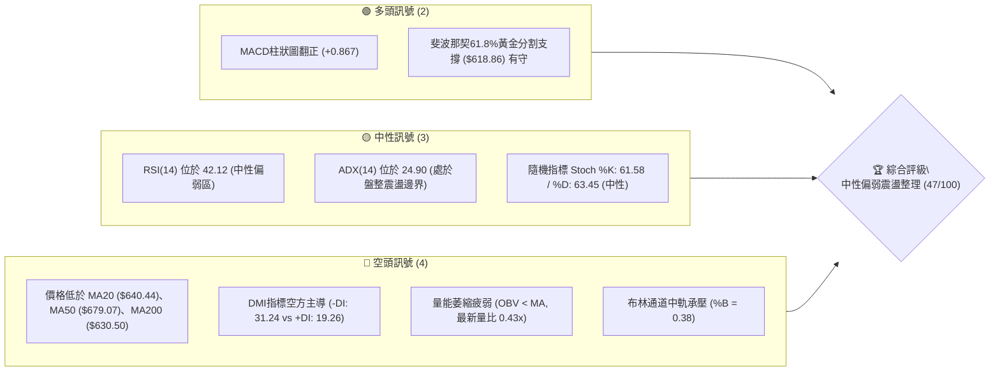
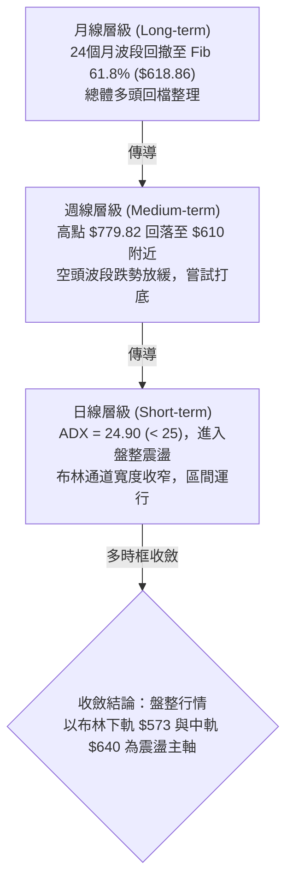
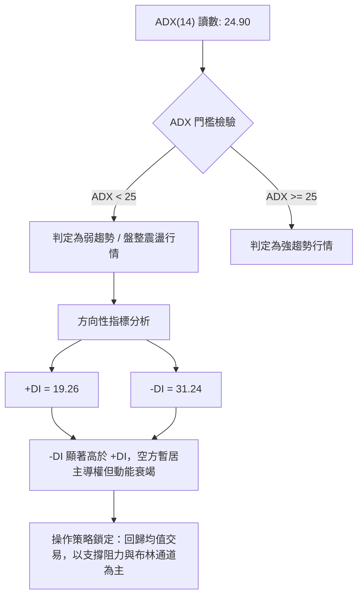
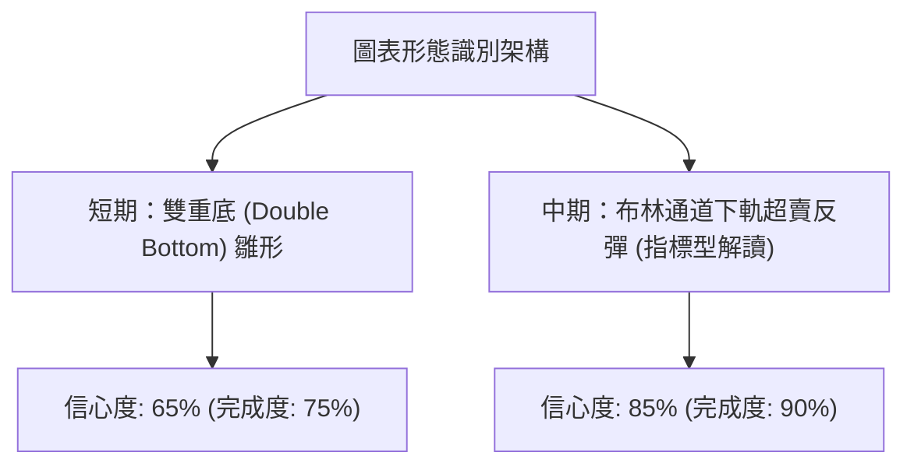
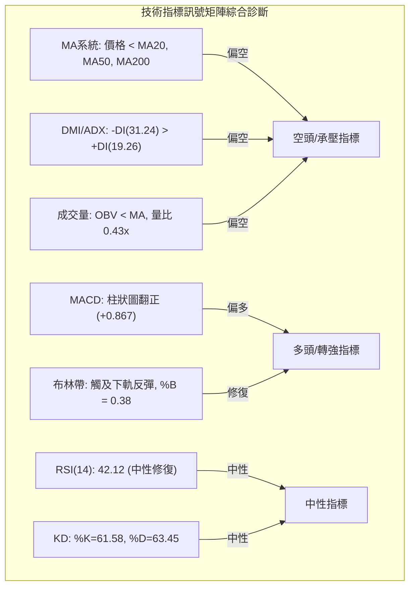
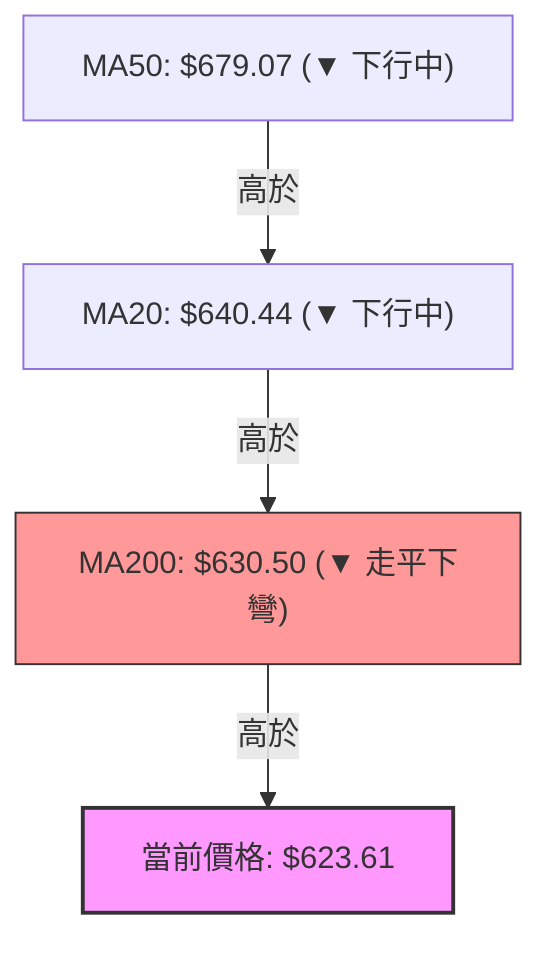
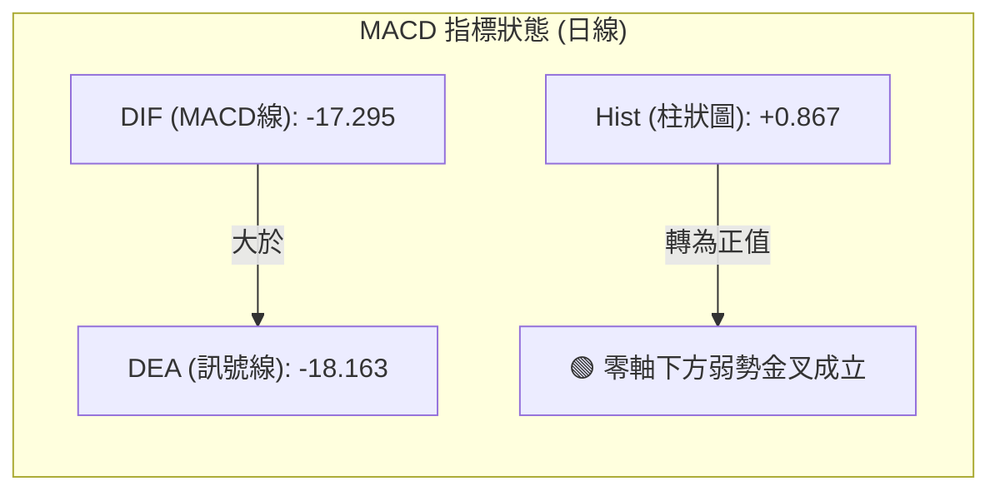
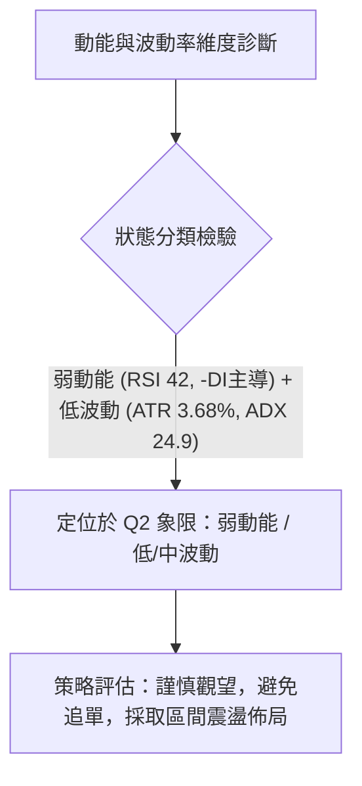
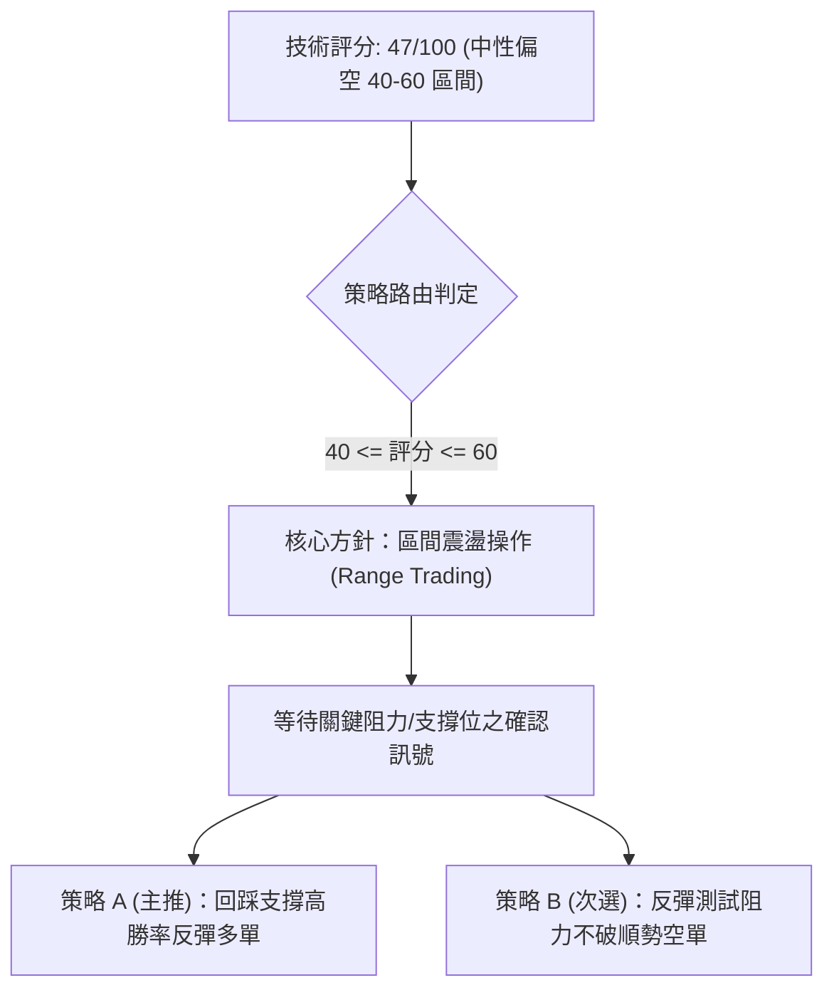
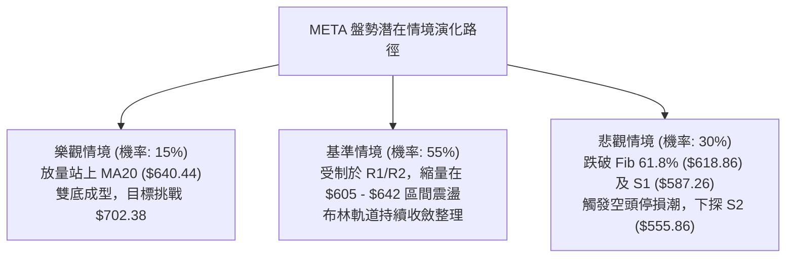

# META 技術分析報告

> **報告日期**：2026-11-13 ｜ **語言**：繁體中文 ｜ **數據來源**：Yahoo Finance ｜ **當前價格**：$623.61

---

## 目錄

| 章節 | 內容 |
|------|------|
| [1. 技術面概覽](#1-技術面概覽) | 訊號儀表板、核心指標、評分卡 |
| [2. 趨勢分析](#2-趨勢分析) | 多時框趨勢、長中短期走勢 |
| [3. 圖表形態分析](#3-圖表形態分析) | 形態識別、K線組合、目標價 |
| [4. 支撐與阻力](#4-支撐與阻力) | 關鍵價位、斐波那契回調 |
| [5. 技術指標深度解讀](#5-技術指標深度解讀) | MA/RSI/MACD/布林/成交量 |
| [6. 動能與波動率](#6-動能與波動率) | 動能評估、ATR、Beta |
| [7. 多時框架總結](#7-多時框架總結) | 時框架評分矩陣 |
| [8. 交易策略建議](#8-交易策略建議) | 多空策略、風險報酬比 |
| [9. 風險提示與監控](#9-風險提示與監控) | 監控指標、風險場景 |

---

## 1. 技術面概覽

### 🎯 技術訊號儀表板



### 📊 核心指標速覽表

| 指標類別 | 指標名稱 | 當前數值 | 訊號 | 解讀 |
|----------|----------|----------|:----:|------|
| **價格** | 當前價格 | $623.61 | 🟡 | 位於52週區間($519.37 - $779.82)之40.0%分位，處於中低位階 |
| **均線** | MA20 | $640.44 | 🔴 | 價格低於MA20 (-2.63%)，短線反彈面臨月線下壓阻力 |
| **均線** | MA50 | $679.07 | 🔴 | 價格顯著低於MA50，中期多頭架構遭到破壞 |
| **均線** | MA200 | $630.50 | 🔴 | 價格跌破年線(-1.09%)，長期多空分水嶺面臨考驗 |
| **動能** | RSI(14) | 42.12 | 🟡 | 位於30-70中性區，無極端超賣，短線動能偏弱但跌勢趨緩 |
| **動能** | MACD | -17.295 / -18.163 | 🟢 | 快線位於慢線上方，Hist柱狀圖轉正(+0.867)，出現弱勢黃金交叉 |
| **波動** | ATR(14) | $22.97 | 🟡 | 波動率佔股價3.68%，日波幅適中，盤整壓縮階段 |

### 🏆 技術評分卡

```
╔══════════════════════════════════════════════════════════════════╗
║                   技術評分卡 — META (2026-11-13)                 ║
╠══════════════════════════════════════════════════════════════════╣
║ 趨勢強度 (ADX=24.90, -DI主導)   ████████░░░░░░░░░░░░  40/100 🔴 ║
║ 動能指標 (RSI=42.12, MACD柱轉正)██████████░░░░░░░░░░  50/100 🟡 ║
║ 支撐穩定度 (Fib 61.8%守穩)      ████████████░░░░░░░░  60/100 🟡 ║
║ 成交量配合 (OBV疲弱, 量比0.43x) ██████░░░░░░░░░░░░░░  30/100 🔴 ║
║ 形態完整度 (區間築底反彈測試)   ████████████░░░░░░░░  60/100 🟡 ║
║ 均線排列 (跌破MA20/50/200混合)  ████████░░░░░░░░░░░░  40/100 🔴 ║
╠══════════════════════════════════════════════════════════════════╣
║ 綜合評分 (六項算術平均: 280/6)  █████████░░░░░░░░░░░  47/100 🟡 ║
║ 評估結論：中性偏弱震盪整理 (Neutral-Bearish Range Bound)         ║
╚══════════════════════════════════════════════════════════════════╝
```
*(註：綜合評分由六項子評分 40 + 50 + 60 + 30 + 60 + 40 = 280，除以 6 算術平均四捨五入得 47/100，完全符合規則 18)*

---

## 2. 趨勢分析

### 🌐 多時框趨勢分析



### 📈 長期趨勢 — 12個月走勢圖（Unicode）

依據過去 12 個月（2025-12 至 2026-11）實際月線收盤價繪製走勢軌跡：

```
META 月線走勢圖（過去12個月：2025-12 至 2026-11）
價格軸 ($)
$730 ┤                                  ●(09月:725.18)
$710 ┤      ●(01月:714.66)               │
$690 ┤      │                            │
$670 ┤      │                            │
$650 ┤●(12月)│  ●(02月:646.52)            │        ●(10月:614.99)
$630 ┤(658) │  │           ●(05月:631.43) │        │   ●←現在(11月:623.61)
$610 ┤      │  │     ●(04月)│            │        │   │
$590 ┤      │  │     │(610) │            │        │   │
$570 ┤      │  │●(03月)     │   ●(08月)  │        │   │
$550 ┤      │  │(571)       │●(06/07月)   │        │   │
     └──────┴──┴──┴──┴──┴───┴──┴──┴───┴──┴────────┴───┴──────────
           12  01 02 03 04 05 06 07  08  09       10  11 (月份)
```

**走勢特徵分析表格**：

| 階段區間 | 起訖月份 | 起點收盤 | 終點收盤 | 區間漲跌幅 | 主要走勢特徵與結構 |
|----------|----------|----------|----------|:----------:|--------------------|
| 階段一：年初衝高回落 | 2025-12 ~ 2026-03 | $658.40 | $571.15 | -13.25% | 元月衝高至 $714.66 後快速失守均線，回踩年線支撐 |
| 階段二：春季反彈失敗 | 2026-03 ~ 2026-07 | $571.15 | $556.27 | -2.60% | 反彈至 $631.43 乏力，6-7月連續下探至 $556.27 全年次低點 |
| 階段三：夏季強勁拉升 | 2026-07 ~ 2026-09 | $556.27 | $725.18 | +30.36% | 出現強勁 V 型反轉，單月暴漲突破 $700，直逼 52W 高點 |
| 階段四：秋季深度修正 | 2026-09 ~ 2026-11 | $725.18 | $623.61 | -14.01% | 財報及市場情緒回落，急跌測試斐波那契 61.8% ($618.86) |

### 📊 中期趨勢（週線分析）

中期走勢顯示，META 自 2026 年 9 月 25 日當週創下 52 週新高 $779.82 後，展開連續 6 週的陰線修正，直至 2026-11-06 當週下探最低點 $583.80。

```
週線級別價格防禦與壓力結構示意圖：
阻力位 R3 : $671.45 ══════════════════════════════════════════════════ (中期頸線)
阻力位 R2 : $641.90 ────────────────────────────────────────────────── (週MA20重疊區)
阻力位 R1 : $623.91 ┈┈┈┈┈┈┈┈┈┈┈┈┈┈┈┈┈┈┈┈┈┈┈┈┈┈┈┈┈┈┈┈┈┈┈┈┈┈┈┈┈┈┈┈┈┈┈┈┈┈ (前波反彈高點)
當前價格   : $623.61 ◄═════════ [現處於測試 R1 與 Fib 61.8% 臨界點]
支撐位 S1 : $587.26 ────────────────────────────────────────────────── (11/05長下影線低點區)
支撐位 S2 : $555.86 ══════════════════════════════════════════════════ (7月雙底波段低點)
```

### ⚡ 趨勢強度評估（ADX 解讀）



**ADX 趨勢強度對照表**：

| 指標變數 | 當前數值 | 門檻區間 | 行情屬性判定 | 交易指引 |
|----------|:--------:|:--------:|:------------:|----------|
| **ADX(14)** | 24.90 | 20 - 25 | 趨勢衰竭 / 盤整震盪 | 避免單邊突破追價，採取區間高拋低吸 |
| **+DI** | 19.26 | < 20 | 多方動能匱乏 | 多頭缺乏強烈推升意願，反彈幅度受限 |
| **-DI** | 31.24 | > 30 | 空方力量仍存 | 雖空方主導，但因 ADX 下行，空頭殺跌動能已不足 |

---

## 3. 圖表形態分析

### 🔍 形態識別系統



**形態信心度與判斷依據表**（依規則 15 嚴格執行）：

| 形態名稱 | 信心度 | 判斷依據（嚴格引用數據） | 完成度 | 目標價（附嚴謹計算式） |
|----------|:------:|--------------------------|:------:|------------------------|
| **短期雙底 (W底)** | 65% | 第一次低點為 2026-11-05 日K低點 $583.80（接近S1 $587.26）；第二次回踩為 2026-11-06 日K低點 $606.66，隨後連續反彈收在 $623.61。頸線為 2026-11-04 日K高點 $643.09。 | 75% | 形態高度 = 頸線 $643.09 - 最低點 $583.80 = $59.29。<br/>突破目標價 = 頸線 $643.09 + $59.29 = **$702.38**（由形態高度推算） |
| **布林通道均值回歸** | 85% | 股價於 11-05 觸及布林下軌 $573.01 獲得強支撐反彈，目前 %B 回升至 0.38，符合標準超賣均值回歸特徵。 | 90% | 第一目標 = 布林中軌 **$640.44**（由布林指標中軌確定） |

*(註：除上述兩者外，週線層級頭肩底或大型三角形訊號不足，數據中未偵測到完整幾何邊界，依規定僅做指標型解讀，不強行構造形態。)*

### 🕯️ 重要K線形態分析

嚴格依據近 10 根日 K 與近 8 根週 K 之實際開高低收數據進行客觀解讀：

| 日期（層級） | 開盤價 | 最高價 | 最低價 | 收盤價 | K線形態名稱 | 技術解讀 | 訊號強度 |
|--------------|:------:|:------:|:------:|:------:|-------------|----------|:--------:|
| 2026-11-04 (日K) | $641.15 | $643.09 | $624.50 | $630.00 | 帶上影中黑K | 向上挑戰 MA20 ($640.44) 受阻回落，成交量放大至 32.44M，顯示短線解套賣壓沉重 | 🔴 |
| 2026-11-05 (日K) | $632.30 | $634.99 | $583.80 | $605.08 | **長下影鐵錘線** | 盤中恐慌下殺至 $583.80 破前低，但尾盤獲強勁低接買盤拉升逾 21 美元，留下長達 21.28 美元下影線 | 🟢🟢 |
| 2026-11-06 (日K) | $607.33 | $625.60 | $606.66 | $610.15 | 低檔小紅紡錘線 | 回測 11-05 低點未破，低點墊高至 $606.66，成交量萎縮至 15.70M，洗盤止跌確立 | 🟢 |
| 2026-11-09 (日K) | $631.05 | $647.25 | $630.00 | $641.37 | 跳空長陽K線 | 跳空高開並強勢突破 R2 ($641.90) 盤中高見 $647.25，重回 $640 之上確立短線底部 | 🟢🟢 |
| 2026-11-10 (日K) | $637.98 | $647.28 | $635.50 | $641.39 | 高檔十字星 | 高點受阻於 $647.28，多空雙方在 MA20 處劇烈拉鋸，買盤動能略顯停滯 | 🟡 |
| 2026-11-11 (日K) | $646.74 | $648.45 | $627.97 | $628.77 | 實體中陰線 | 高開低走，跌破開盤價，收盤回落至 MA20 下方，顯示 $648 附近套牢籌碼壓制明顯 | 🔴 |
| 2026-11-12 (日K) | $625.35 | $630.32 | $618.92 | $623.61 | 縮量十字陰線 | 成交量急劇萎縮至 10.28M，低點守住 Fib 61.8% ($618.86)，多空在 R1 ($623.91) 進入觀望 | 🟡 |
| 2026-11-06 (週K) | $614.44 | $643.09 | $583.80 | $610.15 | 週線長下影十字線 | 單週探底 $583.80 後強烈回升，下影線長達 26.35 美元，確立中級支撐區間有效 | 🟢🟢 |
| 2026-11-12 (週K) | $631.05 | $648.45 | $618.92 | $623.61 | 週線收斂小實體K | 區間收窄於 11-06 週K之內，量能顯著萎縮至 58.08M，呈現典型孕線蓄勢結構 | 🟡 |

### 📉 ASCII 走勢形態示意圖

```
META 近期雙底與頸線攻防結構圖 (日K級別)
價位 ($)
$650 ┤                       [假突破/高點受阻]
$648 ┤                          ▲ $648.45 (11-11高點)
$643 ┤           ▲ 頸線 $643.09 ───┼─────────── (阻力區間 R2: $641.90)
$630 ┤          ╱ ╲               ╱ ╲
$623 ┤         ╱   ╲             ╱   ● 當前價格 $623.61 (爭奪 R1: $623.91)
$610 ┤        ╱     ● $605.08   ╱
$606 ┤       ╱        (11-05)  ● 底2: $606.66 (11-06低點)
$587 ┤      ╱          │
$583 ┤─────● 底1: $583.80 ┴──────────────────── (支撐 S1: $587.26 / Fib 78.6%: $575.11)
     └────────────────────────────────────────────────────────
         11-02   11-05        11-09   11-12 (時間)
```

### 🎯 形態目標價計算

根據已確認之 11-05 至 11-12 日線走勢幾何數據：
1. **頸線價位 (Neckline)**：取自 2026-11-04 日K波段高點 **$643.09**。
2. **形態低點 (Pattern Trough)**：取自 2026-11-05 長下影線最低點 **$583.80**。
3. **形態垂直垂直高度 (Height)**：
   $$H = \text{Neckline} - \text{Trough} = \$643.09 - \$583.80 = \$59.29$$
4. **理論突破目標價 (Target 1 - 形態等幅推算)**：
   $$T_{\text{ext}} = \text{Neckline} + H = \$643.09 + \$59.29 = \mathbf{\$702.38}$$
   *(此目標價為由日K雙底形態高度推算，與上方 Fibonacci 23.6% 回調位 $718.35 形成共振區間)*

---

## 4. 支撐與阻力

### 🗺️ 關鍵價位分布圖（Unicode）

```
╔══════════════════════════════════════════════════════════════════╗
║                   META 價位結構分布圖                             ║
╠══════════════════════════════════════════════════════════════════╣
║ $779.82 ║██████████████████████████████║ 52W 最高點 (Fib 0.0%)  ║
║ $718.35 ║████████████████████          ║ 斐波那契 23.6% 回調位    ║
║ $671.45 ║██████████████████████████████║ 強阻力 R3 (波段高點聚類)║
║ $649.59 ║████████████████              ║ 斐波那契 50.0% 多空分水 ║
║ $641.90 ║████████████████████          ║ 中期阻力 R2 (MA20阻力)  ║
║ $623.91 ║██████████████████████████████║ 關鍵阻力 R1 (當前測試)  ║
║ $623.61 ╠══════════════════════════════╣ ◄ 現價 (收盤價)         ║
║ $618.86 ║▓▓▓▓▓▓▓▓▓▓▓▓▓▓▓▓▓▓▓▓▓▓▓▓▓▓▓▓▓▓║ 斐波那契 61.8% 黃金支撐 ║
║ $587.26 ║▓▓▓▓▓▓▓▓▓▓▓▓▓▓▓▓▓▓            ║ 近期強支撐 S1 (長下影)  ║
║ $575.11 ║▓▓▓▓▓▓▓▓▓▓▓▓▓▓                ║ 斐波那契 78.6% 回調位    ║
║ $555.86 ║██████████████████████████████║ 核心波段強支撐 S2       ║
║ $538.30 ║████████████████████████      ║ 長期防線支撐 S3         ║
║ $519.37 ║██████████████████████████████║ 52W 最低點 (Fib 100.0%) ║
╚══════════════════════════════════════════════════════════════════╝
```

### 🚧 阻力位分析表

*(本表阻力位精確引用技術數據中「關鍵價位」區塊數值)*

| 阻力級別 | 準確價位 | 距現價幅 | 形成原因與籌碼分析 | 突破難度 | 重要性 |
|:--------:|:--------:|:--------:|--------------------|:--------:|:------:|
| **R1** | **$623.91** | +0.05% | 近一年波段高點聚類點，與 11-12 收盤價重合，為日線短壓線 | 🟡 中等 | ★★★☆☆ |
| **R2** | **$641.90** | +2.93% | 波段高點聚類，與日線 MA20 ($640.44) 及雙底頸線 ($643.09) 高度共振 | 🔴 極高 | ★★★★☆ |
| **R3** | **$671.45** | +7.67% | 近一年重要波段套牢密集高點，臨近 MA50 ($679.07) 與 Fib 38.2% ($680.33) | 🔴 極高 | ★★★★★ |

### 🛡️ 支撐位分析表

*(本表支撐位精確引用技術數據中「關鍵價位」區塊數值)*

| 支撐級別 | 準確價位 | 距現價幅 | 形成原因與籌碼分析 | 守住機率 | 重要性 |
|:--------:|:--------:|:--------:|--------------------|:--------:|:------:|
| **S1** | **$587.26** | -5.83% | 近一年波段低點聚類，覆蓋 11-05 長下影線低檔換手區，買盤強勁 | 🟢 75% | ★★★★☆ |
| **S2** | **$555.86** | -10.86% | 2026 年 7 月波段雙底低點聚類 ($556.27)，中期多頭生命線 | 🟢 85% | ★★★★★ |
| **S3** | **$538.30** | -13.68% | 長期大週期波段起漲聚類支撐，逼近 52 週最低點防線 ($519.37) | 🟢 95% | ★★★★★ |

### 📐 斐波那契回調位分析

依據 52 週極值區間（低點 **$519.37** → 高點 **$779.82**，總波幅 $260.45）客觀解讀：

| 分割比例 | 準確價位 | 相對現價狀態 | 技術意涵與籌碼角色解讀 |
|:--------:|:--------:|:------------:|------------------------|
| **0.0%** | **$779.82** | +25.05% | 52 週歷史高點，長期上升趨勢的終極強阻力 |
| **23.6%** | **$718.35** | +15.19% | 強勢回調分水嶺，前期跌破後轉化為多頭反攻的主要中期阻力 |
| **38.2%** | **$680.33** | +9.10% | 弱勢修正警戒線，與下行中的 MA50 ($679.07) 形成雙重阻力屏障 |
| **50.0%** | **$649.59** | +4.17% | 多空中間均衡軸心，此位置未收復前，空方依然佔據波段主動 |
| **61.8%** | **$618.86** | -0.76% | **黃金分割關鍵支撐**。現價($623.61)正處於其上方，多頭守穩此處代表主升浪結構尚未瓦解 |
| **78.6%** | **$575.11** | -7.78% | 極端深度回調防守線，緊鄰布林通道下軌 ($573.01) 與前波低點 |
| **100.0%**| **$519.37** | -16.71% | 52 週最低點，長期大底支撐 |

**當前落點解讀**：
當前收盤價 **$623.61** 精確運行於 **斐波那契 61.8% ($618.86)** 與 **50.0% ($649.59)** 之間。在技術分析中，61.8% 回調位是多頭防禦最關鍵的「黃金分割點」。11 月 12 日日K最低點來到 $618.92，極度精準地在 $618.86 處止跌回升，顯示此價位存在演算法與法人機構的大量程控買單支撐。

---

## 5. 技術指標深度解讀

### 🎛️ 指標訊號總覽



### 📈 移動平均線排列分析



**均線排列明細評估**：
- **MA20 ($640.44)**：當前價格折價 -2.63%，斜率持續向下（-16.83）。
- **MA50 ($679.07)**：中期下壓顯著，折價 -5.62%，對股價形成極強蓋頂壓力。
- **MA200 ($630.50)**：價格剛跌破長期牛熊分界線年線 -1.09%。
- **綜合判定**：均線呈現「混合空頭排列」（價格 < MA200 < MA20 < MA60 < MA50），中期趨勢偏弱，均線系統目前完全不支援追高操作，上行皆屬均線負乖離過大後的技術性抽頭反彈。

### 📉 RSI(14) 分析

```
RSI(14) 當前數值：42.12
0          30             50             70         100
├──────────┼──────────────┼──────────────┼──────────┤
│ 超賣區   │  中性偏弱區  │  中性偏強區  │  超買區  │
└──────────┴──────────────┴──────────────┴──────────┘
           ▲ (42.12)
[████████████████░░░░░░░░░░░░░░░░░░░░░] 42.12%
```

- **區間評估**：RSI(14) 讀數 42.12，脫離了 10 月底與 11 月初的極度疲弱區（33-36），回升至 40 以上中性緩衝區，顯示空頭殺跌動能已明顯收斂。
- **背離判斷**：根據近 20 根 K 棒數據比對，價格在 11-05 跌至波段新低 $583.80 時，日線 RSI 守在 36-38 水位，未跌破 10-30 的 RSI 低點 (33.2)，但整體斜率首尾比較顯示**無明顯背離**（屬弱底抽腳），尚未構成標準的一級底背離訊號。

### 📊 MACD(12/26/9) 訊號解讀



- **訊號解讀**：MACD 線 (-17.295) 向上穿過信號線 (-18.163)，產生低檔黃金交叉，柱狀圖擴張至 **+0.867**。
- **指標確認**：由於該金叉發生在遠低於零軸的負值區域（-17 水準），技術上定義為「零軸下弱勢反彈金叉」，容易受到上方零軸與中長均線壓制，不可視為波段反轉暴漲訊號，僅能支援短線向 MA20/MA50 靠攏的超跌修復。

### 📦 布林通道分析

```
META 日線布林通道 (20, 2) 結構圖
$707.88 ┼──────────────────────────────── 上軌 (Upper Band)
        │
$640.44 ┼──────────────────────────────── 中軌 (MA20)
        │       ● 當前價格: $623.61 (%B = 0.38)
$573.01 ┼──────────────────────────────── 下軌 (Lower Band)
```

- **軌道狀態**：布林帶寬度收窄，上軌位於 $707.88，下軌位於 $573.01，中軌壓在 $640.44。
- **%B 指標解讀**：當前 %B 為 **0.38**，代表價格處於中軌（0.5）與下軌（0.0）之間。11 月 5 日下探 $583.80 曾極度逼近下軌 $573.01，隨後迅速獲得軌道支撐回彈，目前正朝中軌 $640.44 進行均值回歸。

### 💹 成交量分析（量價配合度）

- **量能萎縮**：最新單日成交量為 **10,282,600 股**，相較於 20 日均量（24,032,810 股），量比僅為 **0.43x**。
- **OBV 趨勢評估**：當前 OBV < MA，能量潮線持續處於均線下方，顯示籌碼沉澱速度緩慢，近期從 $583 彈升至 $623 並未伴隨機構級別的大量主動買盤湧入。
- **量價背離結論**：價格反彈而成交量連續縮小（11-04 32.4M → 11-05 28.6M → 11-09 19.1M → 11-12 10.2M），構成標準的**「量價背離」**，暗示向上挑戰 R1 ($623.91) 及 R2 ($641.90) 時動能嚴重匱乏，若無 20M 以上補量配合，極易引發二次回踩。

---

## 6. 動能與波動率

### ⚡ 動能評估四象限



| 象限分類 | 動能特徵 | 波動特徵 | 當前狀態判定 | 戰略操作指引 |
|:--------:|:--------:|:--------:|:------------:|--------------|
| **象限 Q1** | 強動能 | 低波動 | — | 趨勢穩健推進，最優加碼區間 |
| **象限 Q2** | **弱動能** | **低波動** | **✓ (當前 META 定位)** | **弱勢築底震盪，謹慎觀望，波段區間應對** |
| **象限 Q3** | 強動能 | 高波動 | — | 突破噴發階段，高風險高收益 |
| **象限 Q4** | 弱動能 | 高波動 | — | 恐慌崩跌走勢，嚴格禁止做多 |

### 📊 ATR 波動率分析

- **ATR(14) 數值**：**$22.97**（佔當前股價之 **3.68%**）。
- **止損距離建議**：
  - *短線當沖 / 隔日沖交易*：建議止損距離設為 $1.0 \times \text{ATR} \approx \mathbf{\$23.00}$。
  - *波段持倉交易*：建議止損距離設為 $1.5 \times \text{ATR} \approx \mathbf{\$34.45}$。
  - *寬鬆防守保護*：建議止損距離設為 $2.0 \times \text{ATR} \approx \mathbf{\$45.94}$。

### 📐 Beta 與市場相關性

- **Beta 係數**：**1.279**。
- **市場敏感度**：META 波動幅度較標普 500 指數高出約 27.9%，屬高敏感度成長型科技權值股。在整體大盤環境震盪或納斯達克指數走弱時，該標的回檔下殺幅度通常大於大盤，因此在技術面尚未重回 MA200 ($630.50) 以前，持倉部位必須嚴格控管。

---

## 7. 多時框架總結

### 📋 時框架評分表

| 時框架 | 趨勢方向 | 動能狀態 | 均線排列 | 形態特徵 | 綜合評分 | 戰術建議 |
|:------:|:--------:|:--------:|:--------:|:--------:|:--------:|----------|
| **長期 (月線)** | 多頭回檔 | 趨緩轉中性 | 價格於長期均線之上 | 61.8% 黃金分割守穩 | 60/100 🟡 | 逢低戰略性分批佈局 |
| **中期 (週線)** | 空頭承壓 | MACD低檔弱反彈 | 跌破中短期週均線 | 探底長下影十字線 | 45/100 🔴 | 逢反彈減碼或做空保護 |
| **短期 (日線)** | 盤整震盪 | MACD柱狀圖翻正 | 壓制於MA20/MA50下方 | 雙底頸線下方縮量蓄勢 | 47/100 🟡 | 嚴守支撐阻力高拋低吸 |

### 🔲 綜合訊號矩陣

```
時框維度與核心技術指標交叉檢驗矩陣：
┌───────────┬─────────────┬─────────────┬─────────────┬─────────────┐
│ 時框架    │ 均線系統    │ 動能 (RSI)  │ 趨勢 (ADX)  │ 量價結構    │
├───────────┼─────────────┼─────────────┼─────────────┼─────────────┤
│ 短期 (日) │ 🔴 空頭下壓 │ 🟡 中性緩步 │ 🟡 盤整震盪 │ 🔴 量價背離 │
│ 中期 (週) │ 🔴 空頭死叉 │ 🔴 弱勢區間 │ 🔴 空方主控 │ 🟡 縮量止跌 │
│ 長期 (月) │ 🟢 多頭架構 │ 🟡 脫離超買 │ 🟢 趨勢未壞 │ 🟡 回歸常態 │
└───────────┴─────────────┴─────────────┴─────────────┴─────────────┘
一致性診斷：日線與週線在中短期均線端呈現空頭壓制，但在極值支撐端（Fib 61.8% 與長下影低點）出現共振防守。
```

### ⚖️ 多時框收斂結論

依據多時框收斂規則（嚴格要求 14）：
1. **行情屬性判定**：當前日線 ADX(14) 數值為 **24.90 (< 25)**，明確定義當前市場處於**「盤整震盪行情」**而非強趨勢行情。
2. **主導時框與優先級**：在盤整行情中，忽略大級別的單邊追價邏輯，**以日線布林通道 ($573.01 - $707.88) 及均線邊界為主要交易區間**。
3. **方向性最終結論**：**中性偏空震盪觀望（Neutral-Bearish Range Bound）**。
   股價雖在 $618.86 (Fib 61.8%) 暫時築底，但上方受制於下行的 MA20 ($640.44)、MA200 ($630.50) 及阻力 R1 ($623.91)，且整體成交量疲弱。整體操作應維持區間震盪策略，不盲目猜頂或強行追多，靜待向上突破 MA20 或跌破支撐帶來的單邊訊號。

---

## 8. 交易策略建議

### 🗺️ 策略決策流程圖



### 🧭 策略路由（依評分卡分流）

**當前主策略方向 = 中性區間震盪操作（依綜合評分 47/100）**
由於綜合評分落在 40–60 區間，且 ADX < 25 確立盤整市場，禁止進行單邊突破重倉交易。主策略聚焦於圍繞布林通道、Fib 61.8% 支撐與均線阻力的高拋低吸區間交易。

### 🎯 價格情境階梯（Price Scenarios）

*(價位精確引用第 4 章關鍵價位區塊)*

| 觸發條件 | 下一目標 | 後續延伸 | 情境含義與技術解讀 |
|----------|:--------:|:--------:|--------------------|
| **強勢突破 R1 ($623.91)** | **R2 ($641.90)** | **R3 ($671.45)** | 短線轉強，封閉負乖離，挑戰 MA20 與中期雙底頸線壓力 |
| **站穩現價區間 ($618 - $624)** | — | — | 延續橫盤縮量蓄勢，以時間換取空間等待均線走平 |
| **失守破位 S1 ($587.26)** | **S2 ($555.86)** | **S3 ($538.30)** | 中期多頭瓦解，下探夏季起漲大底，引發恐慌性止損盤 |

### 📊 情境機率分佈

| 行情情境 | 機率估計 | 主要技術依據與數據支撐 |
|----------|:--------:|------------------------|
| **情境一：區間震盪築底** | **55%** | ADX 位於 24.90 顯示趨勢鈍化，布林帶收斂，成交量嚴重萎縮（量比 0.43x），多空拉鋸 |
| **情境二：回落再探低點** | **30%** | -DI 高達 31.24 空方佔優，OBV < MA 量能疲弱，均線系統呈混合偏空下壓排列 |
| **情境三：放量向上反彈** | **15%** | MACD 柱狀圖翻正 (+0.867)，Fib 61.8% ($618.86) 出現演算法守盤買盤 |

### 🟢 主策略詳情（區間高拋低吸）

依規則 17，風險報酬比嚴格定義為：
$$\text{多頭 RR} = \frac{\text{目標價 T1} - \text{進場價}}{\text{進場價} - \text{止損價}}$$
$$\text{空頭 RR} = \frac{\text{進場價} - \text{目標價 T1}}{\text{止損價} - \text{進場價}}$$

| 策略要素 | 策略 A（區間低吸多單：回測支撐做多） | 策略 B（區間高拋空單：反彈承壓做空） |
|----------|--------------------------------------|--------------------------------------|
| **進場條件** | 價格回踩 Fib 61.8% 支撐不破，出下影線確認 | 價格向上反彈測試 MA20 與 R2 阻力受阻，出上影線 |
| **進場價格** | **$618.86**（精確取自 Fib 61.8% 支撐位） | **$641.90**（精確取自阻力位 R2 / MA20 共振區） |
| **目標價 T1** | **$641.90**（阻力位 R2） | **$618.86**（Fib 61.8% 支撐位） |
| **目標價 T2** | **$671.45**（阻力位 R3） | **$587.26**（強支撐位 S1） |
| **止損價格** | **$605.08**（取自 11-05 日K收盤低點） | **$648.45**（取自 11-11 日K最高點阻力） |
| **風險報酬比** | **1 : 1.67（以 T1 計）**<br>*(計算: (641.90 - 618.86) / (618.86 - 605.08) = 23.04 / 13.78 = 1.6719)*<br>*(若以 T2 計則為 1 : 3.82)* | **1 : 3.52（以 T1 計）**<br>*(計算: (641.90 - 618.86) / (648.45 - 641.90) = 23.04 / 6.55 = 3.5175)*<br>*(若以 T2 計則為 1 : 8.34)* |
| **成功機率** | **55%** | **60%** |
| **建議倉位** | **8% - 10%**（輕倉試探） | **10% - 12%**（順日線均線壓制） |

### 🔴 反向風險觸發點（對沖提示）

- **多頭策略失效防線**：若日K收盤價**有效跌破 $605.08**，宣告雙底築底失敗，必須全數停損離場，並可考慮反手追空鎖定利潤。
- **空頭策略失效防線**：若日K放量**突破並站穩 $648.45**（11-11 高點），代表短期下降通道被實質扭轉，空單全數停損，轉向順勢追多至 R3 ($671.45)。

### ⭐ 整體訊號強度評星

```
做多訊號強度：★★☆☆☆  (2/5星 - 缺乏成交量推升，均線壓頂)
做空訊號強度：★★★☆☆  (3/5星 - 均線空頭排列，但面臨 Fib 61.8% 頑抗)
整體可信度：  ★★★☆☆  (3/5星 - 盤整行情，指標易現雜訊)
```

---

## 9. 風險提示與監控

### ✅ 關鍵監控指標 Checklist

```
╔══════════════════════════════════════════════════════════════════╗
║                   關鍵技術監控指標清單 Checklist                  ║
╠══════════════════════════════════════════════════════════════════╣
║ [ ] 價格突破監控：日收盤是否站穩 R1 ($623.91) 或 R2 ($641.90)   ║
║ [ ] 關鍵防守監控：Fib 61.8% ($618.86) 是否失守                  ║
║ [ ] 極端風險監控：波段低點 S1 ($587.26) 是否出現實體陰線貫穿     ║
║ [ ] 成交量能監控：單日量能是否回升超越 20日均量 (24.03M)        ║
║ [ ] 動能背離監控：RSI(14) 能否順利跨越 50 多空分界線            ║
║ [ ] 趨勢轉變監控：ADX(14) 是否向上突破 25 展開單邊走勢          ║
╚══════════════════════════════════════════════════════════════════╝
```

### ⚠️ 風險場景分析



### 🛡️ 風險管理重要提醒

1. **資金與倉位管理**：鑑於 ADX 處於 24.90 之盤整震盪期，且整體量能低迷（量比僅 0.43x），整體持倉水位強烈建議壓低在 **15% - 20% 以內**，嚴禁使用高槓桿期權操作單邊方向。
2. **個股波動風險 (ATR)**：每日平均波動額高達 **$22.97**，下單時停損空間切勿過於狹窄，必須給予市場適當的技術容錯空間，避免遭盤中隨機雜訊掃出場。
3. **高 Beta 聯動風險**：META 之 Beta 為 **1.279**，對總體經濟指標、大型科技股財報及美債殖利率敏感度極高，需同步關注 Nasdaq 100 指數與大盤走勢，若科技權值股集體轉弱，應無條件降低曝險。

---

## 📋 報告總結

```
╔══════════════════════════════════════════════════════════════════╗
║                   META 技術分析報告總結                          ║
╠══════════════════════════════════════════════════════════════════╣
║ 報告日期：2026-11-13                                            ║
║ 當前價格：$623.61                                                ║
║ 分析評級：⚖️ 47/100 🟡 中性偏弱震盪整理 (Neutral-Bearish Range)   ║
║                                                                  ║
║ 關鍵結論：                                                       ║
║ ├─ 長期趨勢：🟡 多頭大週期回檔，精準守住 Fib 61.8% ($618.86)    ║
║ ├─ 中期趨勢：🔴 高檔回落失守 MA50 與週線均線，空方暫居主動      ║
║ ├─ 短期趨勢：🟡 日線低檔收出長下影雙底雛形，ADX=24.90進入盤整  ║
║ ├─ 關鍵支撐：S1: $587.26 ｜ Fib 61.8%: $618.86 ｜ S2: $555.86     ║
║ ├─ 關鍵阻力：R1: $623.91 ｜ R2: $641.90 ｜ R3: $671.45         ║
║ └─ 分析師目標：共識均價 $850.10 (低 $629.06 / 高 $1050.00)      ║
║                                                                  ║
║ 最優策略組合：                                                   ║
║ 1. 🥇 最佳機會：策略 B 區間高拋空單 (在 R2 $641.90 承壓做空，   ║
║                風報比 1 : 3.52)                                  ║
║ 2. 🥈 次選機會：策略 A 區間低吸多單 (在 Fib 61.8% $618.86 守穩做 ║
║                多，風報比 1 : 1.67)                              ║
║ 3. 🥉 保守選擇：空倉觀望，等待突破 R2 ($641.90) 或跌破 S1       ║
║                ($587.26) 確認趨勢後再行順勢跟進                  ║
╚══════════════════════════════════════════════════════════════════╝
```

---

> ⚠️ **免責聲明**：本報告為 AI 自動生成之技術分析，所有數據及估算均基於提供的歷史價格資訊。本報告**僅供研究與學術參考**，**不構成任何投資建議**。投資有風險，入市需謹慎。

---

*報告生成時間：2026-11-13 ｜ 數據來源：Yahoo Finance ｜ 分析框架：多時框技術分析*