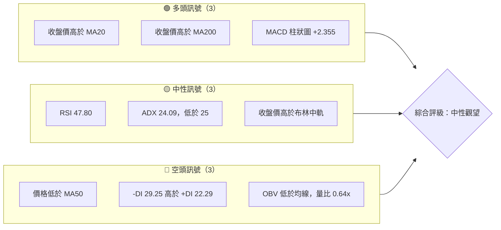
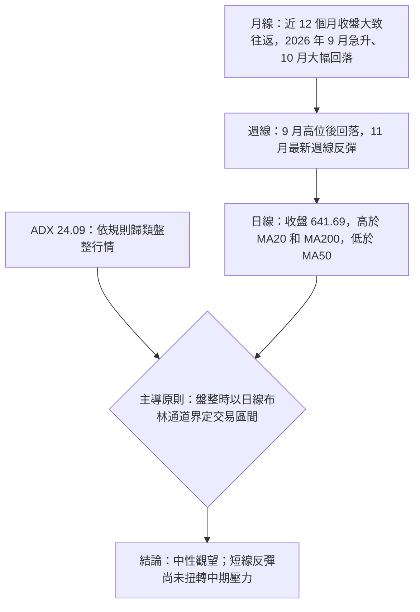
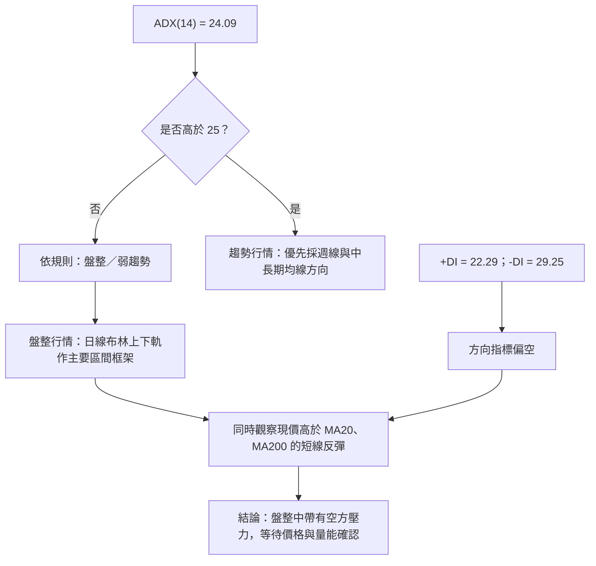
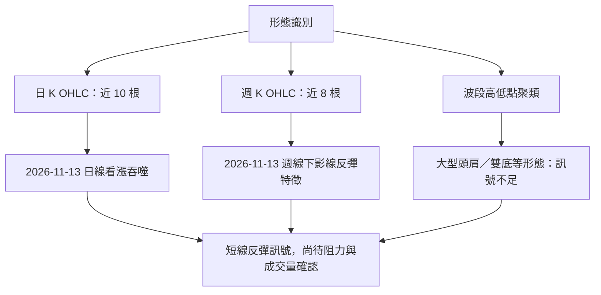
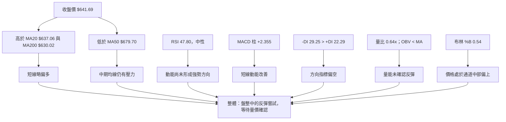
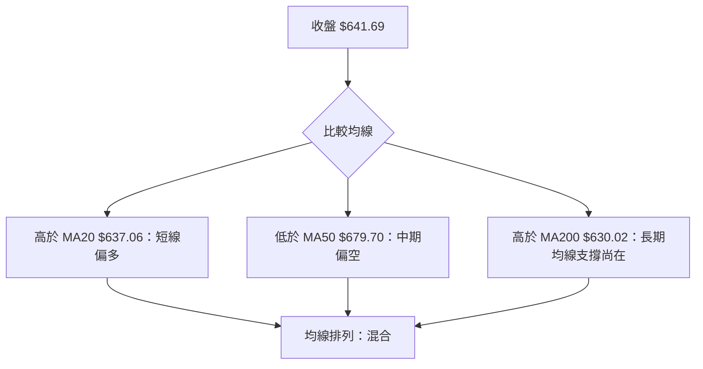
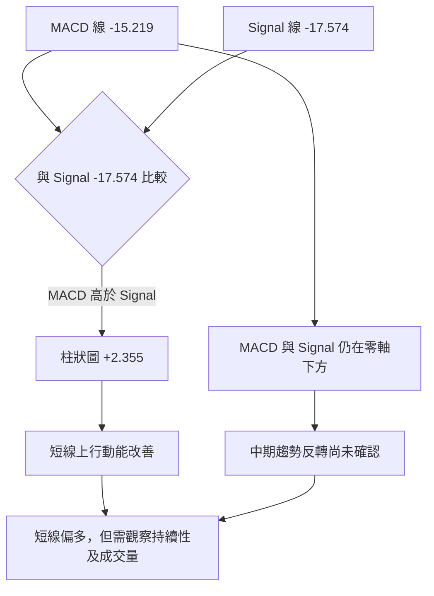
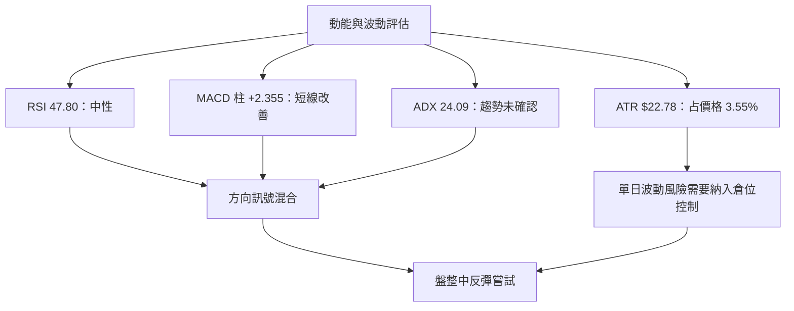
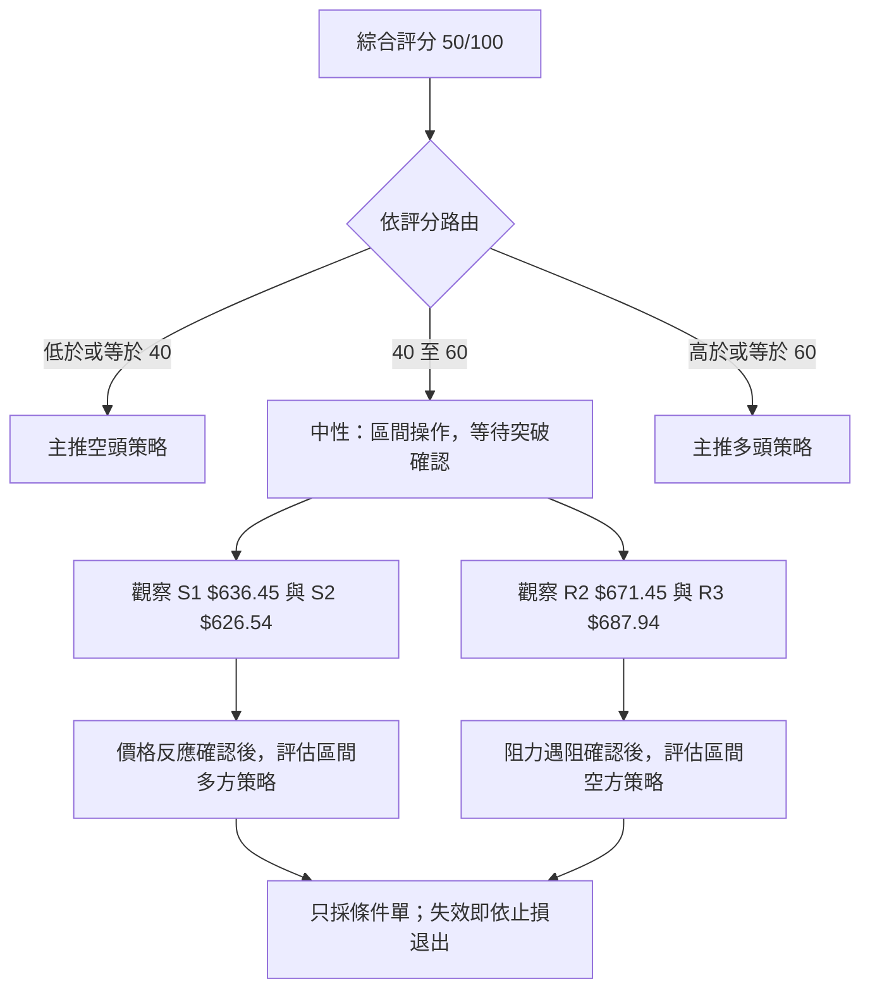
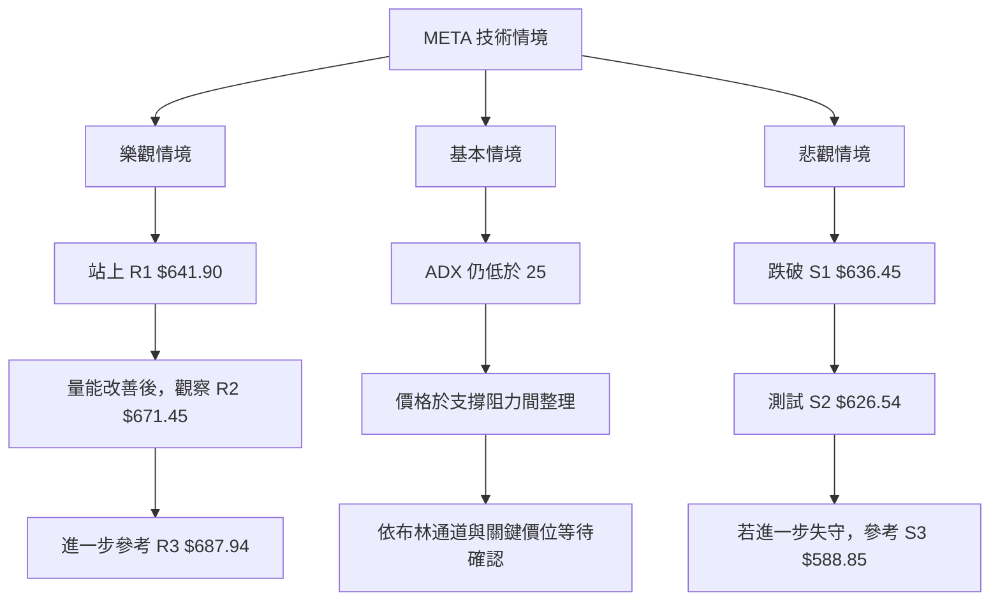

# META 技術分析報告

> **報告日期**：2026-11-14 ｜ **語言**：繁體中文 ｜ **數據來源**：Yahoo Finance（依使用者提供資料）｜ **當前價格**：**$641.69**

---

## 目錄

| 章節 | 內容 |
|------|------|
| [1. 技術面概覽](#1-技術面概覽) | 訊號儀表板、核心指標、評分卡 |
| [2. 趨勢分析](#2-趨勢分析) | 多時框趨勢、長中短期走勢 |
| [3. 圖表形態分析](#3-圖表形態分析) | 形態識別、K線組合、目標價 |
| [4. 支撐與阻力](#4-支撐與阻力) | 關鍵價位、斐波那契回調 |
| [5. 技術指標深度解讀](#5-技術指標深度解讀) | MA、RSI、MACD、布林、成交量 |
| [6. 動能與波動率](#6-動能與波動率) | 動能評估、ATR、Beta |
| [7. 多時框架總結](#7-多時框架總結) | 時框架評分矩陣 |
| [8. 交易策略建議](#8-交易策略建議) | 區間策略、進出場與風險報酬 |
| [9. 風險提示與監控](#9-風險提示與監控) | 監控指標、風險場景 |

---

## 1. 技術面概覽

### 🎯 技術訊號儀表板

技術面目前呈現「短線反彈訊號與中期偏弱結構並存」：收盤價高於 MA20、MA200，且 MACD 柱狀圖翻正；另一方面，價格仍低於 MA50，-DI 高於 +DI，OBV 低於其均線，成交量亦低於 20 日均量。ADX 為 24.09，依本報告的收斂規則歸類為**盤整行情**，但已接近趨勢判定門檻。



> 上圖以主要訊號作分類，並非統計全部指標的投票數。指標彼此有交叉、不同時框可能給出不同方向，須結合後續章節判讀。

### 📊 核心指標速覽表

| 指標類別 | 指標名稱 | 當前數值 | 訊號 | 解讀 |
|----------|----------|----------:|------|------|
| 價格 | 收盤價 | **$641.69** | 🟡 | 位於 52 週區間中段，距 52 週高點仍有距離 |
| 均線 | MA20 | $637.06 | 🟢 | 收盤價高於 MA20 $4.63，短線回到均線上方 |
| 均線 | MA50 | $679.70 | 🔴 | 收盤價低於 MA50 $38.01，中期均線仍有壓力 |
| 均線 | MA200 | $630.02 | 🟢 | 收盤價高於 MA200 $11.67，長期均線未被失守 |
| 動能 | RSI(14) | 47.80 | 🟡 | 中性，尚未進入超買或超賣區 |
| 動能 | MACD / Signal | -15.219 / -17.574 | 🟡 | MACD 線仍在零軸下方，但柱狀圖為正，代表下行動能減弱 |
| 動能 | MACD Histogram | +2.355 | 🟢 | 短線動能改善，尚不足以確認中期反轉 |
| 趨勢 | ADX(14) | 24.09 | 🟡 | 依門檻屬盤整／弱趨勢，接近 25 |
| 趨勢 | +DI / -DI | 22.29 / 29.25 | 🔴 | 空方方向指標仍領先 |
| 波動 | ATR(14) | $22.78 | 🟡 | 約為價格的 3.55%，單日波幅不低 |
| 成交量 | 量比（對 20 日均量） | 0.64x | 🔴 | 最新成交量低於均量，反彈的量能確認不足 |
| 布林 | %B | 0.54 | 🟡 | 略高於中軌，仍在通道中部偏上位置 |

### 🏆 技術評分卡

評分採 1–10 分制，各子項按提供的趨勢、動能、價位、量能、形態與均線資料評定。六項算術平均為 **5.00/10**，換算為 **50/100**；這是區間操作的中性分數，不代表預期報酬率。

```text
╔══════════════════════════════════════════════════════════════╗
║              技術評分卡 — META（2026-11-14）                ║
╠══════════════════════════════════════════════════════════════╣
║ 趨勢強度      ██████████░░░░░░░░░░  5/10  🟡              ║
║ 動能指標      ██████████░░░░░░░░░░  5/10  🟡              ║
║ 支撐穩定度    ████████████░░░░░░░░  6/10  🟡              ║
║ 成交量配合    ████████░░░░░░░░░░░░  4/10  🔴              ║
║ 形態完整度    ██████████░░░░░░░░░░  5/10  🟡              ║
║ 均線排列      ██████████░░░░░░░░░░  5/10  🟡              ║
╠══════════════════════════════════════════════════════════════╣
║ 六項平均      ██████████░░░░░░░░░░  5/10  🟡              ║
║ 綜合評分      ██████████░░░░░░░░░░ 50/100 中性觀望         ║
╚══════════════════════════════════════════════════════════════╝
```

| 子評分 | 分數 | 評分依據 |
|--------|-----:|----------|
| 趨勢強度 | 5/10 | ADX 24.09，屬盤整／弱趨勢；DI 仍偏空，但週線最新一週回升 |
| 動能指標 | 5/10 | RSI 中性、MACD 柱轉正，隨機指標則進入超買區 |
| 支撐穩定度 | 6/10 | 現價靠近 S1 $636.45、S2 $626.54，並高於 MA200；但支撐尚未經過多次確認 |
| 成交量配合 | 4/10 | 最新量比 0.64x，且 OBV 低於均線，未確認反彈 |
| 形態完整度 | 5/10 | 日 K 有一組看漲吞噬，但更大的價格幾何形態資料不足 |
| 均線排列 | 5/10 | 高於 MA20、MA200，低於 MA50，排列混合 |

**評級摘要：🟡 中性觀望。** 短線有改善跡象，但尚缺乏突破關鍵阻力與成交量同步擴張的確認。

---

## 2. 趨勢分析

### 🌐 多時框趨勢分析



| 時框 | 可觀察資料 | 當前判讀 | 訊號 |
|------|------------|----------|------|
| 月線 | 月收盤序列、52 週高低區間 | 近一年高波動、方向不連續；2026 年 9 月上升後，10 月回吐大部分漲幅 | 🟡 |
| 週線 | 近 20 週收盤、RSI、MACD 柱與成交量 | 自 9 月高位回落後，近期出現反彈，但週線 MACD 柱直到最新一週才轉正 | 🟡 |
| 日線 | 收盤價、均線、震盪指標、布林帶 | 短線回到 MA20 上方，但低於 MA50，方向尚未統一 | 🟡 |

### 📈 長期趨勢 — 12 個月走勢圖

下圖使用資料提供的 **2025 年 12 月至 2026 年 11 月** 12 個月收盤價；2026 年 11 月為截至 11 月 13 日的資料，不是完整月收盤。圖中點位對應表列數值，縱向位置為視覺化呈現。

```text
META 月線收盤走勢（2025-12 至 2026-11；每點對應表列價格）

$750 ┤                         ● Sep 725.18
$720 ┤       ● Jan 714.66     ╱ ╲
$690 ┤      ╱       ╲        ╱    ╲
$660 ┤ ● Dec          ● Feb         ╲                         ● Nov 641.69
$630 ┤658.40          646.52          ● May 631.43   ● Aug 571.89
$600 ┤                     ╲    ● Apr 610.86   ╲   ╱      ╲
$570 ┤                       ● Mar 571.15       ● Jun      ● Jul 556.27
     └──────────────────────────────────────────────────────────────
      Dec   Jan   Feb   Mar   Apr   May   Jun   Jul   Aug   Sep   Oct   Nov
```

| 月份 | 收盤價 | 月變化 | 解讀 |
|------|-------:|-------:|------|
| 2025-12 | $658.40 | — | 12 個月觀察區間起點 |
| 2026-01 | $714.66 | +8.55% | 月度上行 |
| 2026-02 | $646.52 | -9.54% | 回吐前月漲幅 |
| 2026-03 | $571.15 | -11.66% | 下行延續 |
| 2026-04 | $610.86 | +6.95% | 反彈 |
| 2026-05 | $631.43 | +3.37% | 反彈延續 |
| 2026-06 | $562.85 | -10.86% | 再度回落 |
| 2026-07 | $556.27 | -1.17% | 此 12 個月序列低點 |
| 2026-08 | $571.89 | +2.81% | 低位反彈但幅度有限 |
| 2026-09 | $725.18 | +26.81% | 期間最大月升幅 |
| 2026-10 | $614.99 | -15.19% | 大幅回吐 |
| 2026-11* | $641.69 | +4.34% | 月內截至 11 月 13 日 |

\* 2026 年 11 月數值為截至 11 月 13 日資料，並非完整月線收盤。

- 2025 年 11 月收盤 $645.76 至 2026 年 11 月 13 日收盤 $641.69，變化約 **-0.63%**。
- 12 個月內月收盤最高為 2026 年 9 月的 $725.18，最低為 2026 年 7 月的 $556.27。
- 2026 年 9 月上漲後，10 月回落；11 月目前反彈，但仍低於 9 月月收盤高點。
- 月線資料顯示高波動與方向切換，尚不足以單憑月收盤序列確認穩定的多頭趨勢。

### 📊 中期趨勢（週線分析）

近 20 週收盤由 2026-09-25 的 $751.66 回落至 2026-11-06 的 $610.15，累計約 **-18.83%**；最新週截至 2026-11-13 收於 $641.69，較前週上升約 **5.17%**。最新一週是回升訊號，但尚未收復週線下跌期間的多個價位區域。

```text
近期週線結構示意（標示資料提供的收盤價；非等比例圖）

$751.66 ── 2026-09-25 高收盤
    │
    ├── $728.08 ── 2026-10-02
    ├── $718.67 ── 2026-10-09
    ├── $709.33 ── 2026-10-16
    │
    ├── $642.62 ── 2026-10-23
    ├── $614.99 ── 2026-10-30
    ├── $610.15 ── 2026-11-06
    └── $641.69 ── 2026-11-13  ← 最新週反彈

下方參考支撐：S1 $636.45 → S2 $626.54 → S3 $588.85
上方參考阻力：R1 $641.90 → R2 $671.45 → R3 $687.94
```

週線最近一週成交量為 73,271,800，低於前一週的 110,051,300，也低於 2026-10-30 週的 173,999,500。價格反彈而週量較前週下降，故量能對反彈的確認程度有限。

### ⚡ 趨勢強度評估（ADX 解讀）



| ADX 區間 | 常見解讀 | META 現況 |
|---------:|----------|-----------|
| 低於 20 | 趨勢較弱，盤整可能性高 | 不適用；ADX 為 24.09 |
| 20–25 | 弱趨勢／盤整過渡區 | **目前所在區域** |
| 高於 25 | 趨勢力量較明顯 | 尚未達成 |
| 高於 40 | 強趨勢區間 | 不適用 |

ADX 衡量趨勢強度而非多空方向。方向需參考 DI：目前 **-DI 29.25 高於 +DI 22.29**，所以即使 ADX 接近 25，方向指標仍偏空。基於規則 14，當前未達 ADX > 25，日線布林通道是主要區間參考；但 MA50 與 DI 的空方壓力仍須納入風險控管。

---

## 3. 圖表形態分析

### 🔍 形態識別系統

現有資料可支持短線 K 線組合與指標位置判讀，但無法充分驗證頭肩、雙頂、雙底、旗形或三角形等幾何形態。近 10 根日 K 與近 8 根週 K 的 OHLC 範圍有限，亦無完整日線成交量序列供幾何結構交叉驗證。



| 形態 | 信心度 | 判斷依據（引用數據） | 完成度 | 目標價 |
|------|-------:|----------------------|-------:|--------|
| 日線看漲吞噬 | 75% | 2026-11-13 實體由 $627.21 上升至 $641.69，完全包覆 2026-11-12 實體 $623.61–$625.35 | 已形成單根組合；後續確認不足 | 不以單根 K 棒推算目標價 |
| 週線下影線反彈特徵 | 60% | 2026-11-13 週開 $631.05、低 $618.92、收 $641.69；下影線長於實體 | 單週反彈訊號，確認不足 | 不以單週 K 棒推算目標價 |
| 雙底／頭肩／三角形／旗形 | <50% | 提供的週線收盤與有限 OHLC 不足以確認幾何結構 | 訊號不足 | **數據中未偵測到；不推算形態目標價** |

### 🕯️ 重要 K 線形態分析

以下 K 線判讀只依據提供的近 10 根日 K、近 8 根週 K 的開、高、低、收，不以區塊之外的 OHLC 推斷 K 線形態。

#### 日 K

| 日期 | 開 | 高 | 低 | 收 | K 線形態 | 解讀 | 訊號 |
|------|---:|---:|---:|---:|----------|------|------|
| 2026-11-02 | $614.44 | $621.69 | $606.41 | $606.73 | 偏空實體 K | 收盤接近當日低位，賣方主導 | 🔴 |
| 2026-11-03 | $610.76 | $624.84 | $610.10 | $621.03 | 偏多實體 K | 收盤高於開盤，反彈延續 | 🟢 |
| 2026-11-04 | $641.15 | $643.09 | $624.50 | $630.00 | 偏空實體 K | 高開後收低，收盤低於開盤 | 🔴 |
| 2026-11-05 | $632.30 | $634.99 | $583.80 | $605.08 | 長下影線、偏空收盤 | 日內下探幅度大，收盤仍低於開盤；不能單獨視為反轉確認 | 🟡 |
| 2026-11-06 | $607.33 | $625.60 | $606.66 | $610.15 | 小實體 K | 開收差距小，方向性較弱 | 🟡 |
| 2026-11-09 | $631.05 | $647.25 | $630.00 | $641.37 | 偏多實體 K | 收盤高於開盤 | 🟢 |
| 2026-11-10 | $637.98 | $647.28 | $635.50 | $641.39 | 小實體、近十字特徵 | 開收差距小，顯示短線猶豫 | 🟡 |
| 2026-11-11 | $646.74 | $648.45 | $627.97 | $628.77 | 偏空實體 K | 收盤顯著低於開盤，日內賣壓明顯 | 🔴 |
| 2026-11-12 | $625.35 | $630.32 | $618.92 | $623.61 | 偏空實體 K | 收盤低於開盤，短線仍有拋售 | 🔴 |
| **2026-11-13** | **$627.21** | **$643.91** | **$624.79** | **$641.69** | **看漲吞噬** | 實體完全包覆前一日實體，支持短線反彈；仍需觀察阻力與量能 | 🟢 |

#### 週 K

| 日期 | 開 | 高 | 低 | 收 | K 線形態 | 解讀 | 訊號 |
|------|---:|---:|---:|---:|----------|------|------|
| 2026-10-09 | $727.71 | $747.60 | $711.68 | $718.67 | 偏空實體 K | 收盤低於開盤，位於週內區間偏低位置 | 🔴 |
| 2026-10-16 | $728.50 | $771.27 | $702.71 | $709.33 | 偏空實體、上下影線 | 高點未能轉化為強勢收盤，週收低於開盤 | 🔴 |
| 2026-10-23 | $707.16 | $713.22 | $633.27 | $642.62 | 大幅偏空實體 K | 週內下跌幅度大，收盤靠近低位 | 🔴 |
| 2026-10-30 | $638.36 | $647.69 | $609.00 | $614.99 | 偏空實體 K | 收盤低於開盤，跌勢延續 | 🔴 |
| 2026-11-06 | $614.44 | $643.09 | $583.80 | $610.15 | 偏空小實體、長下影線 | 下探後回收部分跌幅，但週收仍低於開盤 | 🟡 |
| **2026-11-13** | **$631.05** | **$648.45** | **$618.92** | **$641.69** | **偏多實體、帶下影線** | 收盤高於開盤，低位出現承接跡象；尚未改變週線中期回落結構 | 🟢 |

### 📉 ASCII 走勢形態示意圖

下圖表示最近週收盤由高位回落、近期反彈；不是頭肩或雙底形態認定。價位均使用提供的週收盤及關鍵價位。

```text
META 近期週線收盤示意（非等比例）

$751.66  ● 2026-09-25
          ╲
$728.08    ●
            ╲
$718.67      ●
              ╲
$709.33        ●
                ╲
$642.62           ●
                   ╲
$614.99              ●
                      ╲
$610.15                 ●────────╮
                                  ╰──● $641.69（2026-11-13）

價位參照：
R3 $687.94 ─────────────────────────────────
R2 $671.45 ─────────────────────────────────
R1 $641.90 ─────────────── 現價 $641.69 附近
S1 $636.45 ─────────────────────────────────
S2 $626.54 ─────────────────────────────────
S3 $588.85 ─────────────────────────────────
```

### 🎯 形態目標價計算

- **沒有足夠資料確認可量度的幾何形態**，因此不使用頭肩、雙底、三角形或旗形的高度計算法。
- 看漲吞噬是 K 線組合，不等同於可直接推算固定高度目標的幾何形態。
- 本報告策略中的價位目標採用已提供的關鍵阻力／支撐，而非自行構造形態目標。
- **形態推算目標價：數據中未偵測到。**

---

## 4. 支撐與阻力

### 🗺️ 關鍵價位分布圖

以下全部價位引用資料提供的 OHLCV 波段高低點聚類與斐波那契回調值，未自行創設支撐或阻力位。

```text
META 價位結構分布圖（上方阻力／下方支撐）

$687.94 ║████████████████████████║ R3 阻力
$671.45 ║████████████████████    ║ R2 阻力
$649.59 ║························║ 斐波那契 50.0%
$641.90 ║████████████████████████║ R1 阻力
$641.69 ╠════════ 現價 ══════════╣ 收盤價
$637.06 ║························║ MA20（不是波段支撐位）
$636.45 ║▓▓▓▓▓▓▓▓▓▓▓▓▓▓▓▓▓▓▓▓▓▓║ S1 支撐
$630.02 ║························║ MA200（不是波段支撐位）
$626.54 ║████████████████████████║ S2 支撐
$618.86 ║························║ 斐波那契 61.8%
$588.85 ║████████████████████    ║ S3 支撐
$577.90 ║························║ 布林下軌（區間參考）
```

> R1 $641.90 高於收盤價 $641.69 僅 $0.21。這是資料所列的阻力聚類數值，實際交易時需注意價差、盤中波動與收盤確認。

### 🚧 阻力位分析表

| 阻力級別 | 價位 | 形成依據 | 突破難度 | 重要性 |
|----------|-----:|----------|----------|--------|
| R1 | **$641.90** | 近一年波段高點聚類；距現價僅 +0.03% | 短線需確認收盤能否有效站上 | 高：現價所在的最近阻力 |
| R2 | **$671.45** | 近一年波段高點聚類；距現價 +4.64% | 中等；同時接近 MA50 $679.70 區域，但 MA50 並非本表的關鍵價位 | 高：下一個波段聚類阻力 |
| R3 | **$687.94** | 近一年波段高點聚類；距現價 +7.21% | 中高；若未放量突破 R2，上行延續較難確認 | 高：較上方的波段阻力 |

### 🛡️ 支撐位分析表

| 支撐級別 | 價位 | 形成依據 | 守住條件／判讀 | 重要性 |
|----------|-----:|----------|----------------|--------|
| S1 | **$636.45** | 近一年波段低點聚類；距現價 -0.82% | 現價略高於此位，需觀察回測是否有承接 | 高：最近支撐 |
| S2 | **$626.54** | 近一年波段低點聚類；距現價 -2.36% | 若 S1 失守，為下一層結構參考 | 高：與 MA20、MA200 下方區域相鄰，但支撐價本身以資料值為準 |
| S3 | **$588.85** | 近一年波段低點聚類；距現價 -8.23% | 若前兩層失守，回落風險擴大 | 高：較下方的重要支撐 |

「守住機率」無法由單一快照精確估計，故不提供虛構百分比；表中以需要觀察的技術條件描述。

### 📐 斐波那契回調位分析

以下直接引用資料提供的 52 週區間與回調值：

| 回調比率 | 價位 |
|----------|-----:|
| 0.0%（52 週高點） | $779.82 |
| 23.6% | $718.35 |
| 38.2% | $680.33 |
| 50.0% | $649.59 |
| 61.8% | $618.86 |
| 78.6% | $575.11 |
| 100.0%（52 週低點） | $519.37 |

現價 **$641.69 位於 50.0% 回調位 $649.59 與 61.8% 回調位 $618.86 之間**。若上行，$649.59 是最近的斐波那契參考；若下行，$618.86 是下一個已列出的回調參考。斐波那契價位是參考區，不應被視為單獨有效的交易訊號。

```text
52 週區間的斐波那契位置（由高至低）

$779.82 ── 0.0%
$718.35 ── 23.6%
$680.33 ── 38.2%
$649.59 ── 50.0%
             │
$641.69 ─── 現價
             │
$618.86 ── 61.8%
$575.11 ── 78.6%
$519.37 ── 100.0%
```

---

## 5. 技術指標深度解讀

### 🎛️ 指標訊號總覽



### 📈 移動平均線排列分析



| 均線 | 數值 | 收盤價相對位置 | 訊號 | 解讀 |
|------|-----:|----------------|------|------|
| MA20 | $637.06 | 收盤高 $4.63 | 🟢 | 短線價格已回到 20 日均線上方 |
| MA50 | $679.70 | 收盤低 $38.01 | 🔴 | 中期上方仍有均線壓力 |
| MA200 | $630.02 | 收盤高 $11.67 | 🟢 | 長期均線尚未失守 |
| MA5 | $635.37 | 收盤高 $6.32 | 🟢 | 短線反彈位置高於短均線 |
| MA10 | $624.98 | 收盤高 $16.71 | 🟢 | 短期價格走勢轉強 |
| MA60 | $662.32 | 收盤低 $20.63 | 🔴 | 中期趨勢線高於現價 |
| MA120 | $629.08 | 收盤高 $12.61 | 🟢 | 中長期均線下方提供參考 |
| MA240 | $633.62 | 收盤高 $8.07 | 🟢 | 長周期均線略低於收盤價 |

目前均線不是典型的全面多頭或全面空頭排列：短均線與 MA200、MA120、MA240 位於收盤價下方，MA50、MA60 則位於收盤價上方。故 MA20 上方的短線回升不能單獨等同中期反轉。

### 📉 RSI(14) 分析

```text
RSI(14) = 47.80

0       20       30                   50                  70       80      100
|--------|--------|--------------------|-------------------|--------|--------|
                  超賣區              ▲現值               超買區
                                      47.80

強度條：█████████░░░░░░░░░░░ 47.80%
```

- RSI 47.80 位於 30–70 的中性區間，顯示價格動能尚未偏向極端。
- RSI 低於 50，但接近中線；若後續上升並站穩 50 以上，才會增加短線多頭動能確認。
- RSI 低於 30 的超賣訊號並未出現；高於 70 的超買訊號亦未出現。
- **背離判斷：資料明確標示「無明顯背離」**。該結論只比較近 20 根 K 棒首尾的價格與 RSI 方向，不應延伸成更長週期的背離判斷。

### 📊 MACD(12/26/9) 訊號解讀



- **MACD 線 -15.219，高於訊號線 -17.574**，所以柱狀圖為正值 +2.355，呈現短線動能改善。
- 但 MACD 與訊號線都仍在零軸下方，代表多頭尚未取得完整中期確認。
- 柱狀圖翻正與價格高於 MA20 相互呼應；然而價格低於 MA50、-DI 領先 +DI、OBV 偏弱，構成重要矛盾。
- **MACD 背離判斷：可用資料沒有提供明確的獨立背離標記或完整比較序列，故頂背離／底背離判定為 N/A（數據未提供）。** 不以單一柱狀圖值推斷背離。

### 📦 布林通道分析

布林通道數據：上軌 $696.23、中軌 $637.06、下軌 $577.90，%B 為 0.54。

```text
布林通道位置示意（數值依資料提供）

$696.23 ─────────────── 上軌
                         │
                         │
$641.69 ─────────────── 現價（%B = 0.54）
$637.06 ─────────────── 中軌 / MA20
                         │
                         │
$577.90 ─────────────── 下軌

通道寬度 = $696.23 - $577.90 = $118.33
現價位於通道中部略偏上，不在上下軌極端位置。
```

- 現價高於中軌 $4.63，短線位置略偏多。
- %B 0.54 近似通道中線，不代表已突破上軌或形成強勢趨勢。
- 通道寬度由上、下軌相減為 $118.33；提供資料沒有前期布林帶寬序列，無法判定帶寬正在收斂或擴張。
- 依 ADX 24.09 的盤整判定，布林上下軌可作為區間框架；但策略目標仍使用已列出的關鍵支撐阻力位。

### 💹 成交量分析（量價配合度）

| 成交量項目 | 數值 | 解讀 |
|------------|-----:|------|
| 最新日成交量 | 15,127,500 | 低於 20 日均量 |
| 20 日均量 | 23,759,955 | 量比基準 |
| 量比 | 0.64x | 最新量約為 20 日均量的 64% |
| 50 日均量 | 22,390,956 | 近期基準量高於最新日量 |
| 最新週成交量 | 73,271,800 | 低於 2026-11-06 週的 110,051,300 |
| OBV | OBV < MA | 量能趨勢疲弱 |

- 2026-11-13 日收盤上漲，且日 K 出現看漲吞噬，但成交量僅為 20 日均量的 0.64 倍；因此屬於**價格反彈有訊號、量能確認不足**。
- OBV 低於均線，與成交量偏低的現象一致，未確認累積買盤正在擴大。
- 最近週收盤回升，但週成交量較前一週下降，亦不支持把單週反彈直接視為趨勢反轉。
- 成交量若持續萎縮而價格上升，反彈可信度偏低；若要確認突破，應觀察價位突破與量能同步增強。

---

## 6. 動能與波動率

### ⚡ 動能評估四象限

此處以提供的 RSI、MACD 柱狀圖、ADX 與 ATR 概括動能、波動程度。由於沒有歷史 ATR 或歷史波動百分位，無法精確判定波動率相對自身歷史屬高或低；僅能以 ATR 占價格 3.55% 評估絕對日波動幅度。

| 象限 | 動能 | 波動 | 判讀條件 | META 狀態 |
|------|------|------|----------|----------|
| Q1 | 強 | 低 | 動能明確、波動較可控 | 未確認 |
| Q2 | 弱 | 低 | 缺乏方向但價格穩定 | 未確認 |
| Q3 | 強 | 高 | 趨勢明顯但振幅較大 | 不符合強趨勢條件 |
| Q4 | 混合／偏弱 | 中等偏高 | ADX 未達趨勢門檻，ATR 占比不低 | **目前較接近此區** |



### 📊 ATR 波動率分析

| 項目 | 數值 | 解讀 |
|------|-----:|------|
| ATR(14) | $22.78 | Wilder 方法計算的平均真實波幅 |
| ATR / 收盤價 | 3.55% | 相對價格的單日波動參考 |
| 1 ATR 距離 | $22.78 | 單一 ATR 波動距離，不是價格目標 |
| 收盤價 | $641.69 | 用於計算 ATR 占比 |

ATR 是波動幅度指標，不表示價格方向。以單一 ATR 作為止損緩衝時，應先依個人風險容忍度與倉位調整，再對照 $636.45、$626.54 等已提供結構價位；不宜將止損機械地設在距離現價固定 ATR 倍數的位置，而忽略支撐結構。

本報告交易策略的止損使用資料中已有的關鍵價位，避免另行捏造精確價位。ATR 的 $22.78 可作為判斷日常雜訊與止損距離是否過窄的參考。

### 📐 Beta 與市場相關性

- Beta 為 **1.279**，表示依資料所採用的歷史估算，META 對市場變動的敏感度高於 1。
- Beta 不是相關係數，不能由 1.279 直接推得 META 與大盤的實際相關性。
- 大盤比較基準、Beta 的計算期間、相關係數及其變化序列均為 **N/A（數據未提供）**。
- Beta 偏高代表市場波動時個股波動可能放大，交易倉位應避免僅按一般大型股波動假設配置。

---

## 7. 多時框架總結

### 📋 時框架評分表

| 時框架 | 趨勢方向 | 動能 | 均線排列 | 形態 | 綜合評分 | 建議 |
|--------|----------|------|----------|------|---------:|------|
| 月線／長期 | 高波動、近一年方向不連續 | 月收盤資料顯示區間反覆 | 月線均線資料為 N/A（數據未提供） | 大型形態數據不足 | 5/10 | 不以單月急升或回落判定長期趨勢 |
| 週線／中期 | 9 月高位回落後反彈 | 最新週 MACD 柱轉正，週 RSI 47.8 | 週線均線資料為 N/A（數據未提供） | 下跌後反彈；幾何形態不足 | 5/10 | 觀察反彈能否延續、量能能否回升 |
| 日線／短期 | 盤整中的反彈嘗試 | RSI 中性、MACD 柱為正 | 高於 MA20/MA200，低於 MA50 | 日線看漲吞噬，但確認不足 | 5/10 | 依支撐阻力區間等待確認 |

### 🔲 綜合訊號矩陣

| 訊號項目 | 短期（日線） | 中期（週線） | 長期（12 個月月收盤） | 一致性 |
|----------|--------------|--------------|-----------------------|--------|
| 價格方向 | 反彈 | 高位回落後反彈 | 高波動、區間反覆 | 部分一致 |
| 均線 | 高於 MA20、MA200；低於 MA50 | 週線均線 N/A（數據未提供） | 月線均線 N/A（數據未提供） | 無法完全確認 |
| 動能 | MACD 柱正值、RSI 中性 | 最新週 MACD 柱轉正、RSI 回升 | 月度動能指標 N/A（數據未提供） | 短中期改善 |
| 成交量 | 最新日量低於均量、OBV 弱 | 最新週量低於前週 | 月成交量 N/A（數據未提供） | 量能確認不足 |
| 趨勢強度 | ADX 24.09，盤整 | 週線 ADX N/A（數據未提供） | 月線 ADX N/A（數據未提供） | 以日線規則收斂 |

### ⚖️ 多時框收斂結論

1. **行情分類**：ADX(14) = 24.09，未高於 25，因此依規則判定為**盤整／弱趨勢行情**，不是已確認的趨勢行情。
2. **主導框架**：依盤整規則，以**日線布林通道上下軌**作主要區間框架；布林上軌 $696.23、下軌 $577.90。
3. **方向訊號取捨**：日線價格高於 MA20、MA200，MACD 柱狀圖為正，顯示短線反彈；但價格低於 MA50，-DI 高於 +DI，OBV 與成交量偏弱，故不把短線反彈提升為多頭趨勢結論。
4. **唯一方向性結論：🟡 中性觀望。** 短線反彈正在嘗試形成，但須待阻力突破及量能確認；在確認前以區間條件策略為主。

---

## 8. 交易策略建議

### 🗺️ 策略決策流程圖



### 🧭 策略路由

**當前主策略方向 = 中性區間操作（依評分 50/100），等待價格到達支撐／阻力並出現確認訊號。**

本報告不將當前訊號解讀為立即追多或立即做空。區間策略的多方與空方條件是互斥觸發，不代表同時建立相反部位。若價格未到達觸發區、或沒有價格行為確認，則不進場。

### 🎯 價格情境階梯（Price Scenarios）

| 觸發條件 | 下一目標 | 後續延伸 | 情境含義 |
|----------|----------|----------|----------|
| 有效站上 R1 **$641.90**，並進一步確認 | R2 **$671.45** | R3 **$687.94** | 短線轉強；需注意量能確認不足 |
| 價格在 S1 **$636.45** 至 R2 **$671.45** 間震盪 | — | — | 區間行情延續，等待方向突破 |
| 跌破 S1 **$636.45** | S2 **$626.54** | S3 **$588.85** | 反彈結構轉弱，回落風險增加 |
| 突破 R2 **$671.45** | R3 **$687.94** | 更上方技術目標：數據中未偵測到 | 反彈延伸，但需放量確認 |

> R1 $641.90 與收盤 $641.69 僅差 $0.21；策略上應重視收盤確認，不宜只以極小盤中穿越視為有效突破。

### 📊 情境機率分佈

以下為基於目前技術快照的**主觀情境估計**，不是統計模型輸出，亦非保證結果；三項合計 100%。

| 情境 | 機率估計 | 主要依據 |
|------|---------:|----------|
| 繼續上行／反彈 | 30% | 看漲吞噬、收盤高於 MA20/MA200、MACD 柱 +2.355；但量比 0.64x、OBV 弱、價格低於 MA50 |
| 區間震盪 | 45% | ADX 24.09 低於 25、RSI 47.80、布林 %B 0.54，且多空訊號混合 |
| 回落／再探底 | 25% | -DI 高於 +DI、OBV 低於均線、收盤低於 MA50；若失守 S1，S2 與 S3 成為下方參考 |

### 📊 區間策略條件與風險報酬

以下進場價均採用資料已列出的關鍵價位，不使用未提供的估算價。風險報酬比依指定公式計算。

| 策略 | 方向與條件 | 進場價 | 止損價 | 目標價 T1 | 目標價 T2 | 風險報酬比 |
|------|------------|-------:|-------:|----------:|----------:|------------|
| A | **區間下緣偏多**：回測 S1 並出現止跌／收復訊號才考慮；未確認不接刀 | $636.45 | $626.54（S2） | $671.45（R2） | $687.94（R3） | **1 : 3.53（以 T1 計）**；**1 : 5.20（以 T2 計）** |
| B | **區間上緣偏空**：反彈至 R2 並出現受阻訊號才考慮；若有效突破 R2，策略失效 | $671.45 | $687.94（R3） | $636.45（S1） | $626.54（S2） | **1 : 2.12（以 T1 計）**；**1 : 2.72（以 T2 計）** |

風險報酬比核算：

- **策略 A**：風險 = $636.45 − $626.54 = **$9.91**。  
  T1 報酬 = $671.45 − $636.45 = **$35.00**，所以風險報酬比 = **1 : 3.53**。  
  T2 報酬 = $687.94 − $636.45 = **$51.49**，所以風險報酬比 = **1 : 5.20**。
- **策略 B**：做空風險 = $687.94 − $671.45 = **$16.49**。  
  T1 報酬 = $671.45 − $636.45 = **$35.00**，所以風險報酬比 = **1 : 2.12**。  
  T2 報酬 = $671.45 − $626.54 = **$44.91**，所以風險報酬比 = **1 : 2.72**。

| 策略要素 | 策略 A：區間下緣偏多 | 策略 B：區間上緣偏空 |
|----------|-----------------------|-----------------------|
| 進場條件 | 回測 S1 $636.45，出現止跌或收復訊號 | 反彈至 R2 $671.45，出現受阻訊號 |
| 進場價格 | **$636.45** | **$671.45** |
| 目標價 T1 | **$671.45** | **$636.45** |
| 目標價 T2 | **$687.94** | **$626.54** |
| 止損價格 | **$626.54** | **$687.94** |
| 風險報酬比 | **1 : 3.53（以 T1 計）** | **1 : 2.12（以 T1 計）** |
| 成功機率 | N/A（數據未提供；情境機率非單一策略勝率） | N/A（數據未提供；情境機率非單一策略勝率） |
| 建議倉位 | 低於一般倉位；依帳戶風險上限決定 | 低於一般倉位；若 R2 放量突破則不執行 |

> 風險報酬比僅表示指定入場、止損與目標之間的算術關係，不代表策略勝率或實際成交結果。若實際進場價格偏離表列價位，必須重新計算比例。

### 🔴 反向風險觸發點（對沖提示）

- **區間多方失效**：跌破 S1 **$636.45** 後未能收復，尤其進一步失守 S2 **$626.54**，則區間下緣承接假設減弱；策略 A 的止損設於 S2。
- **區間空方失效**：價格有效突破 R2 **$671.45** 並向 R3 **$687.94** 延伸，尤其成交量同步增加，則 R2 遇阻假設失效；策略 B 的止損設於 R3。
- **訊號轉強條件**：突破阻力且成交量改善，OBV 不再低於其均線，並且 DI 方向差收斂或轉向，才提高偏多情境權重。
- **訊號轉弱條件**：價格跌破 S1、S2，且 MACD 柱重新轉負或 -DI 領先幅度擴大，則降低做多策略的條件吸引力。

### ⭐ 整體訊號強度評星

```text
做多訊號強度：★★★☆☆  (3/5 星)
做空訊號強度：★★★☆☆  (3/5 星)
整體可信度：  ★★★☆☆  (3/5 星)
```

評星同時反映多空證據與資料完整度：短線有反彈訊號，但 ADX 未確認趨勢、量能偏弱，故整體可信度維持中等。

---

## 9. 風險提示與監控

### ✅ 關鍵監控指標 Checklist

```text
╔══════════════════════════════════════════════════════════════╗
║                 META 技術面監控清單                          ║
╠══════════════════════════════════════════════════════════════╣
║ □ 價格能否有效站上 R1 $641.90，並避免僅盤中短暫穿越？       ║
║ □ 反彈後能否守住 S1 $636.45？                                ║
║ □ 若 S1 失守，是否進一步測試 S2 $626.54？                    ║
║ □ MACD 柱狀圖 +2.355 能否延續正值，並改善零軸下方結構？      ║
║ □ RSI 是否由 47.80 回升至 50 以上，或轉弱跌向 30 區？        ║
║ □ -DI 29.25 與 +DI 22.29 的差距是否收窄或反向？              ║
║ □ 最新量能是否回升至接近或超過 20 日均量 23,759,955？        ║
║ □ OBV 是否仍低於均線？                                       ║
║ □ ADX 是否由 24.09 升穿 25，進入趨勢行情判讀框架？           ║
║ □ 價格是否接近布林上軌 $696.23 或下軌 $577.90？              ║
╚══════════════════════════════════════════════════════════════╝
```

| 監控項目 | 目前狀態 | 需要關注的變化 |
|----------|----------|----------------|
| 價格／阻力 | 現價 $641.69，R1 $641.90 | 觀察是否有效突破 R1，而非只短暫穿越 |
| 近端支撐 | S1 $636.45 | 支撐失守會提高測試 S2 的可能性 |
| 中期支撐 | S2 $626.54 | 若失守，需重新評估區間下緣假設 |
| 趨勢強度 | ADX 24.09 | 升至 25 以上時，重新依趨勢行情規則收斂 |
| 量能 | 量比 0.64x | 反彈若沒有量能改善，突破可信度偏低 |
| 趨勢方向 | -DI 高於 +DI | 方向指標差距縮小或翻轉，才構成更強轉向確認 |
| 短線動能 | MACD 柱 +2.355 | 若重新轉負，反彈動能可能消退 |

### ⚠️ 風險場景分析



#### 樂觀情境

- 價格守住 S1 $636.45，並有效站上 R1 $641.90。
- MACD 柱狀圖維持正值，RSI 回升，且成交量相對 20 日均量改善。
- 若上述訊號同時出現，市場可依序觀察 R2 $671.45、R3 $687.94。
- 目前這一情境的主要風險是 OBV 偏弱、價格仍低於 MA50，故突破尚未確認。

#### 基本情境

- ADX 仍在 25 以下，價格在關鍵支撐阻力之間反覆。
- RSI 保持中性，MACD 柱狀圖可能在正負間切換，成交量未明顯擴大。
- 依盤整規則，採用日線布林上下軌 $696.23 與 $577.90 作區間邊界參考；短線執行仍以資料提供的支撐阻力聚類為主。
- 此情境與目前綜合評分 50/100 最一致。

#### 悲觀情境

- 價格跌破 S1 $636.45，且反彈無法收復，支撐結構轉弱。
- 若下探 S2 $626.54，需密切觀察買方承接；若進一步失守，下一個資料所列支撐是 S3 $588.85。
- -DI 已高於 +DI、OBV 低於均線、價格低於 MA50，均是下行情境的技術風險。
- 不應只因 RSI 未超賣就假設支撐必然有效；RSI 目前為 47.80，仍在中性區。

### 🛡️ 風險管理重要提醒

1. **倉位須與 ATR 相容**：ATR(14) 為 $22.78、約占現價 3.55%。若個人可承受的單筆損失有限，應按止損距離倒推股數，而非先決定股數再忽略止損風險。
2. **止損依事前條件執行**：策略 A 的止損為 $626.54，策略 B 的止損為 $687.94。若價格到達止損價，不應因短線反彈期待而任意放寬。
3. **留意訊號不一致**：看漲吞噬、MACD 柱翻正，與 OBV 偏弱、-DI 領先、低於 MA50 同時存在。多項訊號一致前，避免把單一指標當成充分進場理由。
4. **避免追逐接近 R1 的微幅突破**：R1 為 $641.90，與現價 $641.69 相距很近。應留意有效收盤與成交量，而非把細微價差誤當成趨勢突破。
5. **價格跳空與滑價風險**：止損單未必能在指定價格成交；市場快速波動、流動性或開盤跳空可能造成實際損失大於以表列價位計算的風險。
6. **策略勝率不是已知資料**：提供資料沒有歷史策略回測、逐筆交易或交易成本，因此策略成功率為 N/A（數據未提供）。風險報酬比不等於策略期望值。
7. **技術價位不是保證的支撐或阻力**：價位聚類可能被突破、失效或在不同市場環境下改變，應以後續價格與量能驗證。
8. **Beta 代表市場敏感度風險**：Beta 為 1.279，市場大幅波動時個股價格可能放大變動；Beta 不等於相關係數，也不代表未來必然維持相同敏感度。

---

## 📋 報告總結

```text
╔══════════════════════════════════════════════════════════════╗
║                 META 技術分析報告總結                       ║
╠══════════════════════════════════════════════════════════════╣
║ 報告日期：2026-11-14                                        ║
║ 當前價格：$641.69                                           ║
║ 綜合評分：50/100（六項平均 5/10；中性觀望）                  ║
╠══════════════════════════════════════════════════════════════╣
║ 長期趨勢：🟡 近一年高波動，月收盤方向反覆                   ║
║ 中期趨勢：🟡 9 月高位回落後，最近一週反彈                   ║
║ 短期趨勢：🟡 高於 MA20、MA200；低於 MA50                     ║
║ 關鍵支撐：S1 $636.45；S2 $626.54；S3 $588.85                 ║
║ 關鍵阻力：R1 $641.90；R2 $671.45；R3 $687.94                 ║
║ 分析師平均目標：$850.10（外部共識，非技術面目標價）          ║
╠══════════════════════════════════════════════════════════════╣
║ 最優策略組合：                                               ║
║ 1. 🥇 區間操作：等待支撐／阻力確認，不在區間中段追價         ║
║ 2. 🥈 偏多條件：回測 S1 $636.45 並止跌確認，止損 S2 $626.54  ║
║ 3. 🥉 偏空條件：R2 $671.45 受阻確認，止損 R3 $687.94         ║
╚══════════════════════════════════════════════════════════════╝
```

- **方向結論**：🟡 **中性觀望／區間操作**。ADX 24.09 未達趨勢行情門檻；價格雖高於 MA20、MA200，並出現短線 MACD 改善，但量能、OBV、DI 及 MA50 仍未構成全面確認。
- **最近支撐**：S1 **$636.45**；若失守，下一層為 S2 **$626.54**。
- **最近阻力**：R1 **$641.90**；突破後依序觀察 R2 **$671.45**、R3 **$687.94**。
- **技術面關鍵條件**：反彈需要成交量改善與阻力有效突破確認；回落則觀察 S1、S2 是否守住。
- **分析師共識區別**：資料中的分析師平均目標 $850.10 是外部分析師共識，**不是本報告依技術形態推算的目標價**。依本報告形態判讀，沒有足夠幾何資料推算形態目標。

---

> ⚠️ **免責聲明**：本報告為 AI 依使用者提供的歷史價格與技術指標資料生成，僅供研究與學術參考，不構成投資建議。技術指標與關鍵價位並非未來價格保證；實際交易可能受到價格跳空、滑價、流動性、交易成本及市場事件影響。投資有風險，入市需謹慎。

*報告生成時間：2026-11-14 ｜ 數據來源：使用者提供之 Yahoo Finance 資料 ｜ 分析框架：多時框技術分析*