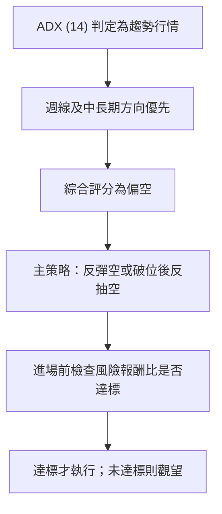

# META 技術分析報告

> **報告日期**：2026-11-24 ｜ **語言**：繁體中文 ｜ **數據來源**：Yahoo Finance ｜ **當前價格**：$597.60 USD（收盤日期：2026-11-23）

---

## 目錄

| 章節 | 內容 |
|------|------|
| [1. 技術面概覽](#1-技術面概覽) | 核心指標速覽、評分卡 |
| [2. 趨勢分析](#2-趨勢分析) | 長中短期走勢、ADX |
| [3. 圖表形態分析](#3-圖表形態分析) | 形態、K線、缺口 |
| [4. 支撐與阻力](#4-支撐與阻力) | 關鍵價位、斐波那契 |
| [5. 技術指標深度解讀](#5-技術指標深度解讀) | MA、RSI、MACD、布林通道、成交量、進階指標 |
| [6. 動能與波動率](#6-動能與波動率) | ATR、Beta、相對強度 |
| [7. 多時框架總結](#7-多時框架總結) | 時框架評分矩陣 |
| [8. 交易策略建議](#8-交易策略建議) | 歷史基準、策略、風險報酬比 |
| [9. 風險提示與監控](#9-風險提示與監控) | 監控指標、風險場景 |

---

## 1. 技術面概覽

META 技術面目前偏空：價格位於主要均線下方，週線與日線方向均偏空，且空頭方向指標高於多頭方向指標。較具建設性的訊號是 RSI 顯示底背離，價格亦位於布林通道中軌下方但尚未貼近下軌，短線存在反彈空間。最大的反向風險是底背離若未獲價格及量能確認，可能只形成弱勢反彈，並不能扭轉中期下行趨勢。

### 📊 核心指標速覽表

| 指標類別 | 指標名稱 | 當前數值 | 訊號 | 解讀 |
|----------|----------|----------|------|------|
| **價格** | 當前價格 | $597.60 | 🔴 | 收盤價低於主要趨勢均線，反彈仍需確認。 |
| **均線** | MA20 / MA50 / MA200 | 見第 5 章 | 🔴 | 收盤價低於三條均線，均線排列混合但整體壓力偏上方。 |
| **動能** | RSI(14)（日線） | 見第 5 章 | 🟡 | 位於中性區，且存在底背離訊號；尚非超賣。 |
| **動能** | MACD 柱（日線） | 見第 5 章 | 🔴 | MACD 柱為負，空頭動能仍在。 |
| **趨勢** | ADX(14) | 見第 2 章 | 🔴 | 趨勢強度略高於趨勢門檻，空頭方向主導。 |
| **波動** | ATR(14) | 見第 6 章 | 🟡 | 日常價格波動幅度顯著，交易止損需留足空間。 |
| **多時框** | 一致性 | 見第 7 章 | 🔴 | 日線與週線偏空，月線中性，整體偏空。 |

### 🏆 技術評分卡

六項子評分均為整數；綜合評分為六項算術平均四捨五入。

| 維度 | 評分（0–100） | 訊號 | 主要依據（引用數值所在章節） |
|------|---------------|------|------------------------------|
| 趨勢強度 | 30 | 🔴 | 趨勢強度略達趨勢行情門檻，且空頭方向主導；見第 2 章。 |
| 動能指標 | 40 | 🟡 | RSI 底背離提供反彈訊號，但 MACD 柱仍偏空；見第 5 章。 |
| 支撐穩定度 | 45 | 🟡 | 價格接近第一支撐區，但未見足以確認支撐有效的轉強訊號；見第 4 章。 |
| 成交量配合 | 30 | 🔴 | OBV 低於均線，A/D 與價格同步下行；見第 5 章。 |
| 形態完整度 | 35 | 🔴 | 尚無高信心度的反轉或延續形態；見第 3 章。 |
| 均線排列 | 25 | 🔴 | 收盤價低於主要均線，均線結構仍有壓力；見第 5 章。 |
| **綜合評分** | **34** | **偏空** | 六項算術平均：34.17，四捨五入為 34。 |

---

## 2. 趨勢分析

**結論：長期走勢呈現高檔回落，中期週線偏空，短期仍在下跌趨勢中尋找支撐。**近十二個月的月收盤走勢呈現先回落、反彈、再度轉弱的階段特徵；週線收盤低於自身趨勢均線，週 RSI 低於中性分界，方向判定偏空。ADX 顯示趨勢強度已達趨勢行情判斷條件，因此以中長期方向為主，日線只用於尋找進場時機。

### 📈 長期趨勢（近 12 個月）

下表依月收盤資料分段整理，漲跌幅以各階段起訖月收盤計算。階段分段用於描述價格結構，不代表每個月均沿同一方向運行。

| 期間 | 起始月收盤 | 結束月收盤 | 漲跌幅 | 階段特徵 |
|------|------------:|------------:|-------:|----------|
| 2025-12 至 2026-02 | $658.40 | $646.52 | -1.8% | 期間曾於年初上行，後回落，階段端點接近平盤略跌。 |
| 2026-02 至 2026-07 | $646.52 | $556.27 | -14.0% | 多月回落，長期趨勢轉弱。 |
| 2026-07 至 2026-09 | $556.27 | $725.18 | +30.4% | 出現明顯反彈，但其後未能維持高位。 |
| 2026-09 至 2026-11 | $725.18 | $597.60 | -17.6% | 反彈後快速回落，近期價格結構偏弱。 |

**長期判讀：**月線方向依多時框指標為中性，而月收盤階段表顯示近期高點回落。月線中性並不等於趨勢已反轉；目前更適合視為長期回落中的反彈後修正，等待收盤重新站回月線趨勢均線再評估轉強。

### 📊 中期趨勢（週線）

週線多時框方向為偏空。近二十週收盤紀錄顯示，價格曾由夏季低位大幅反彈至九月高位，其後連續回落；近期週 RSI 回落至中性分界以下，週 MACD 柱轉負並擴大負值，表示週線反彈動能已明顯衰退。

| 週線觀察項目 | 資料與判讀 |
|--------------|------------|
| 週線方向 | 偏空；照抄多時框指標區塊的方向判定。 |
| 週趨勢均線 | 收盤低於週線趨勢均線，週線結構尚未轉強。 |
| 週 RSI | 46.40；低於 50，與偏空方向一致。 |
| 週 MACD 柱 | -8.155；為負值，顯示週線動能偏空。 |
| 近週收盤變化 | 2026-11-20 收於 $560.84，2026-11-23 收於 $597.60；最新週線資料仍為進行中 K 棒，單日反彈不足以確認週線反轉。 |

### ⚡ 趨勢強度（ADX）

| 指標 | 數值 | 判讀 |
|------|------:|------|
| ADX(14) | 25.58 | 高於 25，屬趨勢行情判定範圍；ADX 衡量趨勢強弱，不單獨判定多空方向。 |
| +DI | 17.24 | 多頭方向力量較弱。 |
| −DI | 34.14 | 空頭方向力量高於多頭方向。 |
| 行情分類 | 趨勢行情 | 依多時框收斂規則，以週線及中長期均線方向為主，日線用於進場時機判斷。 |

**趨勢收斂含意：**ADX 高於趨勢門檻，且 −DI 高於 +DI，確認目前應以空頭方向為主。短線 RSI 底背離與單日反彈只能提高反彈風險，不能凌駕週線偏空判斷。

---

## 3. 圖表形態分析

**結論：目前沒有足夠資料支持高信心度的傳統反轉形態。**可確認的是價格低於多條均線、收盤仍在布林中軌下方，以及近期出現向下跳空；這些屬指標與價格結構解讀，不應延伸為未經資料支持的頭肩、雙底或旗形判定。日線末端出現反彈 K 棒，但單根 K 棒不足以確認反轉。

### 🔍 形態識別

| 形態 | 信心度 | 判斷依據（引用數據） | 完成度 | 目標價（附計算式） |
|------|--------|----------------------|--------|--------------------|
| 傳統反轉形態（頭肩、雙底等） | 低 | 僅有近十根日 K 與近八根週 K 的開高低收，缺少足以確認頸線及多次有效測試的幾何結構。 | 訊號不足，僅做指標型解讀。 | N/A（數據中未偵測到可用的形態高度，無法計算形態目標）。 |
| 均線下方的弱勢結構 | 中 | 收盤低於短、中、長期主要均線；週線方向偏空。 | 尚未出現收復均線的確認訊號。 | 不適用；此為指標型結構，非幾何形態。 |
| 布林通道中軌下方運行 | 中 | 日線布林 %B 位於中軌下方區域，但並未顯示收盤已貼近下軌。 | 弱勢仍在，未見通道下軌反彈確認。 | 不適用；未以布林通道構造形態高度目標。 |

### 🕯️ 重要 K 線形態與缺口

下表 K 線判斷僅使用近十根日 K 與近八根週 K 的開、高、低、收資料。週線最後一根為進行中 K 棒，解讀需保留確認風險。

| 日期（日 K／週 K） | 開 | 高 | 低 | 收 | K 線形態 | 解讀 | 訊號 |
|------|----:|----:|----:|----:|---------|------|------|
| 2026-11-20（日 K） | $583.91 | $588.69 | $558.68 | $560.84 | 長黑實體，收盤接近當日低位 | 賣壓明顯，且該日同時出現向下跳空；當日價格結構偏空。 | 🔴 |
| 2026-11-23（日 K） | $591.72 | $602.46 | $579.78 | $597.60 | 下影線較長的反彈 K 棒 | 低位有承接，但仍需後續收盤確認，不能單獨視為反轉。 | 🟡 |
| 2026-11-20（週 K） | $640.00 | $640.70 | $558.68 | $560.84 | 長黑週 K | 週線賣壓顯著，與週線偏空方向一致。 | 🔴 |
| 2026-11-23（週 K，進行中） | $591.72 | $602.46 | $579.78 | $597.60 | 進行中反彈週 K | 尚未收週，反彈能否持續需待週線完成確認。 | 🟡 |

#### 跳空缺口

| 日期 | 方向 | 缺口區間 | 回補狀態 | 技術意義 |
|------|------|----------|----------|----------|
| 2026-11-20 | 向下跳空 | $588.69–$595.78 | 已回補 | 缺口已回補，較適合作為近期價格事件背景，不再視為未回補阻力區。 |
| 2026-10-22 | 向下跳空 | $681.07–$689.68 | 未回補 | 上方仍有未回補缺口，反彈至該區將面臨供給與套牢賣壓。 |
| 2026-09-09 | 向上跳空 | $624.31–$638.06 | 已回補 | 已回補，不再構成尚未回補的缺口支撐。 |

**K 線與缺口整合：**近期向下跳空日出現長黑，價格下行與缺口訊號同向；其後反彈 K 棒有下影線，但因週線偏空及量能未確認，反彈訊號目前僅屬初步。

---

## 4. 支撐與阻力

**結論：現價位於第一支撐與第一阻力之間，短線可觀察支撐能否守穩；中期上方阻力層次較多。**以下波段價位均取自近一年波段高低點聚類；斐波那契及未回補缺口另行標示，避免混為同一類價位。

### 🚧 阻力位分析表

| 阻力級別 | 價位 | 形成原因 | 突破難度（高／中／低） | 重要性 |
|----------|------:|----------|------------------------|--------|
| R1 | $608.64 | 近一年波段高點聚類；亦須與均線及短期反彈結構共同觀察。 | 中 | 短線第一道波段阻力；若未能站穩，反彈易受壓。 |
| R2 | $623.91 | 近一年波段高點聚類；與較高時間框架供給區域相近。 | 中 | 若能收復，才有助緩解短線弱勢。 |
| R3 | $645.17 | 近一年波段高點聚類；高於前述短線阻力。 | 高 | 需有持續買盤和量能配合，否則突破延續性不足。 |

### 🛡️ 支撐位分析表

| 支撐級別 | 價位 | 形成原因 | 守住可能性（高／中／低） | 重要性 |
|----------|------:|----------|--------------------------|--------|
| S1 | $588.85 | 近一年波段低點聚類；接近近期價格活動區。 | 中 | 第一層短線支撐；若失守，可能引發向下一層支撐測試。 |
| S2 | $555.86 | 近一年波段低點聚類；與近期低位區域相呼應。 | 中 | 中期重要支撐；跌破將使下行結構進一步惡化。 |
| S3 | $538.30 | 近一年波段低點聚類。 | 低 | 較深層支撐，只有在前兩層支撐失效後才需優先關注。 |

### 📐 斐波那契回調位分析

| 回調比例 | 價位 | 技術解讀 |
|----------|------:|----------|
| 23.6% | $718.35 | 高位回檔區，與目前價格距離較遠。 |
| 38.2% | $680.33 | 中期反彈可能遭遇的上方回撤阻力。 |
| 50.0% | $649.59 | 中段回調參考位；需先收復下方波段阻力才具有近期參考性。 |
| 61.8% | $618.86 | 現價上方第一個較近的斐波那契回調阻力。 |
| 78.6% | $575.11 | 現價下方的斐波那契參考支撐；若失守，回調幅度加深。 |

| 區間判讀 | 結論 |
|----------|------|
| 現價相對斐波那契區間 | 現價介於 78.6% 回調位與 61.8% 回調位之間。 |
| 對趨勢的含意 | 價格處於回撤較深的區域，可能出現技術反彈；但仍需收復上方阻力及趨勢均線，才可確認趨勢改善。 |

### 補充價位：缺口、樞軸與進階指標

| 類別 | 價位 | 依據 | 解讀 |
|------|------:|------|------|
| 缺口 | $681.07–$689.68 | 2026-10-22 向下跳空，未回補。 | 上方未回補缺口區，屬反彈時可能遇到的供給區。 |
| 樞軸 P | $665.09 | 上一完整月計算的經典樞軸點。 | 公式型參考價位，不是波段高低點聚類。 |
| 樞軸 PS1 | $558.90 | 上一完整月計算的經典樞軸支撐。 | 可與波段支撐及週線低位一併觀察，不應改稱 S1–S3。 |
| POC | $611.61 | 近 252 個交易日成交量分布控制點。 | 成交量較集中的參考位置，現價位於其下方。 |
| 價值區 | $573.63–$671.30 | 近 252 個交易日含 70% 成交量的價值區。 | 收盤位於價值區內，仍屬過去較集中的成交價格帶。 |

---

## 5. 技術指標深度解讀

**結論：均線與 MACD 明確偏空，RSI 底背離提供反彈警訊但未扭轉整體結構；布林位置和成交量資料也未確認趨勢反轉。**因此主要技術訊號仍偏空，反彈交易需以明確價位和止損條件控制風險。

### 📈 均線、RSI、MACD、布林通道

| 指標 | 數值 | 訊號 | 解讀 |
|------|------|------|------|
| MA20 / MA50 / MA200 與排列 | MA20 $616.92；MA50 $675.25；MA200 $627.58；均線排列：混合排列 | 🔴 | 收盤低於三條均線，價格上方存在多層均線壓力。MA50 明顯高於短期均線及現價，反映中期修復仍有阻力。 |
| RSI(14)（日線）與背離 | RSI 41.75；程式判定近二十根 K 棒首尾比較為底背離 | 🟡 | RSI 位於中性區，並非超賣。底背離表示價格下跌與 RSI 動能變化出現背離，但只屬反彈警訊，尚未由 MACD、均線或量能共同確認。 |
| MACD 線 / Signal / 柱 | MACD -19.668；Signal -17.434；Hist -2.234 | 🔴 | MACD 線低於 Signal，柱狀圖為負，短線動能仍偏空。未有可稽核的 MACD 價格轉折點資料，因此 MACD 頂背離或底背離判定為 N/A（數據未提供）。 |
| 布林上軌 / 中軌 / 下軌 / %B | 上軌 $654.21；中軌 $616.92；下軌 $579.62；%B 0.24 | 🟡 | 收盤低於中軌、位於通道下半部，但尚未貼近下軌；表示弱勢存在，但仍不能單憑位置判定已超跌。 |

#### 指標互相確認與矛盾

| 指標組合 | 關係 | 解讀 |
|----------|------|------|
| 均線與 MACD | 互相確認偏空 | 收盤低於主要均線，MACD 線低於訊號線且柱為負，與價格弱勢一致。 |
| RSI 底背離與 MACD | 訊號矛盾 | RSI 底背離暗示賣壓可能減弱，但 MACD 尚未轉強，底背離需要價格和動能確認。 |
| 布林通道與均線 | 大致確認偏弱 | 價格位於中軌下方、主要均線下方，支持弱勢判斷；未貼近下軌則意味短線仍可能反彈或延續震盪。 |
| 綜合判斷 | 偏空，保留反彈風險 | 趨勢方向以均線、MACD、週線及 ADX/DI 組合為主；RSI 底背離僅作為進場時機風險提示。 |

#### RSI／MACD 背離結論

| 指標 | 背離判斷 | 證據與限制 |
|------|----------|------------|
| RSI | 有底背離 | 指標快照標示為近二十根 K 棒首尾價格與 RSI 方向比較所偵測的底背離。此方法未提供各轉折點數值，解讀應視為初步訊號。 |
| MACD | N/A（數據未提供） | 未提供 MACD 與價格轉折點的背離計算結果，不能自行推定有頂背離或底背離。 |

### 💹 成交量（量價配合度）

| 成交量指標 | 數值／狀態 | 解讀 |
|------------|------------|------|
| 最新成交量 | 19,051,700 股 | 低於 20 日均量，最新反彈尚未伴隨明顯高於近期均量的買盤確認。 |
| 20 日均量 | 21,075,415 股 | 作為短期量能基準。 |
| 量比 | 0.90 倍 | 低於均量基準，顯示近期成交活躍度未能確認反彈。 |
| 50 日均量 | 21,721,626 股 | 中期均量略高於短期均量，量能背景未顯示明確的買盤擴張。 |
| OBV | OBV 低於均線；量能疲弱 | OBV 未確認價格反彈，量能結構仍偏弱。 |
| A/D 線 | 近二十根不高於其二十日均值；A/D 下降、價格下跌，與價格同向 | 資金累積／分配方向與價格下跌一致，確認而非否定近期弱勢。 |

**量價結論：**OBV 與 A/D 均未確認買方主導；最新反彈未有足夠量能證據支持趨勢反轉。量能因此支持偏空主判斷，並降低 RSI 底背離訊號的可信度。

### 🧭 進階指標

| 指標 | 數值 | 收盤相對位置 | 解讀 |
|------|------|--------------|------|
| 一目均衡表（轉換線／基準線／雲層） | 轉換線 $603.57；基準線 $635.95；最新 K 棒所在雲層先行帶 A $724.87、先行帶 B $658.33；前方雲層先行帶 A $619.76、先行帶 B $669.25 | 收盤位於雲層下方；轉換線低於基準線；前方雲層 A 低於 B | 一目均衡表偏空，且與均線、MACD 方向一致。收盤仍在雲層下方，短線若反彈，雲層及基準線可能構成阻力。 |
| 成交量分布（POC／價值區） | POC $611.61；價值區 $573.63–$671.30，含 70% 成交量 | 收盤位於價值區內，低於 POC | 價格仍在主要成交區內，但位於 POC 下方，短線結構偏弱；此項與均線及 MACD 的偏空判讀大致一致。 |
| 錨定 VWAP（自 52 週高點／低點） | 自 2026-09-24 高點起 $670.07；自 2026-03-27 低點起 $628.35 | 收盤均低於兩條錨定 VWAP | 持有成本參考線位於現價上方，反映自兩個錨定事件後的平均成交成本高於現價；與均線及 MACD 的弱勢結論一致。 |
| A/D 線 | 近二十根不高於其二十日均值；A/D 下降且價格下跌 | — | 資金流向與價格同步轉弱，與 RSI 底背離訊號形成部分矛盾，但支持價格趨勢仍偏空。 |

---

## 6. 動能與波動率

**結論：META 日常波動幅度偏大，止損不能過度貼近進場價；市場相對強度近期較弱，但中期相對表現仍優於納斯達克基準。**相對強度比值仍低於其均線，因此即使部分期間超額報酬為正，近期相對趨勢也未確認轉強。

### 📊 ATR 波動率分析

| 指標 | 數值 | 解讀 |
|------|------:|------|
| ATR(14) | $24.58 | 以 Wilder 方法計算的日線平均真實波幅，反映短期日常價格波動。 |
| ATR 佔價格比例 | 4.11% | 對單一交易日而言，價格波動尺度較大，策略的進場與止損需避免過度貼近。 |
| 1.5 倍 ATR 距離 | $36.87 | 作為波動距離參考；策略止損仍須使用第 8 章列出的有效關鍵價位。 |
| 2 倍 ATR 距離 | $49.16 | 作為較寬波動距離參考，不代表預測價格目標。 |

**止損距離原則：**ATR 用於評估價格雜訊與倉位大小，不直接用來創造新的支撐、阻力或策略價位。若關鍵價位與波動距離不相容，應縮小倉位或不交易，而非任意改寫已列出的支撐阻力。

### 📐 Beta 與相對強度

#### 相對強度 vs VTI（美國整體市場）

| 期間 | META 價格報酬 | VTI 價格報酬 | 超額報酬 | 比值趨勢 |
|------|--------------:|-------------:|---------:|----------|
| 1 個月 | -13.6% | -9.3% | -4.3% | 相對走弱，比值低於其 50 日均值。 |
| 3 個月 | +0.3% | -9.8% | +10.2% | 相對報酬優於基準，但比值仍低於其 50 日均值。 |
| 6 個月 | -8.1% | -7.3% | -0.8% | 略遜於基準，比值低於其 50 日均值。 |

#### 相對強度 vs QQQ（Nasdaq-100）

| 期間 | META 價格報酬 | QQQ 價格報酬 | 超額報酬 | 比值趨勢 |
|------|--------------:|-------------:|---------:|----------|
| 1 個月 | -13.6% | -13.6% | +0.1% | 相對走弱，比值低於其 50 日均值。 |
| 3 個月 | +0.3% | -13.9% | +14.2% | 相對報酬優於基準，但比值仍低於其 50 日均值。 |
| 6 個月 | -8.1% | -15.2% | +7.1% | 相對報酬優於基準，但比值仍低於其 50 日均值。 |

| 指標 | 數值 | 解讀與策略含意 |
|------|------:|----------------|
| Beta | 1.279 | 歷史價格敏感度高於整體市場，市場波動時個股波動可能放大；不能將 Beta 當作方向預測。 |
| 相對強度綜合判讀 | 比值低於其 50 日均值 | 儘管若干中期期間超額報酬為正，近期相對比值趨勢仍走弱；不支持在阻力突破前積極做多。 |

---

## 7. 多時框架總結

**結論：日線與週線偏空、月線中性，多時框一致性為 2/3 偏空。**由於 ADX 判定為趨勢行情，依規則優先採用週線及中長期均線方向，日線訊號僅用於找尋交易時機；因此唯一方向性結論為偏空。

### 📋 時框架評分表

以下方向、RSI、MACD 柱、趨勢均線與收盤相對位置，均照抄多時框指標區塊。由於區塊僅提供各時框指定趨勢均線，表中不另推算其他均線位置。

| 時框架 | 趨勢方向 | RSI(14) | MACD 柱 | 收盤 vs 趨勢均線 | 形態 | 建議 |
|--------|----------|---------|---------|------------------|------|------|
| 日線 | 偏空 | 41.75 | -2.234 | 收盤 $597.60；MA50 $675.25，下方 | 短線弱勢，RSI 有底背離但未由 MACD／量能確認。 | 以反彈至阻力後的空方風險報酬為主，避免在支撐處追空。 |
| 週線 | 偏空 | 46.40 | -8.155 | 收盤 $597.60；MA20 $630.46，下方 | 近期週線回落，週 MACD 柱轉負。 | 週線轉強前，反彈視為空方進場時機候選。 |
| 月線 | 中性 | 50.00 | N/A（數據未提供） | 收盤 $597.60；MA10 $608.87，下方 | 月 RSI 中性，月 MACD 柱資料不足。 | 保持中性偏防守，不以月線資料宣稱已確認反轉。 |

**多時框一致性：2/3 偏空。**

### ⚖️ 多時框收斂結論

| 收斂項目 | 結論 |
|----------|------|
| 行情分類 | 趨勢行情；ADX 高於趨勢門檻。 |
| 主導時框 | 週線與中長期均線方向優先，依規則 14 收斂。 |
| 日線定位 | 用於挑選反彈空方的進場時機，不用來推翻週線偏空判斷。 |
| 月線訊號 | 月線中性，與日線、週線並非完全同向；不構成明確多頭確認。 |
| 唯一方向性結論 | **偏空**；若日線反彈，需先觀察是否收復阻力和均線，不應單憑 RSI 底背離轉為偏多。 |

---

## 8. 交易策略建議

**當前主策略方向 = 偏空（依評分 34/100）。**由於綜合評分不高於偏空分流門檻，主策略採反彈做空或破位後等待反抽做空；不把 RSI 底背離解讀為獨立做多依據。下列策略只有在進場條件成立、且以 T1 計算的風險報酬比達到最低要求時，才列為可執行策略。

### 🧭 策略路由

### 📊 歷史基準機率

今日狀態為「RSI(14) 介於 30–50 且收盤位於 MA200 下方」。歷史樣本期間為 2016-11-21 至 2026-11-23，共 2,515 個交易日；以下資料來自價格資料庫。

| 持有期 | 相同狀態樣本（段數） | 上漲比例 | 中位數報酬 | 25%–75% 分位 | 全部交易日上漲比例／中位數 |
|--------|----------------------|----------|------------|--------------|---------------------------|
| 5 日 | 464 日（77 段） | 52% | +0.2% | -3.7% 至 +4.2% | 55%／+0.5% |
| 20 日 | 452 日（75 段） | 46% | -1.3% | -7.8% 至 +9.1% | 58%／+2.1% |
| 60 日 | 449 日（74 段） | 43% | -3.5% | -15.6% 至 +17.6% | 60%／+4.1% |

**歷史基準解讀：**相同狀態下，中期持有期的上漲比例與中位數報酬低於全部交易日對照，與偏空主策略方向相抵不大；短期結果則接近平常交易日表現，不能視為明顯優勢。樣本交易日存在重疊，段數較交易日數少，且各段並非完全獨立；這些歷史頻率是描述性基準，不是預測，也不代表策略成功率。

### 🎯 價格情境階梯（Price Scenarios）

情境中的支撐與阻力均引用第 4 章價位；可能性以高／中／低表示，不構成數值機率。

| 觸發條件 | 下一目標 | 後續延伸 | 可能性（高／中／低） | 依據 |
|----------|----------|----------|----------------------|------|
| 有效突破並站穩 R1 | R2 | R3 | 中 | 若收盤重新站回第一阻力之上，短線反彈可延伸；但週線偏空及均線壓力仍在。 |
| 在 S1 上方站穩 | — | — | 中 | 價格仍處支撐與阻力之間；但量能未確認反彈，應等待價格行為而非預先押注。 |
| 跌破 S1 | S2 | S3 | 中 | 跌破第一支撐會確認弱勢延續風險；更深層支撐是否有效需觀察後續收盤。 |

### 🟢 主策略詳情

| 策略要素 | 策略 A：反彈至阻力做空 | 策略 B：跌破支撐後反抽做空 |
|----------|------------------------|------------------------------|
| 進場條件 | 反彈至 R2 附近受阻，並出現價格轉弱確認；若直接穿越並站穩，取消進場。 | 日線有效跌破 S1，之後反抽至 S1 附近但無法重新站穩時進場。 |
| 進場價格 | $623.91（R2） | $588.85（S1） |
| 目標價 T1 | $588.85（S1） | $555.86（S2） |
| 目標價 T2 | $555.86（S2） | $538.30（S3） |
| 止損價格 | $645.17（R3） | $608.64（R1） |
| 風險報酬比 | 1 : 1.65（以 T1 計；空方計算為進場價減目標價，再除以止損價減進場價） | 1 : 1.67（以 T1 計；空方計算為進場價減目標價，再除以止損價減進場價） |
| 把握度 | 中：週線與量價偏空支持方向，但反彈觸及阻力及拒絕訊號尚未發生。 | 中：須先出現有效跌破及反抽受阻；若未發生，不追價。 |
| 建議倉位 | 佔可投資資金 0.5%–1.0% 的風險預算；依止損距離反推股數。 | 佔可投資資金 0.5%–1.0% 的風險預算；依止損距離反推股數。 |
| 風險報酬比驗算 | (623.91 − 588.85) ÷ (645.17 − 623.91) = 1.65 | (588.85 − 555.86) ÷ (608.64 − 588.85) = 1.67 |

**策略執行原則：**兩項策略均以空方方向為主，但觸發條件不同，不代表可同時重複加倉。未到指定進場條件時不追價；若跳空導致進場或止損價格失真，放棄原計畫，重新計算風險。

### 🔴 反向風險觸發點（對沖提示）

| 觸發訊號 | 對主策略的影響 | 風控動作 |
|----------|----------------|----------|
| 收盤有效站上 R2，且量能擴大 | 反彈空頭邏輯減弱 | 停止新增空單，檢查既有部位是否接近止損。 |
| 收盤突破 R3 並持續站穩 | 可能推翻近期空頭結構 | 依策略止損執行，不以主觀理由延後止損。 |
| RSI 底背離後 MACD、OBV 同步轉強 | 反彈訊號開始獲得其他指標確認 | 暫停追空，重新評估方向；在綜合訊號改善前不自動反手做多。 |
| 價格跌破 S2 後迅速收復 | 可能形成假跌破 | 避免在支撐附近追空，等待重新確認。 |

---

## 9. 風險提示與監控

**結論：近期主要風險在於空頭趨勢延續與反彈急拉並存。**需同時監控波段支撐／阻力、週線方向、量價確認及財報事件；單一指標不應觸發超出既定風險承受範圍的倉位。

### ✅ 關鍵監控指標

| 監控項目 | 觸發條件／資料 | 觸發後的動作 |
|----------|----------------|--------------|
| 第一支撐 S1 | 收盤跌破，或跌破後無法收復 | 按策略 B 等待反抽確認，不在快速下跌中盲目追空。 |
| 第二支撐 S2 | 價格測試或有效跌破 | 若持有空單，依預先規劃分段檢視；若快速收復，防範假跌破。 |
| 第一阻力 R1 | 反彈測試但無法站穩 | 觀察是否形成空方進場確認；未確認前不預先建立部位。 |
| 第二、第三阻力 R2／R3 | 反彈觸及或突破 | R2 可評估策略 A；若突破並站穩 R3，空方邏輯需重新評估。 |
| RSI 與 MACD | RSI 底背離是否獲 MACD 轉強確認 | 若動能轉強，停止追空並檢查空單風險；不可僅憑 RSI 背離反手。 |
| OBV 與 A/D | 是否由弱轉強並獲價格確認 | 若量能轉強而價格同步收復阻力，降低空方曝險。 |
| 下次財報日 | 2027-01-27；距最新收盤日 65 個日曆天；Yahoo Finance，日期可能調整 | 確認持倉是否跨越財報事件；財報可能造成跳空，止損不保證按設定價成交。 |

### ⚠️ 風險場景

| 情境 | 觸發條件 | 觀察價位 | 應對 | 可能性（高／中／低） |
|------|----------|----------|------|----------------------|
| 樂觀反彈 | RSI 底背離獲價格收復阻力及量能改善確認 | 先觀察 R1、其後 R2；進一步阻力見第 4 章 R3。 | 空單減碼或依止損規則離場；不在未確認前預判趨勢反轉。 | 中 |
| 基本震盪 | 價格在第一支撐與第一阻力之間反覆，量能仍未確認方向 | S1 至 R1 區間 | 等待區間邊緣出現確認訊號；未達風險報酬要求時觀望。 | 中 |
| 悲觀續跌 | 支撐失守且週線空頭動能延續 | 依序觀察 S2、S3 | 只依已設定的進場與止損計畫管理，不追逐快速下跌。 | 中 |

### 🛡️ 風險管理提醒

- 每筆交易先確定止損價，再依帳戶可承受風險反推股數；不要先決定股數再放寬止損。
- 價格跳空可能使實際成交價偏離止損價，尤其事件風險期間不應假設止損一定能按指定價格成交。
- RSI 底背離尚未獲 MACD、OBV 或均線確認前，不宜據此大幅增加多頭曝險。
- 若進場後風險報酬比低於策略規定，取消交易；不得藉由任意移動止損或目標價使其表面達標。
- 同一方向的策略 A、B 需視為整體曝險管理，避免在相同趨勢風險下重複累加部位。

---

## 📋 報告總結

| 項目 | 結論 |
|------|------|
| 報告日期 | 2026-11-24 |
| 當前價格 | 見標題列（收盤日期：2026-11-23） |
| 綜合評分／方向 | 34/100，偏空 |
| 長期／中期／短期趨勢 | 🟡 長期月線中性但近期回落；🔴 中期週線偏空；🔴 短期日線偏空，保留反彈風險。 |
| 關鍵支撐／關鍵阻力 | 支撐見第 4 章 S1–S3；阻力見第 4 章 R1–R3。 |
| 🥇 最佳機會 | 策略 A：反彈至 R2 受阻後做空；僅於確認條件成立且風險報酬比達標時執行。 |
| 最大風險 | RSI 底背離若獲量能與價格確認，可能引發急速反彈，使空單承受跳空或止損滑價風險。 |

> ⚠️ **免責聲明**：本報告為 AI 自動生成之技術分析，所有數據及估算均基於歷史價格資訊。本報告**僅供研究與學術參考**，**不構成任何投資建議**。投資有風險，入市需謹慎。

---

## 資料與來源

| 項目 | 內容 |
|------|------|
| 價格 | 597.60 USD，2026-11-23 收盤（Yahoo Finance 日線） |
| K 棒 | 500 根日線，2024-11-25 至 2026-11-23（Yahoo Finance）；較長期間的價位與基準機率取自價格資料庫 |
| 關鍵價位回溯期間 | 阻力 近一年、支撐 近一年 |
| 下次財報日 | 2027-01-27（Yahoo Finance，日期可能調整） |
| 有回應的資料來源 | Yahoo Finance、Finviz、StockAnalysis、Roic.ai |
| 由程式計算 | 所有指標、R1–S3 與斐波那契價位、多時框方向、相對強度、缺口、歷史基準機率、綜合評分 |
| 撰寫模型 | openai / gpt-6-luna |

> 本區塊由產生報告的程式依實際取得的資料填寫，非模型撰寫。「由程式計算」的數字不是模型的估計；其餘判斷（評分、情境、策略）是模型的分析。
