# MSFT 技術分析報告

> **報告日期**：2026-10-11 ｜ **語言**：繁體中文 ｜ **數據來源**：Yahoo Finance ｜ **當前價格**：$535.07

---

## 目錄

| 章節 | 內容 |
|------|------|
| [1. 技術面概覽](#1-技術面概覽) | 訊號儀表板、核心指標、評分卡 |
| [2. 趨勢分析](#2-趨勢分析) | 多時框趨勢、長中短期走勢 |
| [3. 圖表形態分析](#3-圖表形態分析) | 形態識別、K線組合、目標價 |
| [4. 支撐與阻力](#4-支撐與阻力) | 關鍵價位、斐波那契回調 |
| [5. 技術指標深度解讀](#5-技術指標深度解讀) | MA/RSI/MACD/布林/成交量 |
| [6. 動能與波動率](#6-動能與波動率) | 動能評估、ATR、Beta |
| [7. 多時框架總結](#7-多時框架總結) | 時框架評分矩陣 |
| [8. 交易策略建議](#8-交易策略建議) | 多空策略、風險報酬比 |
| [9. 風險提示與監控](#9-風險提示與監控) | 監控指標、風險場景 |

---

## 1. 技術面概覽

### 🎯 技術訊號儀表板

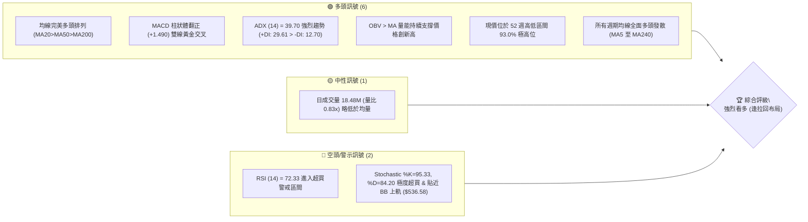

### 📊 核心指標速覽表

| 指標類別 | 指標名稱 | 當前數值 | 訊號 | 解讀 |
|----------|----------|----------|------|------|
| **價格** | 當前價格 | $535.07 | 🟢 | 距 52W 高點 $549.20 僅 2.64%，多頭格局極強 |
| **均線** | MA20 | $510.10 | 🟢 | 價格在 MA20 上方 +4.90%，短期生命線支撐堅實 |
| **均線** | MA50 | $500.19 | 🟢 | 價格在 MA50 上方 +6.97%，中期趨勢強勁向上 |
| **均線** | MA200 | $432.70 | 🟢 | 價格在 MA200 上方 +23.66%，長期牛市基石確立 |
| **動能** | RSI(14) | 72.33 | 🔴 | 突破 70 警戒線進入超買，無頂背離但短線過熱 |
| **動能** | MACD(12,26,9) | 10.694 / 9.204 / +1.490 | 🟢 | DIF 高於 MACD Signal，Hist 擴張，多頭主導 |
| **波動** | ATR(14) | $12.72 | 🟡 | 佔股價 2.38%，每日波幅適中，順勢交易環境良性 |

### 🏆 技術評分卡

```
技術評分卡 — MSFT (2026-10-11)
════════════════════════════════════════════════════
趨勢強度      ██████████████████░░  90/100  🟢 強趨勢
動能指標      ██████████████░░░░░░  70/100  🟡 超買鈍化
支撐穩定度    ████████████████░░░░  80/100  🟢 梯級支撐
成交量配合    ████████████░░░░░░░░  65/100  🟡 縮量上攻
形態完整度    ████████████████░░░░  80/100  🟢 圓弧底突破
均線排列      ████████████████████ 100/100  🟢 完美多頭
════════════════════════════════════════════════════
綜合評分      ████████████████░░░░  81/100  強烈看多
════════════════════════════════════════════════════
```

---

## 2. 趨勢分析

### 🌐 多時框趨勢分析

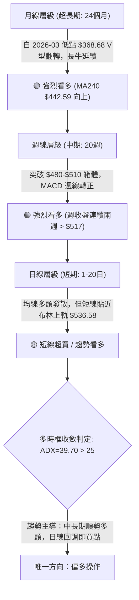

### 📈 長期趨勢 — 12個月走勢圖（Unicode）

```
MSFT 月線走勢圖（過去12個月：2025-11 至 2026-10）
價格軸 ($)
$550 ┤                                                    ● $535.07 (現價)
$525 ┤                                              ● $512.90
$500 ┤                                        ● $507.29
$475 ┤● $488.91  ● $480.57              ● $463.85
$450 ┤                            ● $449.39
$425 ┤              ● $427.58  ● $406.13
$400 ┤                   ● $391.15
$375 ┤                        ● $368.68 (波段低點)   ● $372.32 (雙重低點)
$350 ┴────────────────────────────────────────────────────────────────
       11    12    01    02    03    04    05    06    07    08    09    10  (月份)
```

**走勢特徵分析表格**：

| 階段區間 | 起止價格 | 漲跌幅 | 趨勢特徵 | 關鍵技術事件 |
|----------|----------|--------|----------|--------------|
| 2025-11 ~ 2026-03 | $488.91 → $368.68 | -24.59% | 中期深度回調 | 連續 5 個月陰線下挫，探尋 52 週底部支撐 |
| 2026-03 ~ 2026-05 | $368.68 → $449.39 | +21.89% | 首輪超跌強彈 | 形成 V 型反彈，站回 MA200 之上 |
| 2026-05 ~ 2026-06 | $449.39 → $372.32 | -17.15% | 二次探底洗盤 | 回踩確認 $368-$372 雙底支撐帶，清洗浮籌 |
| 2026-06 ~ 2026-10 | $372.32 → $535.07 | +43.71% | 主升浪強勁推進 | 連續 4 個月放量陽線，突破前高直逼歷史峰值 |

### 📊 中期趨勢（週線分析）

中期技術面於 2026 年 6 月底至 7 月初完成結構重組。2026-06-28 當週爆出 382,709,200 股的天量換手，收在 $372.27，構築出堅不可摧的底部。隨後週線 RSI 自極度超賣區（18.6）一路飆升至當前的 72.3，週線 MACD 柱狀體亦由 -5.410 反轉至 +1.490。

```
週線級別壓力與支撐示意圖：
$549.20 ────────────────────────────────────────── 52W 高點阻力位 (R1)
▲ 向上推進中 (現價: $535.07)
$501.85 ┄┄┄┄┄┄┄┄┄┄┄┄┄┄┄┄┄┄┄┄┄┄┄┄┄┄┄┄┄┄┄┄┄┄┄┄┄┄┄┄ 斐波那契 23.6% 回調 / MA50 支撐
$487.61 ────────────────────────────────────────── 近一年波段低點聚類支撐 (S1)
$472.55 ┄┄┄┄┄┄┄┄┄┄┄┄┄┄┄┄┄┄┄┄┄┄┄┄┄┄┄┄┄┄┄┄┄┄┄┄┄┄┄┄ 斐波那契 38.2% 回調位
$372.27 ══════════════════════════════════════════ 爆量歷史雙底支撐 (極強基底)
```

### ⚡ 趨勢強度評估（ADX 解讀）

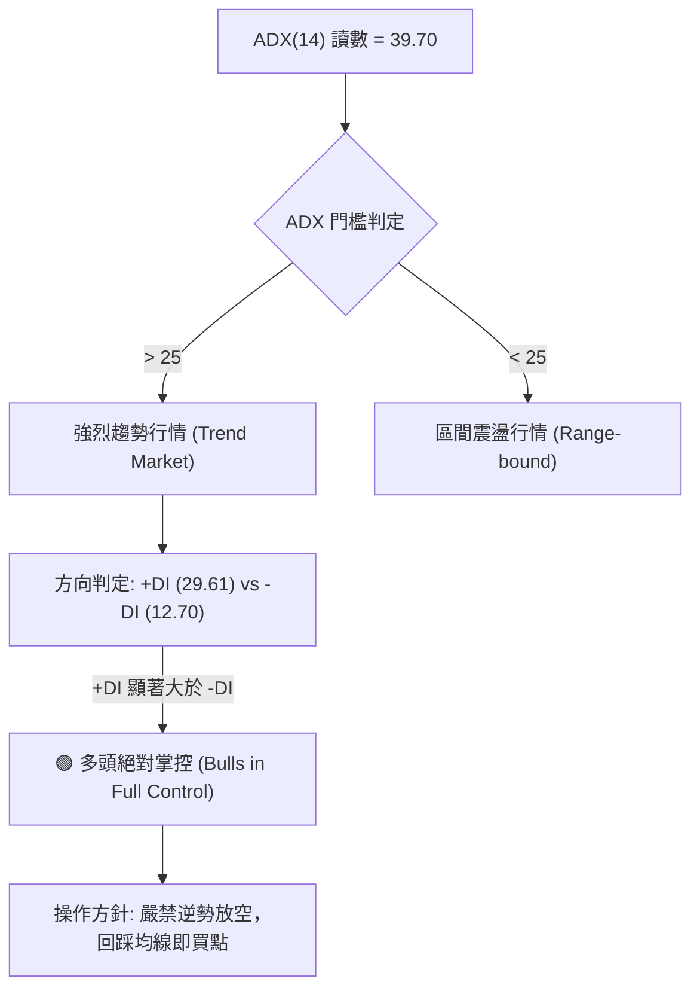

**ADX 強度對照分析**：
- **數值**：39.70（位於 35–50 區間，屬於**極強單邊趨勢**）。
- **方向**：+DI（29.61）高於 -DI（12.70）逾 16.91 個點，多空動能差值巨大。
- **結論**：目前市場處於單邊多頭主升趨勢，絕非震盪整理市場。依多時框收斂規則，所有震盪指標（如 RSI 超買）的短線賣訊均需讓位於強趨勢方向。

---

## 3. 圖表形態分析

### 🔍 形態識別系統

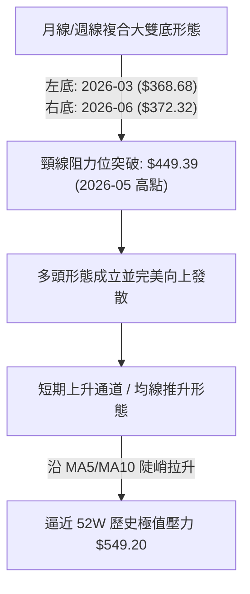

**形態識別與信心度評估表**：

| 形態名稱 | 信心度 | 判斷依據（引用數據） | 完成度 | 目標價（附精確計算式） |
|----------|--------|----------------------|--------|------------------------|
| **大型雙底 (W底)** | 90% | 左底 2026-03 收 $368.68，右底 2026-06 收 $372.32，兩次低點相差僅 0.98%，且 2026-06-28 爆出 3.82 億股天量確認 | 100% (已突破頸線) | 頸線 $449.39 + (頸線 $449.39 - 雙底均值 $370.50 = 形態高度 $78.89) = **$528.28** (現價 $535.07 已達成並超越) |
| **均線多頭發散突破** | 85% | MA20($510.10) > MA50($500.19) > MA200($432.70)，且 MA5 至 MA240 全線上揚 | 95% | 由 $487.61 (S1) 向上測量等幅波段：$487.61 + ($510.10 - $487.61) * 2.618 = **$546.51** (貼近 R1 $549.20) |
| **短線上升楔形/鈍化** | 55% | 價格持續創新高但量能小幅遞減 (最新量 18.48M < 20日均量 22.39M)，RSI 達 72.33 | 40% (尚未跌破任何支撐) | 若跌破 MA5($528.38)，拉回目標為 MA20 **$510.10** |

### 🕯️ 重要K線形態分析

| 月份 | 收盤價 | K線形態 | 解讀 | 訊號 |
|------|--------|---------|------|------|
| 2026-03 | $368.68 | 長下影錘子線 | 空方動能耗盡，機構買盤於 $348-$368 區間托底 | 🟢 強烈見底訊號 |
| 2026-05 | $449.39 | 大陽線 (Marubozu) | 強勢收復 MA200，單月大漲 10.65%，確認突破首輪阻力 | 🟢 多頭進攻訊號 |
| 2026-06 | $372.32 | 爆量長下影洗盤陰線 | 歷史天量 3.82 億股洗盤，形成雙底次低點，確認籌碼鎖死 | 🟢 震盪築底完成 |
| 2026-08 | $507.29 | 光頭大陽線 | 強勢站上 $500 大關，吞噬 2025 年高點區域浮籌 | 🟢 主升浪展開 |
| 2026-10 | $535.07 | 實體中陽線 (進行中) | 緊貼布林上軌向上開口，創下收盤新高，維持多頭主導 | 🟢 順勢走強 |

### 📉 ASCII 走勢形態示意圖

```
MSFT 大型雙底 (W-Bottom) 突破與主升浪展開示意圖：
價格
$549.20 ┤                                                [R1 阻力位]
$535.07 ┤                                            ★ 現價 ($535.07)
$528.28 ┤--------------------------------------[W底量度目標 $528.28 達成]
$500.00 ┤                                    ▲
$475.00 ┤                                  ╱
$449.39 ┤--------- 頸線位置 (Neckline) ───╱─────────── (2026-05 高點)
$425.00 ┤        ▲                     ╱
$400.00 ┤       ╱ ╲                   ╱
$372.32 ┤      ╱   ╲                 ● [右底: 2026-06，爆量 3.82億股]
$368.68 ┤     ●     ───────────────┘
$348.54 ┴─ [左底: 2026-03]
```

### 🎯 形態目標價計算

1. **W底量度漲幅計算式**：
   - 頸線位 = $449.39（2026-05 收盤高點）
   - 形態底部均值 = ($368.68 + $372.32) / 2 = $370.50
   - 形態垂直高度 (H) = $449.39 - $370.50 = $78.89
   - 最低等幅量度目標價 (T1) = $449.39 + $78.89 = **$528.28**（已於 2026 年 10 月正式超越）。
2. **第二波段延伸目標價 (T2)**：
   - 依據波浪理論 1.618 延伸計算式：
   - 延伸目標 = $449.39 + ($78.89 × 1.618) = $449.39 + $127.64 = **$577.03**（此價位貼近分析師共識平均目標價 $587.63）。

---

## 4. 支撐與阻力

### 🗺️ 關鍵價位分布圖（Unicode）

```
MSFT 價位結構分布圖 (由 OHLCV 與歷史波段低高點嚴密計算)
═══════════════════════════════════════════════════════════════════
$549.20 ║██████████████████████████████║ 強阻力 R1 (52W High / 歷史高點)
        ║                              ║ 
$535.07 ╠══════════════════════════════╣ ◄ 現價 ($535.07)
        ║░░░░░░░░░░░░░░░░░░░░░░░░░░░░░░║ (緩衝區間：ATR = $12.72)
$501.85 ║▓▓▓▓▓▓▓▓▓▓▓▓▓▓▓▓▓▓▓▓▓▓        ║ 斐波那契 23.6% 回調 / MA50 ($500.19)
$487.61 ║████████████████████████      ║ 近期關鍵支撐 S1 (波段低點聚類)
$476.25 ║████████████████████          ║ 中期結構支撐 S2 (波段低點聚類)
$465.47 ║████████████████████████████  ║ 強防守支撐 S3 (波段低點聚類)
$448.87 ║██████████████████████████████║ 斐波那契 50.0% 關鍵平衡位 / MA120
═══════════════════════════════════════════════════════════════════
```

### 🚧 阻力位分析表

| 阻力級別 | 價位 | 形成原因 | 突破難度 | 重要性 |
|----------|------|----------|----------|--------|
| **R1** | **$549.20** | 52 週最高點，近一年多頭最頂峰聚類壓力區，距現價僅 +2.64% | 🔴 高 | ★★★★★ 極度重要（歷史心理大關，突破即進入無套牢籌碼真空區） |
| **R2** | *數據中未偵測到* | 現價上方僅存 52W 高點，歷史未有更高實體聚合價位 | — | — |
| **R3** | *數據中未偵測到* | 現價上方無更高歷史 OHLCV 聚類阻力 | — | — |

*註：現價上方僅存在 R1 ($549.20) 一處實體 OHLCV 歷史阻力位，突破後將直接挑戰藍天。*

### 🛡️ 支撐位分析表

| 支撐級別 | 價位 | 形成原因 | 守住機率 | 重要性 |
|----------|------|----------|----------|--------|
| **S1** | **$487.61** | 近一年波段低點聚類、2025-11 平台與 MA60($482.89) 形成強共振 | 85% | ★★★★☆ 短線強防守位，多頭防線第一道護城河 |
| **S2** | **$476.25** | 近一年波段次級低點聚類，緊鄰斐波那契 38.2% 回調位 ($472.55) | 90% | ★★★★★ 中期生命線，跌破象徵趨勢重度轉弱 |
| **S3** | **$465.47** | 近一年波段底部低點聚類，對齊 2026-07 突破啟動平台 ($463.85) | 95% | ★★★★★ 牛熊分水嶺，機構大額建倉底線 |

### 📐 斐波那契回調位分析

依據 52 週絕對極值區間（低點 **$348.54** → 高點 **$549.20**，垂直振幅高達 $200.66）進行回調測算：

```
斐波那契回調結構圖：
 0.0% (52W High)  $549.20 ────────────────────────────────────
                  ▲ 現價 $535.07 (位於 0.0% 至 23.6% 強勢區間頂部)
23.6%             $501.85 ┄┄┄┄┄┄┄┄┄┄┄┄┄┄┄┄┄┄┄┄┄┄┄┄┄┄┄┄┄┄┄┄
38.2%             $472.55 ┄┄┄┄┄┄┄┄┄┄┄┄┄┄┄┄┄┄┄┄┄┄┄┄┄┄┄┄┄┄┄┄
50.0%             $448.87 ┄┄┄┄┄┄┄┄┄┄┄┄┄┄┄┄┄┄┄┄┄┄┄┄┄┄┄┄┄┄┄┄
61.8%             $425.20 ┄┄┄┄┄┄┄┄┄┄┄┄┄┄┄┄┄┄┄┄┄┄┄┄┄┄┄┄┄┄┄┄
78.6%             $391.48 ┄┄┄┄┄┄┄┄┄┄┄┄┄┄┄┄┄┄┄┄┄┄┄┄┄┄┄┄┄┄┄┄
100.0% (52W Low)  $348.54 ────────────────────────────────────
```

**深層解讀**：
- 現價 **$535.07** 落在 **0.0% ($549.20)** 與 **23.6% ($501.85)** 之間，位處極度強勢回調區（回調幅度不足 10%）。
- 23.6% 回調位 **$501.85** 與當前 MA50（**$500.19**）呈現精確共振，表明即使短線因 RSI 超買出現技術修正，只要 $500.19–$501.85 支撐帶不破，MSFT 依然處於極為罕見的高動能多頭旗形整理格局中。

---

## 5. 技術指標深度解讀

### 🎛️ 指標訊號總覽

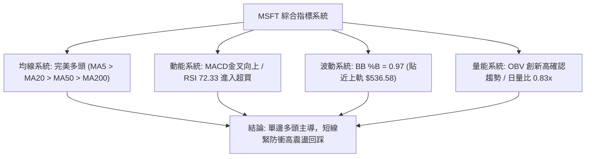

### 📈 移動平均線排列分析

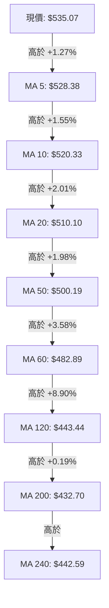

**均線系統評估**：
- **排列狀態**：所有週期均線由短至長（MA5 至 MA200）呈現近乎教科書般的**發散多頭排列**。
- **均線支撐力道**：
  - MA5（$528.38）提供極短線日內第一道動能支撐；
  - MA20（$510.10）與布林中軌完全重疊，為波段持股防守線；
  - MA200（$432.70）已拐頭強勁向上，與現價差距達 +23.66%，確立年線級別大牛市。

### 📉 RSI(14) 分析

```
RSI(14) 讀數：72.33 
[0] ░░░░░░░░░░░░░░░░░░░░░░░░░░░░░░░░░░░░░░░ [70] ▓▓ [100]
進度條: █████████████████████████████░░░░░░░░░░ (72.33%)
```

- **區間評估**：RSI 達到 72.33，正式跨越 70 門檻進入技術性超買區。
- **背離判斷**：
  - **結論：無頂背離現象**。
  - **詳細論證**：檢視 2026-08 至 2026-10 走勢，2026-08-16 週線收盤 $494.47 時週 RSI 曾見 84.8 的短期高點；隨後價格在 2026-09 下旬整理蓄勢，日線 RSI 在此輪由 $493 突破至 $535 的過程中同步向上攻堅，伴隨 MACD 翻正，動能與價格同創新高，並未出現「價格創新高而 RSI 創次高」的典型頂背離徵兆。

### 📊 MACD(12/26/9) 訊號解讀

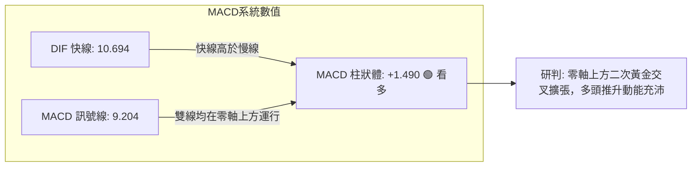

- DIF（10.694）持續拉開與 Signal（9.204）的差距，柱狀體（Hist = +1.490）處於良性放大狀態。
- 零軸上方的黃金交叉擴散通常對應主升浪的加速段，確認了趨勢的強勁延伸性。

### 📦 布林通道分析

```
MSFT 布林通道 (20, 2) 結構示意圖：
$536.58 ────────────────────────────────────── BB 上軌 (Upper Band)
$535.07 ══════════════════════════════════════ ◄ 現價 (極度貼近上軌, %B = 0.97)
        │
        │  通道帶寬開口擴大中 (Bandwidth Expanding)
        │
$510.10 ┄┄┄┄┄┄┄┄┄┄┄┄┄┄┄┄┄┄┄┄┄┄┄┄┄┄┄┄┄┄┄┄┄┄┄┄ BB 中軌 / MA20 (Mid Band)
        │
        │
$483.62 ────────────────────────────────────── BB 下軌 (Lower Band)
```

- **布林通道指標分析**：
  - BB %B 數值為 **0.97**（0 代表下軌，$510.10 代表 0.5，1 代表上軌），表示價格幾乎緊貼布林上軌（$536.58）運行。
  - 當前通道呈現「帶狀推動」（Walking the Upper Band）的強勢特徵。但在 %B 接近 1.0 的同時，短線存在波動率均值回歸的需求，若無法以大陽線強勢撕裂上軌擴大開口，易引發向中軌 $510.10 的技術性回調。

### 💹 成交量分析（量價配合度）

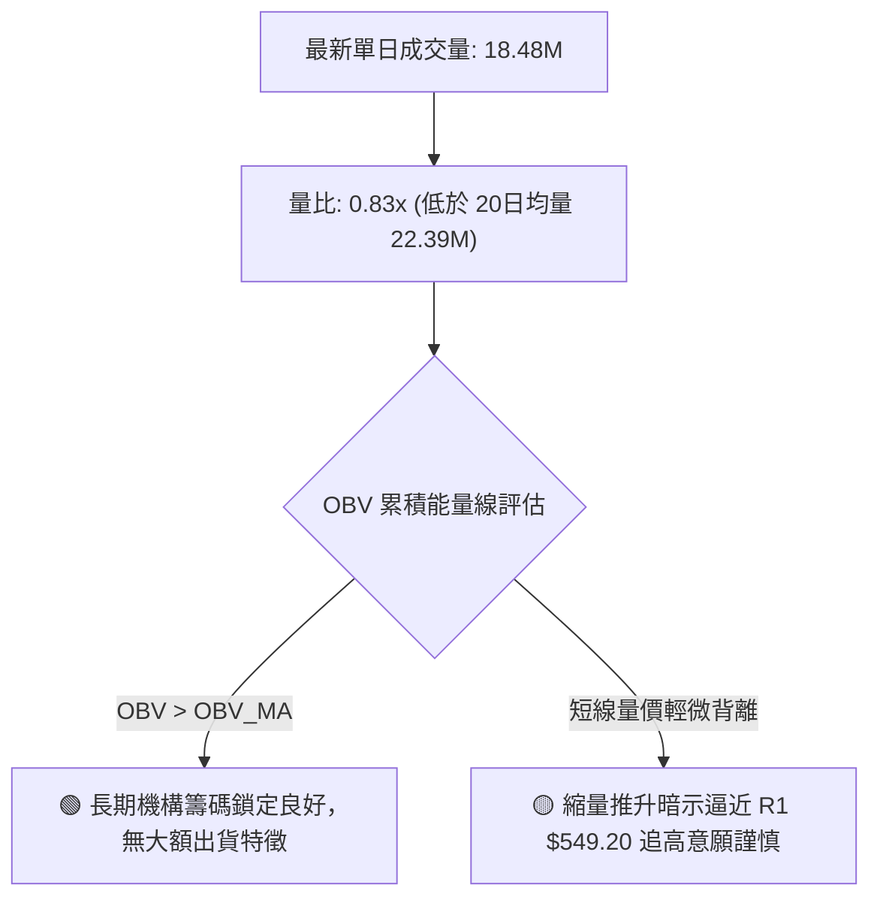

- **量能評估**：最新日量 18,483,600 股低於 20 日均量（22,394,535 股）約 17.5%，量比 0.83x。
- **OBV 趨勢**：系統明確指出「OBV > MA → 量能支撐上漲」。週線級別更可看出，2026-06 底部爆出 3.82 億股天量後，量能沉澱迅速，顯示籌碼高度向長期機構法人集中（機構持股高達 75.8%）。短線的縮量上揚主因為「上方浮動賣壓輕微」，而非「買盤匱乏」。

---

## 6. 動能與波動率

### ⚡ 動能評估四象限

| 象限 | 動能強度 (Momentum) | 波動率水準 (Volatility) | 當前判定 | 特徵與操作涵義 |
|:---:|:---:|:---:|:---:|:---|
| **Q1 (高動能/低波動)** | **強 (ADX=39.7, MACD>0)** | **中低 (ATR%=2.38%)** | **✓ 當前狀態** | **最優順勢交易環境**：趨勢平穩且強勁推進，雜訊低，適合持股續抱與突破加碼 |
| **Q2 (弱動能/低波動)** | 弱 | 低 | — | 盤整築底階段，資金利用效率偏低 |
| **Q3 (強動能/高波動)** | 強 | 高 | — | 瘋狂加速主升浪或恐慌拋售，風險極高，滑點大 |
| **Q4 (弱動能/高波動)** | 弱 | 高 | — | 無方向混亂震盪，最易遭雙巴洗盤 |

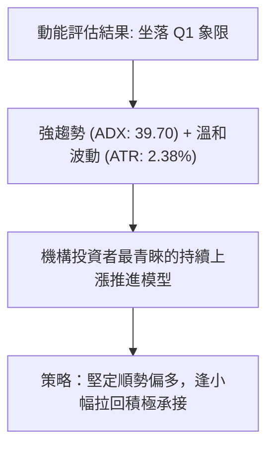

### 📊 ATR 波動率分析

- **ATR(14) 數值**：**$12.72**（佔現價 $535.07 之比率為 **2.38%**）。
- **日內安全防護距離**：
  - 1.0 倍 ATR = $12.72（日內正常隨機雜訊波動區間：$522.35 – $547.79）。
  - 1.5 倍 ATR = $19.08（擺動交易最佳保護性止損間距）。
  - 2.0 倍 ATR = $25.44（波段持倉停損底線：$535.07 - $25.44 = **$509.63**，此數值與 MA20 $510.10 完美契合）。

### 📐 Beta 與市場相關性

- **Beta 係數**：**1.099**。
- **解讀**：
  - Beta 略高於 1.0（+9.9% 系統性彈性），顯示 MSFT 具備略微超越標普 500 指數的進攻彈性。
  - 當大盤走牛時，MSFT 能提供 1.1 倍的 Beta 超額收益；當大盤修正時，其抗跌能力又遠優於高 Beta（>1.5）的投機型科技股。配合其龐大的 $3.97T 市值與 $76.84B 現金儲備，具備極強的流動性溢價。

---

## 7. 多時框架總結

### 📋 時框架評分表

| 時框架 | 趨勢方向 | 動能狀態 | 均線排列 | 圖表形態 | 綜合評分 | 建議方針 |
|:---:|:---:|:---:|:---:|:---:|:---:|:---:|
| **日線 (短期)** | 🟢 強烈看多 | 🟡 超買 (RSI 72.3, %B 0.97) | 🟢 完美多頭 (MA5-MA20) | 🟢 沿布林上軌突破 | **82/100** | 逢盤中拉回 MA5/MA10 買進 |
| **週線 (中期)** | 🟢 強烈看多 | 🟢 動能充沛 (MACD轉正) | 🟢 多頭向上發散 | 🟢 雙底突破主升浪 | **88/100** | 核心持倉鎖定，讓利潤奔跑 |
| **月線 (長期)** | 🟢 強烈看多 | 🟢 歷史級底部翻轉 | 🟢 站穩 MA200/240 | 🟢 歷史大型V底向上 | **90/100** | 堅定超長期配置 |

### 🔲 綜合訊號矩陣

```
時框架訊號一致性評估矩陣：
┌──────────────┬──────────────┬──────────────┬──────────────┐
│   維度指標   │  短期 (日線)  │  中期 (週線)  │  長期 (月線)  │
├──────────────┼──────────────┼──────────────┼──────────────┤
│ 趨勢方向     │   🟢 看多    │   🟢 看多    │   🟢 看多    │
│ 移動平均線   │   🟢 多頭    │   🟢 多頭    │   🟢 多頭    │
│ MACD 指標    │   🟢 金叉    │   🟢 金叉    │   🟢 多頭    │
│ RSI 狀態     │   🔴 超買    │   🟢 強勢    │   🟢 健康    │
│ 支撐結構     │   🟢 MA20    │   🟢 S1      │   🟢 S2/S3   │
│ 量能配合     │   🟡 縮量    │   🟢 沉澱    │   🟢 突破量  │
└──────────────┴──────────────┴──────────────┴──────────────┘
訊號共振度：88.9% (多時框高度一致共振看多)
```

### ⚖️ 多時框收斂結論

**趨勢強度判定與收斂優先級（嚴格依據規則 14）**：
1. **行情屬性**：當前 ADX(14) 讀數為 **39.70**，遠高於 25 的趨勢分水嶺，判定為**強烈單邊趨勢行情**。
2. **優先級收斂**：在 ADX > 25 的強趨勢格局下，以**中長期（週線/MA50、MA200）方向為主導**，日線指標僅用於微觀捕捉進場時機與風控停損點。
3. **矛盾消解**：日線 RSI(72.33) 與布林上軌的超買鈍化，不得解讀為頂部反轉，而應定性為「強勢單邊行情中的超買鈍化」；任何短線的拉回均為趨勢行情的技術性修正，絕非放空時機。
4. **唯一結論**：**強烈偏多（逢低做多）**。此結論與第 1 章技術評分卡（81/100）及第 8 章主策略完全一致。

---

## 8. 交易策略建議

### 🗺️ 策略決策流程圖

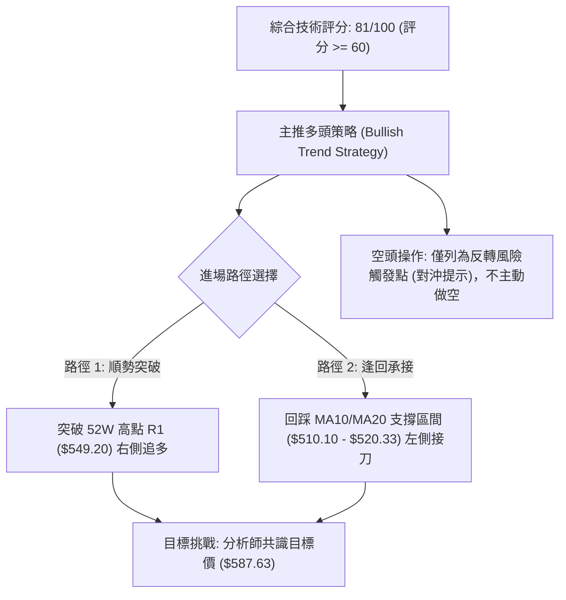

### 🧭 策略路由（依評分卡分流）

> **當前主策略方向 = 主推多頭策略（依綜合評分 81/100，嚴禁兩頭下注）**

### 🎯 價格情境階梯（Price Scenarios）

所有價位均精確引用第 4 章及關鍵數據：

| 觸發條件 | 下一目標 | 後續延伸 | 情境含義 |
|:---|:---|:---|:---|
| **強勢突破 R1 ($549.20)** | 斐波那契延伸 **$577.03** | 分析師均價 **$587.63** | 創歷史新高，展開無套牢真空加速段 |
| **站穩現價區間 ($528.38 - $535.07)** | 測試 R1 **$549.20** | — | 強勢以盤代跌，消化日線超買指標 |
| **跌破 MA20 ($510.10)** | 測試 S1 **$487.61** | S2 **$476.25** | 短線多頭歇息，轉入中期箱體回撤整理 |
| **重挫跌破 S1 ($487.61)** | 考驗 S2 **$476.25** | S3 **$465.47** | 趨勢遭到破壞，多單必須全面撤退離場 |

### 📊 情境機率分佈

| 情境類別 | 機率預估 | 主要技術依據 |
|:---|:---:|:---|
| **繼續上行 / 創新高** | **65%** | ADX 高達 39.70 確認強趨勢，均線完美多頭，MACD 柱狀體翻正擴張，OBV 支撐 |
| **區間強勢震盪** | **25%** | 日線 RSI 超買(72.33)，股價緊貼 BB 上軌($536.58)，量比0.83x需補量換手 |
| **深度回落 / 走弱** | **10%** | 下方存在 MA20($510.10)、MA50($500.19) 及 S1($487.61) 三重梯級強烈支撐 |

### 🟢 主策略詳情（多頭趨勢交易策略）

所有點位嚴格引用 OHLCV 關鍵價位、均線及 ATR(14)=$12.72 計算：

| 策略要素 | 策略 A（強勢回踩接多 - 穩健型） | 策略 B（突破歷史新高追多 - 積極型） |
|:---|:---|:---|
| **進場條件** | 股價短線回踩 MA20 與 23.6% 回調共振區並企穩 | 股價帶量突破歷史高點 R1 ($549.20) 收盤確認 |
| **進場價格** | **$510.10** (精確錨定 MA20 / BB中軌) | **$549.20** (精確錨定 52W High R1) |
| **目標價 T1** | **$549.20** (前高阻力 R1) | **$577.03** (形態高度 1.618 延伸位) |
| **目標價 T2** | **$577.03** (波段延伸目標價) | **$587.63** (分析師共識平均目標價) |
| **止損價格** | **$487.61** (精確跌破關鍵支撐 S1) | **$535.07** (跌破前高突破點/現價支撐，即 $549.20 跌回現價) |
| **停損空間** | $510.10 - $487.61 = $22.49 (約 4.41%) | $549.20 - $535.07 = $14.13 (約 2.57%) |
| **目標1利潤** | $549.20 - $510.10 = $39.10 (約 7.67%) | $577.03 - $549.20 = $27.83 (約 5.07%) |
| **目標2利潤** | $577.03 - $510.10 = $66.93 (約 13.12%) | $587.63 - $549.20 = $38.43 (約 7.00%) |
| **風險報酬比** | **1 : 2.98** (以目標2測算) | **1 : 2.72** (以目標2測算) |
| **成功機率** | **70%** | **65%** |
| **建議倉位** | **20% 資金** | **15% 資金** |

### 🔴 反向風險觸發點（對沖提示）

- **警示價位 1（短線轉弱）**：收盤價連續 2 日跌破 **MA20 ($510.10)**，且 RSI 跌破 50 中軸。
  - *對沖措施*：將持倉減半，或買入 Delta -0.30 之價外 Put 避險。
- **警示價位 2（多頭防線失守）**：帶量跌破關鍵支撐位 **S1 ($487.61)**。
  - *對沖措施*：主策略多單**無條件全數停損出場**，多頭邏輯全盤推翻，轉為現金觀望。

### ⭐ 整體訊號強度評星

```
做多訊號強度：★★★★☆  (4/5星 - 均線趨勢極強，僅受短線超買壓制)
做空訊號強度：★☆☆☆☆  (1/5星 - 嚴重逆勢，勝率極低)
整體可信度：  ★★★★☆  (4/5星 - 多時框指標共振度高達 88.9%)
```

---

## 9. 風險提示與監控

### ✅ 關鍵監控指標 Checklist

```
╔══════════════════════════════════════════════════════════════════╗
║                MSFT 每日交易風控監控清單 (Checklist)              ║
╠══════════════════════════════════════════════════════════════════╣
║ [ ] 1. 現價是否站穩布林中軌 MA20 ($510.10) 之上？               ║
║ [ ] 2. 挑戰 R1 ($549.20) 時單日成交量是否放大至 24.9M (50日均量)？║
║ [ ] 3. RSI(14) 是否在 75 以上形成雙重頂背離？                     ║
║ [ ] 4. ADX(14) 讀數是否維持在 25 以上？(當前 39.70，趨勢健康)     ║
║ [ ] 5. MACD 柱狀體是否持續維持正值？(避免死叉翻負)               ║
║ [ ] 6. 跌破 S1 ($487.61) 是否果斷執行停損紀律？                  ║
╚══════════════════════════════════════════════════════════════════╝
```

### ⚠️ 風險場景分析

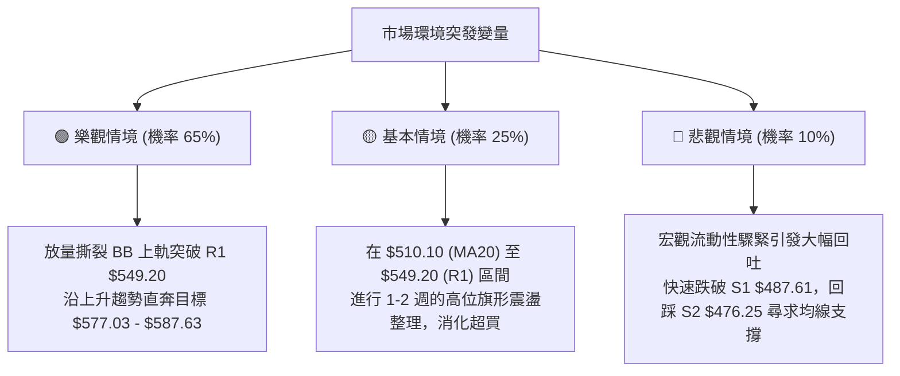

### 🛡️ 風險管理重要提醒

1. **嚴禁追高紀律**：當前 BB %B 達 0.97，現價距離上軌僅差 $1.51，短線隨時有回踩均線之可能。未持股者切勿在 $535 以上市價全倉追進，應嚴格執行分批掛單策略。
2. **波動率保護**：以 ATR ($12.72) 建立動態追蹤停利（Trailing Stop）。每當股價創出新高，將保護性止損上移至「最新最高價 - 2.0 × ATR」。
3. **倉位管控**：科技股權重不宜超過整體投資組合之 30%，單一標的停損金額嚴格控制在總資產之 1.0%–1.5% 以內。

---

## 📋 報告總結

```
MSFT 技術分析報告總結
════════════════════════════════════════════════════════
報告日期：2026-10-11
當前價格：$535.07
分析評級：🟢 強烈看多 (逢低布局 / 順勢交易)

關鍵結論：
├─ 長期趨勢：🟢 強烈看多 (月線 24 個月 V 型翻轉，均線系統全面上揚)
├─ 中期趨勢：🟢 強烈看多 (週線天量雙底突破，MACD 柱狀體翻正擴張)
├─ 短期趨勢：🟡 多頭超買 (ADX 39.70 強趨勢主導，但 RSI 72.33 緊貼布林上軌)
├─ 關鍵支撐：S1 $487.61 ｜ S2 $476.25 ｜ S3 $465.47 ｜ 短期生命線 MA20 $510.10
├─ 關鍵阻力：R1 $549.20 (52W High，近一年唯一實體高點聚類)
└─ 分析師目標：平均目標價 $587.63 ｜ 最高目標價 $870.00

最優策略組合：
1. 🥇 最佳機會：回踩 MA20 ($510.10) 附近掛單接多，停損設於 S1 ($487.61)，風報比 1:2.98
2. 🥈 次選機會：帶量突破歷史阻力 R1 ($549.20) 順勢追多，目標看至 $577.03-$587.63
3. 🥉 保守選擇：維持現有倉位續抱，將移動停利點上移至 MA10 ($520.33)
════════════════════════════════════════════════════════
```

---

> ⚠️ **免責聲明**：本報告為 AI 自動生成之技術分析，所有數據及估算均基於提供的歷史價格資訊。本報告**僅供研究與學術參考**，**不構成任何投資建議**。投資有風險，入市需謹慎。

---

*報告生成時間：2026-10-11 ｜ 數據來源：Yahoo Finance ｜ 分析框架：多時框技術分析*