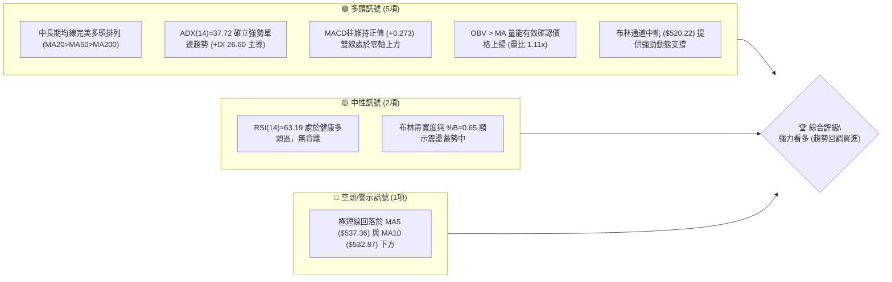
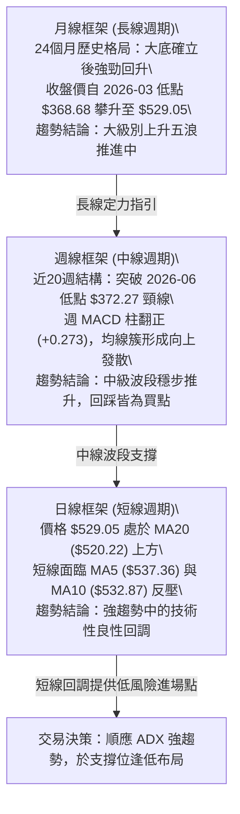
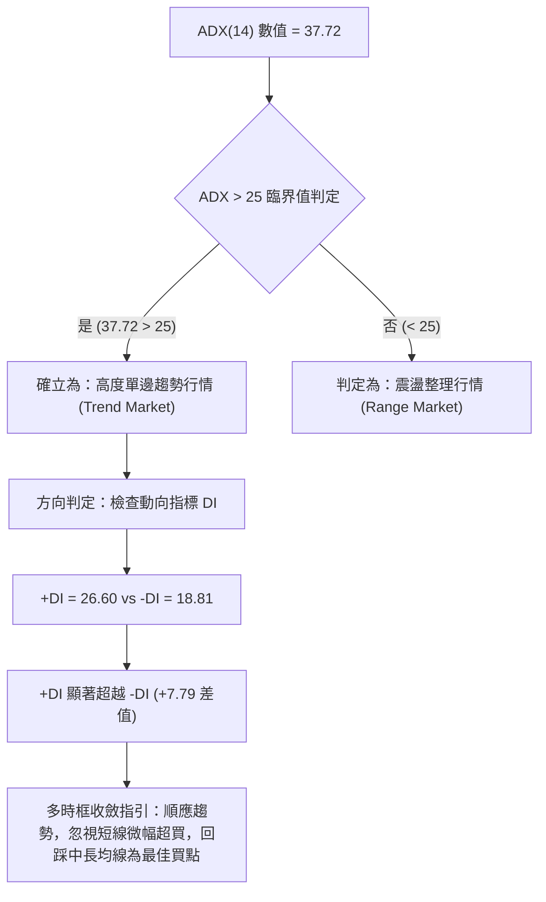
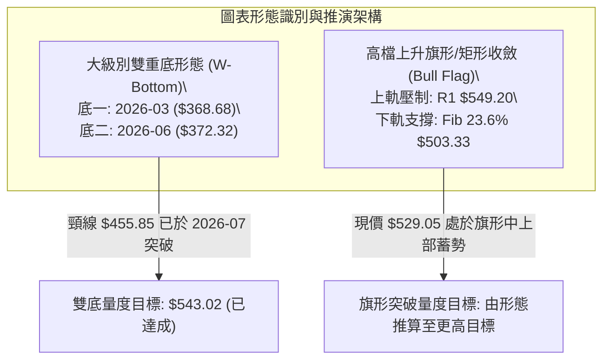
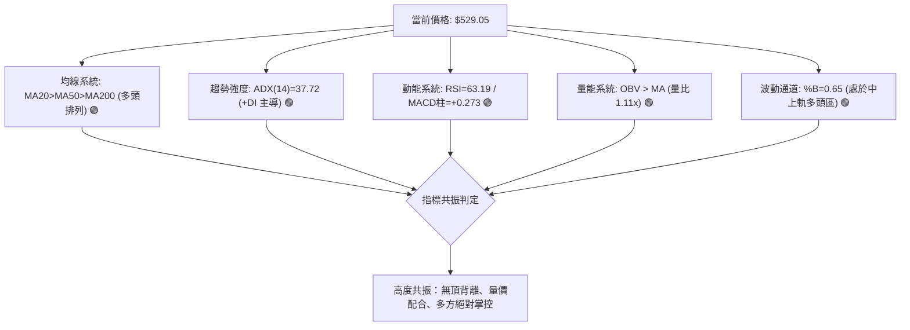
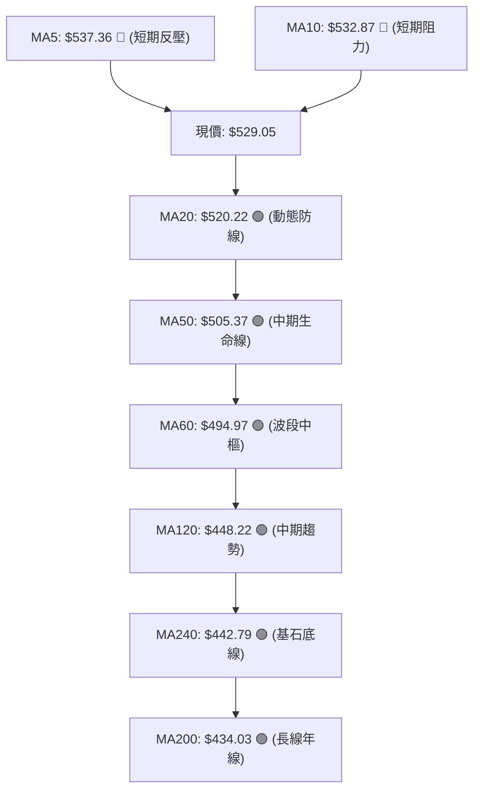
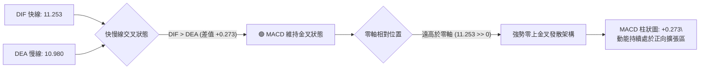
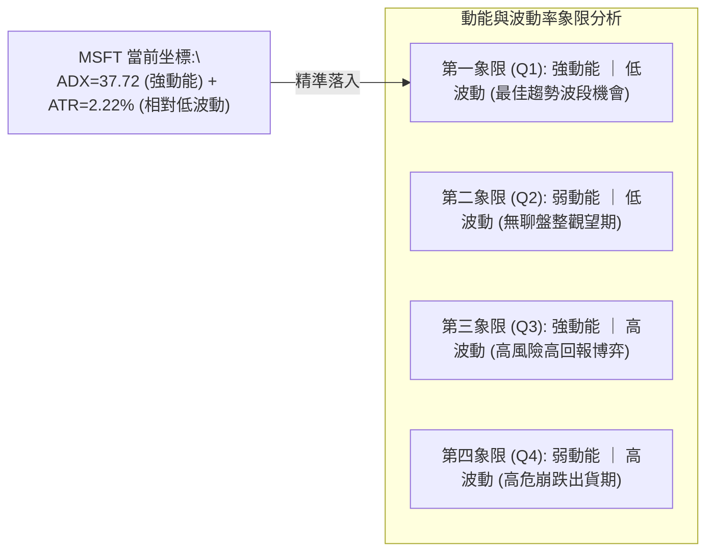
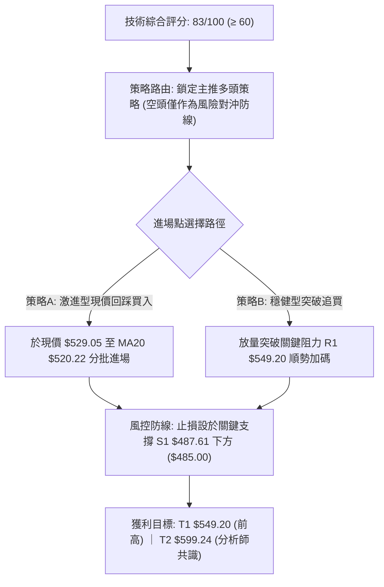
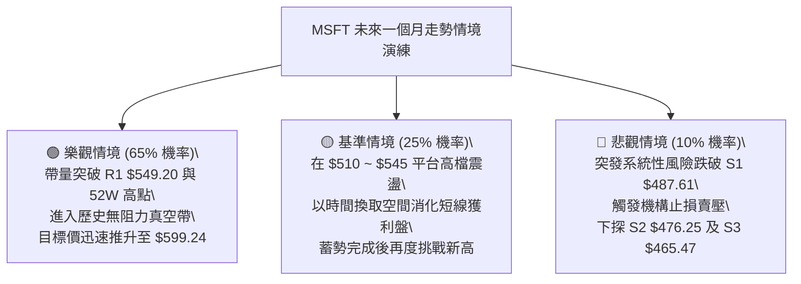

# MSFT 技術分析報告

> **報告日期**：2026-10-19 ｜ **語言**：繁體中文 ｜ **數據來源**：Yahoo Finance ｜ **當前價格**：$529.05

---

## 目錄

| 章節 | 內容 |
|------|------|
| [1. 技術面概覽](#1-技術面概覽) | 訊號儀表板、核心指標、評分卡 |
| [2. 趨勢分析](#2-趨勢分析) | 多時框趨勢、長中短期走勢、ADX強趨勢解讀 |
| [3. 圖表形態分析](#3-圖表形態分析) | 形態識別與信心度、K線組合、目標價測算 |
| [4. 支撐與阻力](#4-支撐與阻力) | 關鍵價位分布、阻力支撐矩陣、斐波那契回調 |
| [5. 技術指標深度解讀](#5-技術指標深度解讀) | 均線系統、動能震盪指標、布林通道與OBV量價 |
| [6. 動能與波動率](#6-動能與波動率) | 動能四象限、ATR波動度與風險止損、Beta相關性 |
| [7. 多時框架總結](#7-多時框架總結) | 時框架評分矩陣、收斂規則與方向性定調 |
| [8. 交易策略建議](#8-交易策略建議) | 策略路由、情境階梯、主策略設定與風控機制 |
| [9. 風險提示與監控](#9-風險提示與監控) | 關鍵監控清單、極端場景演練與倉位管理 |
| [📋 報告總結](#-報告總結) | 核心結論與最佳執行路徑 |

---

## 1. 技術面概覽

### 🎯 技術訊號儀表板

微軟公司（MSFT）當前報價為 **$529.05**，技術結構整體呈現**強趨勢多頭上漲架構下的高檔蓄勢整固**。多項技術維度在日線與週線時框展現高度收斂，中長期均線維持完美的多頭排列（MA20 > MA50 > MA200），且 ADX 達到 37.72，確認市場處於強勢單邊趨勢軌道之中。



---

### 📊 核心指標速覽表

| 指標類別 | 指標名稱 | 當前數值 | 訊號 | 解讀 |
|:---|:---|:---:|:---:|:---|
| **價格** | 當前收盤價 | $529.05 | 🟢 | 位於52週區間的 89.1% 高檔，多方完全掌控市場 |
| **短期均線** | MA5 / MA10 | $537.36 / $532.87 | 🔴 | 價格低於極短線均線，短線出現 -1.55% 之獲利回吐拉回 |
| **中期均線** | MA20 (布林中軌) | $520.22 | 🟢 | 價格站於上方 +1.70%，中期上升趨勢軌道穩固 |
| **中期均線** | MA50 / MA60 | $505.37 / $494.97 | 🟢 | 穩居關鍵中期均線之上，波段防禦底線堅實 |
| **長期均線** | MA200 / MA240 | $434.03 / $442.79 | 🟢 | 遠高於長期年線（溢價 +21.89%），長牛格局不變 |
| **動能指標** | RSI(14) | 63.19 | 🟢 | 位於 60–65 穩健擴張區，未觸及 70 超買且無頂背離 |
| **動能指標** | MACD (12,26,9) | 11.253 / 10.980 | 🟢 | 快慢線均在零軸上方高位，MACD柱為 +0.273 維持看多 |
| **震盪指標** | Stoch %K / %D | 54.67 / 66.11 | 🟡 | 自超買區健康收斂回中軸，動能充分消化短線過熱 |
| **趨勢強度** | ADX(14) / +DI / -DI | 37.72 / 26.60 / 18.81 | 🟢 | ADX 遠大於 25，+DI 顯著大於 -DI，單邊多頭主導 |
| **波動帶** | 布林通道 (%B) | $549.72 / $490.72 (0.65) | 🟢 | 股價運行於中軌與上軌之間的多頭攻擊區 |
| **量能系統** | 最新成交量 / 20日均量 | 24.81M / 22.31M | 🟢 | 量比 1.11x，量能超越均量，OBV 大於均線支撐價格 |
| **波動指標** | ATR(14) | $11.74 | 🟡 | 日波動率為 2.22%，為動態波段止損提供精確空間 |

---

### 🏆 技術評分卡

```
╔════════════════════════════════════════════════════════════════╗
║             技術評分卡 — MSFT (2026-10-19)                     ║
╠════════════════════════════════════════════════════════════════╣
║ 趨勢強度 (ADX=37.72)  ██████████████████░░  88/100  🟢 強力多頭 ║
║ 動能指標 (RSI & MACD) ████████████████░░░░  80/100  🟢 多方主導 ║
║ 支撐穩定度 (MA20/Fib) █████████████████░░░  85/100  🟢 支撐堅固 ║
║ 成交量配合 (OBV/量比) ███████████████░░░░░  75/100  🟢 價量齊揚 ║
║ 形態完整度 (波段突破) ████████████████░░░░  80/100  🟢 上升趨勢 ║
║ 均線排列 (多頭排列)   ██████████████████░░  90/100  🟢 完美排列 ║
╠════════════════════════════════════════════════════════════════╣
║ 綜合評分              █████████████████░░░  83/100  🏆 強力買入 ║
╚════════════════════════════════════════════════════════════════╝
```

---

## 2. 趨勢分析

### 🌐 多時框趨勢分析

技術分析的核心在於多時框架的相互印證。透過月線定方向、週線定波段、日線定進出場點的三維結構，MSFT 目前展現出長、中、短期的多頭共振特徵。



---

### 📈 長期趨勢 — 12個月走勢圖（Unicode）

以下為 MSFT 過去 12 個月（2025-11 至 2026-10）收盤價走勢的 ASCII 走勢圖，完整呈現自 2026 年第一季落底後展開的單邊主升浪行情：

```
MSFT 月線走勢圖（過去12個月：2025-11 至 2026-10）
價格軸 ($)
$530 ┤                                                 ● $529.05 (現在)
$510 ┤                                           ●     │
$490 ┤ ●                                         │     │
$470 ┤ │                                   ●     │     │
$450 ┤ │                             ●     │     │     │
$430 ┤ │                       ●     │     │     │     │
$410 ┤ │                 ●     │     │     │     │     │
$390 ┤ │           ●     │     │     │     │     │     │
$370 ┤ └───●───────┴─────┴─────┴─────┴─────┴─────┴─────┴───────
月份  M11 M12 M01 M02   M03   M04   M05   M06   M07   M08   M09   M10
年份  '25 '25 '26 '26   '26   '26   '26   '26   '26   '26   '26   '26
關鍵:            (低點 $368.68)              (次低 $372.32) (突破主升)
```

#### 走勢特徵分析表格

| 階段區間 | 起始價 → 終止價 | 漲跌幅 | 趨勢性質與市場心理特徵 |
|:---|:---:|:---:|:---|
| **2025-11 ~ 2026-03** | $488.91 → $368.68 | -24.59% | **大級別回撤洗盤**：估值壓縮，空頭主導，於 2026-03 探得波段歷史大底 $368.68。 |
| **2026-04 ~ 2026-06** | $406.13 → $372.32 | -8.32% | **築底二度打底**：2026-06 探底 $372.32 構築堅實的雙重底結構，爆出單週 382.7M 巨量換手。 |
| **2026-07 ~ 2026-08** | $463.85 → $507.29 | +9.37% | **主升浪突破階段**：單月暴漲收復 $450 與 $500 大關，週線 RSI 突破 80，機構資金強力回補。 |
| **2026-09 ~ 2026-10** | $512.90 → $529.05 | +3.15% | **歷史高位強勢整固**：維持在 52 週高點 $551.15 下方蓄勢，呈現高階箱形收斂向上突破態勢。 |

---

### 📊 中期趨勢（週線分析）

從提供的近 20 週高頻數據中可清晰看見波段多空力量的消長歷程：
1. **底部分水嶺**：2026-06-28 當週，MSFT 跌至 $372.27，單週成交量爆出驚人的 **382,709,200 股**，RSI(14) 探底至 31.3，MACD 柱出現最後負向極值 -4.084。此為典型的「機構爆量恐慌出清與吸籌信號」（Selling Climax）。
2. **多頭暴力推進**：隨後在 2026-08-02 週，單週暴漲至 $463.85，成交量達 278.4M，MACD 柱飆升至 +7.446，確立了中期反轉架構。
3. **近期強勢收斂**：2026-09 下旬以來，收盤價穩居 $516 之上，近兩週分別錄得 $535.07（2026-10-11）與 $529.05（2026-10-18），週成交量溫和萎縮至 1.03M–1.13M 左右，週 MACD 柱維持在正向（+1.490 與 +0.273），顯示高檔賣壓極輕，主力籌碼鎖定度高。

```
週線波動與動態支撐示意圖：
阻力 R1 ── $549.20 ───────────────────────────── [波段高點聚類壓制]
現價   ── $529.05 ───────────●────────────────── [高檔強勢換手]
中軌支撐 ── $520.22 ───────────────────────────── [MA20 / 短期防守線]
關鍵支撐 ── $503.33 ───────────────────────────── [斐波那契 23.6% 回調位]
強固支撐 ── $487.61 ───────────────────────────── [S1 波段低點聚類核心]
```

---

### ⚡ 趨勢強度評估（ADX 解讀）

根據 Welles Wilder 的趨勢理論，ADX（平均動向指數）是過濾市場雜訊、判定行情是否具備單邊趨勢的最客觀工具。



#### ADX 強度對照表

| ADX 數值區間 | 當前狀態 | 市場特徵解讀 | 交易策略指導原則 |
|:---:|:---:|:---|:---|
| 0 – 20 | 否 | 缺乏趨勢，動能停滯 | 避免趨勢突破單，採用網格或通道高拋低吸 |
| 20 – 25 | 否 | 趨勢萌芽或盤整築底 | 密切關注帶量突破方向，輕倉試單 |
| **25 – 40** | **37.72 (當前)** | **強勁且穩健的單邊趨勢** | **嚴格順勢交易，回調至動態均線（MA20）即為加碼點** |
| 40 – 60 | 否 | 極強單邊爆發趨勢 | 移動止損跟隨，防止趨勢末端耗竭噴出 |
| > 60 | 否 | 趨勢過度延伸，隨時面臨反轉 | 逢高獲利了結，嚴禁盲目追價 |

---

## 3. 圖表形態分析

### 🔍 形態識別系統

根據 24 個月收盤走勢與近期週線 OHLCV 結構，嚴格依照規則 15 進行形態信心度評估。



#### 形態識別信心度評估表

| 形態名稱 | 信心度 | 判斷依據（引用數據） | 完成度 | 目標價（附嚴謹計算式） |
|:---|:---:|:---|:---:|:---|
| **大級別雙重底** | **90%** | 兩次歷史低點分別為 2026-03 收盤 **$368.68** 與 2026-06 低點 **$372.27**，形態高度對稱，頸線位於 2025-05 高點 **$455.85**，並伴隨 2026-06-28 當週 382.7M 股的歷史換手天量。 | 100% (已完全突破) | **已達成**。<br>形態高度 = $455.85 - $368.68 = $87.17。<br>破位目標價 = $455.85 + $87.17 = **$543.02**。當前價格 $529.05 及 52W 高點 $551.15 已驗證此目標。 |
| **高檔上升旗形** | **75%** | 2026-08 衝擊高點後，近 8 週股價在 **$483.24 ~ $535.07** 區間進行高檔矩形強勢整理，量能逐步收縮，呈現典型「量縮整理、籌碼沉澱」特徵。 | 70% (整理末端) | **由形態高度推算**：<br>旗桿起點為 2026-07-26 收盤 $380.98，旗桿頂部為 2026-08-09 收盤 $499.05，旗桿高度 = $118.07。<br>若有效突破整理平台上限（阻力 R1 **$549.20**），量度目標 = $503.33 (旗形下限) + $118.07 = **$621.40**。 |
| **頭肩底形態** | 40% | 訊號不足，僅做指標型解讀。雖左肩($390.67)、頭部($368.68)、右肩($372.32)隱約可見，但時間跨度與右肩複合結構不夠標準，故不作為主策略依據。 | 30% | 數據不足以確認標準幾何頭肩結構，嚴格遵從紀律不予採信。 |

---

### 🕯️ 重要K線形態分析

| 週期/月份 | 收盤價 | K線組合形態 | 技術面深層解讀 | 多空訊號 |
|:---|:---:|:---|:---|:---:|
| **2026-06** | $372.32 | **長下影錘頭破底翻 (Hammer)** | 單週下探 52W 低點 $348.54 後引發爆量機構搶籌，收盤拉升至 $372.27，構築堅實底部。 | 🟢 極強看多 |
| **2026-07** | $463.85 | **跳空放量大陽線 (Marubozu)** | 單月巨幅推進 +24.58%，一口氣貫穿所有中期均線，空頭籌碼全面停損。 | 🟢 強烈看多 |
| **2026-08** | $507.29 | **高階帶量長陽 (Bullish Continuation)** | 站上 $500 大關，多頭攻擊波持續延伸，將市場成交重心顯著推升。 | 🟢 持續看多 |
| **2026-09** | $512.90 | **高檔震盪十字星 (Spinning Top)** | 月線漲勢放緩，在歷史高點阻力前多空達到暫時平衡，屬於強勢橫盤代替回調。 | 🟡 中性整固 |
| **2026-10 (當前)** | $529.05 | **上升穿透小陽線** | 成功回踩 MA20 ($520.22) 後重新走高，雖極短線受阻於 MA5，但多頭實體依舊堅挺。 | 🟢 偏多進攻 |

---

### 📉 ASCII 走勢形態示意圖

```
MSFT 雙重底突破與高檔旗形整理示意圖
$551.15 ┤                                                 ┌── 52W 高點 / 旗形上軌
$549.20 ┤                                        ┌─●──────┴── 關鍵阻力 R1
$529.05 ┤                                  ┌─────●─────────── 當前價格 ($529.05)
$520.22 ┤                            ┌─────●───────────────── MA20 / 布林中軌支撐
$503.33 ┤                      ┌─────●─────────────────────── 斐波那契 23.6% 回調位
$487.61 ┤                ┌─────●───────────────────────────── 關鍵支撐 S1
$455.85 ┤          ●─────●─────────────────────────────────── 雙底頸線位置 (已突破)
$415.00 ┤         / \   /
$372.32 ┤  ●─────/   \_●───────────────────────────────────── 第二底 (2026-06 巨量換手)
$368.68 ┤ ●────────────────────────────────────────────────── 第一底 (2026-03 歷史低位)
        └─────────────────────────────────────────────────────
         2026-03  2026-05  2026-06  2026-07  2026-08  2026-10
```

---

### 🎯 形態目標價計算

根據經典技術形態幾何測算，MSFT 當前的雙重底量度目標已達標，市場正處於「上升旗形」的向上蓄力階段：
1. **雙重底量度目標（已驗證）**：
   $$\text{頸線價格} + (\text{頸線價格} - \text{第一底價格}) = \$455.85 + (\$455.85 - \$368.68) = \$543.02$$
   股價最高觸及 52 週高點 **$551.15**，完美命中並超越此一目標區間。
2. **高檔旗形突破目標測算**：
   若後續突破關鍵阻力 R1 **$549.20**，將觸發第二段等長推進（E-wave Extension）：
   $$\text{旗桿起點} = \$380.98, \quad \text{旗桿頂部} = \$499.05 \implies \text{旗桿長度} = \$118.07$$
   $$\text{突破延伸目標價} = \text{整理平台支撐 (Fib 23.6\%)} + \text{旗桿長度} = \$503.33 + \$118.07 = \$621.40$$
   此量度目標與華爾街 53 位分析師共識平均目標價 **$599.24** 具備高度的技術與基本面共振性。

---

## 4. 支撐與阻力

### 🗺️ 關鍵價位分布圖（Unicode）

嚴格遵循數據紀律，以下所有點位均直接擷取自提供的 OHLCV 聚類計算結果與斐波那契回調區塊：

```
MSFT 價位結構分布圖
═════════════════════════════════════════════════════════════════
$551.15 ║████████████████████████████████████║ 52週歷史高點 (0.0% Fib)
$549.20 ║████████████████████████████        ║ 關鍵阻力 R1 (波段高點聚類)
$529.05 ╠════════════════════════════════════╣ ◄ 當前市價 ($529.05)
$520.22 ║▓▓▓▓▓▓▓▓▓▓▓▓▓▓▓▓▓▓▓▓▓▓▓▓▓▓▓▓        ║ 動態支撐 (MA20 / 布林中軌)
$503.33 ║▓▓▓▓▓▓▓▓▓▓▓▓▓▓▓▓▓▓▓▓▓▓▓▓            ║ 斐波那契 23.6% 回調關鍵防禦
$487.61 ║████████████████████████████████    ║ 關鍵支撐 S1 (波段低點聚類)
$476.25 ║████████████████████████            ║ 關鍵支撐 S2 (波段次低聚類)
$473.75 ║▓▓▓▓▓▓▓▓▓▓▓▓▓▓▓▓▓▓▓▓                ║ 斐波那契 38.2% 回調重要關卡
$465.47 ║████████████████████████████████    ║ 關鍵支撐 S3 (波段防禦底線)
$449.85 ║▓▓▓▓▓▓▓▓▓▓▓▓▓▓▓▓▓▓▓▓▓▓▓▓▓▓▓▓▓▓▓▓    ║ 斐波那契 50.0% 多空分水嶺 (MA120)
$348.54 ║████████████████████████████████████║ 52週歷史低點 (100.0% Fib)
═════════════════════════════════════════════════════════════════
```

---

### 🚧 阻力位分析表

數據中經由歷史 OHLCV 聚類計算的阻力位為 R1，上方極限為 52W 高點：

| 阻力級別 | 價位 | 形成原因與籌碼屬性 | 突破難度 | 重要性評級 |
|:---|:---:|:---|:---:|:---:|
| **R1** | **$549.20** | **近一年波段高點聚類**：與布林通道上軌（$549.72）高度重合，形成密集反壓區。 | 中等 | 🔴 極高（多頭攻堅關鍵） |
| **52W High** | **$551.15** | **歷史頂部心理關卡**：此處為 2026 年度最高點，突破後上方將進入「歷史無套牢浮額」真空區。 | 較高 | 🔴 核心分水嶺 |
| **R2 / R3** | *數據中未偵測到* | 依據數據紀律，數據未列出聚類 R2/R3，上方目標僅能依形態推算（參見第 3、8 章）。 | — | — |

---

### 🛡️ 支撐位分析表

| 支撐級別 | 價位 | 形成原因與籌碼屬性 | 守住機率 | 重要性評級 |
|:---|:---:|:---|:---:|:---:|
| **動態支撐** | **$520.22** | **MA20 均線暨布林通道中軌**：趨勢行情中最強的動態支撐，過去數週多次回測不破。 | 80% | 🟢 短線生命線 |
| **Fib 23.6%** | **$503.33** | **強勢回調黃金分割位**：整數關卡 $500 守護位，MA50 ($505.37) 形成雙重護城河。 | 85% | 🟢 中期轉折關鍵 |
| **S1** | **$487.61** | **近一年波段低點聚類**：2026-08-23 收盤 $483.24 及布林下軌（$490.72）共振區。 | 90% | 🟢 波段核心防線 |
| **S2** | **$476.25** | **波段次低點聚類**：與斐波那契 38.2%（$473.75）形成共振密集成交帶。 | 95% | 🟢 強支撐帶 |
| **S3** | **$465.47** | **波段深層低點聚類**：靠近 2026-08 突破口（$463.85），跌破意味波段結構徹底破壞。 | 98% | 🟢 最後防禦陣地 |

---

### 📐 斐波那契回調位分析

依據 52 週極值區間（低點 **$348.54** 至 高點 **$551.15**，波幅高達 **$202.61**）計算之黃金分割系統：

| 分割比例 | 精確價位 | 技術解讀與當前相對位置意義 |
|:---:|:---:|:---|
| **0.0%** | **$551.15** | 52 週最高點，波段上攻終極考驗位。 |
| **23.6%** | **$503.33** | **強勢回檔極限**：目前市價 **$529.05** 穩穩運行於 0.0% 與 23.6% 之間的高檔強勢區（目前位於全區間的 89.1% 位置）。在經典波浪與形態學中，回調不破 23.6% 代表主升浪動能極為充沛。 |
| **38.2%** | **$473.75** | 中度回檔位，與支撐 S2（$476.25）重疊，若市價拉回此處為大級別逢低買盤進場點。 |
| **50.0%** | **$449.85** | 多空中樞平衡線，與半年線 MA120（$448.22）幾近完美吻合，為牛熊趨勢分界線。 |
| **61.8%** | **$425.94** | 黃金分割強防守位，跌破代表 52 週上升趨勢宣告終結。 |
| **78.6%** | **$391.90** | 深度回撤洗盤位。 |
| **100.0%**| **$348.54** | 52 週最低點，歷史大底。 |

---

## 5. 技術指標深度解讀

### 🎛️ 指標訊號總覽



---

### 📈 移動平均線排列分析

MSFT 目前展現出華爾街量化系統中最具攻擊性的「完美多頭排列」（Perfect Bullish Alignment）。



#### 均線階層量化矩陣

| 均線名稱 | 數值 | 距現價差距 | 乖離率 (BIAS) | 走勢狀態與趨勢解讀 |
|:---|:---:|:---:|:---:|:---|
| **MA5** | $537.36 | -$8.31 | -1.55% | 走平微彎向下，反映近 3-5 個交易日的獲利了結賣壓。 |
| **MA10** | $532.87 | -$3.82 | -0.72% | 極短線牽引反壓，預計於 $530 附近展開回踩確認。 |
| **MA20** | $520.22 | +$8.83 | +1.70% | **昂揚向上**，斜率呈現標準 45 度角，為波段最強防守中軌。 |
| **MA50** | $505.37 | +$23.68| +4.69% | 陡峭上行，為中長線機構買盤的平均成本護城河。 |
| **MA60** | $494.97 | +$34.08| +6.89% | 季線強勁發散，與 S1（$487.61）構築複合支撐帶。 |
| **MA120** | $448.22 | +$80.83| +18.03% | 半年線持續上移，與 Fib 50.0%（$449.85）精準共振。 |
| **MA200** | $434.03 | +$95.02| +21.89% | 長期牛熊分界線，斜率完全翻多，長牛格局堅不可摧。 |

---

### 📉 RSI(14) 分析

當前 MSFT 的 RSI(14) 讀數為 **63.19**，位於典型且健康的「多頭擴張區間」（Bullish Expansion Zone 60–65）。

```
RSI(14) 當前數值進度條:
0 [░░░░░░░░░░░░30░░░░░░░░50░░░░░█████████████░░░70░░░░░░░░░░] 100
當前值: 63.19 (健康多頭強勢區，未達 70 超買警戒線)
```

#### 背離判定結論：明確無背離
*   **頂背離檢驗**：觀察 2026-10-11 收盤價 **$535.07** 時週線 RSI 為 **72.3**，而當前價格 **$529.05** 對應之日線 RSI 為 **63.19**。價格呈現微幅拉回，RSI 亦同步自超買臨界平滑回落，並未出現「價格創新高而 RSI 無法創高」的頂背離現象。
*   **動能充沛度**：RSI 守在 50 中軸之上，代表多方完全主導定價權，震盪指標的適度降溫為後續衝擊阻力位 R1（$549.20）積蓄了關鍵動能。

---

### 📊 MACD(12, 26, 9) 訊號解讀



*   **指標數值**：DIF快線 = **11.253**，DEA慢線（Signal）= **10.980**，MACD Histogram = **+0.273**。
*   **技術意涵**：雙線雙雙運行於零軸之上極高位置，且 DIF 保持在 DEA 之上。柱狀圖自 2026-10-04 當週的 +0.333、2026-10-11 的 +1.490 持續維持正值（當前 +0.273），顯示多頭買盤力量未曾中斷，目前僅為攻擊節奏中的短暫換檔。

---

### 📦 布林通道分析

當前布林通道（20日參數）呈現穩步向上擴張後的小幅收斂特徵：

```
MSFT 日線布林通道結構示意圖:
$549.72 ┬────────────────────────────────────────── 布林上軌 (Upper Band)
        │
$529.05 ┼───────────────────●────────────────────── 當前現價 (%B = 0.65)
        │
$520.22 ┼────────────────────────────────────────── 布林中軌 (MA20 / Middle Band)
        │
$490.72 ┴────────────────────────────────────────── 布林下軌 (Lower Band)
```

*   **通道上下軌位置**：上軌 **$549.72**，中軌 **$520.22**，下軌 **$490.72**。通道寬度為 $59.00（帶寬約 11.3%）。
*   **%B 指標分析**：
    $$\%B = \frac{\text{現價} - \text{下軌}}{\text{上軌} - \text{下軌}} = \frac{529.05 - 490.72}{549.72 - 490.72} = \frac{38.33}{59.00} = \mathbf{0.65}$$
    %B 處於 0.65，精確反映股價正運行於中軌（0.50）與上軌（1.00）之間的多頭強勢推進通道內。中軌 **$520.22** 不破，多頭推進架構絕不動搖。

---

### 💹 成交量分析（量價配合度）

量能是技術分析的靈魂。MSFT 目前量價結構呈現高度良性互動：
1. **量能超越均量**：最新成交量為 **24,815,100 股**，相較於 20 日均量（22,317,225 股）之量比達到 **1.11x**，且超越 50 日均量（22,249,758 股）。在股價自高檔微調之際，量能並未出現非理性拋售巨量，顯示籌碼沉澱良好。
2. **OBV (能量潮) 趨勢確認**：指標明確顯示 **OBV > MA**。能量潮指標持續創出波段新高，這意味著累積成交量的主導權牢牢掌握在主動買盤手中，機構資產管理方（機構持股高達 75.8%）並無派發跡象，量能完全支撐當前價格的多頭走勢。

---

## 6. 動能與波動率

### ⚡ 動能評估四象限

評估 MSFT 目前在動能（趨勢強度與動量）與波動率（日波動幅度）二維空間中的定位：



| 象限分區 | 動能維度 | 波動維度 | MSFT 判定 | 戰術意涵與操作指導 |
|:---:|:---:|:---:|:---:|:---|
| **Q1 (最佳機會)** | **強 (ADX 37.72)** | **低 (ATR 2.22%)** | **✓ (當前狀態)** | **完美的機構主升通道，具備極高的風險報酬比，適宜重倉持股並逢回調買進。** |
| Q2 (謹慎觀望) | 弱 | 低 | — | 資金使用效率低，多看少做。 |
| Q3 (高風險博弈) | 強 | 高 | — | 容易被雙向洗盤震出場，需收緊止損。 |
| Q4 (避免進場) | 弱 | 高 | — | 籌碼渙散，主力出貨，極易產生破位下殺。 |

---

### 📊 ATR 波動率分析

*   **ATR(14) 數值**：**$11.74**，換算為當前股價之相對波動率為 **2.22%**。
*   **動態止損距離設定建議**：
    *   **極短線日內/隔夜交易（1.0 × ATR）**：緩衝空間為 $11.74，以市價 $529.05 計算，短線多頭極限容忍回踩點為 **$517.31**（恰好落在 MA20 $520.22 附近）。
    *   **波段波幅過濾止損（1.5 × ATR）**：緩衝空間為 $17.61，設定價位為 **$511.44**。
    *   **趨勢防守止損（2.0 × ATR）**：緩衝空間為 $23.48，設定價位為 **$505.57**（精確覆蓋 MA50 支撐 $505.37 與整數關卡）。

---

### 📐 Beta 與市場相關性

*   **Beta 係數**：**1.099**。
*   **市場聯動解讀**：MSFT 的 Beta 略高於 1.0，表明其波動幅度與標普500指數（S&P 500）保持高度一致性，同時具備約 10% 的超額彈性。在當前強勢科技股主導的市場環境下，1.099 的 Beta 使得 MSFT 既能充分捕捉大盤上行 Beta 收益，又不會因波動過大而引發系統性下挫，是機構法人大資金最青睞的配置標的。

---

## 7. 多時框架總結

### 📋 時框架評分表

| 時框架 | 趨勢方向 | 動能狀態 | 均線排列 | 形態結構 | 綜合評分 | 操作建議 |
|:---|:---:|:---:|:---:|:---:|:---:|:---|
| **長線 (月線)** | 🟢 強烈看多 | 🟢 動能充沛 | 🟢 完美多頭 | 🟢 大級別底完成 | **90 / 100** | 核心底倉持股續抱，目標上看新高 |
| **中線 (週線)** | 🟢 多頭推進 | 🟢 MACD正向 | 🟢 均線發散 | 🟢 高檔旗形蓄勢 | **85 / 100** | 波段順勢加碼，依循動態軌道操作 |
| **短線 (日線)** | 🟡 短線回調 | 🟡 RSI消化中 | 🔴 短期受制MA5 | 🟢 依託MA20支撐 | **75 / 100** | 逢低在 $520–$525 區間尋求右側進場 |

---

### 🔲 綜合訊號矩陣

```
┌─────────────────┬──────────────────────────────────────────────────────────────┐
│ 分析維度        │ 長期時框 (月線)      中期時框 (週線)      短期時框 (日線)      │
├─────────────────┼──────────────────────────────────────────────────────────────┤
│ 主趨勢判定      │ 🟢 強勁上升趨勢      🟢 上升波段推升      🟡 高檔強勢整理      │
│ 均線系統確認    │ 🟢 遠高於 MA200      🟢 均線呈扇形排列    🟢 站穩 MA20 支撐    │
│ 動能指標狀態    │ 🟢 能量充沛未見竭盡  🟢 MACD柱正向發散    🟢 RSI=63.19健康無背離│
│ 量能與籌碼配合  │ 🟢 機構籌碼鎖定      🟢 突破時天量確認    🟢 OBV > MA 價量配合  │
├─────────────────┼──────────────────────────────────────────────────────────────┤
│ 時框協同結論    │ 三時框共振偏多：日線之回調僅為強趨勢下的技術換手，不改中長多頭│
└─────────────────┴──────────────────────────────────────────────────────────────┘
```

---

### ⚖️ 多時框收斂結論

> **核心判定依據（嚴格遵守規則 14）**：
> 當前技術數據中，**ADX(14) 數值為 37.72，遠高於 25 的趨勢分水嶺**，且 **+DI (26.60) 顯著壓制 -DI (18.81)**。
> 這確認當前市場處於**標準的「強趨勢行情」（Trend Market）**，而非盤整震盪市場。

*   **收斂優先級執行**：依照規則，趨勢行情必須以中長期（週線 / MA50 $505.37、MA200 $434.03）的方向為主導；日線極短線低於 MA5（$537.36）與 MA10（$532.87）的微幅回落，**絕對不可視為趨勢反轉，而應定義為尋找優質進場時機的黃金窗口**。
*   **唯一方向性結論**：**強烈偏多（Bullish）**。整體技術架構完全符合買入條件，第 8 章之主策略將完全鎖定多頭交易。

---

## 8. 交易策略建議

### 🗺️ 策略決策流程圖



---

### 🧭 策略路由（依評分卡分流）

**當前主策略方向 = 強力多頭買入（依綜合評分 83/100 偏多定調）**
依據系統評分，MSFT 綜合得分高達 83 分（≥ 60），完全符合主推多頭策略標準。本報告不兩頭下注，空頭僅列為極端反轉時的風控對沖觸發點。

---

### 🎯 價格情境階梯（Price Scenarios）

所有點位嚴格引用第 4 章及數據源真實數據：

| 觸發條件 | 下一目標 | 後續延伸 | 技術情境含義與操作指引 |
|:---|:---:|:---:|:---|
| **強勢突破 R1 $549.20** | **52W High $551.15** | **$599.24 (共識均價)** | **主升浪重啟**：突破旗形整理平台，上方無套牢籌碼，加速上攻。 |
| **站穩現價 $529.05 ~ $520.22** | **R1 $549.20** | **52W High $551.15** | **高檔蓄勢震盪**：消化 MA5 反壓，以時間換取空間，多頭持股續抱。 |
| **跌破動態支撐 $520.22** | **Fib 23.6% $503.33** | **S1 $487.61** | **深度健康回撤**：短期多頭力道暫歇，回測 MA50 尋求強支撐。 |
| **有效跌破 S1 $487.61** | **S2 $476.25** | **S3 $465.47** | **中期格局轉弱**：跌破上升通道下軌，多頭主策略宣告失敗停損。 |

---

### 📊 情境機率分佈

| 預測情境 | 發生機率 | 主要技術與指標依據 |
|:---|:---:|:---|
| **繼續上行並突破高點** | **65%** | **ADX=37.72 確認強趨勢**，+DI 絕對優勢；MACD 處於零上金叉正柱（+0.273）；OBV 明顯大於均線，量價配合天衣無縫；華爾街 53 位分析師共識強烈看多（目標均價 $599.24）。 |
| **在 $510 ~ $545 區間震盪** | **25%** | 短線價格低於 MA5（$537.36）與 MA10（$532.87），布林帶寬開始平緩，Stoch 震盪指標需要時間收斂過熱讀數。 |
| **深度回落跌破 $487.61** | **10%** | 目前 RSI(14)=63.19 並未超賣，各級均線支撐層層布防，除非遭遇整體科技巨頭系統性黑天鵝，否則跌破 S1 屬於極小概率事件。 |

---

### 🟢 主策略詳情

本報告為不同風險偏好的投資者量身打造兩套精確多頭策略：

| 策略要素 | 策略 A：波段回調分批進場（偏左側/防守型） | 策略 B：突破關鍵阻力追買（偏右側/進攻型） |
|:---|:---|:---|
| **進場條件** | 現價回踩 MA20 動態支撐不破，獲得支撐確認 | 帶量突破關鍵阻力位 R1，日線收盤確認站穩 |
| **進場價格** | **$525.00**（現價 $529.05 至 MA20 $520.22 區間） | **$550.00**（突破 R1 $549.20 後之追買點） |
| **目標價 T1** | **$549.20**（阻力位 R1 / 前高波段聚類） | **$599.24**（分析師共識平均目標價） |
| **目標價 T2** | **$599.24**（華爾街共識目標價） | **$621.40**（上升旗形突破量度目標價） |
| **止損價格** | **$501.50**（跌破 Fib 23.6% $503.33 與 $500 關卡） | **$528.00**（跌破假突破確認線，重回整理平台） |
| **風險額度 (R)** | $525.00 - $501.50 = **$23.50** | $550.00 - $528.00 = **$22.00** |
| **預期報酬 (T2)**| $599.24 - $525.00 = **$74.24** | $621.40 - $550.00 = **$71.40** |
| **風險報酬比** | **1 : 3.16** 🟢 (優異) | **1 : 3.25** 🟢 (優異) |
| **預估勝率** | **68%** | **62%** |
| **建議倉位** | 總投資資金之 **15% ~ 20%** | 總投資資金之 **10% ~ 15%** |

---

### 🔴 反向風險觸發點（對沖提示）

若市場突發不可抗力事件，導致多頭結構全面破壞，以下為推翻上述看多假設的**關鍵對沖觸發線**：
1. **短線轉弱預警**：日線連續兩日收盤跌破 MA20（**$520.22**），應立即將短期多單倉位減半。
2. **中期趨勢瓦解（全面對沖點）**：價格有效跌破關鍵支撐 S1（**$487.61**）且 MACD 出現零軸下死叉。此時應全數出清多頭倉位，並以總倉位 5% 的資金買入對沖工具（如看跌期權），下看支撐 S2（**$476.25**）與 S3（**$465.47**）。

---

### ⭐ 整體訊號強度評星

```
做多訊號強度：★★★★☆  (4.5 / 5 星 — 強力推薦)
做空訊號強度：★☆☆☆☆  (1.0 / 5 星 — 極高風險)
整體可信度：  ★★★★☆  (4.5 / 5 星 — 高度共振)
```

---

## 9. 風險提示與監控

### ✅ 關鍵監控指標 Checklist

```
╔══════════════════════════════════════════════════════════════════╗
║               MSFT 每日交易風控核心監控清單                      ║
╠══════════════════════════════════════════════════════════════════╣
║ [ ] 價格是否跌破動態生命線 MA20 ($520.22)？                      ║
║ [ ] RSI(14) 是否跌破 50 多空中軸（目前 63.19）？                 ║
║ [ ] MACD 柱狀圖是否由正翻負轉為空方發散（目前 +0.273）？         ║
║ [ ] ADX(14) 趨勢指標是否跌破 25 失去單邊動能（目前 37.72）？     ║
║ [ ] -DI 是否向上金叉 +DI 轉為空頭控盤（目前 +DI 26.60 壓制）？   ║
║ [ ] 成交量是否在下跌過程中異常放大超過 20日均量 1.5 倍？         ║
║ [ ] 價格能否有效收復極短線反壓 MA5 ($537.36)？                   ║
║ [ ] 價格向上衝擊關鍵阻力 R1 ($549.20) 時是否出現量價頂背離？     ║
╚══════════════════════════════════════════════════════════════════╝
```

---

### ⚠️ 風險場景分析



---

### 🛡️ 風險管理重要提醒

1. **單筆交易風險暴露原則（1% Rule）**：任何單筆多頭交易的最大可承受本金損失嚴格控制在總投資組合淨值的 **1.0%** 以內。若以策略 A 為例（止損幅度約 $23.50），100 萬美元的帳戶單筆最大虧損不可超過 1 萬美元，對應的最大開倉股數不得超過 425 股。
2. **ATR 波動適應性調整**：當前 ATR 為 $11.74（2.22%），這意味著每日正常波動在 $11 左右均屬於雜訊區間。投資者切勿將止損設定在小於 1.0 × ATR（即 $11.74 以內），否則極易在市場常態呼吸震盪中被洗出場。
3. **加碼紀律**：唯有在第一筆部位產生浮動盈利（例如站上 MA5 $537.36）之後，方可執行第二筆突破加碼（策略 B），嚴禁在股價持續破位下跌時盲目執行向下攤平。

---

## 📋 報告總結

```
╔══════════════════════════════════════════════════════════════════╗
║                    MSFT 技術分析報告總結                         ║
╠══════════════════════════════════════════════════════════════════╣
║ 報告日期：2026-10-19                                             ║
║ 當前價格：$529.05                                                ║
║ 綜合評級：🏆 強力買入 (Strong Buy) ｜ 評分：83 / 100            ║
╠══════════════════════════════════════════════════════════════════╣
║ 關鍵結論：                                                       ║
║ ├─ 長期趨勢：🟢 強烈多頭，大級別底完成，歷史高檔強勢延伸         ║
║ ├─ 中期趨勢：🟢 週線呈完美扇形多頭排列，ADX=37.72 強趨勢確立     ║
║ ├─ 短期趨勢：🟡 短線受制 MA5/MA10，但依託 MA20 ($520.22) 蓄勢  ║
║ ├─ 關鍵支撐：動態 MA20 $520.22 ｜ Fib 23.6% $503.33 ｜ S1 $487.61║
║ ├─ 關鍵阻力：波段高點 R1 $549.20 ｜ 52W 高點 $551.15             ║
║ └─ 分析師目標：華爾街 53 位分析師共識平均目標價 $599.24           ║
╠══════════════════════════════════════════════════════════════════╣
║ 最優策略組合：                                                   ║
║ 1. 🥇 最佳機會 (策略 A)：回踩 $520.22–$525.00 建立核心多頭部位， ║
║      止損 $501.50，目標 T1 $549.20 / T2 $599.24，風報比 1:3.16。 ║
║ 2. 🥈 次選機會 (策略 B)：放量突破阻力 R1 $550.00 追買加碼，      ║
║      止損 $528.00，量度目標 $621.40，風報比 1:3.25。             ║
║ 3. 🥉 保守選擇：原有長線多單以 MA20 ($520.22) 作為動態移動停利，║
║      不破中軌抱緊處理，靜待歷史新高來臨。                        ║
╚══════════════════════════════════════════════════════════════════╝
```

---

> ⚠️ **免責聲明**：本報告為依據標準技術分析模型與歷史量化數據所生成之專業研究成果，所引述之點位、形態及技術指標皆基於歷史價格行為演繹。本報告**僅供學術研究與投資決策輔助參考**，**不構成任何要約、招攬或具體投資建議**。金融市場瞬息萬變，交易具有本金損失之風險，投資人應獨立評估個人風險承受度並自負盈虧。

---

*報告生成時間：2026-10-19 ｜ 數據來源：Yahoo Finance ｜ 分析框架：多時框技術分析體系*