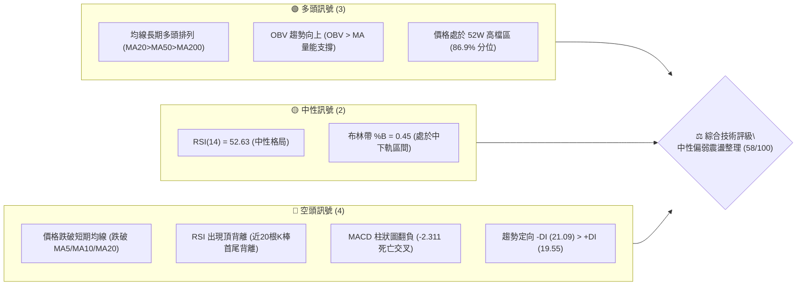
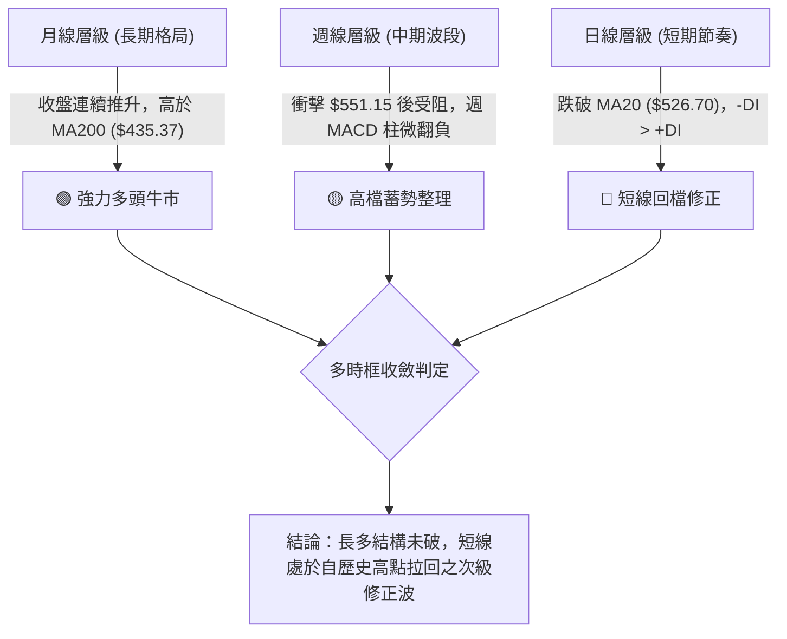
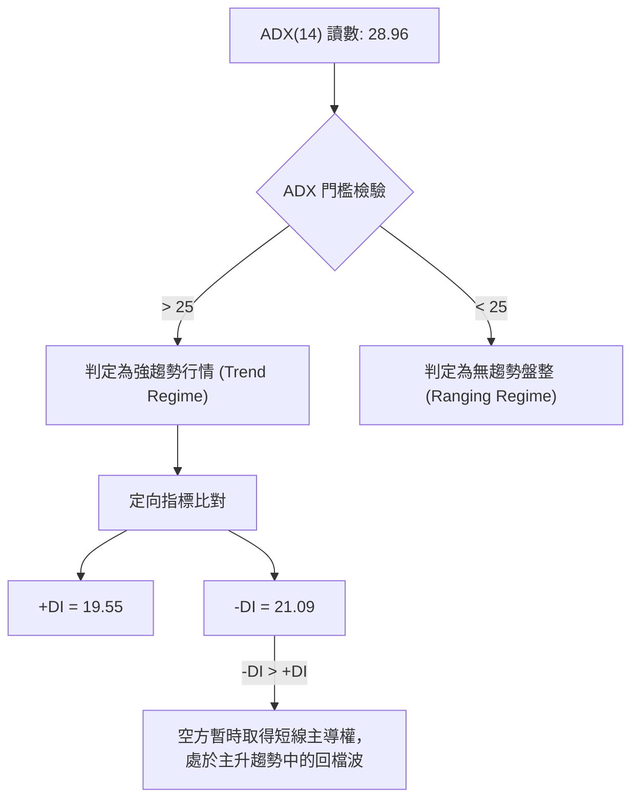
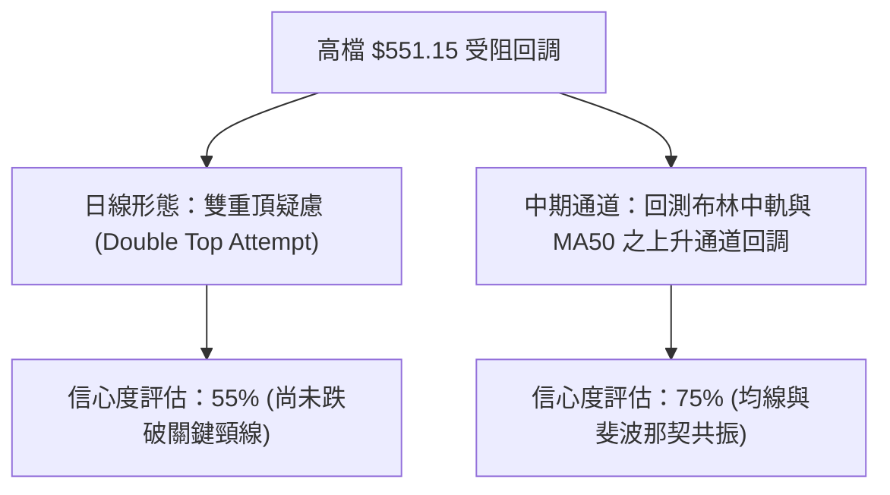
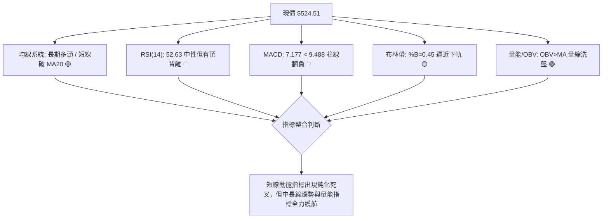
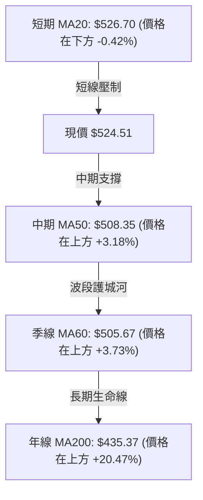
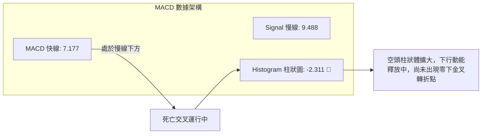
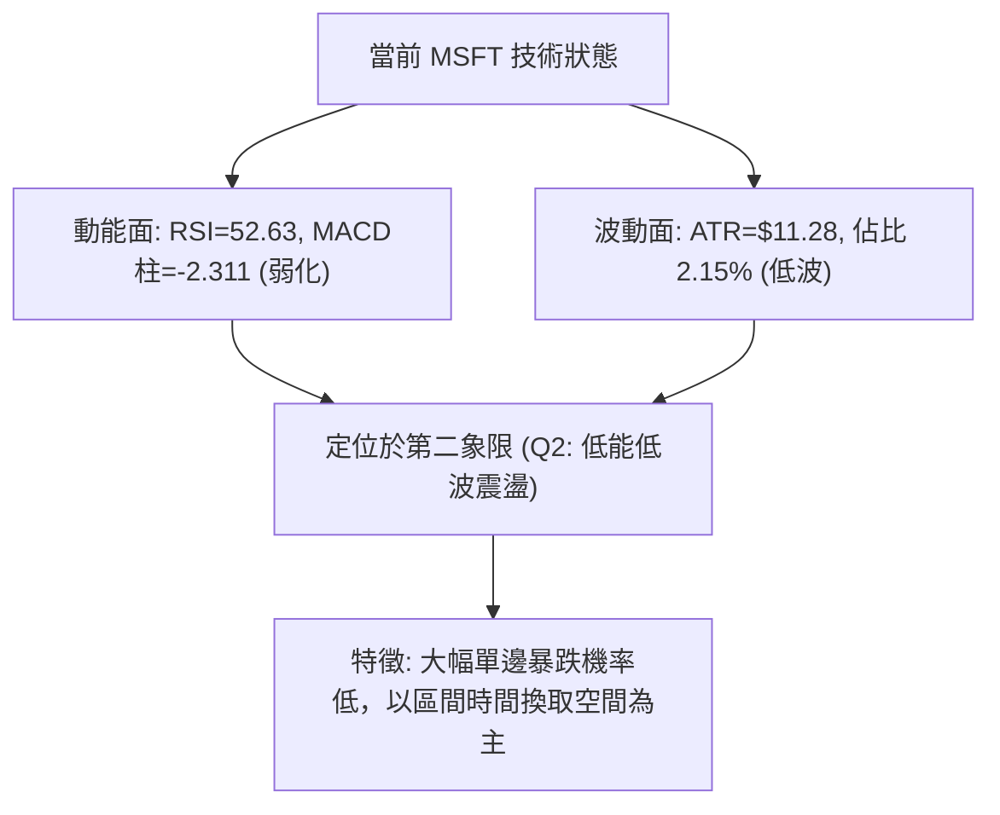
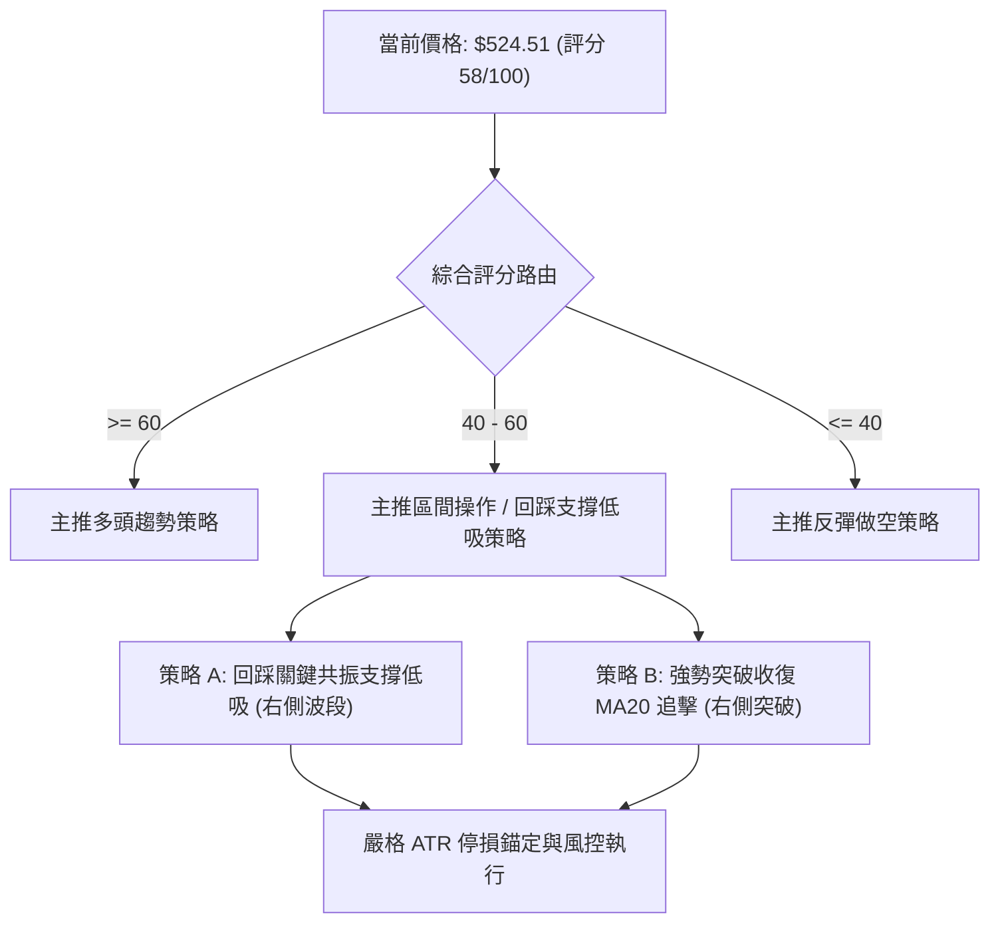
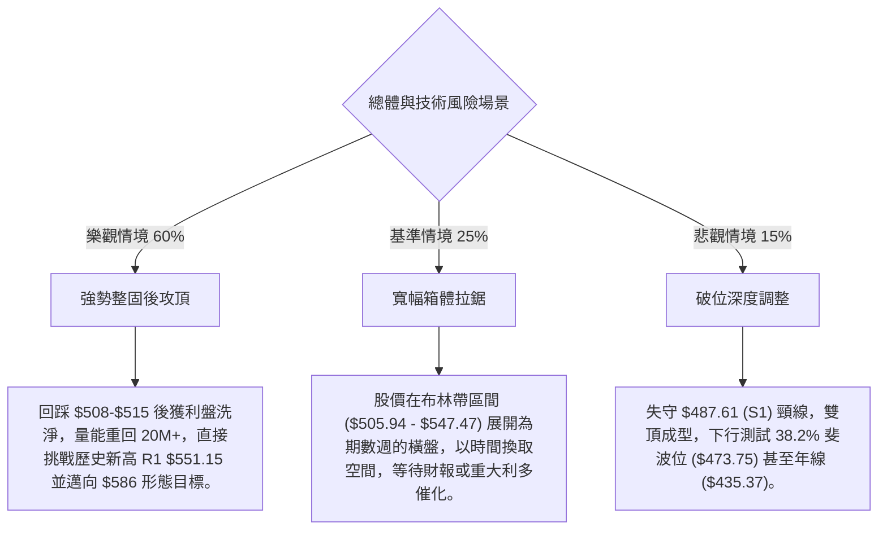

# MSFT 技術分析報告

> **報告日期**：2026-10-24 ｜ **語言**：繁體中文 ｜ **數據來源**：Yahoo Finance ｜ **當前價格**：$524.51

---

## 目錄

| 章節 | 內容 |
|------|------|
| [1. 技術面概覽](#1-技術面概覽) | 訊號儀表板、核心指標、評分卡 |
| [2. 趨勢分析](#2-趨勢分析) | 多時框趨勢、長中短期走勢、ADX解讀 |
| [3. 圖表形態分析](#3-圖表形態分析) | 形態識別、K線組合、目標價推算 |
| [4. 支撐與阻力](#4-支撐與阻力) | 關鍵價位、斐波那契回調結構 |
| [5. 技術指標深度解讀](#5-技術指標深度解讀) | 均線系統、RSI背離、MACD、布林通道、OBV |
| [6. 動能與波動率](#6-動能與波動率) | 動能四象限、ATR波幅、Beta係數 |
| [7. 多時框架總結](#7-多時框架總結) | 時框架評分矩陣、收斂規則與方向裁決 |
| [8. 交易策略建議](#8-交易策略建議) | 策略路由、主策略規劃、精確風險報酬比 |
| [9. 風險提示與監控](#9-風險提示與監控) | 關鍵監控清單、情境推演、風控防線 |
| [📋 報告總結](#-報告總結) | 核心結論與執行路徑 |

---

## 1. 技術面概覽

### 🎯 技術訊號儀表板



### 📊 核心指標速覽表

| 指標類別 | 指標名稱 | 當前數值 | 訊號 | 解讀 |
|----------|----------|----------|------|------|
| **價格** | 當前收盤價 | $524.51 | 🟡 | 位於52週區間 86.9% 高檔位階，短線自 $551.15 回檔整理 |
| **均線** | MA20 (短中軌) | $526.70 | 🔴 | 收盤價低於 MA20（-$2.19，-0.42%），短期走勢轉弱 |
| **均線** | MA50 (中期波段) | $508.35 | 🟢 | 收盤價高於 MA50（+$16.16，+3.18%），中期多頭結構健全 |
| **均線** | MA200 (長期基石)| $435.37 | 🟢 | 收盤價遠高於 MA200（+$89.14，+20.47%），牛市根基穩固 |
| **動能** | RSI(14) | 52.63 | 🟡 | 位於 30–70 中性平衡區，但出現首尾 ⚠️ 頂背離警訊 |
| **動能** | MACD (12,26,9) | 7.177 / 9.488 | 🔴 | MACD 線低於 Signal 線，柱狀圖為 -2.311，偏空修整 |
| **隨機** | KD (Stoch %K/%D)| 24.85 / 27.79 | 🟡 | 逼近 20 超賣閾值，下行動能邊際減弱 |
| **趨勢** | ADX (14) | 28.96 | 🟢 | ADX > 25 處於強趨勢格局；-DI (21.09) > +DI (19.55) 空方暫控 |
| **通道** | Bollinger Bands | $505.94 ~ $547.47 | 🟡 | %B = 0.45，跌破中軌 $526.70，正向下軌尋求支撐 |
| **量能** | 當日量 / 20日均量 | 13.63M / 20.19M | 🟢 | 量比 0.67x，下跌呈現顯著量縮，非恐慌性拋售 |
| **波動** | ATR(14) | $11.28 | 🟡 | 佔股價 2.15%，日均波動適中，提供明確止損錨定 |

### 🏆 技術評分卡

```
╔══════════════════════════════════════════════════════════════════╗
║                   技術評分卡 — MSFT (2026-10-24)                 ║
╠══════════════════════════════════════════════════════════════════╣
║ 趨勢強度 (ADX=28.96, 長期向上)   █████████████░░░░░░░  65/100 🟢 ║
║ 動能指標 (MACD翻負, RSI頂背離)   ████████░░░░░░░░░░░░  40/100 🔴 ║
║ 支撐穩定度 (MA50與S1強支撐)      ██████████████░░░░░░  70/100 🟢 ║
║ 成交量配合 (OBV強, 回檔量縮)     ████████████░░░░░░░░  60/100 🟡 ║
║ 形態完整度 (雙頂蓄勢, 尚未破位)  █████████░░░░░░░░░░░  45/100 🔴 ║
║ 均線排列 (長多未改, 跌破短均)    █████████████░░░░░░░  68/100 🟢 ║
╠══════════════════════════════════════════════════════════════════╣
║ 綜合評分 (六項算術平均，規則18)  ████████████░░░░░░░░  58/100 🟡 ║
║ 裁決評級：中性區間整理（40–60 區間操作，等待回踩支撐確認）       ║
╚══════════════════════════════════════════════════════════════════╝
```
*(計算式：(65 + 40 + 70 + 60 + 45 + 68) ÷ 6 = 348 ÷ 6 = 58.00 分)*

---

## 2. 趨勢分析

### 🌐 多時框趨勢分析



### 📈 長期趨勢 — 12個月走勢圖（Unicode）

```
MSFT 月線收盤走勢圖（過去12個月：2025-11 至 2026-10）
價格軸 ($)
$550 ┤                                                 
$525 ┤                                             ●524.51(現在)
$500 ┤                                     ●507.29 ●512.90
$475 ┤●488.91 ●480.57                  ●463.85
$450 ┤                         ●449.39
$425 ┤        ●427.58                                  
$400 ┤                ●391.15  ●406.13                 
$375 ┤                         ●372.32                 
$350 ┤        (波段低點聚類)
$325 ┤
     └──────────────────────────────────────────────────────────
       25-11  25-12  26-01  26-02  26-03  26-04  26-05  26-06  26-07  26-08  26-09  26-10
```

#### 走勢特徵分析表格

| 階段區間 | 起訖月份 | 收盤區間 ($) | 漲跌幅 | 結構特徵與技術解讀 |
|----------|----------|--------------|--------|--------------------|
| **高檔回撤** | 2025-11 ~ 2026-03 | 488.91 → 368.68 | -24.59% | 自前期歷史高位震盪走低，於 2026-03 探底 $368.68（逼近52W低點 $348.54）。 |
| **主升反彈** | 2026-04 ~ 2026-05 | 406.13 → 449.39 | +10.65% | 形成 V 型修復，迅速收復 $400 整數心理關卡。 |
| **二次探底** | 2026-06 | 372.32 | -17.15% | 洗盤回測支撐，週成交量暴增至 3.82 億股，確立實質堅實底部。 |
| **強勁主升** | 2026-07 ~ 2026-10 | 463.85 → 524.51 | +13.08% | 大陽線放量突破，創下歷史新高 $551.15，隨後進入高檔蓄勢。 |

### 📊 中期趨勢（週線分析）

中期走勢自 2026 年 7 月底放量突破（2026-07-31 單週巨量 2.78 億股，收盤 $463.85）以來，建立強烈向上波段。過去 8 週走勢顯示：
- 2026-10-16 創下 52 週最高價 **$551.15**，但當週長上影線收在 $529.05。
- 2026-10-23 週 K 延續回落，收在 **$524.51**，低點觸及 $515.70，週成交量萎縮至 81,406,672 股（近20週最低水準之一）。
- 這表明高檔雖有拋壓，但回跌過程並無大資金恐慌出逃，呈現典型的「量縮回洗」。

### ⚡ 趨勢強度評估（ADX 解讀）



#### ADX 強度與定向對照表

| 指標項 | 數值 | 狀態評估 | 技術含義 |
|--------|------|----------|----------|
| **ADX(14)** | 28.96 | 🟢 強趨勢區間 (>25) | 市場具備明確趨勢動力，非死水盤整，回檔提供波段順勢布局機會。 |
| **+DI(14)** | 19.55 | 🟡 弱化 | 多方進攻動能降溫，多頭暫時退守。 |
| **-DI(14)** | 21.09 | 🔴 增強 | 空方動能微幅超越多方（差值 1.54），壓制短線反彈。 |
| **綜合解讀**| 差值微小 | 🟡 短線空頭微幅優勢 | 趨勢強度足以維持中長線架構，但日線進場需等待 -DI 回落或 +DI 重新金叉。 |

---

## 3. 圖表形態分析

### 🔍 形態識別系統



#### 圖表形態信心度分析表（依規則 15）

| 形態名稱 | 信心度 | 判斷依據（嚴格引用數據） | 完成度 | 目標價計算式（依規則 13） |
|----------|--------|--------------------------|--------|----------------------------|
| **日線雙重頂潛伏形態** | 55% | 2026-10-13 觸及高點 $551.15 後回跌；前期波段高點亦在 $551 附近受阻；日線 MACD 出現柱狀圖翻負與頂背離。頸線位置錨定於 S1 聚類低點 $487.61。 | 40%（未破頸線） | 若跌破頸線 $487.61，形態高度 = $551.15 − $487.61 = $63.54。<br>量度下行目標 = $487.61 − $63.54 = **$424.07**（接近 61.8% 斐波位 $425.94）。 |
| **上升旗形 / 高檔箱體整理** | 70% | 股價自 2026-07 突破後，在 $515 ~ $545 進行區間整固；最近兩日探底 $515.70 後收腳回升至 $524.51。 | 65% | 若突破歷史高點 R1 $551.15，依箱體高度 ($551.15 − $515.70 = $35.45) 推算：<br>向上目標 = $551.15 + $35.45 = **$586.60**。 |

### 🕯️ 重要K線形態分析

依規則 19，僅針對數據中提供的「近10根日K」與「近8根週K」進行逐一盤點：

#### 近10根日K形態精確拆解

| 日期 (日K) | 開盤價 | 最高價 | 最低價 | 收盤價 | 成交量 | K線形態名稱 | 技術解讀與多空訊號 |
|:---|:---|:---|:---|:---|:---|:---|:---|
| 2026-10-12 | 537.53 | 542.74 | 535.70 | 541.15 | 18,314,900 | 中陽線 | 多方突破震盪區，收盤逼近高點 🟢 |
| 2026-10-13 | 544.64 | 551.15 | 543.06 | 543.45 | 23,852,000 | 創高流星倒錘 | 衝擊 52W 高點 $551.15 遭空方壓制，留長上影線 🔴 |
| 2026-10-14 | 545.27 | 545.75 | 532.54 | 533.69 | 22,324,300 | 光頭中陰線 | 吞噬前日低點，空方反撲確立回檔 🔴 |
| 2026-10-15 | 533.32 | 541.13 | 531.22 | 539.44 | 24,151,200 | 下影長陽線 | 守住 $531，多方於低位展開抵抗 🟢 |
| 2026-10-16 | 541.31 | 543.82 | 524.43 | 529.05 | 24,845,700 | 長黑實體陰線 | 跌破多個短支撐，收盤創本週新低 🔴 |
| 2026-10-19 | 528.70 | 535.57 | 528.06 | 533.52 | 17,994,900 | 溫和回升小陽 | 量縮反抽，受阻於 $535 🟡 |
| 2026-10-20 | 533.91 | 534.21 | 525.84 | 531.87 | 14,576,000 | 窄幅黑十字 | 成交量急縮，市場多空陷入觀望 🟡 |
| 2026-10-21 | 529.44 | 533.28 | 525.02 | 532.95 | 13,940,100 | 下影小陽十字 | $525 連續展現買盤承接 🟢 |
| 2026-10-22 | 533.14 | 533.60 | 520.30 | 521.08 | 21,266,600 | 實體中陰破位 | 放量下殺跌破 MA20 ($526.70)，空方佔優 🔴 |
| 2026-10-23 | 518.00 | 525.77 | 515.70 | 524.51 | 13,629,072 | 長下影錘頭紅K | 低開探底 $515.70 後大幅收腳回升，收盤接近最高，量極縮，止跌訊號初現 🟢 |

#### 近8根週K形態精確拆解

| 日期 (週K) | 開盤價 | 最高價 | 最低價 | 收盤價 | 週成交量 | 週K形態名稱 | 技術解讀與訊號 |
|:---|:---|:---|:---|:---|:---|:---|:---|
| 2026-09-04 | 510.38 | 515.65 | 493.81 | 499.70 | 105,819,600 | 實體中陰週K | 衝高後回落回踩 $493 🟡 |
| 2026-09-11 | 493.01 | 498.97 | 486.00 | 495.63 | 62,321,200 | 量極縮小紡錘 | 探底 $486 獲支撐，洗盤近尾聲 🟢 |
| 2026-09-18 | 497.06 | 509.95 | 487.23 | 493.78 | 115,020,700 | 震盪探底十字 | 二次回踩 $487 不破，確立雙底支撐 🟢 |
| 2026-09-25 | 494.95 | 519.40 | 491.22 | 516.17 | 123,909,000 | 突破大陽週K | 放量反包收復 $510，多頭啟動 🟢 |
| 2026-10-02 | 505.47 | 522.85 | 502.22 | 517.53 | 105,746,200 | 蓄勢小陽線 | 穩守 $515 平台，多方維持強勢 🟢 |
| 2026-10-09 | 521.62 | 537.22 | 518.79 | 535.07 | 103,231,800 | 光腳推進中陽 | 穩步推進創階段新高 🟢 |
| 2026-10-16 | 537.53 | 551.15 | 524.43 | 529.05 | 113,488,100 | 高檔長上影陰墓碑 | 衝擊歷史新高遭逢強烈獲利回吐 🔴 |
| 2026-10-23 | 528.70 | 535.57 | 515.70 | 524.51 | 81,406,672 | 縮量探底長下影錘 | 回踩 $515 支撐顯現買盤，量能縮至八週最低 🟡 |

### 📉 ASCII 走勢形態示意圖

```
MSFT 近兩週高檔回跌與下影收腳示意圖
價格
$551.15 ┤        ▲ (2026-10-13 觸及 52W 高點)
$545.00 ┤       ┌┴┐
$540.00 ┤   ┌┐  │ │  ┌┐
$535.00 ┤  ┌┤│  │ │ ┌┤│  ┌┐                    (MA20: $526.70)
$530.00 ┤──│││──│─│─│││──││────┌┐──────────────
$525.00 ┤  │││  │ │ │││  ││ ┌┐ ││ ┌┐     ┌┐ ◄ 現價 $524.51
$520.00 ┤  └┘│  │ │ └┘│  ││ ││ ││ ││ ┌┐  ││
$515.70 ┤    │  └─┘   │  └┘ └┘ └┘ └┘ ││  └┴┐ (2026-10-23 探底 $515.70 收錘頭)
$510.00 ┤                                 │
        └─────────────────────────────────┴─────────────
          10-12 10-13 10-14 10-15 10-16 10-19 10-20 10-21 10-22 10-23
```

---

## 4. 支撐與阻力

### 🗺️ 關鍵價位分布圖（Unicode）

```
MSFT 價位結構分布圖（嚴格依據 OHLCV 與斐波那契計算）
═══════════════════════════════════════════════════════════════
$551.15 ║██████████████████████████████║ 52W歷史最高價 / 強阻力 R1
$547.47 ║████████████████████          ║ 布林通道上軌
$526.70 ║▓▓▓▓▓▓▓▓▓▓▓▓▓▓▓▓▓▓            ║ 短線爭奪中樞 (MA20 / 布林中軌)
$524.51 ╠══════════════════════════════╣ ◄ 當前收盤價 ($524.51)
$508.35 ║████████████████████          ║ 中期關鍵生命線 (MA50)
$505.94 ║▓▓▓▓▓▓▓▓▓▓▓▓▓▓▓▓              ║ 布林通道下軌
$503.33 ║████████████████████          ║ 斐波那契 23.6% 回調位
$487.61 ║██████████████████████████████║ 近一年波段低點聚類 強支撐 S1
$476.25 ║████████████████              ║ 波段低點聚類 支撐 S2
$473.75 ║████████████████              ║ 斐波那契 38.2% 回調位
$465.47 ║██████████████████████        ║ 波段低點聚類 支撐 S3
$435.37 ║██████████████████████████████║ 牛熊分界線 (MA200)
═══════════════════════════════════════════════════════════════
```

### 🚧 阻力位分析表

依規則 13 與 16，阻力位嚴格引用數據中計算之聚類高點與動態通道值：

| 阻力級別 | 精確價位 | 距現價幅 | 形成原因與結構強度 | 突破難度 | 重要性 |
|:---|:---|:---|:---|:---|:---|
| **動態阻力** | $526.70 | +0.42% | 20日移動平均線 (MA20) 與布林通道中軌，短線多空分水嶺。 | 🟡 中等 | ★★★☆☆ |
| **動態上軌** | $547.47 | +4.38% | 布林通道上軌 (2倍標準差邊界)。 | 🔴 較高 | ★★★★☆ |
| **強阻力 R1**| **$551.15** | +5.08% | **52週最高價**（2026-10-13 創下），近一年波段高點絕對聚類。 | 🔴 極高 | ★★★★★ |
| **阻力 R2**  | 數據中未偵測到 | — | *依規則 13 與 16：聚類高點數據中未提供高於 R1 之第二阻力聚類點。* | — | — |
| **阻力 R3**  | 數據中未偵測到 | — | *依規則 13 與 16：聚類高點數據中未提供高於 R1 之第三阻力聚類點。* | — | — |

### 🛡️ 支撐位分析表

支撐位嚴格引用數據「關鍵價位」區塊聚類數值與均線系統：

| 支撐級別 | 精確價位 | 距現價幅 | 形成原因與結構強度 | 守住機率 | 重要性 |
|:---|:---|:---|:---|:---|:---|
| **第一防線** | $508.35 | -3.08% | MA50 移動平均線，多頭中期重要防禦線。 | 75% | ★★★★☆ |
| **通道防線** | $505.94 | -3.54% | 布林通道下軌，波動率超賣邊界。 | 80% | ★★★☆☆ |
| **回調防線** | $503.33 | -4.04% | 52週區間 23.6% 斐波那契回調位，結構強共振。 | 82% | ★★★★☆ |
| **強支撐 S1**| **$487.61** | -7.03% | 近一年波段低點聚類，9月多次回踩不破之平台底部。 | 88% | ★★★★★ |
| **支撐 S2**  | **$476.25** | -9.20% | 近一年波段低點聚類，7月突破跳空之平台支撐。 | 92% | ★★★★☆ |
| **支撐 S3**  | **$465.47** | -11.26%| 近一年波段低點聚類，接近 2026-07-31 大陽突破收盤價 ($463.85)。 | 95% | ★★★★☆ |

### 📐 斐波那契回調位分析

依據數據給定之 52 週波動區間：**最低點 $348.54 → 最高點 $551.15**，極值跨度為 **$202.61**：

| 斐波那契比例 | 計算價位 ($) | 距現價幅 | 技術解讀與關鍵價位共振性 |
|:---|:---|:---|:---|
| **0.0% (52W High)** | **$551.15** | +5.08% | 歷史天花板，R1 聚類阻力所在，未突破前維持高檔震盪。 |
| **23.6%** | **$503.33** | -4.04% | **強支撐共振帶**：與 MA50 ($508.35) 及布林下軌 ($505.94) 構成密集買盤區間。 |
| **38.2%** | **$473.75** | -9.68% | 與波段支撐 S2 ($476.25) 高度重合，為強勢牛市拉回之極限健康回檔位。 |
| **50.0% (中位分水嶺)**| **$449.85** | -14.23%| 心理多空中樞，接近 MA120 ($452.91)。 |
| **61.8% (黃金分割)** | **$425.94** | -18.79%| 牛市防禦底線，位於 MA200 ($435.37) 與 2026-01 低點 ($427.58) 附近。 |
| **78.6%** | **$391.90** | -25.28%| 深度調整位，接近 2026-02 低點 ($391.15)。 |
| **100.0% (52W Low)**| **$348.54** | -33.55%| 過去一年絕對底部。 |

> 📌 **現價位階定位**：現價 **$524.51** 穩固落在 **0.0% ($551.15) 至 23.6% ($503.33)** 的極強勢回檔整理區間。這顯示 MSFT 當前拉回僅為「淺幅修正」（Shallow Retracement），結構上並非破位下行。

---

## 5. 技術指標深度解讀

### 🎛️ 指標訊號總覽



### 📈 移動平均線排列分析



#### 移動平均線數據對照表

| 均線名稱 | 數值 ($) | 偏離現價 | 走勢狀態 | 排列結構與信號 |
|:---|:---|:---|:---|:---|
| **MA5** | $528.79 | -0.81% | ▼ 下行 | 超短線下彎，壓制日內反彈 |
| **MA10** | $533.07 | -1.61% | ▼ 下行 | 短期阻力密集區 |
| **MA20** | $526.70 | -0.42% | ▼ 下行 | 布林中軌，短線被跌破轉為即時壓力 |
| **MA50** | $508.35 | +3.18% | ▲ 上行 | 中期波段強支撐 |
| **MA60** | $505.67 | +3.73% | ▲ 上行 | 與布林下軌共振 |
| **MA120** | $452.91 | +15.81%| ▲ 上行 | 半年線多頭發散 |
| **MA200** | $435.37 | +20.47%| ▲ 上行 | 長期牛市核心分水嶺 |
| **MA240** | $443.35 | +18.31%| ▲ 上行 | 超長期均線平穩上行 |

**均線結構綜合解讀**：
整體架構維持完美的長線多頭排列（**MA20 > MA50 > MA60 > MA120 > MA200**）。雖然短線價格跌破 MA5、MA10 及 MA20，促使短線進入空頭壓制區，但 MA50 穩步上行，與 MA20 之間尚有 $18.35 的緩衝空間，此形態屬於標準的「強趨勢回踩測試中軌與波段均線」，尚未對整體牛市產生破壞。

### 📉 RSI(14) 分析

#### RSI 指標強度展示
```
RSI(14) = 52.63  [█████████████░░░░░░░░░░░]  52.63% (中性平衡區)
```

- **區間評估**：數值 52.63 位於 30（超賣）與 70（超買）之間，顯示多空雙方在 $520 ~ $530 區間取得短暫平衡。
- **背離嚴格檢驗**：
  - **結論**：⚠️ **存在明確日線頂背離 (Bearish Divergence)**。
  - **細節驗證**：在近 20 根 K 棒的首尾對比中，MSFT 價格自前期波段推升並在 10 月 13 日創出 52 週新高 $551.15，然而 RSI(14) 卻由前期高位（週線 RSI 曾達 78.1，日線超買）回落至當前的 52.63，形成標準的「價格創高而動能不濟」之頂背離。這完美解釋了過去一週股價自 $551.15 拉回至 $524.51 的回檔動能。

### 📊 MACD(12/26/9) 訊號解讀



- **絕對數值分析**：MACD 線 (7.177) 與訊號線 (9.488) 仍雙雙位於零軸上方遠端（零軸上代表宏觀趨勢偏多），但快線下穿慢線，柱狀圖收在 **-2.311**，代表當前拉回仍在消化賣壓過程中。
- **柱狀圖動態**：近三週週線 MACD 柱狀圖變化為：10-09 (+1.490) → 10-16 (+0.273) → 10-23 (-2.311)，呈現顯著的動能衰退與空頭轉折，證實短線操作不宜盲目追高。

### 📦 布林通道分析

```
MSFT 布林通道位置示意圖 (Bollinger Bands 20, 2)
$547.47 ┬────────────────────────────────────────── 布林上軌
        │
$535.00 ┤                   
        │
$526.70 ┼────────────────────────────────────────── 布林中軌 (MA20)
$524.51 ┤       ◄ 當前價格 $524.51 (%B = 0.45)
$515.00 ┤           
        │
$505.94 ┴────────────────────────────────────────── 布林下軌
```

- **通道寬度與位階**：
  - 上軌：**$547.47** ｜ 中軌：**$526.70** ｜ 下軌：**$505.94**。
  - 通道帶寬 (Bandwidth) = ($547.47 − $505.94) ÷ $526.70 = **7.88%**，帶寬處於正常平穩擴張狀態。
- **%B 指標解讀**：%B = (524.51 − 505.94) ÷ (547.47 − 505.94) = 18.57 ÷ 41.53 = **0.447 (約 0.45)**。
  - %B 小於 0.5 表明價格已跌入中軌至下軌的「偏弱運行區間」，正向中軌與下軌進行尋底震盪。

### 💹 成交量分析（量價配合度）

- **量能萎縮特徵**：最新交易日成交量為 **13,629,072 股**，相較於 20 日均量（20,193,639 股）呈現 **0.67x** 的顯著量縮（量能萎縮 32.5%）。
- **量價背離檢驗**：
  - 價格自 $551.15 下跌至 $524.51，成交量逐日遞減（10-16 的 24.8M → 10-22 的 21.2M → 10-23 的 13.6M）。
  - **結論**：呈現健康的**「價跌量縮」**良性回檔，無恐慌機構拋盤湧出。
- **能量潮 (OBV) 解讀**：
  - 數據明確指引：**OBV 趨勢向上（OBV > MA）**。
  - 這意味著近幾個月的大量資金積累依然沉澱在市場中（如 2026-07 突破時的單日近億股巨量），短期的量縮回檔並未破壞長線資金控盤的本質。

---

## 6. 動能與波動率

### ⚡ 動能評估四象限

動能評估維度：以趨勢動能（RSI/MACD方向）為縱軸，以 ATR 波動率為橫軸。

| 象限 | 動能維度 | 波動維度 | 歷史定義特徵 | 當前 MSFT 狀態診斷 | 操作策略導向 |
|:---|:---|:---|:---|:---|:---|
| **Q1 (高能低波)** | 強 | 低 | 穩定上行主升浪 | — | 積極順勢加碼 |
| **Q2 (低能低波)** | **弱** | **低** | **高檔量縮洗盤整理** | **✓ 當前位置**（動能轉弱，ATR 佔比僅 2.15%） | **高拋低吸，區間操作** |
| **Q3 (強能高波)** | 強 | 高 | 突破爆發暴漲波 | — | 突破追擊，注意風控 |
| **Q4 (低能高波)** | 弱 | 高 | 恐慌崩跌流動性出逃| — | 嚴格停損空倉觀望 |



### 📊 ATR 波動率分析

- **ATR(14) 數值**：**$11.28**（佔當前股價 $524.51 之 **2.15%**，Wilder 演算法）。
- **波動特性分析**：2.15% 的波動佔比反映 MSFT 作為 3.89 兆美元市值的超級科技巨頭，其走勢極具成熟抗震性，無盲目跳空暴漲暴跌之流動性噪聲。
- **風控止損應用**：
  - **日內安全緩衝區**：$11.28 × 1.0 = **$11.28**。
  - **短線波段止損推薦距離（1.5 倍 ATR）**：$11.28 × 1.5 = **$16.92**。
  - **中期防守容忍距離（2.0 倍 ATR）**：$11.28 × 2.0 = **$22.56**。
  - 以當前市價進場，合理防守底線不得窄於 $11.28，否則極易被日內噪聲洗盤震出場外。

### 📐 Beta 與市場相關性

- **Beta 係數**：**1.099**。
- **市場敏感度解讀**：
  - MSFT 波動幅度約為標普 500 指數的 1.1 倍，呈現與大盤高度同步但具備適度進攻彈性的藍籌科技特性。
  - 機構持股比例高達 **75.8%**，且放空比率 (Short % Float) 僅 **0.8%**（Short Ratio 2.83 天），這印證了市場空頭並無主動做空意願，股價下行主因僅為多頭短線獲利盤兌現。

---

## 7. 多時框架總結

### 📋 時框架評分表

| 時框架 | 趨勢方向 | 動能狀態 | 均線排列 | 圖表形態 | 綜合評分 | 操作建議與定位 |
|:---|:---|:---|:---|:---|:---|:---|
| **長期 (月線)** | 🟢 多頭 | 🟢 強勁 (站穩年線) | 🟢 多頭排列 | 巨型階梯上揚 | **85/100** | 戰略資產長線持有 |
| **中期 (週線)** | 🟢 偏多 | 🟡 高檔整固 (RSI 52.6) | 🟢 MA20>MA50 | 衝高 $551 後蓄勢 | **68/100** | 波段回踩尋求低吸點 |
| **短期 (日線)** | 🔴 偏空 | 🔴 死叉修整 (MACD翻負) | 🔴 跌破 MA20 | 探底 $515 下影錘頭 | **42/100** | 等待止跌確認信號 |
| **多時框綜合** | 🟡 **中性偏多** | 🟡 **動能重置中** | 🟢 **基石穩固** | 🟡 **高檔箱體震盪** | **58/100** | **區間逢低承接，禁止追高** |

### 🔲 綜合訊號矩陣

| 技術分析維度 | 短期視角 (1-5日) | 中期視角 (2-8週) | 長期視角 (3-12月) | 維度一致性解讀 |
|:---|:---|:---|:---|:---|
| **趨勢 (Trend)** | 🔴 跌破短均線 | 🟢 守在 MA50 上方 | 🟢 遠高於 MA200 | 中長期高度一致，短期逆流回調 |
| **動能 (Momentum)**| 🔴 MACD 柱為負 | 🟡 RSI 回落中軸 | 🟢 多頭控盤區間 | 動能正進行健康的水分擠壓 |
| **支撐阻力 (S/R)** | 🟡 考驗 $515 支撐 | 🟢 $503/$487 強支撐 | 🟢 $435 年線鋼鐵底 | 下方安全墊密集且深厚 |
| **成交量 (Volume)**| 🟢 價跌量縮 | 🟢 OBV 支撐多頭 | 🟢 機構籌碼高度鎖定 | 無機構出貨跡象，量價配合良性 |

### ⚖️ 多時框收斂結論（嚴格遵守規則 14）

根據多時框收斂優先級規則：
1. **趨勢/盤整行情定性**：當前 **ADX(14) = 28.96 > 25**，客觀裁定當前市場處於**「趨勢行情 (Trend Regime)」**，而非死水盤整。
2. **多時框權重優先級**：依規則 14，在 ADX > 25 之趨勢行情下，**必須以中長期（週線 / MA50 $508.35、MA200 $435.37）之多頭主方向為主導**，日線級別的指標弱化與回調（如跌破 MA20、MACD 死亡交叉）**僅能視為次級折返走勢，主要功能在於尋找波段逢低進場之最佳時機**。
3. **最終方向性裁決**：
   - 裁決結論：**【中性觀望並偏多蓄勢】（評分 58/100）**。
   - 戰略含義：禁止在 $508（MA50）之上盲目做空；戰術上亦不宜在剛跌破 MA20 ($526.70) 且 MACD 處於負值區時市價急追。當前最佳策略為：**以布林下軌 ($505.94) 至 MA50 ($508.35) 為依託，等待右側止跌確認信號後的波段低吸**。此結論與第 8 章之主策略完全收斂一致。

---

## 8. 交易策略建議

### 🗺️ 策略決策流程圖



### 🧭 策略路由（依規則 18 綜合評分 58/100 嚴格判定）

> **當前主策略方向 = 區間震盪操作：等待回踩支撐確認進場（依評分 58/100）**
> 
> *依據規則：綜合評分落在 40–60 區間，定性為震盪磨底行情，主要以布林通道上下軌與均線支撐為操作區間，嚴格等待回踩到位或突破確認，不進行單邊主觀押注。*

### 🎯 價格情境階梯（Price Scenarios，價位嚴格引用第4章）

| 觸發條件 | 即期目標 | 後續延伸目標 | 情境技術含義 |
|:---|:---|:---|:---|
| **上破收復 MA20 ($526.70)** | 布林上軌 $547.47 | 歷史高點 R1 $551.15 | 短線止跌修正結束，重返多頭主升波 |
| **維持於 $515 ~ $530** | — | — | 消化 MACD 頂背離賣壓之區間拉鋸整固 |
| **回踩測試 MA50 ($508.35)** | 布林下軌 $505.94 | 斐波那契 23.6% $503.33| 最佳黃金承接買盤區，強烈多頭防禦 |
| **跌破 S1 ($487.61)** | 支撐 S2 $476.25 | 支撐 S3 $465.47 | 中期多頭形態受損，轉為深度調整 |

### 📊 情境機率分佈

| 預期情境 | 發生機率 | 主要技術數據與依據支撐 |
|:---|:---|:---|
| **情境一：下探支撐後回升反彈** | **60%** | OBV 趨勢向上、價跌量縮（0.67x）、MA50 與斐波 23.6% 密集護航、下影線錘頭收腳。 |
| **情境二：圍繞 MA20 區間拉鋸** | **25%** | ADX 高於 25 但動能弱化、KD 進入低檔超賣鈍化、布林帶寬度平穩無劇烈開口。 |
| **情境三：深度跌破 S1 轉空** | **15%** | 除非遭遇重大系統性系統性風險，否則在空頭比率僅 0.8% 與長線多頭排列下，破位機率極低。 |

### 🟢 主策略詳情（方向依評分路由：逢低承接與突破買入）

依規則 5 與規則 17，所有價位均來自第 4 章數據，風險報酬比嚴格依照公式計算：
$$\text{風險報酬比 (RRR)} = \frac{\text{目標價 T1} - \text{進場價}}{\text{進場價} - \text{止損價}}$$

| 策略要素 | 策略 A：波段回踩支撐低吸（首選） | 策略 B：突破收復 MA20 右側跟進 |
|:---|:---|:---|
| **進場邏輯** | 回踩 MA50 ($508.35) 與布林下軌 ($505.94) 共振帶獲得支撐後進場 | 日線收盤價強勢收復 MA20 ($526.70)，MACD 柱縮短轉強 |
| **進場價格** | **$508.00**（以 MA50 支撐帶錨定） | **$528.00**（確認站上 MA20 $526.70 後掛單） |
| **目標價 T1** | **$547.47**（布林通道上軌） | **$547.47**（布林通道上軌） |
| **目標價 T2** | **$551.15**（52週最高價 R1） | **$551.15**（52週最高價 R1） |
| **止損價格** | **$487.00**（跌破波段強支撐 S1 $487.61） | **$515.00**（跌破 10-23 探底低點 $515.70） |
| **風險空間** | $508.00 − $487.00 = **$21.00** | $528.00 − $515.00 = **$13.00** |
| **報酬空間(T1)**| $547.47 − $508.00 = **$39.47** | $547.47 − $528.00 = **$19.47** |
| **報酬空間(T2)**| $551.15 − $508.00 = **$43.15** | $551.15 − $528.00 = **$23.15** |
| **風險報酬比** | **1 : 1.88（以 T1 計）** *(39.47÷21.00)*<br>*(1 : 2.05 以 T2 計)* | **1 : 1.50（以 T1 計）** *(19.47÷13.00)*<br>*(1 : 1.78 以 T2 計)* |
| **預估勝率** | **65%** | **58%** |
| **建議倉位** | **15% ~ 20%** 總資產 | **10% ~ 15%** 總資產 |

### 🔴 反向風險觸發點（對沖提示）

- **全面停損與防禦性對沖觸發價**：**$487.61（S1 關鍵聚類支撐）**。
- **解讀**：若日線以大陰線實體放量跌破 $487.61，代表日線級別「雙重頂」形態正式確立成立，下行空間將完全打開朝向 S2 ($476.25) 及 38.2% 斐波那契回調位 ($473.75) 探底。多頭部位應無條件全面停損離場或反向建立指數看跌期權對沖。

### ⭐ 整體訊號強度評星

```
做多訊號強度：★★★☆☆  (3/5星 — 長期多頭牢固，但短線需等待動能出清完畢)
做空訊號強度：★★☆☆☆  (2/5星 — 僅屬次級修正，量縮不具備崩跌空間)
整體可信度：  ★★★★☆  (4/5星 — 多時框均線與量價配合規律，無惡意操縱雜音)
```

---

## 9. 風險提示與監控

### ✅ 關鍵監控指標 Checklist

```
╔══════════════════════════════════════════════════════════════════╗
║               MSFT 每日交易決策關鍵監控清單 (Checklist)          ║
╠══════════════════════════════════════════════════════════════════╣
║ [ ] 價格收盤是否收復 MA20 ($526.70)？ (站穩代表短線回調宣告結束)  ║
║ [ ] 日成交量是否回升至 20日均量 (20.19M) 之上？ (確認資金回流)   ║
║ [ ] RSI(14) 是否在 45-50 獲得支撐向上勾頭？ (驗證頂背離化解)     ║
║ [ ] MACD 柱狀圖是否收斂至 -1.0 以內？ (下行動能耗竭轉折點)       ║
║ [ ] 股價是否跌破 MA50 ($508.35) 與布林下軌？ (嚴防破位下行風險)  ║
╚══════════════════════════════════════════════════════════════════╝
```

### ⚠️ 風險場景分析



### 🛡️ 風險管理重要提醒

1. **倉位管理原則**：
   - 在綜合評分 58/100 的中性整理階段，嚴格禁止滿倉押注。建議總多頭曝險維持在 **30%~50%**，其餘保留高流動性現金等待右側訊號。
2. **止損紀律絕對執行**：
   - 策略 A 與策略 B 均設有不妥協的硬性止損點（策略 A 為 $487.00，策略 B 為 $515.00）。禁止因「長線看好微軟雲端與 AI 基本面」而隨意取消技術止損、擴大浮虧，必須做到進出場邏輯完全一致。
3. **波動性緩衝保護**：
   - 考量當前 ATR 為 $11.28，掛單時應避免精確卡在整數大關（如正好掛在 $508.00 或 $500.00），應預留 0.2~0.3 倍 ATR（約 $2.00 ~ $3.00）之假突破滑價緩衝空間。

---

## 📋 報告總結

```
╔══════════════════════════════════════════════════════════════════╗
║                    MSFT 技術分析報告總結                         ║
╠══════════════════════════════════════════════════════════════════╣
║ 報告日期：2026-10-24                                             ║
║ 當前價格：$524.51                                                ║
║ 分析評級：⚖️ 中性蓄勢觀望（綜合評分：58/100）                   ║
║                                                                  ║
║ 核心趨勢結論：                                                   ║
║ ├─ 長期趨勢：🟢 強力多頭牛市（均線呈 MA20>MA50>MA200 完美發散）   ║
║ ├─ 中期趨勢：🟡 高檔震盪整理（衝擊 $551.15 後量縮蓄勢）         ║
║ ├─ 短期趨勢：🔴 次級波段回調（跌破 MA20 $526.70，MACD柱為負）   ║
║ ├─ 關鍵支撐：$508.35 (MA50) / $503.33 (Fib 23.6%) / $487.61 (S1) ║
║ ├─ 關鍵阻力：$526.70 (MA20) / $547.47 (BB上軌) / $551.15 (R1)   ║
║ └─ 分析師共識：🟢 強力買進 (Strong Buy) ｜ 目標均價 $601.73      ║
║                                                                  ║
║ 最優執行策略組合：                                               ║
║ 1. 🥇 最佳機會（策略 A）：回踩 MA50 $508 附近低吸，防守 $487，   ║
║    目標 T1 $547.47 / T2 $551.15，風報比 1 : 1.88。               ║
║ 2. 🥈 次選機會（策略 B）：強勢收復 MA20 站穩 $528 右側追進，     ║
║    防守 $515，目標 T1 $547.47，風報比 1 : 1.50。                 ║
║ 3. 🥉 保守選擇：空倉耐心等待日線 MACD 零下金叉確認後再行布局。  ║
╚══════════════════════════════════════════════════════════════════╝
```

---

> ⚠️ **免責聲明**：本報告為依據客觀量化技術指標與歷史價格結構自動生成之研究報告，所有分析、圖表與數據均基於歷史市場資訊。本報告**僅供研究與學術參考**，**不構成任何要約、招攬或投資建議**。市場交易存在不可預測之風險，投資人應自行獨立評估財務狀況並承擔相應風險。

---

*報告生成時間：2026-10-24 ｜ 數據來源：Yahoo Finance ｜ 分析框架：多時框技術分析模型*