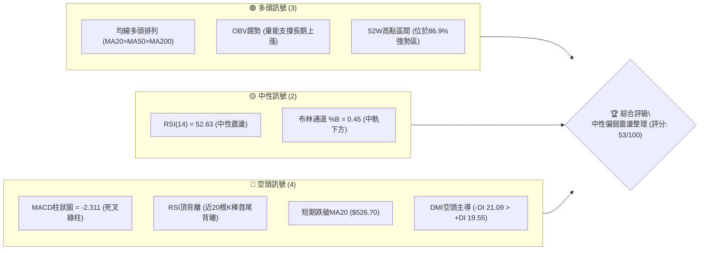
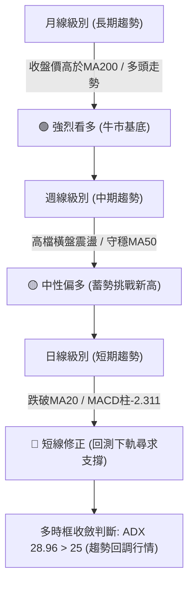
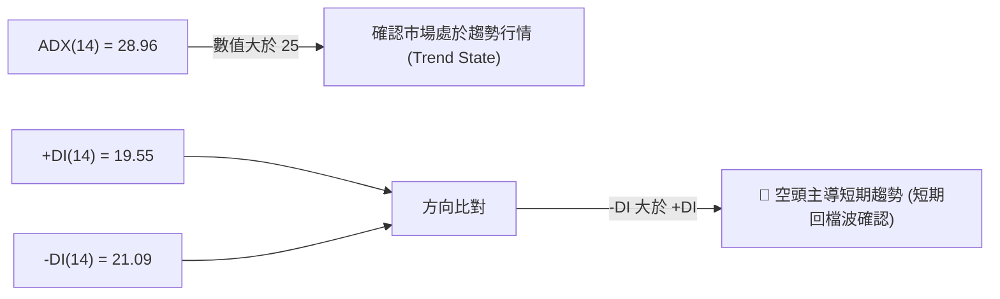
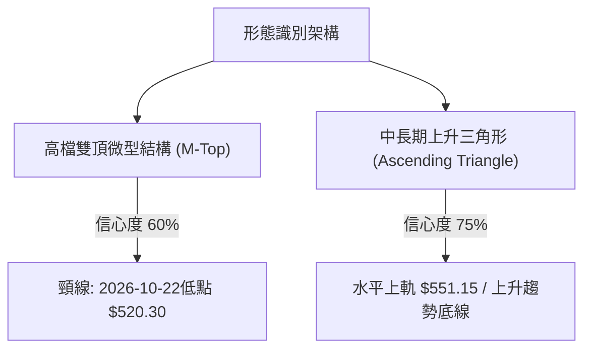
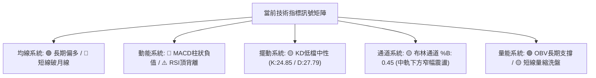
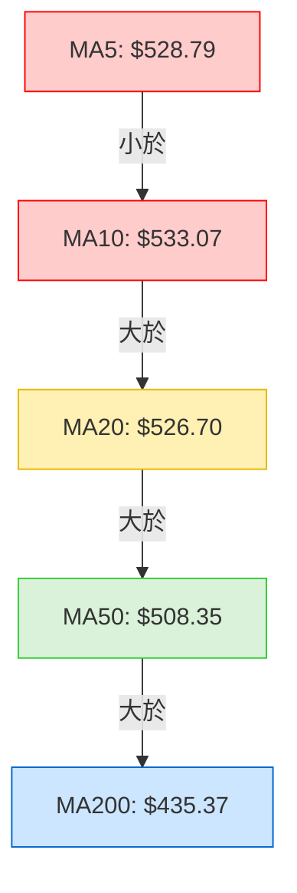
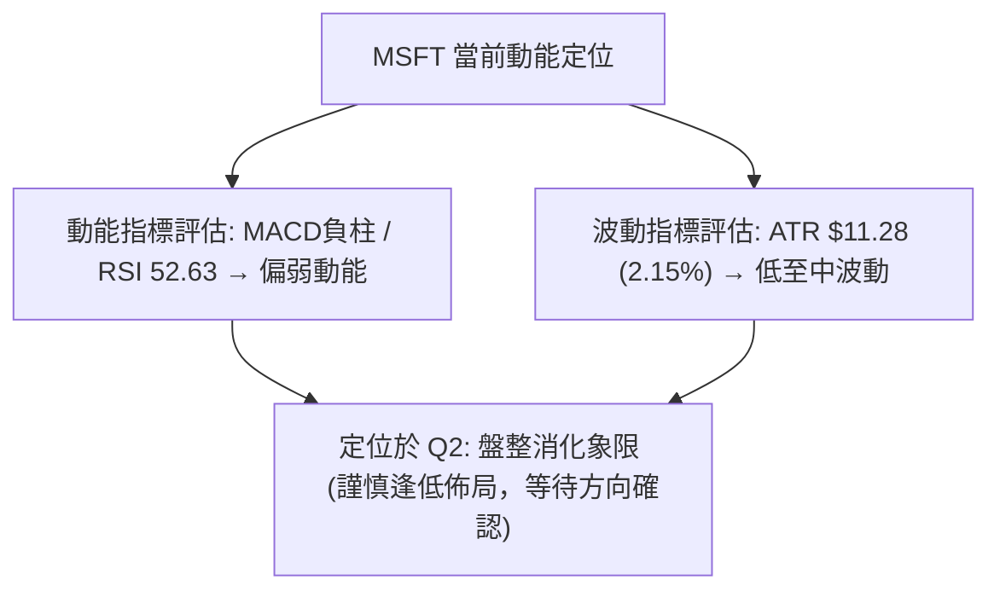
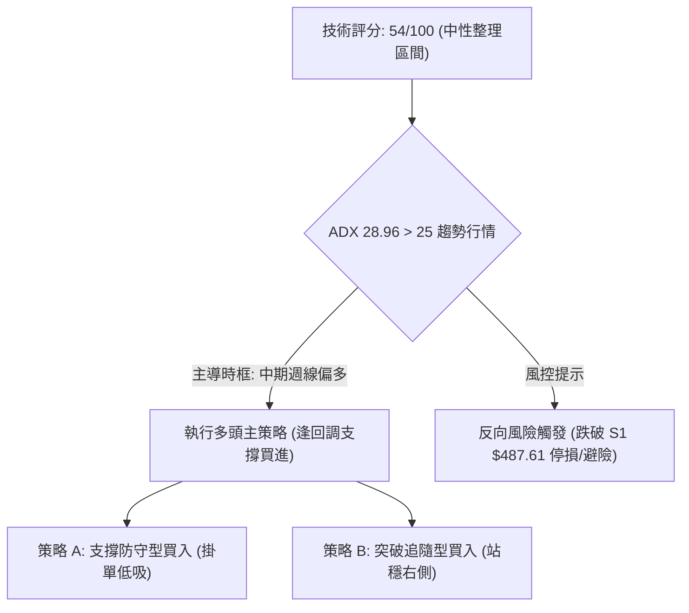
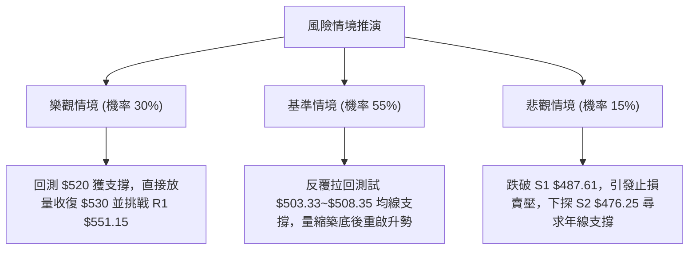

# MSFT 技術分析報告

> **報告日期**：2026-10-25 ｜ **語言**：繁體中文 ｜ **數據來源**：Yahoo Finance ｜ **當前價格**：$524.51

---

## 目錄

| 章節 | 內容 |
|------|------|
| [1. 技術面概覽](#1-技術面概覽) | 訊號儀表板、核心指標、評分卡 |
| [2. 趨勢分析](#2-趨勢分析) | 多時框趨勢、長中短期走勢 |
| [3. 圖表形態分析](#3-圖表形態分析) | 形態識別、K線組合、目標價 |
| [4. 支撐與阻力](#4-支撐與阻力) | 關鍵價位、斐波那契回調 |
| [5. 技術指標深度解讀](#5-技術指標深度解讀) | MA/RSI/MACD/布林/成交量 |
| [6. 動能與波動率](#6-動能與波動率) | 動能評估、ATR、Beta |
| [7. 多時框架總結](#7-多時框架總結) | 時框架評分矩陣 |
| [8. 交易策略建議](#8-交易策略建議) | 多空策略、風險報酬比 |
| [9. 風險提示與監控](#9-風險提示與監控) | 監控指標、風險場景 |

---

## 1. 技術面概覽

### 🎯 技術訊號儀表板



### 📊 核心指標速覽表

| 指標類別 | 指標名稱 | 當前數值 | 訊號 | 解讀 |
|----------|----------|----------|------|------|
| **價格** | 當前收盤價 | $524.51 | 🟡 | 位於52週高點下方4.83%，處於高檔震盪整理區間 |
| **均線** | MA20 | $526.70 | 🔴 | 現價位於MA20下方（-0.42%），短線跌破月線轉弱 |
| **均線** | MA50 | $508.35 | 🟢 | 現價高於MA50（+3.18%），中期多頭防線穩固 |
| **均線** | MA200 | $435.37 | 🟢 | 現價大幅高於年線（+20.47%），長期牛市趨勢未變 |
| **動能** | RSI(14) | 52.63 | 🟡 | 處於50中軸附近，動能均衡，但存在近20日頂背離警訊 |
| **動能** | MACD (12,26,9) | 7.177 / 9.488 | 🔴 | MACD線位於訊號線下方，Histogram為-2.311，短線處於回檔波 |
| **趨勢** | ADX(14) / DMI | 28.96 | 🔴 | ADX>25為趨勢行情，但-DI(21.09)高於+DI(19.55)，空方主導修正 |
| **波動** | ATR(14) | $11.28 | 🟡 | 佔股價2.15%，日均波動適中，提供明確止損設定依據 |

### 🏆 技術評分卡

```
╔══════════════════════════════════════════════════════════════╗
║                技術評分卡 — MSFT (2026-10-25)                 ║
╠══════════════════════════════════════════════════════════════╣
║ 趨勢強度      ███████████░░░░░░░░░  55/100  🟡 中性 (ADX強但-DI領先) ║
║ 動能指標      ████████░░░░░░░░░░░░  40/100  🔴 偏弱 (MACD死叉/背離) ║
║ 支撐穩定度    ██████████████░░░░░░  70/100  🟢 偏強 (MA50與S1防護)  ║
║ 成交量配合    ██████████░░░░░░░░░░  50/100  🟡 中性 (量縮回檔)      ║
║ 形態完整度    ██████████░░░░░░░░░░  50/100  🟡 中性 (高檔雙頂疑慮)  ║
║ 均線排列      ████████████░░░░░░░░  60/100  🟡 偏多 (長多短空糾結)  ║
╠══════════════════════════════════════════════════════════════╣
║ 綜合評分      ███████████░░░░░░░░░  54/100  中性整理 (規則18: 均值54) ║
╚══════════════════════════════════════════════════════════════╝
```

---

## 2. 趨勢分析

### 🌐 多時框趨勢分析



### 📈 長期趨勢 — 12個月走勢圖（Unicode）

```
MSFT 月線走勢圖（過去12個月：2025-11 至 2026-10）
價格軸 ($)
$550 ┤                                                    
$525 ┤                                            ●524.51 (現價)
$500 ┤                                    ●507.29 ●512.90 
$475 ┤●488.91 ●480.57             ●463.85                 
$450 ┤                    ●449.39                         
$425 ┤        ●427.58                                     
$400 ┤                ●406.13                             
$375 ┤    ●391.15 ●368.68 ●372.32                         
     └────────────────────────────────────────────────────────
       11   12   01   02   03   04   05   06   07   08   09   10
      (2025)        (2026年月份)
```

**過去12個月走勢特徵分析表格**：

| 期間階段 | 起迄月份 | 起迄收盤價 | 漲跌幅 | 走勢特徵與結構分析 |
|----------|----------|------------|--------|--------------------|
| 週期回落段 | 2025-11 → 2026-03 | $488.91 → $368.68 | -24.59% | 自前期高點大幅回檔，下探52週波段低點區，完成中期去槓桿修正。 |
| 初段反彈段 | 2026-03 → 2026-05 | $368.68 → $449.39 | +21.89% | V型強勁反彈，修復年線與各級短中期均線，多頭重掌主導權。 |
| 雙底洗盤段 | 2026-05 → 2026-06 | $449.39 → $372.32 | -17.15% | 劇烈二次探底，未破3月前低（$368.68），構築堅實的大級別雙底結構。 |
| 主升起飛段 | 2026-06 → 2026-08 | $372.32 → $507.29 | +36.25% | 大量突破中期均線壓力，單月強彈近百點，一舉收復$500大關。 |
| 高檔盤整段 | 2026-08 → 2026-10 | $507.29 → $524.51 | +3.39%  | 衝刺歷史高點$551.15後受阻，轉入高檔旗形與箱型震盪，等待量能突破。 |

### 📊 中期趨勢（週線分析）

中期走勢圖示展現了過去8週的區間拉鋸，上方受制於52週高點 $551.15（R1），下方則受到波段低點 $487.61（S1）與上升MA50（$508.35）的強力支撐：

```
MSFT 近期週線壓力支撐結構
$551.15 ══════════════════════════════════════════════════ [R1 / 52週高點強阻力]
          ▲ 週K最高觸及 $551.15 (2026-10-16週)
$535.00 ───┼──────────────────────────────────────────── 密集阻力區間
$524.51 ───┼─────── ◄ 當前收盤價 ($524.51)
$508.35 ───┼──────────────────────────────────────────── [MA50 中期生命線]
$487.61 ══════════════════════════════════════════════════ [S1 / 中期波段低點支撐]
```

### ⚡ 趨勢強度評估（ADX 解讀）



| 指標名稱 | 當前數值 | 臨界基準 | 狀態評估 | 實戰解讀 |
|----------|----------|----------|----------|----------|
| **ADX(14)** | 28.96 | 25.00 | 強趨勢狀態 | 股價脫離無方向盤整，進入具備單邊動能的波段運動。 |
| **+DI(14)** | 19.55 | — | 多方力量降溫 | 買盤動能自前週高點逐步衰退。 |
| **-DI(14)** | 21.09 | — | 空方力量微幅佔優 | 賣方在短期居於主導地位，確認當前處於下行修正波。 |

---

## 3. 圖表形態分析

### 🔍 形態識別系統



**形態信心度與目標價計算表**（依規則 15）：

| 形態名稱 | 信心度 | 判斷依據（引用數據） | 完成度 | 目標價（附計算式） |
|----------|--------|----------------------|--------|--------------------|
| **短線潛在雙頂 (M-Top)** | 60% | 兩次回升觸及高點：10/13高點 $551.15 與 10/16高點 $543.82，中間低點為 10/22 低點 $520.30。 | 70% | 由雙頂形態高度推算：頸線 $520.30 − 形態高度($543.82 − $520.30 = $23.52) = **$496.78**（接近S1 $487.61與斐波那契23.6% $503.33）。 |
| **中期上升收斂三角形** | 75% | 頂部受制於 R1 $551.15，週線低點墊高（09/11低點 $486.00 → 09/25低點 $491.22 → 10/23低點 $515.70）。 | 85% | 由形態突破高度推算：突破點 R1 $551.15 + 三角形底寬($551.15 − $486.00 = $65.15) = **$616.30**。 |

### 🕯️ 重要K線形態分析

依規則 19，以下嚴格引用數據中「近10根日K」與「近8根週K」之開高低收進行精確解讀：

#### 近10根日K形態清單
| 日期（日K） | 開 | 高 | 低 | 收 | K線形態 | 解讀 | 訊號 |
|-------------|----|----|----|----|---------|------|------|
| 2026-10-12 | 537.53 | 542.74 | 535.70 | 541.15 | 小實體紅K | 窄幅走高，多方維持攻勢 | 🟢 |
| 2026-10-13 | 544.64 | 551.15 | 543.06 | 543.45 | 長上影流星線 | 觸及52週新高$551.15後遭遇獲利了結賣壓 | 🔴 |
| 2026-10-14 | 545.27 | 545.75 | 532.54 | 533.69 | 光頭長陰K | 吞噬前日低點，空方反撲確立 | 🔴 |
| 2026-10-15 | 533.32 | 541.13 | 531.22 | 539.44 | 下影中陽線 | 回測支撐後買盤介入，多空拉鋸 | 🟡 |
| 2026-10-16 | 541.31 | 543.82 | 524.43 | 529.05 | 長黑實體K | 跌破前日低位，破壞反彈結構 | 🔴 |
| 2026-10-19 | 528.70 | 535.57 | 528.06 | 533.52 | 小陽孕線 | 跌勢暫緩，呈現母子孕線整理 | 🟡 |
| 2026-10-20 | 533.91 | 534.21 | 525.84 | 531.87 | 帶下影小黑K | 向上試探受阻，成交量萎縮 | 🟡 |
| 2026-10-21 | 529.44 | 533.28 | 525.02 | 532.95 | 十字星陽線 | 多空極度膠著，量縮等待方向 | 🟡 |
| 2026-10-22 | 533.14 | 533.60 | 520.30 | 521.08 | 光腳實體長黑K | 放量摜破月線MA20，下探$520.30 | 🔴 |
| 2026-10-23 | 517.75 | 525.77 | 515.70 | 524.51 | 低檔長下影中陽錘頭線 | 開低走高，下影線長達$2.05，短線買盤進駐支撐 | 🟢 |

#### 近8根週K形態清單
| 日期（週K） | 開 | 高 | 低 | 收 | K線形態 | 解讀 | 訊號 |
|-------------|----|----|----|----|---------|------|------|
| 2026-09-04 | 510.38 | 515.65 | 493.81 | 499.70 | 帶長下影小黑K | 回踩$493獲支撐，守穩$500關卡 | 🟡 |
| 2026-09-11 | 493.01 | 498.97 | 486.00 | 495.63 | 探底長下影十字K | 週成交量驟降至62.3M，極度量縮築底 | 🟢 |
| 2026-09-18 | 497.06 | 509.95 | 487.23 | 493.78 | 雙針探底整理K | 二次回踩$487.23不破，底部明確 | 🟢 |
| 2026-09-25 | 494.95 | 519.40 | 491.22 | 516.17 | 中實體長紅週K | 放量突破$510，多頭主升確立 | 🟢 |
| 2026-10-02 | 505.47 | 522.85 | 502.22 | 517.53 | 高檔高飛十字星 | 漲勢趨緩，多空在高檔進行換手 | 🟡 |
| 2026-10-09 | 521.62 | 537.22 | 518.79 | 535.07 | 突破實體陽K | 突破$530，續創歷史波段新高 | 🟢 |
| 2026-10-16 | 537.53 | 551.15 | 524.43 | 529.05 | 倒轉錘長上影陰K | 創52週新高$551.15後巨量長黑收跌，見頂訊號 | 🔴 |
| 2026-10-23 | 528.70 | 535.57 | 515.70 | 524.51 | 下影縮量小陰K | 週量驟降至81.4M，跌勢趨緩，尋求支撐 | 🟡 |

### 📉 ASCII 走勢形態示意圖

```
MSFT 日K短期頭部與支撐測試示意圖
$551.15 ───────── 頂點1 (10/13: $551.15)
                   /\
                  /  \      頂點2 (10/16: $543.82)
                 /    \     /\
$535.00 ────────/──────\───/──\─────────────────────────
               /        \ /    \
$524.51 ──────/──────────V──────\─────── ◄ 現價 ($524.51)
             /                   \  ▲ 10/23 錘頭反彈
$520.30 ────/─────────────────────\─/─── 頸線/近2週低點 ($520.30 - $515.70)
           /                       ▼ (10/23低點: $515.70)
$508.35 ──/───────────────────────────── MA50防禦線
```

### 🎯 形態目標價計算

1. **短線雙頂下行破位量度目標（悲觀路徑）**：
   - 形態頸線：2026-10-22 日K低點 $520.30。
   - 形態頂部：2026-10-16 高點 $543.82。
   - 形態垂直高度 = $543.82 − $520.30 = $23.52。
   - 由雙頂形態高度推算下行目標 = 頸線 $520.30 − 形態高度 $23.52 = **$496.78**。
2. **中期上升收斂三角形向上突破量度目標（樂觀路徑）**：
   - 形態上軌阻力：52週波段高點 R1 $551.15。
   - 形態基底支撐：2026-09-11 週K低點 $486.00。
   - 形態最大底寬 = $551.15 − $486.00 = $65.15。
   - 由三角形形態高度推算目標價 = 突破點 $551.15 + 形態高度 $65.15 = **$616.30**。

---

## 4. 支撐與阻力

### 🗺️ 關鍵價位分布圖（Unicode）

```
MSFT 價位結構分布圖 (由 OHLCV 與斐波那契計算)
═════════════════════════════════════════════════════════════════
$551.15 ║████████████████████████████████║ 關鍵阻力 R1 (52W High / 0.0%)
$526.70 ║▓▓▓▓▓▓▓▓▓▓▓▓▓▓▓▓▓▓▓▓            ║ 短期動態壓制 (BB中軌 / MA20)
$524.51 ╠════════════════════════════════╣ ◄ 當前收盤價 ($524.51)
$508.35 ║▓▓▓▓▓▓▓▓▓▓▓▓▓▓▓▓▓▓▓▓▓▓▓▓        ║ 中期均線防線 (MA50)
$505.94 ║▓▓▓▓▓▓▓▓▓▓▓▓▓▓▓▓▓▓▓▓▓▓▓▓        ║ 動態波動下限 (BB下軌)
$503.33 ║████████████████████████        ║ 斐波那契 23.6% 回調位
$487.61 ║████████████████████████████    ║ 關鍵支撐 S1 (近一年波段低點聚類)
$476.25 ║██████████████████████          ║ 強支撐 S2 (波段密集成交支撐)
$473.75 ║██████████████████████          ║ 斐波那契 38.2% 回調位
$465.47 ║████████████████████████████████║ 核心防守支撐 S3 (波段防守底線)
═════════════════════════════════════════════════════════════════
```

### 🚧 阻力位分析表

依規則 13，價位嚴格引用數據中計算之阻力位：

| 阻力級別 | 價位 | 形成原因 | 突破難度 | 重要性 |
|----------|------|----------|----------|--------|
| **R1** | $551.15 | 52週歷史最高點（2026-10-13日觸及）、斐波那契0.0%基準位、波段獲利了結密集區。 | 🔴 極高 | ★★★★★ (歷史天花板) |
| **動態阻力** | $526.70 | MA20日均線暨布林通道中軌，短線多空分水嶺。 | 🟡 中等 | ★★★☆☆ (短線重奪主控權關鍵) |

### 🛡️ 支撐位分析表

依規則 13，價位嚴格引用數據中計算之支撐位：

| 支撐級別 | 價位 | 形成原因 | 守住機率 | 重要性 |
|----------|------|----------|----------|--------|
| **S1** | $487.61 | 近一年波段低點聚類、9月中旬整理平台底部（09/18週低$487.23）。 | 🟢 80% | ★★★★★ (中期多頭防守樞紐) |
| **S2** | $476.25 | 近一年波段低點聚類、7月突破起漲跳空缺口附近。 | 🟢 88% | ★★★★☆ (強烈結構支撐) |
| **S3** | $465.47 | 近一年波段低點聚類、7/31跳空大陽線突破收盤價（$463.85）。 | 🟢 95% | ★★★★☆ (牛熊分界底線) |

### 📐 斐波那契回調位分析

依規則 13，嚴格直接引用 52週區間 $348.54 → $551.15 之回調計算結果：

| 回調比率 | 價位 | 距現價差距 | 技術意涵與分析解讀 |
|----------|------|------------|--------------------|
| **0.0% (52W High)** | $551.15 | +5.08% | 當前波段頂點，歷史最高天花板，強大拋壓區。 |
| **23.6%** | $503.33 | -4.04% | 淺度回調位。與MA50（$508.35）及BB下軌（$505.94）共振形成首道多頭密集防禦帶。 |
| **38.2%** | $473.75 | -9.68% | 健康回調位。高度重合支撐位 S2 ($476.25)，若回測至此仍屬健康牛市修正。 |
| **50.0%** | $449.85 | -14.23% | 多空平衡中軸。接近半年線 MA120 ($452.91) 與 5月收盤價 ($449.39)。 |
| **61.8%** | $425.94 | -18.79% | 黃金分割強支撐。接近年線 MA200 ($435.37)，為長期多頭不可失守之極限防線。 |
| **78.6%** | $391.90 | -25.28% | 深度回調防線。接近4月起漲平台。 |
| **100.0% (52W Low)**| $348.54 | -33.55% | 52週最低點，宏觀經濟衰退週期底部。 |

> **現價位置解讀**：現價 $524.51 目前精準運行於 **0.0% ($551.15)** 與 **23.6% ($503.33)** 之間，處於強勢高位整理區間（回調幅度僅佔全波段之13.1%）。

---

## 5. 技術指標深度解讀

### 🎛️ 指標訊號總覽



### 📈 移動平均線排列分析



**移動平均線狀態詳解表**：

| 均線名稱 | 當前價格 | 與現價偏離度 | 走勢方向 | 排列與技術解讀 |
|----------|----------|--------------|----------|----------------|
| **MA5** | $528.79 | -0.81% | ▼ 下行 | 極短線壓制，10/23反彈尚未收復5日線。 |
| **MA10** | $533.07 | -1.61% | ▼ 下行 | 短期下彎扣高，形成短壓阻力線。 |
| **MA20** | $526.70 | -0.42% | ▼ 下行 | 月線失守，短線轉為整理弱勢格局。 |
| **MA50** | $508.35 | +3.18% | ▲ 上行 | 中期生命線穩固上揚，為多頭第一道堅實防線。 |
| **MA60** | $505.67 | +3.73% | ▲ 上行 | 季線強勁上推，確認中期上升通道。 |
| **MA120** | $452.91 | +15.81% | ▲ 上行 | 半年線支撐宏觀擴張格局。 |
| **MA200** | $435.37 | +20.47% | ▲ 上行 | 年線持續走揚，確認超長期牛市無虞。 |
| **MA240** | $443.35 | +18.31% | ▲ 上行 | 兩年均線穩健向上，結構完整。 |

### 📉 RSI(14) 分析

- **RSI 當前數值**：52.63（Wilder 算法），位於中性區間（30–70）。
- **數值進度條**：
  ```
  0 [════════════════░░░░░░░░░░░░░░░░] 100  (當前: 52.63)
  ```
- **背離判斷與結論**：
  - **背離形態**：⚠️ **明確頂背離 (Bearish Divergence)**。
  - **數據論證**：依據近20根日K棒檢驗，股價在 2026-10-13 創出歷史新高 $551.15，然而 RSI(14) 僅達到 67.5 附近，未能突破 2026-08-07 所創出的高點 78.1，形成標準的「價格創波段新高、動能指標未能過高」之頂背離結構。該背離導致了隨後向 $520 的回調。

### 📊 MACD(12/26/9) 訊號解讀


- **MACD 指標拆解**：
  - **DIF 快線**：7.177
  - **DEA 慢線**：9.488
  - **MACD 柱狀圖 (Histogram)**：-2.311（負值且較前週走擴）
- **實戰解讀**：雙線依然運行於零軸之上（>0），表明宏觀多頭趨勢並未終結，當前處於零軸上方的死叉波段修正。綠柱持續擴散，顯示空方動能尚未完全衰竭，短線不宜盲目追高。

### 📦 布林通道分析

```
布林通道結構示意圖 (日線級別)
$547.47 ══════════════════════════════════════════ 上軌 (Upper Band)
          ▲ 10/13 觸及上軌附近收流星線
$526.70 ────────────────────────────────────────── 中軌 (MA20 / 壓力位)
$524.51 ─── ◄ 當前價格位於中軌下方 (%B = 0.45)
$505.94 ══════════════════════════════════════════ 下軌 (Lower Band / 支撐位)
```

- **布林帶參數狀態**：
  - 上軌：$547.47
  - 中軌 (MA20)：$526.70
  - 下軌：$505.94
  - **%B 指標**：0.45（略低於中軌 0.5，處於通道下半區）
- **解讀**：通道開口未見劇烈放大，呈現橫向擴展狀態。現價在下半區運行，代表短期回檔壓力仍在，下軌 $505.94 與 MA50（$508.35）及斐波那契23.6%（$503.33）形成極強的三重支撐共振帶。

### 💹 成交量分析（量價配合度）

```
成交量對比長條圖
最新量 (10/23):  13,671,500   ███████░░░░░░░░░ (0.68x 量比)
20日均量:        20,195,760   ███████████░░░░░
50日均量:        21,176,500   ████████████░░░░
```

- **成交量量比解讀**：最新單日成交量 13.67M 僅為 20日均量（20.20M）之 0.68 倍，呈現顯著的「**跌勢縮量**」特徵。
- **OBV 趨勢檢驗**：數據確認 `OBV > MA`。成交量能量潮指標持續高於其移動平均線，說明大資金機構在上漲過程中吸籌充分，近期的急跌並未伴隨機構籌碼潰逃，屬於標準的洗盤與獲利回吐性質。

---

## 6. 動能與波動率

### ⚡ 動能評估四象限

| 象限標籤 | 動能狀態 | 波動率狀態 | 判定標記 | 當前技術狀態與意涵評估 |
|----------|----------|------------|----------|------------------------|
| **Q1 突破爆發** | 強動能 (趨勢向上) | 低波動 (蓄勢) | — | 最佳波段進場點（如7月底起漲階段）。 |
| **Q2 盤整消化** | 弱動能 (動能回落) | 低波動 (區間收斂) | **✓ 當前狀態** | **謹慎觀望/逢低分批**：MACD回落，ATR佔比僅2.15%，處於蓄勢洗盤期。 |
| **Q3 狂熱極限** | 強動能 (單邊暴拉) | 高波動 (多空激戰) | — | 高風險高收益階段，需防範假突破與見頂風險。 |
| **Q4 恐慌出清** | 弱動能 (連續崩跌) | 高波動 (非理性拋售) | — | 應全面避免進場，等待結構打底。 |



### 📊 ATR 波動率分析

- **ATR(14) 數值**：**$11.28**（佔股價 2.15%，Wilder 平滑計算）。
- **波動特性評估**：每日價格震盪幅度約在 11 至 12 美元之間，波動幅度適中偏平穩，無極端恐慌性失控特徵。
- **風控參數具體應用**：
  - **波段進場止損距離（1.5 × ATR）**：$11.28 × 1.5 = **$16.92**。
  - **寬鬆趨勢防守距離（2.0 × ATR）**：$11.28 × 2.0 = **$22.56**。
  - **短線日內雜訊過濾閥值（0.75 × ATR）**：$11.28 × 0.75 = **$8.46**。

### 📐 Beta 與市場相關性

- **Beta 係數**：**1.099**（微幅高於大盤基準 1.0）。
- **市場連動解讀**：
  - MSFT 表現出與標普500指數（S&P 500）高度同步的特徵，市場上行時具備 1.1 倍的放大收益彈性，而在大盤拉回時亦承擔同等放大之波動風險。
  - 籌碼結構極度穩定：機構持股佔比高達 **75.8%**，融券放空比例僅佔流通盤的 **0.8%**（Short Ratio 2.83天），說明市場並無大舉放空跡象，拋壓主要來自多頭內部的獲利回吐。

---

## 7. 多時框架總結

### 📋 時框架評分表

| 時框架 | 趨勢方向 | 動能狀態 | 均線排列 | 圖表形態 | 綜合評分 | 操作建議 |
|--------|----------|----------|----------|----------|----------|----------|
| **月線 (長期)** | 🟢 強烈看多 | 🟢 強勁偏多 | 多頭排列 (MA200上揚) | 大級別雙底延伸主升浪 | 80/100 | 長期投資堅定持有 |
| **週線 (中期)** | 🟡 中性偏多 | 🟡 高檔鈍化轉平 | 多頭排列 (MA50上揚) | 上升收斂三角形整理 | 65/100 | 拉回關鍵支撐分批佈局 |
| **日線 (短期)** | 🔴 震盪回調 | 🔴 死叉修正中 | 短期均線空頭排列 | 高檔微型雙頂整理 | 40/100 | 嚴控追高，等待止跌訊號 |

### 🔲 綜合訊號矩陣

```
時框架訊號收斂圖示
長期 (月線):  ████████████████░░░░  80% 🟢 強烈看多
中期 (週線):  █████████████░░░░░░░  65% 🟢 偏多整固
短期 (日線):  ████████░░░░░░░░░░░░  40% 🔴 震盪拉回
────────────────────────────────────────────────
一致性分析: 短期回檔不改中長期牛市基調，為典型多頭架構下的波段技術性修正。
```

### ⚖️ 多時框收斂結論

依「嚴格要求 14」執行精確的多時框收斂：
1. **趨勢模式判定**：當前 ADX(14) 數值為 **28.96**，明確大於 25 臨界值，技術面確立為**趨勢行情架構**。
2. **主導時框裁決**：依照收斂規則，趨勢行情下以中長期方向（週線與 MA50、MA200）為主導，日線僅用以尋找回調買點或短線風控進出場時機。
3. **唯一收斂結論**：**中性偏多（回調蓄勢型）**。
   - 儘管日線指標（MACD死叉、RSI頂背離）顯示短期回調未結束，但中期週線上升三角形結構完好，長線年線支撐極為強勁。
   - 結論方向：**回檔逢低建立多頭倉位，拒絕盲目追空**。本結論嚴格收斂並指導第 8 章之策略規劃。

---

## 8. 交易策略建議

### 🗺️ 策略決策流程圖



### 🧭 策略路由（依評分卡分流，不得兩頭下注）

- **當前技術評分卡綜合評分 = 54/100**。
- 依照規則 14 趨勢收斂優先級（ADX 28.96 > 25 由週線中長多主導），主策略定調：
  **當前主策略方向 = 中性偏多回調佈局（依評分 54/100 與週線強支撐）**。
- 本報告主推逢低做多策略（策略A/策略B），空頭僅作為下行風控與對沖觸發點，絕不兩頭下注。

### 🎯 價格情境階梯（Price Scenarios）

依規則 13，價位嚴格引用數據中計算之阻力位 R1、支撐位 S1/S2/S3 及斐波那契回調位：

| 觸發條件 | 下一目標 | 後續延伸 | 情境含義 |
|----------|----------|----------|----------|
| **強勢突破 R1 $551.15** | $601.73 (分析師目標) | $616.30 (形態目標) | 創歷史新高，上升三角形量度目標展開。 |
| **收復 MA20 $526.70** | R1 $551.15 | $560.00 | 短線修正結束，重返多頭攻擊軌道。 |
| **維持現價 $524.51 震盪** | $526.70 (中軌) | $505.94 (下軌) | 於布林通道中下軌區間進行籌碼換手。 |
| **拉回測試 23.6% $503.33**| S1 $487.61 | MA50 $508.35 | 測試中期上升通道支撐強度（最佳買點區）。 |
| **跌破 S1 $487.61** | S2 $476.25 | S3 $465.47 | 中期轉弱，多頭防線面臨深度回撤考驗。 |

### 📊 情境機率分佈

| 情境類別 | 預估機率 | 主要技術指標與結構依據 |
|----------|----------|------------------------|
| **下探支撐後反彈上行** | **55%** | 依據週線均線多頭排列、OBV多頭趨勢不變、最新日K縮量長下影錘頭線。 |
| **區間橫盤震盪整固** | **30%** | 依據布林通道 %B 為 0.45、ADX 空方微幅主導(-DI>-DI)需時間化解背離。 |
| **下破波段關鍵支撐** | **15%** | 依據日線 MACD 綠柱擴散、短線跌破月線 MA20，若大盤重挫可能引發外溢拋壓。 |

### 🟢 主策略詳情（多頭逢低佈局）

依規則 17 嚴格定義風險報酬比：`(目標價 T1 − 進場價) ÷ (進場價 − 止損價)`，進場區間取中點計算：

| 策略要素 | 策略 A（支撐低吸型 — 首選） | 策略 B（右側突破型 — 追隨） |
|----------|------------------------------|------------------------------|
| **進場條件** | 股價回踩斐波那契23.6%與S1密集帶，且日K收下影線止跌。 | 日線實體K棒放量突破並站穩日線布林中軌 MA20。 |
| **進場價格** | **$495.47** (區間 $487.61 ～ $503.33 中點) | **$527.00** (突破 MA20 $526.70 後確認) |
| **目標價 T1** | **$551.15** (R1 / 52週歷史高點) | **$551.15** (R1 / 52週歷史高點) |
| **目標價 T2** | **$601.73** (分析師共識平均目標價) | **$616.30** (三角形向上突破量度目標) |
| **止損價格** | **$473.00** (有效跌破 S2 $476.25 與 38.2% $473.75) | **$515.00** (跌破 10/23 日K低點 $515.70) |
| **風險報酬比** | **1 : 2.48（以 T1 計）**<br>*(551.15−495.47) ÷ (495.47−473.00) = 55.68 ÷ 22.47* | **1 : 2.01（以 T1 計）**<br>*(551.15−527.00) ÷ (527.00−515.00) = 24.15 ÷ 12.00* |
| **成功機率** | 65% | 60% |
| **建議倉位** | 15% 總資金（分兩批建倉） | 10% 總資金 |

*註：策略 A 至 T2 之風險報酬比為 1 : 4.73（以 T2 計）；策略 B 至 T2 之風險報酬比為 1 : 7.44（以 T2 計）。*

### 🔴 反向風險觸發點（對沖提示）

- **關鍵破位警戒點**：收盤價以實體黑K放量跌破 **S1 $487.61**。
- **對沖處置建議**：若跌破 S1，表明上升三角形底邊失效，日線雙頂量度下行目標（$496.78）完全發酵。投資人應立即將多頭部位減半，或買入對應市值的反向工具對沖至 **S2 $476.25** 及 **S3 $465.47**。

### ⭐ 整體訊號強度評星

```
做多訊號強度：★★★☆☆  (3.5/5星 — 中長多無虞，等待短線落底)
做空訊號強度：★★☆☆☆  (2.0/5星 — 下方支撐層層共振，空間有限)
整體可信度：  ★★★★☆  (4.0/5星 — 數據結構完整，量價與均線高度收斂)
```

---

## 9. 風險提示與監控

### ✅ 關鍵監控指標 Checklist

```
╔══════════════════════════════════════════════════════════════╗
║               每日盤後關鍵技術監控清單 (Checklist)              ║
╠══════════════════════════════════════════════════════════════╣
║ [ ] 價格是否成功重返 MA20 ($526.70) 之上？                     ║
║ [ ] RSI(14) 能否在 50 中軸處獲得支撐並勾頭向上？             ║
║ [ ] 日成交量是否萎縮至 15M 以下（確認浮額洗淨）？            ║
║ [ ] MACD 綠柱狀圖（當前 -2.311）是否開始縮短？                ║
║ [ ] 週線收盤價是否嚴格防守在 MA50 ($508.35) 上方？           ║
║ [ ] 是否跌破 10/23 錘頭線低點 $515.70（短線轉弱警訊）？       ║
╚══════════════════════════════════════════════════════════════╝
```

### ⚠️ 風險場景分析



### 🛡️ 風險管理重要提醒

1. **嚴禁高檔追價**：現價距離歷史高點僅 5% 左右，且面臨 MACD 綠柱與 RSI 頂背離，切忌在 $535 以上追高買入。
2. **波動防禦設置**：根據當前 ATR(14) = $11.28，日內正常雜訊即達 $8.5 左右，止損點不可設得過於緊繃，須至少預留 1.5 倍 ATR 空間（即約 $17 美元）以防遭到非理性洗盤震出場外。
3. **重大基本面事件防範**：微軟即將迎來財報發布與 AI 資本支出檢驗，若 Azure 增速不如市場預期，短線可能引發大幅波動，建議財報公布前維持整體倉位在 30% 以下之安全防護水位。

---

## 📋 報告總結

```
╔══════════════════════════════════════════════════════════════╗
║                  MSFT 技術分析報告總結                       ║
╠══════════════════════════════════════════════════════════════╣
║ 報告日期：2026-10-25                                         ║
║ 當前價格：$524.51                                            ║
║ 分析評級：⚖️ 中性偏多（逢回調佈局，技術評分: 54/100）          ║
╠══════════════════════════════════════════════════════════════╣
║ 關鍵結論：                                                   ║
║ ├─ 長期趨勢：🟢 強烈看多（年線 MA200 上揚，大級別主升浪未變） ║
║ ├─ 中期趨勢：🟢 偏多整固（上升收斂三角形構築中，守穩 MA50）  ║
║ ├─ 短期趨勢：🔴 震盪回調（跌破月線 MA20，MACD柱為負值）       ║
║ ├─ 關鍵支撐：S1: $487.61 ｜ 斐波那契23.6%: $503.33 ｜ MA50: $508.35 ║
║ ├─ 關鍵阻力：R1: $551.15 (52W High) ｜ MA20: $526.70        ║
║ └─ 分析師共識目標：$601.73 (潛在空間: +14.7%)                ║
╠══════════════════════════════════════════════════════════════╣
║ 最優策略組合：                                               ║
║ 1. 🥇 最佳機會：策略 A 支撐低吸（於 $495.47 附近掛單分批建倉，║
║                 停損 $473.00，目標 T1 $551.15，風報比 1:2.48）║
║ 2. 🥈 次選機會：策略 B 右側突破（待放量站上 $527.00 後順勢追隨）║
║ 3. 🥉 保守選擇：維持場外觀望，靜待日線 MACD 綠柱翻紅後再行介入║
╚══════════════════════════════════════════════════════════════╝
```

---

> ⚠️ **免責聲明**：本報告為 AI 自動生成之技術分析，所有數據及估算均基於提供的歷史價格資訊。本報告**僅供研究與學術參考**，**不構成任何投資建議**。投資有風險，入市需謹慎。

---

*報告生成時間：2026-10-25 ｜ 數據來源：Yahoo Finance ｜ 分析框架：多時框技術分析*