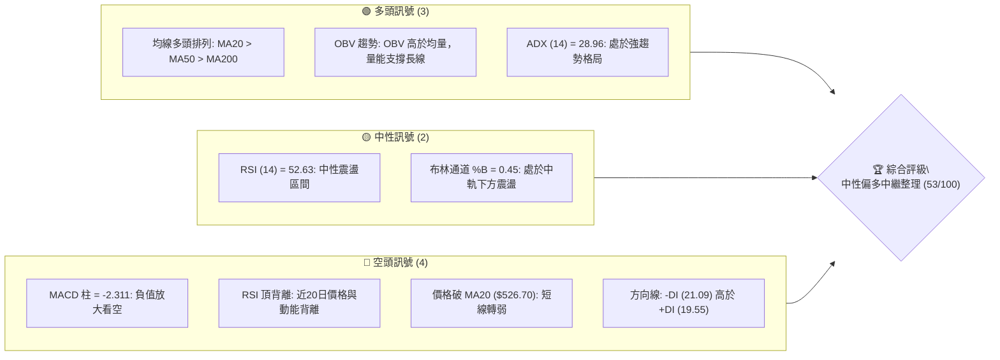
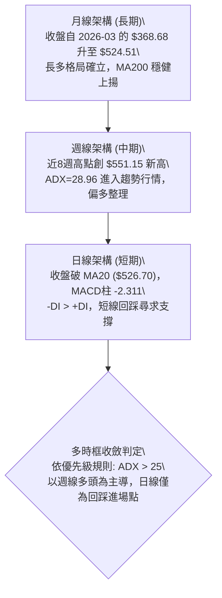
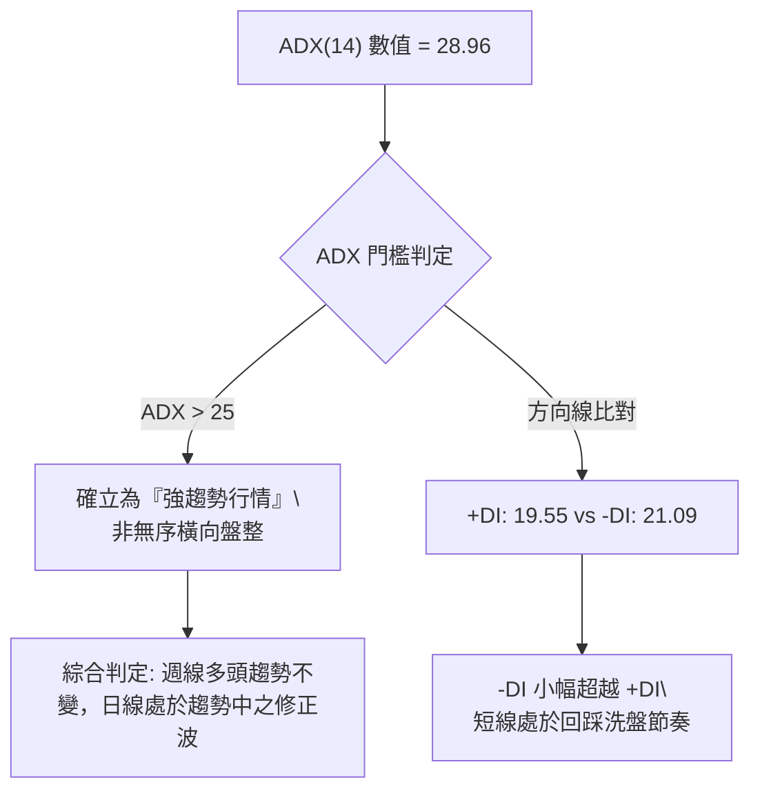
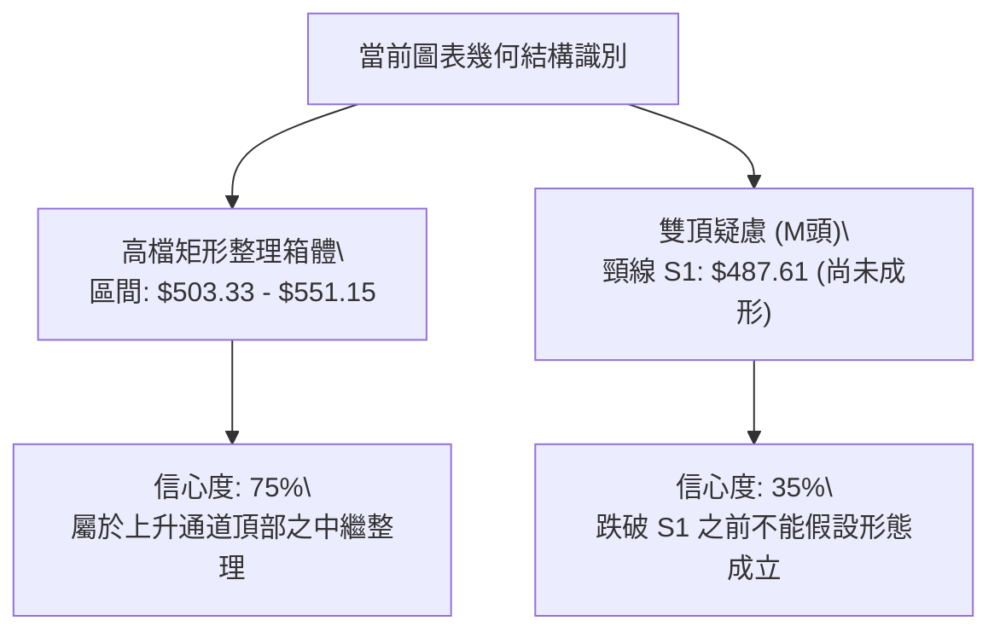
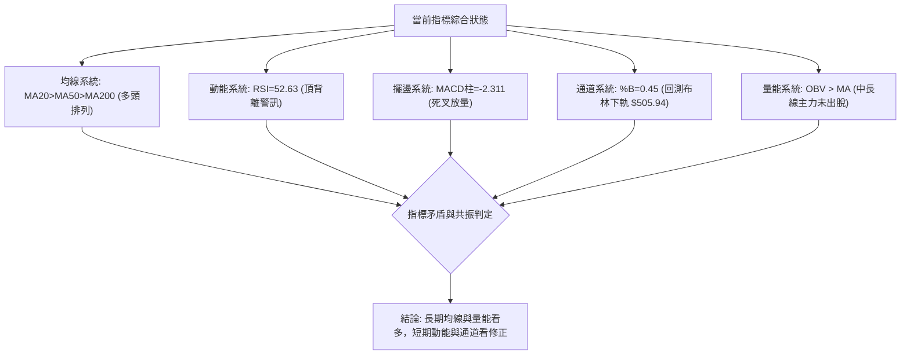
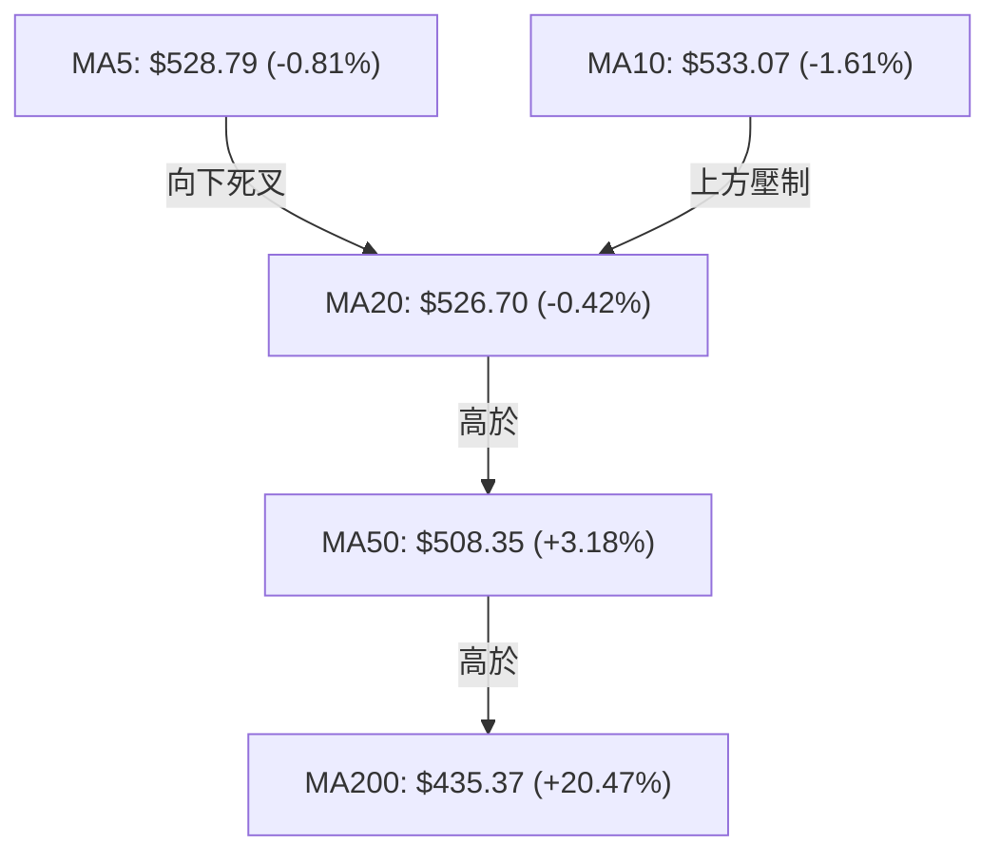
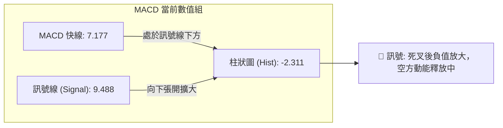
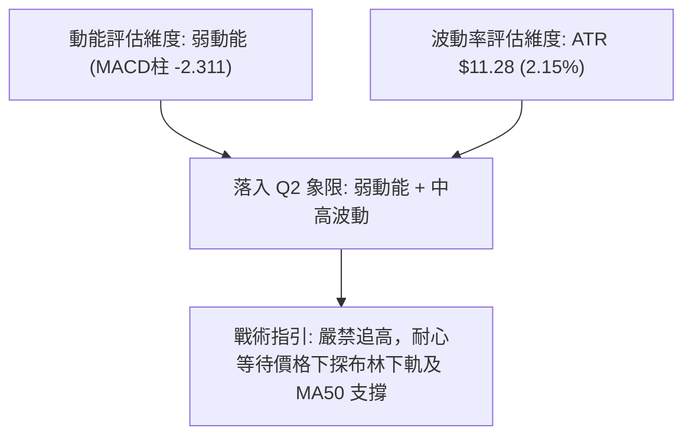
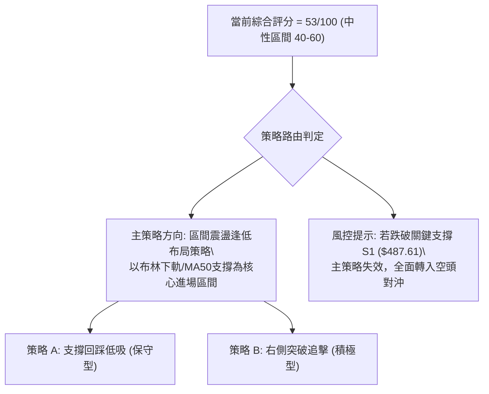
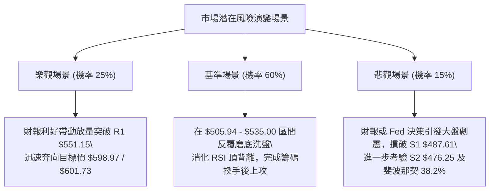

# MSFT 技術分析報告

> **報告日期**：2026-10-26 ｜ **語言**：繁體中文 ｜ **數據來源**：Yahoo Finance ｜ **當前價格**：$524.51

---

## 目錄

| 章節 | 內容 |
|------|------|
| [1. 技術面概覽](#1-技術面概覽) | 訊號儀表板、核心指標、評分卡 |
| [2. 趨勢分析](#2-趨勢分析) | 多時框趨勢、長中短期走勢 |
| [3. 圖表形態分析](#3-圖表形態分析) | 形態識別、K線組合、目標價 |
| [4. 支撐與阻力](#4-支撐與阻力) | 關鍵價位、斐波那契回調 |
| [5. 技術指標深度解讀](#5-技術指標深度解讀) | MA/RSI/MACD/布林/成交量 |
| [6. 動能與波動率](#6-動能與波動率) | 動能評估、ATR、Beta |
| [7. 多時框架總結](#7-多時框架總結) | 時框架評分矩陣 |
| [8. 交易策略建議](#8-交易策略建議) | 多空策略、風險報酬比 |
| [9. 風險提示與監控](#9-風險提示與監控) | 監控指標、風險場景 |

---

## 1. 技術面概覽

### 🎯 技術訊號儀表板



### 📊 核心指標速覽表

| 指標類別 | 指標名稱 | 當前數值 | 訊號 | 解讀 |
|----------|----------|----------|------|------|
| **價格** | 當前收盤價 | $524.51 | 🟡 | 位於52週高低區間 86.9% 分位，高檔震盪整理 |
| **均線** | MA20 | $526.70 | 🔴 | 價格低於 MA20（-$2.19，-0.42%），跌破短線生命線 |
| **均線** | MA50 | $508.35 | 🟢 | 價格高於 MA50（+$16.16，+3.18%），中期支撐強勁 |
| **均線** | MA200 | $435.37 | 🟢 | 價格大幅高於 MA200（+$89.14，+20.47%），長多確立 |
| **動能** | RSI(14) | 52.63 | 🟡 | 處於 30–70 中性區間，惟伴隨日線頂背離預警 |
| **動能** | MACD(12,26,9) | 柱狀圖 -2.311 | 🔴 | MACD線 7.177 低於訊號線 9.488，死叉延續中 |
| **波動** | ATR(14) | $11.28 | 🟡 | 佔現價 2.15%，日均波動擴大，短線需防假突破 |
| **趨勢強度** | ADX(14) | 28.96 | 🟢 | ADX > 25 處於強趨勢環境，主導時框為週線多頭 |
| **方向指標** | +DI / -DI | 19.55 / 21.09 | 🔴 | -DI > +DI，空頭在日線時框暫時取得主導權 |
| **通道狀態** | 布林 %B | 0.45 | 🟡 | 價格自中軌 $526.70 下滑，朝下軌 $505.94 靠攏 |
| **量能狀態** | 成交量比 | 0.68x | 🟡 | 日成交量 13.67M 低於20日均量 20.20M，縮量回檔 |

### 🏆 技術評分卡

```
╔══════════════════════════════════════════════════════════════╗
║              技術評分卡 — MSFT (2026-10-26)                  ║
╠══════════════════════════════════════════════════════════════╣
║ 趨勢強度 (ADX=28.96, 週線偏多)  ██████████████░░░░░░  70/100 🟢 ║
║ 動能指標 (RSI頂背離, MACD負值)  ████████░░░░░░░░░░░░  40/100 🔴 ║
║ 支撐穩定度 (S1=$487.61, MA50)   ████████████░░░░░░░░  60/100 🟢 ║
║ 成交量配合 (OBV偏多, 量縮拉回)  ██████████░░░░░░░░░░  50/100 🟡 ║
║ 形態完整度 (高檔矩形, 無雙頂)   ████████░░░░░░░░░░░░  40/100 🔴 ║
║ 均線排列 (MA20>MA50>MA200多頭)  ████████████░░░░░░░░  60/100 🟢 ║
╠══════════════════════════════════════════════════════════════╣
║ 綜合評分 (六項算術平均)         ███████████░░░░░░░░░  53/100 🟡 ║
║ 評級結論: 40–60 區間 — 中性區間震盪整理，等待回踩支撐確認    ║
╚══════════════════════════════════════════════════════════════╝
```

---

## 2. 趨勢分析

### 🌐 多時框趨勢分析



### 📈 長期趨勢 — 12個月走勢圖（Unicode）

```
MSFT 月線收盤走勢圖（過去12個月：2025-11 至 2026-10）
價格軸 ($)
$550 ┤                                                 ● $524.51 (當前)
$520 ┤                                           ●     │
$490 ┤ ●                                         │     │
$460 ┤  ╲                                  ●     │     │
$430 ┤   ╲                           ●     │     │     │
$400 ┤    ●                    ●     │     │     │     │
$370 ┤     ╲      ●(波段低點)  │     │     │     │     │
     └─────┴──────┴────────────┴─────┴─────┴─────┴─────┴──────────
          11-25  01-26        03-26 05-26 07-26 08-26 09-26 10-26
```

#### 走勢特徵分析表格

| 週期區間 | 起始收盤價 | 結束收盤價 | 區間漲跌幅 | 走勢結構與技術特徵 |
|----------|------------|------------|------------|--------------------|
| **2025-11 至 2026-03** | $488.91 | $368.68 | -24.59% | 中期深度回調，探尋 52 週低點區間（年內低點 $348.54） |
| **2026-03 至 2026-06** | $368.68 | $372.32 | +0.99% | 底部構築打底，成交量在 2026-06-26 爆出 382.7M 巨量見底 |
| **2026-06 至 2026-08** | $372.32 | $507.29 | +36.25% | 強勢主升浪，突破 MA50 與 MA200，週 RSI 一度突破 78.1 |
| **2026-08 至 2026-10** | $507.29 | $524.51 | +3.39% | 高檔橫盤震盪，創下 52 週歷史高點 $551.15 後進入高檔洗盤 |

### 📊 中期趨勢（週線分析）

```
MSFT 週線結構與關鍵阻力支撐示意
$551.15 ═════════════════════════════════════════ 52週高點 / 歷史阻力位 R1
        │   ▲ 2026-10-13 試探 $551.15 承壓回落
        │   ▼ 當前週線收盤 $524.51 (處於高檔整理區)
$508.35 ----------------------------------------- MA50 / 中期多空生命線
$503.33 ----------------------------------------- 斐波那契 23.6% 回調位
$487.61 ═════════════════════════════════════════ 波段支撐位 S1
```

週線層面顯示，MSFT 自 2026-07 啟動強勁升勢後，近 6 週收盤價維持在 $493.78 至 $535.07 之間窄幅擺動。週成交量由 8 月初的 215.89M 逐步縮減至最新一週的 81.45M，呈現標準的高檔「量縮整固」特徵，並非主力出貨之放量暴跌。

### ⚡ 趨勢強度評估（ADX 解讀）



#### ADX 趨勢強度對照表

| 指標變數 | 當前讀數 | 標準門檻區間 | 趨勢屬性判定 | 交易策略導向 |
|----------|----------|--------------|--------------|--------------|
| **ADX(14)** | 28.96 | > 25 (強趨勢) | 強趨勢環境 | 依循主時框（週線）順勢交易，禁止盲目做空 |
| **+DI** | 19.55 | < 20 (多頭動能減退) | 上攻動能暫歇 | 不宜於高點追價，待拉回支撐點布局 |
| **-DI** | 21.09 | > +DI (空方佔先) | 短線空方控盤 | 嚴防日線回踩 MA50 ($508.35) 之風險 |

---

## 3. 圖表形態分析

### 🔍 形態識別系統



#### 形態識別信心度與目標價評估表

| 形態名稱 | 信心度 | 判斷依據（引用精確數據） | 完成度 | 目標價計算式與數值 |
|----------|--------|--------------------------|--------|--------------------|
| **高檔矩形整理箱體** | 75% | 頂部受阻於 R1 $551.15，底部獲得斐波那契 23.6% ($503.33) 與 MA50 ($508.35) 承接 | 70% | 向上突破 R1 後之等幅測距：<br>突破價 $551.15 + (箱體高度 $551.15 - $503.33 = $47.82) = **$598.97**（形態推算） |
| **雙頂反轉 (M頭)** | 30% | 2026-10-13 創 $551.15，隨後拉回，但未跌破頸線 S1 $487.61 | 25% | 若跌破頸線 S1 $487.61：<br>跌破價 $487.61 - (形態高度 $551.15 - $487.61 = $63.54) = **$424.07**（形態推算） |
| **上升旗形中繼** | 45% | 自 7 月低點急升後進入量縮平行下傾通道，但日線斜率不明顯 | 40% | 訊號不足，僅作指標型解讀，暫不推算目標價 |

### 🕯️ 重要K線形態分析

#### 近 10 根日 K 棒形態解讀

| 日期 (日K) | 開盤價 | 最高價 | 最低價 | 收盤價 | K線形態 | 技術解讀 | 訊號 |
|------------|--------|--------|--------|--------|---------|----------|------|
| **2026-10-12** | 537.53 | 542.74 | 535.70 | 541.15 | 實體陽線 | 多方發力，向上挑戰波段高點 | 🟢 |
| **2026-10-13** | 544.64 | 551.15 | 543.06 | 543.45 | 長上影倒錘頭 | 衝高觸及 52 週新高 $551.15 後大幅承壓 | 🔴 |
| **2026-10-14** | 545.27 | 545.75 | 532.54 | 533.69 | 光頭大陰線 | 空方吞噬前日陽線，獲利了結賣壓湧現 | 🔴 |
| **2026-10-15** | 533.32 | 541.13 | 531.22 | 539.44 | 下影小陽線 | 在 $531 處獲得買盤抵抗，小幅反彈 | 🟡 |
| **2026-10-16** | 541.31 | 543.82 | 524.43 | 529.05 | 長下影長陰線 | 空方摜壓跌破 $530，短線多空分水嶺失守 | 🔴 |
| **2026-10-19** | 528.70 | 535.57 | 528.06 | 533.52 | 實體中陽線 | 反彈回測 MA20，但量能不足（17.99M） | 🟡 |
| **2026-10-20** | 533.91 | 534.21 | 525.84 | 531.87 | 紡錘十字陰線 | 窄幅盤整，多空陷入僵局 | 🟡 |
| **2026-10-21** | 529.44 | 533.28 | 525.02 | 532.95 | 下影小陽線 | 下探 $525 未破，量縮整固（13.94M） | 🟡 |
| **2026-10-22** | 533.14 | 533.60 | 520.30 | 521.08 | 光腳破位陰線 | 實體跌穿 $525 支撐，最低觸及 $520.30 | 🔴 |
| **2026-10-23** | 517.75 | 525.77 | 515.70 | 524.51 | 下影反彈陽線 | 低開下探 $515.70 後拉升，多頭守護下軌 | 🟢 |

#### 近 8 根週 K 棒形態解讀

| 日期 (週K) | 開盤價 | 最高價 | 最低價 | 收盤價 | K線形態 | 技術解讀 | 訊號 |
|------------|--------|--------|--------|--------|---------|----------|------|
| **2026-09-04** | 510.38 | 515.65 | 493.81 | 499.70 | 長下影陰線 | 回測 $493 獲買盤支撐，下影線長達 $6 | 🟡 |
| **2026-09-11** | 493.01 | 498.97 | 486.00 | 495.63 | 實體小陽線 | 縮量築底（62.32M），測試 S1 $487 區域 | 🟢 |
| **2026-09-18** | 497.06 | 509.95 | 487.23 | 493.78 | 紡錘十字星 | 二次探底 $487.23 未破，確立支撐底線 | 🟢 |
| **2026-09-25** | 494.95 | 519.40 | 491.22 | 516.17 | 中實體長陽線 | 帶量突破前高，週線轉強啟動多頭攻勢 | 🟢 |
| **2026-10-02** | 505.47 | 522.85 | 502.22 | 517.53 | 衝高回落十字 | 站上 $517，但上方逢高調節賣壓增加 | 🟡 |
| **2026-10-09** | 521.62 | 537.22 | 518.79 | 535.07 | 實體強勢陽線 | 週線收大陽，確立創波段新高趨勢 | 🟢 |
| **2026-10-16** | 537.53 | 551.15 | 524.43 | 529.05 | 高檔長上影陰星 | 衝擊 52 週高點 $551.15 遭空方狙擊 | 🔴 |
| **2026-10-23** | 528.70 | 535.57 | 515.70 | 524.51 | 探底回升陰十字 | 測試 $515 支撐，週線縮量拉回，洗盤格局 | 🟡 |

### 📉 ASCII 走勢形態示意圖

```
MSFT 高檔箱體整理形態示意圖
價位 ($)
$551.15 ───┬──────────────────────● (2026-10-13 試探阻力 R1)
           │                     ╱ ╲
$538.00 ───┼──────────●         ╱   ╲      ● (短線反彈高點)
           │         ╱ ╲       ╱     ╲    ╱ ╲
$524.51 ───┼────────╱───╲─────╱───────●──╱───●◄ 當前收盤價 ($524.51)
           │       ╱     ╲   ╱        (MA20: $526.70)
$515.70 ───┼──────╱───────●─╱ (下探支撐點)
           │     ╱        (2026-10-23 低點)
$503.33 ───┴────● (斐波那契 23.6% 箱體下沿支撐線)
```

### 🎯 形態目標價計算

根據上述「高檔矩形整理箱體」形態：
1. **箱體上限（頸線/阻力）**：$551.15（數據中 52W High / R1）
2. **箱體下限（支撐底線）**：$503.33（數據中斐波那契 23.6% 回調位）
3. **箱體絕對垂直高度**：$551.15 - $503.33 = $47.82
4. **多頭向上突破目標價**：
   - 測算公式：箱體上限 + 形態高度
   - 計算式：$551.15 + $47.82 = **$598.97**（由箱體高度推算）
5. **空頭向下破位目標價（風險測算）**：
   - 測算公式：箱體下限 - 形態高度
   - 計算式：$503.33 - $47.82 = **$455.51**（由箱體高度推算）

---

## 4. 支撐與阻力

### 🗺️ 關鍵價位分布圖（Unicode）

```
MSFT 價位結構分布圖
═══════════════════════════════════════════════════════════════════
$551.15 ║████████████████████████████████║ 歷史阻力 / 52週高點 R1
$547.47 ║██████████████████████          ║ 布林通道上軌
$526.70 ║▓▓▓▓▓▓▓▓▓▓▓▓▓▓                  ║ 布林中軌 / MA20
$524.51 ╠════════════════════════════════╣ ◄ 當前收盤價
$508.35 ║▓▓▓▓▓▓▓▓▓▓▓▓▓▓▓▓▓▓              ║ MA50 生命線
$505.94 ║▓▓▓▓▓▓▓▓▓▓▓▓▓▓▓▓▓▓▓▓            ║ 布林通道下軌
$503.33 ║████████████████████████        ║ 斐波那契 23.6% 回調位
$487.61 ║████████████████████████████    ║ 關鍵波段支撐 S1
$476.25 ║██████████████████████          ║ 關鍵波段支撐 S2
$465.47 ║████████████████████████████    ║ 關鍵波段支撐 S3
$435.37 ║████████████████████████████████║ 長期均線 MA200 牛熊分界
═══════════════════════════════════════════════════════════════════
```

### 🚧 阻力位分析表

依據系統關鍵價位（波段高點聚類）嚴格引用：

| 阻力級別 | 價位 | 與現價距離 | 形成原因與技術共振 | 突破難度 | 重要性 |
|----------|------|------------|--------------------|----------|--------|
| **R1** | **$551.15** | +5.08% | 近一年 52 週最高點聚類；斐波那契 0.0% 回調位；10-13 衝高承壓巨量高點 | 🔴 極高 | ⭐️⭐️⭐️⭐️⭐️ 歷史牛熊分界天花板 |
| **R2** | N/A | N/A | 數據中未偵測到（R1 上方已無歷史籌碼套牢區） | N/A | N/A |
| **R3** | N/A | N/A | 數據中未偵測到 | N/A | N/A |

### 🛡️ 支撐位分析表

依據系統關鍵價位（波段低點聚類）嚴格引用：

| 支撐級別 | 價位 | 與現價距離 | 形成原因與技術共振 | 守住機率 | 重要性 |
|----------|------|------------|--------------------|----------|--------|
| **S1** | **$487.61** | -7.03% | 近一年波段低點聚類；9-11、9-18 週K兩次探底確認之頸線支撐 | 🟢 80% | ⭐️⭐️⭐️⭐️⭐️ 中期多頭防禦底線 |
| **S2** | **$476.25** | -9.20% | 波段低點聚類；共振斐波那契 38.2% 回調位 ($473.75) | 🟢 75% | ⭐️⭐️⭐️⭐️ 強支撐護城河 |
| **S3** | **$465.47** | -11.26% | 7 月突破缺口上沿密集換手區；波段低點聚類 | 🟢 85% | ⭐️⭐️⭐️ 長期牛市防線 |

### 📐 斐波那契回調位分析

本波段自 52 週低點 **$348.54** 攀升至 52 週高點 **$551.15**，垂直落差 $202.61：

```
0.0%  (52W High)  $551.15  ──────────────────────────── 極強阻力 R1
23.6%             $503.33  ──────────┬───────────────── 首道強防禦支撐
                             現價落於此區間 ($524.51)
38.2%             $473.75  ──────────┴───────────────── 逼近波段支撐 S2 ($476.25)
50.0%             $449.85  ──────────────────────────── 多空平衡分水嶺
61.8%             $425.94  ──────────────────────────── 黃金分割回調極限（逼近MA200 $435.37）
78.6%             $391.90  ──────────────────────────── 深度回撤防線
100.0% (52W Low)  $348.54  ──────────────────────────── 全年最低點
```

#### 斐波那契層級解讀
- **現價位置**：當前收盤價 **$524.51** 處於 **0.0% ($551.15)** 與 **23.6% ($503.33)** 之間。
- **強勢整理特徵**：強勢多頭市場中，技術性回檔通常不破 23.6% 回調位。只要 MSFT 守穩 $503.33，整個上升架構完全未受破壞，當前僅為正常漲多修正。
- **失守風險**：若跌破 23.6% ($503.33)，下一道核心接盤區將落在 38.2% ($473.75)，該位置與波段支撐 S2 ($476.25) 形成雙重技術共振。

---

## 5. 技術指標深度解讀

### 🎛️ 指標訊號總覽



### 📈 移動平均線排列分析



#### 均線階梯分析表

| 均線名稱 | 數值 | 價格相對於均線 | 均線斜率與狀態 | 多空屬性 |
|----------|------|----------------|----------------|----------|
| **MA 5** | $528.79 | -0.81% (現價在下) | 下行（-4.28） | 🔴 短期壓制 |
| **MA 10** | $533.07 | -1.61% (現價在下) | 下行（-8.56） | 🔴 短線反彈阻力 |
| **MA 20** | $526.70 | -0.42% (現價在下) | 下行（-2.19） | 🔴 月線生命線失守 |
| **MA 50** | $508.35 | +3.18% (現價在上) | 上行（+3.73% 於MA60） | 🟢 中期生命線強撐 |
| **MA 200** | $435.37 | +20.47% (現價在上) | 強烈上行（年線牛市） | 🟢 長期牛市底座 |

均線總評：大週期呈現完美的多頭排列（MA20 > MA50 > MA200），但微觀週期上（MA5、MA10、MA20）已轉為空頭壓制，現價處於短期回調測試 MA50 支撐的結構中。

### 📉 RSI(14) 分析

```
RSI(14) 當前讀數: 52.63
0 ──────────── 30 ──────────────────────── 52.63 ─────── 70 ─────────── 100
[   超賣區     ] [        中性整理區       ●    ] [   超買區     ]
進度條: ███████████████████████████████░░░░░░░░░░░░░░░░░░░░ 52.63%
```

- **超買超賣判定**：數值 52.63，處於 30 至 70 之中性平衡區間，無極端超買或超賣。
- **背離分析**：**明確存在頂背離（Bearish Divergence）**。
  - **背離事實**：回溯最近 20 根 K 棒，價格於 2026-10-13 刷新高點至 **$551.15**，而 RSI(14) 讀數僅為 67.5～73.5 區間，未能突破 2026-08-07 股價在 $499.05 時所創下的 RSI 高點 **78.1**。
  - **技術含義**：價格創出 52 週新高，動能指標卻出現實質性的高點下移，構成標準動能頂背離，預示高檔買盤後繼乏力，觸發近兩週的技術性拉回。

### 📊 MACD(12/26/9) 訊號解讀



- **數值關係**：MACD 線 7.177 < 訊號線 9.488，柱狀圖為 **-2.311**。
- **雙線位置**：雖然雙線均維持在零軸上方（長多架構尚未崩潰），但快線死叉訊號線向下發散，且柱狀圖負值持續放大，表明短線空方掌控節奏，回調修正尚未出現收斂止跌信號。

### 📦 布林通道分析

```
MSFT 日線布林通道示意圖
$547.47 ────────────────────────────────── 上軌 (壓力區)
        │
$526.70 ───────────┄┄┄┄┄┄┄┄┄┄┄┄┄┄┄┄┄┄┄┄─ 中軌 (MA20 生命線)
        │         ▲ 跌破中軌
$524.51 ──────────●────────────────────── 現價 ($524.51, %B = 0.45)
        │
$505.94 ────────────────────────────────── 下軌 (動態支撐區)
```

- **通道參數**：上軌 **$547.47**，中軌 **$526.70**，下軌 **$505.94**，帶寬約 $41.53。
- **%B 指標解讀**：%B 數值為 **0.45**（0.5 代表中軌，0 代表下軌）。價格自上週跌破中軌後，目前運行於中軌至下軌之間，顯示短期走勢由強勢轉入弱勢震盪，下軌 $505.94 將與 MA50 ($508.35) 構成複合防禦壁壘。

### 💹 成交量分析（量價配合度）

```
成交量比對
最新成交量 (10-23):  13,671,500   ███████████░░░░░░░░░ (0.68x)
20日平均量:          20,195,760   ████████████████░░░░ (1.00x)
50日平均量:          21,176,500   █████████████████░░░ (1.05x)
```

- **量價配合判定**：
  1. **拉回量縮**：最新成交量僅 13.67M，量比為 0.68x，明顯低於 20 日均量與 50 日均量。價格下跌並未伴隨恐慌性拋售，量價呈現良性的「回調縮量」。
  2. **OBV 趨勢**：系統明確顯示「OBV > MA → 量能支撐上漲」。從 7 月以來的量能積累來看，主力大資金在 $370–$460 區間建立之大量多頭籌碼尚未出逃，當前日線級別的量縮僅為籌碼沉澱過程。

---

## 6. 動能與波動率

### ⚡ 動能評估四象限

| 象限 | 動能強度 (Momentum) | 波動率水平 (Volatility) | 當前市場狀態判定 | 戰術應對策略 |
|------|---------------------|-------------------------|------------------|--------------|
| **Q1** | 強 (ADX>25, MACD柱>0) | 低 (ATR% < 1.5%) | 穩定單邊主升 | 重倉順勢做多 |
| **Q2 (當前)** | **弱 (MACD柱<0, DI空方)** | **中/高 (ATR% = 2.15%)** | **✓ 高檔震盪拉回整理** | **控制倉位，回測支撐逢低吸納** |
| **Q3** | 強 (動能激增) | 高 (恐慌或極端狂熱) | 頂部或底部極端爆發 | 追漲殺跌或鎖定利潤 |
| **Q4** | 弱 (無動能) | 低 (縮量死水) | 橫盤窄幅盤整 | 觀望休整 |



### 📊 ATR 波動率分析

- **ATR(14) 讀數**：**$11.28**（佔股價比例 **2.15%**）。
- **日內波動特徵**：近 10 日 K 線振幅多介於 $8 至 $19 之間（如 10-16 振幅達 $19.39，10-23 振幅達 $10.07），$11.28 的 ATR 充分反映了科技巨頭財報前夕的波動擴大。
- **止損距離建議**：
  - **日內交易 / 短線擺動**：以 1.0 × ATR（約 **$11.30**）作為動態止損緩衝。
  - **波段趨勢交易**：以 1.5 × 至 2.0 × ATR（約 **$16.90 至 $22.56**）作為防守底線，避免被隨機雜訊掃出場。

### 📐 Beta 與市場相關性

- **Beta 係數**：**1.099**（高於 1.00，具備溫和進攻屬性）。
- **市場特徵**：MSFT 與標普 500 指數及納斯達克 100 指數具備高度正相關性。在 Beta = 1.099 的背景下，大盤每波動 1%，MSFT 預期波動約 1.10%。在當前大盤面臨 Fed 利率決策與重量級科技股財報的宏觀環境下，MSFT 將承擔稍高於大盤的系統性波動。

---

## 7. 多時框架總結

### 📋 時框架評分表

| 時框架 | 趨勢方向 | 動能指標 | 均線排列 | 圖表形態 | 綜合評分 | 操作建議 |
|--------|----------|----------|----------|----------|----------|----------|
| **月線 (長期)** | 🟢 強烈看多 | 🟢 多方強勁 | 🟢 多頭排列 (MA200上揚) | 長期上升通道 | **85/100** | 長線多單堅定續抱 |
| **週線 (中期)** | 🟢 震盪看多 | 🟡 高檔鈍化修復 | 🟢 MA50向上支撐 | 高檔蓄勢整理箱體 | **70/100** | 逢低分批建立波段倉位 |
| **日線 (短期)** | 🔴 偏弱回調 | 🔴 MACD死叉/頂背離 | 🔴 跌破MA20月線 | 頂背離下拉回測試 | **40/100** | 短線禁止追多，等待止跌 |

### 🔲 綜合訊號矩陣

```
時框維度 ╲ 分析指標   均線系統    動能系統 (MACD/RSI)    量價結構 (OBV)    形態結構
短期 (日線)           🔴 偏空      🔴 死叉頂背離          🟡 量縮整理       🔴 破位MA20
中期 (週線)           🟢 多頭      🟡 柱狀收窄            🟢 量能未散       🟢 箱體蓄勢
長期 (月線)           🟢 強多      🟢 多方主導            🟢 長期流入       🟢 多頭主升
```

### ⚖️ 多時框收斂結論

依據多時框收斂規則（規則 14）：
1. **行情屬性判定**：當前 ADX(14) 讀數為 **28.96**，明確大於 25，判定為**「趨勢行情」**而非無序盤整行情。
2. **優先級收斂取捨**：依規定，趨勢行情以中長期（週線 / MA50 / MA200）方向為主導，日線時框僅用來尋找進場時機。
3. **最終唯一方向性結論**：**中性偏多中繼整理（逢拉回做多）**。
   - 日線的走弱（跌破 MA20、MACD 柱負值放大）屬於強趨勢中的**次級修正折返**，其修正目標是化解日線級別的頂背離壓力，並回踩確認週線 MA50 ($508.35) 與布林下軌 ($505.94) 之支撐效力。
   - 結論與第 1 章技術評分卡（53/100，中性震盪）、第 8 章交易策略完全收斂一致。

---

## 8. 交易策略建議

### 🗺️ 策略決策流程圖



### 🧭 策略路由（依評分卡分流）

> **當前主策略方向 = 中性偏多區間操作，依綜合評分 53/100 判定。**  
> 由於評分落於 40–60 之中性整理帶，且 ADX>25 顯示中長線多頭趨勢未變，主策略不盲目於高檔追高，亦不在強牛市中盲目做空，採取**「區間下沿逢低吸納，等待突破確認」**之戰術配置。

### 🎯 價格情境階梯（Price Scenarios）

價位嚴格引用自「關鍵價位」與「斐波那契回調」實體數據：

| 觸發條件 | 下一目標 | 後續延伸 | 情境技術含義 |
|----------|----------|----------|--------------|
| **向上突破 R1 ($551.15)** | **$598.97** (形態推算) | **$601.73** (分析師均價) | 突破 52 週歷史天花板，開啟全新主升浪 |
| **站穩現價區間 ($508.35 - $526.70)** | **$547.47** (布林上軌) | **$551.15** (52W High) | MA50 支撐有效，在布林通道內展開多頭震盪 |
| **跌破 S1 ($487.61)** | **S2 ($476.25)** | **S3 ($465.47)** | 跌破高檔箱體底線，中期走勢轉弱，回撤深水區 |

### 📊 情境機率分佈

| 情境劇本 | 發生機率 | 主要技術依據 |
|----------|----------|--------------|
| **情境一：回踩支撐後重拾升勢** | **55%** | 均線多頭排列完整（MA20>MA50>MA200），OBV 長期量能支撐，回調呈現良性量縮（量比 0.68x），ADX=28.96 支撐週線多頭趨勢。 |
| **情境二：箱體區間震盪整理** | **30%** | 布林中軌壓制，MACD 柱狀圖仍為負值（-2.311），短期動能尚未修復完畢，需在 $505–$535 區間反覆洗盤打底。 |
| **情境三：深度破位回落再探底** | **15%** | RSI 日線頂背離擴大發酵，若財報等基本面利空引發放量跌破 S1 ($487.61)，將引發多殺多回踩 S2/S3。 |

### 🟢 主策略詳情（方向：逢低吸納 / 突破加碼）

依照規則 17 嚴格定義：  
- 風險報酬比 = (目標價 T1 − 進場價) ÷ (進場價 − 止損價)  
- 進場價格若為區間，以其區間中點計算並註明。

| 策略要素 | 策略 A（保守型：回踩 MA50/下軌支撐進場） | 策略 B（積極型：右側突破確認進場） |
|----------|-----------------------------------------|-----------------------------------|
| **進場條件** | 股價回踩布林下軌 $505.94 至 MA50 $508.35 出現止跌K棒 | 日線實體收盤價強勢帶量突破 52 週高點 R1 |
| **進場價格** | **$507.15**（區間 $505.94–$508.35 中點） | **$552.00**（突破 R1 $551.15 後之右側確認價） |
| **目標價 T1** | **$551.15**（引用阻力位 R1） | **$598.97**（由箱體高度推算目標價） |
| **目標價 T2** | **$598.97**（由箱體高度推算目標價） | **$601.73**（引用分析師 Consensus Mean 目標價） |
| **止損價格** | **$487.61**（引用波段支撐 S1） | **$526.70**（引用跌破 MA20 / 布林中軌） |
| **風險報酬比** | **1 : 2.25（以 T1 計）**<br>計算式：($551.15 - $507.15) ÷ ($507.15 - $487.61) = $44.00 ÷ $19.54 = 2.25<br>*(若以 T2 計則為 1 : 4.70)* | **1 : 1.86（以 T1 計）**<br>計算式：($598.97 - $552.00) ÷ ($552.00 - $526.70) = $46.97 ÷ $25.30 = 1.86<br>*(若以 T2 計則為 1 : 1.97)* |
| **成功機率** | **65%** | **55%** |
| **建議倉位** | **15% - 20%**（分批掛單建立底倉） | **10% - 15%**（突破確認後追擊加碼） |

### 🔴 反向風險觸發點（對沖提示）

若市場出現非預期之極端惡化，以下為多頭主策略之失效警戒線（僅供風控對沖參考）：
- **空頭觸發價位**：有效跌破波段支撐 **S1 $487.61**（跌破幅度 > 0.5% 且日線收盤確認）。
- **技術失效訊號**：跌破斐波那契 23.6% ($503.33) 後無買盤抵抗，且日成交量放大至 25M 以上，MACD 快慢線跌穿零軸。
- **對沖應對指引**：多頭部位應無條件止損減倉 50% 以上；避險投資者可於 $487.61 破位時建立衍生品反向保護，下一道防守觀察點為波段支撐 **S2 $476.25** 與 **S3 $465.47**。

### ⭐ 整體訊號強度評星

```
做多訊號強度：★★★☆☆  (3/5星 — 長多趨勢穩固，但短線受制於頂背離修正)
做空訊號強度：★★☆☆☆  (2/5星 — 均線與OBV長多，做空勝率低、逆勢風險大)
整體可信度：  ★★★★☆  (4/5星 — 數據體系完整，關鍵支撐阻力結構清晰)
```

---

## 9. 風險提示與監控

### ✅ 關鍵監控指標 Checklist

```
╔══════════════════════════════════════════════════════════════╗
║              每日交易關鍵監控清單 (Checklist)                 ║
╠══════════════════════════════════════════════════════════════╣
║ [ ] 價格是否重新收復 MA20 ($526.70)？                         ║
║     ── 若收復，表明短線修正結束，將再度考驗 R1 ($551.15)     ║
║ [ ] 價格下探是否在 MA50 ($508.35) / 布林下軌 ($505.94) 止跌？ ║
║     ── 若出現下影線或放量陽線，為策略 A 最佳買點             ║
║ [ ] MACD 柱狀圖是否由負向收斂 (-2.311 縮小向 0 靠攏)？       ║
║     ── 綠柱收窄為動能回溫的首要右側訊號                      ║
║ [ ] 日成交量是否放大至 20M 均量以上？                         ║
║     ── 放量上攻為多頭確認，縮量陰跌則需保持觀望              ║
║ [ ] 關鍵支撐 S1 ($487.61) 是否完好無損？                     ║
║     ── 任何日線收盤跌破 S1 均視為中期趨勢轉壞警戒            ║
╚══════════════════════════════════════════════════════════════╝
```

### ⚠️ 風險場景分析



### 🛡️ 風險管理重要提醒

1. **財報與事件風險控制**：微軟即將面臨科技巨頭財報公佈與聯準會（Fed）利率決策。重大事件窗口期隱含波動率驟升，跳空風險加劇，嚴禁在 $524 附近使用槓桿追價。
2. **資金管理與倉位暴露**：
   - 在綜合評分處於中性（53/100）的階段，整體權益部位暴露建議控制在總資金的 **20%–30%** 以內。
   - 單筆策略風險曝險（進場價與止損價之差額 × 股數）不應超過投資組合總資產的 **1.5%**。
3. **ATR 動態風控設定**：當前 ATR 為 $11.28，日內波動極大。在設定止損時務必保留至少 1.5 倍 ATR 緩衝（約 $17），切勿將止損設定在 $520 等整數關卡內側，以防遭假突破洗盤掃出。

---

## 📋 報告總結

```
╔══════════════════════════════════════════════════════════════════╗
║                    MSFT 技術分析報告總結                         ║
╠══════════════════════════════════════════════════════════════════╣
║ 報告日期：2026-10-26                                             ║
║ 當前價格：$524.51                                                ║
║ 綜合評分：53 / 100                                               ║
║ 分析評級：⚖️ 中性觀望 / 區間回踩偏多 (Hold / Accumulate on Dips)  ║
╠══════════════════════════════════════════════════════════════════╣
║ 關鍵結論：                                                       ║
║ ├─ 長期趨勢：🟢 強烈看多 (月線沿上升通道推進，MA200 牛市穩健)     ║
║ ├─ 中期趨勢：🟢 震盪看多 (ADX=28.96 趨勢行情，維持高檔箱體整固)   ║
║ ├─ 短期趨勢：🔴 偏弱回調 (跌破 MA20，MACD柱負值，RSI 日線頂背離) ║
║ ├─ 關鍵支撐：S1: $487.61 ｜ MA50: $508.35 ｜ 斐波23.6%: $503.33   ║
║ ├─ 關鍵阻力：R1: $551.15 (52週歷史高點)                          ║
║ └─ 分析師目標：Consensus Mean $601.73 (最高 $870.00 / 最低 $440.00)║
╠══════════════════════════════════════════════════════════════════╣
║ 最優策略組合：                                                   ║
║ 1. 🥇 最佳機會（策略 A）：耐心等待股價回踩布林下軌與 MA50 支撐帶  ║
║    （$505.94–$508.35）企穩後分批進場，風報比 1 : 2.25。         ║
║ 2. 🥈 次選機會（策略 B）：待多頭強勢帶量向上突破歷史阻力 R1     ║
║    （$551.15），右側於 $552.00 追擊加碼，測算目標看至 $598.97。 ║
║ 3. 🥉 保守選擇：維持現有長線部位續抱，暫不開新倉，嚴密觀察      ║
║    $508.35 支撐得失與財報動向。                                 ║
╚══════════════════════════════════════════════════════════════════╝
```

---

> ⚠️ **免責聲明**：本報告為 AI 自動生成之技術分析，所有數據及估算均基於提供的歷史價格資訊。本報告**僅供研究與學術參考**，**不構成任何投資建議**。投資有風險，入市需謹慎。

---

*報告生成時間：2026-10-26 ｜ 數據來源：Yahoo Finance ｜ 分析框架：多時框技術分析*