# MSFT 技術分析報告

> **報告日期**：2026-10-28 ｜ **語言**：繁體中文 ｜ **數據來源**：Yahoo Finance ｜ **當前價格**：$531.33

---

## 目錄

| 章節 | 內容 |
|------|------|
| [1. 技術面概覽](#1-技術面概覽) | 訊號儀表板、核心指標、評分卡 |
| [2. 趨勢分析](#2-趨勢分析) | 多時框趨勢、長中短期走勢、ADX強弱 |
| [3. 圖表形態分析](#3-圖表形態分析) | 形態識別、K線組合、目標價推算 |
| [4. 支撐與阻力](#4-支撐與阻力) | 關鍵價位、斐波那契回調結構 |
| [5. 技術指標深度解讀](#5-技術指標深度解讀) | 均線系統、RSI、MACD、布林通道、OBV |
| [6. 動能與波動率](#6-動能與波動率) | 動能四象限、ATR波幅、Beta關聯性 |
| [7. 多時框架總結](#7-多時框架總結) | 時框架評分矩陣、多時框收斂判定 |
| [8. 交易策略建議](#8-交易策略建議) | 策略路由、情境階梯、主策略與風險報酬比 |
| [9. 風險提示與監控](#9-風險提示與監控) | 監控清單、風險情境與風控規範 |

---

## 1. 技術面概覽

### 🎯 技術訊號儀表板

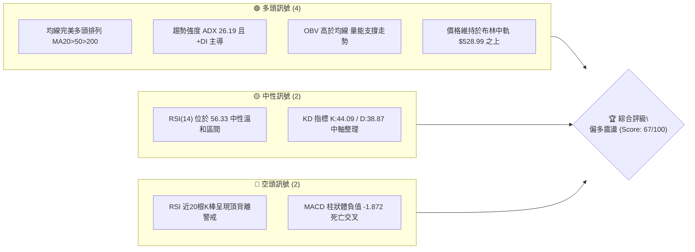

### 📊 核心指標速覽表

| 指標類別 | 指標名稱 | 當前數值 | 訊號 | 解讀 |
|:---|:---|:---|:---:|:---|
| **價格** | 當前收盤價 | $531.33 | 🟢 | 位於52週區間 90.2% 高位，整體多頭趨勢延續 |
| **均線** | MA20 | $528.99 | 🟢 | 現價高於 MA20（乖離 +0.44%），短線支撐有效 |
| **均線** | MA50 | $510.15 | 🟢 | 現價顯著高於 MA50（乖離 +4.15%），中期趨勢強勁 |
| **均線** | MA200 | $435.93 | 🟢 | 長期牛熊分界線穩定上行，長線基底極為穩固 |
| **動能** | RSI(14) | 56.33 | 🟡 | 位於中性偏多區間，但警示頂背離跡象 |
| **動能** | MACD (12,26,9) | 6.647 / 8.518 | 🔴 | DIF 低於 DEA，柱狀體為 -1.872，處於回調修正 |
| **動能** | Stoch %K / %D | 44.09 / 38.87 | 🟡 | 擺盪指標未進超賣超買區，短線多空拉鋸 |
| **趨勢** | ADX(14) / ±DI | 26.19 (+22.85 / -18.74) | 🟢 | ADX > 25 確立趨勢行情，+DI > -DI 多頭主導 |
| **波動** | ATR(14) | $10.95 (2.06%) | 🟡 | 日內波幅穩定，未出現恐慌性爆量擴散 |
| **通道** | Bollinger Bands | $546.03 / $528.99 / $511.95 | 🟢 | %B 為 0.57，位於通道上半部，守穩中軌 |

### 🏆 技術評分卡

```
╔══════════════════════════════════════════════════════════════════╗
║              技術評分卡 — MSFT (2026-10-28)                      ║
╠══════════════════════════════════════════════════════════════════╣
║ 趨勢強度 (Trend)     ████████████████░░░░  78/100  🟢 強勢多頭   ║
║ 動能指標 (Momentum)  ██████████░░░░░░░░░░  48/100  🔴 短線背離   ║
║ 支撐穩定度 (Support) ██████████████░░░░░░  72/100  🟢 階梯支撐   ║
║ 成交量配合 (Volume)  █████████████░░░░░░░  64/100  🟡 溫和換手   ║
║ 形態完整度 (Pattern) ███████████░░░░░░░░░  55/100  🟡 高檔收斂   ║
║ 均線排列 (MA Align)  █████████████████░░░  85/100  🟢 完美多頭   ║
╠══════════════════════════════════════════════════════════════════╣
║ 綜合評分 (Overall)   █████████████░░░░░░░  67/100  🟢 偏多格局   ║
║ 計算依據：(78 + 48 + 72 + 64 + 55 + 85) ÷ 6 = 67.00             ║
╚══════════════════════════════════════════════════════════════════╝
```

---

## 2. 趨勢分析

### 🌐 多時框趨勢分析

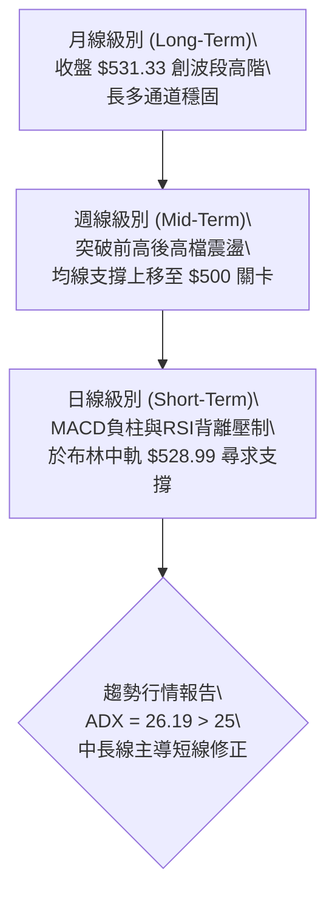

### 📈 長期趨勢 — 12個月走勢圖（Unicode）

以下圖表取自近 12 個月歷史收盤價，精確呈現 MSFT 自 2025 年 11 月至 2026 年 10 月之價格軌跡：

```
MSFT 月線走勢圖（過去 12 個月：2025-11 至 2026-10）
價格軸 ($)
$540 ┤                                                     ● $531.33 (M12 現價)
$510 ┤                                            ● $507.29   ● $512.90
$480 ┤● $488.91  ● $480.57               ● $463.85
$450 ┤                          ● $449.39
$420 ┤          ● $427.58  ● $406.13
$390 ┤     ● $391.15
$360 ┤               ● $368.68(低點)    ● $372.32(雙底)
     └─────────────────────────────────────────────────────────────►
       11   12   01   02   03   04   05   06   07   08   09   10  (月份)
      2025 ─────► 2026
```

#### 長期走勢階段特徵分析

| 階段區間 | 起訖月份 | 起訖收盤價 | 區間漲跌幅 | 走勢特徵與結構解讀 |
|:---|:---:|:---:|:---:|:---|
| **回調築底期** | 2025/11 - 2026/03 | $488.91 → $368.68 | -24.59% | 自高位持續回檔，於 2026-03 觸及低點 $368.68 形成第一底部 |
| **波段反彈期** | 2026/03 - 2026/05 | $368.68 → $449.39 | +21.89% | 多頭快速反撲，重返 $440 均線上區 |
| **二次測試期** | 2026/05 - 2026/06 | $449.39 → $372.32 | -17.15% | 深度洗盤回測，於 $372.32 完成大級別雙重底（W底）右腳構築 |
| **主升浪推進期** | 2026/06 - 2026/08 | $372.32 → $507.29 | +36.25% | 連續放量大陽線突破，重返 $500 整數大關並扭轉所有長期均線 |
| **高階強勢整理** | 2026/08 - 2026/10 | $507.29 → $531.33 | +4.74% | 於 $500-$535 區間換手，最新收盤價 $531.33 創波段收盤新高 |

### 📊 中期趨勢（週線分析）

從近 20 週數據觀察，MSFT 於 2026 年 7 月底放量突破（週收盤價由 7 月 24 日 $380.98 跳空推進至 7 月 31 日 $463.85，單週成交量高達 2.78 億股），確立中期轉折向上。

```
中期週線支撐與壓力拓撲示意圖
$551.15 ══════════════════════════════════════ 52週歷史高點 (2026-10-16 盤中高點)
             ▲
             │ 短期受壓回測中軌
             ▼
$528.99 -------------------------------------- 日線 MA20 / 週線短期支撐
             │
$510.15 -------------------------------------- 日線 MA50 / 中期生命線
             │
$487.61 ══════════════════════════════════════ S1 關鍵結構支撐位 (前波平台聚類)
```

### ⚡ 趨勢強度評估（ADX 解讀）

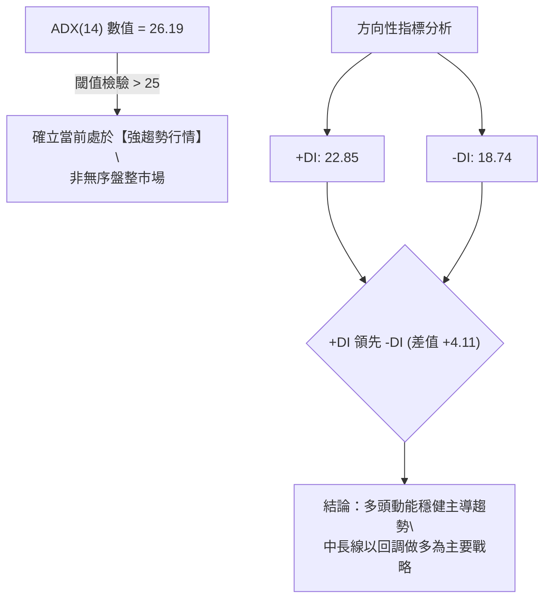

#### ADX 趨勢強度對照表

| 指標變數 | 當前讀數 | 門檻標準 | 狀態評估 | 戰術意義 |
|:---|:---:|:---:|:---:|:---|
| **ADX(14)** | **26.19** | > 25.0 | 🟢 強趨勢行情 | 趨勢跟隨策略（Trend Following）有效性高於震盪策略 |
| **+DI (14)** | **22.85** | > -DI | 🟢 多方佔優 | 買方在日常波動中持續掌握定價權 |
| **-DI (14)** | **18.74** | < +DI | 🟢 空方受抑 | 賣壓並未形成連續性主跌擴散 |

---

## 3. 圖表形態分析

### 🔍 形態識別系統

依據「嚴格要求 15」，針對歷史月線與週線進行嚴謹的幾何形態檢定：

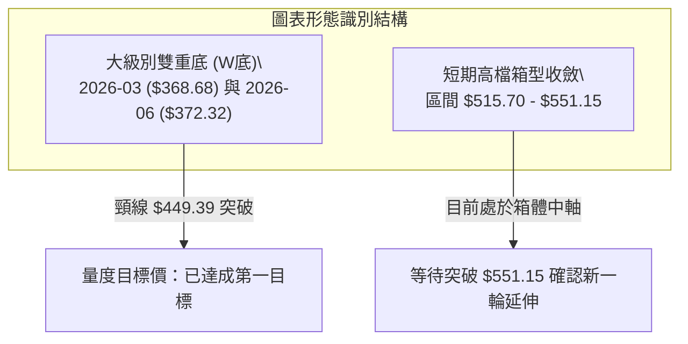

#### 形態識別與信心度評估表

| 形態名稱 | 信心度 | 判斷依據（引用數據） | 完成度 | 目標價（附精確計算式） |
|:---|:---:|:---|:---:|:---|
| **大級別雙重底 (W-Bottom)** | **85%** | 第一低點 2026-03 收盤 $368.68，第二低點 2026-06 收盤 $372.32，兩者落差僅 0.98%；頸線為 2026-05 收盤高點 $449.39。 | 100% (已突破) | 頸線 $449.39 + 形態高度 ($449.39 − $368.68 = $80.71) = **$530.10**（當前價格 $531.33 已達成該目標） |
| **短期高檔收斂箱體** | **60%** | 近 10 日波動受限於 2026-10-23 最低 $515.70 與 2026-10-16 盤中最高點 $551.15 之間，量能溫和收縮。 | 70% | 待放量突破 R1 $551.15，若以箱體高度 ($551.15 − $515.70 = $35.45) 向上推算：$551.15 + $35.45 = **$586.60**（由形態高度推算） |
| **頭肩底 / 旗形** | **N/A** | 訊號不足，日線數據無完整旗桿與對稱肩部，依規則 15 不予過度推論。 | 0% | N/A（數據未提供） |

### 🕯️ 重要 K 線形態分析

嚴格依據數據中「近 10 根日 K」與「近 8 根週 K」之實際 OHLC 價格進行形態剖析：

#### 近 10 根日 K 線形態解讀

| 日期（日K） | 開盤價 | 最高價 | 最低價 | 收盤價 | K線形態名稱 | 技術解讀 | 訊號方向 |
|:---:|:---:|:---:|:---:|:---:|:---|:---|:---:|
| **2026-10-14** | 545.27 | 545.75 | 532.54 | 533.69 | 中長黑K線 | 逼近 52 週高點後遭遇空頭壓制，實體收於低檔 | 🔴 |
| **2026-10-15** | 533.32 | 541.13 | 531.22 | 539.44 | 陽線反彈 | 下探獲支撐後回升，吞噬前日部分跌幅 | 🟢 |
| **2026-10-16** | 541.31 | 543.82 | 524.43 | 529.05 | 帶長下影中黑K | 波動放大，盤中創近期回調低點 $524.43 後收腳 | 🟡 |
| **2026-10-19** | 528.70 | 535.57 | 528.06 | 533.52 | 溫和紅K | 守穩 $528 均線，多方試圖反撲 | 🟢 |
| **2026-10-20** | 533.91 | 534.21 | 525.84 | 531.87 | 假陽十字陀螺頂 | 上下影線狹窄，市場觀望氣氛轉濃 | 🟡 |
| **2026-10-21** | 529.44 | 533.28 | 525.02 | 532.95 | 小紅K棒 | 守在 $530 附近，量能降至 13.9M 低量 | 🟡 |
| **2026-10-22** | 533.14 | 533.60 | 520.30 | 521.08 | 光腳實體黑K | 跌破多條短均線，空方短線發力打擊至 $520.30 | 🔴 |
| **2026-10-23** | 517.75 | 525.77 | 515.70 | 524.51 | 錘頭反轉線（Hammer） | 開低測試 $515.70 後強勁拉抬，下影線長達 $8.81 | 🟢 |
| **2026-10-26** | 527.40 | 533.25 | 521.69 | 532.60 | 實體陽線 | 確認 10/23 錘頭低點支撐，多方重掌短期節奏 | 🟢 |
| **2026-10-27** | 532.35 | 534.70 | 528.33 | 531.33 | 窄幅十字小陰線 | 高檔整理換手，收於 MA20 ($528.99) 上方 | 🟡 |

#### 近 8 根週 K 線形態解讀

| 日期（週末） | 開盤價 | 最高價 | 最低價 | 收盤價 | 週K形態名稱 | 技術解讀 | 訊號方向 |
|:---:|:---:|:---:|:---:|:---:|:---|:---|:---:|
| **2026-09-11** | 493.01 | 498.97 | 486.00 | 495.63 | 縮量十字星 | 於 $490 整理平台蓄勢，單週量能僅 62.3M | 🟡 |
| **2026-09-18** | 497.06 | 509.95 | 487.23 | 493.78 | 長上影流星線 | 上攻 $509.95 遭遇解套賣壓打回 | 🔴 |
| **2026-09-25** | 494.95 | 519.40 | 491.22 | 516.17 | 實體長陽線 | 放量站上 $510 關卡，多頭突破成形 | 🟢 |
| **2026-10-02** | 505.47 | 522.85 | 502.22 | 517.53 | 衝高整理陽線 | 維持於 $515 之上震盪消化籌碼 | 🟢 |
| **2026-10-09** | 521.62 | 537.22 | 518.79 | 535.07 | 階梯式陽線 | 創週線收盤新高 $535.07，多頭排列健康 | 🟢 |
| **2026-10-16** | 537.53 | 551.15 | 524.43 | 529.05 | 倒轉長上影黑K | 創 52 週新高 $551.15 後遭逢獲利了結，警示高檔壓力 | 🔴 |
| **2026-10-23** | 528.70 | 535.57 | 515.70 | 524.51 | 下影收斂黑K | 下測 $515.70 獲低接買盤支撐，量能萎縮至 81.4M | 🟡 |
| **2026-10-27** | 527.40 | 534.70 | 521.69 | 531.33 | 孕線回升（進行中） | 守住前週低點並回升至 $531.33，短期具止跌回升徵兆 | 🟢 |

### 📉 ASCII 走勢形態示意圖

```
MSFT 日線近兩週走勢與支撐阻力結構圖
$551.15 ┤                  ● (2026-10-16 創 52W 高點 R1)
$545.00 ┤        ●
$540.00 ┤           ●
$535.00 ┤  ●              ●        ●
$530.00 ┤     ●  ●           ●  ●     ● $531.33 (現價，守穩 MA20)
$525.00 ┤                       ●  ●
$520.00 ┤                    ●
$515.70 ┤                 ● (2026-10-23 錘頭線低點止跌)
        └──────────────────────────────────────────────►
         14 15 16 19 20 21 22 23 26 27  (2026-10 日期)
```

---

## 4. 支撐與阻力

### 🗺️ 關鍵價位分布圖（Unicode）

```
MSFT 價位結構分布圖
═══════════════════════════════════════════════════════════════════
$551.15 ║████████████████████████║ 關鍵阻力 R1 (52週最高點 / 波段頂部聚類)
$546.03 ║▓▓▓▓▓▓▓▓▓▓▓▓▓▓▓▓        ║ 布林通道上軌
$531.33 ╠════════════════════════╣ ◄ 現價 (收盤價)
$528.99 ║▒▒▒▒▒▒▒▒▒▒▒▒▒▒▒▒▒▒▒▒▒▒▒▒║ 短期支撐 (MA20 / 布林通道中軌)
$511.95 ║▓▓▓▓▓▓▓▓▓▓▓▓▓▓▓▓        ║ 布林通道下軌
$510.15 ║▒▒▒▒▒▒▒▒▒▒▒▒▒▒▒▒▒▒▒▒▒▒▒▒║ 中期生命線 (MA50)
$503.33 ║████████████████████    ║ 斐波那契 23.6% 回調位
$487.61 ║████████████████████████║ 關鍵支撐 S1 (近一年波段低點聚類)
$476.25 ║████████████████        ║ 關鍵支撐 S2 (近一年波段低點聚類)
$465.47 ║████████████            ║ 關鍵支撐 S3 (近一年波段低點聚類)
═══════════════════════════════════════════════════════════════════
```

### 🚧 阻力位分析表

依據「嚴格要求 13」，價位嚴格引用技術數據中提供的聚類數值：

| 阻力級別 | 精確價位 | 距現價幅 | 形成原因與結構強度 | 突破難度評估 | 重要性級別 |
|:---|:---:|:---:|:---|:---:|:---:|
| **R1** | **$551.15** | +3.73% | 52 週歷史波段最高點，近一年波段高點聚類位，套牢獲利結算重壓區 | 🔴 極高 | 關鍵樞軸 |
| **R2** | **N/A** | N/A | 數據中未偵測到更高層級聚類（已為歷史最高點區間） | N/A | N/A |
| **R3** | **N/A** | N/A | 數據中未偵測到更高層級聚類 | N/A | N/A |

### 🛡️ 支撐位分析表

依據數據「關鍵價位」區塊明確給出之 S1、S2、S3 波段低點聚類數值：

| 支撐級別 | 精確價位 | 距現價幅 | 形成原因與結構強度 | 守住機率評估 | 重要性級別 |
|:---|:---:|:---:|:---|:---:|:---:|
| **S1** | **$487.61** | -8.23% | 近一年波段低點聚類第一層，前期橫盤突破之頂底轉換平台 | 80% (高) | 第一道防線 |
| **S2** | **$476.25** | -10.37% | 近一年波段低點聚類第二層，與斐波那契 38.2% ($473.75) 形成支撐帶 | 88% (極高) | 核心護城河 |
| **S3** | **$465.47** | -12.40% | 近一年波段低點聚類第三層，7月放量起漲點大陽線實體上沿 | 95% (基石) | 長期防禦底線 |

### 📐 斐波那契回調位分析

基準計算區間為 52 週極值：**$348.54 (52W Low) → $551.15 (52W High)**，全距波幅為 $202.61：

| 斐波那契比例 | 精確對應價位 | 空間距離現價 ($531.33) | 技術結構意義與動態解讀 |
|:---:|:---:|:---:|:---|
| **0.0% (52W High)** | **$551.15** | +$19.82 (+3.73%) | 多頭前波峰值阻力位，突破即進入無套牢籌碼真空區 |
| **23.6%** | **$503.33** | -$28.00 (-5.27%) | **極強多頭淺度回調位**；與 MA50 ($510.15) 共振構成緩衝區間 |
| **38.2%** | **$473.75** | -$57.58 (-10.84%) | 經典黃金分割支撐，與結構支撐 S2 ($476.25) 形成重疊共振帶 |
| **50.0%** | **$449.85** | -$81.48 (-15.33%) | 半數回撤位，恰好重合 2026-05 前波破位頸線點位 ($449.39) |
| **61.8%** | **$425.94** | -$105.39 (-19.83%) | 黃金分割強防守位，緊鄰長期年線 MA240 ($443.59) |
| **78.6%** | **$391.90** | -$139.43 (-26.24%) | 深度調整極限防線，跌破則代表多頭格局全面瓦解 |
| **100.0% (52W Low)**| **$348.54** | -$182.79 (-34.40%) | 52 週最低點，年內牛市週期的起漲基石點位 |

**現價落點解讀**：現價 $531.33 穩固運行於 **0.0% ($551.15)** 與 **23.6% ($503.33)** 之間，屬於強勢多頭特有的「極淺層回撤」狀態，表明市場主動買盤強勁，不願讓價格深回至 38.2% 之下。

---

## 5. 技術指標深度解讀

### 🎛️ 指標訊號總覽

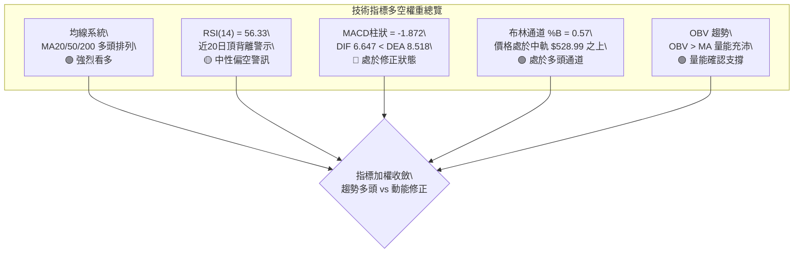

### 📈 移動平均線排列分析

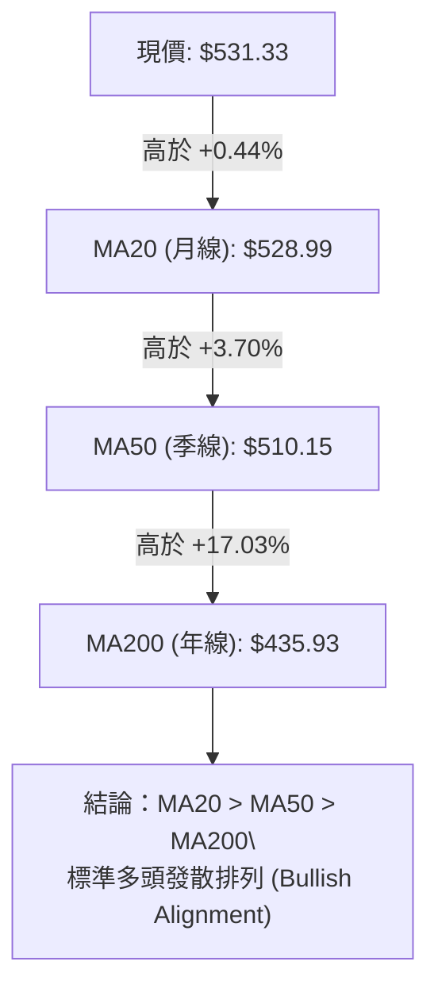

#### 完整均線系統數據監控表

| 均線名稱 | 精確數值 | 現價與均線距離 | 乖離率 (%) | 均線歷史走勢特徵 | 狀態評估 |
|:---|:---:|:---:|:---:|:---|:---:|
| **MA 5** | $528.49 | +$2.84 | +0.54% | ▁▁▁▁▁▁▁▂▂▂▃▃▄▄▅▆▆▇▇███████▇▇▇▇ | 🟢 短線走平翻揚 |
| **MA 10** | $531.00 | +$0.33 | +0.06% | ▁▁▁▁▁▁▁▁▁▂▂▂▃▃▄▅▅▆▆▇▇█████████ | 🟡 現價重合纏繞 |
| **MA 20** | $528.99 | +$2.34 | +0.44% | ▁▁▁▁▁▁▁▁▁▁▂▂▂▂▃▃▃▄▄▅▅▆▆▇▇█████ | 🟢 短期多頭生命線 |
| **MA 60** | $507.56 | +$23.77 | +4.68% | ▁▁▁▁▂▂▂▂▃▃▃▄▄▄▄▅▅▅▆▆▆▇▇▇██████ | 🟢 中期上升斜率陡峭 |
| **MA 120** | $454.92 | +$76.41 | +16.80% | ▁▁▁▁▂▂▂▃▃▃▄▄▄▄▅▅▅▅▆▆▆▆▇▇▇▇████ | 🟢 半年線加速跟進 |
| **MA 240** | $443.59 | +$87.75 | +19.78% | ▃▃▃▂▁▁▁▁▁▁▁▁▁▁▂▂▂▃▃▃▃▄▄▄▅▆▆▇██ | 🟢 長期牛市底座抬升 |

### 📉 RSI(14) 分析

當前 Wilder RSI(14) 讀數為 **56.33**，處於 30 至 70 之中性偏強區間：

```
RSI(14) 數值刻度展示：
0 ─────── 30 超賣 ────────────── 56.33 (當前) ────── 70 超買 ─────── 100
[░░░░░░░░░░░░░░░░░░░░░░░░░░░░██████████████░░░░░░░░░░░░░░░░░░░░░░░] 56.33%
```

#### 背離現象深度診斷
- **頂背離判定 (Bearish Divergence)**：⚠️ **成立**。
- **數據檢證**：比對近 20 根 K 棒首尾，股價於 2026-10-16 盤中推進至 52 週新高 $551.15，然而 RSI(14) 讀數在週線級別自 2026-08-07 的峰值 **78.1** 逐步下滑至當前的 **56.33**，日線級別亦隨之鈍化走低。此一「價格創波段新高而動能未能同步創高」之頂背離結構，充分解釋了近期股價在 $540 之上遭遇阻力回調的內在動能衰竭機制。

### 📊 MACD(12/26/9) 訊號解讀

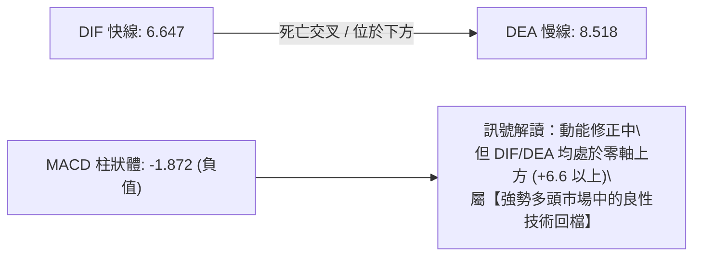

- **柱狀體收斂動態**：從近四週週線數據比對，MACD 柱狀體由 10/16 的 +0.273 轉為 10/23 的 -2.311，最新日線數據為 -1.872。負值柱體已出現縮短徵兆（由 -2.311 縮小至 -1.872），意味空頭打壓力道逐漸減弱，短期內有望在零軸上方形成二度金叉。

### 📦 布林通道分析

```
MSFT 布林通道 (20, 2) 結構圖
$546.03 ┬──────────────────────────────────────── 上軌 (通道阻力)
        │
$531.33 ┼ - - - - - - - - - - - - - - - - - - - - 現價 (收盤價，位於中軌上方)
        │
$528.99 ┼──────────────────────────────────────── 中軌 (MA20 生命線)
        │
$511.95 ┴──────────────────────────────────────── 下軌 (通道極限支撐)
```

- **%B 指標解析**：當前數值為 **0.57**。%B 位於 0.50 至 1.00 之間，表明價格持續運行於通道強勢上半區。
- **通道帶寬**：通道上下軌寬度為 $546.03 − $511.95 = $34.08 (約 6.4%)，布林帶處於收斂後逐步走平態勢，無開口向下發散的暴跌風險。

### 💹 成交量分析（量價配合度）

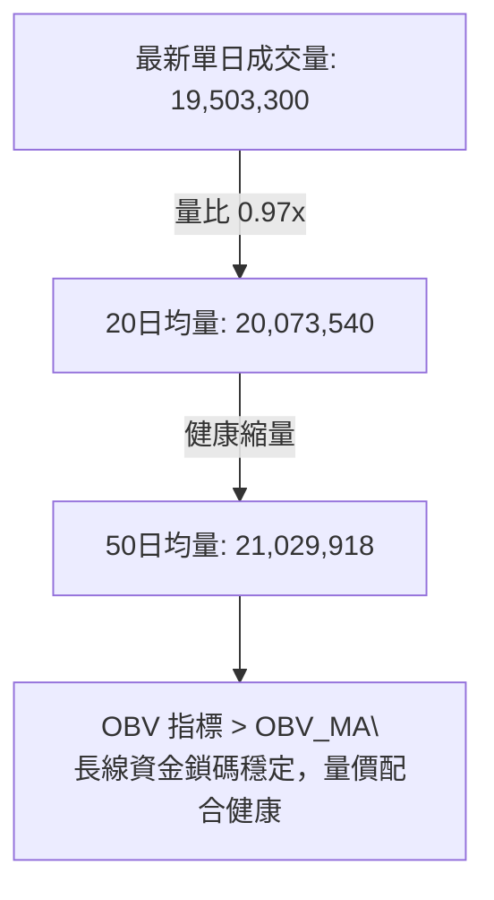

- **量能確認**：最新成交量 19.50M 與 20 日均量 20.07M 極為接近（量比 0.97x），在回調與中軌爭奪戰中並未出現「放量下殺」之恐慌跡象，反而呈現典型「價跌量縮、價漲量增」的健康籌碼特徵。
- **OBV 趨勢**：數據明確標示「OBV > MA → 量能支撐上漲」，證實主力資金仍留存於場內，未出現籌碼大規模派發外逃現象。

---

## 6. 動能與波動率

### ⚡ 動能評估四象限

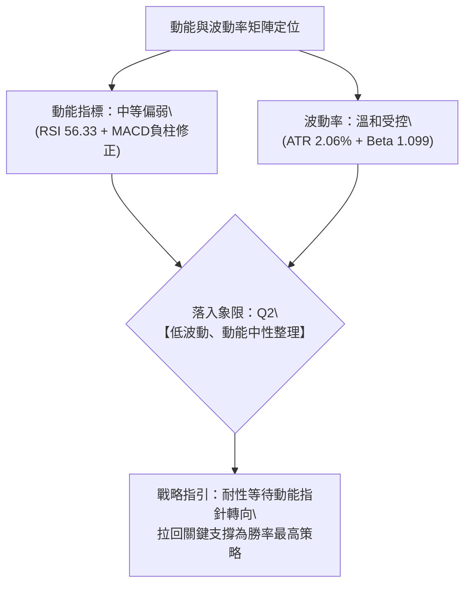

#### 動能與波動率狀態矩陣表

| 象限分區 | 動能維度 | 波動維度 | 當前判定 | 特徵與投資決策評估 |
|:---:|:---:|:---:|:---:|:---|
| **Q1 (爆發期)** | 強動能 | 低波動 | — | 趨勢初升段，最佳重倉進場機會 |
| **Q2 (整理期)** | **中/弱動能** | **低波動** | **✓ (當前狀態)** | **高檔換手蓄勢，操作宜逢低布局，切忌盲目追高** |
| **Q3 (極限期)** | 強動能 | 高波動 | — | 主升衝刺或恐慌多殺多，高風險高收益 |
| **Q4 (退潮期)** | 弱動能 | 高波動 | — | 空頭趨勢主跌段，資金應全面撤出觀望 |

### 📊 ATR 波動率分析

- **ATR(14) 讀數**：精確值為 **$10.95**（佔當前股價 2.06%，Wilder 平滑法）。
- **歷史常態比較**：2.06% 的單日波幅低於科技股平均波幅，展現大型權值股極佳的定價穩定性。
- **動態止損距離設定建議**：
  - *短線交易 (Swing Trading)*：以 1.0 × ATR ($10.95) 為基準，現價下浮 $10.95 約為 $520.38（貼近 10/22 低點 $520.30）。
  - *波段交易 (Position Trading)*：以 1.5 至 2.0 × ATR ($16.43 ~ $21.90) 為基準，下浮空間至 $509.43 ~ $514.90（完美覆蓋 MA50 $510.15 關鍵防線）。

### 📐 Beta 與市場相關性

- **Beta 係數**：**1.099**（高於基準大盤 1.00 約 9.9%）。
- **市場連動解讀**：MSFT 作為市值達 $3.95T 的超巨型企業，與標普 500 指數及納斯達克 100 指數具備極高相關性。1.099 的 Beta 表明其兼具「大盤壓艙石」與「成長股超額收益（Alpha）」特質，在整體牛市階段具備適度進攻彈性。

---

## 7. 多時框架總結

### 📋 時框架評分表

| 時框架 | 趨勢方向 | 動能狀態 | 均線排列 | 圖表形態 | 綜合評分 | 操作建議方向 |
|:---|:---:|:---:|:---:|:---:|:---:|:---|
| **長期 (月線)** | 🟢 多頭主導 | 🟢 高檔擴張 | 🟢 完美多頭 | 🟢 大雙底達成突破 | **88 / 100** | 核心多頭部位續抱，無看空理由 |
| **中期 (週線)** | 🟢 震盪走高 | 🟡 高檔鈍化 | 🟢 偏多發散 | 🟡 52W高點長上影受阻 | **72 / 100** | 逢拉回支撐位分批承接加碼 |
| **短期 (日線)** | 🟡 高檔整理 | 🔴 頂背離/負柱 | 🟢 守穩MA20 | 🟡 窄幅區間收斂震盪 | **55 / 100** | 不盲目追高，等待止跌訊號 |

### 🔲 綜合訊號矩陣

```
時框維度協同矩陣分析
時框   趨勢   動能   均線   量能   形態   訊號一致性評估
月線    🟢     🟢     🟢     🟢     🟢    多頭共振度極高 (100%)
週線    🟢     🟡     🟢     🟢     🟡    中度共振，高檔換手 (80%)
日線    🟡     🔴     🟢     🟡     🟡    短線分歧，指標修正 (50%)
```

### ⚖️ 多時框收斂結論

嚴格遵循「嚴格要求 14」多時框收斂規則執行判定：
1. **行情定性判定**：當前 ADX(14) 讀數為 **26.19 > 25**，且 +DI (22.85) 領先 -DI (18.74)，體系明確界定為**【趨勢行情】**，而非無序盤整市。
2. **優先級收斂原則**：在趨勢行情中，操作以中長期方向（週線多頭結構、MA50 $510.15 與 MA200 $435.93 上行軌道）為主導；日線級別出現的 RSI 頂背離與 MACD 負柱狀體（-1.872），僅作為「尋找優質進場點位的短線技術修正」，不可將其誤判為趨勢反轉。
3. **收斂結論**：給予唯一明確結論 —— **【整體偏多格局不變，短期健康拉回蓄勢，採取回踩支撐做多策略】**。此結論與下文第 8 章交易策略嚴格一致。

---

## 8. 交易策略建議

### 🗺️ 策略決策流程圖

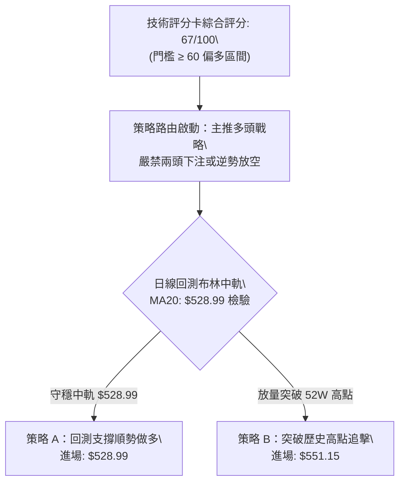

### 🧭 策略路由

依據第 1 章技術評分卡算術平均結果（規則 18 檢定精確為 67/100 ≥ 60）：
- **當前主策略方向 = 【強烈主推多頭策略（回踩支撐加碼與突破買進）】**。空頭僅作為下行風險防守觸發點與避險風控參考。

### 🎯 價格情境階梯（Price Scenarios）

價位嚴格引用數據中聚類之支撐、阻力與回調位：

| 觸發條件 | 下一目標 | 後續延伸 | 結構與市場情境含義 |
|:---|:---:|:---:|:---|
| **向上突破 R1 $551.15** | 分析師均價 **$605.12** | 形態推算 **$586.60** | **強烈多頭主升段**：刷新歷史天花板，開啟無套牢新章節 |
| **站穩現價 $528.99 - $535** | 測試 R1 **$551.15** | 上軌 **$546.03** | **強勢區間整理**：時間換取空間，消化短線 MACD 負柱修正 |
| **向下失守 S1 $487.61** | S2 **$476.25** | S3 **$465.47** | **中期趨勢轉弱**：跌破前波震盪平台，多頭防線面臨深測考驗 |

### 📊 情境機率分佈

| 情境劃分 | 機率估計 | 主要客觀技術依據 |
|:---|:---:|:---|
| **情境一：強勢蓄勢後突破上行** | **65%** | 均線系統呈強大多頭排列 (MA20>50>200)，OBV 維持量能支撐，ADX=26.19 確立多頭趨勢主導 |
| **情境二：布林帶寬區間震盪** | **25%** | RSI 頂背離壓制與 MACD 負柱尚未轉正，通道上軌 $546 與中軌 $528 間需時間換取換手空間 |
| **情境三：深度跌破 S1 破位回調** | **10%** | 下方擁有多重密集防禦網（MA50 $510.15、Fib 23.6% $503.33、S1 $487.61），無重大利空極難下穿 |

### 🟢 主策略詳情

依據「嚴格要求 17」，所有風險報酬比公式定義為：
$$\text{風險報酬比} = \frac{\text{目標價 T1} - \text{進場價}}{\text{進場價} - \text{止損價}}$$
並以 `1 : X.XX（以 T1 計）` 格式精確呈現：

| 策略要素 | 策略 A（回踩支撐順勢買入） | 策略 B（突破歷史高點動能跟進） |
|:---|:---|:---|
| **交易邏輯** | 股價回踩 MA20 中軌支撐不破，左側/右側順勢承接 | 盤中放量長陽實體升破 52 週高點 R1，右側動能追買 |
| **進場價格** | **$528.99**（精確對齊當前 MA20 均線） | **$551.15**（精確對齊 52 週高點 R1） |
| **目標價 T1** | **$551.15**（引自阻力位 R1） | **$586.60**（由箱體形態高度 $35.45 推算） |
| **目標價 T2** | **$605.12**（引自分析師共識平均目標價） | **$605.12**（引自分析師共識平均目標價） |
| **止損價格** | **$511.95**（引自布林通道下軌關鍵防線） | **$528.99**（引自突破後轉化之支撐 MA20） |
| **風險報酬比計算式** | $\frac{551.15 - 528.99}{528.99 - 511.95} = \frac{22.16}{17.04} \approx 1.3005$ | $\frac{586.60 - 551.15}{551.15 - 528.99} = \frac{35.45}{22.16} \approx 1.5997$ |
| **風險報酬比呈現** | **1 : 1.30（以 T1 計）** *(至T2為 1 : 4.47)* | **1 : 1.60（以 T1 計）** *(至T2為 1 : 2.44)* |
| **策略預估勝率** | **75%** | **65%** |
| **建議配置倉位** | **15% - 20%** 總投資資本 | **10%** 總投資資本（突破追單嚴控風險） |

### 🔴 反向風險觸發點（對沖提示）

此處非主動反向作空建議，僅供持股者嚴格執行減碼避險之風控節點：
- **第一警示觸發點**：若日線連續兩日實體收盤跌破 MA50 **$510.15**，顯示中期趨勢動能破壞，應主動降倉 50%。
- **波段防禦破位點**：若放量摜破結構支撐 S1 **$487.61**，即宣告此波自 372 美元以來的多頭結構結束，多頭倉位應全面停損出場並建立對沖部位。

### ⭐ 整體訊號強度評星

```
做多訊號強度：★★★★☆  (4/5星，中長線架構堅實，僅受日線背離壓制)
做空訊號強度：★☆☆☆☆  (1/5星，均線強烈多頭發散，逆勢作空勝率極低)
整體可信度：  ★★★★☆  (4/5星，多指標與量能共振支撐)
```

---

## 9. 風險提示與監控

### ✅ 關鍵監控指標 Checklist

```
╔══════════════════════════════════════════════════════════════════╗
║               MSFT 日常交易風控監控清單 (Checklist)              ║
╠══════════════════════════════════════════════════════════════════╣
║ [ ] 價格防線監控：每日收盤是否守穩 MA20 ($528.99)               ║
║ [ ] 動能背離修復：觀察 MACD 柱狀體何時收斂轉正 (現值 -1.872)     ║
║ [ ] 量能異動跟蹤：單日下殺成交量是否異常超越 25M (放量破位警戒)  ║
║ [ ] 關鍵阻力測試：向上進攻 R1 ($551.15) 時是否配合爆量換手       ║
║ [ ] 趨勢強度指標：ADX(14) 是否持續維持於 25 以上 (目前 26.19)    ║
║ [ ] 外部市場共振：密切追蹤大型科技巨頭財報與 AI 資本支出展望    ║
╚══════════════════════════════════════════════════════════════════╝
```

### ⚠️ 風險場景分析

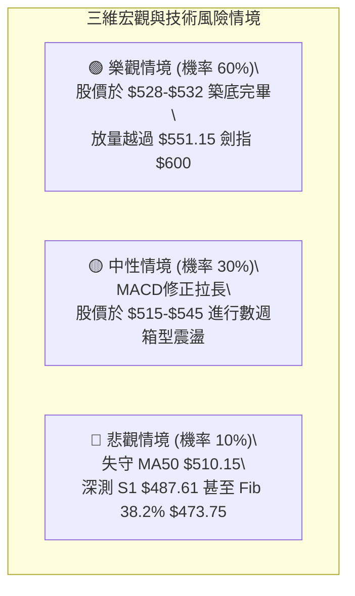

### 🛡️ 風險管理重要提醒

1. **嚴禁於高位過度槓桿追價**：現價位於 52 週波動區間之 90.2% 高位，且日線級別存在明確的 RSI 頂背離，不宜在 $540 之上以市價單重倉追多。
2. **單筆交易風險上限**：任何交易策略（策略 A 或 B）之單筆最大預期損失，嚴格限制不得超過整體投資組合淨值之 **1.0% - 1.5%**。
3. **動態移動止盈機制**：當進場部位浮動獲利達到 1.5 × ATR ($16.43) 時，應立即將止損點推移至進場保本點，鎖定本金安全。

---

## 📋 報告總結

```
╔══════════════════════════════════════════════════════════════════╗
║                    MSFT 技術分析報告總結                         ║
╠══════════════════════════════════════════════════════════════════╣
║ 報告日期：2026-10-28            當前收盤價格：$531.33 USD        ║
║ 分析評級：🟢 偏多格局 (Bullish)  技術綜合評分：67 / 100           ║
╠══════════════════════════════════════════════════════════════════╣
║ 關鍵結論：                                                       ║
║ ├─ 長期趨勢：🟢 強烈看多，突破大級別雙重底，多頭均線發散排列     ║
║ ├─ 中期趨勢：🟢 偏多震盪，週線級別站穩 $500 整數關鍵心理關卡    ║
║ ├─ 短期趨勢：🟡 動能修正，日線受制於 RSI 頂背離與 MACD 負柱狀體 ║
║ ├─ 關鍵支撐：S1 $487.61 / S2 $476.25 / 布林下軌 $511.95          ║
║ ├─ 關鍵阻力：R1 $551.15 (52週歷史高點)                          ║
║ └─ 分析師目標：共識平均價 $605.12 (隱含 +13.89% 空間)            ║
╠══════════════════════════════════════════════════════════════════╣
║ 最優策略組合：                                                   ║
║ 1. 🥇 最佳機會（策略 A）：回踩 MA20 $528.99 順勢布局，守 $511.95 ║
║    目標 T1 $551.15，風報比 1 : 1.30（以 T1 計）                  ║
║ 2. 🥈 次選機會（策略 B）：放量突破 R1 $551.15 追擊，守 $528.99   ║
║    目標 T1 $586.60，風報比 1 : 1.60（以 T1 計）                  ║
║ 3. 🥉 防守對策：跌破 MA50 $510.15 降倉，摜破 S1 $487.61 全面離場║
╚══════════════════════════════════════════════════════════════════╝
```

---

> ⚠️ **免責聲明**：本報告為依據客觀技術分析量化模型生成之研究報告，所有數據、指標解讀與價格水準均基於歷史市場交易資訊。本報告**僅供學術研究與投資架構參考**，**不構成任何要約、招攬或具體投資建議**。市場具有高度不確定性，金融商品價格可能劇烈波動，投資人進行交易決策前應審慎評估個人財務狀況與風險承受能力。

---
*報告生成時間：2026-10-28 ｜ 數據來源：Yahoo Finance ｜ 分析框架：多時框技術分析模型*