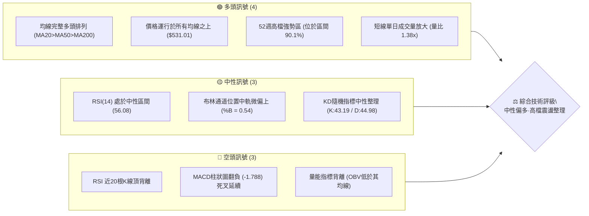
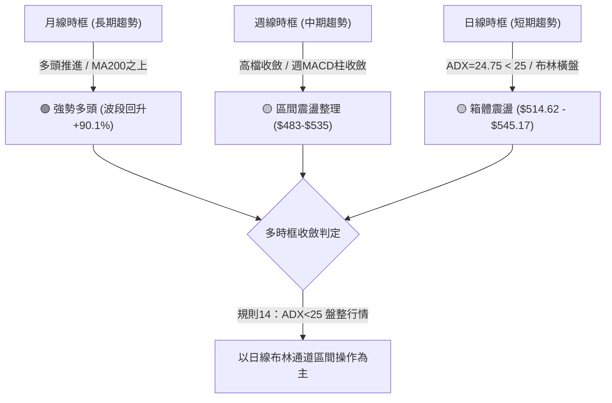
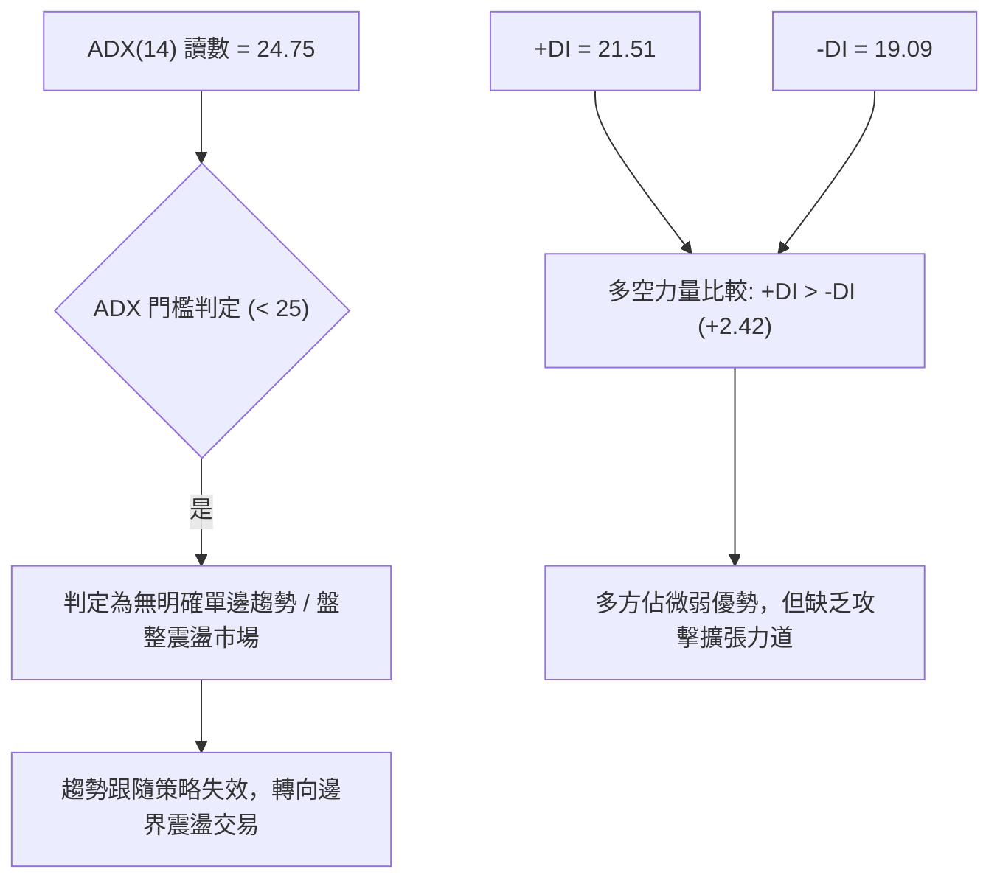
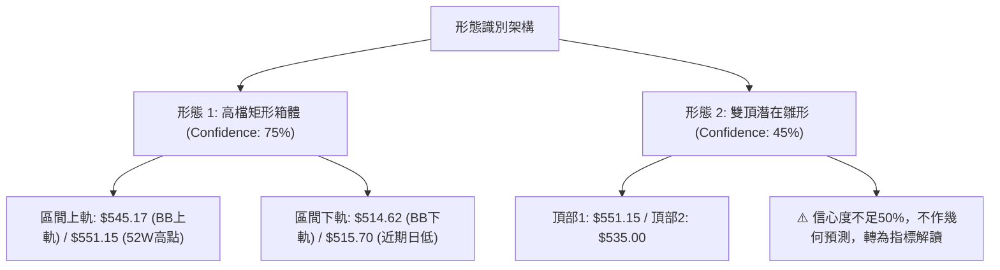
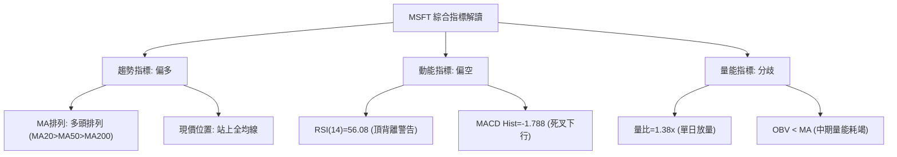
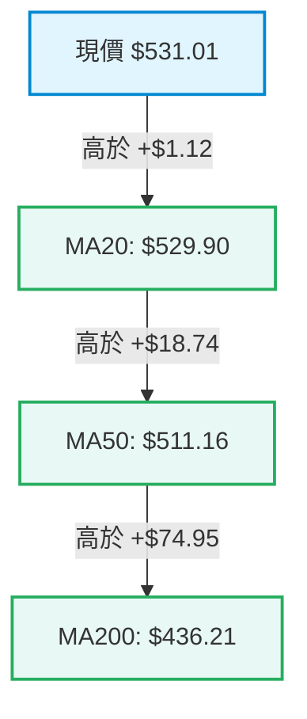
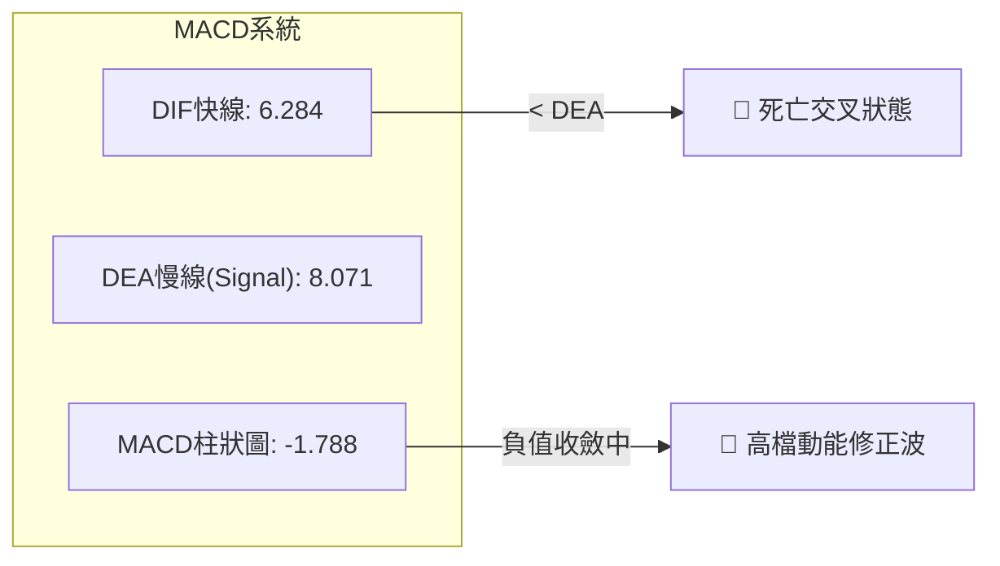
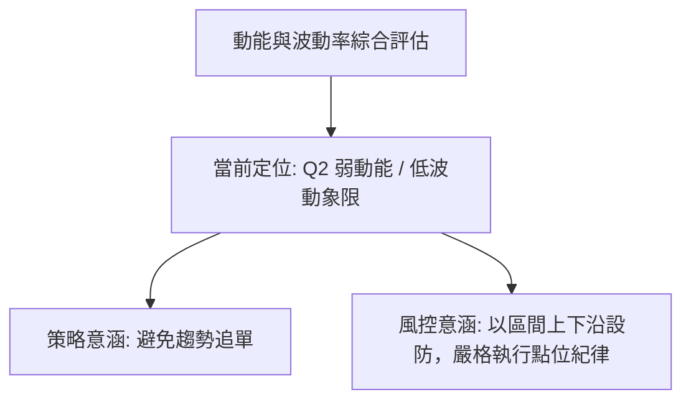
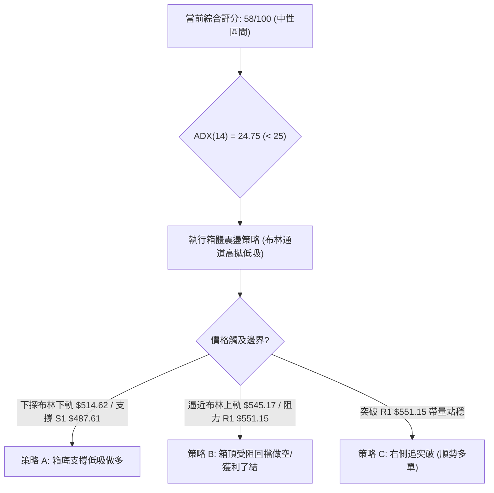
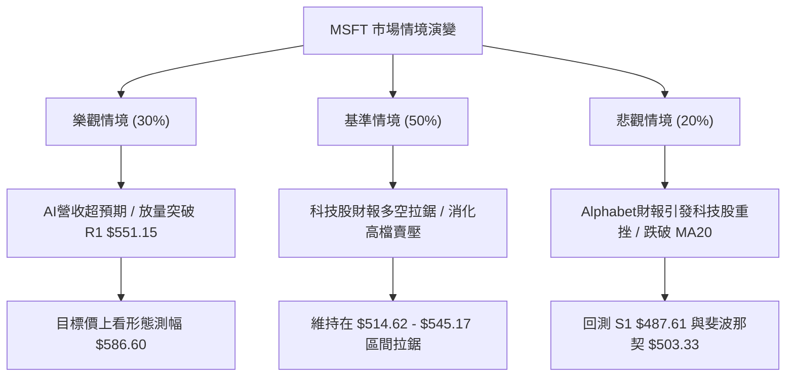

# MSFT 技術分析報告

> **報告日期**：2026-10-29 ｜ **語言**：繁體中文 ｜ **數據來源**：Yahoo Finance ｜ **當前價格**：$531.01

---

## 目錄

| 章節 | 內容 |
|------|------|
| [1. 技術面概覽](#1-技術面概覽) | 訊號儀表板、核心指標、評分卡 |
| [2. 趨勢分析](#2-趨勢分析) | 多時框趨勢、長中短期走勢、ADX解讀 |
| [3. 圖表形態分析](#3-圖表形態分析) | 形態識別、K線組合、目標價推算 |
| [4. 支撐與阻力](#4-支撐與阻力) | 關鍵價位結構、斐波那契回調位解讀 |
| [5. 技術指標深度解讀](#5-技術指標深度解讀) | 均線系統、RSI背離、MACD、布林通道、OBV |
| [6. 動能與波動率](#6-動能與波動率) | 動能象限、ATR波動分析、Beta市場關聯 |
| [7. 多時框架總結](#7-多時框架總結) | 時框架矩陣、ADX收斂判定 |
| [8. 交易策略建議](#8-交易策略建議) | 策略路由、情境階梯、精確風報比建議 |
| [9. 風險提示與監控](#9-風險提示與監控) | 監控指標Checklist、風險場景防護 |
| [10. 報告總結](#-報告總結) | 核心結論與最優策略執行彙整 |

---

## 1. 技術面概覽

### 🎯 技術訊號儀表板

當前微軟（MSFT）技術面呈現「長多中固、短線高檔收斂震盪」格局。均線系統維持完整多頭排列，但短線動能指標出現頂背離與動能減速訊號。



### 📊 核心指標速覽表

| 指標類別 | 指標名稱 | 當前數值 | 訊號 | 解讀 |
|----------|----------|----------|:----:|------|
| **價格** | 當前收盤價 | $531.01 | 🟢 | 站上所有主要均線，處於52週高點下方3.79%位置 |
| **均線** | MA20 | $529.90 | 🟢 | 現價高於MA20（+$1.12），短線重回月線支撐 |
| **均線** | MA50 | $511.16 | 🟢 | 現價高於MA50（+$19.85），中期趨勢維持多頭防線 |
| **均線** | MA200 | $436.21 | 🟢 | 現價高於MA200（+$94.80），長期牛市基石極為穩固 |
| **動能** | RSI(14) | 56.08 | 🟡 | 位於50中軸上方偏多區間，但出現頂背離警告 |
| **動能** | MACD (12,26,9) | 6.284 / 8.071 | 🔴 | DIF低於DEA，柱狀圖-1.788，處於高位修正波 |
| **趨勢強度** | ADX(14) | 24.75 | 🟡 | ADX < 25，表明單邊趨勢趨緩，進入盤整區間 |
| **通道位置** | Bollinger %B | 0.54 | 🟡 | 位於布林通道中軌（$529.90）與上軌（$545.17）之間 |
| **量能** | 20日成交量比 | 1.38x | 🟢 | 最新量27.68M高於20日均量20.10M，但OBV<MA量能未確認 |
| **波動** | ATR(14) | $10.80 | 🟡 | 佔現價 2.03%，日內波幅中等偏低，適合作為止損依據 |

### 🏆 技術評分卡

依據六大技術構面綜合評估，綜合評分取六項算術平均值（四捨五入至整數）：

```
╔══════════════════════════════════════════════════════════════╗
║                技術評分卡 — MSFT (2026-10-29)               ║
╠══════════════════════════════════════════════════════════════╣
║ 趨勢強度 (ADX=24.75 弱趨勢)   ██████████░░░░░░░░░░  48/100 🟡 ║
║ 動能指標 (MACD柱負/RSI頂背離)  █████████░░░░░░░░░░░  46/100 🔴 ║
║ 支撐穩定度 (S1-S3厚實/MA多頭)  ███████████████░░░░░  76/100 🟢 ║
║ 成交量配合 (量比1.38x/OBV偏弱) ██████████░░░░░░░░░░  52/100 🟡 ║
║ 形態完整度 (箱體整理/尚未破位) ███████████░░░░░░░░░  56/100 🟡 ║
║ 均線排列 (MA20>MA50>MA200)    ████████████████░░░░  82/100 🟢 ║
╠══════════════════════════════════════════════════════════════╣
║ 綜合評分 (六項算術平均)        ████████████░░░░░░░░  58/100 🟡 ║
║ 技術評級：中性區間整理 (Neutral Consolidation)               ║
╚══════════════════════════════════════════════════════════════╝
```

---

## 2. 趨勢分析

### 🌐 多時框趨勢分析

微軟在不同時框呈現明顯的「大週期主升、中週期震盪、小週期拉鋸」特徵。



### 📈 長期趨勢 — 12個月走勢圖（Unicode）

MSFT 過去 12 個月（2025-11 至 2026-10）收盤價走勢經歷了顯著的「雙底反轉」與「主升浪拉升」：

```
MSFT 月線走勢圖（過去12個月：2025-11 至 2026-10）
價格軸 ($)
$550 ┤                                                    
$530 ┤                                              ●(10月: 531.01) 現價
$510 ┤                                        ●     │
$490 ┤●(11月: 488.91)                   ●     │     │
$470 ┤  ●(12月: 480.57)           ●     │     │     │
$450 ┤                      ●     │     │     │     │
$430 ┤    ●(01月: 427.58)   │     │     │     │     │
$410 ┤                ●     │     │     │     │     │
$390 ┤      ●         │     │     │     │     │     │
$370 ┤        ●(低點) └──●  │     │     │     │     │
     └──────────────────────────────────────────────────
       11  12  01  02  03  04  05  06  07  08  09  10  (月份)
      '25 '25 '26 '26 '26 '26 '26 '26 '26 '26 '26 '26 
```

#### 走勢特徵分析表格

| 階段區間 | 起訖月份 | 起點收盤 | 終點收盤 | 漲跌幅 | 走勢結構與技術特徵 |
|----------|----------|----------|----------|:------:|-------------------|
| **第一段回調** | 2025-11 ～ 2026-03 | $488.91 | $368.68 | -24.59% | 沿空頭均線下探，跌破400元大關，創下波段低點 |
| **春季反彈** | 2026-03 ～ 2026-05 | $368.68 | $449.39 | +21.89% | 超跌反彈突破MA50，但6月再度二次探底（$372.32）形成大型W底 |
| **夏季主升** | 2026-06 ～ 2026-08 | $372.32 | $507.29 | +36.25% | 大量突破頸線，多頭動能激增，直接收復500元整數關卡 |
| **高檔收斂** | 2026-08 ～ 2026-10 | $507.29 | $531.01 | +4.68% | 逼近52週歷史高點（$551.15），進入ADX<25的箱體消化籌碼階段 |

### 📊 中期趨勢（週線分析）

從近20週數據觀察，MSFT 於 2026-07-31 單週大漲收在 $463.85，隨後一舉推升至 2026-10-16 盤中創下 52 週高點 $551.15。近 3 週週K線連續出現上影線與小實體陰陽交錯，週 MACD 柱由正轉負（從 10-09 的 +1.490 降至當前 -1.788），顯示中期動能有耗竭跡象。

```
週線關鍵阻力與支撐示意圖：
阻力層 ─── $551.15 (52W High / 近一年波段高點 R1) ═══════════════════
                    ▲ 當前週線收盤: $531.01
震盪區 ─── $515.70 - $535.07 (近4週高低收斂箱體) ─────────────────
支撐層 ─── $487.61 (近一年波段低點聚類 S1 / 8月整理平台低點) ═══════
```

### ⚡ 趨勢強度評估（ADX 解讀）

微軟當前技術系統的核心變數為 ADX 指標：



#### ADX 強度對照表

| ADX 區間 | 趨勢狀態 | 市場特性 | MSFT 當前狀態定位 |
|----------|----------|----------|:-----------------:|
| 0 ～ 20 | 極弱/無趨勢 | 價格漫遊、雜訊極多 | ⚪ |
| **20 ～ 25** | **弱趨勢 / 盤整收斂** | **假突破頻繁、箱體震盪** | **🟡 當前狀態 (24.75)** |
| 25 ～ 40 | 強勁趨勢 | 順勢交易最佳階段 | ⚪ |
| 40 ～ 60 | 極強單邊趨勢 | 動能爆發，容易延伸波段 | ⚪ |

---

## 3. 圖表形態分析

### 🔍 形態識別系統

在多週期形態掃描下，微軟日線級別並無符合嚴格幾何定義的頭肩頂或雙底頸線破位，而是處於典型的「高檔矩形箱體整理」。



#### 形態信心度評估表（依規則 15）

| 形態名稱 | 信心度 | 判斷依據（引用數據） | 完成度 | 目標價（附計算式） |
|----------|:------:|----------------------|:------:|--------------------|
| **高檔矩形整理箱體** | **75%** | 上軌受壓於布林上軌 $545.17 與高點 R1 $551.15；下軌獲布林下軌 $514.62 與日線低點 $515.70 支撐 | 85% | 向上突破：頸線 $551.15 + 箱高 $35.45 = **$586.60**；向下破位：$515.70 - $35.45 = **$480.25** |
| **高檔潛在雙頂** | **45%** | 10-16 創高 $551.15 後回落，10-28 反彈高點僅達 $535.00 | 40% | 訊號不足，僅做指標型解讀（未跌破頸線 S1 $487.61 不得宣稱成立） |

### 🕯️ 重要K線形態分析

嚴格依據提供的「近10根日K」與「近8根週K」價格進行逐根型態解讀：

#### 近10根日K形態精確解析

| 日期（日K） | 開 | 高 | 低 | 收 | 成交量 | K線形態 | 解讀與訊號 |
|:-----------:|:------:|:------:|:------:|:------:|:------:|:-------:|:----------:|
| 2026-10-15 | 533.32 | 541.13 | 531.22 | 539.44 | 24,151,200 | 中陽線 | 向上進攻，突破短期均線 🟢 |
| 2026-10-16 | 541.31 | 543.82 | 524.43 | 529.05 | 24,845,700 | 長黑實體伴下影 | 衝高受阻於52週高點下方，短線轉弱 🔴 |
| 2026-10-19 | 528.70 | 535.57 | 528.06 | 533.52 | 17,994,900 | 小陽線 | 縮量抗跌，回踩確認MA20 🟡 |
| 2026-10-20 | 533.91 | 534.21 | 525.84 | 531.87 | 14,576,000 | 紡錘陰線 | 量能驟縮，多空雙方觀望 🟡 |
| 2026-10-21 | 529.44 | 533.28 | 525.02 | 532.95 | 13,940,100 | 下影小陽線 | 守住 $525 支撐，地量整理 🟡 |
| 2026-10-22 | 533.14 | 533.60 | 520.30 | 521.08 | 21,266,600 | 光腳中黑線 | 帶量下殺，跌破布林中軌，短空發力 🔴 |
| 2026-10-23 | 517.75 | 525.77 | 515.70 | 524.51 | 13,671,500 | 錘頭反彈線 | 下探 $515.70 逼近布林下軌獲支撐強彈 🟢 |
| 2026-10-26 | 527.40 | 533.25 | 521.69 | 532.60 | 19,021,000 | 中陽反包線 | 突破前三日陰線阻力，多頭反攻 🟢 |
| 2026-10-27 | 532.35 | 534.70 | 528.33 | 531.33 | 19,532,300 | 墓碑小陰線 | 上攻 $534.70 遇阻，留下上影線 🟡 |
| 2026-10-28 | 531.82 | 535.00 | 526.14 | 531.01 | 27,681,000 | 帶量十字星 | 放量至27.68M，上下影線均衡，多空決戰 🟡 |

#### 近8根週K形態精確解析

| 日期（週K最後日） | 開 | 高 | 低 | 收 | 週成交量 | K線形態 | 解讀與訊號 |
|:-----------------:|:------:|:------:|:------:|:------:|:--------:|:-------:|:----------:|
| 2026-09-11 | 493.01 | 498.97 | 486.00 | 495.63 | 62,321,200 | 縮量紡錘小陽 | 平台震盪，守住486低點 🟡 |
| 2026-09-18 | 497.06 | 509.95 | 487.23 | 493.78 | 115,020,700 | 長上影倒錘陰 | 放量衝高509回落，上檔賣壓沉重 🔴 |
| 2026-09-25 | 494.95 | 519.40 | 491.22 | 516.17 | 123,909,000 | 大陽突破線 | 帶量突破510阻力，重啟多頭攻擊 🟢 |
| 2026-10-02 | 505.47 | 522.85 | 502.22 | 517.53 | 105,746,200 | 高位十字小陽 | 520關卡換手，多頭推升力道收窄 🟡 |
| 2026-10-09 | 521.62 | 537.22 | 518.79 | 535.07 | 103,231,800 | 穩健實體陽線 | 創波段收盤新高，多頭完全主導 🟢 |
| 2026-10-16 | 537.53 | 551.15 | 524.43 | 529.05 | 113,488,100 | 長上影流星陰 | 創52W高點 $551.15 後大幅回吐，高檔空訊 🔴 |
| 2026-10-23 | 528.70 | 535.57 | 515.70 | 524.51 | 81,449,100 | 縮量下探中陰 | 回測下檔支撐 $515.70，週線三連跌 🔴 |
| 2026-10-28 | 527.40 | 535.00 | 521.69 | 531.01 | 66,234,300 | 抵抗型小陽星 | 止跌回升重回530，但未收復前週失土 🟡 |

### 📉 ASCII 走勢形態示意圖

```
MSFT 日線箱體與近期震盪形態示意圖（2026-10-15 至 10-28）
$551.15 ┼──────────────────┬───────────────── (52W High / R1 阻力線)
        │                  │ 10-16 流星陰
$540.00 ┤        ┌──┐      │                  
        │        │  │ 10-15│                  
$530.00 ┼────────┼──┼──────┼───┬───┬───┬────── (布林中軌 MA20: $529.90)
        │        │  └──┐   │   │   │   └──┐ 10-28 現價: $531.01 (十字星)
$520.00 ┤        │     └───┘   │   │      └─── 10-22 帶量長陰
        │        │             └───┘ 10-23 錘頭低點: $515.70
$514.62 ┼────────┴─────────────────────────── (布林下軌 / 箱體支撐底線)
```

### 🎯 形態目標價計算

依據高檔箱體形態進行高度測量推算：
*   **箱體上限（Resistance Neckline）**：取 52 週高點聚類 **$551.15**
*   **箱體下限（Support Base）**：取近兩週最低點 **$515.70**
*   **形態垂直高度（H）**：$551.15 − $515.70 = **$35.45**
*   **向上測幅目標價（Upside Target）**：$551.15 + $35.45 = **$586.60**（附註：若多頭有效帶量突破 R1 成立）
*   **向下測幅目標價（Downside Target）**：$515.70 − $35.45 = **$480.25**（附註：若空頭帶量跌破箱底成立，將考驗支撐 S2 $476.25 附近）

---

## 4. 支撐與阻力

### 🗺️ 關鍵價位分布圖（Unicode）

```
MSFT 價位結構分布圖（嚴格依據 OHLCV 計算聚類與斐波那契點位）
══════════════════════════════════════════════════════════════════
$551.15 ║██████████████████████████████║ 強阻力 R1 (52W High / 斐波 0.0%)
$545.17 ║▓▓▓▓▓▓▓▓▓▓▓▓▓▓▓▓▓▓▓▓            ║ 動態阻力 (日線布林通道上軌)
$531.01 ╠══════════════════════════════╣ ◄ 當前收盤價 ($531.01)
$529.90 ║▒▒▒▒▒▒▒▒▒▒▒▒▒▒▒▒▒▒▒▒▒▒▒▒▒▒▒▒    ║ 短線核心支撐 (MA20 / 布林中軌)
$514.62 ║▓▓▓▓▓▓▓▓▓▓▓▓▓▓▓▓▓▓▓▓            ║ 動態支撐 (日線布林通道下軌)
$503.33 ║████████████████                ║ 中期關鍵防線 (斐波那契 23.6%)
$487.61 ║████████████████████████        ║ 強支撐 S1 (近一年波段低點聚類)
$476.25 ║████████████████████████████    ║ 強支撐 S2 (近一年波段低點聚類)
$465.47 ║██████████████████████████████║ 核心防禦底線 S3 (近一年波段低點聚類)
══════════════════════════════════════════════════════════════════
```

### 🚧 阻力位分析表

數據中「關鍵價位」區塊明確給出波段高點聚類數值：

| 阻力級別 | 價位 | 形成原因 | 突破難度 | 重要性 |
|:--------:|:----:|----------|:--------:|:------:|
| **R1** | **$551.15** | 52週歷史高點、近一年波段高點聚類、斐波那契 0.0% 極值 | 🔴 極高 | ★★★★★ |
| **R2** | 數據中未偵測到 | 數據中近一年高點聚類僅列出 R1，未提供其他獨立聚類峰值 | N/A（數據未提供） | N/A |
| **R3** | 數據中未偵測到 | 數據中近一年高點聚類僅列出 R1，未提供其他獨立聚類峰值 | N/A（數據未提供） | N/A |

*註：動態通道阻力請參考日線布林上軌 $545.17。*

### 🛡️ 支撐位分析表

數據中「關鍵價位」區塊明確給出波段低點聚類數值：

| 支撐級別 | 價位 | 形成原因 | 守住機率 | 重要性 |
|:--------:|:----:|----------|:--------:|:------:|
| **S1** | **$487.61** | 近一年波段低點聚類、8月平台整理區下沿、距離現價 -8.17% | 🟢 85% | ★★★★☆ |
| **S2** | **$476.25** | 近一年波段低點聚類、接近斐波那契 38.2%（$473.75）、距離現價 -10.31% | 🟢 90% | ★★★★★ |
| **S3** | **$465.47** | 近一年波段低點聚類、7月底跳空起漲點強支撐、距離現價 -12.34% | 🟢 95% | ★★★★★ |

### 📐 斐波那契回調位分析

依據 52 週區間波段（波谷 $348.54 → 波峰 $551.15，總垂直落差 $202.61）計算：

| 回調比例 | 價位 | 技術含義與當前關聯 |
|:--------:|:----:|-------------------|
| **0.0%** | **$551.15** | 52週高點，當前最核心技術阻力位 R1 |
| **23.6%** | **$503.33** | 第一回調支撐位，與 MA60（$508.21）及 MA50（$511.16）形成強力匯聚防守區 |
| **38.2%** | **$473.75** | 強力回調位，直接疊合近一年波段支撐 S2（$476.25） |
| **50.0%** | **$449.85** | 中樞多空平衡點，接近 MA120（$455.86） |
| **61.8%** | **$425.94** | 黃金分割防禦點，低於 MA200（$436.21），長期牛熊分水嶺 |
| **78.6%** | **$391.90** | 深度回調防禦位 |
| **100.0%** | **$348.54** | 52週歷史低點 |

**現價落點解讀**：現價 **$531.01** 位於 **0.0%（$551.15）與 23.6%（$503.33）之間**。這表明即便價格自高檔回檔整理，整體多頭架構仍處於最頂層的極強勢區間（回調未觸及 23.6%），未破壞中長期上升趨勢。

---

## 5. 技術指標深度解讀

### 🎛️ 指標訊號總覽



### 📈 移動平均線排列分析

微軟目前所有短中長期均線呈現完整的金叉多頭排列架構：



#### 移動平均線數值與乖離率一覽

| 均線名稱 | 均線數值 | 現價與MA差距 | 乖離率 (Bias) | 斜率趨勢 | 技術意涵 |
|:--------:|:--------:|:------------:|:-------------:|:--------:|:--------|
| **MA5** | $528.11 | +$2.90 | +0.55% | ▲ 翻揚 | 極短線止跌回穩 |
| **MA10** | $530.74 | +$0.27 | +0.05% | ▲ 走平 | 糾結於現價附近 |
| **MA20** | $529.90 | +$1.12 | +0.21% | ▲ 向上 | 月線支撐發揮效用 |
| **MA50** | $511.16 | +$19.85 | +3.88% | ▲ 向上 | 中期上升趨勢基準線 |
| **MA60** | $508.21 | +$22.80 | +4.49% | ▲ 向上 | 季線強支撐 |
| **MA120** | $455.86 | +$75.15 | +16.49% | ▲ 向上 | 半年線防禦穩固 |
| **MA200** | $436.21 | +$94.80 | +21.73% | ▲ 向上 | 年線長期牛市軌道 |
| **MA240** | $443.69 | +$87.32 | +19.68% | ▲ 向上 | 長期資本成本支撐 |

### 📉 RSI(14) 分析

*   **當前數值**：**56.08**（Wilder 算法平滑）
*   **區間定位**：中性偏多區間（30～70 中軸 50 之上）
*   **進度條狀態**：
    `超賣 [0] ░░░░░░░░░░░░░░ [30] ▓▓▓▓▓▓▓ [56.08] ░░░░░░░ [70] ░░░░░░░░░░░░ [100] 超買`
*   **背離嚴格判定**：⚠️ **確定存在頂背離（Bearish Divergence）**
    *   **判定依據**：比對近 20 根 K 棒走勢，價格首尾推升至 $551.15 及維持在 $531.01 高檔；然而 RSI(14) 指標峰值自 8 月底及 10 月初的 70 以上高位一路下滑至當前的 56.08。價格創新高但 RSI 峰值一波低於一波，確認動能與價格發生背離，顯示推升力道枯竭，隨時面臨回調洗盤壓力。

### 📊 MACD(12/26/9) 訊號解讀



*   **解讀**：DIF（6.284）低於 Signal（8.071），柱狀圖為 **-1.788**。雖然兩條指標線均位於零軸之上（代表大格局為多頭控制），但死亡交叉已確立並維持負柱狀體，說明中短期仍處於獲利回吐修正階段，多方未重新取回主動權。

### 📦 布林通道分析

日線布林通道（20, 2）各軌道數值：
*   **上軌**：$545.17
*   **中軌（MA20）**：$529.90
*   **下軌**：$514.62
*   **帶寬**：$30.55（帶寬率 5.76%，顯示波動度明顯收斂）
*   **%B 指標**：**0.54**

```
ASCII 布林通道現況圖：
$545.17 ┬─────────────────────────────────────────── 布林上軌
        │                                           
        │                                           
$531.01 ┼───────● 當前價格 ($531.01, %B = 0.54)
$529.90 ┼─────────────────────────────────────────── 布林中軌 (MA20)
        │                                           
        │                                           
$514.62 ┴─────────────────────────────────────────── 布林下軌
```

*   **狀態評估**：%B 為 0.54，價格緊貼中軌上方震盪，通道線未見開口發散跡象，符合 ADX=24.75 所定義的標準箱體橫盤走勢。

### 💹 成交量分析（量價配合度）

*   **最新成交量**：27,681,000 股
*   **20日均量**：20,097,875 股（量比：**1.38x**）
*   **OBV 狀態**：數據指出「**OBV < MA → 量能疲弱**」
*   **量價背離分析**：雖然 10-28 單日出現 1.38 倍放量，但在近 10 根日K線中，價格於 10-16 創高後量能並未持續遞增，反而在 $520-$535 區間反覆震盪時成交量萎縮（最低曾縮至 13.67M）。能量潮 OBV 落後於其均線，代表主力資金在此價位並無強烈的追高進貨意願，多為存量博弈與高檔換手，量能並未有效確認價格向上的突破力道。

---

## 6. 動能與波動率

### ⚡ 動能評估四象限

結合動能（RSI 頂背離、MACD 死叉）與波動率（ATR 低位收斂）進行定位：

| 象限 | 動能強度 | 波動率狀態 | 市場環境特徵 | MSFT 歸屬與評估 |
|:----:|:--------:|:----------:|:------------|:---------------:|
| **Q1** | 強 | 低 | 穩定牛皮緩漲，最佳低吸順勢波段 | ⚪ |
| **Q2** | **弱** | **低** | **箱體收斂整理，動能停滯，需謹慎觀望** | **✓ 當前定位 (Q2)** |
| **Q3** | 強 | 高 | 突破暴發行情，高風險高收益 | ⚪ |
| **Q4** | 弱 | 高 | 單邊破位大跌，嚴禁盲目抄底 | ⚪ |



### 📊 ATR 波動率分析

*   **ATR(14) 數值**：**$10.80**（Wilder 算法平滑）
*   **價格佔比**：**2.03%**
*   **日內波動特徵**：波動率處於正常溫和區間。以目前價位計算，日均理論震盪區間約在 ±$10.80 之間。
*   **止損距離建議**：
    *   **短線日內交易**：1.0 × ATR = **$10.80**
    *   **波段擺盪交易**：1.5 × ATR = **$16.20**
    *   **中期防禦底線**：2.0 × ATR = **$21.60**

### 📐 Beta 與市場相關性

*   **Beta 數值**：**1.099**
*   **大盤相關度解讀**：MSFT 作為市值達 $3.94T 的巨型權值股，Beta 為 1.099 意味著其價格波動與標普500指數（S&P 500）及那斯達克100指數高度正相關，波動幅度放大約 9.9%。近期科技板塊受 Alphabet 財報干擾及 AI 資本支出擔憂影響，MSFT 易受科技巨頭整體情緒牽引，但其相對堅韌的財報使其具備抗跌防禦屬性。

---

## 7. 多時框架總結

### 📋 時框架評分表

| 時框架 | 趨勢方向 | 動能狀態 | 均線排列 | 圖表形態 | 綜合評分 | 戰術建議 |
|:------:|:--------:|:--------:|:--------:|:--------:|:--------:|:--------:|
| **月線** | 🟢 強勢多頭 | 🟢 充沛 | 🟢 完美多頭 | 主升回升段 | 85/100 | 長期投資者堅定續抱 |
| **週線** | 🟡 震盪盤整 | 🔴 轉弱 (MACD柱負) | 🟢 多頭排列 | 高檔十字整理 | 60/100 | 逢低分批布局，不追高 |
| **日線** | 🟡 區間收斂 | 🔴 頂背離整理 | 🟢 MA20附近膠著 | 高檔矩形箱體 | 52/100 | 區間內高拋低吸，嚴設止損 |

### 🔲 綜合訊號矩陣

```
時框訊號一致性矩陣：
┌───────────┬──────────────┬──────────────┬──────────────┐
│ 分析維度  │   短期(日)   │   中期(週)   │   長期(月)   │
├───────────┼──────────────┼──────────────┼──────────────┤
│ 趨勢方向  │ 🟡 橫盤震盪  │ 🟡 橫盤震盪  │ 🟢 多頭推進  │
│ 動能方向  │ 🔴 死叉修正  │ 🔴 動能回落  │ 🟢 歷史高檔  │
│ 成交量配合│ 🟡 量能分歧  │ 🟡 縮量整理  │ 🟢 總量健康  │
│ 支撐防禦力│ 🟢 布林下軌  │ 🟢 S1/S2支撐 │ 🟢 年線超強  │
└───────────┴──────────────┴──────────────┴──────────────┘
```

### ⚖️ 多時框收斂結論

依據「嚴格要求 14」之收斂優先級規則：
1.  **市場屬性判定**：當前 ADX(14) 為 **24.75 < 25**，客觀判定當前行情為**盤整行情（Consolidation Market）**。
2.  **時框取捨機制**：在盤整行情中，趨勢型追價指標暫時失效，交易必須收斂至**日線布林通道上下軌（$514.62 ～ $545.17）**作為核心操作區間，日線僅用來尋找進場拐點。
3.  **唯一方向性結論**：**中性偏多·區間高拋低吸（中性觀望等待方向確認）**。中長期均線（MA50/MA200）提供極強的底部防禦基石，但日線與週線動能背離限制了立即向上的空間，策略禁止追高，優先採取箱體下緣低吸或突破確認後跟進。

---

## 8. 交易策略建議

### 🗺️ 策略決策流程圖



### 🧭 策略路由（依評分卡分流）

*   **當前主策略方向 = 中性區間操作（依評分 58/100）**
*   **路由定義**：綜合評分 58 落在 40–60 中性區間內，且 ADX < 25。策略嚴禁主觀單邊下注，以「布林通道與箱體上下軌之間的高拋低吸」為主，耐心等待突破或回踩確認。

### 🎯 價格情境階梯（Price Scenarios）

價位嚴格引用數據中計算之 R1 及 S1、S2、S3 數值：

| 觸發條件 | 下一目標 | 後續延伸 | 情境含義 |
|----------|:--------:|:--------:|----------|
| **帶量突破 R1 $551.15** | $565.00（整數心理關卡） | 形態測幅 $586.60 | 歷史新高開啟，主升浪延續 🟢 |
| **站穩現價區間 $529.90 - $535.00** | 布林上軌 $545.17 | 阻力 R1 $551.15 | 箱體內部窄幅震盪消化賣壓 🟡 |
| **跌破布林下軌 $514.62** | 斐波那契 $503.33 | 支撐 S1 $487.61 | 短線轉弱，尋求 MA50 及中線支撐 🔴 |
| **跌破強支撐 S1 $487.61** | 支撐 S2 $476.25 | 核心支撐 S3 $465.47 | 中期多頭形態遭破壞，轉入深度回調 🔴 |

### 📊 情境機率分佈

| 情境 | 機率 | 主要依據 |
|------|:----:|----------|
| **高檔區間震盪整理** | **50%** | ADX=24.75 呈現弱趨勢，布林帶寬收窄，多空在 MA20 處均衡拉鋸 |
| **向上突破創新高** | **30%** | 均線系統完整多頭排列，基本面財報穩健，但受制於 RSI 頂背離 |
| **回落測試中期支撐** | **20%** | MACD 柱狀圖翻負延續，OBV 疲軟，短期獲利籌碼可能回吐至 S1 |

### 🟢 主策略詳情（中性區間低吸 / 突破交易）

依據嚴格規則 17，風險報酬比公式為：$(目標價 T1 − 進場價) ÷ (進場價 − 止損價)$，所有數值均具備精確數學一致性。

| 策略要素 | 策略 A：箱底支撐低吸（左側掛單） | 策略 B：突破歷史新高追多（右側跟進） |
|----------|----------------------------------|--------------------------------------|
| **進場條件** | 價格回踩布林下軌及整數關卡獲得支撐 | 價格帶量突破 52 週高點 R1 並回踩確認 |
| **進場價格** | **$516.00**（回測箱底 $515.70 上方） | **$552.00**（突破 R1 $551.15 後買入） |
| **止損價格** | **$502.00**（跌破斐波那契位 $503.33） | **$544.00**（跌回布林上軌 $545.17 之下） |
| **目標價 T1** | **$544.00**（布林上軌附近） | **$568.00**（突破後第一波推升目標） |
| **目標價 T2** | **$551.15**（阻力 R1 52週高點） | **$586.60**（矩形形態等幅測算目標） |
| **風險報酬比** | **1 : 2.00（以 T1 計）**<br>*(544−516)/(516−502) = 28/14 = 2.00*<br>*(以 T2 計為 1 : 2.51)* | **1 : 2.00（以 T1 計）**<br>*(568−552)/(552−544) = 16/8 = 2.00*<br>*(以 T2 計為 1 : 4.33)* |
| **成功機率** | 60% | 50% |
| **建議倉位** | 10% ～ 15% | 5% ～ 10%（突破初期輕倉） |

### 🔴 反向風險觸發點（對沖與風控提示）

*   **多頭風控警報線**：若日線收盤價**跌破 $514.62（布林下軌）**，宣告箱體破位，所有短線波段多單應立即減倉 50%。
*   **中線趨勢翻空點**：若價格帶量**跌破 $487.61（關鍵支撐 S1）**，代表近一年波段低點失守且頭部形態確立，中線投資人應進行現貨避險或清倉觀望。

### ⭐ 整體訊號強度評星

```
做多訊號強度：★★★☆☆  (3/5星 — 均線極佳但短線動能頂背離)
做空訊號強度：★★☆☆☆  (2/5星 — 僅屬高檔逆勢回調，長期均線防禦極厚)
整體可信度：  ★★★★☆  (4/5星 — 價位邊界清晰，ADX指引震盪明確)
```

---

## 9. 風險提示與監控

### ✅ 關鍵監控指標 Checklist

```
╔══════════════════════════════════════════════════════════════════╗
║                    每日盤後關鍵技術監控清單                      ║
╠══════════════════════════════════════════════════════════════════╣
║ [ ] 價格是否收在布林中軌 MA20 ($529.90) 之上？                  ║
║ [ ] 日成交量是否萎縮至 20M 以下（量能枯竭）或放大至 30M 以上？  ║
║ [ ] MACD 柱狀圖負值是否收斂（當前 -1.788，翻正為轉強訊號）？     ║
║ [ ] RSI(14) 能否重返 60 軸上方化解頂背離警訊？                   ║
║ [ ] 價格是否挑戰阻力 R1 ($551.15) 或跌破箱底 ($515.70)？         ║
║ [ ] ADX(14) 讀數是否突破 25，確認新一波單邊趨勢啟動？            ║
╚══════════════════════════════════════════════════════════════════╝
```

### ⚠️ 風險場景分析



### 🛡️ 風險管理重要提醒

1.  **科技巨頭情緒傳染風險**：當前市場焦點聚焦於 AI 資本支出（如微軟近期 CapEx 達 $115.95B）。Alphabet 等同業財報引發的市場動盪易造成 MSFT 開盤跳空，切忌在開盤前 15 分鐘盲目市價追單。
2.  **ATR 動態倉位配置原則**：目前 ATR(14) 為 $10.80，單筆交易的最大止損空間不宜超過總資金的 1.5%。以 $14.00 止損空間為例，單一策略的持倉風險額度需嚴格控制在總權益的 10%～15% 之內。
3.  **震盪市紀律**：當 ADX < 25 時，趨勢交易法則的勝率顯著下滑。在價格未明確帶量封閉 $551.15 前，禁止單邊重倉持有多單；若行情跌破 $514.62 布林下軌，必須果斷執行止損，不可抱持僥倖心理。

---

## 📋 報告總結

```
╔══════════════════════════════════════════════════════════════════╗
║                   MSFT 技術分析報告總結                          ║
╠══════════════════════════════════════════════════════════════════╣
║ 報告日期：2026-10-29                                             ║
║ 當前價格：$531.01 USD                                            ║
║ 綜合評分：58 / 100 (六項算術平均)                                 ║
║ 技術評級：⚖️ 中性偏多·高檔箱體震盪 (Neutral Consolidation)        ║
╠══════════════════════════════════════════════════════════════════╣
║ 關鍵結論：                                                       ║
║ ├─ 長期趨勢：🟢 強勢多頭 (均線多頭排列 MA20>MA50>MA200)          ║
║ ├─ 中期趨勢：🟡 區間收斂 (週MACD柱收斂，高檔量能背離)            ║
║ ├─ 短期趨勢：🟡 箱體震盪 (ADX=24.75 < 25，布林通道水平收斂)     ║
║ ├─ 關鍵支撐：S1 $487.61 ｜ S2 $476.25 ｜ S3 $465.47              ║
║ ├─ 關鍵阻力：R1 $551.15 (52W歷史高點 / 斐波那契 0.0%)            ║
║ └─ 分析師目標：華爾街平均共識目標價 $605.12                      ║
╠══════════════════════════════════════════════════════════════════╣
║ 最優策略組合：                                                   ║
║ 1. 🥇 最佳機會：策略 A (箱底低吸) — 於 $516.00 進場，            ║
║                  止損 $502.00，目標 T1 $544.00 (風報比 1:2.00)  ║
║ 2. 🥈 次選機會：策略 B (右側突破) — 帶量突破 $552.00 進場，      ║
║                  止損 $544.00，目標 T1 $568.00 (風報比 1:2.00)  ║
║ 3. 🥉 保守選擇：場外觀望，等待日線 ADX > 25 或突破箱體後再行介入 ║
╚══════════════════════════════════════════════════════════════════╝
```

---

> ⚠️ **免責聲明**：本報告為技術分析研究成果，所有數據、指標及估算均嚴格基於所提供的市場歷史公開價格與量能資訊。本報告**僅供學術研究與投資分析參考**，**不構成任何要約、招攬或具體投資建議**。市場有風險，交易需嚴格執行資金管理與停損紀律。

---
*報告生成時間：2026-10-29 ｜ 數據來源：Yahoo Finance ｜ 分析框架：多時框技術分析模型*