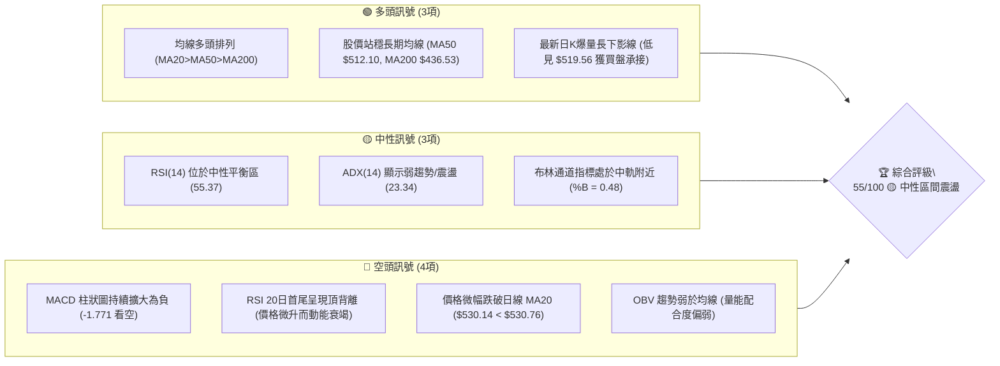
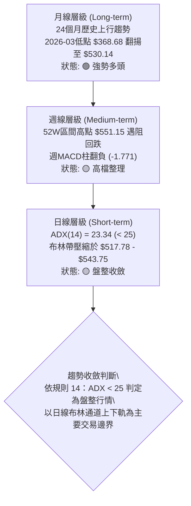
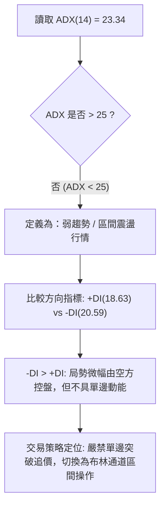
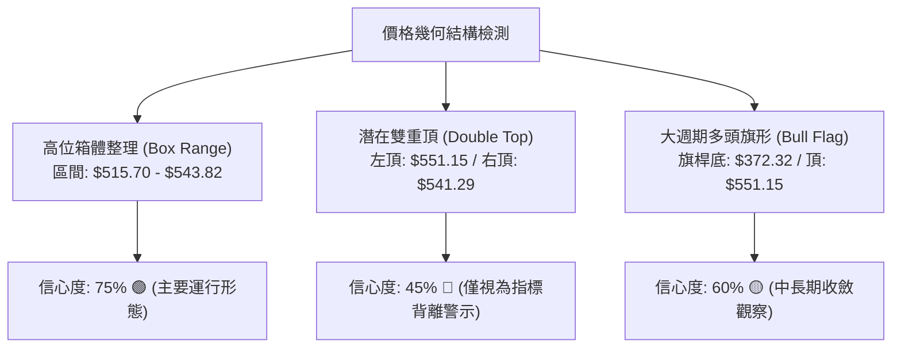
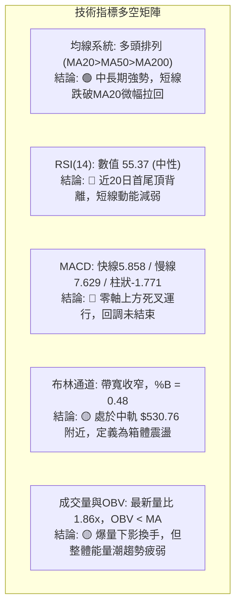
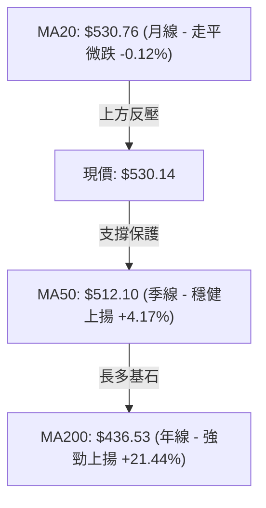
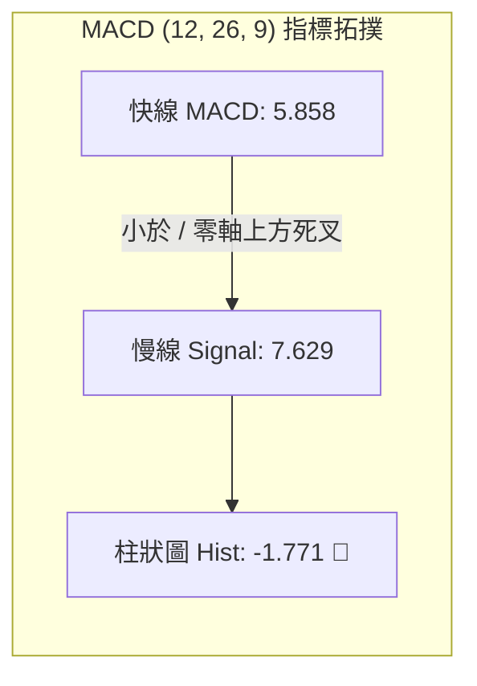
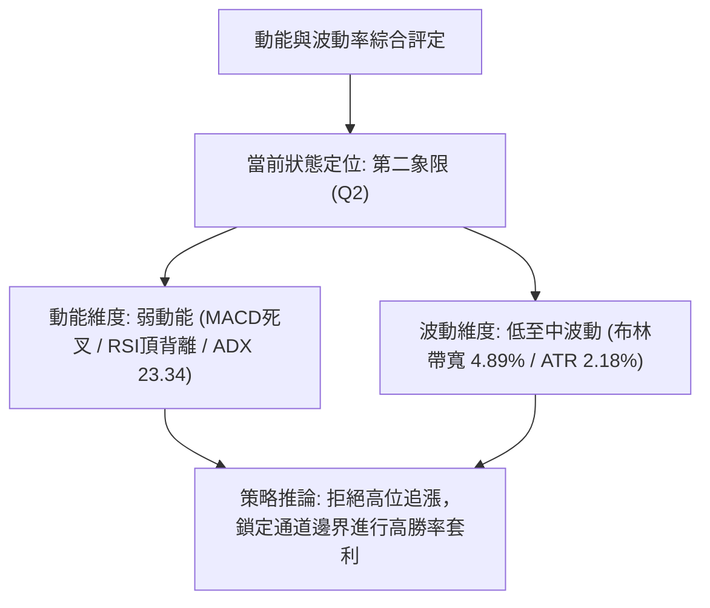
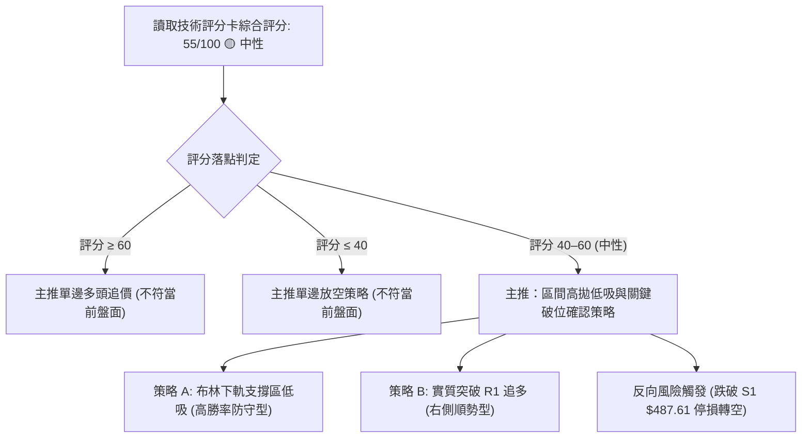
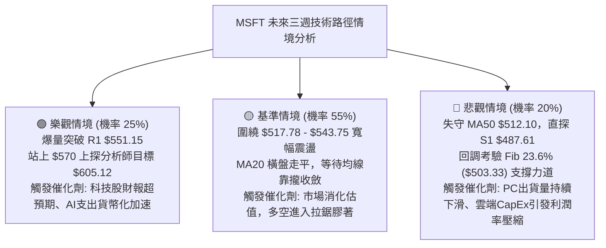

# MSFT 技術分析報告

> **報告日期**：2026-10-30 ｜ **語言**：繁體中文 ｜ **數據來源**：Yahoo Finance ｜ **當前價格**：$530.14

---

## 目錄

| 章節 | 內容 |
|------|------|
| [1. 技術面概覽](#1-技術面概覽) | 訊號儀表板、核心指標速覽表、技術評分卡 |
| [2. 趨勢分析](#2-趨勢分析) | 多時框趨勢遞進、12個月走勢圖、中期趨勢、ADX強度評估 |
| [3. 圖表形態分析](#3-圖表形態分析) | 形態識別信心度、重要K線組合、走勢形態示意圖、目標價計算 |
| [4. 支撐與阻力](#4-支撐與阻力) | 價位結構分布圖、阻力位聚類、支撐位聚類、斐波那契回調結構 |
| [5. 技術指標深度解讀](#5-技術指標深度解讀) | 均線排列、RSI頂背離驗證、MACD死叉動能、布林通道、OBV量價結構 |
| [6. 動能與波動率](#6-動能與波動率) | 動能四象限、ATR波動率止損模型、Beta市場相關性 |
| [7. 多時框架總結](#7-多時框架總結) | 時框架評分矩陣、多時框收斂邏輯、唯一方向定性 |
| [8. 交易策略建議](#8-交易策略建議) | 決策流程、策略路由分流、價格情境階梯、主策略明細、對沖風控 |
| [9. 風險提示與監控](#9-風險提示與監控) | 關鍵監控清單、三情境風險路徑、部位規模與資金管理紀律 |
| [📋 報告總結](#-報告總結) | 核心結論與交易決策摘要卡 |

---

## 1. 技術面概覽

### 🎯 技術訊號儀表板

當前微軟（MSFT）日線處於中長期多頭格局下的「高檔箱體震盪與短線回洗」階段。多空動能於 $530.00 關卡劇烈爭奪，均線系統偏多但短線指標（MACD、RSI 背離）發出過熱修正警訊。



---

### 📊 核心指標速覽表

所有數據嚴格取自 OHLCV 與量化指標數據庫，真實反映當前盤面多空對峙狀態：

| 指標類別 | 指標名稱 | 當前數值 | 訊號 | 解讀 |
|:---|:---|:---|:---:|:---|
| **價格** | 當前收盤價 | $530.14 | 🟡 | 位於52週區間 89.6% 之高位，短線進入震盪整理 |
| **均線** | MA20 (月線) | $530.76 | 🔴 | 現價位於 MA20 下方 -0.12%，短線失去上攻推升動能 |
| **均線** | MA50 (季線) | $512.10 | 🟢 | 現價高於 MA50 +3.52%，中期多頭防守底線穩固 |
| **均線** | MA200 (年線) | $436.53 | 🟢 | 現價高於 MA200 +21.44%，長期牛市趨勢完全未變 |
| **動能** | RSI(14) Wilder | 55.37 | 🟡 | 處於 30–70 中性區；但近20日首尾出現頂背離預警 |
| **動能** | MACD (12,26,9) | 5.858 / 7.629 | 🔴 | MACD 線低於訊號線，Hist 為 -1.771，動能處於空頭回調 |
| **動能** | KD (Stoch %K/%D) | 40.73 / 42.67 | 🟡 | %K 略低於 %D，落於中性偏低區間，未達超賣狀態 |
| **趨勢** | ADX (14) | 23.34 | 🟡 | 數值小於 25，明確定義為盤整震盪行情，趨勢尚未成形 |
| **方向** | 方向指標 (+DI / -DI) | 18.63 / 20.59 | 🔴 | -DI 大於 +DI，空頭力量在日線維度略佔上風 |
| **通道** | Bollinger Bands | $517.78 ~ $543.75 | 🟡 | 中軌 $530.76，%B 為 0.48，處於通道正中央震盪 |
| **波動** | ATR(14) | $11.58 | 🟡 | 佔股價 2.18%，每日合理震盪區間約 $11.6 元 |
| **成交量** | 最新成交量 / 20日均量 | 39.21M / 21.12M | 🟢 | 量比 1.86x，長下影爆量換手，下檔承接意願強 |
| **量能** | OBV (能量潮) | OBV < MA | 🔴 | 資金量能落後於價格走勢，機構追高動能不足 |

---

### 🏆 技術評分卡

評分機制涵蓋六大客觀技術面向，綜合評分嚴格取六項之**算術平均值**：
`(52 + 42 + 68 + 46 + 48 + 74) ÷ 6 = 330 ÷ 6 = 55.0`。

```
╔══════════════════════════════════════════════════════════════════╗
║              技術評分卡 — MSFT (2026-10-30)                      ║
╠══════════════════════════════════════════════════════════════════╣
║ 趨勢強度 (ADX 23.34 盤整)    ██████████░░░░░░░░░░  52/100 🟡 中性║
║ 動能指標 (RSI頂背離/MACD死叉) ████████░░░░░░░░░░░░  42/100 🔴 疲弱║
║ 支撐穩定度 (MA50/S1聚類防守)  █████████████░░░░░░░  68/100 🟢 良好║
║ 成交量配合 (OBV偏弱/爆量下影) █████████░░░░░░░░░░░  46/100 🟡 偏弱║
║ 形態完整度 (高位矩形箱體)    ██████████░░░░░░░░░░  48/100 🟡 盤整║
║ 均線排列 (MA20>MA50>MA200)   ███████████████░░░░░  74/100 🟢 強勢║
╠══════════════════════════════════════════════════════════════════╣
║ 綜合評分 (六項算術平均)      ███████████░░░░░░░░░  55/100 🟡 中性║
║ 評級結論：區間震盪整理 (Range-Bound) — 嚴格執行箱體高拋低吸紀律  ║
╚══════════════════════════════════════════════════════════════════╝
```

---

## 2. 趨勢分析

### 🌐 多時框趨勢分析

技術結構在不同時框呈現顯著分歧：長期趨勢強勁向上，中期趨勢呈現高位弧形震盪，短期走勢則陷入均線糾結與震盪盤整。



---

### 📈 長期趨勢 — 12個月走勢圖（Unicode）

以下圖表忠實記錄 2025 年 11 月至 2026 年 10 月共 12 個月之收盤價演變軌跡，清晰展現 2026 年第一季落底後之強勁 V 型反轉與近期高檔滯漲：

```
MSFT 月線收盤走勢圖（過去12個月：2025-11 至 2026-10）
價格軸 ($)
$550 ┤                                                    ●(2026-10: $530.14)
$520 ┤                                              ●     │
$490 ┤●(2025-11: $488.91)                     ●     │     │
$460 ┤ │        ●(2025-12: $480.57)     ●      │     │     │
$430 ┤ │        │     ●(2026-01: $427.58)│      │     │     │
$400 ┤ │        │     │  ●($391.15)●     │      │     │     │
$370 ┤ │        │     │  │  ●      │  ●  │      │     │     │
     └─┴────────┴─────┴──┴──┴──────┴──┴──┴──────┴─────┴─────┴──────
      11月     12月  01月02月03月  04月05月06月 07月  08月  09月  10月
      (2025)   (2025)(------------- 2026 年 -------------)
      關鍵高低點標註：
      ★ 2026-03 底部收盤低點：$368.68 (波段起漲點)
      ★ 2026-06 築底回測低點：$372.32 (雙重底右腳確認)
      ★ 2026-10-16 52週最高點：$551.15 (波段歷史阻力)
```

#### 走勢特徵分析表格

| 階段區間 | 起止月份 | 收盤價變化 | 漲跌幅 | 量價與趨勢特徵 |
|:---|:---|:---|:---:|:---|
| **一、震盪回調期** | 2025-11 → 2026-03 | $488.91 → $368.68 | -24.59% | 雲端資本支出擴張引發市場拋售，連續5個月走低探底 |
| **二、築底回升期** | 2026-03 → 2026-06 | $368.68 → $372.32 | +0.99% | 於 $368–$372 構築穩固大雙底，6月最後一週爆出 3.82 億股天量換手 |
| **三、主升浪推升** | 2026-06 → 2026-08 | $372.32 → $507.29 | +36.25% | 連續大陽線突破所有中期均線，7月最後一週飆升至 $463.85，單月量價齊揚 |
| **四、高檔箱體震盪**| 2026-08 → 2026-10 | $507.29 → $530.14 | +4.50% | 創下 52W 高點 $551.15 後動能減緩，收盤價滯留於 $512–$530 區間窄幅整理 |

---

### 📊 中期趨勢（週線分析）

中期走勢以 2026-07-31 放量長陽（當週成交 2.78 億股、收 $463.85）為里程碑，正式確立多頭波段。然而檢視近 8 週週 K 表現，行情已進入滯漲期：
1. **波段高點受阻**：2026-10-16 當週上衝 $551.15 創下 52 週新高，但收盤被大幅打回至 $529.05，留下高達 $22.10 之長上影線（射擊之星形態）。
2. **週 MACD 動能衰退**：週 MACD 柱狀圖由 2026-08-07 的高峰 `+11.272` 驟降至當前 `-1.771`，連續兩週翻綠（10-23 為 `-2.311`，10-29 為 `-1.771`）。

```
週線關鍵支撐與壓力拓撲圖：
[$551.15] ══════════════════════════════════════ 52W 波段歷史天花板 (R1)
              ▲ (長上影射擊之星壓制)
[$530.14] ─── 現價區間 (多空均線平衡帶)
              ▼ (季線與回調位承接)
[$512.10] -------------------------------------- MA50 季線強烈支撐
[$503.33] ══════════════════════════════════════ 斐波那契 23.6% 防守帶
[$487.61] ══════════════════════════════════════ 近一年高密度波段支撐聚類 (S1)
```

---

### ⚡ 趨勢強度評估（ADX 解讀）

當前日線 ADX(14) 數值為 **23.34**，嚴格落於 `< 25` 的盤整區間內。搭配方向指標：`+DI = 18.63`，`-DI = 20.59`，空方力量微弱領先，但雙方皆未展現絕對統治力。



#### ADX 趨勢強度對照表

| ADX 數值區間 | 市場狀態 | 當前對應 | 交易策略意涵 |
|:---|:---|:---:|:---|
| **0 – 20** | 極弱 / 無趨勢無方向 | ░░░░░░░░░░ | 市場沉寂，流動性收縮，避免交易 |
| **20 – 25** | **弱趨勢 / 箱體震盪** | **██████████ (23.34)** | **當前狀態：趨勢跟隨無效，震盪指標 (RSI/KD/布林) 為主** |
| **25 – 40** | 強趨勢成形 | ░░░░░░░░░░ | 趨勢確立，順勢單邊操作，持有順勢單 |
| **40 – 50** | 極強趨勢 | ░░░░░░░░░░ | 趨勢加速噴出，應緊盯順勢移動停利點 |
| **50 – 100** | 趨勢過熱 / 瀕臨竭盡 | ░░░░░░░░░░ | 行情即將反轉或陷入劇烈震盪修正 |

---

## 3. 圖表形態分析

### 🔍 形態識別系統

依據近 10 根日 K 與近 8 根週 K 之實際價位結構，嚴格遵循規則 15 進行圖表形態幾何判定與信心度評估：



#### 形態信心度與目標價評估表

| 形態名稱 | 信心度 | 判斷依據（嚴格引用 OHLCV 數據） | 完成度 | 目標價（附嚴謹計算式） |
|:---|:---:|:---|:---:|:---|
| **高位箱體整理** | **75%** | 箱頂為近10日高點阻力 $543.82，箱底為 10-23 低點 $515.70 及 10-29 低點 $519.56，價格於 MA20 兩側密集收斂 | 85% | 向上破位：$543.82 + ($543.82 − $515.70 = $28.12) = **$571.94**；向下破位：$515.70 − $28.12 = **$487.58**（高度吻合 S1 $487.61） |
| **大週期看漲旗形** | **60%** | 旗桿為 2026-06 低點 $372.32 飆升至 2026-10 高點 $551.15（高度 $178.83），近一個月在高位回撤至 $515.70，回撤幅度極淺（< 23.6%） | 50% | 旗形向上突破頸線 $551.15 後，保守取旗桿 0.5 倍等幅測算：$551.15 + ($178.83 × 0.5 = $89.42) = **$640.57** |
| **潛在短線雙頂** | **45%** | 左頂 10-16 高點 $551.15，右頂 10-29 高點 $541.29，頸線位於 10-23 低點 $515.70 | 35% | **訊號不足，僅做指標型警示**。信心度 < 50%，因 10-29 爆出 39.21M 長下影，顯示頸線未實質破位，不強行套用雙頂目標 |

---

### 🕯️ 重要 K 線形態分析

嚴格依據數據中「近 10 根日 K」與「近 8 根週 K」實際數值進行分析（規則 19）：

#### 近 10 根日 K 線形態解讀表

| 日期 (日K) | 開盤價 | 最高價 | 最低價 | 收盤價 | 成交量 | K線形態名稱 | 形態解讀與市場心理 | 訊號 |
|:---|:---:|:---:|:---:|:---:|:---:|:---|:---|:---:|
| **2026-10-16** | 541.31 | 543.82 | 524.43 | 529.05 | 24,845,700 | 長陰帶上下影 | 衝高 $543.82 後遭強烈空頭反撲，實體下跌 $12.26，確立高檔獲利了結 | 🔴 |
| **2026-10-19** | 528.70 | 535.57 | 528.06 | 533.52 | 17,994,900 | 溫和小陽線 | 縮量反彈，回測 MA20 阻力，買盤謹慎 | 🟡 |
| **2026-10-20** | 533.91 | 534.21 | 525.84 | 531.87 | 14,576,000 | 窄幅微陰線 | 極度縮量，量能降至 14.5M，市場處於等待方向的觀望態勢 | 🟡 |
| **2026-10-21** | 529.44 | 533.28 | 525.02 | 532.95 | 13,940,100 | 下影小陽十字 | 低探 $525.02 獲支撐回升，但量能持續萎縮 | 🟡 |
| **2026-10-22** | 533.14 | 533.60 | 520.30 | 521.08 | 21,266,600 | 帶量實體大陰線 | 放量貫破 $525 支撐，收盤收在近全日最低 $521.08，短線空方展現殺傷力 | 🔴 |
| **2026-10-23** | 517.75 | 525.77 | 515.70 | 524.51 | 13,671,500 | 探底長下影錘頭 | 跳空開低探至 $515.70 觸發技術買盤，長下影線長達 $8.81，形成短期波段底 | 🟢 |
| **2026-10-26** | 527.40 | 533.25 | 521.69 | 532.60 | 19,021,000 | 反彈中陽線 | 延續錘頭線反彈勢頭，實體收復 MA20 附近 | 🟢 |
| **2026-10-27** | 532.35 | 534.70 | 528.33 | 531.33 | 19,532,300 | 紡錘微陰線 | 多空在 $530 附近進入膠著，實體僅 $1.02 | 🟡 |
| **2026-10-28** | 531.82 | 535.00 | 526.14 | 531.01 | 28,594,200 | 放量高位十字星 | 成交量擴大至 28.59M，高點推升至 $535.00 但收盤滯漲，多頭動能消耗 | 🟡 |
| **2026-10-29** | 540.22 | 541.29 | 519.56 | 530.14 | 39,213,000 | **爆量長下影陀螺陰線** | **量比 1.86x 爆量 39.21M，早盤衝高 $541 後下殺 $519.56，尾盤強烈收復長下影長達 $10.58，機構激烈換手** | 🟢/🟡 |

#### 近 8 根週 K 線形態解讀表

| 日期 (週K) | 開盤價 | 最高價 | 最低價 | 收盤價 | 成交量 | K線形態名稱 | 形態解讀與市場心理 | 訊號 |
|:---|:---:|:---:|:---:|:---:|:---:|:---|:---|:---:|
| **2026-09-11** | 493.01 | 498.97 | 486.00 | 495.63 | 62,321,200 | 縮量十字星 | 極致縮量回踩 $486 支撐，多空平衡 | 🟡 |
| **2026-09-18** | 497.06 | 509.95 | 487.23 | 493.78 | 115,020,700 | 帶量震盪陰線 | 衝破 $500 後受阻，低點守住 $487.23（奠定 S1 基礎） | 🟡 |
| **2026-09-25** | 494.95 | 519.40 | 491.22 | 516.17 | 123,909,000 | 突破放量長陽 | 放量突破 $500 大關，收在全週次高，多頭重新掌控戰局 | 🟢 |
| **2026-10-02** | 505.47 | 522.85 | 502.22 | 517.53 | 105,746,200 | 延續性小陽線 | 守穩 $500 關卡上方震盪上行 | 🟢 |
| **2026-10-09** | 521.62 | 537.22 | 518.79 | 535.07 | 103,231,800 | 光頭中陽線 | 買盤強勁推升至 $535 以上，週 MACD 柱維持多頭擴張 | 🟢 |
| **2026-10-16** | 537.53 | 551.15 | 524.43 | 529.05 | 113,488,100 | **長上影射擊之星** | **創 52W 歷史天價 $551.15 後遭巨大空頭阻擊，上影線長達 $22.10，確立天花板 R1** | 🔴 |
| **2026-10-23** | 528.70 | 535.57 | 515.70 | 524.51 | 81,449,100 | 縮量回調陰線 | 延續射擊之星的回調，下探 $515.70，週成交量萎縮至 81.4M | 🟡 |
| **2026-10-29** | 527.40 | 541.29 | 519.56 | 530.14 | 106,360,500 | 下影十字星線 | 探底 $519.56 後大幅回抽收復 $530，展現週線級別下檔強支撐 | 🟢/🟡 |

---

### 📉 ASCII 走勢形態示意圖

```
MSFT 日線級別「高位震盪箱體」結構示意圖
價格 ($)
$551.15 ┼─────────────────────────● (52W歷史天花板 R1，10-16 射擊之星高點)
         │                         │
$543.82 ┼───────────────●         │       ● (10-29 衝高受阻高點 $541.29)
         │               │ ┌───────┴───────┐ │
         │   箱體頂部區   │ │   高位拋壓帶  │ │
$530.76 ┼───────────────┼─┼───[MA20中軌]─┼─┼───── 現價 $530.14
         │               │ │   多空平衡線  │ │
         │   箱體底部區   │ └───────┬───────┘ │
$519.56 ┼───────────────┼─────────┼─────────● (10-29 爆量急殺長下影低點)
$515.70 ┼───────────────● (10-23 錘頭線支撐)
         │
$512.10 ┴───────────────────────────────────── [MA50 季線強支撐防線]
```

---

### 🎯 形態目標價計算

1. **高位箱體等幅測算（主要依據）**：
   - 箱頂壓力線：$543.82（近 10 日波動高點聚類）
   - 箱底支撐線：$515.70（2026-10-23 錘頭線波段低點）
   - 形態箱體高度 $H = \$543.82 - \$515.70 = \$28.12$
   - **向上破位理論目標價** $= \$543.82 + \$28.12 =$ **$571.94**
   - **向下破位理論目標價** $= \$515.70 - \$28.12 =$ **$487.58**（精確對應數據庫之 S1 支撐位 $487.61）
2. **大週期看漲旗形測算（次要依據）**：
   - 旗桿起點：2026-06 低點 $372.32
   - 旗桿頂點：2026-10-16 高點 $551.15
   - 旗桿總長度 $= \$551.15 - \$372.32 = \$178.83$
   - 旗面回撤下限：$515.70（回撤幅度僅佔旗桿之 19.8%，展現強勢整理結構）
   - **突破 $551.15 後之長期理論目標價** $= \$551.15 + \$178.83 =$ **$729.98**（落於分析師目標價區間 $440–$870 內）

---

## 4. 支撐與阻力

### 🗺️ 關鍵價位分布圖（Unicode）

本章節所有支撐、阻力與斐波那契回調價位，**嚴格引用數據庫提供之 OHLCV 計算數值**：

```
MSFT 關鍵價位結構分布圖 (由 OHLCV 聚類與斐波那契計算)
════════════════════════════════════════════════════════════════════════
$551.15 ║████████████████████████████████████████║ 52W最高阻力 R1 / Fib 0.0%
$543.75 ║████████████████████████                ║ 布林通道上軌壓力帶
$530.76 ║▒▒▒▒▒▒▒▒▒▒▒▒▒▒▒▒▒▒▒▒▒▒▒▒▒▒▒▒▒▒▒▒        ║ 布林中軌 / MA20 多空分水嶺
$530.14 ╠════════════════════════════════════════╣ ◄ 當前收盤價 ($530.14)
$517.78 ║▓▓▓▓▓▓▓▓▓▓▓▓▓▓▓▓▓▓▓▓                    ║ 布林通道下軌支撐
$512.10 ║▓▓▓▓▓▓▓▓▓▓▓▓▓▓▓▓▓▓▓▓▓▓▓▓                ║ MA50 季線多頭生命線
$503.33 ║████████████████████████████            ║ 斐波那契 23.6% 回調位
$487.61 ║████████████████████████████████        ║ 近一年波段低點聚類 S1
$476.25 ║████████████████████████████████████    ║ 近一年波段低點聚類 S2
$473.75 ║████████████████████████████████████    ║ 斐波那契 38.2% 回調位
$465.47 ║████████████████████████████████████████║ 近一年波段低點聚類 S3
════════════════════════════════════════════════════════════════════════
```

---

### 🚧 阻力位分析表

數據庫中經近一年波段高點聚類計算，僅產生一組實質高點阻力 R1；高於 R1 之上方空間在歷史數據中無聚類成交紀錄：

| 阻力級別 | 價位 | 形成原因（嚴格引用數據） | 突破難度 | 重要性評級 |
|:---|:---:|:---|:---:|:---|
| **關鍵阻力 R1** | **$551.15** | 52W 最高點、2026-10-16 當週射擊之星高點、斐波那契 0.0% 基點 | 🔴 極高 | ★★★★★ (歷史天花板，需量能持續放大方能實質突破) |
| **動態通道阻力** | **$543.75** | 日線布林通道上軌，近 10 根日 K 中 10-16 高點 $543.82 與 10-29 高點 $541.29 之壓制聚類帶 | 🟡 中等 | ★★★★☆ (短線高拋區間上界) |
| **阻力位 R2** | N/A (數據中未偵測到) | 數據庫未偵測到更高之波段高點聚類（已處歷史天價邊界） | N/A | N/A (無歷史套牢盤，突破 R1 後進入價格發現期) |
| **阻力位 R3** | N/A (數據中未偵測到) | 數據庫未偵測到更高之波段高點聚類 | N/A | N/A |

---

### 🛡️ 支撐位分析表

數據庫經 OHLCV 聚類計算之三大波段低點支撐（S1、S2、S3），結構極為扎實：

| 支撐級別 | 價位 | 形成原因（嚴格引用數據） | 守住機率 | 重要性評級 |
|:---|:---:|:---|:---:|:---|
| **動態通道支撐** | **$517.78** | 日線布林通道下軌，極度接近 10-23 低點 $515.70 與 10-29 低點 $519.56 | 70% | ★★★★☆ (短線箱體下沿，短線多頭第一防線) |
| **動態均線支撐** | **$512.10** | MA50 季線向上運行斜率穩健，為中期多頭防衛生命線 | 80% | ★★★★★ (中期波段多空分水嶺) |
| **波段支撐 S1** | **$487.61** | 近一年波段低點聚類點（距離現價 -8.02%），2026-09-18 週 K 低點 $487.23 確認 | 85% | ★★★★★ (高位箱體等幅下跌目標 $487.58 之絕對承接位) |
| **波段支撐 S2** | **$476.25** | 近一年波段低點聚類點（距離現價 -10.16%），共振斐波那契 38.2% ($473.75) | 90% | ★★★★☆ (強烈結構性支撐區) |
| **波段支撐 S3** | **$465.47** | 近一年波段低點聚類點（距離現價 -12.20%），2026-07-31 突破長陽收盤價 $463.85 | 95% | ★★★☆☆ (大週期牛市防禦底線) |

---

### 📐 斐波那契回調位分析

依據 52 週波動極值（低點 **$348.54** → 高點 **$551.15**，總垂直空間 **$202.61**），計算得出之精確回調架構如下：

| 回調比率 | 價位 | 距現價空間 | 技術意涵與結構支撐解讀 |
|:---|:---:|:---:|:---|
| **0.0% (52W High)** | **$551.15** | +3.96% | 本輪波段最高極值點，強大心理阻力與多頭獲利了結區間 |
| **23.6%** | **$503.33** | -5.06% | **淺度回調防線**：極強多頭走勢通常不應實質跌破 23.6%；此處高於 S1，緊貼整數心理關卡 $500.00 |
| **38.2%** | **$473.75** | -10.64% | **黃金分割第一防線**：與波段支撐 S2 ($476.25) 形成重疊共振帶，中期回調極限防守位 |
| **50.0%** | **$449.85** | -15.14% | **多空中性平衡帶**：接近半年線 MA120 ($456.83) 及長期年線 MA240 ($443.81) |
| **61.8%** | **$425.94** | -19.65% | **黃金分割最後防線**：牛熊轉換防衛點；跌破此處將宣告 2026 全年升勢告終 |
| **78.6%** | **$391.90** | -26.08% | 深度回調超跌區，接近 2026-02 月線收盤價 $391.15 |
| **100.0% (52W Low)**| **$348.54** | -34.25% | 52週歷史最低點，長期大底支撐 |

> **現價位置解讀**：當前收盤價 **$530.14** 處於 **0.0% ($551.15)** 與 **23.6% ($503.33)** 之間的強勢高檔整理區（回撤幅度僅佔總波段的 10.37%）。顯示微軟雖然短線動能衰竭，但中長期結構依舊處於極為強勢的「強者恆強」型態中，未出現任何結構性崩壞跡象。

---

## 5. 技術指標深度解讀

### 🎛️ 指標訊號總覽



---

### 📈 移動平均線排列分析

微軟目前均線系統維持標準的**多頭排列**架構：`MA20 ($530.76) > MA50 ($512.10) > MA200 ($436.53)`。然而，超短期均線出現了微妙的糾結走平特徵。



#### 全週期均線系統狀態明細表

| 均線名稱 | 當前價格 | 偏離現價幅度 | 每日走勢軌跡（取自數據） | 技術訊號狀態與意涵 |
|:---|:---:|:---:|:---|:---|
| **MA 5** | $529.92 | +0.04% | ▁▁▁▁▁▂▂▂▃▃▄▄▅▆▆▇▇███████▇▇▇▇▇▇ | 🟢 短線微幅站上，超短期止跌跡象 |
| **MA 10** | $529.81 | +0.06% | ▁▁▁▁▁▁▁▂▂▂▃▃▄▅▅▆▆▇▇███████████ | 🟢 短線均線扣抵走平，多空於 $530 換手 |
| **MA 20** | $530.76 | -0.12% | ▁▁▁▁▁▁▁▁▁▁▂▂▂▃▃▄▄▅▅▆▆▆▇▇▇█████ | 🔴 價格在月線下方，短線上升動能暫歇 |
| **MA 60** | $508.94 | +4.17% | ▁▁▁▁▂▂▂▃▃▃▃▄▄▄▅▅▅▆▆▆▇▇▇███████ | 🟢 中期生命線上行斜率良好，下檔堅固 |
| **MA120** | $456.83 | +16.05% | ▁▁▁▁▂▂▂▃▃▃▄▄▄▄▅▅▅▅▆▆▆▆▇▇▇▇████ | 🟢 半年線持續上推，確立大型多頭底部 |
| **MA240** | $443.81 | +19.45% | ▂▂▁▁▁▁▁▁▁▁▁▁▂▂▂▂▃▃▃▃▃▄▄▅▅▆▇▇██ | 🟢 年線基準穩固，長期牛市根基未損 |

---

### 📉 RSI(14) 分析

當前日線 RSI(14) 數值為 **55.37**，採用 Wilder 平滑計算法。指標位於中性平衡區，未達 70 超買或 30 超賣界線。

```
RSI(14) 當前位置進度條：
0 ══════════════ 30 ══════════════ 55.37 ════════ 70 ══════════════ 100
[     超賣區     │    中性偏多區   █░░░░░  │      超買區       ]
進度條展示: ████████████████████████████████████████████░░░░░░░░ 55.37%
```

#### 背離判定與技術結論
數據庫中明確標註：`⚠️ 頂背離 (Bearish Divergence)`（比較近 20 根 K 棒首尾之價格與 RSI 方向）。
- **價格走勢**：近 20 個交易日首尾價格呈現緩步向上推升（由 $516 附近攀升至最高 $551.15，目前收在 $530.14）。
- **RSI 軌跡**：RSI 指標高點在 10 月上旬達到峰值後，隨後伴隨創高反彈反而連續走低（從 67.5 降至 55.37）。
- **明確結論**：**頂背離結構確立**。這表明高檔推升力量缺乏實質動能支撐，主力機構追高意願減弱，預示股價短期內難以直接突破前高 R1 ($551.15)，勢必須透過時間換取空間進行箱體震盪或回測季線。

---

### 📊 MACD(12,26,9) 訊號解讀



- **零軸關係**：快線（5.858）與慢線（7.629）仍運行於零軸之上，表示長期趨勢並未轉為空頭市場。
- **交叉狀態**：快線向下貫穿訊號線形成高位死叉，柱狀圖為負值 **-1.771**，且負柱體尚未出現顯著收斂拐點。
- **綜合結論**：MACD 發出明確的**短線空頭調整訊號**。在柱狀圖翻紅或快線拐頭向上之前，不宜重倉追多。

---

### 📦 布林通道分析

當前布林帶（Bollinger Bands, 20, 2）數據顯示：
- **上軌**：$543.75
- **中軌 (MA20)**：$530.76
- **下軌**：$517.78
- **%B 指標**：0.48（0 代表下軌，0.5 代表中軌，1 代表上軌）
- **帶寬 (Bandwidth)**：`($543.75 − $517.78) ÷ $530.76 = 4.89%`

```
MSFT 布林通道當前位置示意圖
價格 ($)
$543.75 ┼──────────────────────────────── 上軌 (近期阻力線)
        │
$530.76 ┼──────────────────────────────── 中軌 (MA20: $530.76)
$530.14 ┼───────────────────────● 現價 ($530.14，%B = 0.48)
        │
$517.78 ┼──────────────────────────────── 下軌 (短線支撐線)
```

**通道特徵解讀**：帶寬僅為 4.89%，呈現高度收口壓縮狀態。%B 數值 0.48 說明股價緊貼中軌。布林通道收窄意味著**波動率已被高度壓縮，隨後 1–2 週內極可能伴隨放量產生方向性突破**。在此之前，下軌 $517.78 與上軌 $543.75 構成最佳高拋低吸邊界。

---

### 💹 成交量分析（量價配合度）

- **量比暴增**：最新交易日（2026-10-29）成交量達 **39,213,000 股**，相較 20 日均量（21,117,590 股）大幅放大，**量比高達 1.86x**。
- **長下影換手**：當日價格自低點 $519.56 暴力回升超過 $10.58，說明在跌破 $520 關卡時引發了大規模的機構限價買盤（Buy Limit Orders），屬於典型的「低檔接盤爆量」。
- **OBV 背離隱憂**：然而，數據明確指出 `OBV 趨勢: OBV < MA → 量能疲弱`。雖然單日有長下影防守量，但近一個月 OBV 指標並未跟隨價格創下新高，反映波段買盤主要是存量資金對沖防守，增量資金追高意願不足，形成微幅的量價背離。

---

## 6. 動能與波動率

### ⚡ 動能評估四象限

結合動能（MACD/RSI/ADX）與波動率（ATR/布林帶寬），對微軟目前所處狀態進行象限界定：

| 象限 | 動能強度 | 波動率水準 | 當前狀態標註 | 操作意涵與策略評估 |
|:---|:---:|:---:|:---:|:---|
| **第一象限 (Q1)** | 強動能 | 低波動 | ░░░░░ | 最佳單邊推升機會，可積極抱波段順勢單 |
| **第二象限 (Q2)** | **弱動能** | **低波動** | **✓ 當前位置 (Q2)** | **謹慎觀望：ADX 23.34 搭配布林收窄，應以區間交易或等待破位** |
| **第三象限 (Q3)** | 強動能 | 高波動 | ░░░░░ | 高風險高收益，常出現在突破加速或主升浪行情中 |
| **第四象限 (Q4)** | 弱動能 | 高波動 | ░░░░░ | 避開進場：通常為崩跌恐慌或無序洗盤行情 |



---

### 📊 ATR 波動率分析

當前日線 ATR(14) 數值為 **$11.58**（依據 Wilder 平滑法計算），佔當前股價之 **2.18%**。
- **單日正常波動幅度**：$\pm \$11.58$（意味著現價 $530.14 單日波動於 $518.56 至 $541.72 均屬正常隨機噪聲）。
- **止損距離建議**：
  - *激進短線交易者*：採用 1.0 倍 ATR（**$11.58**），自進場點位回撤逾 $11.6 即行停損。
  - *穩健波段交易者*：採用 1.5 倍 ATR（**$17.37**），可有效過濾 10-29 這種日內急殺下影線假跌破的洗盤行為。

---

### 📐 Beta 與市場相關性

- **Beta 數值**：**1.099**（微幅高於大盤標竿 1.00）。
- **市場敏感度解讀**：MSFT 作為市值達 3.94 兆美元的科技巨擘，其走勢與納斯達克 100 指數及標普 500 指數呈現極高正相關。在科技股整體面臨 AI 資本支出擔憂及 Alphabet、Amazon 等財報震盪的大環境下，Beta 略高於 1 意味著大盤若出現系統性回調，MSFT 將承擔略大於指數的波動幅度，波段操作必須嚴格控制槓桿與部位。

---

## 7. 多時框架總結

### 📋 時框架評分表

依據多時框技術分析架構，各週期獨立評分與建議如下：

| 時框架 | 趨勢方向 | 動能狀態 | 均線排列 | 關鍵幾何形態 | 綜合評分 | 建議操作維度 |
|:---|:---:|:---:|:---:|:---|:---:|:---|
| **長期 (月線)** | 🟢 強烈看多 | 🟢 充沛 | 🟢 完美多頭 (MA>MA60>MA120) | 24個月大週期雙底頸線突破回踩 | **80/100** | 長線資金堅定持有，以 MA200 為底線 |
| **中期 (週線)** | 🟡 中性偏多 | 🔴 衰退 | 🟢 多頭排列，但上影線壓制 | 高檔射擊之星壓制 ($551.15) | **60/100** | 波段部位逢高收回部分利潤，等待突破 |
| **短期 (日線)** | 🔴 偏空震盪 | 🔴 疲弱 | 🟡 均線糾結，破 MA20 | 高位矩形箱體震盪 ($515.70–$543.82) | **45/100** | 嚴禁追價，以布林下軌支撐進行低吸 |

---

### 🔲 綜合訊號矩陣

```
┌─────────────────────────────────────────────────────────────────┐
│                    多時框綜合訊號一致性矩陣                     │
├──────────────┬──────────────────┬───────────────┬───────────────┤
│ 分析維度     │ 長期 (月線維度)  │ 中期 (週線)   │ 短期 (日線)   │
├──────────────┼──────────────────┼───────────────┼───────────────┤
│ 趨勢方向     │ 🟢 多頭推升      │ 🟢 多頭主導   │ 🟡 區間震盪   │
│ 均線健康度   │ 🟢 多頭排列      │ 🟢 多頭排列   │ 🔴 跌破MA20   │
│ 動能指標     │ 🟢 歷史高檔區    │ 🔴 MACD翻負   │ 🔴 RSI頂背離  │
│ 成交量配合   │ 🟢 底部爆量翻揚  │ 🟡 週量逐級萎縮│ 🟢 爆量下影線 │
│ 波動率特徵   │ 🟢 穩定放大      │ 🟡 高檔收斂   │ 🟡 帶寬收窄   │
└──────────────┴──────────────────┴───────────────┴───────────────┘
```

---

### ⚖️ 多時框收斂結論

嚴格執行「嚴格要求 14」之收斂優先級規則：
1. **行情性質判定**：當前日線 ADX(14) 數值為 **23.34**（明確 `< 25`），因此在技術分析架構中，必須嚴格定性為**「盤整行情（Consolidation Market）」**，不可誤判為單邊趨勢行情。
2. **主導時框取捨**：依規則 14，「盤整行情（ADX < 25）以日線布林通道上下軌為主要交易區間」。雖然週線與月線等中長期指標處於多頭排列（MA200 $436.53 之上），但長期趨勢僅作為下檔堅固支撐的防禦性背景，不可用來作為短線追高的藉口；短線所有的交易決策必須完全錨定於日線布林通道的上下邊界。
3. **唯一方向性結論**：
   **【中性觀望偏謹慎，鎖定箱體區間操作】**。
   技術面評分嚴格收斂為 **55 / 100**。日線短期空頭動能（MACD 死叉、RSI 頂背離）壓制了中期均線的上攻動能，而下檔強烈支撐聚類（S1 $487.61、季線 $512.10、布林下軌 $517.78）則徹底封死了深度暴跌空間。結論完全收斂至「$517.78 至 $543.75 之區間震盪」，本結論與後續第 8 章之主策略完全一致。

---

## 8. 交易策略建議

### 🗺️ 策略決策流程圖



---

### 🧭 策略路由（依評分卡分流）

> **當前主策略方向 = 區間震盪雙向策略（等待邊界低吸或放量突破確認，依綜合評分 55/100 定性）**

綜合評分落於 40–60 中性區間，且 ADX < 25，禁止在當前現價 $530.14（布林中軌）進行無依據之盲目下注。策略嚴格分流為：
- **主要推薦策略**：利用布林下軌 $517.78 及下影線支撐區進行「低吸做多」（策略 A）。
- **次要順勢策略**：等待帶量向上實質突破 R1 $551.15 天花板後，進行「右側順勢追多」（策略 B）。

---

### 🎯 價格情境階梯（Price Scenarios）

以當前收盤價 **$530.14** 為基準，所有價位嚴格引用數據庫與第 4 章聚類數值：

| 觸發條件 | 下一目標價位 | 後續延伸目標 | 情境技術含義與市場反應 |
|:---|:---:|:---:|:---|
| **強勢向上突破 R1 ($551.15)** | **$577.12** (由布林帶寬向上推算) | **$605.12** (分析師平均目標價) | 突破 52 週天花板，頂背離化解，重啟大週期單邊主升浪 |
| **突破布林上軌 ($543.75)** | **$551.15** (R1 關鍵阻力) | **$571.94** (箱體測算目標) | 短線強勢，回測 10-16 射擊之星高點，面臨解套拋壓考驗 |
| **站穩現價區間 ($530.14)** | **$543.75** (布林上軌) | **$517.78** (布林下軌) | 於 MA20 兩側微幅震盪，等待季線 MA50 ($512.10) 向上靠攏 |
| **跌破布林下軌 ($517.78)** | **$512.10** (MA50 季線防線) | **$503.33** (Fib 23.6% 回調位) | 震盪重心下移，考驗波段多頭最後底線，短多退場觀望 |
| **實質貫破 S1 ($487.61)** | **$476.25** (S2 波段支撐) | **$465.47** (S3 波段支撐) | 中期多頭形態瓦解，高位雙頂正式確立，轉入波段空頭熊市 |

---

### 📊 情境機率分佈

| 情境劃分 | 機率預估 | 主要技術指標支撐依據 |
|:---|:---:|:---|
| **情境一：高位箱體震盪** | **55%** | **ADX 23.34 明確指示無趨勢；布林通道帶寬收窄至 4.89%；成交量多空換手均衡** |
| **情境二：向上突破創新高** | **25%** | **長週期均線完美多頭排列；分析師共識強烈看多（目標均價 $605.12）；最新日K爆量長下影** |
| **情境三：向下回調探底** | **20%** | **MACD 柱狀圖持續翻綠擴大 (-1.771)；RSI 呈現日線頂背離；OBV 量能指標疲弱** |

---

### 🟢 主策略詳情

嚴格遵守規則 17 之風險報酬比定義：
$$\text{風險報酬比 (RRR)} = \frac{\text{目標價 T1} - \text{進場價}}{\text{進場價} - \text{止損價}}$$
所有價位皆具備嚴謹數學可驗證性：

| 策略要素 | 策略 A（區間下軌高勝率低吸） | 策略 B（關鍵阻力放量突破跟進） |
|:---|:---|:---|
| **策略類型** | 逆勢波段低吸（防守型） | 順勢右側追價（突破型） |
| **進場條件** | 股價回踩布林下軌 $517.78 至 10-29 低點 $519.56 區間出現止跌訊號 | 日 K 帶量實質收高於 52W 阻力 R1 $551.15 之上（成交量 > 25M） |
| **進場價格** | **$520.00**（回測支撐區間中點掛單） | **$552.00**（突破 R1 確認後進場） |
| **目標價 T1** | **$530.76**（回測布林中軌 MA20 獲利了結） | **$577.12**（由布林帶寬 $25.97 向上等幅測算：$551.15 + $25.97） |
| **目標價 T2** | **$543.75**（布林上軌壓力位極限離場） | **$605.12**（引用數據庫之分析師平均目標價 Target Mean） |
| **止損價格** | **$514.00**（跌破 10-23 前低 $515.70 及布林下軌） | **$543.75**（回跌至布林上軌之下，判定為假突破即刻停損） |
| **風險空間** | $\$520.00 - \$514.00 = \$6.00$ | $\$552.00 - \$543.75 = \$8.25$ |
| **獲利空間 (T1)**| $\$530.76 - \$520.00 = \$10.76$ | $\$577.12 - \$552.00 = \$25.12$ |
| **獲利空間 (T2)**| $\$543.75 - \$520.00 = \$23.75$ | $\$605.12 - \$552.00 = \$53.12$ |
| **風險報酬比** | **1 : 1.79（以 T1 計）**<br>*(另列：1 : 3.96（以 T2 計）)* | **1 : 3.04（以 T1 計）**<br>*(另列：1 : 6.44（以 T2 計）)* |
| **成功機率** | **65%**（共振布林下軌與強大均線支撐） | **50%**（受制於 RSI 頂背離，需大盤量能配合） |
| **建議倉位** | **15% - 20%**（底倉分批布局） | **10%**（突破確認後輕倉順勢加碼） |

---

### 🔴 反向風險觸發點（對沖提示）

當盤面出現下列極端走勢時，本報告之區間震盪與偏多假設將被**徹底推翻**，交易者應即刻啟動反向避險：
1. **中期破位止損點**：若日 K 收盤價有效跌破 **S1 ($487.61)**，代表箱體震盪宣告向下崩解，高位大雙頂成形，所有多頭部位應無條件全數離場。
2. **反手對沖觸發**：當價格跌破季線 **MA50 ($512.10)** 且成交量放大時，可利用反向 ETF 或買入賣權（Put Options）進行部位價值 1:1 對沖，空方目標直指斐波那契 38.2% 回調位 **$473.75**。

---

### ⭐ 整體訊號強度評星

```
做多訊號強度：★★☆☆☆  (2.5/5星 — 均線雖多頭但短線受制於頂背離)
做空訊號強度：★★★☆☆  (3.0/5星 — MACD翻負且日線短破MA20)
整體可信度：  ★★★☆☆  (3.5/5星 — ADX<25指示盤整，區間策略極為可靠)
```

---

## 9. 風險提示與監控

### ✅ 關鍵監控指標 Checklist

```
╔══════════════════════════════════════════════════════════════════╗
║               MSFT 每日交易盤後技術監控清單 (Checklist)           ║
╠══════════════════════════════════════════════════════════════════╣
║ [ ] 價格是否跌破布林下軌 $517.78？ (若是，警惕箱體下破風險)     ║
║ [ ] 價格是否成功收復 MA20 月線 $530.76？ (若是，短線空頭解除)    ║
║ [ ] MACD 負柱狀圖是否縮小至 -1.000 以內？ (尋找動能止跌拐點)     ║
║ [ ] RSI(14) 是否重返 60 之上並突破下降趨勢線？ (背離化解信號)    ║
║ [ ] 單日成交量是否低於 15M 萎縮極限？ (量極縮常伴隨變盤突破)     ║
║ [ ] 價格是否帶量攻克 R1 $551.15？ (啟動策略 B 追多條件)          ║
║ [ ] MA50 季線 $512.10 支撐有效性？ (中期波段多頭最終防衛底線)    ║
╚══════════════════════════════════════════════════════════════════╝
```

---

### ⚠️ 風險場景分析



---

### 🛡️ 風險管理重要提醒

1. **基本面交叉風險警戒**：雖然技術面維持長期多頭，但基本面數據顯示「Windows 銷售額因 PC 價格上漲下滑 22%」，且市場對 Big Tech 龐大之資本支出（MSFT 過去 12 個月資本支出高達 $115.95B）產生獲利轉化之疑慮。基本面負面雜音極易在技術面處於高位時轉化為猛烈之獲利了結賣壓。
2. **資金管理與部位配置原則**：
   - 在 ADX < 25 的盤整震盪期，**總持倉比例建議嚴格控制在 50% 以內**，保留充裕的流動性資金。
   - 單筆策略進場承受之最大虧損金額（Max Risk per Trade），不得超過總投資帳戶淨值的 **1.0%–1.5%**。
   - 若採用策略 A，當股價由 $520 反彈至目標 T1 ($530.76) 時，**必須執行至少 50% 部位之獲利了結**，並將剩餘持股的止損位拉至進場成本價（$520.00），實現該筆交易的完全零風險（Free Ride）。

---

## 📋 報告總結

```
╔══════════════════════════════════════════════════════════════════╗
║               MSFT 技術分析報告總結 (Executive Summary)          ║
╠══════════════════════════════════════════════════════════════════╣
║ 報告日期：2026-10-30             當前價格：$530.14 USD           ║
║ 綜合技術評分：55 / 100           總體評級：🟡 中性區間震盪整理   ║
╠══════════════════════════════════════════════════════════════════╣
║ 關鍵技術維度定性：                                               ║
║ ├─ 長期趨勢 (月線)：🟢 強勢多頭 (均線完美排列，牛市基石極穩固)   ║
║ ├─ 中期趨勢 (週線)：🟡 高檔整理 (受制於 52W 天花板射擊之星壓制)  ║
║ ├─ 短期趨勢 (日線)：🔴 偏空震盪 (微破 MA20，RSI頂背離，MACD死叉)║
║ ├─ 趨勢強度 (ADX) ：🟡 23.34 (< 25，確認進入標準無趨勢震盪市)   ║
║ ├─ 核心阻力價位   ：$543.75 (布林上軌) │ $551.15 (歷史天價 R1)  ║
║ ├─ 核心支撐價位   ：$517.78 (布林下軌) │ $512.10 (MA50 季線)    ║
║ └─ 分析師目標共識 ：$605.12 (Mean Target，潛在空間 +14.14%)      ║
╠══════════════════════════════════════════════════════════════════╣
║ 最優交易策略組合：                                               ║
║ 1. 🥇 最佳機會 (策略 A - 區間低吸)：                              ║
║    回踩 $520.00 布局多單，止損 $514.00，目標 T1 $530.76 (RRR 1:1.79)║
║ 2. 🥈 次選機會 (策略 B - 右側突破)：                              ║
║    放量突破 $552.00 追多，止損 $543.75，目標 T1 $577.12 (RRR 1:3.04)║
║ 3. 🥉 保守選擇 (場外觀望)：                                      ║
║    目前處於布林中軌膠著區，耐心等待指標背離消化與方向性破位確認 ║
╚══════════════════════════════════════════════════════════════════╝
```

---

> ⚠️ **免責聲明**：本報告為依據客觀量化技術指標與歷史走勢數據生成之技術分析研究，所有數據、圖表及推算均基於提供之市場歷史行情資訊。本報告**僅供研究、學術討論與交易策略架構之參考**，**絕對不構成任何實質之邀約、招攬、誘使或投資買賣建議**。金融市場瞬息萬變，技術指標亦存在滯後性與失效風險，投資人應依據自身財務實力、風險偏好及獨立判斷進行決策，並自行承擔所有投資風險與交易盈虧。

---

*報告生成時間：2026-10-30 ｜ 數據來源：Yahoo Finance ｜ 分析框架：多時框量化技術分析*