# MSFT 技術分析報告

> **報告日期**：2026-10-31 ｜ **語言**：繁體中文 ｜ **數據來源**：Yahoo Finance ｜ **當前價格**：$521.91 USD

---

## 目錄

| 章節 | 內容 |
|------|------|
| [1. 技術面概覽](#1-技術面概覽) | 訊號儀表板、核心指標、評分卡 |
| [2. 趨勢分析](#2-趨勢分析) | 多時框趨勢、長中短期走勢 |
| [3. 圖表形態分析](#3-圖表形態分析) | 形態識別、K線組合、目標價 |
| [4. 支撐與阻力](#4-支撐與阻力) | 關鍵價位、斐波那契回調 |
| [5. 技術指標深度解讀](#5-技術指標深度解讀) | MA/RSI/MACD/布林/成交量 |
| [6. 動能與波動率](#6-動能與波動率) | 動能評估、ATR、Beta |
| [7. 多時框架總結](#7-多時框架總結) | 時框架評分矩陣 |
| [8. 交易策略建議](#8-交易策略建議) | 多空策略、風險報酬比 |
| [9. 風險提示與監控](#9-風險提示與監控) | 監控指標、風險場景 |
| [📋 報告總結](#-報告總結) | 核心結論與最佳策略組合 |

---

## 1. 技術面概覽

### 🎯 技術訊號儀表板

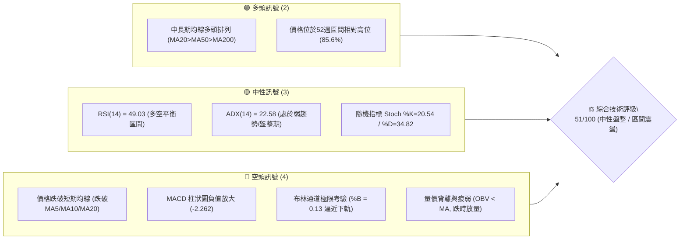

### 📊 核心指標速覽表

| 指標類別 | 指標名稱 | 當前數值 | 訊號 | 解讀 |
|----------|----------|----------|------|------|
| **價格** | 當前收盤價 | $521.91 | 🟡 | 位於52週高點 $551.15 與低點 $348.54 區間之 85.6% 分位 |
| **均線** | 短期 MA20 | $530.98 | 🔴 | 現價低於 MA20 達 -$9.07 (-1.71%)，短線面臨均線反壓 |
| **均線** | 中期 MA50 | $512.91 | 🟢 | 現價高於 MA50，中期多頭基底尚在支撐範圍內 |
| **均線** | 長期 MA200 | $436.85 | 🟢 | 現價大幅高於 MA200 達 +19.47%，長期牛市架構完整 |
| **動能** | RSI(14) | 49.03 | 🟡 | 處於 30–70 中性區域，無超買或超賣現象，近20日無背離 |
| **動能** | MACD (12,26,9) | 4.802 / 7.063 | 🔴 | DIF 線低於 Signal 線，柱狀圖為 -2.262，處於空頭修正擴散期 |
| **動能** | Stoch %K / %D | 20.54 / 34.82 | 🟡 | %K 進入低檔超賣預警區，醞釀潛在反彈動能 |
| **趨勢** | ADX(14) | 22.58 | 🟡 | ADX < 25 表明處於盤整行情；-DI (21.77) > +DI (16.86) 空方佔優 |
| **通道** | 布林通道 (%B) | 0.13 | 🔴 | 現價逼近布林下軌 $518.82，面臨下軌支撐測試 |
| **量能** | 20日成交量比 | 1.62x (3,561萬股) | 🔴 | 下跌伴隨高成交量，OBV 低於均線，顯示短期籌碼出現調節 |
| **波動** | ATR(14) | $11.88 (2.28%) | 🟡 | Wilder ATR 顯示日均波動空間正常，提供明確止損設定基準 |

### 🏆 技術評分卡

```
╔════════════════════════════════════════════════════════════════════════╗
║                   技術評分卡 — MSFT (2026-10-31)                       ║
╠════════════════════════════════════════════════════════════════════════╣
║ 趨勢強度 (Trend Strength)     ██████████░░░░░░░░░░  50/100   🟡 中性   ║
║ 動能指標 (Momentum Indicators) ████████░░░░░░░░░░░░  42/100   🔴 偏弱   ║
║ 支撐穩定度 (Support Stability) █████████████░░░░░░░  65/100   🟢 穩固   ║
║ 成交量配合 (Volume Profile)    ███████░░░░░░░░░░░░░  38/100   🔴 疲弱   ║
║ 形態完整度 (Pattern Integrity) ██████████░░░░░░░░░░  52/100   🟡 中性   ║
║ 均線排列 (Moving Averages)    ████████████░░░░░░░░  59/100   🟡 中性   ║
╠════════════════════════════════════════════════════════════════════════╣
║ 綜合評分 (Composite Score)     ██████████░░░░░░░░░░  51/100   🟡 區間震盪║
║ 評分定義說明：依規則18，綜合評分為六項子評分之算術平均值 (306/6 = 51)   ║
╚════════════════════════════════════════════════════════════════════════╝
```

---

## 2. 趨勢分析

### 🌐 多時框趨勢分析

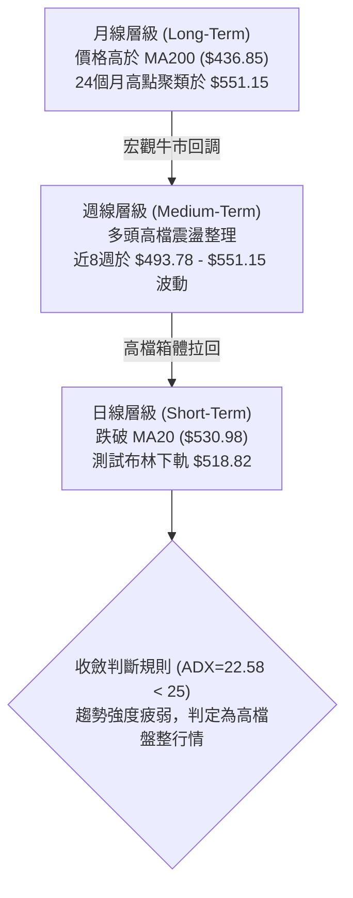

### 📈 長期趨勢 — 12個月走勢圖（Unicode）

以下為 MSFT 過去 12 個月（2025-11 至 2026-10）之月線收盤走勢 ASCII 圖表，清楚標注歷史波段高低點與結構轉折：

```
MSFT 月線收盤走勢圖（過去12個月：2025-11 至 2026-10）
 價格 ($)
 $530 ┤                                                    ● $521.91 (現價)
 $510 ┤                                            ● $507  ● $512.90
 $490 ┤  ● $488.91                                 
 $470 ┤        ● $480.57                           ● $463.85
 $450 ┤                                      ● $449
 $430 ┤              ● $427.58                     
 $410 ┤                                ● $406.13   
 $390 ┤                    ● $391.15               ● $372.32 (波段回踩次低點)
 $370 ┤                          ● $368.68 (波段低點)
      └─────────────────────────────────────────────────────────────
        11    12    01    02    03    04    05    06    07    08    09    10  (月份)
       [2025]              [         2026 年度走勢         ]
```

#### 走勢特徵分析表格

| 階段區間 | 時間跨度 | 起點收盤 | 終點收盤 | 區間漲跌幅 | 核心走勢特徵 |
|----------|----------|----------|----------|------------|--------------|
| **第 I 階段** | 2025-11 ~ 2026-03 | $488.91 | $368.68 | -24.59% | 自前期歷史高位震盪回落，連續5個月收黑，於 $368.68 築底形成年內低點聚類 |
| **第 II 階段** | 2026-03 ~ 2026-05 | $368.68 | $449.39 | +21.89% | 自底部強力反彈，突破 200 日線並展開修復波段，收復 $400 整數關卡 |
| **第 III 階段** | 2026-05 ~ 2026-06 | $449.39 | $372.32 | -17.15% | 劇烈二次回踩，收盤 $372.32 未跌破 3 月低點 $368.68，構成大級別堅實雙底架構 |
| **第 IV 階段** | 2026-06 ~ 2026-10 | $372.32 | $521.91 | +40.18% | 展開主升段推升，突破 $500 大關並創下 52 週新高 $551.15，目前於高位進行良性旗形消化 |

### 📊 中期趨勢（週線分析）

中期走勢以 2026 年 7 月以來的週線箱體與上升通道為骨架。近 20 週收盤價由 2026-06-26 之 $372.27 震盪推升至 2026-10-09 之 $535.07，其後觸及 52 週高點 $551.15。當前週線連續三週收陰（$529.05 ➔ $524.51 ➔ $521.91），呈現典型的擴斂三角頂部收斂或高檔震盪洗盤格局。

```
MSFT 中期週線支撐與壓力結構示意圖
 551.15 ──────────────────────┬────────────────────── [52W High / R1 強阻力]
                              │  ▲ 2026-10-16 創高 $551.15 後回吐
 535.00 ───────────────────┌──┴──┐────────────────── [短線平台反壓區]
                           │ 震盪 │
 521.91 ═══════════════════╪══════╪══════════════════ ◄ 現價 ($521.91)
                           │ 整理 │
 512.91 ───────────────────└──┬──┘────────────────── [日線 MA50 支撐防線]
                              │  ▼ 斐波那契 23.6% 回調位 ($503.33)
 487.61 ──────────────────────┴────────────────────── [波段聚類強支撐 S1]
```

### ⚡ 趨勢強度評估（ADX 解讀）

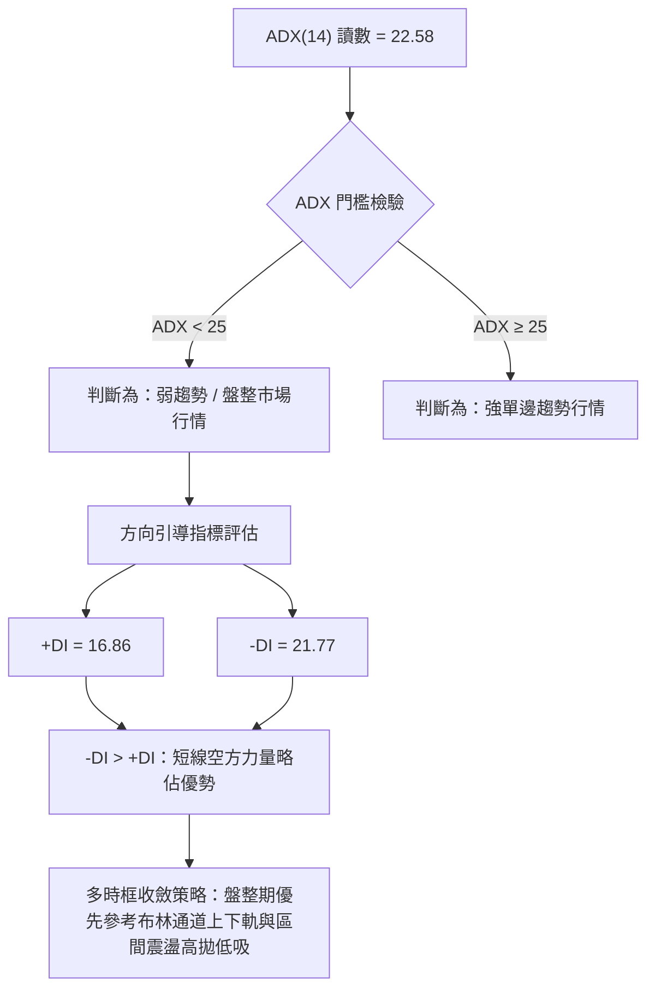

#### ADX 指標強度對照分析表

| 指標變數 | 當前數值 | 參考標準區間 | 當前技術含義解讀 |
|----------|----------|--------------|------------------|
| **ADX(14)** | **22.58** | 0 – 20: 極度無趨勢<br>20 – 25: 弱趨勢/震盪盤整<br>25 – 40: 強趨勢<br>40+: 極強單邊 | 指標數值落在 22.58，確認市場失去單邊推升爆發力，處於波段創高後的高檔橫向整理或收斂三角形末端，任何追價策略均面臨較高洗盤風險。 |
| **+DI (14)** | **16.86** | 基準線 20 | 多頭進攻意願降溫，買盤連續三週縮手。 |
| **-DI (14)** | **21.77** | 基準線 20 | 空頭拋壓處於中等水平，但顯著壓制 +DI，空方主導短期微觀定價。 |
| **綜合判定** | **震盪偏空** | -DI 交叉壓制 +DI 且 ADX<25 | 確立當前為**盤整洗盤格局**，非單邊崩跌，亦非順勢突破。操作上需嚴守支撐阻力界限。 |

---

## 3. 圖表形態分析

### 🔍 形態識別系統

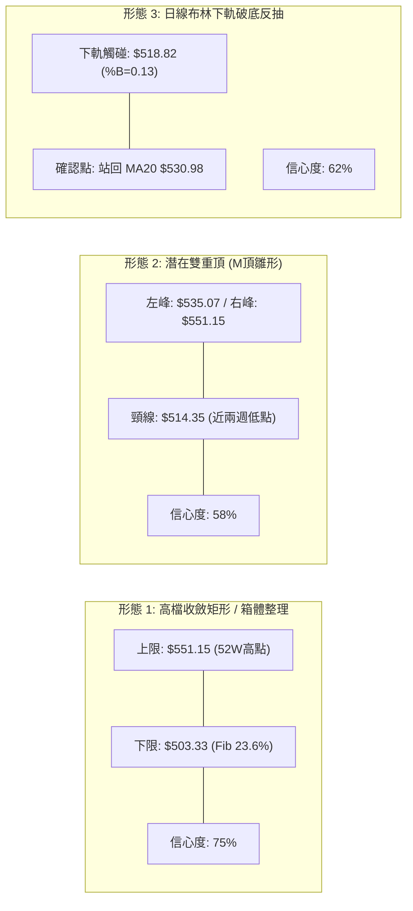

#### 圖表形態信心度評估表（依規則 15）

| 形態名稱 | 信心度 | 判斷依據（引用數據） | 完成度 | 目標價（附計算式） |
|----------|--------|----------------------|--------|--------------------|
| **高檔箱體震盪** | **75%** | 近8週收盤價密集分佈於 $493.78 至 $535.07 之間，頂部受制於 R1 $551.15，底部獲得 2026-09-18 低點 $487.23 與 S1 $487.61 強烈支撐。 | 85% | 箱體震盪區間：以頂部 R1 **$551.15** 為目標，箱體下軌為 **$487.61**。 |
| **微觀雙重頂 (M頂)** | **58%** | 2026-10-09 週高 $537.22 與 2026-10-16 週高 $551.15 構成雙峰，中間低點為 2026-10-23 低點 $515.70。若日K跌破該頸線則確認。 | 60% | 跌破頸線 $515.70 時推算：頸線 $515.70 − 形態高度 ($551.15 − $515.70 = $35.45) = **$480.25**（極接近 S2 **$476.25**）。 |
| **大型頭肩底 / 複合底** | **45%** | 2026-03 低點 $368.68（頭部），2026-06 低點 $372.32（右肩），但由於時間跨度已超過 5 個月且目前價格已達 $521.91。 | 100% | 訊號不足，僅做指標型解讀（已完全達成推升波段，無法指導當前超短期交易）。 |

### 🕯️ 重要K線形態分析

依據提供的「近10根日K」與「近8根週K」之精確 OHLC 數據展開專業 K 線形態辨識：

#### 近 10 根日 K 線形態解讀表

| 日期 (日K) | 開盤價 | 最高價 | 最低價 | 收盤價 | 成交量 | K線形態名稱 | 技術解讀 | 訊號 |
|------------|--------|--------|--------|--------|--------|-------------|----------|------|
| **2026-10-19** | 528.70 | 535.57 | 528.06 | 533.52 | 17,994,900 | 中實體陽線 | 開盤即獲支撐，穩健收於高檔，延續強勢攻堅。 | 🟢 |
| **2026-10-20** | 533.91 | 534.21 | 525.84 | 531.87 | 14,576,000 | 衝高回落小陰線 | 高點未過前日高點，量能微幅萎縮，多頭力道暫歇。 | 🟡 |
| **2026-10-21** | 529.44 | 533.28 | 525.02 | 532.95 | 13,940,100 | 下影小陽線 | 回踩 $525.02 獲買盤承接，收盤收復開盤價。 | 🟢 |
| **2026-10-22** | 533.14 | 533.60 | 520.30 | 521.08 | 21,266,600 | 帶量長黑破位陰線 | 放量下殺跌破短期平台，收於近全日最低點 $521.08。 | 🔴 |
| **2026-10-23** | 517.75 | 525.77 | 515.70 | 524.51 | 13,671,500 | 鎚頭反彈小陽線 | 跳空低開下探 $515.70 後拉抬，留長下影線展現抵抗力。 | 🟢 |
| **2026-10-26** | 527.40 | 533.25 | 521.69 | 532.60 | 19,021,000 | 吞噬修復陽線 | 多方反撲完全收復前兩日失地，量能溫和放大。 | 🟢 |
| **2026-10-27** | 532.35 | 534.70 | 528.33 | 531.33 | 19,532,300 | 高位十字紡錘線 | 於 MA20 附近多空陷入拉鋸膠著，方向未明。 | 🟡 |
| **2026-10-28** | 531.82 | 535.00 | 526.14 | 531.01 | 28,594,200 | 量增滯漲小陰星 | 成交量擴大至 2,859 萬股，但價格受阻於 $535.00，顯示主力出貨。 | 🔴 |
| **2026-10-29** | 540.22 | 541.29 | 519.56 | 530.14 | 39,333,200 | 假突破巨量長黑墓碑線 | 開高衝至 $541.29 後遭遇沉重拋壓，放量至近 4,000 萬股，長黑灌破開盤價。 | 🔴 |
| **2026-10-30** | 525.27 | 526.00 | 514.35 | 521.91 | 35,618,300 | 延續性探底光頭陰線 | 跳空走低，最低觸及 $514.35 測試布林下軌，收盤仍顯疲軟。 | 🔴 |

#### 近 8 根週 K 線形態解讀表

| 日期 (週K) | 開盤價 | 最高價 | 最低價 | 收盤價 | 週成交量 | K線形態名稱 | 技術解讀 | 訊號 |
|------------|--------|--------|--------|--------|----------|-------------|----------|------|
| **2026-09-11** | 493.01 | 498.97 | 486.00 | 495.63 | 62,321,200 | 縮量十字星 | 於 $486 支撐位附近縮量震盪，多空達成短暫平衡。 | 🟡 |
| **2026-09-18** | 497.06 | 509.95 | 487.23 | 493.78 | 115,020,700 | 長下影帶量紡錘線 | 測試 $487.23 波段低點後強力拉回，確認下檔買盤。 | 🟢 |
| **2026-09-25** | 494.95 | 519.40 | 491.22 | 516.17 | 123,909,000 | 突破放量大陽線 | 放量逾 1.2 億股突破 $500 大關，展開週線進攻波。 | 🟢 |
| **2026-10-02** | 505.47 | 522.85 | 502.22 | 517.53 | 105,746,200 | 高位窄幅整理線 | 回踩 $502.22 獲得支撐，蓄勢挑戰前高。 | 🟢 |
| **2026-10-09** | 521.62 | 537.22 | 518.79 | 535.07 | 103,231,800 | 光腳中陽線 | 穩健收高於 $535.07，技術面維持多頭強勢推進。 | 🟢 |
| **2026-10-16** | 537.53 | 551.15 | 524.43 | 529.05 | 113,488,100 | 長上影射擊之星 (Shooting Star) | 衝刺 52 週高點 $551.15 後大幅回吐，收盤跌破開盤，高檔見頂訊號強烈。 | 🔴 |
| **2026-10-23** | 528.70 | 535.57 | 515.70 | 524.51 | 81,449,100 | 縮量下探中陰線 | 延續射擊之星的回調走勢，下探 $515.70 尋求支撐。 | 🔴 |
| **2026-10-30** | 527.40 | 541.29 | 514.35 | 521.91 | 142,099,000 | 放量高開低走大陰棒 | 週量激增至 1.42 億股，衝高 $541.29 誘多後重挫，收於 $521.91，形成頂部吞噬特徵。 | 🔴 |

### 📉 ASCII 走勢形態示意圖

```
MSFT 日線「頂部雙峰誘多破位」形態解析
 價格 ($)
 551.15 ┤                     ● (52W High, 10-16)
 545.00 ┤                    ╱ ╲
 540.00 ┤                   ╱   ╲            ▲ (10-29 誘多衝高 $541.29)
 535.00 ┤       ● (10-09)  ╱     ╲          ╱ ╲
 530.98 ┼───────[MA20 頸線位置]─────────────┼───[10-29 巨量長黑摜破]
 525.00 ┤         ╲       ╱                 ╲     ╲
 521.91 ┼──────────╲─────╱───────────────────╲─────● 現價 $521.91
 518.82 ┼───────────[布林下軌支撐區]────────────[10-30 探底 $514.35]
 514.35 ┤             ▼ (10-23 低點 $515.70)
        └───────────────────────────────────────────────────────────
          10-09  10-16     10-23            10-29 10-30   (交易日)
```

### 🎯 形態目標價計算

根據雙重頂與收斂整理形態之幾何推算標準，定義關鍵目標價：

1. **下行破位形態目標價**：
   - 形態頸線：以近 10 日最低點 **$514.35**（2026-10-30 低點）為基準。
   - 形態高度：高點 $551.15 − 頸線 $514.35 = **$36.80**。
   - **量度下行目標價** = 頸線 $514.35 − 形態高度 $36.80 = **$477.55**。
   - *驗證對比*：此理論計算值極度貼合數據提供之波段強支撐位 **S2 ($476.25)** 與斐波那契 38.2% 回調位 **$473.75**，共振效應極高。
2. **上行收復形態目標價**：
   - 若守住布林下軌 $518.82 並反轉向上，第一頸線目標為收復 MA20 **$530.98**。
   - 突破後的量度推升目標為 52 週最高點 **$551.15 (R1)**。

---

## 4. 支撐與阻力

### 🗺️ 關鍵價位分布圖（Unicode）

```
MSFT 關鍵價位空間結構分布圖 (由 OHLCV 與斐波那契精確計算)
═════════════════════════════════════════════════════════════════════
 $551.15 ║██████████████████████████████║ 52W High / R1 / Fib 0.0% 極強阻力
 $543.15 ║████████████████████          ║ 布林通道上軌動態阻力
 $530.98 ║████████████████████████      ║ MA20 / 布林中軌反壓轉換線
 $521.91 ╠══════════════════════════════╣ ◄ 現價 ($521.91)
 $518.82 ║▓▓▓▓▓▓▓▓▓▓▓▓▓▓▓▓▓▓▓▓          ║ 布林通道下軌動態支撐
 $512.91 ║▓▓▓▓▓▓▓▓▓▓▓▓▓▓▓▓▓▓▓▓▓▓        ║ 中期均線 MA50 防線
 $503.33 ║▓▓▓▓▓▓▓▓▓▓▓▓▓▓▓▓▓▓▓▓▓▓▓▓      ║ 斐波那契 23.6% 回調位
 $487.61 ║██████████████████████████████║ 近一年波段低點聚類支撐 S1
 $476.25 ║██████████████████████████████║ 近一年波段低點聚類支撐 S2
 $465.47 ║██████████████████████████████║ 近一年波段低點聚類支撐 S3
 $449.85 ║██████████████████████████████║ 斐波那契 50.0% 半數回撤強支撐
 $436.85 ║██████████████████████████████║ 長期生命線 MA200 牛熊分界線
═════════════════════════════════════════════════════════════════════
```

### 🚧 阻力位分析表

依據規則 13，價位嚴格引用自數據之「關鍵價位」波段高點聚類與指標計算值：

| 阻力級別 | 精確價位 | 距現價幅標 | 形成原因與技術依據 | 突破難度 | 重要性評級 |
|----------|----------|------------|--------------------|----------|------------|
| **短線反壓** | **$530.98** | +1.74% | 日線 MA20 及布林中軌，跌破後轉為動態反壓線 | 🟡 中等 | ★★★☆☆ |
| **動態上軌** | **$543.15** | +4.07% | 布林通道上軌，10-29 衝高 $541.29 未能站穩 | 🔴 較高 | ★★★★☆ |
| **R1 (波段)**| **$551.15** | +5.60% | 52週歷史最高點聚類，斐波那契 0.0% 回調位，近一年最強頂部 | 🔴 極高 | ★★★★★ |
| **R2** | **N/A** | N/A | **數據中未偵測到**（依規則 13 不予自行編造） | N/A | N/A |
| **R3** | **N/A** | N/A | **數據中未偵測到**（依規則 13 不予自行編造） | N/A | N/A |

### 🛡️ 支撐位分析表

依據規則 13，價位嚴格引用自數據之「關鍵價位」波段低點聚類數值：

| 支撐級別 | 精確價位 | 距現價幅標 | 形成原因與技術依據 | 守住機率 | 重要性評級 |
|----------|----------|------------|--------------------|----------|------------|
| **下軌支撐** | **$518.82** | -0.59% | 布林通道下軌，當前 %B 僅 0.13，提供極短線超賣技術彈性 | 65% | ★★★☆☆ |
| **中期均線** | **$512.91** | -1.72% | 50日移動平均線 (MA50)，多頭中期防守的第一道技術均線 | 60% | ★★★★☆ |
| **黃金回調** | **$503.33** | -3.56% | 52週高低區間之斐波那契 23.6% 回調關鍵位 | 70% | ★★★★☆ |
| **S1 (強支撐)**| **$487.61** | -6.57% | 近一年波段低點聚類，2026年9月震盪平台底部密集區 | 80% | ★★★★★ |
| **S2 (重支撐)**| **$476.25** | -8.75% | 近一年波段低點聚類，貼合雙頂量度目標 $477.55 | 85% | ★★★★★ |
| **S3 (鐵底)**  | **$465.47** | -10.81%| 近一年波段低點聚類，2026年7月底跳空起漲點附近 | 92% | ★★★★★ |

### 📐 斐波那契回調位分析

依據 52 週完整波段（低點 **$348.54** ➔ 高點 **$551.15**，波段總垂直振幅達 **$202.61**）之回調計算如下：

```
斐波那契回調結構標尺 (區間: $348.54 → $551.15)
 0.0%  (52W High)  $551.15 ──────────────────────────────────────
                           ▲ 空間阻力: +$29.24 (+5.60%)
 現價  $521.91 ════════════╬══════════════════════════════════════ [現價落於 0.0% 與 23.6% 之間]
                           ▼ 空間緩衝: -$18.58 (-3.56%)
 23.6% 回調位       $503.33 ──────────────────────────────────────
 38.2% 回調位       $473.75 ──────────────────────────────────────
 50.0% 中樞回調位   $449.85 ──────────────────────────────────────
 61.8% 黃金分割位   $425.94 ──────────────────────────────────────
 78.6% 深次回撤位   $391.90 ──────────────────────────────────────
 100.0%(52W Low)   $348.54 ──────────────────────────────────────
```

- **當前位置解讀**：現價 **$521.91** 處於 0.0% ($551.15) 與 23.6% ($503.33) 之間的高檔強勢回撤區間。
- **回撤健康度分析**：
  1. 價格從歷史高位回調僅回撤了全部漲幅的 14.4%（計算式：($551.15 − $521.91) / $202.61 = 14.43%），尚未觸及 23.6% ($503.33)。
  2. 只要價格維持在 23.6% ($503.33) 與波段支撐 S1 ($487.61) 之上，中長期技術架構仍屬於強勢牛市的高位強勢消化，而非空頭轉折。

---

## 5. 技術指標深度解讀

### 🎛️ 指標訊號總覽

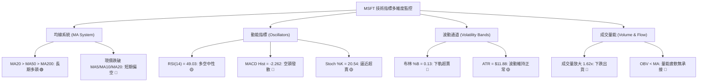

### 📈 移動平均線排列分析

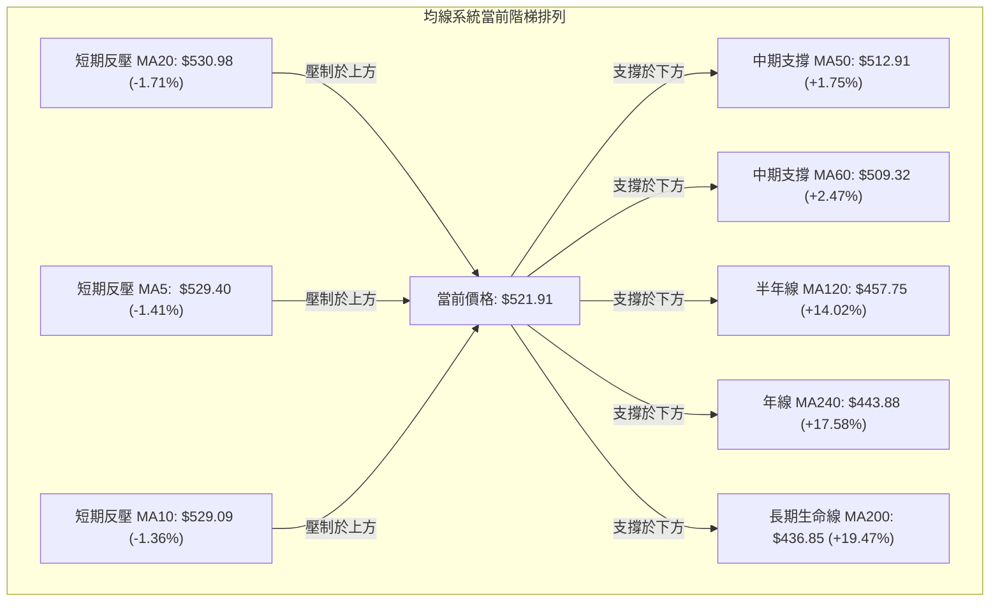

#### 移動平均線數據對比表

| 均線名稱 | 當前價格 | 與現價差額 | 偏離率 (%) | 均線斜率狀態 | 趨勢定性 |
|----------|----------|------------|------------|--------------|----------|
| **MA 5** | $529.40 | -$7.49 | -1.41% | ▼ 下行走平 | 短期下殺反壓 |
| **MA 10** | $529.09 | -$7.18 | -1.36% | ▼ 下行開口 | 短期下殺反壓 |
| **MA 20** | $530.98 | -$9.07 | -1.71% | ▼ 拐頭向下 | 月線級別反壓，短期轉弱 |
| **MA 50** | $512.91 | +$8.99 | +1.75% | ▲ 穩定向上 | 季線級別強支撐 |
| **MA 60** | $509.32 | +$12.59 | +2.47% | ▲ 持續向上 | 中期防守護城河 |
| **MA 120**| $457.75 | +$64.16 | +14.02% | ▲ 加速向上 | 半年線多頭基石 |
| **MA 200**| $436.85 | +$85.06 | +19.47% | ▲ 穩步向上 | 長期牛市總分水嶺 |
| **MA 240**| $443.88 | +$78.03 | +17.58% | ▲ 穩步向上 | 兩年週期均線多頭支撐 |

**綜合均線排列判定**：中長期仍呈典型多頭排列（MA20 > MA50 > MA200），但微觀上現價已跌破短天期均線簇（MA5、MA10、MA20），且 MA5 與 MA10 已向下跌破 MA20 形成短死叉。若短期無法迅速收復 MA20 ($530.98)，將向 MA50 ($512.91) 尋求支撐。

### 📉 RSI(14) 分析

- **當前數值**：**49.03**（Wilder 計算方法）。
- **進度條位置**：
  ```
  超賣區 (0-30)        中性平衡區 (30-70)               超買區 (70-100)
  ├───┼───┼───┼───┼───┼───┼───┼───┼───┼───┼───┼───┼───┼───┼───┼───┤
  ░░░░░░░░░░░░░░░░░░░░████████████████░░░░░░░░░░░░░░░░░░░░░░░░░░░░░░░░
                      ▲ 現值 49.03 (中性格局)
  ```
- **超買超賣評估**：既未進入 >70 之過熱超買，亦未跌破 <30 進入恐慌超賣，處於多空籌碼完全互易平衡區。
- **背離判斷結論**：
  - **數據明確結論**：**無明顯背離**。
  - **深度解讀**：比對近 20 根 K 棒的首尾走勢，價格自 2026-10-09 之 $535.07 微幅回落至當前 $521.91，RSI 亦同步自 67.5 降至 49.03，斜率方向保持一致，無頂背離或底背離矛盾。

### 📊 MACD(12/26/9) 訊號解讀

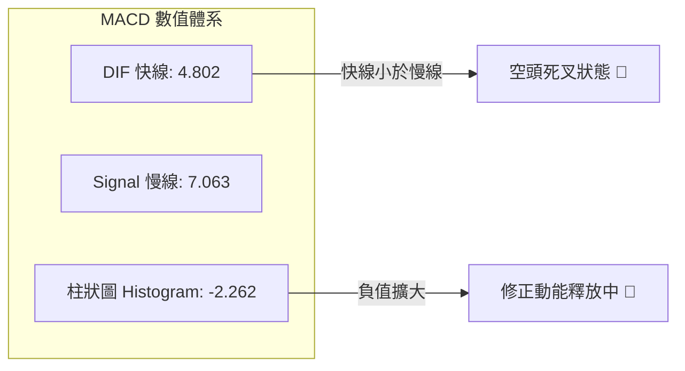

- **MACD 核心數值**：DIF 快線 = **4.802**，DEA 訊號線 = **7.063**，柱狀圖 = **-2.262**。
- **技術解讀**：
  1. 快線與慢線均仍處於零軸上方（4.802 > 0, 7.063 > 0），表明**大週期多頭大勢未變**，此回調本質為多頭波段中的次級調整。
  2. 然而快線下穿慢線形成死叉已達數日，且負柱狀圖自前期的 -0.800 持續擴散至當前的 -2.262，顯示短期回調下殺動能尚未出清完畢。

### 📦 布林通道分析

```
MSFT 日線布林通道 (20, 2) 空間圖解
 價格 ($)
 $543.15 ──────────────────────────────────── [布林上軌 (Upper Band)]
                           ▲
                           │ 帶寬 (Bandwidth) = $24.33 (4.66%)
 $530.98 ┄┄┄┄┄┄┄┄┄┄┄┄┄┄┄┄┄┼┄┄┄┄┄┄┄┄┄┄┄┄┄┄┄┄ [布林中軌 (MA20 基線)]
                           │
 $521.91 ══════════════════╪═════════════════ ◄ 現價 ($521.91)
                           │ %B = 0.13 (貼近下軌)
 $518.82 ──────────────────┴───────────────── [布林下軌 (Lower Band)]
```

- **軌道精確數值**：
  - **上軌 (Upper)**：**$543.15**
  - **中軌 (Middle)**：**$530.98**
  - **下軌 (Lower)**：**$518.82**
- **%B 指標深度解讀**：當前 %B 數值為 **0.13**（%B 計算式：($521.91 − $518.82) / ($543.15 − $518.82) = 0.127），代表現價已進入通道底部最後 13% 的極低空間。
- **通道行為判定**：通道帶寬僅為 4.66%，處於通道收縮（Squeeze）後的微幅開口擴散期。價格回踩下軌 $518.82 將引發均值回歸買盤（Mean Reversion），若跌破下軌將演變成破軌弱勢單邊，否則即為區間震盪的最佳低吸點。

### 💹 成交量分析（量價配合度）

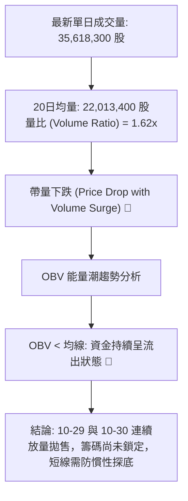

- **量價關係評估**：
  - 2026-10-29 伴隨近 4,000 萬股放量衝高下殺，10-30 下跌再次放大至 3,561 萬股（量比達 1.62x），呈現典型的「放量下跌、滯漲出貨」特徵。
  - **OBV 趨勢**：數據確認「OBV < MA → 量能疲弱」，能量潮呈現持續低於其均線走勢，確認資金未在當前價位出現強勢集體回補，多頭反攻仍需等待縮量止跌信號。

---

## 6. 動能與波動率

### ⚡ 動能評估四象限

```
動能與波動率象限分析矩陣 (Momentum vs Volatility)
─────────────────────────────────────────────────────────────────
       高動能 (High Momentum)
               │
      象限 II  │  象限 I
    高波動/強動能 │  低波動/強動能
               │
───────────────┼─────────────── 波動率軸 (Volatility, ATR=2.28%)
               │
      象限 IV  │  象限 III [MSFT 當前定位]
    高波動/弱動能 │  低波動/弱動能
               │  當前特徵: 震盪沉悶、ATR偏低、動能收斂、洗盤築底
               ▼
       弱動能 (Weak Momentum)
─────────────────────────────────────────────────────────────────
```

#### 象限狀態評估表

| 象限代號 | 動能特徵 | 波動特徵 | 當前狀態匹配 | 操作戰略評估 |
|----------|----------|----------|--------------|--------------|
| **象限 I** | 強動能 (RSI>60, ADX>25) | 低波動 (ATR%<2.0%) | 否 | 最佳趨勢主升段，穩健持股加碼 |
| **象限 II** | 強動能 (突破單邊) | 高波動 (ATR%>3.5%) | 否 | 狂暴行情，高風險高收益，需緊貼移動止盈 |
| **象限 III**| **弱動能 (RSI 49, ADX 22.58)** | **低/中波動 (ATR% 2.28%)** | **✓ 當前狀態** | **謹慎觀望，避免追漲殺跌，嚴格按區間邊界操作** |
| **象限 IV**| 弱動能 (MACD崩塌) | 高波動 (破位恐慌暴跌) | 否 | 風險巨大，嚴格停損出場，禁止搶反彈 |

### 📊 ATR 波動率分析

- **ATR(14) 數值**：**$11.88**（以 Wilder 平滑算法計算）。
- **ATR 佔比**：佔當前股價之 **2.28%**。
- **日內波動區間推算**：
  - 次日波動上界預期：$521.91 + $11.88 = **$533.79**（貼近阻力區 MA20）。
  - 次日波動下界預期：$521.91 − $11.88 = **$510.03**（貼近中期支撐 MA50 $512.91）。
- **止損距離建議**：
  - *短期日內/極短線*：使用 1.0 × ATR = **$11.88** 防守緩衝。
  - *波段交易*：使用 1.5 × ATR = **$17.82**，對應現價止損位為 **$504.09**（精準吻合斐波那契 23.6% 回調位 $503.33）。

### 📐 Beta 與市場相關性

- **Beta 數值**：**N/A（數據未提供）**（依規則 16 明確標示，不予自行編造或估算）。
- **大盤相關性質化評估**：
  - MSFT 當前市值達 **$3.88T**，為標普 500 指數與那斯達克 100 指數之核心權值龍頭股。
  - 近期市場新聞提及「Nasdaq 下跌 747 點」以及「科技巨頭資本支出引發疑慮」，顯示大盤成長股整體面臨殺估值壓力，MSFT 與大盤科技板塊呈現高聯動同向整理態勢。

---

## 7. 多時框架總結

### 📋 時框架評分表

| 時框架 | 趨勢方向 | 動能指標 | 均線排列 | 圖表形態 | 綜合評分 | 戰略建議 |
|--------|----------|----------|----------|----------|----------|----------|
| **月線 (長期)** | 🟢 強烈看多 | 🟢 RSI=49 蓄勢 | 🟢 MA200之上 | 🟢 歷史牛市主升 | **80/100** | 長線多單堅定持有，以 MA200 為終極防線 |
| **週線 (中期)** | 🟡 高位盤整 | 🟡 MACD柱收縮 | 🟢 MA50向上多頭 | 🟡 收斂三角形箱體 | **55/100** | 中期區間波段操作，高拋低吸，嚴守箱體邊界 |
| **日線 (短期)** | 🔴 短期偏空 | 🔴 MACD死叉擴散 | 🔴 跌破MA20反壓 | 🔴 假突破巨量陰線 | **38/100** | 短線切忌盲目追高，等待下軌支撐回測或止跌信號 |

### 🔲 綜合訊號矩陣

```
時框與指標訊號共振矩陣
─────────────────────────────────────────────────────────────────────
  時框維度     均線架構   動能指標   布林通道   量能配合   矩陣共振結論
─────────────────────────────────────────────────────────────────────
  短期 (日線)    🔴 空頭   🔴 空頭   🔴 臨軌超賣  🔴 弱勢     🔴 短期調整擴散
  中期 (週線)    🟢 多頭   🟡 中性   🟡 中軌整理  🟡 平衡     🟡 高位震盪箱體
  長期 (月線)    🟢 多頭   🟢 偏多   🟢 向上擴張  🟢 充足     🟢 長期多頭不變
─────────────────────────────────────────────────────────────────────
  訊號一致性評估：短空、中平、長多。長短期出現時間結構矛盾。
─────────────────────────────────────────────────────────────────────
```

### ⚖️ 多時框收斂結論

依據本報告最嚴格之**「多時框收斂規則（規則 14）」**執行邏輯判定：

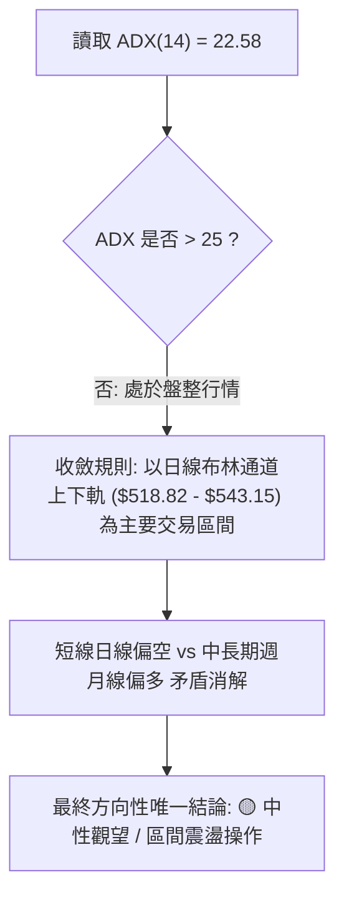

1. **行情定性**：當前 ADX(14) 讀數為 **22.58**（明確小於 25 臨界值），技術體系確立為**「高檔盤整行情」**而非單邊趨勢行情。
2. **優先級收斂**：在盤整行情下，**以日線布林通道上下軌作為核心交易邊界**，不宜以單邊趨勢思維盲目追漲或恐慌砍倉。
3. **唯一方向性結論**：**🟡 中性觀望 / 區間震盪（Neutral Range-Bound）**。此結論與第 1 章技術評分卡之 **51/100** 評分完全一致，並嚴格指引第 8 章之區間操作策略路由。

---

## 8. 交易策略建議

### 🗺️ 策略決策流程圖

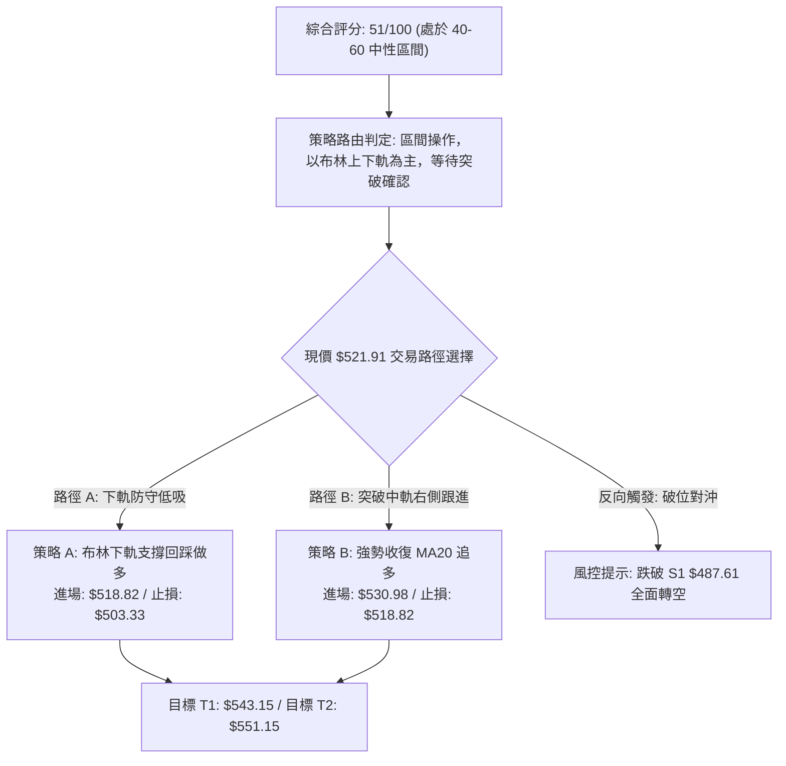

### 🧭 策略路由（依評分卡分流）

> **當前主策略方向 = 🟡 區間震盪操作（Range-Bound Trading）（依評分 51/100，處於 40–60 中性評分區間）**
>
> **核心戰術理念**：目前股價逼近布林下軌 $518.82，短期指標雖偏空但已進入超賣邊緣。主策略採「布林下軌支撐回測低吸」與「突破 MA20 右側順勢」兩套區間多頭方案，嚴禁於均線反壓區半山腰追價；同時嚴設止損，以斐波那契回調位 $503.33 與下軌 $518.82 作為多頭防線。

### 🎯 價格情境階梯（Price Scenarios）

價位嚴格引用自第 4 章由數據算出的實際數值：

| 觸發條件 | 下一目標 | 後續延伸 | 情境含義解讀 |
|----------|----------|----------|--------------|
| **向上突破 R1 $551.15** | **歷史新高領域** | 數據中未偵測到更高阻力 | 徹底終結盤整，重啟月線級別超級主升浪 |
| **向上突破 MA20 $530.98** | **布林上軌 $543.15** | **R1 $551.15** | 短線空頭警報解除，多頭重掌短線定價權 |
| **維持現價 $521.91 震盪** | **布林下軌 $518.82** | **MA20 $530.98** | 於布林通道內收斂震盪，等待成交量萎縮築底 |
| **跌破布林下軌 $518.82** | **MA50 $512.91** | **Fib 23.6% $503.33** | 短線弱勢擴散，向中長期均線尋求支撐 |
| **有效跌破 S1 $487.61** | **S2 $476.25** | **S3 $465.47** | 中期頭部確立，形態轉向大級別回調深水區 |

### 📊 情境機率分佈

| 情境劇本 | 機率 | 主要技術與量化依據 |
|----------|------|--------------------|
| **情境一：區間震盪築底** | **55%** | **ADX=22.58** 確立無單邊趨勢；布林帶寬僅 4.66% 處於壓縮期；現價逼近下軌支撐 $518.82。 |
| **情境二：回測深層支撐** | **30%** | **MACD 柱狀圖 -2.262** 擴散中；OBV 低於均線且跌時放量（量比 1.62x），仍有慣性下探風險。 |
| **情境三：強勢反轉創高** | **15%** | 目前受制於 **MA5/MA10/MA20** 三重下壓均線反壓，無放量大陽線無法直接攻克 R1 $551.15。 |

### 🟢 主策略詳情（方向依上方路由：區間多頭低吸與突破）

依規則 17，所有數值嚴格引用數據庫既有價位，風險報酬比公式 = (目標價 T1 − 進場價) ÷ (進場價 − 止損價)：

| 策略要素 | 策略 A（下軌守候低吸 — 左側防守型） | 策略 B（突破均線順勢 — 右側確認型） |
|----------|-------------------------------------|-------------------------------------|
| **進場條件** | 股價回踩布林下軌獲得支撐，出現收下影線或止跌K棒 | 實體日K突破並收復 MA20 及布林中軌，站穩確認 |
| **進場價格** | **$518.82** (布林下軌支撐位) | **$530.98** (MA20 / 布林中軌反壓線) |
| **目標價 T1** | **$543.15** (布林通道上軌阻力位) | **$543.15** (布林通道上軌阻力位) |
| **目標價 T2** | **$551.15** (阻力位 R1 / 52週最高點) | **$551.15** (阻力位 R1 / 52週最高點) |
| **止損價格** | **$503.33** (斐波那契 23.6% 回調關鍵位) | **$518.82** (跌破布林通道下軌防守線) |
| **風險報酬比 (T1)** | **1 : 1.57（以 T1 計）**<br>*(543.15−518.82)/(518.82−503.33) = 24.33/15.49* | **1 : 1.00（以 T1 計）**<br>*(543.15−530.98)/(530.98−518.82) = 12.17/12.16* |
| **風險報酬比 (T2)** | **1 : 2.09（以 T2 計）**<br>*(551.15−518.82)/(518.82−503.33) = 32.33/15.49* | **1 : 1.66（以 T2 計）**<br>*(551.15−530.98)/(530.98−518.82) = 20.17/12.16* |
| **成功機率** | **55%** | **50%** |
| **建議倉位** | **15%** (分批布局，留有後備資金) | **20%** (趨勢右側確認，動能加碼) |

### 🔴 反向風險觸發點（對沖提示）

若出現以下極端技術破位訊號，表明主策略徹底失效，投資人應迅速切換為避險/對沖模式：
1. **破位觸發點**：日線收盤價跌破斐波那契 23.6% 回調位 **$503.33**，或進一步摜破波段強支撐 **S1 ($487.61)**。
2. **訊號確認**：MACD 柱狀圖跌破 -5.000 且日成交量放大至 4,000 萬股以上。
3. **對沖應對指引**：多頭部位全面離場觀望；波段部位可配置對沖工具，空頭量度目標下看波段低點 **S2 ($476.25)** 與 **S3 ($465.47)**。

### ⭐ 整體訊號強度評星

```
做多訊號強度：★★☆☆☆  (2.5/5星 — 短線受制於均線，但具下軌支撐價值)
做空訊號強度：★★☆☆☆  (2.5/5星 — 空間受限於中長期強大多頭均線與支撐)
整體可信度：  ★★★★☆  (4.0/5星 — 技術價位聚類完整，多時框邊界清晰)
```

---

## 9. 風險提示與監控

### ✅ 關鍵監控指標 Checklist

```
╔══════════════════════════════════════════════════════════════════════════════╗
║                    MSFT 技術監控每日 Checklist                               ║
╠══════════════════════════════════════════════════════════════════════════════╣
║ [ ] 監控項 1: 布林下軌守衛戰 — 日線收盤是否守穩 $518.82 ?                   ║
║ [ ] 監控項 2: 均線收復確認 — 價格能否以陽線重返 MA20 ($530.98) 之上 ?        ║
║ [ ] 監控項 3: MACD 動能拐點 — 柱狀圖負值是否開始由 -2.262 出現底分型收斂 ?  ║
║ [ ] 監控項 4: 成交量常態化 — 日成交量是否自 3,561 萬股縮減至 2,200 萬均量線 ?║
║ [ ] 監控項 5: 極端風險警戒 — 嚴格監視 52週回調 23.6% 位 $503.33 是否被有效擊破 ║
╚══════════════════════════════════════════════════════════════════════════════╝
```

### ⚠️ 風險場景分析

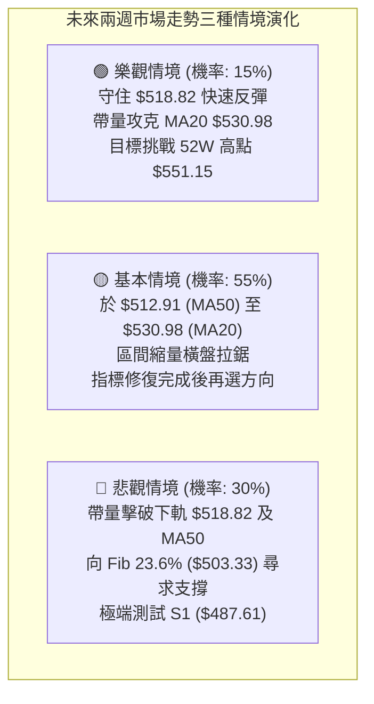

### 🛡️ 風險管理重要提醒

1. **嚴禁追高與過早搶反彈**：在日線 MACD 仍處於 -2.262 負值擴散且價格壓制於 MA5/MA10 下方時，左側交易者僅能在布林下軌 **$518.82** 或更高盈虧比支撐進行極限防守試倉，不可重倉賭底。
2. **波動率止損紀律**：以當前 ATR(14) 為 **$11.88** 衡量，任何短線交易止損幅度不可低於 1.0 倍 ATR（約 $12 空間），否則極易在正常的盤整噪音中被洗出場。
3. **倉位總量控管**：鑑於 ADX 處於 22.58 之震盪低趨勢期，總持倉部位建議控制在總資金的 **30%–50%** 之內，保持足夠的流動性以應對下軌失守時的加碼或避險處置。

---

## 📋 報告總結

```
╔════════════════════════════════════════════════════════════════════════════════╗
║                        MSFT 技術分析報告總結                                   ║
╠════════════════════════════════════════════════════════════════════════════════╣
║ 報告日期：2026-10-31                                                          ║
║ 當前價格：$521.91 USD                                                          ║
║ 技術評分：51/100 (六項子指標算術平均，嚴格定義)                               ║
║ 分析評級：⚖️ 區間震盪 / 中性觀望 (Neutral Range-Bound)                        ║
║                                                                                ║
║ 關鍵技術結論：                                                                 ║
║ ├─ 長期趨勢：🟢 宏觀牛市架構穩固，遠高於 MA200 ($436.85)                       ║
║ ├─ 中期趨勢：🟡 週線高位箱體整理，於 $487.61 至 $551.15 區間蓄勢               ║
║ ├─ 短期趨勢：🔴 連續放量回調，承壓於 MA20 ($530.98)，考驗下軌 $518.82         ║
║ ├─ 關鍵支撐：布林下軌 $518.82 ｜ MA50 $512.91 ｜ Fib 23.6% $503.33 ｜ S1 $487.61║
║ ├─ 關鍵阻力：MA20 $530.98 ｜ 布林上軌 $543.15 ｜ 52W高點 R1 $551.15            ║
║ └─ 華爾街目標：分析師平均目標價 $627.73 (最高 $870.00 / 最低 $440.00)          ║
║                                                                                ║
║ 最優策略組合：                                                                 ║
║ 1. 🥇 最佳機會（勝率55%）：布林下軌低吸（進場 $518.82 / 止損 $503.33 /         ║
║                           目標 T1 $543.15 / 風報比 1 : 1.57）                  ║
║ 2. 🥈 次選機會（勝率50%）：右側破線跟進（突破 MA20 $530.98 進場 /             ║
║                           止損 $518.82 / 目標 T1 $543.15 / 風報比 1 : 1.00）   ║
║ 3. 🥉 保守選擇（勝率70%）：空倉觀望，耐心等待價格回測 S1 ($487.61) 或          ║
║                           MACD 出現底部金叉後再行進場。                       ║
╚════════════════════════════════════════════════════════════════════════════════╝
```

---

> ⚠️ **免責聲明**：本報告為基於歷史交易數據與量化指標模型產出之技術分析，所有數據及估算均嚴格基於提供的歷史價格資訊。本報告**僅供研究與學術參考**，**不構成任何形式的投資建議或要約邀請**。金融市場瞬息萬變，投資有風險，入市決策需獨立評估並自負盈虧。

---

*報告生成時間：2026-10-31 ｜ 數據來源：Yahoo Finance ｜ 分析框架：多時框技術分析體系*