# MSFT 技術分析報告

> **報告日期**：2026-11-01 ｜ **語言**：繁體中文 ｜ **數據來源**：Yahoo Finance ｜ **當前價格**：$521.91

---

## 目錄

| 章節 | 內容 |
|------|------|
| [1. 技術面概覽](#1-技術面概覽) | 訊號儀表板、核心指標、評分卡 |
| [2. 趨勢分析](#2-趨勢分析) | 多時框趨勢、長中短期走勢、ADX 解讀 |
| [3. 圖表形態分析](#3-圖表形態分析) | 形態識別、近10日/8週K線組合、目標價 |
| [4. 支撐與阻力](#4-支撐與阻力) | 關鍵價位、斐波那契回調結構 |
| [5. 技術指標深度解讀](#5-技術指標深度解讀) | MA/RSI/MACD/布林/成交量量價關係 |
| [6. 動能與波動率](#6-動能與波動率) | 動能四象限、ATR 波動率、Beta |
| [7. 多時框架總結](#7-多時框架總結) | 時框架評分矩陣、收斂結論 |
| [8. 交易策略建議](#8-交易策略建議) | 策略路由、區間操作、風險報酬比 |
| [9. 風險提示與監控](#9-風險提示與監控) | 監控清單、情境模擬、風控指引 |

---

## 1. 技術面概覽

### 🎯 技術訊號儀表板

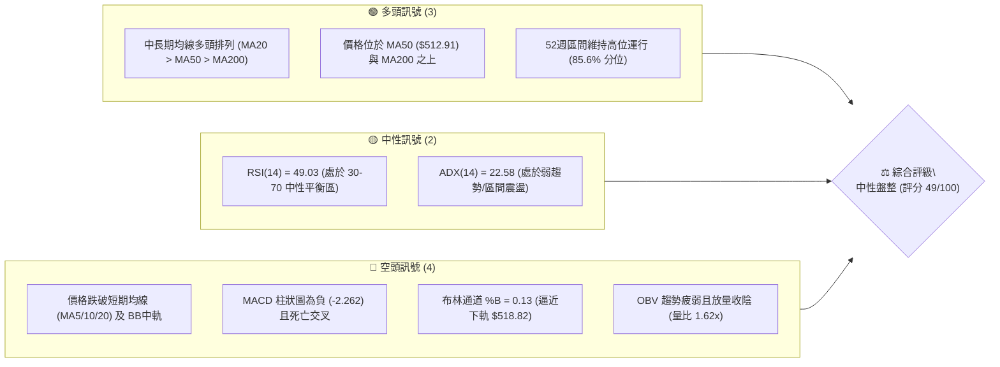

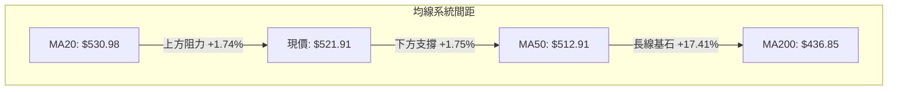

### 📊 核心指標速覽表

| 指標類別 | 指標名稱 | 當前數值 | 訊號 | 解讀 |
|:---|:---|:---|:---:|:---|
| **價格** | 當前收盤價 | $521.91 | 🟡 | 位於52W高點回撤區間，跌破短期均線但守住MA50 |
| **均線** | 短期 MA20 | $530.98 | 🔴 | 現價位於 MA20 下方 (-1.71%)，短線承壓 |
| **均線** | 中期 MA50 | $512.91 | 🟢 | 現價高於 MA50 (+1.75%)，中期多頭基石完好 |
| **均線** | 長期 MA200 | $436.85 | 🟢 | 現價大幅高於 MA200 (+19.47%)，長線牛市格局未破 |
| **動能** | RSI(14) | 49.03 | 🟡 | 處於 40–60 中性震盪區，多空勢力均衡，無超買超賣 |
| **動能** | MACD 柱狀圖 | -2.262 | 🔴 | MACD(4.802) 位於 Signal(7.063) 下方，動能看空 |
| **動能** | 隨機指標 %K/%D | 20.54 / 34.82 | 🟡 | %K 進入超賣臨界區，隨時具備短線反抽中軌動能 |
| **趨勢** | ADX(14) | 22.58 | 🟡 | 數值低於 25，表明缺乏單邊趨勢，屬於盤整震盪行情 |
| **方向** | 方向性指標 (+DI/-DI) | 16.86 / 21.77 | 🔴 | -DI 大於 +DI，短期內空方略佔上風 |
| **通道** | 布林帶寬 (%B) | 0.13 | 🔴 | 貼近布林下軌 ($518.82)，面臨下軌支撐測試 |
| **成交量**| 最新量 / 20日均量 | 35.62M / 22.01M | 🔴 | 量比達 1.62x，下跌帶量顯示短線賣壓釋放 |
| **波動** | ATR(14) | $11.88 | 🟡 | 佔現價 2.28%，日內波動適中，提供合理的止損緩衝 |

### 🏆 技術評分卡

```
╔══════════════════════════════════════════════════════════════╗
║               技術評分卡 — MSFT (2026-11-01)                  ║
╠══════════════════════════════════════════════════════════════╣
║ 評估維度         評分進度條                分數    訊號標記  ║
╟──────────────────────────────────────────────────────────────╢
║ 趨勢強度         █████████░░░░░░░░░░░     45/100     🟡      ║
║ 動能指標         ████████░░░░░░░░░░░░     42/100     🔴      ║
║ 支撐穩定度       ████████████░░░░░░░░     62/100     🟢      ║
║ 成交量配合       ███████░░░░░░░░░░░░░     38/100     🔴      ║
║ 形態完整度       █████████░░░░░░░░░░░     48/100     🟡      ║
║ 均線排列         ████████████░░░░░░░░     59/100     🟡      ║
╠══════════════════════════════════════════════════════════════╣
║ 綜合評分         █████████░░░░░░░░░░░     49/100     🟡 中性  ║
║ 評級結論：區間震盪整理 (40–60 區間)，以布林通道與支撐操作為主║
╚══════════════════════════════════════════════════════════════╝
```

*註：綜合評分 = (45 + 42 + 62 + 38 + 48 + 59) ÷ 6 = 294 ÷ 6 = 49.0/100（依規則 18 採算術平均，四捨五入至整數）。*

---

## 2. 趨勢分析

### 🌐 多時框趨勢分析

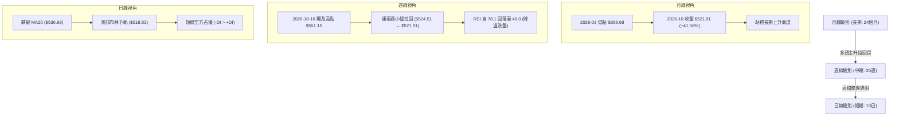

### 📈 長期趨勢 — 12個月走勢圖（Unicode）

以下展示 2025-11 至 2026-10 過去 12 個月收盤走勢：

```
MSFT 月線走勢圖（過去12個月）
價格軸 ($)
$530 ┤                                                 ● (2026-10: $521.91)
$510 ┤                                           ●     │
$490 ┤ ●                                   ●     │     │
$470 ┤   ●                                 │     │     │
$450 ┤     │                         ●     │     │     │
$430 ┤     │   ●                     │     │     │     │
$410 ┤     │   │               ●     │     │     │     │
$390 ┤     │   │   ●           │     │     │     │     │
$370 ┤     │   │   │     ●     │     │     │     │     │
$350 ┤     │   │   │     │     │     │     │     │     │
     └─────┴───┴───┴─────┴─────┴─────┴─────┴─────┴─────┴──────
           N   D   J     F     M     A     M     J     J     A     S     O
          25  25  26    26    26    26    26    26    26    26    26    26
```

#### 走勢特徵分析表格

| 階段 | 時間跨度 | 起訖收盤價 | 漲跌幅 | 結構特徵與技術意義 |
|:---|:---|:---|:---:|:---|
| **回調築底期** | 2025-11 ～ 2026-03 | $488.91 → $368.68 | -24.59% | 自前期高點大幅回撤，於 2026-03 探明年度底部 ($368.68)，完成去槓桿 |
| **強勢主升期** | 2026-03 ～ 2026-08 | $368.68 → $507.29 | +37.60% | 走出強勁多頭推進，連破 MA50 與 MA200，週成交量大幅放大 |
| **高檔收斂期** | 2026-08 ～ 2026-10 | $507.29 → $521.91 | +2.88%  | 衝高至 52W 高點 $551.15 後遇阻，轉為高位橫盤整理，累積籌碼換手 |

### 📊 中期趨勢（週線分析）

中期走勢呈現「階梯式墊高後的震盪」。觀察近 8 週走勢，微軟於 2026-10-16 當週創下 $551.15 的 52 週新高，隨後連續兩週受阻回落，收盤價由 $529.05 下行至 $521.91。週線 RSI 從 8 月高點的 78.1 超買區平滑修正至當前 49.0，週 MACD 柱狀圖亦由正轉負 (-2.262)，中期動能自強多轉向中性休整。

```
中期支撐與阻力結構示意圖
$551.15 ───────────────────────────── 52W 高點 / 強阻力 R1 (週K衝高受阻)
           ▲               ▲
           │ 高檔回檔      │
$530.98 ───┼───────────────┼───────── 短期均線密集區 (MA20 / BB中軌)
           │               │
$521.91 ───┴───────────────┴───────── 當前現價 (測試中軌與下軌間)
           ┬───────────────┬─────────
$512.91 ───┼───────────────┼───────── 中期生命線 MA50
           │               │
$487.61 ───▼───────────────▼───────── 近一年波段低點聚類支撐 S1
```

### ⚡ 趨勢強度評估（ADX 解讀）

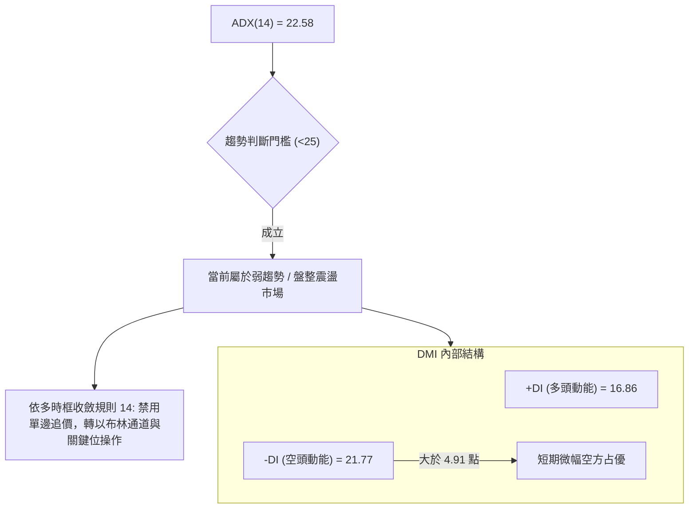

#### ADX 趨勢強度對照表

| 指標名稱 | 當前讀數 | 門檻區間 | 趨勢狀態 | 操作指引 |
|:---|:---:|:---:|:---:|:---|
| **ADX(14)** | **22.58** | `< 25` | **弱趨勢 / 盤整區間** | 避免趨勢突破追價，嚴守支撐阻力區間操作 |
| **+DI** | 16.86 | 參考線 | 多頭動量萎縮 | 多方攻擊動能不足，缺乏連續上攻力道 |
| **-DI** | 21.77 | 參考線 | 空頭動量主導 | 短期賣壓佔優，但尚未構成單邊崩跌趨勢 |

---

## 3. 圖表形態分析

### 🔍 形態識別系統

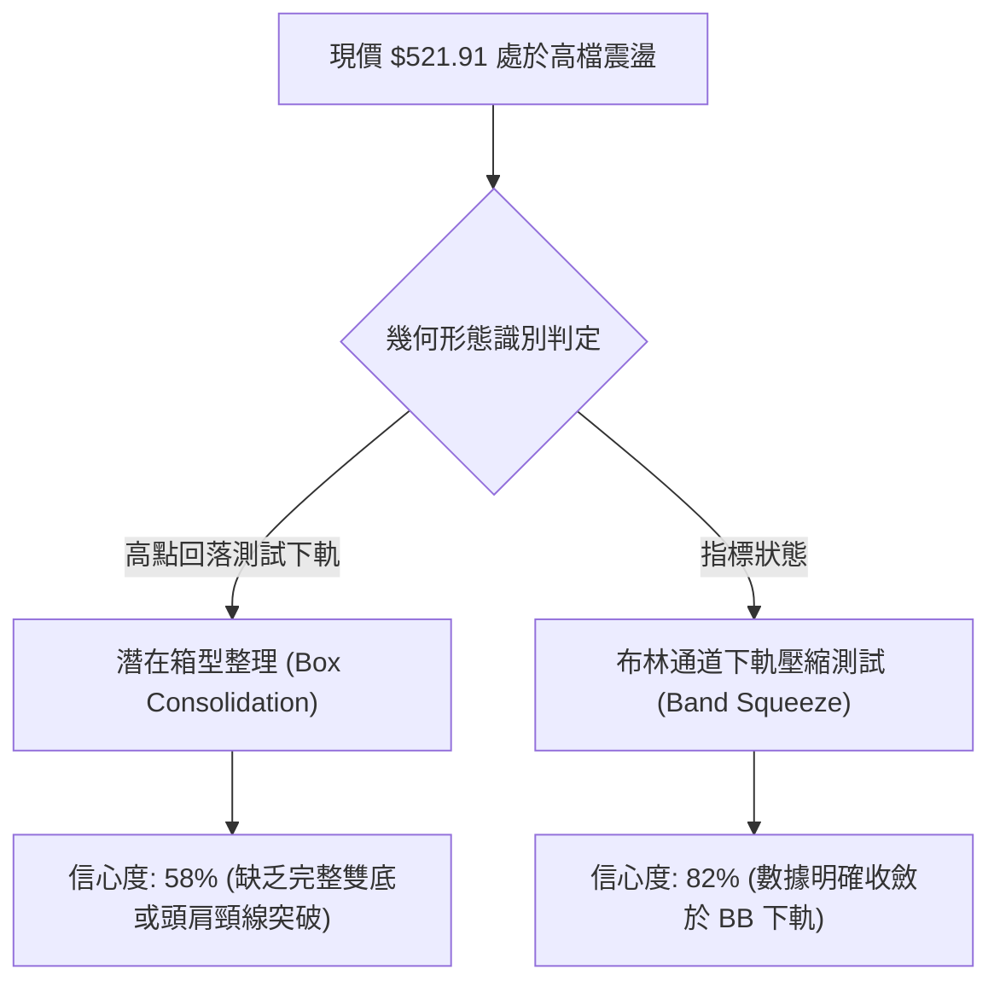

#### 形態識別信心度評估表（依規則 15）

| 形態名稱 | 信心度 | 判斷依據（引用數據） | 完成度 | 目標價（附計算式） |
|:---|:---:|:---|:---:|:---|
| **矩形箱型整理** | **58%** | 區間高點為 R1 ($551.15)，低點受 MA50 ($512.91) 與支撐 S1 ($487.61) 支撐 | 65% | 向上突破測幅：$551.15 + ($551.15 - $487.61) = **$614.69**（由形態高度推算） |
| **布林下軌壓縮反彈** | **82%** | 現價 $521.91 逼近下軌 $518.82，BB %B 為 0.13，Stoch %K 達 20.54 超賣臨界 | 85% | 均值回歸中軌：MA20 = **$530.98**（由指標通道回歸推算） |
| **頭肩頂 / 雙底形態** | **N/A** | 訊號不足，僅做指標型解讀（近8週未呈現標準三峰或雙底結構） | 0% | 數據中未偵測到 |

### 🕯️ 重要 K 線形態分析

依據規則 19，以下嚴格引用數據中「近 10 根日 K」與「近 8 根週 K」之實際開高低收進行客觀解讀：

#### 近 10 根日 K 線形態解讀

| 日期（日K） | 開 | 高 | 低 | 收 | 成交量 | K線形態 | 解讀與技術意義 | 訊號 |
|:---|:---:|:---:|:---:|:---:|:---:|:---|:---|:---:|
| **2026-10-19** | 528.70 | 535.57 | 528.06 | 533.52 | 17,994,900 | 溫和實體紅K | 站上 533，買盤平穩推進 | 🟢 |
| **2026-10-20** | 533.91 | 534.21 | 525.84 | 531.87 | 14,576,000 | 小陰十字星 | 高檔量縮盤整，多空暫時平衡 | 🟡 |
| **2026-10-21** | 529.44 | 533.28 | 525.02 | 532.95 | 13,940,100 | 下影小紅K | 探低 525.02 後獲逢低支撐收復 | 🟢 |
| **2026-10-22** | 533.14 | 533.60 | 520.30 | 521.08 | 21,266,600 | 帶量中黑K | 實體下挫 12 點，短線破位下殺 | 🔴 |
| **2026-10-23** | 517.75 | 525.77 | 515.70 | 524.51 | 13,671,500 | 探底長下影紅K | 最低觸及 515.70，收盤拉升近 9 點展現支撐 | 🟢 |
| **2026-10-26** | 527.40 | 533.25 | 521.69 | 532.60 | 19,021,000 | 震盪反彈陽K | 開低走高收 532.60，重回短期中樞 | 🟢 |
| **2026-10-27** | 532.35 | 534.70 | 528.33 | 531.33 | 19,532,300 | 窄幅整理黑K | 受制於 MA20 壓力，上行乏力 | 🟡 |
| **2026-10-28** | 531.82 | 535.00 | 526.14 | 531.01 | 28,594,200 | 帶量滯漲陰星 | 成交量放大但無法攻克 535，籌碼換手遇阻 | 🔴 |
| **2026-10-29** | 540.22 | 541.29 | 519.56 | 530.14 | 39,333,200 | 長黑高檔反轉K | 跳空開高至 540 後重挫逾 20 點，爆出 39.3M 大量 | 🔴 |
| **2026-10-30** | 525.27 | 526.00 | 514.35 | 521.91 | 35,618,300 | 續挫帶下影黑K | 跌破 520 測 514.35，成交量 35.6M，收盤收斂賣壓 | 🔴 |

#### 近 8 根週 K 線形態解讀

| 日期（週K） | 開 | 高 | 低 | 收 | 週成交量 | 週K形態 | 解讀與技術意義 | 訊號 |
|:---|:---:|:---:|:---:|:---:|:---:|:---|:---|:---:|
| **2026-09-11** | 493.01 | 498.97 | 486.00 | 495.63 | 62,321,200 | 縮量築底陽線 | 量縮回踩，於 486 獲支撐 | 🟡 |
| **2026-09-18** | 497.06 | 509.95 | 487.23 | 493.78 | 115,020,700 | 長影線震盪十字 | 衝破 500 後回吐，形成蓄勢 | 🟡 |
| **2026-09-25** | 494.95 | 519.40 | 491.22 | 516.17 | 123,909,000 | 突破大陽K | 實體上漲 21.2 點，帶量發動多頭 | 🟢 |
| **2026-10-02** | 505.47 | 522.85 | 502.22 | 517.53 | 105,746,200 | 創高整理陽線 | 維持在 517 之上，消化浮額 | 🟢 |
| **2026-10-09** | 521.62 | 537.22 | 518.79 | 535.07 | 103,231,800 | 續攻中長陽K | 週線連續攀升，逼近前高 | 🟢 |
| **2026-10-16** | 537.53 | 551.15 | 524.43 | 529.05 | 113,488,100 | 長上影倒錘頭陰K | 觸及 52W 新高 $551.15 後大幅拉回，高檔見頂 | 🔴 |
| **2026-10-23** | 528.70 | 535.57 | 515.70 | 524.51 | 81,449,100 | 下探收斂陰K | 測試 515 支撐，量能明顯萎縮 | 🟡 |
| **2026-10-30** | 527.40 | 541.29 | 514.35 | 521.91 | 142,099,000 | 帶量下殺陰線 | 衝高 541 受阻，週量擴大至 1.42 億股，跌破週均線 | 🔴 |

### 📉 ASCII 走勢形態示意圖

```
高檔箱型震盪與雙頂壓制示意圖
$551.15 ┼─────────────────────● (2026-10-16 創高 551.15)
        │                    ╱ ╲
$541.29 ┼                   ●   ╲        ● (2026-10-29 次高 541.29 遇阻)
        │                  ╱     ╲      ╱ ╲
$530.98 ┼─────────────────┼───────●────┼───╲──── (MA20 頸線壓力)
        │                ╱         ╲  ╱     ╲
$521.91 ┼───────────────●           ╲╱       ● (現價測試支撐)
        │              ╱                       ╲
$514.35 ┼─────────────●                         ● (10-30 探底 514.35)
        └─────────────────────────────────────────────
```

### 🎯 形態目標價計算

根據現有確認之形態參數進行推算：
1. **布林下軌超賣均值回歸（短線）**：
   - 起點：當前收盤價 $521.91
   - 基準頸線：布林通道中軌（MA20）= **$530.98**
   - 測算上行目標：$530.98（上漲空間 +1.74%）
2. **箱型整理向上突破測幅（中長線）**：
   - 形態區間：下軌波段低點聚類 S1 ($487.61) 至上軌高點 R1 ($551.15)
   - 箱型高度：$551.15 - $487.61 = $63.54
   - 若未來確認放量突破 R1，等幅向上目標價 = $551.15 + $63.54 = **$614.69**（由形態高度推算）

---

## 4. 支撐與阻力

### 🗺️ 關鍵價位分布圖（Unicode）

```
MSFT 價位結構分布圖
═══════════════════════════════════════════════════════════════
$551.15 ║██████████████████████████████║ 強阻力 R1 (52W 高點聚類)
$543.15 ║████████████████████          ║ 布林通道上軌
$530.98 ║████████████████              ║ 阻力位 (MA20 / 布林中軌)
$521.91 ╠══════════════════════════════╣ ◄ 當前現價 ($521.91)
$518.82 ║▓▓▓▓▓▓▓▓▓▓▓▓▓▓▓▓              ║ 布林通道下軌
$512.91 ║▓▓▓▓▓▓▓▓▓▓▓▓▓▓▓▓▓▓▓▓          ║ 動態支撐 (MA50 生命線)
$503.33 ║▓▓▓▓▓▓▓▓▓▓▓▓▓▓▓▓▓▓▓▓▓▓        ║ 斐波那契 23.6% 回調位
$487.61 ║██████████████████████████████║ 強支撐 S1 (近一年波段低點聚類)
$476.25 ║████████████████████████      ║ 強支撐 S2 (波段低點聚類)
$465.47 ║████████████████████          ║ 強支撐 S3 (波段低點聚類)
═══════════════════════════════════════════════════════════════
```

### 🚧 阻力位分析表

*嚴格引用數據中「關鍵價位」區塊數值：*

| 阻力級別 | 價位 | 形成原因 | 突破難度 | 重要性 |
|:---|:---:|:---|:---:|:---:|
| **關鍵阻力 R1** | **$551.15** | 52週歷史高點（2026-10-16 盤中高點聚類） | 極高 | ★★★★★ |
| **阻力位 R2** | N/A（數據未提供） | 數據中未偵測到次級聚類高點，上方無其他歷史重疊位 | N/A | N/A |
| **阻力位 R3** | N/A（數據未提供） | 數據中未偵測到次級聚類高點 | N/A | N/A |

*補充動態阻力：布林上軌 $543.15、MA20 阻力 $530.98。*

### 🛡️ 支撐位分析表

*嚴格引用數據中「關鍵價位」區塊數值：*

| 支撐級別 | 價位 | 形成原因 | 守住機率 | 重要性 |
|:---|:---:|:---|:---:|:---:|
| **近期支撐 S1** | **$487.61** | 近一年波段低點聚類，對應 2026-08/09 週線整理平台低點 | 75% | ★★★★☆ |
| **強支撐 S2** | **$476.25** | 近一年波段低點聚類，接近斐波那契 38.2% ($473.75) 重合區 | 85% | ★★★★★ |
| **深度支撐 S3** | **$465.47** | 近一年波段低點聚類，對應 2026-07 突破跳空缺口頂部 | 90% | ★★★★☆ |

### 📐 斐波那契回調位分析

*直接引用數據中 52 週區間 ($348.54 → $551.15) 斐波那契回調計算結果：*

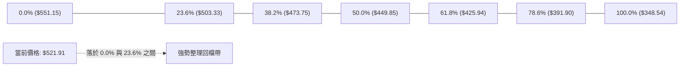

#### 斐波那契回調層級分析

| 回調比例 | 價位 | 當前距離 | 結構解讀與技術意義 |
|:---|:---:|:---:|:---|
| **0.0% (52W High)** | **$551.15** | +5.60% | 年度極值阻力，突破此位方能打開多頭新一輪空間 |
| **23.6% 回調** | **$503.33** | -3.56% | **第一道多頭防禦線**。強勢牛市拉回通常不破 23.6% |
| **38.2% 回調** | **$473.75** | -9.23% | 中級修正支撐，與波段低點 S2 ($476.25) 形成重疊共振支撐帶 |
| **50.0% 回調** | **$449.85** | -13.81% | 趨勢多空平衡位，此位下方趨勢轉弱 |
| **61.8% 黃金分割** | **$425.94** | -18.39% | 牛熊分水嶺，接近 MA200 ($436.85) 長期核心均線 |
| **78.6% 回調** | **$391.90** | -24.91% | 深幅回撤防線 |
| **100.0% (52W Low)**| **$348.54** | -33.22% | 52 週週期底部起點 |

**位置解讀**：現價 $521.91 牢牢維持在 0.0% ($551.15) 與 23.6% ($503.33) 之間的「強勢回調區」。即便自高點回落 5.6%，整體回檔幅度仍未觸及 23.6%，顯示長期多頭骨架依然強韌，目前僅屬淺層回踩。

---

## 5. 技術指標深度解讀

### 🎛️ 指標訊號總覽

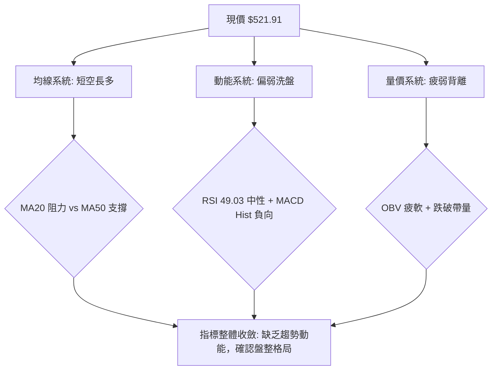

### 📈 移動平均線排列分析

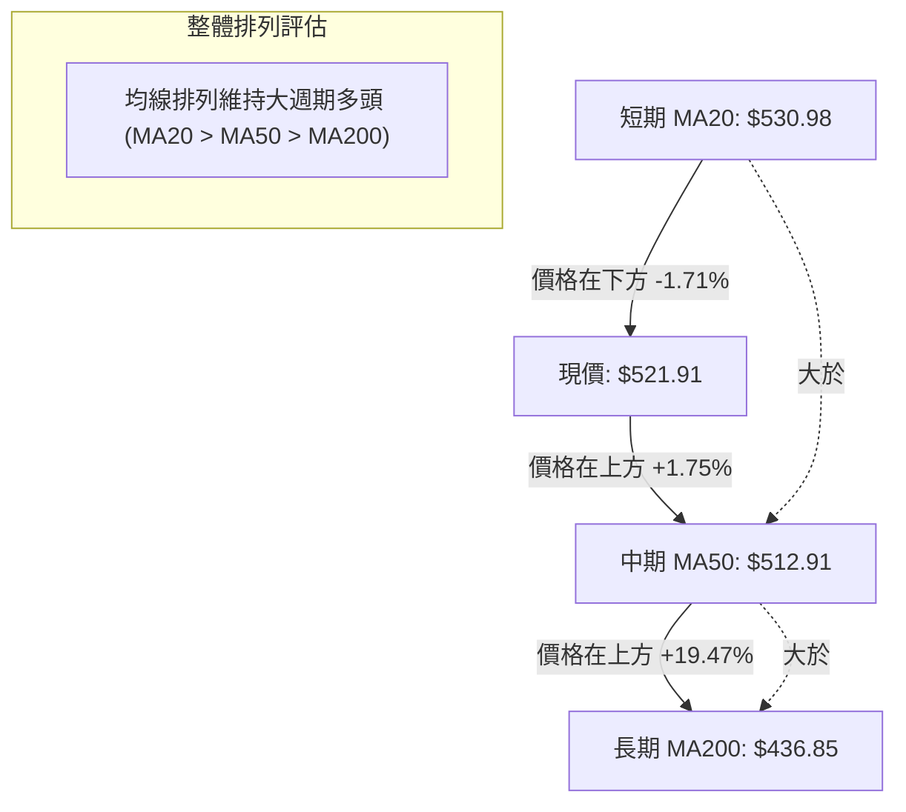

#### 移動平均線數據對比

| 均線名稱 | 數值 | 現價與均線差值 | 偏離百分比 | 趨勢方向 | 短期技術意涵 |
|:---|:---:|:---:|:---:|:---:|:---|
| **MA 5** | $529.40 | -$7.49 | -1.41% | ▼ 下行 | 短線急跌，扣抵高價位使超短期承壓 |
| **MA 10** | $529.09 | -$7.18 | -1.36% | ▼ 下行 | 與 MA5 形成短期反壓壓制區 ($529–$530) |
| **MA 20** | $530.98 | -$9.07 | -1.71% | ▼ 下行 | 跌破月均線，月線級別反彈的第一目標 |
| **MA 50** | $512.91 | +$9.00 | +1.75% | ▲ 上行 | 季線強勁上揚，為當前多方第一道堅固防線 |
| **MA 60** | $509.32 | +$12.59| +2.47% | ▲ 上行 | 提供 $509 附近的雙重多頭緩衝 |
| **MA 120** | $457.75 | +$64.16| +14.02%| ▲ 上行 | 半年線持續抬升，中長期趨勢完好 |
| **MA 200** | $436.85 | +$85.06| +19.47%| ▲ 上行 | 年線多頭大底，長線安全邊際充足 |
| **MA 240** | $443.88 | +$78.03| +17.58%| ▲ 上行 | 長期均線架構維持良性發散 |

### 📉 RSI(14) 分析

```
RSI(14) 讀數：49.03 (Wilder)
0 ─────── 30 ──────────────── 50 ──────────────── 70 ─────── 100
[ 超賣區 ]   [       中性震盪區間       ]   [ 超買區 ]
                   ▲ (49.03)
進度條：████████████░░░░░░░░░░░░  49.03%
```

- **超買超賣判定**：數值 49.03 處於 30 至 70 之正中區間，既無超買亦無超賣，反映多空力量處於勢均力敵的冷卻狀態。
- **背離分析判定**：
  - 根據數據中近 20 根 K 棒首尾之價格與 RSI 方向比對：**無明顯背離**。
  - 結論：價格回落與 RSI 動能回落同步，未見頂背離（價格創新高而 RSI 走低）或底背離（價格創新低而 RSI 走高），表明當前回檔為常態性技術修正。

### 📊 MACD(12/26/9) 訊號解讀

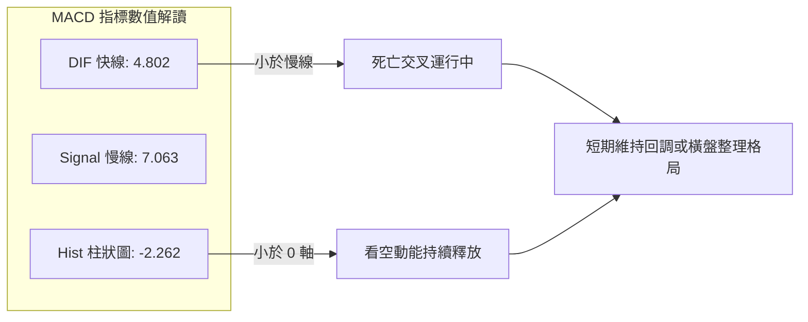

- **快慢線關係**：MACD 線 (4.802) 位於 Signal 線 (7.063) 下方，雙線均處於 0 軸之上，代表「長期多頭背景下的短期死叉回調」。
- **柱狀圖動能**：柱狀圖為 -2.262 🔴，空頭柱體仍處於負向區域，提示短期動能尚未由空翻多，切勿盲目追價。

### 📦 布林通道分析

```
布林通道 (20, 2) 結構示意圖
$543.15 ─────────────────────────────── 上軌 (BB Upper)
          ╲
           ╲
$530.98 ────●────────────────────────── 中軌 (BB Middle / MA20)
             ╲
$521.91 ──────●──────────────────────── 現價 (BB %B = 0.13)
               ╲
$518.82 ────────●────────────────────── 下軌 (BB Lower)
```

- **軌道邊界**：上軌 $543.15、中軌 $530.98、下軌 $518.82。
- **帶寬與位置**：BB %B 僅為 **0.13**，現價 $521.91 距離下軌 $518.82 僅有 $3.09 (0.59%)。
- **統計意義**：在布林通道常態分佈下，價格運行至 %B < 0.20 屬於下軌極值超賣區域，若下軌未被有效摜破並發散張口，通常具備向中軌回歸的統計學均值回歸傾向。

### 💹 成交量分析（量價配合度）

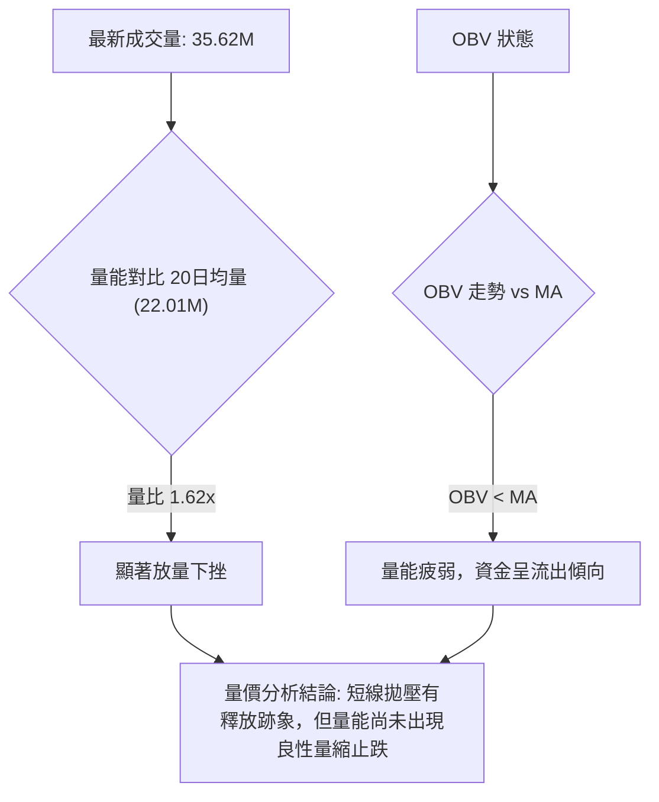

- **量比狀態**：2026-10-30 下跌收陰，成交量 35,618,300 股，相較 20 日均量 22,013,400 股放大至 **1.62 倍**。
- **OBV 趨勢**：數據顯示「OBV < MA」，量能指標落後於均線，確認資金在短期呈現淨流出。
- **量價背離分析**：高檔 540 之上出貨放量（10-29 日量 39.3M，10-30 日量 35.6M），屬於「放量滯漲與帶量殺跌」，尚未見到縮量築底結構，多頭反攻需等待量能重新萎縮至 20M 以下。

---

## 6. 動能與波動率

### ⚡ 動能評估四象限

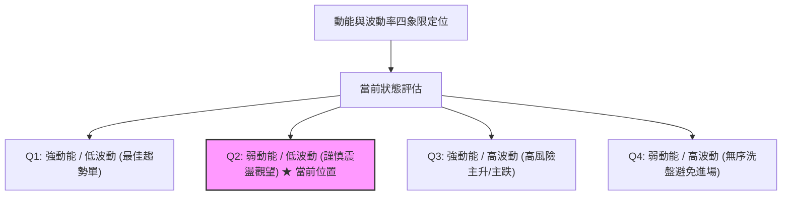

#### 四象限評估矩陣

| 象限 | 動能維度 | 波動維度 | 當前狀態標記 | 技術特徵與策略對策 |
|:---|:---:|:---:|:---:|:---|
| **Q1** | 強 (ADX>25, RSI>60) | 低 (ATR%<2%) | — | 穩定多頭推進，順勢加碼 |
| **Q2** | **弱 (ADX=22.58, RSI=49.03)** | **中低 (ATR% 2.28%)** | **✓ 當前狀態** | **典型區間拉鋸，動能衰減，宜低吸高拋或觀望** |
| **Q3** | 強 (單邊爆發) | 高 (ATR%>3%) | — | 單邊突破行情，需快速跟進並設寬幅止損 |
| **Q4** | 弱 (無方向) | 高 (劇烈洗盤) | — | 雜訊過多，極易雙向被掃，強制空倉 |

### 📊 ATR 波動率分析

- **ATR(14) 數值**：**$11.88**（佔當前股價 2.28%，Wilder 平滑計算）。
- **日內波動區間推算**：
  - 預期單日波動上限：$521.91 + $11.88 = $533.79
  - 預期單日波動下限：$521.91 - $11.88 = $510.03（與 MA50 $512.91 高度貼合）
- **止損距離建議**：
  - 短線波段策略（1.0 × ATR）：$11.88
  - 穩健中線策略（1.5 × ATR）：$17.82
  - 寬幅風控策略（2.0 × ATR）：$23.76

### 📐 Beta 與市場相關性

- **Beta 數值**：**1.099**（略高於市場平均水平 1.00）。
- **大盤聯動性解讀**：
  - Beta 接近 1.10，顯示微軟與標普 500 指數具備高度同步性，且彈性稍大於指數 10%。
  - 在整體美股市場（S&P 500 / QQQ）未見系統性下跌風險的前提下，個股下行空間相對受限；若大盤震盪築底，MSFT 易出現共振反彈。

---

## 7. 多時框架總結

### 📋 時框架評分表

| 時框架 | 趨勢方向 | 動能指標 | 均線排列 | 圖表形態 | 綜合評分 | 操作建議 |
|:---|:---:|:---:|:---:|:---:|:---:|:---|
| **短期 (日線)** | 🔴 偏空 | 🔴 MACD Hist 負值 | 🔴 跌破 MA20 | 🟡 測試布林下軌 | **38/100** | 暫停追價，等待下軌止跌信號 |
| **中期 (週線)** | 🟡 震盪整理 | 🟡 RSI 49 降溫 | 🟢 站穩 MA50 | 🟡 高檔箱型蓄勢 | **54/100** | 逢回調至關鍵支撐分批佈局 |
| **長期 (月線)** | 🟢 多頭推進 | 🟢 位於歷史高位區 | 🟢 MA200 向上多頭 | 🟢 階梯式多頭架構 | **72/100** | 長線多頭趨勢不變，持股續抱 |

### 🔲 綜合訊號矩陣

```
訊號維度對照表：
┌──────────────┬──────────────┬──────────────┬──────────────┐
│ 分析維度     │ 日線 (短期)  │ 週線 (中期)  │ 月線 (長期)  │
├──────────────┼──────────────┼──────────────┼──────────────┤
│ 均線架構     │ 跌破 MA5/10/20│ 遠高於 MA50  │ 多頭完美發散 │
│ 動能強度     │ 空方主導     │ 震盪洗盤     │ 強勁上升     │
│ 支撐測試     │ 測布林下軌   │ 測前波突破位 │ 離年線空間大 │
│ 成交量配合   │ 放量下跌(空) │ 衝高縮量(平) │ 穩健換手(多) │
└──────────────┴──────────────┴──────────────┴──────────────┘
```

### ⚖️ 多時框收斂結論

**嚴格依據多時框收斂規則（規則 14）推導：**

1. **市場屬性判斷**：
   當前日線 ADX(14) 讀數為 **22.58**（明確低於 25 門檻），因此當前行情性質定性為**「盤整行情（Range-bound Market）」**，而非單邊趨勢行情。
2. **主導時框與優先級取捨**：
   - 根據規則 14 之盤整行情指令，此時**「以日線布林通道上下軌（$518.82 ～ $543.15）為主要交易區間」**。
   - 雖然長期月線與週線均線（MA50 $512.91、MA200 $436.85）呈現多頭排列，但日線短期受制於 MA20 ($530.98) 且 MACD 死亡交叉，長短期發生背馳。
   - 依盤整市收斂原則，日線不宜用作追多依據，亦不可單純因長多而盲目開倉，必須尊重日線布林通道邊界的震盪反覆。
3. **唯一方向性結論**：
   **【中性觀望 / 區間震盪操作】**（偏向在布林下軌及 MA50 支撐處尋找均值回歸機會）。

---

## 8. 交易策略建議

### 🗺️ 策略決策流程圖

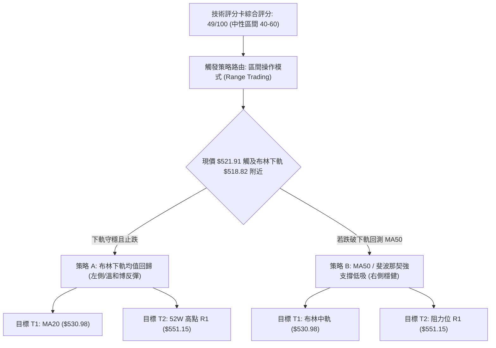

### 🧭 策略路由（依評分卡分流）

> **當前主策略方向 = 中性區間震盪操作（依評分 49/100，落於 40–60 區間）**
> 
> *解讀：因綜合評分 49 分處於 40–60 之中性震盪區間，依規則明確採用「區間操作」主策略，以日線布林上下軌與均線支撐為操作軸心，禁止單邊追高或殺跌，等待區間邊界之確認信號。*

### 🎯 價格情境階梯（Price Scenarios）

*價位嚴格引用第 4 章及數據關鍵價位：*

| 觸發條件 | 下一目標 | 後續延伸 | 情境含義 |
|:---|:---:|:---:|:---|
| **向上突破 R1 $551.15** | $614.69（形態推算） | N/A（數據未提供） | 強勢突破 52 週新高，打開中長期延伸空間 |
| **站穩現價區間 ($518.82 ～ $530.98)** | MA20 $530.98 | R1 $551.15 | 布林通道內常態震盪整理，籌碼沉澱 |
| **跌破 S1 $487.61** | S2 $476.25 | S3 $465.47 | 中期轉弱，跌破盤整大箱底，回測深度支撐 |

### 📊 情境機率分佈

| 情境劇本 | 機率 | 主要依據 |
|:---|:---:|:---|
| **情境一：布林下軌獲撐，向中軌反彈** | **55%** | 布林 %B=0.13 逼近下軌極限，Stoch %K=20.54 超賣，MA50 ($512.91) 強力托底 |
| **情境二：窄幅橫盤震盪 (518–530)** | **30%** | ADX 僅 22.58，趨勢強度弱，成交量尚未放大逆轉，市場等待籌碼冷卻 |
| **情境三：摜破下軌，回測 S1 支撐** | **15%** | 帶量長陰（10-29/30 連續大成交量），若跌破 MA50 將觸發技術性停損賣壓 |

### 🟢 主策略詳情（區間操作模式）

*風險報酬比嚴格依規則 17 計算：(目標價 T1 − 進場價) ÷ (進場價 − 止損價)*

| 策略要素 | 策略 A（布林下軌均值回歸） | 策略 B（MA50 支撐位低吸） |
|:---|:---|:---|
| **策略性質** | 短線區間反彈策略 | 中期波段防禦性佈局 |
| **進場條件** | 股價於布林下軌 $518.82 附近止跌收十字星 | 股價回踩 MA50 $512.91 附近確認企穩 |
| **進場價格** | **$519.00**（以布林下軌邊界為進場點） | **$513.00**（以 MA50 支撐位為進場點） |
| **目標價 T1** | **$530.98**（引用 MA20 / BB中軌） | **$530.98**（引用 MA20 / BB中軌） |
| **目標價 T2** | **$551.15**（引用阻力位 R1 / 52W高點） | **$551.15**（引用阻力位 R1 / 52W高點） |
| **止損價格** | **$514.00**（低於 10-30 日低點 $514.35） | **$503.00**（低於斐波那契 23.6% $503.33） |
| **風險報酬比** | **1 : 2.40（以 T1 計）**<br>*算式: (530.98-519)/(519-514) = 11.98/5 = 2.40*<br>另註：1 : 6.43（以 T2 計，算式: 32.15/5） | **1 : 1.80（以 T1 計）**<br>*算式: (530.98-513)/(513-503) = 17.98/10 = 1.80*<br>另註：1 : 3.82（以 T2 計，算式: 38.15/10） |
| **成功機率** | **55%** | **65%** |
| **建議倉位** | **15%**（輕倉試探） | **25%**（標準波段底倉） |

### 🔴 反向風險觸發點（對沖提示）

- **多頭結構推翻點**：若日線收盤價帶量跌破 **$503.33**（斐波那契 23.6% 回調位）及 **$487.61**（波段強支撐 S1），宣告自 $368 以來的中期上升趨勢中斷，必須全數停損或建立空頭對沖部位。
- **空頭威脅化解點**：若價格放量突破並站穩 **$530.98**（MA20），且日 MACD 柱狀圖翻正，則短期空頭死叉失效，將直接挑戰 **$551.15**。

### ⭐ 整體訊號強度評星

```
╔══════════════════════════════════════════════════════════════╗
║ 做多訊號強度：★★☆☆☆  (2/5星) — 短期承壓，需等待止跌確認       ║
║ 做空訊號強度：★★☆☆☆  (2/5星) — 長期多頭護盤，追空勝率偏低     ║
║ 整體可信度：  ★★★☆☆  (3/5星) — 盤整市特徵，尊重區間邊界       ║
╚══════════════════════════════════════════════════════════════╝
```

---

## 9. 風險提示與監控

### ✅ 關鍵監控指標 Checklist

```
╔══════════════════════════════════════════════════════════════╗
║               每日盤後技術監控清單 (Checklist)               ║
╠══════════════════════════════════════════════════════════════╣
║ [ ] 1. 價格是否跌破布林下軌 $518.82 並持續發散張口？          ║
║ [ ] 2. 季線 MA50 ($512.91) 是否提供有效支撐與收出下影線？    ║
║ [ ] 3. 成交量是否自當前 35M 高檔萎縮至 22M 均量以下？        ║
║ [ ] 4. 日線 MACD 柱狀圖負值 (-2.262) 是否開始收斂向上？       ║
║ [ ] 5. RSI(14) 能否在 45–50 區域止跌，避免跌破 40 弱勢區？   ║
║ [ ] 6. 向上反彈時能否有效收復 MA20 ($530.98) 阻力？          ║
╚══════════════════════════════════════════════════════════════╝
```

### ⚠️ 風險場景分析

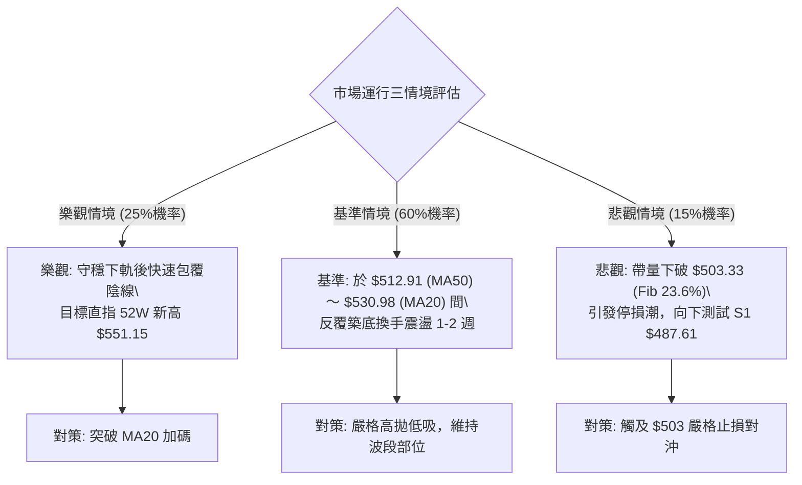

### 🛡️ 風險管理重要提醒

1. **拒絕單邊臆測，尊重震盪指標**：
   在 ADX = 22.58 且 -DI 略大於 +DI 的環境下，切忌在通道中軌附近猜測突破方向。當前行情最大的風險是「過早全力押注單邊走勢」，導致在布林通道上下軌之間被來回停損。
2. **倉位管理守則**：
   整體技術部位建議控制在總資金的 **30%–40% 以內**。單筆交易最大虧損額度不得超過總投資組合淨值的 **1.0%**（以策略 A 為例，若進場價 $519.00，止損點 $514.00，每股風險 $5.00，10 萬美元部位最多持有 200 股）。
3. **重大基本面事件防範**：
   技術面呈現量能流出（OBV 疲軟、連續兩日放量下跌），雖有分析師給予高度正面評級，但技術面往往領先反映籌碼意圖。嚴格以技術支撐位（MA50 $512.91、S1 $487.61）作為硬性風控底線，不得以基本面為藉口忽視破位信號。

---

## 📋 報告總結

```
╔══════════════════════════════════════════════════════════════╗
║                   MSFT 技術分析報告總結                      ║
╠══════════════════════════════════════════════════════════════╣
║ 報告日期：2026-11-01                                         ║
║ 當前價格：$521.91                                            ║
║ 分析評級：⚖️ 中性盤整 (技術評分: 49/100)                     ║
║                                                              ║
║ 關鍵結論：                                                   ║
║ ├─ 長期趨勢：🟢 強勢多頭 (月線穩健，遠高於 MA200 $436.85)     ║
║ ├─ 中期趨勢：🟡 高檔震盪 (週線高位拉回，回踩 MA50 $512.91)   ║
║ ├─ 短期趨勢：🔴 偏弱整理 (跌破 MA20 $530.98，測下軌 $518.82) ║
║ ├─ 關鍵支撐：S1 $487.61 ｜ S2 $476.25 ｜ S3 $465.47           ║
║ ├─ 關鍵阻力：R1 $551.15 (52W歷史高點)                         ║
║ └─ 分析師目標：均價 $631.09 (現有51位分析師共識)             ║
║                                                              ║
║ 最優策略組合：                                               ║
║ 1. 🥇 最佳機會：策略 A (布林下軌 $519 輕倉試探反彈，盈虧比 1:2.40)║
║ 2. 🥈 次選機會：策略 B (MA50 $513 關鍵均線防守佈局，盈虧比 1:1.80)║
║ 3. 🥉 保守選擇：場外觀望，等待日線 MACD 柱狀圖翻正且站上 MA20 ║
╚══════════════════════════════════════════════════════════════╝
```

---

> ⚠️ **免責聲明**：本報告為技術分析研究，所有數據均嚴格基於所提供之歷史價格與技術指標資訊。本報告**僅供研究與學術參考**，**不構成任何買賣要約或投資建議**。市場有風險，交易決策應獨立判斷並自負盈虧。

---

*報告生成時間：2026-11-01 ｜ 數據來源：Yahoo Finance ｜ 分析框架：多時框技術分析*