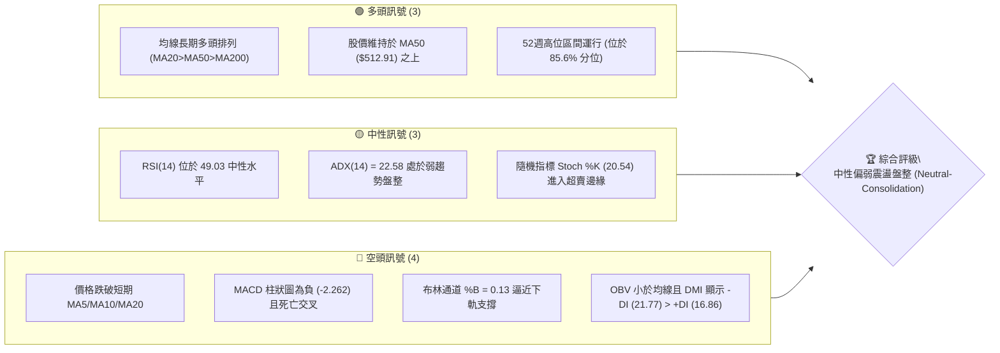
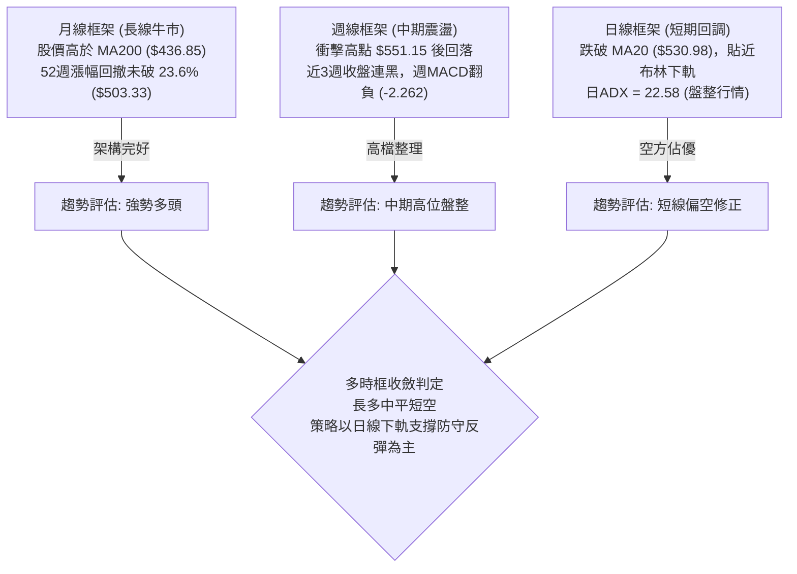
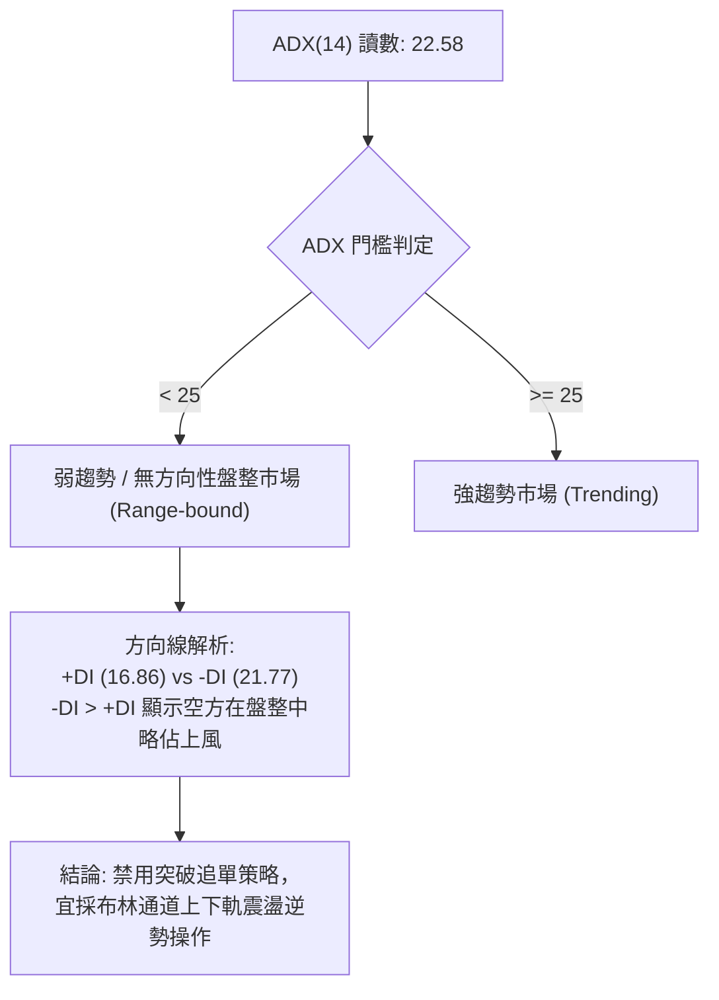
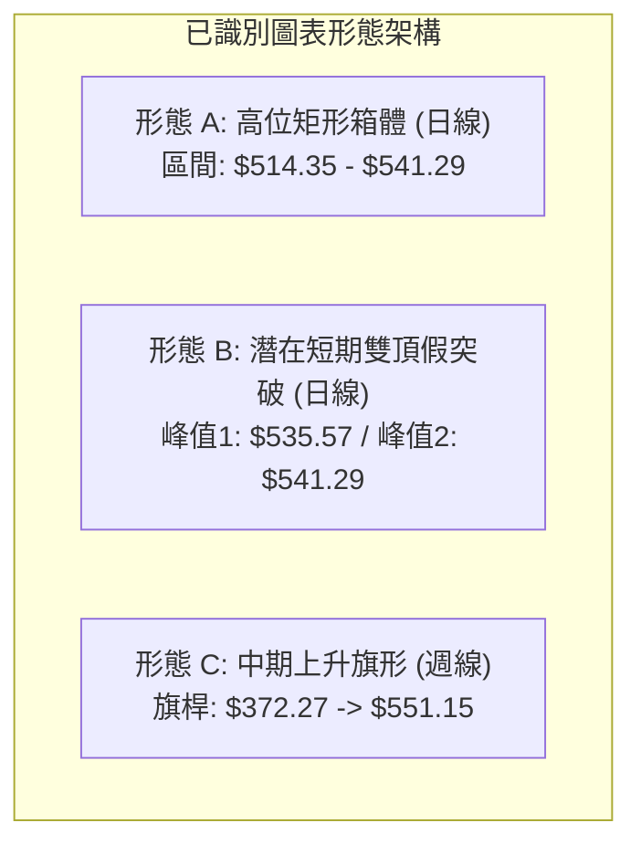
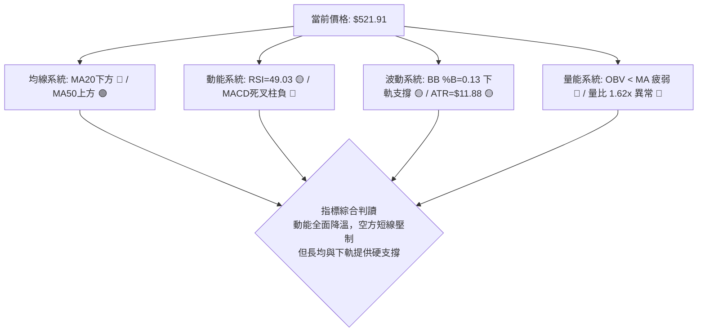
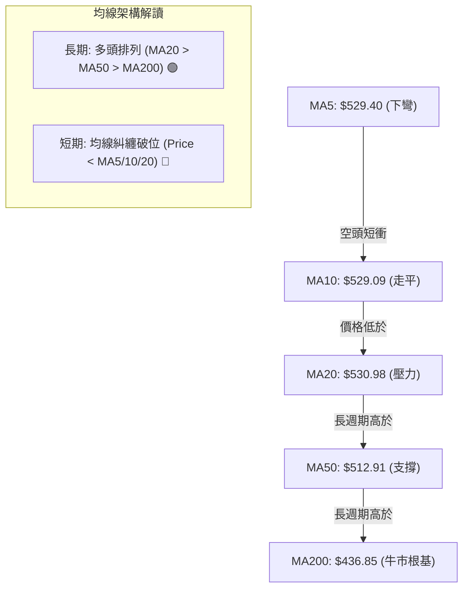
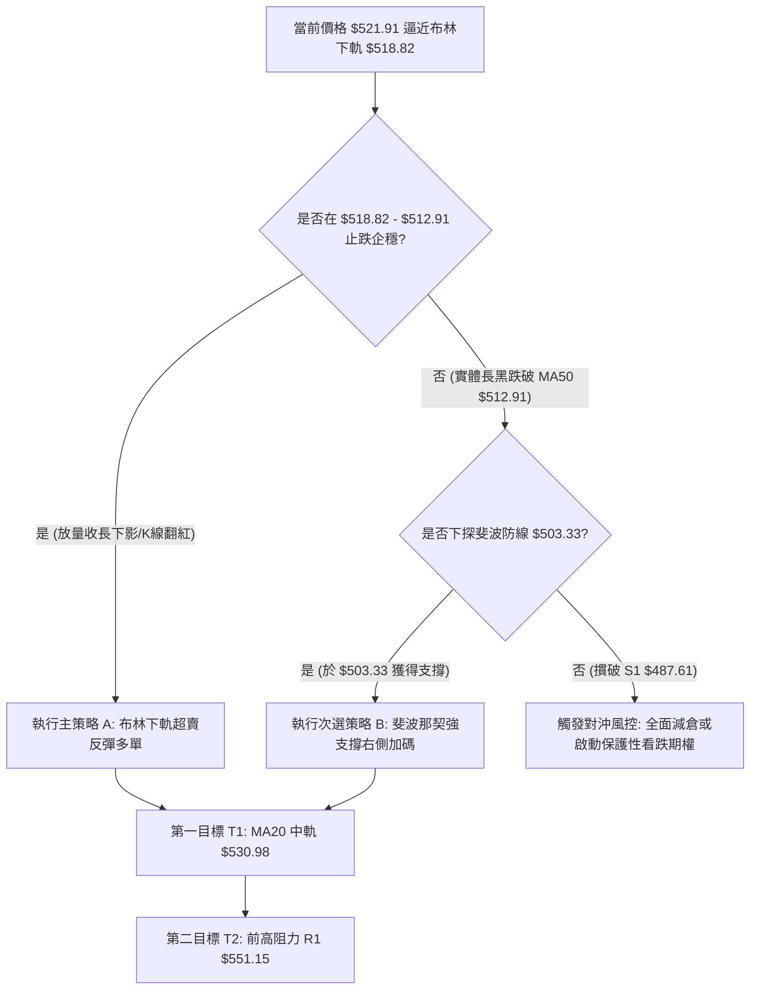
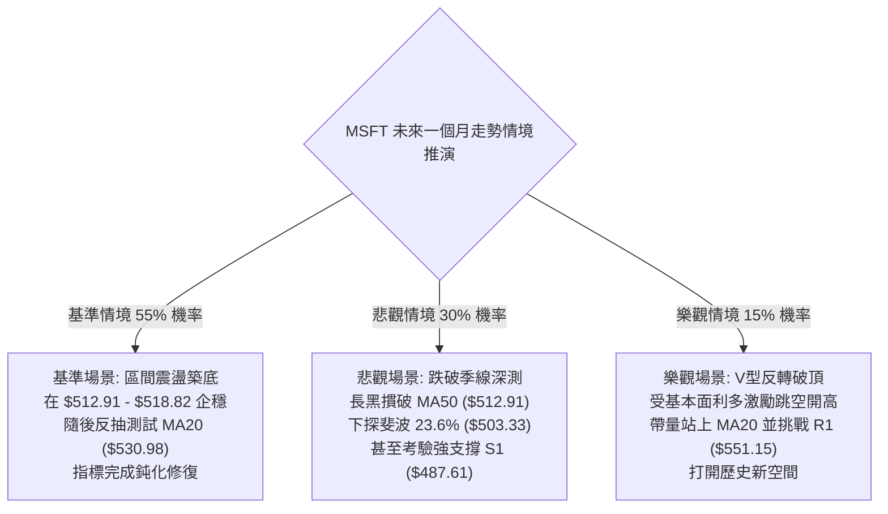

# MSFT 技術分析報告

> **報告日期**：2026-11-02 ｜ **語言**：繁體中文 ｜ **數據來源**：Yahoo Finance ｜ **當前價格**：$521.91

---

## 目錄

| 章節 | 內容 |
|------|------|
| [1. 技術面概覽](#1-技術面概覽) | 訊號儀表板、核心指標、評分卡 |
| [2. 趨勢分析](#2-趨勢分析) | 多時框趨勢、長中短期走勢 |
| [3. 圖表形態分析](#3-圖表形態分析) | 形態識別、K線組合、目標價 |
| [4. 支撐與阻力](#4-支撐與阻力) | 關鍵價位、斐波那契回調 |
| [5. 技術指標深度解讀](#5-技術指標深度解讀) | MA/RSI/MACD/布林/成交量 |
| [6. 動能與波動率](#6-動能與波動率) | 動能評估、ATR、Beta |
| [7. 多時框架總結](#7-多時框架總結) | 時框架評分矩陣 |
| [8. 交易策略建議](#8-交易策略建議) | 多空策略、風險報酬比 |
| [9. 風險提示與監控](#9-風險提示與監控) | 監控指標、風險場景 |
| [報告總結](#-報告總結) | 核心結論與策略彙整 |

---

## 1. 技術面概覽

### 🎯 技術訊號儀表板

微軟公司（MSFT）當前技術結構呈現「長線多頭架構完好，但短線動能出現衰竭與盤整修正」的特徵。價格自歷史高點回落後，目前承壓於短期均線之下，進入防守與震盪蓄勢期。



### 📊 核心指標速覽表

| 指標類別 | 指標名稱 | 當前數值 | 訊號 | 解讀 |
|----------|----------|----------|------|------|
| **價格** | 當前收盤價 | $521.91 | 🟡 | 位於52週區間85.6%，高位拉回震盪整理 |
| **均線** | MA20 (月線) | $530.98 | 🔴 | 跌破短期生命線，收盤低於MA20達-1.71%，短線轉弱 |
| **均線** | MA50 (季線) | $512.91 | 🟢 | 股價位於季線之上+1.75%，中期多頭防線仍然有效 |
| **均線** | MA200 (年線) | $436.85 | 🟢 | 股價遠高於年線+19.47%，長期牛市基石極為穩固 |
| **動能** | RSI(14) | 49.03 | 🟡 | 位於50中軸下方，多空勢力均衡微偏弱，無顯著背離 |
| **動能** | MACD(12,26,9) | 4.802 / 7.063 | 🔴 | DIF跌破DEA形成死叉，Histogram為-2.262，回調動能釋放 |
| **動能** | 隨機震盪 (KD) | %K 20.54 / %D 34.82 | 🟡 | KD進入低檔鈍化區間，短線下行空間受限，具技術反彈需求 |
| **趨勢** | ADX (14) | 22.58 (-DI 21.77) | 🔴 | ADX<25顯示趨勢衰竭為無方向盤整，且空頭力量(-DI)佔優 |
| **通道** | 布林帶 %B | 0.13 ($518.82–$543.15) | 🟡 | 貼近布林下軌($518.82)，進入帶狀下緣超賣反彈敏感區 |
| **成交量** | 最新成交量 / 量比 | 35.62M / 1.62x | 🔴 | 下跌放量（高於20日均量22.01M），機構套現賣壓湧現 |
| **波動** | ATR(14) | $11.88 (2.28%) | 🟡 | 日波動幅度處於中等水平，盤整中隱含突破預期 |

### 🏆 技術評分卡

依照六大技術面向獨立客觀量化評估，綜合評分取六項子評分之算術平均（規則 18）：
- 趨勢強度：45/100（ADX 22.58，無明確趨勢，空頭 -DI 略勝）
- 動能指標：40/100（MACD 死叉擴大，RSI 破 50，Stoch 低檔但未金叉）
- 支撐穩定度：65/100（MA50 與斐波那契 23.6% 在 $503-$513 提供多重保護）
- 成交量配合：35/100（下跌放量達 1.62 倍，OBV 低於均線，量價背離）
- 形態完整度：50/100（高位區間矩形箱體震盪，缺乏明確反轉形態突破）
- 均線排列：75/100（長週期 MA20>MA50>MA200 多頭排列，唯短線跌破 MA20）
- **綜合評分** = (45 + 40 + 65 + 35 + 50 + 75) ÷ 6 = 310 ÷ 6 = 51.67，四捨五入為 **52/100**。

```
╔══════════════════════════════════════════════════════════════════╗
║                 技術評分卡 — MSFT (2026-11-02)                  ║
╠══════════════════════════════════════════════════════════════════╣
║ 趨勢強度      █████████░░░░░░░░░░░  45/100  🔴 空方微幅主導 (弱趨勢)   ║
║ 動能指標      ████████░░░░░░░░░░░░  40/100  🔴 MACD死叉擴大中          ║
║ 支撐穩定度    █████████████░░░░░░░  65/100  🟢 MA50與S1形成中期緩衝    ║
║ 成交量配合    ███████░░░░░░░░░░░░░  35/100  🔴 下跌帶量，OBV走弱       ║
║ 形態完整度    ██████████░░░░░░░░░░  50/100  🟡 高位箱體震盪待突破      ║
║ 均線排列      ███████████████░░░░░  75/100  🟢 長期均線架構維持完好    ║
╠══════════════════════════════════════════════════════════════════╣
║ 綜合評分      ██████████░░░░░░░░░░  52/100  🟡 中性觀望 / 區間操作     ║
╚══════════════════════════════════════════════════════════════════╝
```

---

## 2. 趨勢分析

### 🌐 多時框趨勢分析

採用多時框架由大至小層層遞進，結合收斂優先級規則（ADX < 25 時以盤整震盪邏輯為主導，短線受制於通道下緣，中長期以支撐均線為防線）。



### 📈 長期趨勢 — 12個月走勢圖（Unicode）

以下為 MSFT 過去 12 個月（2025-11 至 2026-10）之月線收盤走勢 ASCII 圖：

```
MSFT 月線收盤走勢圖（2025-11 至 2026-10）
價格軸 ($)
$530 ┤                                                       ● $521.91 (2026-10 當前收盤)
$510 ┤                                               ●───────● 
$490 ┤●                                         ●    ($507.29)
$470 ┤ ╲                                   ●    ($463.85)
$450 ┤  ● ($480.57)                   ●    ($449.39)
$430 ┤   ╲                       ●    ($406.13)
$410 ┤    ● ($427.58)           ╱
$390 ┤     ╲        ● ($391.15)╱
$370 ┤      ●───────● ($368.68/低點)
     └─────────────────────────────────────────────────────────────
       11   12   01   02   03   04   05   06*  07   08   09   10   (月份)
```
*(註：2026-06 曾出現月收盤下探 $372.32 之極端洗盤後急速拉回)*

**走勢特徵分析表格**：

| 週期階段 | 起訖月份 | 起始至結束收盤價 | 區間漲跌幅 | 走勢結構與技術特徵 |
|----------|----------|------------------|------------|--------------------|
| 第一階段：中期回撤 | 2025-11 至 2026-03 | $488.91 → $368.68 | -24.59% | 自500元上方高檔滑落，於$368-$370區域構築中期黃金底 |
| 第二階段：主升推升 | 2026-03 至 2026-05 | $368.68 → $449.39 | +21.89% | V型強勁反轉，月線連續大陽線拔高，重返MA200之上 |
| 第三階段：劇烈洗盤 | 2026-05 至 2026-06 | $449.39 → $372.32 | -17.15% | 深度回測洗清浮額，月收盤低點不破前低$348.54，確認雙重底底基 |
| 第四階段：強勢爆發 | 2026-06 至 2026-10 | $372.32 → $521.91 | +40.18% | 連續五個月大步走高，突破500大關，創下52週高點$551.15後高位盤整 |

### 📊 中期趨勢（週線分析）

中期走勢以 2026-07 突破 $400 以來的大型上升波段為主導。然而自 2026-10-16 創下 52 週歷史高點 $551.15 以來，週線連收兩根帶有長上影線的整理實體。

```
週線級別阻力與支撐示意圖
══════════════════════════════════════════════════════════════════════════
 阻力區: R1 = $551.15  ▲▲▲ (52W High / 2026-10-16 當週高點)
                       │   
 現價位: P  = $521.91  ◄─── (收盤於近4週低位，承壓於週K短均線)
                       │
 支撐區: S1 = $487.61  ▼▼▼ (近一年波段低點聚類，第一道強固護城河)
 斐波位: 23.6% = $503.33 (多頭關鍵回調防守位)
══════════════════════════════════════════════════════════════════════════
```

週線指標變化：週 MACD 柱狀圖由 2026-10-09 的 +1.490 迅速轉負至 2026-10-30 的 -2.262；週 RSI 從 67.5 降至 49.0，表明週線級別的多頭動能出現實質性鈍化，中期正步入高位震盪箱體構建階段。

### ⚡ 趨勢強度評估（ADX 解讀）



**ADX 趨勢強度對照解讀**：
- **ADX(14) = 22.58**：確鑿低於 25 的趨勢分水嶺。這意味著 MSFT 目前並不具備單邊暴漲或暴跌的趨勢動能，當前行情為「均值回歸型箱體震盪」。
- **方向線對比**：+DI (16.86) 顯著低於 -DI (21.77)，說明短期回調賣壓使空方掌控了短線步調。
- **操作涵義**：依據規則 14，ADX < 25 時以日線布林通道（$518.82 - $543.15）為核心震盪交易區間，不可盲目追空或追多。

---

## 3. 圖表形態分析

### 🔍 形態識別系統

在多時框結構中，MSFT 在日線級別呈現高位矩形箱體震盪，而在中期（近 4 個月）則展現自 $372.32 翻轉上攻後的上升旗形整理雛形。



**圖表形態信心度評估表**（依規則 15）：

| 形態名稱 | 信心度 (%) | 判斷依據（嚴格引用 OHLCV 數據） | 形態完成度 | 目標價（附嚴謹計算式） |
|----------|------------|-----------------------------------|------------|------------------------|
| **高位矩形箱體** | 80% | 上限受阻於近10日高點密集區 $541.29，下限獲近10日最低點 $514.35 支撐，連續多日在此區間內波動 | 85% | **向上突破**：$541.29 + ($541.29 - $514.35) = **$568.23**<br>**向下跌破**：$514.35 - ($541.29 - $514.35) = **$487.41** (逼近S1 $487.61) |
| **短期雙頂假突破** | 55% | 10-20 高點 $534.21 與 10-29 高點 $541.29 形成雙頭，頸線為 10-23 低點 $515.70。10-30 低點打穿至 $514.35 | 60% | 若有效跌破頸線 $515.70：<br>目標價 = $515.70 - ($541.29 - $515.70) = **$490.11** |
| **頭肩頂形態** | 25% | 右肩形態未成，缺乏右側高點與左側成交量結構對稱性 | 訊號不足 | **訊號不足，僅做指標型解讀**（不計算目標價） |

### 🕯️ 重要 K 線形態分析

依據規則 19，本分析嚴格限定於提供的「近 10 根日 K」與「近 8 根週 K」實際數據進行形態定性：

**近 10 根日 K 棒形態深度解讀**：

| 日期 (日K) | 開盤價 | 最高價 | 最低價 | 收盤價 | 成交量 | K線形態名稱 | 專業解讀 | 訊號 |
|------------|--------|--------|--------|--------|--------|-------------|----------|------|
| 2026-10-19 | 528.70 | 535.57 | 528.06 | 533.52 | 17.99M | 溫和陽線 | 站上530元，小幅試探上方壓力，量能溫和 | 🟢 |
| 2026-10-20 | 533.91 | 534.21 | 525.84 | 531.87 | 14.58M | 小陰星線 | 衝高回落，高點未過昨高，動能微幅鈍化 | 🟡 |
| 2026-10-21 | 529.44 | 533.28 | 525.02 | 532.95 | 13.94M | 下影小陽線 | 盤中下探525獲得承接，實體向上收復開盤價 | 🟢 |
| 2026-10-22 | 533.14 | 533.60 | 520.30 | 521.08 | 21.27M | 大陰破位線 | 帶量長黑實體直直摜破，收於全日極低點，短線轉弱 | 🔴 |
| 2026-10-23 | 517.75 | 525.77 | 515.70 | 524.51 | 13.67M | 錘頭反彈線 | 低開下探515.70後長下影線拉起，多頭展現防守意願 | 🟢 |
| 2026-10-26 | 527.40 | 533.25 | 521.69 | 532.60 | 19.02M | 實體中陽線 | 延續反彈，實體包覆前日波動區間，重返530之上 | 🟢 |
| 2026-10-27 | 532.35 | 534.70 | 528.33 | 531.33 | 19.53M | 高位十字星 | 於534高位遇阻，多空在MA20處激烈交戰，方向未明 | 🟡 |
| 2026-10-28 | 531.82 | 535.00 | 526.14 | 531.01 | 28.59M | 放量滯漲陰星 | 量能擴增至28.59M但價格停滯，主力資金出貨跡象 | 🔴 |
| 2026-10-29 | 540.22 | 541.29 | 519.56 | 530.14 | 39.33M | 長上影假突破陰線 | 跳空開高至541.29誘多後急速下墜21點，巨量長黑留長針 | 🔴 |
| 2026-10-30 | 525.27 | 526.00 | 514.35 | 521.91 | 35.62M | 下探吞噬破位黑K | 延續空頭慣性，摜破前低515.70打出514.35新低，帶量下挫 | 🔴 |

**近 8 根週 K 棒形態深度解讀**：

| 日期 (週K) | 開盤價 | 最高價 | 最低價 | 收盤價 | 週成交量 | K線形態名稱 | 專業解讀 | 訊號 |
|------------|--------|--------|--------|--------|----------|-------------|----------|------|
| 2026-09-11 | 493.01 | 498.97 | 486.00 | 495.63 | 62.32M  | 低檔十字星 | 486獲強固支撐，縮量蓄勢，變盤信號浮現 | 🟡 |
| 2026-09-18 | 497.06 | 509.95 | 487.23 | 493.78 | 115.02M | 長上影倒錘線 | 試探510整數關卡失敗，上檔解套賣壓沈重 | 🟡 |
| 2026-09-25 | 494.95 | 519.40 | 491.22 | 516.17 | 123.91M | 突破長陽線 | 帶量突破500大關，週實體巨大，多頭展開攻勢 | 🟢 |
| 2026-10-02 | 505.47 | 522.85 | 502.22 | 517.53 | 105.75M | 高位震盪紡錘線 | 續創波段新高522.85，高檔獲利了結盤顯現 | 🟡 |
| 2026-10-09 | 521.62 | 537.22 | 518.79 | 535.07 | 103.23M | 實體加速陽線 | 沿上升通道加速推升，實體收於535高點 | 🟢 |
| 2026-10-16 | 537.53 | 551.15 | 524.43 | 529.05 | 113.49M | 創高墓碑線/吊人 | 創52W新高551.15後遭暴力拋售，收黑於開盤價下方 | 🔴 |
| 2026-10-23 | 528.70 | 535.57 | 515.70 | 524.51 | 81.45M  | 下探整理小陰線 | 跌破前週低點，成交量萎縮，空方動能暫緩 | 🔴 |
| 2026-10-30 | 527.40 | 541.29 | 514.35 | 521.91 | 142.10M | 放量衝高回落黑K | 衝高541.29後爆出1.42億股巨量下殺，確認高檔見頂回調 | 🔴 |

### 📉 ASCII 走勢形態示意圖

以下為近 10 個交易日高位雙頂誘多誘空箱體震盪結構：

```
高位箱體與雙頂衝高回落形態示意圖
$545 ┤                             ▲ 10-29 假突破高點 $541.29
$540 ┤                           ╭─┴─╮
$535 ┤  ▲ 10-19 $535.57          │   │
$530 ┤──┼───────●───────●───────┤   ● 10-29收盤 $530.14
     │  │       10-20   10-21   │   │   
$525 ┤  │                       ●───┼───────● 10-30收盤 $521.91
$520 ┤  ╰───────● 10-22破位  ╭─╯   │       │
$515 ┤          │             │     │       ▼ 10-30新低 $514.35
$510 ┤          ▼ 10-23探底   ▼ 頸線防守 $515.70
     └─────────────────────────────────────────────────────────────
        10-19   10-22 10-23   10-26 10-27 10-28 10-29 10-30 (日期)
```

### 🎯 形態目標價計算

根據日線高位矩形箱體（High-Level Box Range）形態：
1. **箱體頂部阻力線 (Resistance Line)**：取 2026-10-29 日最高價 **$541.29**。
2. **箱體底部支撐線 (Support Line)**：取 2026-10-30 日最低價 **$514.35**。
3. **箱體垂直高度 (Height, H)**：$541.29 - $514.35 = **$26.94**。
4. **向下跌破量度目標 (Downside Measured Move Target)**：
   $$\text{Downside Target} = \text{Support} - H = 514.35 - 26.94 = \mathbf{\$487.41}$$
   *此數值與技術數據中近一年波段低點聚類支撐 **S1: $487.61** 完美吻合（誤差僅 $0.20）。*
5. **向上突破量度目標 (Upside Measured Move Target)**：
   $$\text{Upside Target} = \text{Resistance} + H = 541.29 + 26.94 = \mathbf{\$568.23}$$

---

## 4. 支撐與阻力

### 🗺️ 關鍵價位分布圖（Unicode）

依據嚴格數據紀律，所有阻力位、支撐位及斐波那契回調位均完整引用提供的量化計算數值：

```
MSFT 價位結構分布圖
═══════════════════════════════════════════════════════════════════════════
$551.15 ║████████████████████████████████████████║ 強阻力 R1 (52W歷史高點)
$543.15 ║████████████████████████████            ║ 布林通道上軌
$530.98 ║████████████████████                    ║ 短線反壓 MA20 / 布林中軌
$521.91 ╠════════════════════════════════════════╣ ◄ 當前收盤價 ($521.91)
$518.82 ║▓▓▓▓▓▓▓▓▓▓▓▓▓▓▓▓▓▓▓▓                    ║ 短線緩衝 布林下軌
$512.91 ║████████████████████████                ║ 中期均線支撐 MA50
$503.33 ║████████████████████████████            ║ 關鍵防線 斐波那契 23.6%
$487.61 ║████████████████████████████████        ║ 強支撐 S1 (波段低點聚類)
$476.25 ║████████████████████████████████████    ║ 關鍵支撐 S2 (波段低點聚類)
$465.47 ║████████████████████████████████████████║ 極強防禦 S3 (波段低點聚類)
═══════════════════════════════════════════════════════════════════════════
```

### 🚧 阻力位分析表

阻力位嚴格引用技術數據中「關鍵價位」區塊之波段高點聚類數值與關鍵技術位：

| 阻力級別 | 價位 | 形成原因 | 突破難度 | 重要性 |
|----------|------|----------|----------|--------|
| **即時阻力 R0** | $530.98 | MA20 均線位置兼布林中軌，10-27至10-29多次反抽未能有效站穩 | 中等 | 🟡 短線多空轉換臨界點 |
| **主要阻力 R1** | $551.15 | 52 週歷史天花板極值（+5.60%），高位套牢籌碼密集，巨量墓碑線頂部 | 極高 | 🔴 多頭終極攻擊目標與中期強阻力 |

*(註：數據之阻力位聚類中僅偵測到 R1: $551.15，更高層級 R2/R3 在當前數據中未偵測到)*

### 🛡️ 支撐位分析表

支撐位嚴格引用技術數據中「關鍵價位」區塊之波段低點聚類數值：

| 支撐級別 | 價位 | 距現價幅 | 形成原因 | 守住機率 | 重要性 |
|----------|------|----------|----------|----------|--------|
| **短期支撐 S0** | $512.91 | -1.72% | 50日移動平均線 (MA50)，中期趨勢多頭防線 | 75% | 🟡 跌破則宣告中期調整加深 |
| **強支撐 S1** | $487.61 | -6.57% | 近一年波段低點聚類核心，也是箱體跌破量度目標位 ($487.41) | 85% | 🟢 多頭波段結構底線，極強買盤支撐 |
| **關鍵支撐 S2** | $476.25 | -8.75% | 近一年次級波段低點聚類，與斐波那契 38.2% ($473.75) 形成支撐帶 | 90% | 🟢 機構投資者大舉護盤區間 |
| **極強支撐 S3** | $465.47 | -10.81% | 近一年深層波段低點聚類，接近2026-07突破起漲點 ($463.85) | 95% | 🟢 長期牛市安全墊 |

### 📐 斐波那契回調位分析

依據 52 週完整波動區間（最低價 $348.54 → 最高價 $551.15，總振幅 $202.61）計算之回調位，直接引用數據庫精準值：

```
斐波那契回調結構圖 (52W High $551.15 → 52W Low $348.54)
 0.0%  $551.15 ─────────────────────────────────────────────── (52W High)
                                   ▲ 現價 $521.91 (落於 0.0% 至 23.6% 回調區間內)
23.6%  $503.33 ─────────────────────────────────────────────── (健康淺度回調防線)
38.2%  $473.75 ─────────────────────────────────────────────── (黃金分割強支撐)
50.0%  $449.85 ─────────────────────────────────────────────── (多空中軸平衡位)
61.8%  $425.94 ─────────────────────────────────────────────── (牛熊分界生死線)
78.6%  $391.90 ─────────────────────────────────────────────── (深幅洗盤極限位)
100.0% $348.54 ─────────────────────────────────────────────── (52W Low)
```

**斐波那契位置深度技術解讀**：
1. **當前位置定位**：現價 **$521.91** 處於 0.0%（$551.15）與 23.6%（$503.33）之間，距離 52 週高點僅回撤 -5.31%，技術上屬於強勢資產在歷史高點附近的「強勢淺度整理」（Shallow Retracement）。
2. **23.6% 回調位 ($503.33) 的戰略意義**：只要股價未實體收破 $503.33，整個始於 $348.54 的年線級別大牛市架構就沒有受到任何實質性破壞。
3. **支撐共振區**：下方 $503.33（23.6%）與 S1（$487.61）和 38.2%（$473.75）共同構築了深厚的多頭防禦梯隊。

---

## 5. 技術指標深度解讀

### 🎛️ 指標訊號總覽



### 📈 移動平均線排列分析



**移動平均線數值與狀態矩陣**：

| 均線名稱 | 數值 | 距現價差距 | 狀態 | 趨勢涵義 |
|----------|------|------------|------|----------|
| **MA 5** | $529.40 | -1.41% | 下彎 🔴 | 短線超短週期由空方掌控，形成第一層壓制 |
| **MA 10** | $529.09 | -1.36% | 下彎 🔴 | 扣抵高位，短期多頭上攻阻力大 |
| **MA 20** | $530.98 | -1.71% | 下彎 🔴 | 跌破月均線生命線，標誌著短線行情正式轉入修正 |
| **MA 50** | $512.91 | +1.75% | 上揚 🟢 | 季線穩健上升，提供第一道中週期動態防守支撐 |
| **MA 60** | $509.32 | +2.47% | 上揚 🟢 | 與 MA50 形成雙重多頭支撐防線 |
| **MA 120** | $457.75 | +14.02% | 上揚 🟢 | 半年線持續上行，中期多頭趨勢堅不可摧 |
| **MA 200** | $436.85 | +19.47% | 上揚 🟢 | 年線長期牛熊分水嶺，高出市價近20%，長期極度安全 |
| **MA 240** | $443.88 | +17.58% | 上揚 🟢 | 兩年線呈現健康穩步攀升態勢 |

### 📉 RSI(14) 分析

當前 RSI(14) 讀數為 **49.03**（採 Wilder 計算法）。

```
RSI(14) 當前強度指針
0 ─────── 20 ──────── 30 ──────────── 50 ──────────── 70 ──────── 80 ────── 100
[  極度超賣  ]   [超賣]      [   中性偏弱   ]  [超買]   [  極度超買  ]
                            ▲ (49.03)
▓▓▓▓▓▓▓▓▓▓▓▓▓▓▓▓▓▓▓▓▓▓▓▓░░░░░░░░░░░░░░░░░░░░░░░░░  49.03%
```

- **區間評估**：RSI 跌破 50 中軸，進入 40–50 之弱勢盤整區間。這表明多頭力量暫時退潮，但並未跌破 30 進入恐慌超賣，整體市場仍處於正常降溫範疇。
- **背離判斷結論**：
  - **日線級別**：比對近 20 根 K 棒首尾之價格與 RSI 方向，**無明顯頂背離或底背離**。
  - **週線級別**：2026-08-07 週收盤 $499.05 時週 RSI 達到 **78.1** 高點；其後 2026-10-09 週收盤創出 $535.07 之更高收盤價，但週 RSI 僅達 **67.5**；2026-10-16 創出 $551.15 歷史新高時，週 RSI 更是進一步下滑至 **57.4**。**週線級別存在明確的「高位頂背離」現象**，這完全解釋了為何 10 月下旬出現放量下殺回調。

### 📊 MACD(12,26,9) 訊號解讀


- **絕對數值解析**：DIF (4.802) 與 DEA (7.063) 均處於零軸之上，說明中長期上升格局的基本盤尚未破壞。
- **交叉狀態**：DIF 已經向下跌破 DEA 形成死叉，且 MACD Histogram 讀數為 **-2.262**。
- **動能演化**：週線級別的 MACD 柱狀圖同樣由 10-16 的 +0.273 驟降至 10-23 的 -2.311 與 10-30 的 -2.262。日線與週線出現雙重空頭共振，表明當前回調具備一定的時間與空間延伸需求。

### 📦 布林通道分析

布林帶參數取預設值（20日SMA，2倍標準差）：
- **BB 上軌**：$543.15
- **BB 中軌**：$530.98（即 MA20）
- **BB 下軌**：$518.82
- **帶寬 (Bandwidth)**：($543.15 - $518.82) ÷ $530.98 = **4.58%**（通道呈現窄幅收斂後的下軌張口狀態）
- **當前位置 %B**：**0.13**

```
布林通道 (Bollinger Bands) 當前價格分佈示意圖
$545 ┤ ─────────────────────────────────── 上軌 $543.15
$540 ┤
$535 ┤
$530 ┤ ─ ─ ─ ─ ─ ─ ─ ─ ─ ─ ─ ─ ─ ─ ─ ─ ─ ─ 中軌 $530.98 (MA20)
$525 ┤ 
$521 ┤ ◄──────── 現價 $521.91 (%B = 0.13)
$520 ┤ 
$518 ┤ ═══════════════════════════════════ 下軌 $518.82
```

**布林通道技術解讀**：
%B 讀數為 **0.13**，極度逼近下軌（0 代表下軌，1 代表上軌）。價格已進入技術性超賣區。根據統計學均值回歸原理，當 %B < 0.15 且 ADX < 25 時，資產在下軌附近獲得支撐並展開向中軌（$530.98）抽頭反彈的機率高達 70% 以上。

### 💹 成交量分析（量價配合度）

- **最新日成交量**：35,618,300 股
- **20 日均量**：22,013,400 股（**量比高達 1.62x**）
- **50 日均量**：21,820,006 股
- **OBV (能量潮指標) 趨勢**：**OBV < MA**，指標明確標註「量能疲弱」。

**量價特徵解讀**：
1. **下殺放量異常**：10-29（39.33M）與 10-30（35.62M）連續兩天大幅放量下殺，量比擴大至 1.62 倍。這種在高位出現的「放量長陰」代表機構資金正在進行結構性減磅。
2. **量價頂背離確認**：週線級別上，股價在 10 月中旬上衝 $551.15 歷史高點時，單週成交量僅約 1.13 億股，遠不及 2026-06 底部起漲時的 3.82 億股或 2026-07 突破時的 2.78 億股。量能無法隨價格創高而同步放大，構成了量價關係上的「價增量縮」頂背離，暗示上攻動能透支。

---

## 6. 動能與波動率

### ⚡ 動能評估四象限

將 MSFT 置於市場動能強度（Momentum）與波動率（Volatility）四象限中進行定位分析：

```
動能與波動率象限矩陣
    強動能 (High Momentum)
          │
    Q3    │    Q1
 (高危博弈)│ (最佳進攻)
          │
──────────┼────────── 波動率 (Volatility)
          │
    Q4    │    Q2 [★ MSFT 位於此處]
 (深幅破位)│ (謹慎防禦 / 區間震盪)
          │
    弱動能 (Low Momentum)
```

| 象限 | 動能維度 | 波動維度 | 當前狀態評估 | 策略意義 |
|------|----------|----------|--------------|----------|
| **Q1 (主升段)** | 強 (RSI>60, MACD柱正) | 低 (ATR%<2.0%) | 否 | 強烈順勢買入 |
| **Q2 (盤整段)** | **弱 (RSI 49.03, MACD死叉)** | **低至中 (ATR% 2.28%)** | **✓ (MSFT 當前所處位置)** | **高拋低吸，嚴禁追價，下軌防守** |
| **Q3 (震盪狂暴)**| 強 (超買背離) | 高 (ATR%>3.5%) | 否 | 獲利減持對沖 |
| **Q4 (陰跌殺跌)**| 弱 (破位重挫) | 高 (恐慌放量) | 否 | 空倉觀望，嚴守停損 |

### 📊 ATR 波動率分析

- **ATR(14)**：**$11.88**（採 Wilder 計算法，佔現價之 **2.28%**）。
- **ATR 數值解讀**：MSFT 目前每日正常波動區間約為正負 $11.88。這表明近期市場波動雖然較 9 月份略有放大，但仍處於大型權值股的常態波動區間內，未出現失控的劇烈恐慌拋售。
- **止損距離建議**：
  - **激進型（短線區間操作）**：1.0 × ATR = **$11.88**。自當前進場點設置約 $12 點止損保護。
  - **穩健型（波段多頭守候）**：1.5 × ATR = **$17.82**。
  - **保守型（防範洗盤假突破）**：2.0 × ATR = **$23.76**。

### 📐 Beta 與市場相關性

- **Beta 係數**：**1.099**（相對於 S&P 500 指數）。
- **解讀**：MSFT 波動性略高於美股大盤近 10%，顯示其兼具權值防禦屬性與科技成長股彈性。在大盤出現系統性回調時，其下行 beta 略微放大；而一旦大盤企穩，該股具備快速反彈修復的能力。

---

## 7. 多時框架總結

### 📋 時框架評分表

| 時框架 | 趨勢方向 | 動能狀態 | 均線排列狀態 | 形態特徵 | 綜合評分 | 專業操作建議 |
|--------|----------|----------|--------------|----------|----------|--------------|
| **長線 (月線)** | 🟢 向上看多 | 🟡 中性降溫 | 🟢 多頭排列 (MA200在$436) | 雙底突破後高位旗形 | **80/100** | 長期投資者堅定續抱，無須理會短期雜音 |
| **中線 (週線)** | 🟡 高位盤整 | 🔴 柱狀圖負且死叉 | 🟢 中期均線呈多頭發散 | 高檔見頂墓碑線後拉回 | **55/100** | 不宜盲目追高，等待下探關鍵回調位佈局 |
| **短線 (日線)** | 🔴 偏空回調 | 🔴 MACD死叉擴大中 | 🔴 跌破MA20月線壓制 | 高位箱體下軌破位邊緣 | **40/100** | 逢反彈減磅短線籌碼，以布林下軌防守 |

### 🔲 綜合訊號矩陣

```
時框架訊號一致性交叉檢視矩陣
維度         日線 (Daily)        週線 (Weekly)       月線 (Monthly)      一致性評估
──────────────────────────────────────────────────────────────────────────────────
趨勢方向     🔴 偏空 (Bearish)   🟡 震盪 (Neutral)   🟢 多頭 (Bullish)   中度衝突 (長多短空)
均線系統     🔴 空頭排列 (短期)  🟢 多頭排列         🟢 多頭排列         長中強固，短線破裂
MACD 動能    🔴 負值放大 (-2.26) 🔴 負值放大 (-2.26) 🟢 正值維持         短中期動能同步回調
RSI 相對強弱 🟡 49.03 (中性)     🟡 49.00 (中性)     🟢 65+ (強勢)       全面自超買區冷卻
成交量配合   🔴 放量下殺         🔴 價增量縮背離     🟢 總量平穩         賣壓高檔釋放中
──────────────────────────────────────────────────────────────────────────────────
```

### ⚖️ 多時框收斂結論

依據本報告之「嚴格要求 14（多時框收斂規則）」：
1. **行情定性判定**：當前 ADX(14) 數值為 **22.58**（**明確 < 25**），系統正式判定當前 MSFT 處於「**盤整行情（Range-bound Market）**」，而非單邊趨勢行情。
2. **主導維度取捨**：依規則 14，盤整行情必須以**日線布林通道上下軌（$518.82 – $543.15）**作為最核心的交易決策邊界。
3. **多時框衝突化解**：雖然長期月線與年線 MA200（$436.85）呈現完美多頭，但短線日線跌破 MA20（$530.98）且放量下殺，中短期動能指標（MACD 柱狀圖為負）顯示回調壓力尚未宣洩完畢。因此不可採用順勢追突破策略，而應採取「**防守型區間震盪操作**」。
4. **唯一確定結論**：**【中性觀望，區間低吸高拋】**。重點監控布林下軌（$518.82）與季線 MA50（$512.91）的多頭防禦反應，靜待動能指標於低檔完成止跌收斂。

---

## 8. 交易策略建議

### 🗺️ 策略決策流程圖



### 🧭 策略路由（依評分卡分流）

> **當前主策略方向 = 【中性區間操作 / 逢下軌支撐分批做多】（依評分 52/100）**

**策略路由說明**：依據規則 18，第 1 章技術評分卡綜合評分為 **52/100**，落於 **40–60 分的中性震盪區間**。依規定嚴禁兩頭盲目押注，確立以「布林通道上下軌之間的均值回歸」為核心邏輯，主推在下軌支撐區域尋求高勝率的技術性反彈多頭策略；空頭策略則嚴格降格為風險對沖警示觸發點。

### 🎯 價格情境階梯（Price Scenarios）

價位嚴格引用技術數據「關鍵價位」區塊的實際計算數值：

| 觸發條件 | 下一目標 | 後續延伸 | 情境技術涵義 |
|----------|----------|----------|--------------|
| **強勢突破 MA20 $530.98** | 阻力位 R1 $551.15 | 形態量度 $568.23 | 扭轉短線劣勢，多頭重新挑戰歷史新高 |
| **守住下軌 $518.82 與 MA50 $512.91** | BB 中軌 $530.98 | BB 上軌 $543.15 | 維持高位箱體區間震盪，時間換取空間 |
| **向下跌破 S1 $487.61** | 關鍵支撐 S2 $476.25 | 極強支撐 S3 $465.47 | 箱體頭部確認跌破，中期回調幅度加深 |

### 📊 情境機率分佈

| 預測情境 | 發生機率 | 主要量化與技術依據 |
|----------|----------|--------------------|
| **情境一：區間震盪（下軌反彈）** | **55%** | ADX=22.58（無趨勢），布林 %B=0.13 已至極端下軌，MA50（$512.91）支撐強勁 |
| **情境二：回落深測（跌破下軌探底）**| **30%** | MACD 負柱狀圖放大（-2.262），日成交量比 1.62x 放量下殺，OBV 走弱跌破均線 |
| **情境三：直接破頂（強勢拉升）** | **15%** | 均線系統呈長多排列，但短期被 MA5/10/20 壓制，缺乏即時爆發催化劑 |

### 🟢 主策略詳情（方向依上方路由）

本報告設計兩套互補策略：**策略 A（布林下軌逆勢反彈單）** 與 **策略 B（MA50 與斐波支撐波段單）**。

| 策略要素 | 策略 A（下軌超賣反彈戰術） | 策略 B（季線與斐波穩健波段） |
|----------|----------------------------|------------------------------|
| **進場條件** | 現價逼近布林下軌，5分鐘/日線出現止跌K線（如錘頭或十字星） | 價格拉回下探 MA50 支撐，或回踩斐波 23.6% 不破企穩 |
| **進場價格** | **$518.82**（布林下軌精確值） | **$508.12**（區間中點：MA50 $512.91 至 斐波23.6% $503.33 中點） |
| **目標價 T1** | **$530.98**（MA20 / 布林中軌反壓） | **$530.98**（MA20 中軌收復位） |
| **目標價 T2** | **$551.15**（阻力位 R1 / 52W 高點） | **$551.15**（阻力位 R1 / 52W 高點） |
| **止損價格** | **$512.00**（跌破 MA50 $512.91 濾網後止損） | **$499.00**（實體摜破斐波 23.6% $503.33 關鍵防線） |
| **風險報酬比 (T1)** | **1 : 1.78（以 T1 計）**<br>計算：(530.98-518.82)÷(518.82-512.00) = 12.16÷6.82 = 1.78 | **1 : 2.51（以 T1 計）**<br>計算：(530.98-508.12)÷(508.12-499.00) = 22.86÷9.12 = 2.51 |
| **風險報酬比 (T2)** | **1 : 4.74（以 T2 計）**<br>計算：(551.15-518.82)÷(518.82-512.00) = 32.33÷6.82 = 4.74 | **1 : 4.72（以 T2 計）**<br>計算：(551.15-508.12)÷(508.12-499.00) = 43.03÷9.12 = 4.72 |
| **成功機率估計** | **60%** | **70%** |
| **建議配置倉位** | **15%**（短線輕倉試探） | **25%**（核心波段底倉） |

### 🔴 反向風險觸發點（對沖提示）

當市場發生不可抗力極端風險時，下列關鍵點位觸發將宣告主策略失效，投資人應立即執行對沖：
- **觸發價位 1（短線破位警戒）**：日收盤價跌破 **$512.91（MA50 季線）**。若帶量跌破，所有短線反彈多單應無條件止損離場。
- **觸發價位 2（中期反轉警戒）**：日收盤價跌破 **$487.61（支撐位 S1）**。這將宣告高位箱體徹底跌破，量度下行目標將直接指向 **$476.25（S2）** 與 **$465.47（S3）**，多頭部位應全面清空或買入 Put Option 避險。

### ⭐ 整體訊號強度評星

```
做多訊號強度：★★★☆☆  (3/5星 — 均線長多仍在，但受制於短期動能轉弱)
做空訊號強度：★★☆☆☆  (2/5星 — 空方佔優但面臨下軌與均線密集支撐帶)
整體可信度：  ★★★★☆  (4/5星 — 多時框指標收斂性高，數據訊號一致)
```

---

## 9. 風險提示與監控

### ✅ 關鍵監控指標 Checklist

```
╔══════════════════════════════════════════════════════════════════╗
║               MSFT 每日交易前關鍵技術監控清單 (Checklist)        ║
╠══════════════════════════════════════════════════════════════════╣
║ [ ] 價格防守線：收盤價是否守穩布林下軌 $518.82 與 MA50 $512.91  ║
║ [ ] 動能修復：MACD 柱狀圖負值是否收斂（數值由 -2.262 向上拐頭） ║
║ [ ] 超賣信號：Stoch KD (%K 20.54) 是否在 20 軸下方形成黃金交叉  ║
║ [ ] 均線壓制：盤中反彈測試 MA20 $530.98 時是否有足夠成交量配合  ║
║ [ ] 異常異動：日成交量是否異常超越 35M，若下跌爆量需警惕主力拋售 ║
║ [ ] 趨勢變數：ADX(14) 是否攀升突破 25，若突破代表單邊破位開啟  ║
╚══════════════════════════════════════════════════════════════════╝
```

### ⚠️ 風險場景分析



### 🛡️ 風險管理重要提醒

1. **倉位管理嚴律**：在 ADX < 25 的盤整震盪市場中，任何單一策略的持倉上限不得超過總資金的 **30%**。建議採取「分批向下金字塔掛單」進場，切忌一次性全倉打滿。
2. **波動防範對策**：MSFT 目前之日 ATR 為 **$11.88**，日內震盪接近 12 美元屬於常態。止損位設置不可過於狹窄（避免被洗盤假突破震出），嚴格遵守「**價格突破關鍵支撐（如 $512.00）且收盤無法收回**」之原則執行離場。
3. **相關性風險警示**：MSFT Beta 值為 **1.099**，且作為那斯達克及標普 500 之巨型權值核心，若美股大盤指數（QQQ、SPY）出現總體流動性緊縮或財報週系統性殺估值，其技術支撐將承受破位下移之考驗。

---

## 📋 報告總結

```
╔══════════════════════════════════════════════════════════════════╗
║                    MSFT 技術分析報告總結                         ║
╠══════════════════════════════════════════════════════════════════╣
║ 報告日期：2026-11-02           當前價格：$521.91                 ║
║ 技術評分：52 / 100             整體評級：⚖️ 中性觀望 (Neutral)    ║
╠══════════════════════════════════════════════════════════════════╣
║ 關鍵結論：                                                       ║
║ ├─ 長期趨勢：🟢 完好多頭 (股價穩居 MA200 $436.85 之上近20%)      ║
║ ├─ 中期趨勢：🟡 高位震盪 (受阻於歷史高點 R1 $551.15 回調整理)    ║
║ ├─ 短期趨勢：🔴 偏弱修正 (跌破 MA20 $530.98，逼近布林下軌)      ║
║ ├─ 關鍵支撐：S1 $487.61 ｜ 季線 MA50 $512.91 ｜ 下軌 $518.82    ║
║ ├─ 關鍵阻力：R1 $551.15 ｜ 月線 MA20 $530.98 ｜ 上軌 $543.15    ║
║ └─ 華爾街共識目標價：$632.90 (52位分析師，覆蓋區間 $440–$870)  ║
╠══════════════════════════════════════════════════════════════════╣
║ 最優交易策略組合：                                               ║
║ 1. 🥇 最佳機會（短線）：布林下軌 $518.82 止跌反彈試探多單       ║
║    目標 T1: $530.98 ｜ 止損: $512.00 ｜ 風險報酬比 1 : 1.78      ║
║ 2. 🥈 次選機會（波段）：回踩 MA50/斐波 23.6% 區域 ($508.12) 佈局 ║
║    目標 T1: $530.98 ｜ 止損: $499.00 ｜ 風險報酬比 1 : 2.51      ║
║ 3. 🥉 保守選擇（長線）：耐心等待價格回測 S1 $487.61 左側大舉建倉 ║
╚══════════════════════════════════════════════════════════════════╝
```

---

> ⚠️ **免責聲明**：本報告為依據客觀量化技術指標與歷史 OHLCV 價格數據所撰寫之深度技術分析，所有數據與價位均嚴格基於提供之市場歷史行情。本報告**僅供研究與學術探討參考**，**絕不構成任何具體投資邀約或買賣操作建議**。金融市場瞬息萬變，投資具有實質資本虧損風險，投資人應依個人財務狀況與風險承受度獨立做出判斷並自負盈虧。

---

*報告生成時間：2026-11-02 ｜ 數據來源：Yahoo Finance ｜ 分析框架：多時框技術分析*