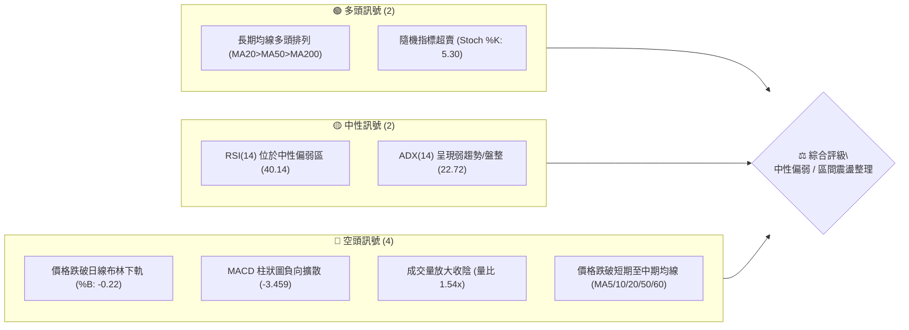
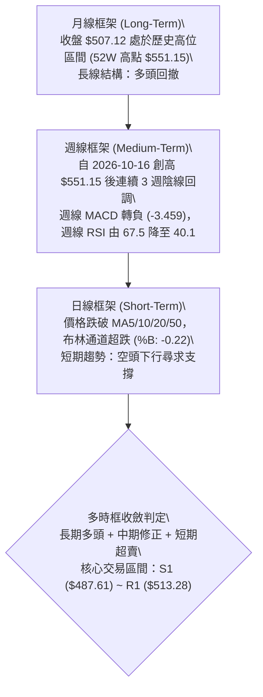
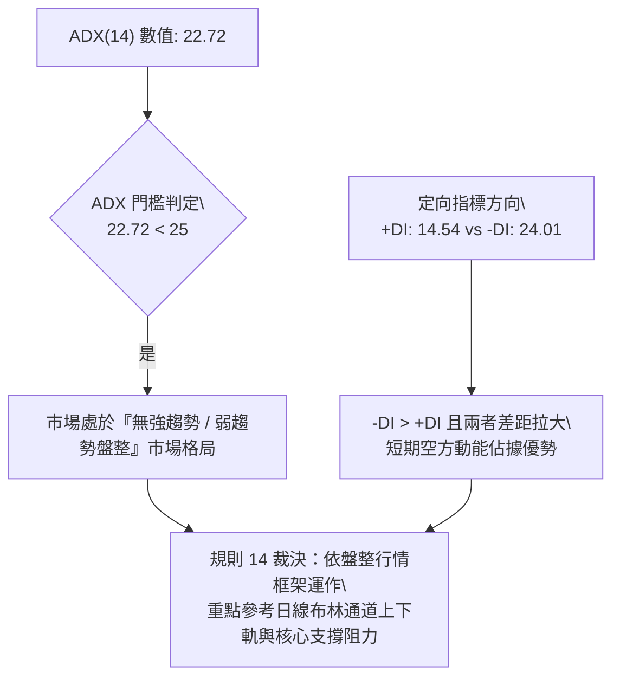
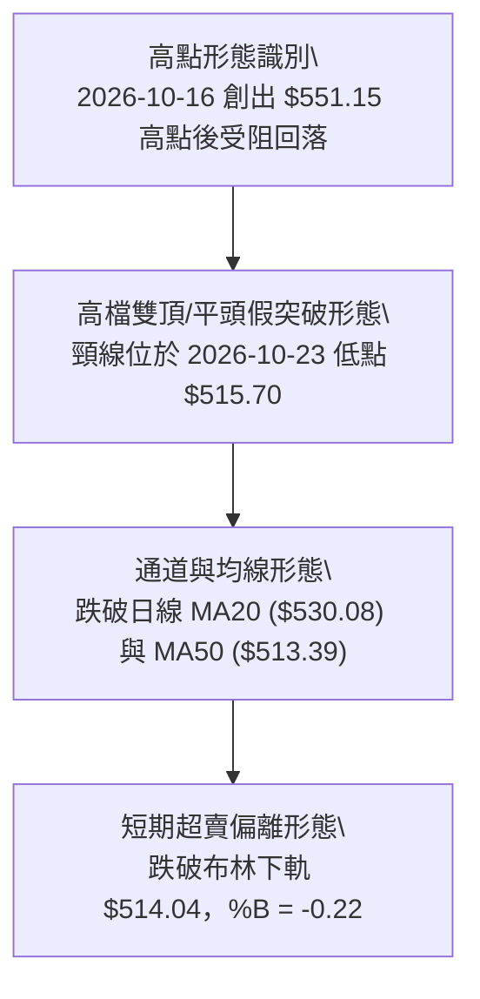
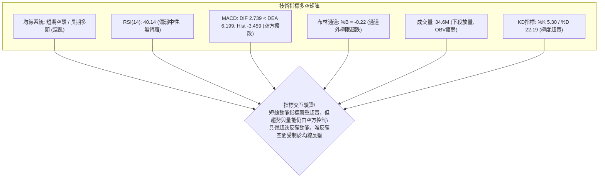
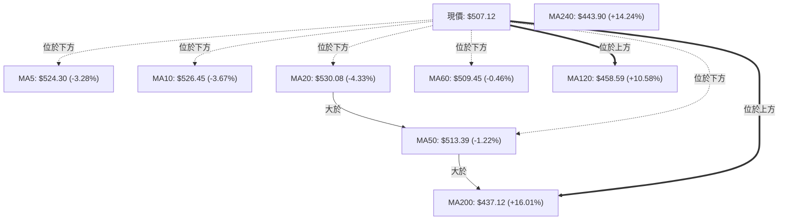
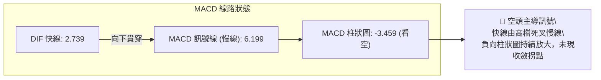
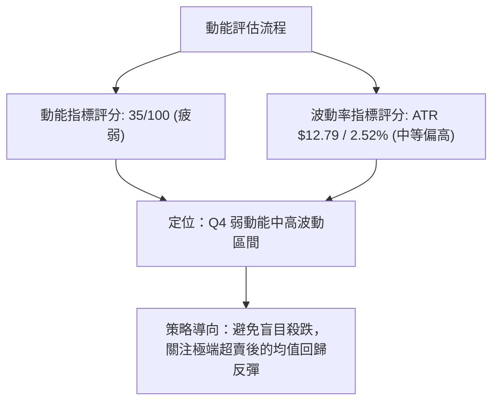
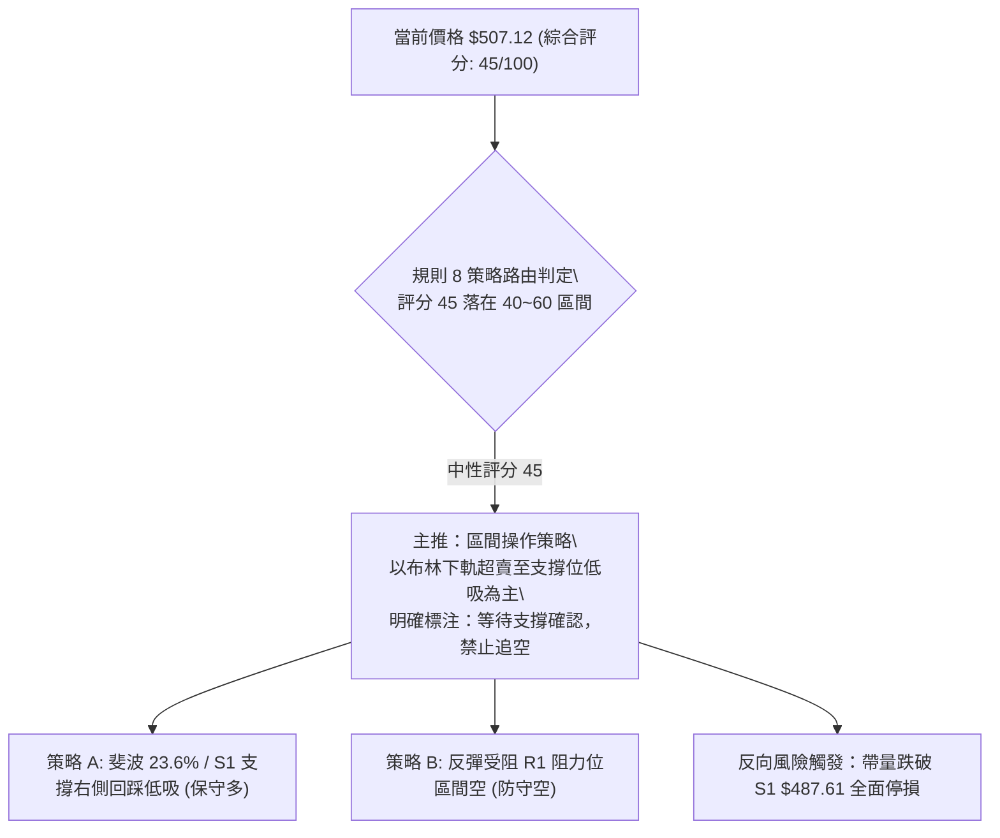
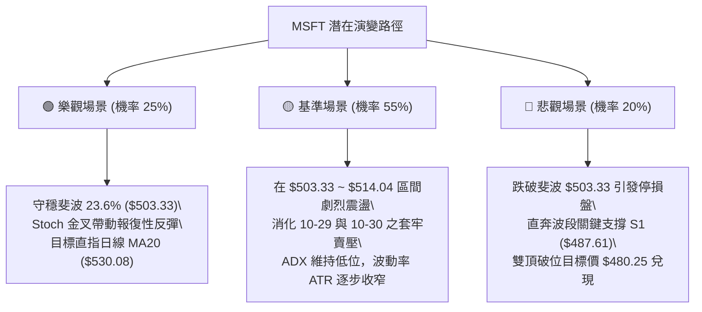

# MSFT 技術分析報告

> **報告日期**：2026-11-03 ｜ **語言**：繁體中文 ｜ **數據來源**：Yahoo Finance ｜ **當前價格**：$507.12

---

## 目錄

| 章節 | 內容 |
|------|------|
| [1. 技術面概覽](#1-技術面概覽) | 訊號儀表板、核心指標、評分卡 |
| [2. 趨勢分析](#2-趨勢分析) | 多時框趨勢、長中短期走勢 |
| [3. 圖表形態分析](#3-圖表形態分析) | 形態識別、K線組合、目標價 |
| [4. 支撐與阻力](#4-支撐與阻力) | 關鍵價位、斐波那契回調 |
| [5. 技術指標深度解讀](#5-技術指標深度解讀) | MA/RSI/MACD/布林/成交量 |
| [6. 動能與波動率](#6-動能與波動率) | 動能評估、ATR、Beta |
| [7. 多時框架總結](#7-多時框架總結) | 時框架評分矩陣 |
| [8. 交易策略建議](#8-交易策略建議) | 多空策略、風險報酬比 |
| [9. 風險提示與監控](#9-風險提示與監控) | 監控指標、風險場景 |

---

## 1. 技術面概覽

### 🎯 技術訊號儀表板



### 📊 核心指標速覽表

| 指標類別 | 指標名稱 | 當前數值 | 訊號 | 解讀 |
|----------|----------|----------|------|------|
| **價格** | 當前收盤價 | $507.12 | 🔴 | 跌破短中期均線，單日大跌測試支撐 |
| **均線** | MA20 | $530.08 | 🔴 | 價格位於 MA20 下方 (-4.33%)，短線承壓 |
| **均線** | MA50 | $513.39 | 🔴 | 價格跌破中期生命線 (-1.22%) |
| **均線** | MA200 | $437.12 | 🟢 | 價格遠高於長期均線 (+16.01%)，長期多頭格局未破 |
| **動能** | RSI(14) | 40.14 | 🟡 | 進入弱勢中性區，尚未落入極端超賣 (<30) |
| **動能** | MACD (12,26,9) | 2.739 / 6.199 | 🔴 | DIF 下穿 MACD 訊號線，Hist 負值擴大至 -3.459 |
| **動能** | Stoch %K / %D | 5.30 / 22.19 | 🟢 | 深度超賣區間，短線存在技術性均值回歸修復需求 |
| **趨勢** | ADX(14) | 22.72 | 🟡 | 數值 <25，呈現盤整/無單邊強趨勢特徵 |
| **方向** | +DI / -DI | 14.54 / 24.01 | 🔴 | -DI 大於 +DI，短期空方動能佔優 |
| **通道** | 布林通道下軌 | $514.04 | 🔴 | %B 為 -0.22，價格已擊穿下軌，呈現超跌偏離 |
| **成交量** | 最新成交量 | 34,624,100 | 🔴 | 高於 20日均量 (量比 1.54x)，下殺伴隨量能擴大 |
| **波動** | ATR(14) | $12.79 | 🟡 | 佔股價 2.52%，單日波動度適中 |

### 🏆 技術評分卡

```
╔══════════════════════════════════════════════════════════════════╗
║                   技術評分卡 — MSFT (2026-11-03)                 ║
╠══════════════════════════════════════════════════════════════════╣
║ 趨勢強度 (Trend)     ████████░░░░░░░░░░░░  40/100  🔴 空方主導   ║
║ 動能指標 (Momentum)  ███████░░░░░░░░░░░░░  35/100  🔴 動能轉弱   ║
║ 支撐穩定度 (Support) █████████████░░░░░░░  65/100  🟡 斐波支撐在即 ║
║ 成交量配合 (Volume)  ███████░░░░░░░░░░░░░  35/100  🔴 帶量下挫   ║
║ 形態完整度 (Pattern) █████████░░░░░░░░░░░  45/100  🟡 頂部回撤   ║
║ 均線排列 (MAs)       ██████████░░░░░░░░░░  50/100  🟡 長多短空   ║
╠══════════════════════════════════════════════════════════════════╣
║ 綜合評分             █████████░░░░░░░░░░░  45/100  ⚖️ 區間震盪/觀望║
╚══════════════════════════════════════════════════════════════════╝
```

*註：綜合評分 = (40 + 35 + 65 + 35 + 45 + 50) ÷ 6 = 45/100（依規則 18 採六項算術平均四捨五入至整數）。*

---

## 2. 趨勢分析

### 🌐 多時框趨勢分析



### 📈 長期趨勢 — 12個月走勢圖（Unicode）

以下展示過去 12 個月（2025-11 至 2026-11）收盤價變動軌跡：

```
MSFT 月線走勢圖（過去12個月：2025-11 至 2026-11）
價格軸 ($)
$530 ┤                                           ● $521.91 (2026-10)
$510 ┤                                       ● $512.90     ● $507.12 (當前)
$490 ┤ ● $488.91 (2025-11)               ● $507.29
$470 ┤     ● $480.57                ● $463.85
$450 ┤                         ● $449.39
$430 ┤         ● $427.58
$410 ┤                             ● $406.13
$390 ┤             ● $391.15
$370 ┤                 ● $368.68(低點)   ● $372.32
     └─┬───────┬───────┬───────┬───────┬───────┬───────┬───────┬───────┬───────┬───────┬───
      25-11   25-12   26-01   26-02   26-03   26-04   26-05   26-06   26-07   26-08   26-09   26-10  26-11
```

**12 個月走勢特徵分析表格**：

| 階段區間 | 起止價格 | 漲跌幅 | 趨勢特徵 | 結構解讀 |
|----------|----------|--------|----------|----------|
| 2025-11 至 2026-03 | $488.91 → $368.68 | -24.59% | 中級回撤波段 | 形成 52週波段低點區間 ($348.54 ~ $368.68) |
| 2026-03 至 2026-05 | $368.68 → $449.39 | +21.89% | 強勁右側反彈 | 突破 MA200，多頭動能回歸 |
| 2026-05 至 2026-06 | $449.39 → $372.32 | -17.15% | 劇烈二次回踩 | 回踩打出雙重底結構 ($372.32)，確認底部支撐 |
| 2026-06 至 2026-10 | $372.32 → $521.91 | +40.18% | 主升浪單邊推進 | 突破歷史高點，推升至 52週最高價 $551.15 |
| 2026-10 至 2026-11 | $521.91 → $507.12 | -2.83% | 高檔獲利回吐 | 測試斐波那契 23.6% 回調位 ($503.33) |

### 📊 中期趨勢（週線分析）

從近 8 週的週線 K 棒演變來看，MSFT 在 2026-10-16 當週衝高至 $551.15 後留長上影線收黑（開盤 $537.53，最高 $551.15，最低 $524.43，收盤 $529.05），隨後週線連三陰，成交量維持在 8,000 萬至 1.42 億股的高檔，顯示頂部機構籌碼出現鬆動。週線 MACD 柱狀圖從 2026-10-16 的 +0.273 急劇滑落至當前 -3.459，週線 RSI 亦由 67.5 降至 40.1。中期結構已由強勢單邊推升轉為高檔防守波段。

### ⚡ 趨勢強度評估（ADX 解讀）



**ADX 趨勢強度對照表**：

| 指標名稱 | 當前數值 | 臨界基準 | 狀態評估 | 實戰交易含義 |
|----------|----------|----------|----------|--------------|
| **ADX(14)** | 22.72 | 25.00 | 🟡 弱趨勢/盤整 | 不宜盲目追單，單邊趨勢策略失效，重視區間高拋低吸 |
| **+DI(14)** | 14.54 | 20.00 | 🔴 多方弱勢 | 多頭主動進攻意願低迷，追高風險顯著 |
| **-DI(14)** | 24.01 | 20.00 | 🔴 空方主導 | 賣壓佔據主導，空方掌控短期節奏 |

---

## 3. 圖表形態分析

### 🔍 形態識別系統



**形態信心度與目標價評估表**：

| 形態名稱 | 信心度 | 判斷依據（引用數據） | 完成度 | 目標價（附計算式） |
|----------|--------|----------------------|--------|--------------------|
| **高檔雙重頂部 (Double Top)** | 65% | 2026-10-16 觸及 $551.15 後回落，2026-10-29 反彈高點僅達 $541.29 未過前高，2026-11-02 收盤 $507.12 正式跌破頸線 $515.70 | 85% | 頸線 $515.70 - 形態高度 ($551.15 - $515.70 = $35.45) = **$480.25**（接近 S2 $476.25） |
| **布林通道極度超賣偏離** | 80% | 收盤價 $507.12 跌破日線布林下軌 $514.04，%B 為 -0.22，Stoch %K 達 5.30 | 95% | 均值回歸目標價 = 布林中軌 (MA20) **$530.08** 或 MA50 **$513.39** |
| **斐波那契回調結構** | 75% | 價格回調至 52週漲幅之 23.6% 回調位 $503.33 附近，單日最低下探 $504.96 | 70% | 若 $503.33 守住，反彈目標為 R1 **$513.28**；若跌破則看 38.2% 位 **$473.75** |

### 🕯️ 重要K線形態分析

根據提供的「近10根日K」與「近8根週K」實際 OHLCV 數據進行精確識別：

#### 1. 近 10 根日 K 線逐日形態拆解

| 日期 | 開盤價 | 最高價 | 最低價 | 收盤價 | 成交量 | K線形態 | 技術解讀 | 訊號 |
|------|--------|--------|--------|--------|--------|---------|----------|------|
| 2026-10-20 | 533.91 | 534.21 | 525.84 | 531.87 | 14,576,000 | 窄幅小陰線 | 縮量橫盤，受制於前高壓力 | 🟡 |
| 2026-10-21 | 529.44 | 533.28 | 525.02 | 532.95 | 13,940,100 | 小陽線 | 量能不足，多方試探性反抽 | 🟡 |
| 2026-10-22 | 533.14 | 533.60 | 520.30 | 521.08 | 21,266,600 | 破位中長陰 | 帶量長黑跌破 MA20，實體偏大 | 🔴 |
| 2026-10-23 | 517.75 | 525.77 | 515.70 | 524.51 | 13,671,500 | 下影小陽線 | 探底 $515.70 後引發短線承接 | 🟢 |
| 2026-10-26 | 527.40 | 533.25 | 521.69 | 532.60 | 19,021,000 | 反彈光腳陽 | 嘗試回測 MA20 壓力位 | 🟢 |
| 2026-10-27 | 532.35 | 534.70 | 528.33 | 531.33 | 19,532,300 | 陀螺頂十字星 | 上行遇阻，多空在 $532 附近僵持 | 🟡 |
| 2026-10-28 | 531.82 | 535.00 | 526.14 | 531.01 | 28,594,200 | 放量滯漲陰星 | 量能增至 2,859 萬，高點停滯 | 🔴 |
| 2026-10-29 | 540.22 | 541.29 | 519.56 | 530.14 | 39,333,200 | 長影線穿梭大陰 | 振幅達 $21.73，爆出 3,933 萬巨量，多空劇烈分歧 | 🔴 |
| 2026-10-30 | 525.27 | 526.00 | 514.35 | 521.91 | 35,652,000 | 實體中陰線 | 持續放量下探，空方全面掌控局勢 | 🔴 |
| 2026-11-02 | 524.02 | 529.63 | 504.96 | 507.12 | 34,624,100 | 光腳大陰線 | 跌破 $515.70 頸線，收在全天低點附近 ($504.96 ~ $507.12) | 🔴 |

#### 2. 近 8 根週 K 線結構特徵

| 週末日期 | 開盤價 | 最高價 | 最低價 | 收盤價 | 成交量 | K線形態 | 技術解讀 | 訊號 |
|----------|--------|--------|--------|--------|--------|---------|----------|------|
| 2026-09-18 | 497.06 | 509.95 | 487.23 | 493.78 | 115,020,700 | 帶長上影陰線 | 上攻 510 遇阻回洗 | 🟡 |
| 2026-09-25 | 494.95 | 519.40 | 491.22 | 516.17 | 123,909,000 | 放量突破大陽 | 帶量突破 510 關卡 | 🟢 |
| 2026-10-02 | 505.47 | 522.85 | 502.22 | 517.53 | 105,746,200 | 高位震盪小陽 | 消化獲利盤，維持多頭排列 | 🟢 |
| 2026-10-09 | 521.62 | 537.22 | 518.79 | 535.07 | 103,231,800 | 實體中陽線 | 沿短期均線加速上推 | 🟢 |
| 2026-10-16 | 537.53 | 551.15 | 524.43 | 529.05 | 113,488,100 | 倒錘頭/射擊之星 | 刷歷史新高 $551.15 後長上影回落，頂部賣壓湧現 | 🔴 |
| 2026-10-23 | 528.70 | 535.57 | 515.70 | 524.51 | 81,449,100 | 縮量回調陰線 | 測試頸線 $515.70 支撐 | 🟡 |
| 2026-10-30 | 527.40 | 541.29 | 514.35 | 521.91 | 142,132,700 | 巨量滯跌陰線 | 爆量 1.42 億股，二次試探 $541 失敗 | 🔴 |
| 2026-11-02 | 524.02 | 529.63 | 504.96 | 507.12 | 34,624,100 | 破位下行中陰 | （週初數據）跌破前週低點 $514.35 | 🔴 |

### 📉 ASCII 走勢形態示意圖

```
MSFT 日線雙頂破位與超跌形態示意圖
價位 ($)
$551.15 ┼───────────────● (頂1: 10-16 創52W高點)
        │                \
$541.29 ┼                 \                 ● (頂2: 10-29 反彈次高)
        │                  \               / \
$530.08 ┼───────────────────\──[MA20]─────/───\─────────────────────────────
        │                    \           /     \
$515.70 ┼─────────────────────●─────────/───────●───────── (頸線支撐位)
        │            (10-23 頸線低點)            \
$507.12 ┼─────────────────────────────────────────● ◄【當前收盤 $507.12】
        │                                         │   (跌破頸線與布林下軌)
$503.33 ┼ - - - - - - - - - - - - - - - - - - - - ┴ - 【斐波 23.6% 緩衝位】
        │
$487.61 ┼──────────────────────────────────────────── 【關鍵支撐 S1】
```

### 🎯 形態目標價計算

1. **雙重頂部破位量度目標**：
   - 形態頸線價格：$515.70（2026-10-23 最低點）
   - 頂部最高價格：$551.15（2026-10-16 52週最高點）
   - 形態高度：$551.15 - $515.70 = **$35.45**
   - 破位量度目標價：頸線 $515.70 - 形態高度 $35.45 = **$480.25**
   - *解讀*：該目標價落於關鍵支撐 S1 ($487.61) 與 S2 ($476.25) 之間，顯示若空方延續主導，波段終極支撐將落在此區間。

2. **短期均值回歸反彈目標**：
   - 觸發條件：跌破布林下軌 ($514.04) 且 Stoch %K (5.30) 深度超賣。
   - 理論反彈第一阻力目標：阻力位 R1 = **$513.28**（同時為 MA50 $513.39 附近）。
   - 理論反彈第二目標：日線布林中軌 (MA20) = **$530.08**。

---

## 4. 支撐與阻力

### 🗺️ 關鍵價位分布圖（Unicode）

```
MSFT 價位結構分布圖
══════════════════════════════════════════════════════════════════
$551.15 ║████████████████████████████████║ 強阻力 R2 (52週歷史高點/雙頂頂點)
$530.08 ║▓▓▓▓▓▓▓▓▓▓▓▓▓▓▓▓▓▓▓▓            ║ 動態阻力 (日線 MA20 / 布林中軌)
$513.28 ║████████████████████████        ║ 關鍵阻力 R1 (波段密集高點 / MA50)
$507.12 ╠════════════════════════════════╣ ◄ 現價 ($507.12)
$503.33 ║▒▒▒▒▒▒▒▒▒▒▒▒▒▒▒▒▒▒▒▒▒▒▒▒        ║ 斐波那契 23.6% 回調緩衝支撐
$487.61 ║████████████████████            ║ 關鍵支撐 S1 (近一年波段低點聚類)
$476.25 ║████████████████████████        ║ 強支撐 S2 (波段回撤低點聚類)
$465.47 ║████████████████████████████    ║ 核心防守支撐 S3 (中級底部平台)
══════════════════════════════════════════════════════════════════
```

### 🚧 阻力位分析表

價位數據嚴格引用自計算結果：

| 阻力級別 | 價位 | 形成原因 | 突破難度 | 重要性 |
|----------|------|----------|----------|--------|
| **R1** | **$513.28** | 近一年波段高點聚類、MA50 ($513.39) 重合區 | 中等偏高 | ★★★★☆ |
| **R2** | **$551.15** | 52週歷史最高點、高檔多頭竭盡反轉點 | 極高 | ★★★★★ |
| **R3** | N/A（數據未提供） | 數據中未偵測到更高阻力位（現為歷史天花板） | N/A | ☆☆☆☆☆ |

### 🛡️ 支撐位分析表

價位數據嚴格引用自計算結果：

| 支撐級別 | 價位 | 形成原因 | 守住機率 | 重要性 |
|----------|------|----------|----------|--------|
| **S1** | **$487.61** | 近一年波段低點聚類、2025-11 高點密集成交區 | 65% | ★★★★☆ |
| **S2** | **$476.25** | 近一年波段低點聚類、斐波那契 38.2% ($473.75) 疊加區 | 80% | ★★★★★ |
| **S3** | **$465.47** | 近一年波段低點聚類、2026-07 突破平台支撐 | 90% | ★★★★★ |

### 📐 斐波那契回調位分析

依據 52週區間最低點 **$348.54** 至最高點 **$551.15** 計算（總波段跨度 $202.61）：

```
0.0%  (52W High) ─── $551.15 
23.6%             ─── $503.33  ◄─── 現價 $507.12 位於 23.6% 臨界上方 ($3.79 緩衝)
38.2%             ─── $473.75 
50.0%             ─── $449.85 
61.8%             ─── $425.94 
78.6%             ─── $391.90 
100.0%(52W Low)  ─── $348.54 
```

**回調結構深度解讀**：
1. **當前落點**：現價 $507.12 落在 **0.0% ($551.15)** 與 **23.6% ($503.33)** 區間內，且極度逼近 23.6% 分水嶺。
2. **多空格局判定**：
   - 只要日線收盤守穩在 **$503.33** 之上，本輪自 $551.15 以來的回調僅屬於強勢多頭市場中的「淺度回踩 (Shallow Retracement)」。
   - 若後續帶量跌破 **$503.33**，技術結構將宣告 23.6% 支撐失效，下行空間將完全開啟，價格勢必向 **38.2% ($473.75)** 以及支撐位 **S1 ($487.61) / S2 ($476.25)** 尋求二次築底。

---

## 5. 技術指標深度解讀

### 🎛️ 指標訊號總覽



### 📈 移動平均線排列分析



**均線結構綜合解讀**：
- **長線架構（Bullish）**：長期均線仍呈現標準多頭排列（MA20 $530.08 > MA50 $513.39 > MA200 $437.12），MA200 保持強勁上行，長期牛市基底未受實質破壞。
- **短中期架構（Bearish）**：現價 $507.12 已連續摜破 MA5、MA10、MA20、MA60 以及 MA50。短均線組呈現空頭發散下壓，對價格反彈構成層層重壓。MA50 ($513.39) 剛被下破，若無法在 2-3 個交易日內迅速收復，MA20 下穿 MA50 形成死叉的風險將大增。

### 📉 RSI(14) 分析

- **當前數值**：**40.14**（Wilder 計算方法）
- **指標強度**：`████████░░░░░░░░░░░░ 40.14%` 🟡 中性偏弱區
- **區間判定**：未跌破 30 絕對超賣線，但已跌穿 50 強弱分水嶺，表明多頭動能退潮，市場處於回調弱勢整理階段。
- **背離判斷**：
  - *檢驗依據*：近 20 根 K 棒首尾價格與 RSI 方向比對。
  - *比對結果*：價格自高檔 $535 區域滑落至 $507.12，RSI 同步由 67.5 降至 40.14，兩者方向完全一致。
  - *結論*：**無明顯背離**（既無頂背離亦無底背離），當前下挫屬於動能驅動的正常技術修正。

### 📊 MACD(12/26/9) 訊號解讀



- **訊號解析**：DIF (2.739) 位於零軸上方，但已深度跌破 Signal (6.199)，形成典型的零上死叉。負柱狀圖達 -3.459，顯示空方動能仍在釋放，短期內尚未見到柱狀體收斂或金叉回轉跡象。

### 📦 布林通道分析

```
MSFT 日線布林通道結構 (20, 2)
══════════════════════════════════════════════════════════════════
$546.12 ┼──────────────────────────────────── [BB 上軌]
        │
$530.08 ┼──────────────────────────────────── [BB 中軌 / MA20]
        │
$514.04 ┼──────────────────────────────────── [BB 下軌]
        │
$507.12 ┼─────● ◄── 現價已跌出下軌下方 (%B: -0.22)
══════════════════════════════════════════════════════════════════
```

- **通道參數**：上軌 $546.12、中軌 $530.08、下軌 $514.04，通道寬度 $32.08。
- **%B 指標解讀**：%B = -0.22。當 %B < 0，代表價格已脫離常態分佈帶，跌入通道外部。技術上屬於極端超賣形態（Oversold Band Walk 或突發性下軌跌破），隨時可能誘發均值回歸买盤向通道內（$514.04 及中軌 $530.08）修復。

### 💹 成交量分析（量價配合度）

- **最新量能對比**：最新成交量 34,624,100 股，相較於 20日均量 22,416,050 股，**量比達 1.54x**；相較於 50日均量 22,062,946 股亦明顯放大。
- **量價關係判定**：
  - 價格大跌同時間伴隨量能突破 20 日均線 50% 以上，呈現「放量下挫」特徵。
  - 檢視 2026-10-29 爆量 3,933 萬股、10-30 放量 3,565 萬股至 11-02 的 3,462 萬股，連續三日陰線放量，驗證主力資金有調倉賣壓。
- **OBV 能量潮解讀**：數據明確標示「OBV < MA → 量能疲弱」，OBV 指標落後於其均線，代表中長線資金累積意願降低，成交量未能配合價格維持高位推升，形成量能背離後的補跌效應。

---

## 6. 動能與波動率

### ⚡ 動能評估四象限

| 象限 | 動能維度 | 波動維度 | 狀態特徵 | MSFT 當前定位 | 交易戰術評估 |
|------|----------|----------|----------|---------------|--------------|
| **Q1** | 強動能 (Bullish) | 低波動 (Low Vol) | 穩定單邊牛市 | — | 最佳順勢持倉 |
| **Q2** | 弱動能 (Bearish) | 低波動 (Low Vol) | 緩跌盤整陰跌 | — | 觀望防守 |
| **Q3** | 強動能 (Volatile) | 高波動 (High Vol) | 加速衝頂或崩跌 | — | 突破追單/高風險 |
| **Q4** | **弱動能 (Bearish)** | **中高波動 (Rising Vol)** | **超跌震盪修正** | **✓ (當前處於此象限)** | **禁止追空，嚴防超賣洗盤，等待低吸機會** |



### 📊 ATR 波動率分析

- **ATR(14) 數值**：**$12.79**（佔當前股價 2.52%）。
- **波動特徵**：單日平均潛在波幅約 $12.80，意味著正常市場雜訊波動區間即達 ±$13 美元。
- **止損距離設計建議**：
  - *短線交易 (1.0 × ATR)*：建議止損距離不小於 **$12.79**，以防被日內正常雜訊震盪洗出場。
  - *波段交易 (1.5 ~ 2.0 × ATR)*：建議止損距離設定為 **$19.19 ~ $25.58**。若在 $503 ~ $507 區間建立防守倉位，合理波段防護應退至 S1 關鍵價位 $487.61 附近（距現價約 $19.51，約 1.53 × ATR），完全契合波動率結構。

### 📐 Beta 與市場相關性

- **Beta 數值**：**1.045**。
- **市場特徵解讀**：Beta 極度接近 1.0，顯示 MSFT 與標普 500 指數及納斯達克大盤維持高度同步性。當前科技股板塊受新聞面「AI 資本支出疑慮與公債波動」衝擊整體承壓，MSFT 的回調主要反映板塊系統性 Beta 回撤，非個股孤立基本面暴跌。

---

## 7. 多時框架總結

### 📋 時框架評分表

| 時框架 | 趨勢方向 | 動能狀態 | 均線排列 | 圖表形態 | 綜合評分 | 建議戰術 |
|--------|----------|----------|----------|----------|----------|----------|
| **月線** | 🟢 長期偏多 | 🟡 高位整固 | 🟢 MA200之上 (+16%) | 歷史高點小幅回調 | 75/100 | 長期投資者續抱，回調提供逢低分批窗口 |
| **週線** | 🟡 中期震盪 | 🔴 動能衰退 | 🟡 MA20扣平 | 射擊之星連三陰回撤 | 48/100 | 警惕雙頂頸線失守風險，等待止跌訊號 |
| **日線** | 🔴 短期偏空 | 🟢 極度超賣 | 🔴 跌破MA20/50 | 破布林下軌 (%B -0.22) | 38/100 | 短線禁止追空，等待超跌反彈均值修復 |

### 🔲 綜合訊號矩陣

```
訊號維度對照表：
┌─────────────┬───────────┬───────────┬───────────┐
│ 分析維度    │ 短期(日線)│ 中期(週線)│ 長期(月線)│
├─────────────┼───────────┼───────────┼───────────┤
│ 趨勢方向    │ 🔴 空頭   │ 🟡 震盪   │ 🟢 多頭   │
│ 動能方向    │ 🔴 衰退   │ 🔴 轉弱   │ 🟢 向上   │
│ 均線結構    │ 🔴 蓋頭   │ 🟡 糾結   │ 🟢 多頭   │
│ 量能配合    │ 🔴 殺跌放量│ 🔴 滯漲放量│ 🟢 長線溫和│
│ 超買超賣    │ 🟢 嚴重超賣│ 🟡 中性偏弱│ 🟡 高位分歧│
└─────────────┴───────────┴───────────┴───────────┘
一致性分析：長多、中整、短空。長線趨勢與短線趨勢發生衝突。
```

### ⚖️ 多時框收斂結論

> **依「規則 14」嚴格收斂判定**：
> 1. **行情性質界定**：當前日線 ADX(14) 數值為 **22.72 (< 25)**，明確指示當前市場屬於**「無強單邊趨勢之盤整行情」**。
> 2. **主導時框與交易規則**：在盤整行情中，依規則應以日線布林通道上下軌及關鍵支撐阻力為核心交易依據，不可採用趨勢突破追單邏輯。
> 3. **多時框衝突收斂**：日線短期雖出現連續破位大陰線，但隨即撞擊極限超賣區（%B -0.22、Stoch %K 5.30）並面臨 52週斐波那契 23.6% 強支撐位 **$503.33**。週線 MA20 仍穩居長多格局。
> 4. **唯一方向性結論**：**【中性觀望 / 區間震盪低吸】**。第 8 章策略將以此為唯一主軸，杜絕兩頭下注。

---

## 8. 交易策略建議

### 🗺️ 策略決策流程圖



### 🧭 策略路由

**當前主策略方向 = 中性觀望 / 區間震盪操作（依評分卡 45/100）**

根據評分卡規定，當前綜合評分為 **45/100（介於 40–60 之間）**，市場進入典型的中性震盪修復期。日線超賣但趨勢未成，主策略聚焦於**「在關鍵支撐位（S1 $487.61 / 斐波 $503.33）尋找右側低吸機會，並在阻力位（R1 $513.28 / MA20 $530.08）獲利了結」**的區間震盪操作。

### 🎯 價格情境階梯（Price Scenarios）

價位數據嚴格引用自計算結果：

| 觸發條件 | 下一目標 | 後續延伸 | 情境含義 |
|----------|----------|----------|----------|
| **強勢突破 R1 $513.28** | 回測日線 MA20 $530.08 | 挑戰 52W 高點 R2 $551.15 | 短線止跌反轉，均值回歸行情確立 |
| **站穩 $503.33 ~ $507.12** | 測試 R1 $513.28 | 震盪於布林下軌至 MA50 之間 | 區間震盪築底，消化短期獲利籌碼 |
| **帶量跌破 S1 $487.61** | 下探強支撐 S2 $476.25 | 考驗核心支撐 S3 $465.47 | 中期多頭結構遭受破壞，進入深度回撤 |

### 📊 情境機率分佈

| 情境 | 機率 | 主要依據 |
|------|------|----------|
| **情境一：超跌反彈 / 均值回歸修復** | **55%** | Stoch %K 僅 5.30 進入極度超賣；%B 達 -0.22 跌穿布林下軌；現價緊鄰 52週斐波 23.6% 支撐 $503.33 |
| **情境二：區間窄幅震盪整理** | **30%** | ADX 僅 22.72 呈現弱勢盤整；量能雖放但空方動能逐漸遭遇長期均線買盤托底 |
| **情境三：跌破 S1 延續深度探底** | **15%** | MACD 負柱狀體持續擴大 (-3.459)；量比 1.54x 顯示機構拋壓尚未完全出清 |

### 🟢 主策略詳情

> **風險報酬比計算說明（依規則 17）**：
> - 多頭公式：$RR = (T1 - 進場價) \div (進場價 - 止損價)$，格式統一為 `1 : X.XX（以 T1 計）`
> - 空頭公式：$RR = (進場價 - T1) \div (止損價 - 進場價)$，格式統一為 `1 : X.XX（以 T1 計）`

| 策略要素 | 策略 A（保守型：S1 支撐位回踩低吸多頭） | 策略 B（激進型：R1 阻力位反彈遇阻做空） |
|----------|-----------------------------------------|-----------------------------------------|
| **操作性質** | 順長期趨勢、逆短期趨勢（支撐低吸） | 順短期趨勢、逆長期趨勢（阻力高拋） |
| **進場條件** | 價格下探 S1 $487.61 企穩出現止跌 K 線 | 價格超跌反彈至 R1 $513.28 遇阻且成交量衰竭 |
| **進場價格** | **$487.61**（引用自支撐位 S1） | **$513.28**（引用自阻力位 R1） |
| **目標價 T1** | **$513.28**（引用自阻力位 R1） | **$487.61**（引用自支撐位 S1） |
| **目標價 T2** | **$551.15**（引用自阻力位 R2） | **$476.25**（引用自支撐位 S2） |
| **止損價格** | **$476.25**（引用自強支撐 S2） | **$524.30**（引用自 MA5 阻力） |
| **風險報酬比** | **1 : 2.26（以 T1 計）**<br>計算式：$(513.28 - 487.61) \div (487.61 - 476.25) = 25.67 \div 11.36 = 2.26$；另以 T2 計為 1 : 5.59 | **1 : 2.33（以 T1 計）**<br>計算式：$(513.28 - 487.61) \div (524.30 - 513.28) = 25.67 \div 11.02 = 2.33$；另以 T2 計為 1 : 3.36 |
| **成功機率** | 65% | 45% |
| **建議倉位** | 15% ~ 20%（分批建倉） | 10%（短線輕倉） |

### 🔴 反向風險觸發點（對沖提示）

- **多頭反轉失效觸發點**：若價格以日線大陰線收盤**實體跌破 $487.61 (S1)**，代表雙頂頸線破位量度跌幅正式朝向 $480.25 及 S2 $476.25 延伸，多頭應立即停損或建立反向保護部位。
- **空頭平倉止損觸發點**：若日線收盤價強勢收復 **$524.30 (MA5)** 或進一步突破 **$530.08 (MA20)**，代表超跌 V 轉成立，空頭部位應立即無條件離場。

### ⭐ 整體訊號強度評星

```
╔══════════════════════════════════════════════════════════════════╗
║                     整體訊號強度評星                             ║
╠══════════════════════════════════════════════════════════════════╣
║ 做多訊號強度：  ★★☆☆☆  (2/5星 — 短線受均線壓制，需等回踩支撐)    ║
║ 做空訊號強度：  ★★☆☆☆  (2/5星 — 指標極度超賣，追空盈虧比低劣)    ║
║ 區間震盪可信度：★★★★☆  (4/5星 — ADX 22.72，盤整與均值回歸概率高) ║
║ 整體技術可信度：★★★☆☆  (3/5星 — 長短週期分歧，等待時框收斂)     ║
╚══════════════════════════════════════════════════════════════════╝
```

---

## 9. 風險提示與監控

### ✅ 關鍵監控指標 Checklist

```
╔══════════════════════════════════════════════════════════════════╗
║                   每日交易監控清單 (Checklist)                   ║
╠══════════════════════════════════════════════════════════════════╣
║ [ ] 斐波那契 23.6% 防守：收盤價是否守穩 $503.33                 ║
║ [ ] 布林通道修復狀態：收盤價是否重新站回下軌 $514.04 之內       ║
║ [ ] MA50 得失判定：是否能迅速收復關鍵生命線 $513.39              ║
║ [ ] MACD 柱狀體演變：負柱狀體 (-3.459) 是否出現翻紅或長度縮短   ║
║ [ ] Stoch 超賣金叉：Stoch %K (5.30) 是否向上金叉 %D (22.19)      ║
║ [ ] 量能異動監控：單日成交量是否回落至 2,200 萬股均量水準       ║
║ [ ] S1 終極防守線：盤中是否出現跌穿 $487.61 的放量下殺          ║
╚══════════════════════════════════════════════════════════════════╝
```

### ⚠️ 風險場景分析



### 🛡️ 風險管理重要提醒

1. **嚴禁於布林通道下軌外部追空**：當前 %B 達 -0.22，Stoch %K 僅 5.30，技術上已處於高度超賣臨界點。歷史數據顯示在此類位置追空極易遭遇均值回歸的急促反彈夾殺。
2. **嚴格執行 ATR 動態風控**：MSFT 目前 ATR(14) 為 $12.79。任何多頭進場部位的止損不可小於 1.0 × ATR ($12.79)，最優波段止損應錨定於前低或支撐位外側 1.5 × ATR 處。
3. **倉位管理防線**：在多時框出現收斂突破訊號（ADX > 25 或突破 MA20）之前，總持倉部位建議嚴格限制在 20% 以內，保持高度現金彈性以應對板塊震盪。

---

## 📋 報告總結

```
╔══════════════════════════════════════════════════════════════════╗
║                     MSFT 技術分析報告總結                        ║
╠══════════════════════════════════════════════════════════════════╣
║ 報告日期：2026-11-03                                             ║
║ 當前價格：$507.12                                                ║
║ 綜合評分：45/100                                                 ║
║ 分析評級：⚖️ 區間震盪 / 中性觀望 (等待超跌修復與支撐驗證)       ║
╠══════════════════════════════════════════════════════════════════╣
║ 關鍵結構解讀：                                                   ║
║ ├─ 長期趨勢：🟢 多頭格局未破 (MA200 $437.12 仍遠低於現價)        ║
║ ├─ 中期趨勢：🟡 高位震盪回調 (52W 高點 $551.15 受阻連三週陰線)   ║
║ ├─ 短期趨勢：🔴 弱勢超跌整理 (摜破 MA50，但觸及布林下軌超賣區)   ║
║ ├─ 關鍵支撐：S1 $487.61 ｜ S2 $476.25 ｜ 斐波 23.6% $503.33     ║
║ ├─ 關鍵阻力：R1 $513.28 ｜ R2 $551.15 ｜ 動態 MA20 $530.08      ║
║ └─ 華爾街共識：Strong Buy (53位分析師均價 $633.13)               ║
╠══════════════════════════════════════════════════════════════════╣
║ 最優策略組合：                                                   ║
║ 1. 🥇 最佳機會（策略 A）：耐心等待價格回踩 S1 $487.61 附近企穩，  ║
║    建立波段多頭倉位，止損設於 S2 $476.25，目標看 R1 $513.28      ║
║    （風險報酬比 1 : 2.26，勝率 65%）。                          ║
║ 2. 🥈 次選機會（超跌博弈）：以 $503.33 為極限防守，於現價小倉位  ║
║    博弈布林通道均值回歸反抽，快進快出。                          ║
║ 3. 🥉 保守選擇（空倉觀望）：等待日線收盤重新站上 MA50 $513.39     ║
║    或日線 MACD 負柱狀體顯著收斂後，再行順勢進場。                ║
╚══════════════════════════════════════════════════════════════════╝
```

---

> ⚠️ **免責聲明**：本報告為技術分析研究，所有數據、圖表及估算均基於歷史價格與客觀技術指標計算。本報告**僅供研究與學術參考**，**不構成任何要約、招攬或投資建議**。市場有風險，交易決策需由投資人獨立判斷並自負盈虧。

---

*報告生成時間：2026-11-03 ｜ 數據來源：Yahoo Finance ｜ 分析框架：多時框技術分析體系*