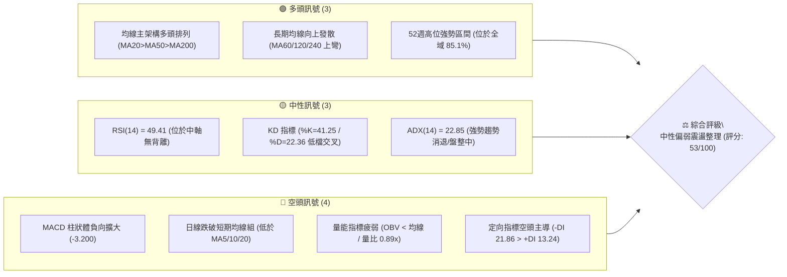
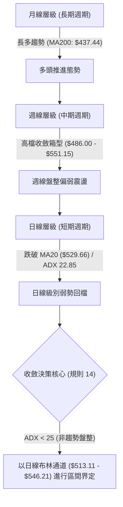
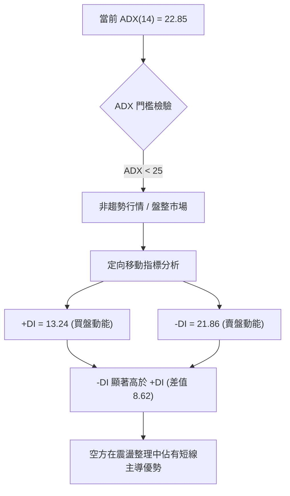
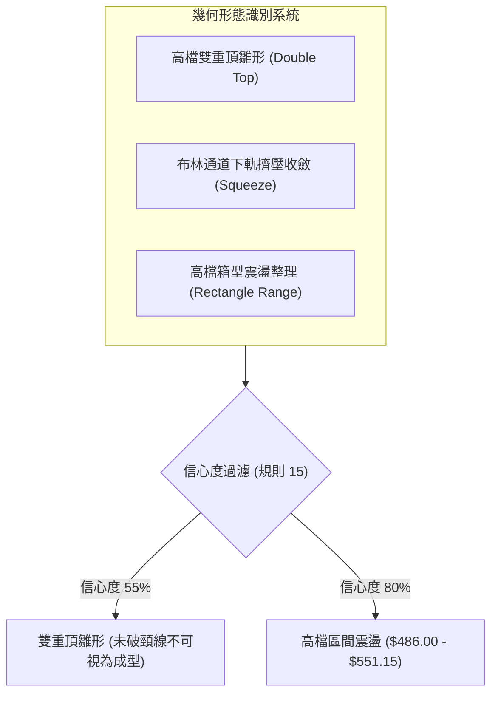
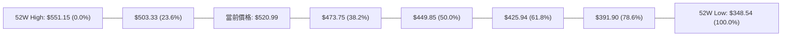
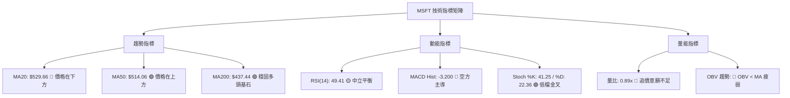
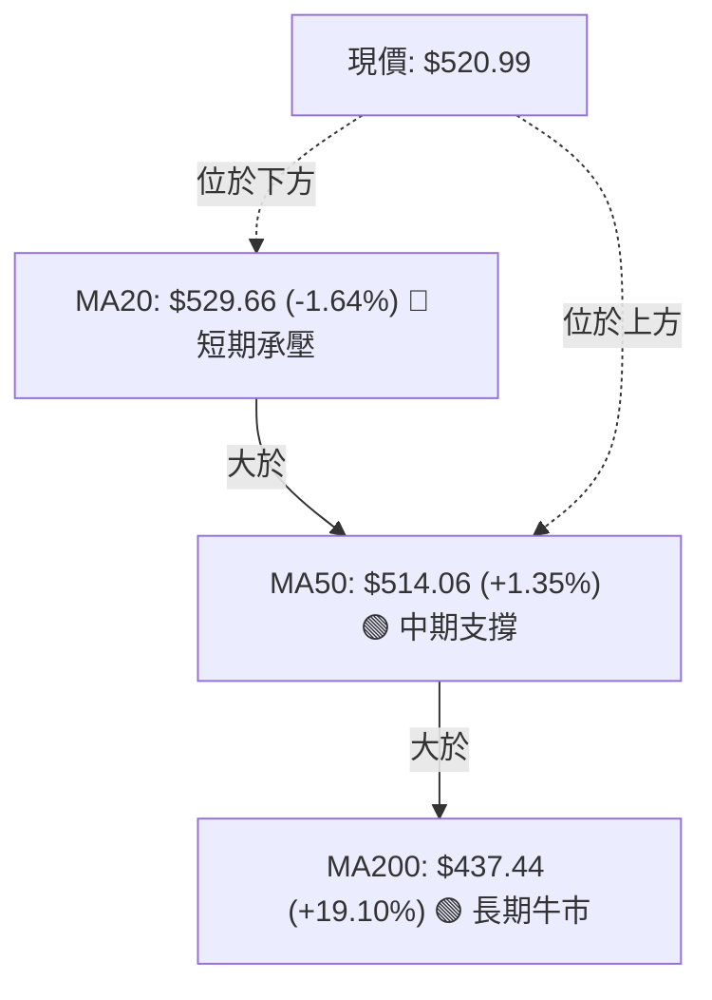
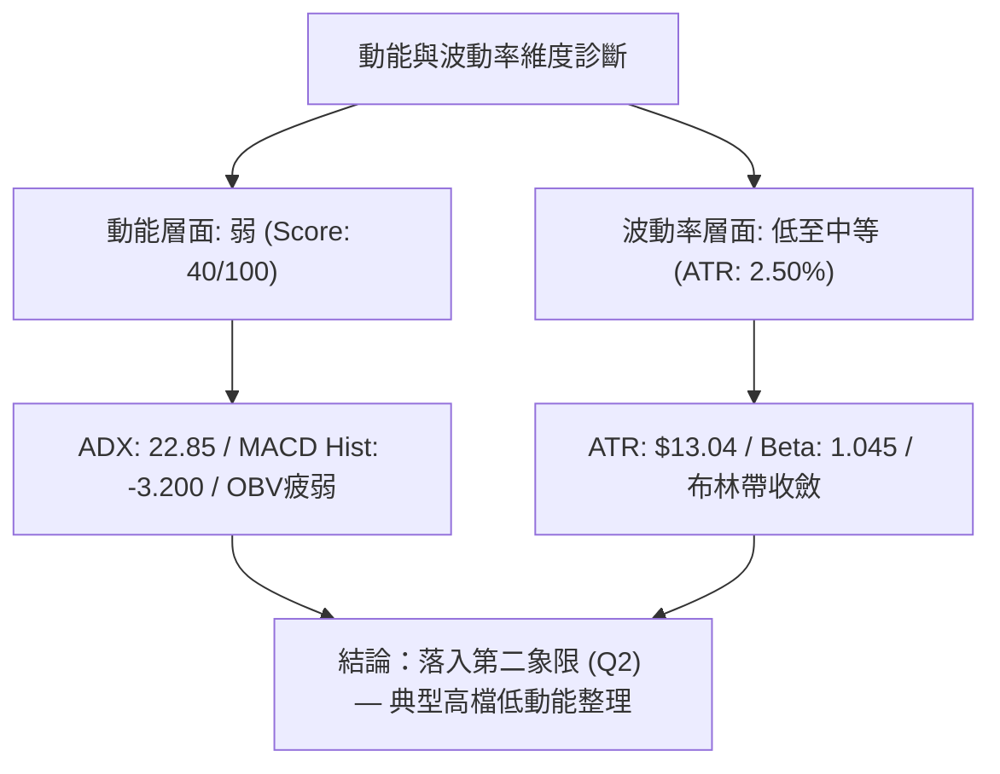
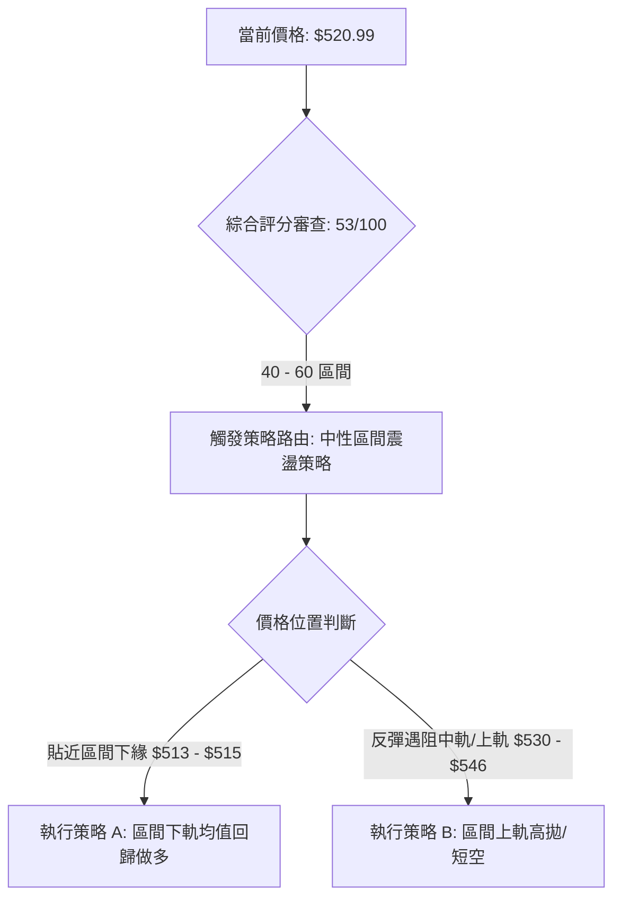
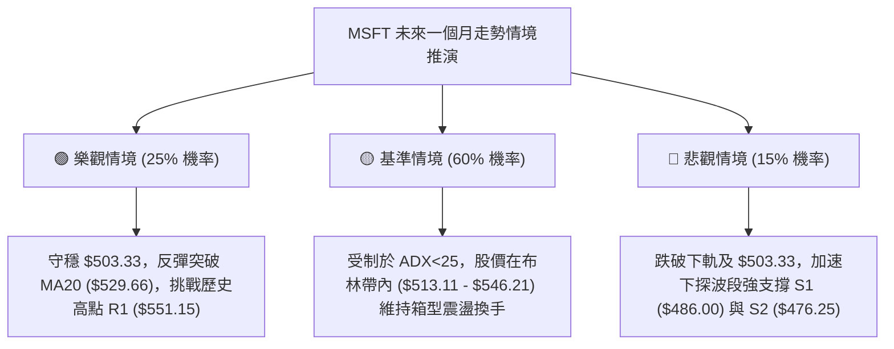

# MSFT 技術分析報告

> **報告日期**：2026-11-04 ｜ **語言**：繁體中文 ｜ **數據來源**：Yahoo Finance ｜ **當前價格**：$520.99

---

## 目錄

| 章節 | 內容 |
|------|------|
| [1. 技術面概覽](#1-技術面概覽) | 訊號儀表板、核心指標、評分卡 |
| [2. 趨勢分析](#2-趨勢分析) | 多時框趨勢、長中短期走勢 |
| [3. 圖表形態分析](#3-圖表形態分析) | 形態識別、K線組合、目標價 |
| [4. 支撐與阻力](#4-支撐與阻力) | 關鍵價位、斐波那契回調 |
| [5. 技術指標深度解讀](#5-技術指標深度解讀) | MA/RSI/MACD/布林/成交量 |
| [6. 動能與波動率](#6-動能與波動率) | 動能評估、ATR、Beta |
| [7. 多時框架總結](#7-多時框架總結) | 時框架評分矩陣 |
| [8. 交易策略建議](#8-交易策略建議) | 多空策略、風險報酬比 |
| [9. 風險提示與監控](#9-風險提示與監控) | 監控指標、風險場景 |

---

## 1. 技術面概覽

### 🎯 技術訊號儀表板



### 📊 核心指標速覽表

| 指標類別 | 指標名稱 | 當前數值 | 訊號 | 解讀 |
|:---|:---|:---|:---:|:---|
| **價格** | 當前收盤價 | $520.99 | 🟡 | 位於52週區間85.1%高位，短線自高檔壓回至MA20下方整理 |
| **均線** | 短期 MA20 | $529.66 | 🔴 | 收盤價低於MA20達-1.64%，短線動能轉弱，MA20扣高向下 |
| **均線** | 中期 MA50 | $514.06 | 🟢 | 收盤價守於MA50上方+1.35%，中期多頭防線結構仍完好 |
| **均線** | 長期 MA200 | $437.44 | 🟢 | 顯著高於MA200達+19.10%，年線多頭根基極為紮實 |
| **動能** | RSI(14) | 49.41 | 🟡 | 位於40-60中性平衡區，無超買超賣，多空動能暫時平衡 |
| **動能** | MACD (12,26,9) | 2.199 / Sig 5.399 | 🔴 | MACD線跌破訊號線，柱狀體為 -3.200，空方動能主導修正 |
| **趨勢** | ADX(14) / DMI | 22.85 (-DI:21.86) | 🔴 | ADX<25顯示為非趨勢盤整，-DI顯著大於+DI(13.24)顯示賣方佔優 |
| **通道** | 布林通道 %B | 0.24 (寬度 $33.10) | 🟡 | 價格貼近布林下軌($513.11)，空方擠壓但尚未形成單向單邊破位 |
| **波動** | ATR(14) | $13.04 (2.50%) | 🟡 | 波動度處於常態水準，每日標準波動區間約為 $13 美元 |
| **量能** | 20日成交量比 | 0.89x (OBV趨弱) | 🔴 | 縮量修正，OBV低於其移動平均線，資金追價動能不足 |

### 🏆 技術評分卡

```
╔══════════════════════════════════════════════════════════════════╗
║                 技術評分卡 — MSFT (2026-11-04)                   ║
╠══════════════════════════════════════════════════════════════════╣
║ 趨勢強度 (Trend)      ████████░░░░░░░░░░░░  40/100  🔴 弱趨勢盤整║
║ 動能指標 (Momentum)   ████████░░░░░░░░░░░░  40/100  🔴 動能轉負  ║
║ 支撐穩定度 (Support)  ██████████████░░░░░░  70/100  🟢 買盤防守強║
║ 成交量配合 (Volume)   ████████░░░░░░░░░░░░  40/100  🔴 縮量背離  ║
║ 形態完整度 (Pattern)  ████████████░░░░░░░░  60/100  🟡 區間收斂  ║
║ 均線排列 (Moving Avg) ██████████████░░░░░░  70/100  🟢 長多架構  ║
╠══════════════════════════════════════════════════════════════════╣
║ 綜合評分 (Overall)    ███████████░░░░░░░░░  53/100  🟡 中性區間  ║
║ 評級結論：(40 + 40 + 70 + 40 + 60 + 70) ÷ 6 = 53.33 → 53分 (中性)║
╚══════════════════════════════════════════════════════════════════╝
```

---

## 2. 趨勢分析

### 🌐 多時框趨勢分析



### 📈 長期趨勢 — 12個月走勢圖（ASCII）

依據 24 個月價格數據中過去 12 個月（2025-12 至 2026-11）的收盤走勢繪製：

```
MSFT 月線走勢圖（過去12個月：2025-12 至 2026-11）
價格軸 ($)
$530 ┤                                                ● $521.91 (M11)
$520 ┤                                                    ● $520.99 (現價 M12)
$510 ┤                                        ● $512.90 (M10)
$500 ┤                                    ● $507.29 (M9)
$480 ┤● $480.57 (M1)
$460 ┤                                ● $463.85 (M8)
$440 ┤                            ● $449.39 (M6)
$420 ┤    ● $427.58 (M2)
$400 ┤                    ● $406.13 (M5)
$390 ┤        ● $391.15 (M3)
$370 ┤            ● $368.68 (M4 低點)   ● $372.32 (M7 次低)
     └────┬───────┬───────┬───────┬───────┬───────┬───────┬───────┬───────┬───────┬───────┬───────
         12月    01月    02月    03月    04月    05月    06月    07月    08月    09月    10月    11月
        (2025)  (2026)  (2026)  (2026)  (2026)  (2026)  (2026)  (2026)  (2026)  (2026)  (2026)  (2026)
```

**12個月走勢階段劃分與特徵分析**：

| 階段區間 | 時間跨度 | 月初/月末收盤 | 區間漲跌幅 | 走勢特徵與結構解讀 |
|:---|:---:|:---:|:---:|:---|
| **第一階段：深幅回調** | 2025-12 ～ 2026-03 | $480.57 → $368.68 | -23.28% | 連續4個月單邊下行，回測年線並創出52週低點群 ($348.54 - $368.68) |
| **第二階段：雙底構築** | 2026-04 ～ 2026-06 | $406.13 → $372.32 | -8.32% | 04-05月反彈至$449.39後，06月急速二次探底$372.32，確立中期堅實大底 |
| **第三階段：主升推升** | 2026-07 ～ 2026-10 | $463.85 → $521.91 | +12.52% | 07月長陽放量拔高突破460頸線，連續4個月穩步推升並逼近歷史前高 |
| **第四階段：高檔滯漲** | 2026-10 ～ 2026-11 | $521.91 → $520.99 | -0.18% | 觸及52W高點$551.15後動能收斂，價格在$520附近轉為高檔狹幅橫盤 |

### 📊 中期趨勢（週線分析）

中期走勢呈現由強轉平的收斂整理格局。從近20週數據觀察，MSFT自2026年7月底放量拉升突破後，於2026年10月16日當週見頂於 $551.15（52週最高點），隨後週線連三陰回落。

```
MSFT 週線震盪區間結構示意圖
價格軸 ($)
$551.15 ┼─────────────────────────────────────────────────────────── 52W High / R1 阻力位
        │                              ╭──╮ (2026-10-16 見高點 $551.15)
$535.00 ┼─────────────────────────────╭╯  ╰─╮────────────────────────────────
        │                            ╭╯      ╰╮ 
$520.99 ┼┄┄┄┄┄┄┄┄┄┄┄┄┄┄┄┄┄┄┄┄┄┄┄┄╭╯┄┄┄┄┄┄┄┄●┄┄┄┄┄┄┄┄┄┄┄┄┄┄┄┄┄┄┄┄┄ 當前收盤價 ($520.99)
        │                          ╭╯          ╰╮
$503.33 ┼─────────────────────────╭╯──────────────╰╮──────────────────────── 斐波那契 23.6% 回調位
        │                        ╭╯              ╰╮
$486.00 ┼───────────────────────╭╯──────────────────╰───────────────────── 關鍵波段支撐位 S1
        │            ╭─╮        │
$380.00 ┼────────────╯ │────────╯──────────────────────────────────────── 底部發動平台
        └────────────┴──────────┴──────────────┴───────────────
                  2026-07     2026-08        2026-10      2026-11
```

週線指標顯示動能明顯減速：週線 RSI 自 2026-08-07 的超買高點 78.1 逐步回落至當前的 49.4；週線 MACD 柱狀圖亦由高峰 +11.272 急速收縮並翻負至 -3.200。這證明中期上升波段已經暫告一段落，目前進入高檔週線級別的籌碼換手與整理階段。

### ⚡ 趨勢強度評估（ADX 解讀）



**ADX 趨勢強度級別對照表**：

| ADX 區間 | 趨勢狀態 | 交易環境 | MSFT 當前狀態判定 |
|:---:|:---:|:---:|:---|
| **0 – 20** | 極弱 / 無趨勢 | 窄幅橫盤打架 | 否 |
| **20 – 25** | **弱趨勢 / 盤整期** | **區間震盪、指標易鈍化** | **✓ 符合（當前 ADX: 22.85，屬盤整消退階段）** |
| **25 – 40** | 強趨勢成型 | 順勢突破策略適用 | 否（原上升趨勢強度已跌破 25 強弱分界點） |
| **40 – 60** | 極強單邊趨勢 | 動能爆發行情 | 否 |

**結論**：由於 ADX 數值為 22.85（低於 25 臨界值），依照**多時框收斂規則（規則 14）**，當前市場環境被明確定義為**盤整行情**。在此架構下，單邊突破追價策略失效率極高，交易框架必須嚴格依據日線布林通道與既有支撐/阻力區間進行高拋低吸。

---

## 3. 圖表形態分析

### 🔍 形態識別系統



**形態信心度與目標價評估表**：

| 形態名稱 | 信心度 | 判斷依據（嚴格引用數據） | 完成度 | 目標價（附嚴格計算式） |
|:---|:---:|:---|:---:|:---|
| **高檔箱型震盪 (Rectangle)** | **80%** | 頂部受阻於 52W 高點聚類 R1: $551.15，底部獲得波段低點聚類 S1: $486.00 支撐，近一個月持續在區間內部游走 | 75% | 箱頂突破目標: $551.15 + ($551.15 − $486.00) = **$616.30**<br>箱底跌破目標: $486.00 − ($551.15 − $486.00) = **$420.85** |
| **潛在雙重頂 (Double Top)** | **55%** | 第一次高點 10-16 週K高點 $551.15，第二次高點 10-29 日K高點 $541.29，頸線暫定於波段支撐 S1: $486.00 | 45% (未跌破頸線) | 若有效跌破 S1，理論量度跌幅目標：<br>頸線 $486.00 − 形態高度($551.15 − $486.00 = $65.15) = **$420.85** |
| **布林帶下軌測試反彈** | **70%** | 日K連續回落至布林通道下軌 $513.11 附近，最新收盤 $520.99 重新收於下軌上方，%B 為 0.24 | 85% | 短期反彈均值回歸目標：<br>回抽布林中軌 MA20 = **$529.66** |

### 🕯️ 重要 K 線形態分析

依據**規則 19**，嚴格採用數據中提供的「近10根日K」與「近8根週K」之實際 OHLC 數據進行形態解讀：

#### 1. 近 10 根日 K 線形態解讀

| 日期 | 開盤價 | 最高價 | 最低價 | 收盤價 | K線形態名稱 | 技術解讀 | 訊號 |
|:---:|:---:|:---:|:---:|:---:|:---:|:---|:---:|
| 2026-10-21 | 529.44 | 533.28 | 525.02 | 532.95 | 溫和陽線 | 實體收於高點附近，延續中軌上方震盪 | 🟢 |
| 2026-10-22 | 533.14 | 533.60 | 520.30 | 521.08 | 光腳中陰線 | 開盤即承壓，下挫吞噬前日陽線實體 | 🔴 |
| 2026-10-23 | 517.75 | 525.77 | 515.70 | 524.51 | 低開小陽線 | 低開後向上回補，收盤收復部分失地 | 🟡 |
| 2026-10-26 | 527.40 | 533.25 | 521.69 | 532.60 | 實體陽線 | 多方反擊，重回 $530 關卡上方 | 🟢 |
| 2026-10-27 | 532.35 | 534.70 | 528.33 | 531.33 | 高檔窄幅十字 | 創反彈高點後多空停滯，量能未放大 | 🟡 |
| 2026-10-28 | 531.82 | 535.00 | 526.14 | 531.01 | 陀螺線 (Spinning Top) | 上下影線均等，多空分歧加劇，放量 28.59M | 🟡 |
| 2026-10-29 | 540.22 | 541.29 | 519.56 | 530.14 | 長黑長下影吞噬 | 跳空衝高至 $541.29 後遭遇沉重賣壓，放量 39.33M 巨量收黑 | 🔴 |
| 2026-10-30 | 525.27 | 526.00 | 514.35 | 521.91 | 連續陰線 | 空方主導下破，收於低位，逼近布林下軌 | 🔴 |
| 2026-11-02 | 524.02 | 529.63 | 504.96 | 507.12 | 長下影大陰線 | 盤中重挫至 $504.96，收盤跌破 $510，空方釋放動能 | 🔴 |
| 2026-11-03 | 509.01 | 523.44 | 507.82 | 520.99 | 實體大陽線 (破底翻) | 低開高走，實體長達 $11.98，強勢反包前日大部分實體，形成短線止跌訊號 | 🟢 |

#### 2. 近 8 根週 K 線形態解讀

| 週末日期 | 開盤價 | 最高價 | 最低價 | 收盤價 | 週K形態名稱 | 技術解讀 | 訊號 |
|:---:|:---:|:---:|:---:|:---:|:---:|:---|:---:|
| 2026-09-18 | 497.06 | 509.95 | 487.23 | 493.78 | 窄幅回調陰線 | 在 $487.23 獲得支撐，測試波段低點聚類 | 🟡 |
| 2026-09-25 | 494.95 | 519.40 | 491.22 | 516.17 | 中陽突破線 | 突破 $510 關卡，多頭動能重啟 | 🟢 |
| 2026-10-02 | 505.47 | 522.85 | 502.22 | 517.53 | 高檔整理線 | 守穩 $515 支撐，消化獲利回吐盤 | 🟢 |
| 2026-10-09 | 521.62 | 537.22 | 518.79 | 535.07 | 連續上攻長陽 | 站上 $535，均線呈現發散推進 | 🟢 |
| 2026-10-16 | 537.53 | 551.15 | 524.43 | 529.05 | 倒錘子/流星線 (Shooting Star) | 衝擊 52W 高點 $551.15 遭空頭阻擊，收出長上影線 | 🔴 |
| 2026-10-23 | 528.70 | 535.57 | 515.70 | 524.51 | 連續回落小陰線 | 高點降低，進入流星線後的修正期 | 🔴 |
| 2026-10-30 | 527.40 | 541.29 | 514.35 | 521.91 | 長上影十字陰線 | 二次嘗試衝高 $541.29 失敗，成交量擴大至 142.1M，滯漲明顯 | 🔴 |
| 2026-11-03 | 524.02 | 529.63 | 504.96 | 520.99 | 長下影錘頭型態 (進行中) | 下探 $504.96 後引發買盤拉抬，留出近 $16 長下影線 | 🟢 |

### 📉 ASCII 走勢形態示意圖

呈現近期高檔「流星線壓頂」與當前「日線破底翻錘頭」之博弈形態：

```
MSFT 日K走勢形態示意圖 (2026-10-26 至 2026-11-03)
價格 ($)
$541.29 ┼───────────────────────── ┬ ──────────────────────────────────── 10-29 衝高受阻流星高點
        │                          │ 
$535.00 ┼───────── ┬ ────── ┬ ────── ┼ ──────────────────────────────────── 頂部頸線壓力位
        │         [ ]     [ ]     [ ] 
$530.00 ┼─────────[ ]─────[ ]─────[ ] ──────────────────────────────────── MA20: $529.66 阻力
        │         [ ]     │       │ 
$520.99 ┼┄┄┄┄┄┄┄┄┄┄┄┄┄┄┄┄┄┄┄┄┄┄┄┄┄┄┄┄┄┄┄┄┄┄┄┄┄┄┄┄┄┄┄ [█] ┄┄┄┄┄┄┄┄┄┄┄┄┄┄ 現價 $520.99 (11-03 破底翻陽線)
        │                 │       │               [█]    [█]
$515.00 ┼───────────────── ┴ ────── │ ────── ┬ ─────[█]──── │ ───────────────── 布林下軌: $513.11 支撐
        │                         │      [ ]      │      │ 
$504.96 ┼──────────────────────────────── │ ───── ┴ ───── ┴ ───────────────── 11-02 探底長下影
        └──────────┬───────┬───────┬───────┬───────┬───────┬───────┬───────
                 10-26   10-27   10-28   10-29   10-30   11-02   11-03
```

### 🎯 形態目標價計算

依據確立度最高之「高檔箱型震盪形態」進行上下雙向量度推算：
1. **箱體上限（阻力 R1）**：$551.15
2. **箱體下限（支撐 S1）**：$486.00
3. **箱體垂直高度**：$551.15 − $486.00 = **$65.15**
4. **向上突破理論目標價**：$551.15 + $65.15 = **$616.30**（需帶量突破 R1 且收盤站穩三天以上）
5. **向下破位理論跌幅目標價**：$486.00 − $65.15 = **$420.85**（此價位貼近 MA200: $437.44 與斐波那契 61.8% 處 $425.94 形成的共振強支撐帶）

---

## 4. 支撐與阻力

### 🗺️ 關鍵價位分布圖（ASCII）

嚴格依據數據中「關鍵價位」區塊與「斐波那契回調」區塊數值繪製：

```
MSFT 價位結構分布圖
═══════════════════════════════════════════════════════════════════════
$551.15 ║████████████████████████████████████████║ 強阻力 R1 (52W High / Fib 0.0%)
$546.21 ║████████████████████████                ║ 布林通道上軌阻力
$529.66 ║████████████████                        ║ 短線中樞阻力 (MA20 / 布林中軌)
$520.99 ╠════════════════════════════════════════╣ ◄ 當前收盤價 ($520.99)
$513.11 ║▓▓▓▓▓▓▓▓▓▓▓▓▓▓▓▓▓▓▓▓                    ║ 動態支撐 (布林通道下軌)
$503.33 ║▓▓▓▓▓▓▓▓▓▓▓▓▓▓▓▓▓▓▓▓▓▓▓▓                ║ 斐波那契 23.6% 回調關鍵位
$486.00 ║████████████████████████████████████████║ 核心波段強支撐 S1
$476.25 ║████████████████████████████            ║ 次級波段支撐 S2
$473.75 ║▓▓▓▓▓▓▓▓▓▓▓▓▓▓▓▓▓▓▓▓▓▓▓▓▓▓▓▓            ║ 斐波那契 38.2% 回調位
$465.47 ║████████████████████                    ║ 深度回調防守位 S3
$437.44 ║████████████████████████████████████████║ 長期牛熊分水嶺 (MA200)
═══════════════════════════════════════════════════════════════════════
```

### 🚧 阻力位分析表

阻力價位嚴格引用「關鍵價位」與指標計算值，絕無捏造：

| 阻力級別 | 價位 | 形成原因與數據依據 | 突破難度 | 重要性 |
|:---|:---:|:---|:---:|:---:|
| **短線動態阻力** | **$529.66** | **MA20 均線 & 布林中軌**：當前 MA20 扣高下彎，價格低於其 -1.64%，為短線空頭反撲第一道關卡 | 中等 | 🟡 短線強弱分水嶺 |
| **通道上軌阻力** | **$546.21** | **布林通道上軌**：極限波動擴張壓力位，10-29 衝高至 $541.29 即在此軌道下方見頂回落 | 高 | 🟡 波段多頭超買界限 |
| **關鍵阻力 R1** | **$551.15** | **近一年波段高點聚類 (52W High)**：歷史高檔籌碼密集套牢區，週線流星線高點所在 (+5.79%) | 極高 | 🔴 核心天花板阻力 |
| **阻力 R2** | N/A | *數據中未偵測到此層級數據* | — | — |
| **阻力 R3** | N/A | *數據中未偵測到此層級數據* | — | — |

### 🛡️ 支撐位分析表

支撐價位嚴格引用「關鍵價位」計算之 S1、S2、S3：

| 支撐級別 | 價位 | 形成原因與數據依據 | 守住機率 | 重要性 |
|:---|:---:|:---|:---:|:---:|
| **動態支撐** | **$513.11** | **布林通道下軌**：下軌目前提供均值回歸之張力，配合 11-03 低點 $507.82 形成下檔緩衝 | 70% | 🟡 極短線防線 |
| **關鍵支撐 S1** | **$486.00** | **近一年波段低點聚類**：距現價 -6.72%，為前波整理平台核心低點，具備極強結構性買盤支撐 | 85% | 🟢 中期多頭生死線 |
| **次級支撐 S2** | **$476.25** | **近一年波段低點聚類**：距現價 -8.59%，與斐波那契 38.2% ($473.75) 構成密集共振支撐區間 | 90% | 🟢 強力防守緩衝帶 |
| **防守支撐 S3** | **$465.47** | **近一年波段低點聚類**：距現價 -10.66%，為2026年7月底放量起漲跳空缺口之上緣平台 | 95% | 🟢 多頭終極陣地 |

### 📐 斐波那契回調位分析

依據 52 週完整波動區間（低點 $348.54 → 高點 $551.15，總垂直落差 $202.61）計算：



**斐波那契點位深度解讀**：
- **當前位置定位**：現價 **$520.99** 精確座落於 **0.0% ($551.15)** 與 **23.6% ($503.33)** 回調位之間。
- **強勢回檔特徵**：在技術分析理論中，強勢多頭趨勢的回調若能守穩在 23.6%（即 $503.33）上方，代表該標的維持在「極強勢整理格局」。11-02 盤中下探低點 $504.96，精準於 23.6% 回調位 $503.33 前止跌回升，顯示此處存在機構大額限價買單防守。
- **下行防禦階梯**：若未來失守 $503.33，下一道關鍵黃金分割位為 38.2% 回調位 **$473.75**，該位置與波段支撐 S2 ($476.25) 僅差 $2.50，形成極為強固的共振支撐帶。

---

## 5. 技術指標深度解讀

### 🎛️ 指標訊號總覽



### 📈 移動平均線排列分析



**移動平均線詳細數據解讀**：
- **長天期排列架構**：MA20 ($529.66) > MA50 ($514.06) > MA200 ($437.44)。三條核心均線維持經典的多頭排列結構，確認中長期多頭主基調未變。
- **短期均線空頭排列（壓制區）**：
  - MA5: **$522.23**（現價在其下方 -0.24%）
  - MA10: **$525.36**（現價在其下方 -0.83%）
  - MA20: **$529.66**（現價在其下方 -1.64%）
  短期均線組呈現向下發散壓制形態，且短天期 MA 斜率均向下（MA5: -1.24, MA10: -4.37, MA20: -8.67），對股價形成階梯式反彈蓋頭壓力。
- **長天期均線支撐強度**：
  - MA60: **$509.72**（現價在其上方 +2.21%）
  - MA120: **$459.57**（現價在其上方 +13.36%）
  - MA240: **$444.03**（現價在其上方 +17.33%）
  中長天期均線斜率全部向上，且距離現價提供 $11 至 $76 美元的極厚實防護墊，限制了下行深跌的空間。

### 📉 RSI(14) 分析

```
RSI(14) 動能進度條：
0            30        49.41      70          100
├────────────┼───────────█────────┼────────────┤
[  超賣區間  ]     中性平衡區間      [  超買區間  ]
當前強度: ██████████░░░░░░░░░░ 49.41%
```

- **區間評估**：當前 RSI(14) 為 **49.41**（採 Wilder 計算），位於 30 至 70 之常態區間內部，精準貼近 50 多空中軸。這反映多空雙方在歷經 10 月中旬的高檔回落後，短線動能處於動態均衡狀態。
- **背離嚴格檢驗（規則 7）**：
  - **日線背離檢驗**：比對近 20 根 K 棒（自 10 月初至今），價格自高點 $551.15 回跌至 $504.96 後反彈至 $520.99，RSI 自 67.5 滑落至 49.41，兩者斜率同向向下，**無明顯頂背離或底背離**。
  - **週線背離檢驗**：2026-10-16 當週價格創 52W 新高 $551.15，但該週週線 RSI 僅為 57.4，遠低於 2026-08-07 前波高點時的 RSI 78.1。此現象顯示週線級別存在**中期頂背離（Bearish Divergence）隱憂**，這也是引發過去三週連續壓回的核心技術面誘因。

### 📊 MACD(12/26/9) 訊號解讀


- **數值狀態**：DIF 快線為 **2.199**，DEA 訊號線為 **5.399**，柱狀圖（Histogram）為 **-3.200**。
- **訊號解析**：DIF 與 DEA 均位於零軸之上（多頭領域），但 DIF 由上向下貫穿 DEA 形成**高檔死叉**，且柱狀體負向值持續擴大至 -3.200。這表徵短線空方主導修正波段，均線收斂正在進行，動能尚未出現底部分型或紅柱翻正之止跌確認訊號。

### 📦 布林通道分析

```
MSFT 日線布林通道結構 (20日, 2倍標準差)
價格軸 ($)
$546.21 ┼──────────────────────────────── 上軌 (Upper Band)
        │
$529.66 ┼──────────────────────────────── 中軌 (MA20 / Middle Band)
        │                 
$520.99 ┼┄┄┄┄┄┄┄┄┄┄┄┄┄┄┄●┄┄┄┄┄┄┄┄┄┄ 現價 ($520.99, %B = 0.24)
        │
$513.11 ┼──────────────────────────────── 下軌 (Lower Band)
```

- **通道參數**：上軌 **$546.21**、中軌 **$529.66**、下軌 **$513.11**。通道帶寬為 $33.10（帶寬比 6.25%）。
- **%B 位置解讀**：當前 **%B = 0.24**（0 代表下軌，0.5 代表中軌，1 代表上軌）。價格自中軌上方跌落至下軌區域，目前緊貼下軌回彈。由於 ADX < 25 且通道未呈現漏斗狀喇叭口擴張，此處下軌 $513.11 具備強烈的均值回歸吸附效應，短線支持價格向中軌 $529.66 展開技術性回抽。

### 💹 成交量分析（量價配合度）

- **量比與均量對比**：
  - 最新日成交量：**19,940,200 股**
  - 20日均量：**22,363,645 股**
  - 量比：**0.89x**（量能低於均量 11%）
- **OBV 走勢評估（規則 9）**：數據明確標示「OBV趨勢：OBV < MA → 量能疲弱」。
- **量價結構診斷**：
  1. **高檔放量滯漲**：10-29 衝高至 $541.29 當日，成交量急劇放大至 39.33M 股，收出帶長上影的大陰線；10-30 續跌成交量亦達 35.65M 股。高檔大量換手顯示機構主力資金逢高減碼結利。
  2. **反彈縮量疑慮**：11-03 價格強勁反彈收大陽線，但成交量僅有 19.94M 股，不僅低於 20 日均量，更遠低於下跌時的量體。量能背離暗示反彈屬於空頭回補與場內存量資金博弈，缺乏場外增量資金追價，制約了向上突破短期均線壓力的持續性。

---

## 6. 動能與波動率

### ⚡ 動能評估四象限

評估 MSFT 當前在「動能強度」與「波動率」維度之技術座標：

| 象限標籤 | 動能狀態 | 波動率狀態 | 當前市場定位 | 策略因應指引 |
|:---:|:---:|:---:|:---:|:---|
| **第一象限 (Q1)** | 強動能 | 低波動 | — | 最佳順勢加碼環境，主升浪穩步推進 |
| **第二象限 (Q2)** | **弱動能** | **低波動** | **✓ MSFT 當前所處位置** | **謹慎觀望、防守為主，以區間低吸高拋應對** |
| **第三象限 (Q3)** | 強動能 | 高波動 | — | 突破行情、趨勢爆發，需承擔高滑點風險 |
| **第四象限 (Q4)** | 弱動能 | 高波動 | — | 恐慌拋售或無序震盪，嚴禁盲目進場接刀 |



### 📊 ATR 波動率分析

- **ATR(14) 數值**：**$13.04**（採 Wilder 計算方式），佔當前收盤價之 **2.50%**。
- **波動特性解析**：MSFT 每日的平均正常波動幅度約為 13 美元。當前 ATR 數值反映市場處於標準平穩波動期，未出現恐慌性的流動性擠壓。
- **風控止損與保護區間推算**：
  - **保守型交易者止損距離（2.0 × ATR）**：$13.04 × 2.0 = **$26.08**
  - **短線交易者止損距離（1.5 × ATR）**：$13.04 × 1.5 = **$19.56**
  - **極短線區間防守（1.0 × ATR）**：$13.04 × 1.0 = **$13.04**

### 📐 Beta 與市場相關性

- **Beta 係數**：**1.045**
- **市場連動分析**：MSFT 的系統性風險係數極度貼近美股大盤（S&P 500 = 1.000）。這意味著 MSFT 與整體科技板塊及大盤具備高度正相關性，不存在獨立的防禦性孤島走勢。在大盤環境不明朗或面臨宏觀選舉、利率波動衝擊時，MSFT 將承擔等比例的系統性波動。

---

## 7. 多時框架總結

### 📋 時框架評分表

| 時框架 | 趨勢方向 | 動能狀態 | 均線排列 | 圖表形態 | 綜合評分 | 操作建議 |
|:---|:---:|:---:|:---:|:---:|:---:|:---|
| **長期 (月線)** | 🟢 多頭向上 | 🟢 強勁偏多 | 🟢 多頭排列 (遠高於年線) | 破底翻大底成型 | **80/100** | 核心部位堅定長抱 |
| **中期 (週線)** | 🟡 高檔震盪 | 🔴 頂背離減速 | 🟢 多頭架構維持中 | 高檔收斂箱型整理 | **55/100** | 逢高減碼、區間操作 |
| **短期 (日線)** | 🔴 弱勢修正 | 🔴 空方控盤中 | 🔴 跌破短期MA5/10/20 | 觸下軌後破底翻陽線 | **45/100** | 不盲目追價，低吸高拋 |

### 🔲 綜合訊號矩陣

```
時框維度協同矩陣：
┌──────────────┬──────────────┬──────────────┬──────────────┐
│ 時框層級     │ 均線系統     │ 動能指標     │ 訊號收斂權重 │
├──────────────┼──────────────┼──────────────┼──────────────┤
│ 長期 (月線)  │ 🟢 強烈看多  │ 🟢 看多      │ 30%          │
│ 中期 (週線)  │ 🟢 看多      │ 🔴 看空      │ 40% (盤整主導)│
│ 短期 (日線)  │ 🔴 短線偏空  │ 🟡 中性      │ 30% (進場節奏)│
└──────────────┴──────────────┴──────────────┴──────────────┘
```

### ⚖️ 多時框收斂結論

嚴格執行**多時框收斂規則（規則 14）**：
1. **行情屬性判定**：當前 ADX(14) 數值為 **22.85**（小於 25 臨界值），技術面確立為**盤整行情**，而非單邊趨勢行情。
2. **主導維度收斂**：依照規則，盤整行情中中長期順勢指標易鈍化，必須**以日線布林通道上下軌（$513.11 至 $546.21）作為首要交易邊界**，並以波段關鍵價位 S1 ($486.00) 與 R1 ($551.15) 作為極限防守與獲利邊界。
3. **唯一方向性結論**：**中性偏弱震盪整理（中性觀望 / 區間操作）**。
   日線跌破短期均線與 MACD 翻負表明短期調整壓力未盡；但中期 MA50 ($514.06) 與布林下軌 ($513.11) 支撐強勁，且月線級別多頭根基完好。因此，當前不具備單邊做空追空的條件，亦不具備單邊追漲做多的動能，策略核心必須聚焦於「區間下緣低吸、區間上緣高拋」。

---

## 8. 交易策略建議

### 🗺️ 策略決策流程圖



### 🧭 策略路由（依評分卡分流，規則 18）

**當前主策略方向 = 中性區間震盪操作（依評分卡綜合評分：53 / 100）**
依據系統路由規則，綜合評分介於 40–60 之間，技術面被嚴格鎖定為「區間震盪交易」，以布林通道上下軌為主要操作邊界，杜絕任何單邊重倉追單，嚴格等待邊界信號確認。

### 🎯 價格情境階梯（Price Scenarios）

價位嚴格引用第 4 章「關鍵價位」區塊之計算數值：

| 觸發條件 | 下一目標 | 後續延伸 | 情境技術含義 |
|:---|:---:|:---:|:---|
| **向上突破 R1 $551.15** | 箱體推算目標 **$616.30** | 分析師目標 **$633.13** | 終結中級盤整，多頭主升浪重啟 |
| **站穩短期 MA20 $529.66** | 布林上軌 **$546.21** | 關鍵阻力 **$551.15** | 短線止跌轉強，回測高檔箱頂 |
| **維持現價區間 ($513.11 - $529.66)** | 布林中軌 **$529.66** | 布林下軌 **$513.11** | 窄幅箱體震盪，指標逐步修復 |
| **有效跌破 S1 $486.00** | 次級波段支撐 **$476.25** | 斐波那契38.2% **$473.75** | 中期走勢轉弱，高檔雙頂結構確立 |
| **深度失守 S3 $465.47** | 長期牛熊線 MA200 **$437.44** | 雙頂推算目標 **$420.85** | 升級為月線級別深度熊市調整 |

### 📊 情境機率分佈

| 預測情境 | 發生機率 | 主要技術數據支撐依據 |
|:---|:---:|:---|
| **區間震盪修復 (核心情境)** | **60%** | ADX 為 22.85 顯示無單邊趨勢；布林帶上下軌收斂；均線系統短空長多互相牽制。 |
| **向上反彈回抽** | **25%** | 11-03 日K線展現強勢破底翻；KD 低檔金叉交叉；價格企穩於斐波那契 23.6% ($503.33) 上方。 |
| **向下破位探底** | **15%** | MACD 柱狀體擴大為 -3.200；OBV 量能持續走疲；-DI (21.86) 仍壓制 +DI (13.24)。 |

### 🟢 主策略詳情（區間震盪雙向策略）

所有價位均來自關鍵價位區塊或精確點位，風險報酬比嚴格按公式 **(T1 − 進場價) ÷ (進場價 − 止損價)** 計算：

| 策略要素 | 策略 A（下軌支撐回歸多單） | 策略 B（上軌遇阻回落空單） |
|:---|:---|:---|
| **策略類型** | 順大勢逆短波：區間下緣低吸做多 | 逆大勢順短波：通道上緣高拋做空 |
| **進場條件** | 回踩布林下軌附近止跌，日K收下影線企穩 | 反彈觸及 MA20/布林上軌遇阻，出現長上影線 |
| **進場價格** | **$513.11**（以布林下軌精確價位計算） | **$537.94**（以中軌$529.66與上軌$546.21區間中點計） |
| **目標價 T1** | **$529.66**（布林中軌 / MA20） | **$520.99**（當前收盤中樞價位） |
| **目標價 T2** | **$546.21**（布林上軌） | **$513.11**（布林下軌） |
| **止損價格** | **$503.33**（斐波那契 23.6% 回調關鍵位） | **$546.21**（布林通道上軌，突破即止損） |
| **風險報酬比** | **1 : 1.69（以 T1 計）**<br>*(計算式: (529.66−513.11)÷(513.11−503.33) = 16.55÷9.78 = 1.69)*<br>*(以 T2 計: (546.21−513.11)÷9.78 = 1 : 3.38)* | **1 : 2.05（以 T1 計）**<br>*(計算式: (537.94−520.99)÷(546.21−537.94) = 16.95÷8.27 = 2.05)*<br>*(以 T2 計: (537.94−513.11)÷8.27 = 1 : 3.00)* |
| **成功機率** | **65%** | **55%** |
| **建議倉位** | **15% - 20%（中等防禦倉位）** | **10%（輕倉短線參與）** |

### 🔴 反向風險觸發點（對沖與風控提示）

1. **多單全面撤離點**：若日線收盤價**實體跌破 $503.33（斐波那契 23.6% 處）**，代表強勢整理格局瓦解，多單必須無條件止損出局，並提防價格進一步滑向 S1 ($486.00)。
2. **空單全面認賠點**：若日線帶量（單日成交量 > 25M 股）**向上突破並收復 MA20 ($529.66) 且進一步站上 $535.00**，表明短線空頭壓制失敗，所有區間摸頂空單必須即刻平倉。

### ⭐ 整體訊號強度評星

```
做多訊號強度：★★★☆☆  (3.0/5星 — 長多基石完好，但短線承壓於MA20)
做空訊號強度：★★☆☆☆  (2.5/5星 — 短空動能受制於下檔強支撐，賠率有限)
整體可信度：  ★★★★☆  (4.0/5星 — 價位回調精準契合斐波那契與布林通道)
```

---

## 9. 風險提示與監控

### ✅ 關鍵監控指標 Checklist

```
╔══════════════════════════════════════════════════════════════════╗
║                    每日盤面核心監控清單 (Checklist)              ║
╠══════════════════════════════════════════════════════════════════╣
║ [ ] 1. 價格防守線：收盤價是否守穩斐波那契 23.6% 位 ($503.33)    ║
║ [ ] 2. 均線攻防戰：多方能否帶量收復 MA20 短期中樞 ($529.66)     ║
║ [ ] 3. 動能指標翻正：MACD 柱狀體能否收窄至 -1.000 以內甚或翻紅   ║
║ [ ] 4. 趨勢強度判定：ADX(14) 是否向上突破 25 臨界線確認新趨勢   ║
║ [ ] 5. 量能結構驗證：反彈日成交量是否有效放大至 22.36M 均量以上  ║
║ [ ] 6. 波動異常警報：日振幅是否突然超越 1.5 倍 ATR ($19.56)     ║
╚══════════════════════════════════════════════════════════════════╝
```

### ⚠️ 風險場景分析



### 🛡️ 風險管理重要提醒

1. **縮量反彈的誘多陷阱**：11-03 雖然收出強勁大陽線，但成交量僅 19.94M 股，屬於典型「量價背離」。在成交量無法持續站上 20 日均量（22.36M）之前，不可將單日陽線視為反轉信號，嚴防「一日反彈」後再度探底。
2. **宏觀環境事件衝擊**：近期新聞提及美國大選、AI 板塊財報季（如 AMD 等晶片股波動），市場 Beta 高達 1.045 的 MSFT 極易受整體科技類股情緒牽動，需提防高檔估值壓縮風險。
3. **倉位管理紀律**：在 ADX < 25 的盤整震盪期中，總倉位應嚴格控制在 30% 至 50% 以內，單筆交易最大虧損額不得超過總資產的 1.5%。

---

## 📋 報告總結

```
╔════════════════════════════════════════════════════════════════════╗
║                   MSFT 技術分析報告總結                          ║
╠════════════════════════════════════════════════════════════════════╣
║ 報告日期：2026-11-04                                             ║
║ 當前價格：$520.99                                                ║
║ 分析評級：⚖️ 中性偏弱震盪整理 (評分: 53 / 100)                    ║
║                                                                  ║
║ 關鍵技術維度結論：                                               ║
║ ├─ 長期趨勢：🟢 強烈看多 (MA200 年線 $437.44 向上發散)           ║
║ ├─ 中期趨勢：🟡 高檔震盪 (週線高檔背離，於 $486-$551 構築箱體)  ║
║ ├─ 短期趨勢：🔴 弱勢修正 (收於 MA20: $529.66 下方，動能承壓)     ║
║ ├─ 關鍵支撐：S1: $486.00 ｜ 斐波那契 23.6%: $503.33 ｜ 下軌: $513.11║
║ ├─ 關鍵阻力：MA20: $529.66 ｜ 上軌: $546.21 ｜ R1: $551.15      ║
║ └─ 外資共識：🟢 強力買進 (53位分析師均價: $633.13)               ║
║                                                                  ║
║ 最優策略組合建議：                                               ║
║ 1. 🥇 最佳機會：回踩布林下軌 $513.11 止跌進場做多 (策略 A)       ║
║    目標 T1: $529.66 ｜ 止損: $503.33 ｜ 風險報酬比 1:1.69        ║
║ 2. 🥈 次選機會：反彈至布林中上軌 $537.94 遇阻短空對沖 (策略 B)    ║
║    目標 T1: $520.99 ｜ 止損: $546.21 ｜ 風險報酬比 1:2.05        ║
║ 3. 🥉 保守選擇：完全空倉觀望，靜待放量突破 R1 $551.15 後順勢跟進 ║
╚════════════════════════════════════════════════════════════════════╝
```

---

> ⚠️ **免責聲明**：本報告為技術分析研究成果，所有數據、指標解讀與估算均嚴格基於所提供之歷史價格與成交量資訊。本報告**僅供研究與學術參考**，**不構成任何形式的要約、招攬或投資買賣建議**。金融市場瞬息萬變，投資人應依個人財務狀況、風險承受能力獨立做出投資決策並自負盈虧。

---

*報告生成時間：2026-11-04 ｜ 數據來源：Yahoo Finance ｜ 分析框架：多時框技術分析體系*