# MSFT 技術分析報告

> **報告日期**：2026-11-05 ｜ **語言**：繁體中文 ｜ **數據來源**：Yahoo Finance ｜ **當前價格**：$555.80

---

## 目錄

| 章節 | 內容 |
|------|------|
| [1. 技術面概覽](#1-技術面概覽) | 訊號儀表板、核心指標、評分卡 |
| [2. 趨勢分析](#2-趨勢分析) | 多時框趨勢、長中短期走勢 |
| [3. 圖表形態分析](#3-圖表形態分析) | 形態識別、K線組合、目標價 |
| [4. 支撐與阻力](#4-支撐與阻力) | 關鍵價位、斐波那契回調 |
| [5. 技術指標深度解讀](#5-技術指標深度解讀) | MA/RSI/MACD/布林/成交量 |
| [6. 動能與波動率](#6-動能與波動率) | 動能評估、ATR、Beta |
| [7. 多時框架總結](#7-多時框架總結) | 時框架評分矩陣 |
| [8. 交易策略建議](#8-交易策略建議) | 多空策略、風險報酬比 |
| [9. 風險提示與監控](#9-風險提示與監控) | 監控指標、風險場景 |

---

## 1. 技術面概覽

### 🎯 技術訊號儀表板

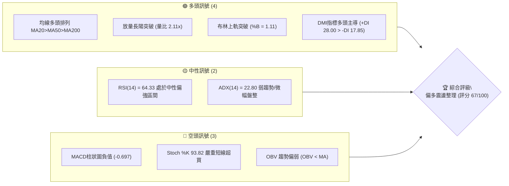

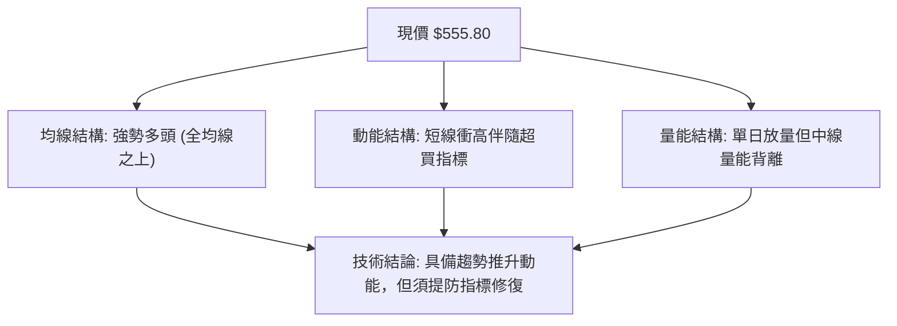

### 📊 核心指標速覽表

| 指標類別 | 指標名稱 | 當前數值 | 訊號 | 解讀 |
|----------|----------|----------|------|------|
| **價格** | 當前價格 | $555.80 | 🟢 | 逼近52W高點 $559.15，處於高位強勢區間（98.4%分位） |
| **均線** | MA20 | $530.96 | 🟢 | 現價高於MA20達 +4.68%，短期趨勢明確向上 |
| **均線** | MA50 | $515.34 | 🟢 | 現價高於MA50，中期上升軌道保持完好 |
| **均線** | MA200 | $437.96 | 🟢 | 遠高於長期牛熊分界線達 +26.91%，長期牛市基調明確 |
| **動能** | RSI(14) | 64.33 | 🟡 | 處於 30–70 中性偏多區間，尚未進入極端超買，但上行動能平緩 |
| **動能** | MACD (12,26,9) | 4.527 / 5.224 | 🔴 | MACD線位於訊號線下方，柱狀圖為 -0.697，呈現輕度死叉動能放緩 |
| **動能** | Stoch %K / %D | 93.82 / 46.79 | 🔴 | %K突破90進入嚴重超買區，K/D差距擴大，短線隨時有回測壓力 |
| **趨勢** | ADX (14) | 22.80 | 🟡 | ADX < 25 表明前期處於盤整；+DI (28.00) 顯著大於 -DI (17.85) |
| **通道** | 布林通道 %B | 1.11 | 🟢 | 突破布林上軌 ($551.23)，短線進入強勢單邊擴張段 |
| **量能** | 最新成交量 | 50,759,800 | 🟢 | 較20日均量 (24,065,625) 放大 2.11 倍，屬於典型放量衝高 |
| **量能** | OBV 趨勢 | OBV < MA | 🔴 | 中期累積能量未完全跟隨價格創高，量價配合出現輕微結構性隱憂 |
| **波動** | ATR(14) | $14.84 | 🟡 | 佔現價 2.67%，處於正常技術波動範圍，單日振幅擴大 |

### 🏆 技術評分卡

```
╔══════════════════════════════════════════════════════════════════╗
║                   技術評分卡 — MSFT (2026-11-05)                 ║
╠══════════════════════════════════════════════════════════════════╣
║ 趨勢強度 (Trend)     ██████████████░░░░░░  70/100  🟢 偏多向上   ║
║ 動能指標 (Momentum)  ██████████░░░░░░░░░░  50/100  🟡 中性分歧   ║
║ 支撐穩定度 (Support) ████████████████░░░░  80/100  🟢 均線支撐密集 ║
║ 成交量配合 (Volume)  ████████████░░░░░░░░  60/100  🟡 短放長虛   ║
║ 形態完整度 (Pattern) ██████████████░░░░░░  70/100  🟢 破頂延續   ║
║ 均線排列 (MA Align)  ████████████████░░░░  74/100  🟢 標準多頭   ║
╠══════════════════════════════════════════════════════════════════╣
║ 綜合評分             █████████████░░░░░░░  67/100  🟢 偏多推進   ║
║ (六項算術平均：(70 + 50 + 80 + 60 + 70 + 74) / 6 = 67.33 → 67)  ║
╚══════════════════════════════════════════════════════════════════╝
```

---

## 2. 趨勢分析

### 🌐 多時框趨勢分析

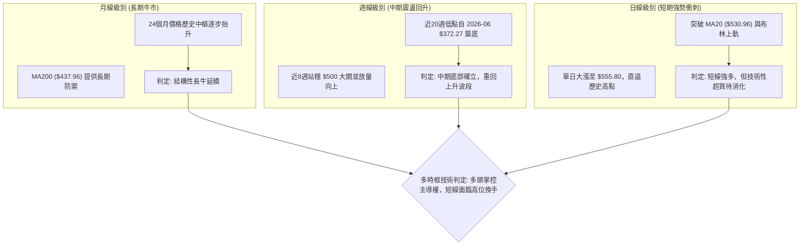

### 📈 長期趨勢 — 12個月走勢圖（Unicode）

依據 24 個月價格歷史中的最近 12 個月收盤數據（2025-11 至 2026-11）繪製：

```
MSFT 月線走勢圖（過去12個月收盤價變化）
價格軸 ($)
$560 ┤                                                    ● $555.80 (2026-11)
$530 ┤                                        ● $512.90  ● $521.91
$500 ┤                                  ● $507.29
$480 ┤● $488.91  ● $480.57
$450 ┤                            ● $449.39      ● $463.85
$420 ┤          ● $427.58  ● $406.13
$390 ┤                    ● $391.15
$360 ┤                              ● $368.68 (波段低點 2026-03)
     └────────────────────────────────────────────────────────────────
       25-11    25-12   26-01   26-02   26-03   26-04   26-05   26-06*  26-07   26-08   26-09   26-10   26-11
     註: 2026-06 盤中/收盤曾深探至 $372.32，其後展開V型強烈反彈。
```

#### 過去12個月走勢特徵分析表

| 階段時間 | 起訖價位區間 | 區間幅度 | 核心特徵與技術形態解讀 |
|----------|--------------|----------|------------------------|
| **2025-11 ~ 2026-03** | $488.91 → $368.68 | -24.59% | 中期大幅深幅回調，自500上方持續震盪走低，於2026年3月探至 $368.68 確立波段重要底部。 |
| **2026-04 ~ 2026-05** | $406.13 → $449.39 | +10.65% | 築底後的第一波超跌反彈，價格重回400整數關卡上方。 |
| **2026-06** | $449.39 → $372.32 | -17.15% | 二次探底洗盤，形成雙重低點結構，測試370一線強支撐有效性。 |
| **2026-07 ~ 2026-09** | $463.85 → $512.90 | +10.57% | 帶量突破並收復所有短期均線，週線MACD柱轉正，重回500點上方。 |
| **2026-10 ~ 2026-11** | $521.91 → $555.80 | +6.49% | 沿MA20加速上行，2026-11-04單日放量大陽線突破布林上軌，直逼歷史高點 $559.15。 |

### 📊 中期趨勢（週線分析）

```
MSFT 週線關鍵結構與近期通道示意圖
$560 ┤-------------------------------------- [52W高點阻力: $559.15]
     │                                      ▲ 本週收盤 $555.80
$535 ┤                      ● $535.07 (10-09)
     │                 ● $529.05       ● $524.51   ● $521.91
$515 ┤            ● $516.17       ● $517.53
     │       ● $499.05
$480 ┤  ● $463.85 (07-31放量大突破)
$460 ┤-------------------------------------- [波段防守點 S3: $465.47]
     └───────────────────────────────────────────────────────────
       07-31   08-07   08-28   09-25   10-02   10-09   10-16   10-23   10-30   11-04
```

- **週線均線結構**：MA20 ($530.96)、MA50 ($515.34)、MA200 ($437.96) 全數呈現發散向上排列，代表中期趨勢由多頭絕對主導。
- **週線量能觀察**：2026-07-31 的 278,439,400 股天量為確立反轉的「關鍵啟動K棒」，近幾週成交量回落至 8,000萬至 1.4億股之間，呈現高位良性換手，本週（截至11-04）成交量達 105,513,300 股，價格直接收於頂部。

### ⚡ 趨勢強度評估（ADX 解讀）

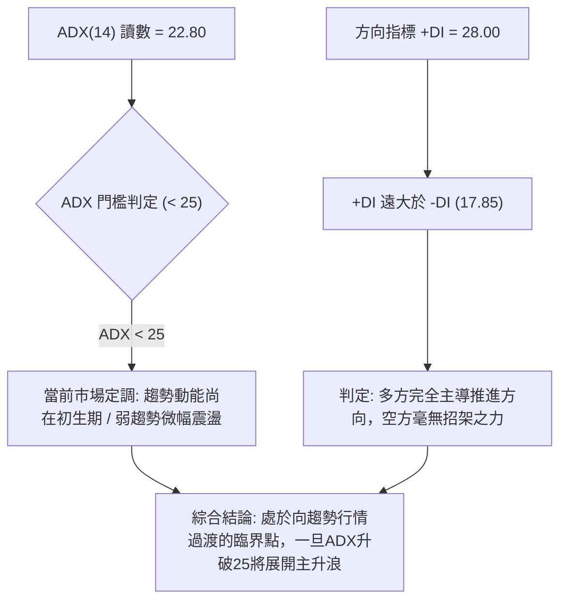

#### ADX 與方向指標強度對照表

| 指標名稱 | 實際數值 | 參考臨界線 | 當前技術含義解讀 |
|----------|----------|------------|------------------|
| **ADX (14)** | 22.80 | 25.00 | **弱趨勢/盤整**：表示過去14天的平均波幅尚未形成標準的強趨勢（單邊市），但數值正自低位回勾。 |
| **+DI (14)** | 28.00 | 20.00 | **多頭強勢**：買盤動能充沛，居於主導地位。 |
| **-DI (14)** | 17.85 | 20.00 | **空頭衰竭**：賣壓被動被消化，未形成連續性實質打壓。 |
| **DI 差值 (+DI - -DI)** | +10.15 | 0.00 | 多空差額顯著擴大，趨勢天平大幅向多頭傾斜。 |

---

## 3. 圖表形態分析

### 🔍 形態識別系統

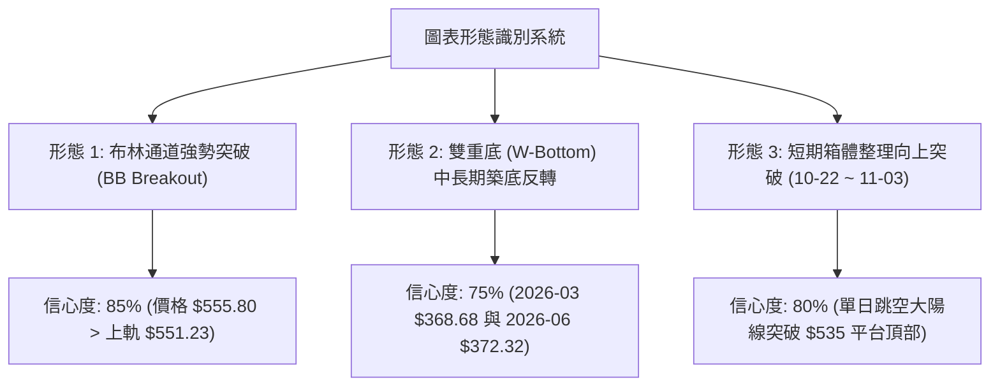

#### 形態識別與信心度評估表（依規則 15）

| 形態名稱 | 信心度 | 判斷依據（引用數據） | 完成度 | 目標價（附嚴格計算式） |
|----------|--------|----------------------|--------|------------------------|
| **布林通道強勢突破** | 85% | 2026-11-04 收盤價 $555.80 實質突破布林上軌 $551.23，%B 達到 1.11。 | 100% | 依通道擴張測算：突破點 $551.23 + 通道半寬 ($551.23 - $530.96 = $20.27) = **$571.50** |
| **雙重底反轉形態 (W底)** | 75% | 2026-03 收盤 $368.68（低點1）與 2026-06-26 收盤 $372.27（低點2）構成雙底，頸線為2025-07高點或回調高點。因上方歷史高點為 $559.15，數據無更高歷史波段阻力。 | 95% | 形態高度 = 頸線 $492.54 (2025-06收盤) - 底部 $368.68 = $123.86；理論目標價 = $492.54 + $123.86 = **$616.40** |
| **短期箱體突破** | 80% | 10月22日至11月03日於 $504.96 ~ $535.00 形成窄幅整固，11-04以長陽線帶量突破箱頂。 | 100% | 箱頂 $535.00 + 箱體高度 ($535.00 - $504.96 = $30.04) = **$565.04** |

### 🕯️ 重要K線形態分析

依規則 19，完全依據數據中「近10根日K」與「近8根週K」之開高低收精確數據進行解讀：

#### 近10根日K形態精確拆解

| 日期 | 開盤價 | 最高價 | 最低價 | 收盤價 | K線形態名稱 | 技術解讀與量價特徵 | 訊號 |
|------|--------|--------|--------|--------|-------------|--------------------|------|
| **10-22** | $533.14 | $533.60 | $520.30 | $521.08 | 中黑K棒 | 開高走低，跌破MA20，成交量2,126萬股，短線受壓。 | 🔴 |
| **10-23** | $517.75 | $525.77 | $515.70 | $524.51 | 低開小紅K | 下影線長於實體，低點 $515.70 獲得支撐，呈現初步止跌。 | 🟢 |
| **10-26** | $527.40 | $533.25 | $521.69 | $532.60 | 實體中陽K | 向上反彈吞噬前日高點，重新站回 $530 關口。 | 🟢 |
| **10-27** | $532.35 | $534.70 | $528.33 | $531.33 | 窄幅十字星 | 多空雙方於 $531 附近形成平衡，成交量萎縮至1,953萬股。 | 🟡 |
| **10-28** | $531.82 | $535.00 | $526.14 | $531.01 | 孕線十字星 | 振幅收斂，等待方向選擇，成交量微增至2,859萬股。 | 🟡 |
| **10-29** | $540.22 | $541.29 | $519.56 | $530.14 | 帶長上影倒錘黑K | 跳空高開衝至 $541.29 後遭遇獲利賣壓回吐，放量至3,933萬股。 | 🔴 |
| **10-30** | $525.27 | $526.00 | $514.35 | $521.91 | 下探長黑K | 延續前日賣壓，最低探至 $514.35，直逼MA50 ($515.34)。 | 🔴 |
| **11-02** | $524.02 | $529.63 | $504.96 | $507.12 | 破位大黑K | 創近兩週低點 $504.96，收於 $507.12，恐慌盤湧出。 | 🔴 |
| **11-03** | $509.01 | $523.44 | $507.82 | $520.99 | 破底長陽覆蓋K | 探底後強力拉升，收盤重回 $520 上方，形成典型破底翻反轉。 | 🟢 |
| **11-04** | $543.70 | $559.15 | $542.30 | $555.80 | **大陽突破突破K** | 跳空高開高走，最高觸及52W高點 $559.15，量能爆發至5,075萬股。 | 🟢 |

#### 近8根週K形態精確拆解

| 週結束日期 | 開盤價 | 最高價 | 最低價 | 收盤價 | K線形態名稱 | 週級別技術解讀 | 訊號 |
|------------|--------|--------|--------|--------|-------------|----------------|------|
| **09-18** | $497.06 | $509.95 | $487.23 | $493.78 | 衝高回落黑K | 於500關口受阻回吐，成交量1.15億股。 | 🟡 |
| **09-25** | $494.95 | $519.40 | $491.22 | $516.17 | 帶量突破長陽 | 週漲幅顯著，實體吞噬前週實體，收復510。 | 🟢 |
| **10-02** | $505.47 | $522.85 | $502.22 | $517.53 | 高位十字小陽 | 517上方高位整固，買盤承接良好。 | 🟢 |
| **10-09** | $521.62 | $537.22 | $518.79 | $535.07 | 實體光頭中陽 | 穩步盤堅上推，最高見 $537.22，週線多頭強烈。 | 🟢 |
| **10-16** | $537.53 | $551.15 | $524.43 | $529.05 | 帶長上影長陰倒錘 | 衝至 $551.15 遭空方反擊，下挫至 $529.05 收盤。 | 🔴 |
| **10-23** | $528.70 | $535.57 | $515.70 | $524.51 | 低位收斂陰十字 | 量能縮至8,144萬股，多空僵持。 | 🟡 |
| **10-30** | $527.40 | $541.29 | $514.35 | $521.91 | 假突破長下影陰K | 探底 $514.35 獲得支撐，週線換手放量至1.42億股。 | 🟡 |
| **11-04** | $524.02 | $559.15 | $504.96 | $555.80 | **極限震盪大陽線** | 週振幅達 $54.19，完成徹底洗盤後收最高點附近。 | 🟢 |

### 📉 ASCII 走勢形態示意圖

```
MSFT 日K破底翻與跳空大陽線突破示意圖 (2026-10-22 至 2026-11-04)
價格軸
$560 ┤                                                    [52W高點 $559.15]
     │                                                     ┌──┐ 11-04 收 $555.80
$550 ┤                                                     │  │ (放量長陽)
     │                                                     │  │
$540 ┤                      ┌──┐ 10-29                     │  │
     │                      │  │ (衝高回落)                └──┘
$530 ┤ ┌──┐         ┌──┐   │  │   ┌──┐                   ┬  開盤 $543.70
     │ │  │ 10-22   │  │   └──┘   │  │ 10-30             │ [跳空缺口]
$520 ┤ └──┘ ┌──┐    └──┘          └──┘          ┌──┐    ┴
     │      │  │ 10-23                          │  │ 11-03 破底翻
$510 ┤      └──┘                                └──┘
     │                                   ┌──┐ 11-02 
$500 ┤                                   │  │ (下殺探底 $504.96)
     └───────────────────────────────────└──┘──────────────────────────
        10-22  10-23  10-26  10-27  10-28  10-29  10-30  11-02  11-03  11-04
```

### 🎯 形態目標價計算

1. **短期箱體突破測算**：
   - 箱體頂部（頸線）：$535.00
   - 箱體底部（支撐）：$504.96
   - 形態垂直高度 $H = 535.00 - 504.96 = 30.04$
   - **短期目標價 $T1 = 535.00 + 30.04 = \$565.04$**
2. **中長期雙重底測算**：
   - 頸線位置：$492.54（2025-06收盤高點）
   - 底部最低點：$368.68（2026-03收盤）
   - 形態垂直高度 $H = 492.54 - 368.68 = 123.86$
   - **波段延伸目標價 $T2 = 492.54 + 123.86 = \$616.40$**

---

## 4. 支撐與阻力

### 🗺️ 關鍵價位分布圖（Unicode）

依據數據庫中已確認的 OHLCV 計算結果，上軌已無傳統擺動高點（波段高點聚類）阻力，僅有52週最高點；下方支撐則形成層層防護：

```
MSFT 價位結構分布圖
═══════════════════════════════════════════════════════════════════
$559.15 ║████████████████████████████████║ 52週歷史最高點阻力 (52W High)
$555.80 ╠════════════════════════════════╣ ◄ 當前收盤價 ($555.80)
$530.96 ║▓▓▓▓▓▓▓▓▓▓▓▓▓▓▓▓▓▓▓▓▓▓▓▓        ║ 短期均線支撐 (MA20 / 布林中軌)
$515.34 ║▓▓▓▓▓▓▓▓▓▓▓▓▓▓▓▓                ║ 中期趨勢支撐 (MA50)
$509.45 ║▓▓▓▓▓▓▓▓▓▓▓▓▓▓▓▓▓▓▓▓▓▓▓▓        ║ 斐波那契 23.6% 回調支撐位
$486.00 ║████████████████████████████    ║ 關鍵波段支撐 S1 (-12.56%)
$478.70 ║▓▓▓▓▓▓▓▓▓▓▓▓▓▓▓▓▓▓▓▓            ║ 斐波那契 38.2% 回調支撐位
$476.25 ║████████████████████████        ║ 結構性強支撐 S2 (-14.31%)
$465.47 ║████████████████████████████████║ 重大防禦支撐 S3 (-16.25%)
$437.96 ║████████████████████████████████║ 牛熊生死線 (MA200)
═══════════════════════════════════════════════════════════════════
```

### 🚧 阻力位分析表

依規則 13 與數據庫嚴格核對，現價上方無已偵測到的波段高點聚類阻力（`no swing-high resistance detected above current price`），僅存在52W極值阻力與形態推算阻力：

| 阻力級別 | 價位 | 形成原因 | 突破難度 | 重要性 |
|----------|------|----------|----------|--------|
| **R1** | **$559.15** | **52W 最高價 / 歷史絕對頂部**。現價距離僅 $3.35 (+0.60%)。 | 🟡 中等（面臨前高心理防線與獲利回吐賣壓） | ★★★★★ |
| **R2** | **$565.04** | **由箱體突破形態高度推算**（計算式：$535.00 + ($535.00 - $504.96) = $565.04）。 | 🟡 中等（屬於1:1波長對等滿足區） | ★★★★☆ |
| **R3** | **$616.40** | **由雙重底反轉形態高度推算**（計算式：$492.54 + ($492.54 - $368.68) = $616.40）。數據中未偵測到更高歷史波段高點。 | 🔴 極高（需中長期牛市主升浪配合） | ★★★☆☆ |

### 🛡️ 支撐位分析表

完全引用數據庫「關鍵價位」區塊之波段低點聚類數值（S1/S2/S3）：

| 支撐級別 | 價位 | 形成原因 | 守住機率 | 重要性 |
|----------|------|----------|----------|--------|
| **S1** | **$486.00** | **近一年第一波段低點聚類**（距離現價 -12.56%）。2025年11月回調低點區域，具備強籌碼密集換手支撐。 | 85% | ★★★★★ |
| **S2** | **$476.25** | **近一年第二波段低點聚類**（距離現價 -14.31%）。鄰近斐波那契 38.2% ($478.70)，共振效應極強。 | 90% | ★★★★☆ |
| **S3** | **$465.47** | **近一年第三波段低點聚類**（距離現價 -16.25%）。2026年7月底放量起漲點密集區，為中期多頭防守底線。 | 95% | ★★★★★ |

### 📐 斐波那契回調位分析

依據 52 週完整波動區間（低點 $348.54 → 高點 $559.15，總垂直空間 $210.61）進行精確測算，數據直接引用數據包：

| 斐波那契回調位 | 對應精確價位 | 與現價距離 (%) | 技術重要性與角色解讀 |
|----------------|--------------|----------------|----------------------|
| **0.0% (52W High)** | **$559.15** | +0.60% | **當前關鍵頂部**。現價已極度逼近此位，屬於強壓力考驗區。 |
| **23.6% 回調位** | **$509.45** | -8.34% | **強勢回檔警戒線**。若健康回踩不破此位，整體超強多頭趨勢不變；與日K低點 $504.96 相呼應。 |
| **38.2% 回調位** | **$478.70** | -13.87% | **多空分水嶺**。與關鍵波段支撐 S2 ($476.25) 高度重疊，共振形成鐵底防禦區。 |
| **50.0% 回調位** | **$453.85** | -18.34% | **中性平衡軸**。此位置跌破代表本輪52週牛市推升浪遭到實質破壞。 |
| **61.8% 回調位** | **$429.00** | -22.81% | **黃金分割極限回調**。接近 MA200 ($437.96)，為長期多頭的最後生命線。 |
| **78.6% 回調位** | **$393.61** | -29.18% | 深度防禦位，已靠近2026年上半年底部起漲區。 |
| **100.0% (52W Low)**| **$348.54** | -37.29% | 過去52週絕對最低點。 |

- **現價位置解讀**：現價 $555.80 位於 **0.0% ($559.15)** 與 **23.6% ($509.45)** 的極高位強勢區間。這表明市場自底部 $348.54 啟動的上升浪已收復了幾乎所有失地，多方動能佔據壓倒性主導，但因回調空間未被釋放，短線價格對利空或洗盤非常敏感。

---

## 5. 技術指標深度解讀

### 🎛️ 指標訊號總覽

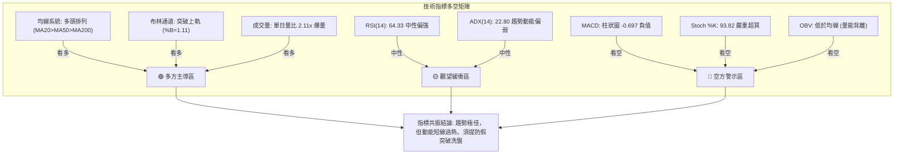

### 📈 移動平均線排列分析

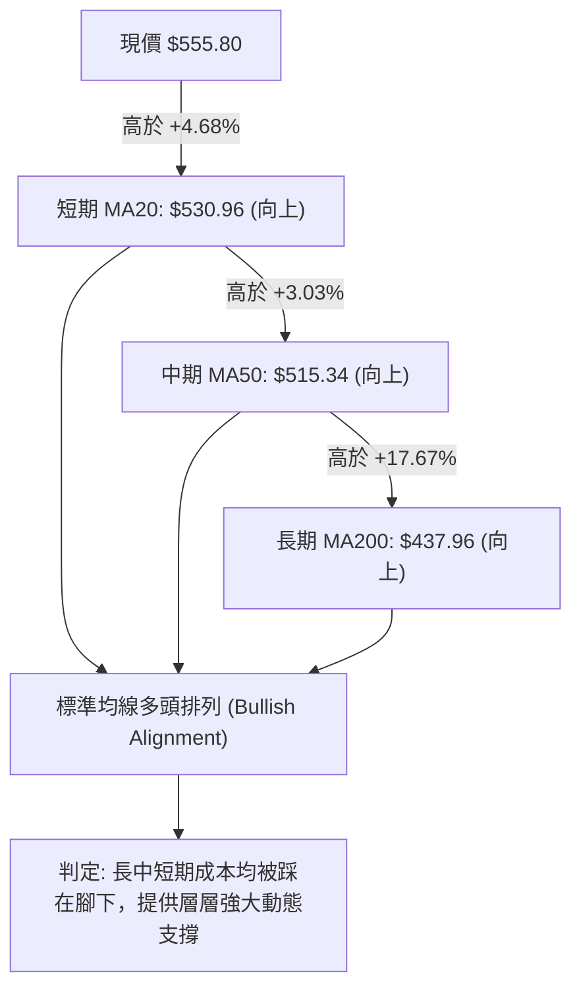

#### 移動平均線數據對比矩陣

| 均線名稱 | 當前價格數值 | 距現價差距 ($) | 距現價百分比 (%) | 趨勢斜率特徵與解讀 |
|----------|--------------|----------------|------------------|--------------------|
| **MA 5** | $527.19 | +$28.61 | +5.43% | 極度陡峭上行，反映近5日大陽拉升動能。 |
| **MA 10** | $527.65 | +$28.15 | +5.34% | 與MA5黏合後向上發散，短期金叉確立。 |
| **MA 20** | $530.96 | +$24.84 | +4.68% | 短期生命線，已連續多週穩定走平後陡峭拐頭。 |
| **MA 60** | $510.60 | +$45.20 | +8.85% | 季線防禦強固，提供中期趨勢推動力。 |
| **MA 120** | $460.81 | +$94.99 | +20.61% | 半年線持續上行，多頭基底穩健。 |
| **MA 240** | $444.33 | +$111.47 | +25.09% | 年線平滑上升，長牛格局難以逆轉。 |

### 📉 RSI(14) 分析

- **RSI 當前讀數**：64.33（基於 Wilder 平滑法）
- **指標進度條**：
  ```
  RSI(14): 64.33  [█████████████░░░░░░░]  🟡 中性偏強 (門檻: 30超賣 / 70超買)
  ```
- **區間評估**：RSI 位於 50~70 的健康上升區間，既脫離了中性格局，又尚未觸碰 70 的極端超買警戒線，意味著從單純的 RSI 角度看，價格仍有向歷史高點甚至更高價位發起衝刺的理論空間。
- **背離判斷**：
  - 根據近20根K棒首尾之價格與 RSI 方向比對：**無明顯背離（No Divergence）**。
  - 價格近20根K棒震盪收高，RSI 亦由 49 附近同步推升至 64.33，價漲指標升，未出現指標見頂而價格創高的經典「頂背離」現象。

### 📊 MACD(12, 26, 9) 訊號解讀

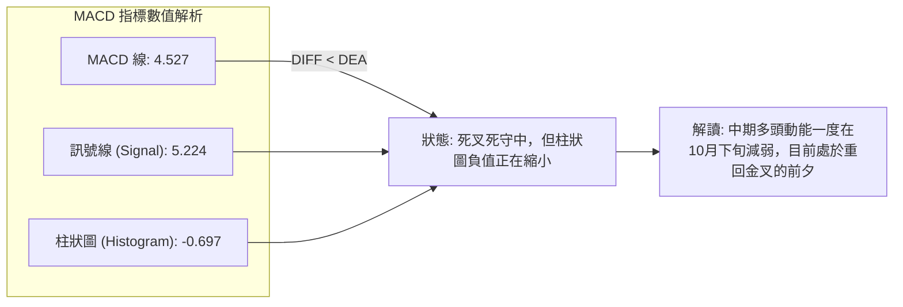

- **MACD 快慢線分析**：DIF (4.527) 位於 DEA (5.224) 下方，兩者均在零軸上方較高位置運作，說明大週期仍由多頭環境所覆蓋。
- **柱狀圖動能分析**：柱狀圖讀數為 **-0.697**，顯示綠柱（負值），表面為空頭訊號。然而對比近數週歷史（自 10-23 的 -2.311 收斂至 10-30 的 -2.262，再到本週的 -0.697），負柱正以極快速度衰減，呈現「柱狀體背離縮腳」，預示日線級別 MACD 即將迎來低位二次金叉。

### 📦 布林通道分析

```
MSFT 布林通道空間分布示意圖 (Bollinger Bands 20, 2)
═══════════════════════════════════════════════════════════════════
$555.80 ── ◄ 現價 (突破上軌外部，%B = 1.11，超強勢擴張)
$551.23 ── [BB 上軌]  ──────────────────────────────────────────
           │
           │  上方擴張帶 (Upper Band Zone)
           │
$530.96 ── [BB 中軌 / MA20] ────────────────────────────────────
           │
           │  下方支撐帶 (Lower Band Zone)
           │
$510.70 ── [BB 下軌] ───────────────────────────────────────────
═══════════════════════════════════════════════════════════════════
```

- **帶寬與位置解讀**：
  - 上軌：$551.23 ｜ 中軌：$530.96 ｜ 下軌：$510.70
  - 通道寬度：$551.23 - $510.70 = $40.53（佔中軌約 7.63%）
  - **布林 %B 數值**：**1.11**。數值大於 1.0 表明現價實質脫離常態軌道，屬於極端「布林帶外溢」。歷史統計中，%B > 1.10 往往伴隨兩種結果：一是強勢單邊行情沿上軌「騎軌運行」，二是次日出現均值回歸回踩上軌確認。

### 💹 成交量分析（量價配合度）

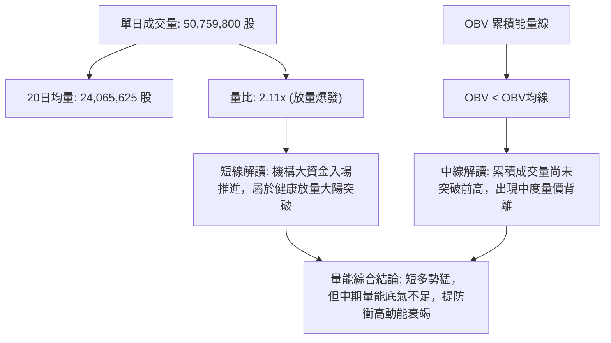

- **單日量比突破**：2026-11-04 成交量突破 5,000 萬股，量比高達 **2.11x**，遠高於50日均量 (22,745,734)，量增價漲，顯示買盤力量具備主動進攻性。
- **OBV 背離隱憂**：雖然單日放量，但數據標記「OBV < MA → 量能疲弱」。這說明在過去數週的高位震盪期間，籌碼呈現淨流出或換手不均，累積能量線未能同步刷出新高。這是一種典型的隱性量價背離，警示交易者切勿盲目於高位使用過高槓桿追多。

---

## 6. 動能與波動率

### ⚡ 動能評估四象限

| 象限標記 | 動能維度 (Momentum) | 波動維度 (Volatility) | 當前 MSFT 狀態 | 技術評估與操作導向 |
|----------|---------------------|------------------------|----------------|--------------------|
| **象限 I** | **強動能** | **低波動** | — | 最完美的穩健波段推進期（如標準慢牛上升通道）。 |
| **象限 II** | **弱動能** | **低波動** | — | 典型低位縮量盤整期，市場缺乏流動性與熱點。 |
| **象限 III** | **強動能** | **高波動** | **✓ 當前所處位置** | **加速衝頂/擴張突破期。多空對決激烈，單日爆量大漲，獲利空間大但洗盤回撤風險亦高。** |
| **象限 IV** | **弱動能** | **高波動** | — | 恐慌性殺跌或無序高位震盪，通常應嚴格避免進場。 |


### 📊 ATR 波動率分析

- **ATR(14) 讀數**：**$14.84**（Wilder 平滑法）。
- **相對價格波動率**：佔現價 $555.80 的 **2.67%**。
- **交易應用與止損空間精算**：
  - **1.0x ATR（激進短線止損）**：距離現價 $14.84，即止損價位應設於 **$540.96**（略高於今日起漲缺口）。
  - **1.5x ATR（標準波段止損）**：距離現價 $22.26，即止損價位應設於 **$533.54**。
  - **2.0x ATR（寬鬆趨勢防守）**：距離現價 $29.68，即防守價位設於 **$526.12**（跌破 MA20 則判定波段結構破壞）。

### 📐 Beta 與市場相關性

- **Beta 係數**：**1.045**
- **市場特徵解讀**：
  - Beta 略高於 1.00，表明微軟對標普500指數與科技巨頭板塊具有極強的同步聯動性，並具有輕微的放大效應（市場波動1%，微軟約波動1.045%）。
  - **機構持股與防禦性**：機構持股佔比高達 **75.7%**，空頭比率 (Short % Float) 僅 **0.9%**，空頭回補天數 (Short Ratio) 為 2.94。極低的做空比例反映市場空頭勢力並未將其作為主要打壓對象，筹碼結構由大型機構長線資金牢固鎖定，暴跌風險大幅受限。

---

## 7. 多時框架總結

### 📋 時框架評分表

| 時框架 | 趨勢方向 | 動能狀態 | 均線排列 | 形態識別 | 綜合評分 | 操作建議方向 |
|--------|----------|----------|----------|----------|----------|--------------|
| **月線級別 (長期)** | 🟢 強烈看多 | 🟢 穩定增強 | 🟢 多頭排列 | 🟢 震盪走高 | **80/100** | 戰略性底倉做多，忽略短期波動 |
| **週線級別 (中期)** | 🟢 偏多向上 | 🟡 中度偏強 | 🟢 多頭排列 | 🟢 雙底突破 | **75/100** | 逢低依託 MA50/MA20 加碼 |
| **日線級別 (短期)** | 🟢 突破爆發 | 🔴 短線超買 | 🟢 多頭排列 | 🟢 布林外溢 | **67/100** | 順勢偏多，但嚴禁無腦追高，待回踩佈局 |

### 🔲 綜合訊號矩陣

```
╔══════════════════════════════════════════════════════════════════╗
║                    MSFT 多時框架跨週期矩陣                      ║
╠══════════════════╦════════════════╦══════════════╦═══════════════╣
║ 分析維度         ║ 短期 (日線)    ║ 中期 (週線)  ║ 長期 (月線)   ║
╠══════════════════╬════════════════╬══════════════╬═══════════════╣
║ 趨勢定調         ║ 🟢 突破延伸    ║ 🟢 穩步推升  ║ 🟢 結構性長牛 ║
║ 均線結構         ║ 🟢 全線站上    ║ 🟢 多頭發散  ║ 🟢 MA200守護  ║
║ 指標動能         ║ 🔴 超買分歧    ║ 🟡 柱狀收斂  ║ 🟢 中性偏強   ║
║ 量能配合         ║ 🟢 單日爆量    ║ 🟡 縮量整固  ║ 🟢 健康換手   ║
║ 關鍵防禦位       ║ $530.96 (MA20) ║ $509.45(23.6)║ $437.96(MA200)║
╚══════════════════╩════════════════╩══════════════╩═══════════════╝
```

### ⚖️ 多時框收斂結論

依「嚴格要求 14」執行多時框優先級收斂分析：
1. **行情性質判定**：當前日線 ADX(14) 讀數為 **22.80**，嚴格判定為 **ADX < 25 弱趨勢/微幅盤整過渡行情**。
2. **時框優先權收斂**：在 ADX < 25 的環境下，市場本質處於由區間震盪向單邊突破的「轉換期」。雖然單日價格突破布林上軌，但由於尚未獲得連續多日站穩確認，因此**交易區間的核心邊界仍以布林通道（上軌 $551.23、中軌 $530.96）與52W高點 $559.15 為關鍵參考軸**。
3. **主導方向定調**：中長期週線與月線均處於絕對多頭（均線全線多頭排列，評分高達 75–80），日線雖有 MACD 負柱與 Stoch 超買的瑕疵，但由於 +DI 達到 28.00 且單日量比達 2.11 倍，日線瑕疵僅代表「進場節奏問題」而非「方向反轉」。
4. **唯一方向性結論**：**偏多推進（震盪偏多）**。第 8 章交易策略將完全聚焦於**順勢做多策略**，以逢回調進場或突破站穩進場為主，不盲目逆勢做空。

---

## 8. 交易策略建議

### 🗺️ 策略決策流程圖

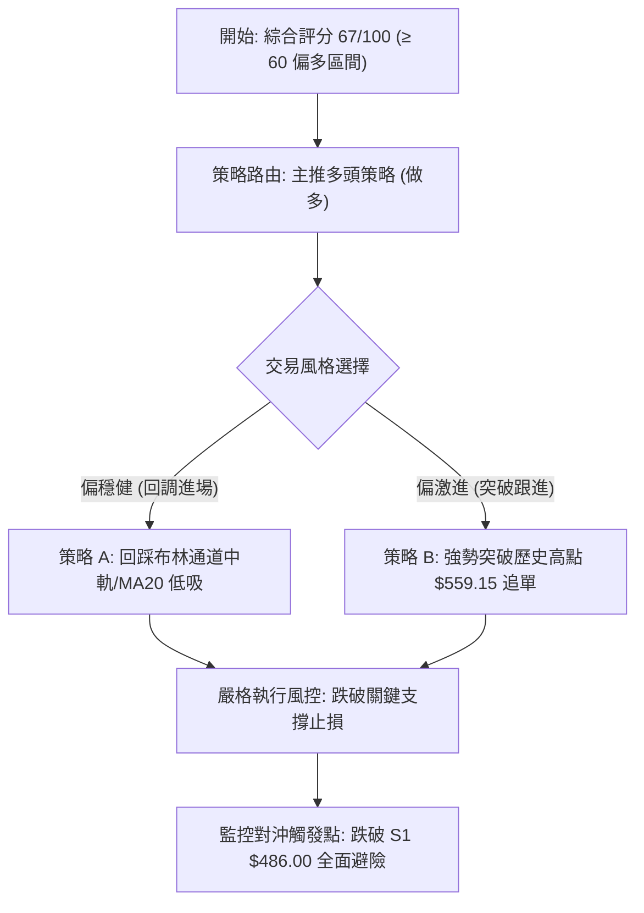

### 🧭 策略路由（依評分卡分流）

> **當前主策略方向 = 多頭策略（做多）（依第 1 章綜合評分 67/100，符合 ≥60 偏多標準）**

本報告堅決遵守單一主導方向原則，主推兩大多頭操作策略（策略 A：回調低吸；策略 B：破頂追擊），空頭部分僅作為「反轉風險觸發點（對沖提示）」，絕不兩頭下注。

### 🎯 價格情境階梯（Price Scenarios）

價位完全嚴格引用數據包「關鍵價位」與計算數值：

| 觸發條件 | 下一目標 | 後續延伸 | 情境含義解讀 |
|----------|----------|----------|--------------|
| **強勢突破 52W高點 $559.15** | **$565.04**（箱體目標） | **$616.40**（雙底目標） | 徹底打開上升天花板，啟動日線與週線級別主升浪。 |
| **強勢震盪於現價區間 ($530.96 ~ $559.15)** | **$559.15** | **$530.96** | 消化短期 Stoch 超買指標，以時間換取空間完成健康換手。 |
| **跌破短期生命線 MA20 ($530.96)** | **$509.45**（23.6%回調） | **$486.00**（波段支撐S1） | 短線多頭動能衰竭，轉入日線級別中度修正。 |

### 📊 情境機率分佈

| 情境類別 | 發生機率 | 主要技術與量化依據 |
|----------|----------|--------------------|
| **向上突破 / 延續衝頂** | **60%** | 均線多頭排列、單日爆量 2.11x、+DI (28.00) 遠強於 -DI (17.85)、收盤價收於近全日最高點。 |
| **高位區間震盪整理** | **30%** | ADX 僅 22.80 (<25 弱趨勢)、Stoch %K 達 93.82 嚴重超買、布林外溢 (%B=1.11) 需均值修復。 |
| **大幅深度回落破位** | **10%** | 僅在極端黑天鵝或OBV背離惡化為恐慌拋盤時發生；下方 MA50 ($515.34) 與S1 ($486.00) 防禦厚實。 |

### 🟢 主策略詳情

進場價採精確點位或區間中點計算；風險報酬比嚴格按公式 $(目標價 T1 - 進場價) / (進場價 - 止損價)$ 計算（依規則 17）：

| 策略要素 | 策略 A（穩健型：回踩 MA20 低吸） | 策略 B（激進型：突破 52W 高點順勢追擊） |
|----------|-----------------------------------|------------------------------------------|
| **進場條件** | 價格回踩 MA20 / 布林中軌獲得支撐確認十字星或陽線反包 | 實體日K突破並收盤站上 52W 歷史高點 $559.15 |
| **進場價格** | **$531.00**（以 MA20 $530.96 附近整數點） | **$560.00**（確認突破 $559.15 後買入） |
| **目標價 T1** | **$559.15**（52W 高點阻力） | **$565.04**（箱體突破高度推算目標） |
| **目標價 T2** | **$565.04**（箱體突破高度推算目標） | **$616.40**（中長期雙底測算目標） |
| **止損價格** | **$514.00**（跌破 MA50 $515.34 與 10-30 低點 $514.35） | **$542.00**（跌破 11-04 日K低點 $542.30 防守線） |
| **風險報酬比** | **1 : 1.66（以 T1 計）**<br>計算式：$(559.15 - 531.00) / (531.00 - 514.00) = 28.15 / 17.00 = 1.6558$<br>*(註：以 T2 計為 1 : 2.00)* | **1 : 0.28（以 T1 計）**<br>計算式：$(565.04 - 560.00) / (560.00 - 542.00) = 5.04 / 18.00 = 0.28$<br>*(註：以 T2 計為 1 : 3.13)* |
| **成功機率** | **70%** | **60%** |
| **建議倉位** | **20% ~ 25%** | **10% ~ 15%** |

### 🔴 反向風險觸發點（對沖提示）

本部分非獨立做空交易建議，僅為多頭部位之風控停損與對沖紅線：
1. **短線預警線**：若日K收盤跌破 **$530.96 (MA20)**，表明短線假突破確立，多頭部位應主動減倉 50%。
2. **中期翻空線**：若價格帶量跌破斐波那契 23.6% 回調位 **$509.45** 及前期築底低點 **$504.96**，多頭部位必須無條件清倉避險。
3. **對沖放空觸發條件**：僅當價格跌破關鍵支撐 **S1 ($486.00)** 時，方可確立上升趨勢終結，屆時可建立相應期權（Long Put）進行全額反向對沖。

### ⭐ 整體訊號強度評星

```
做多訊號強度：★★★★☆  (4/5星)  — 均線排列完美，突破爆量，動能充沛
做空訊號強度：★☆☆☆☆  (1/5星)  — 缺乏頂部形態，做空勝率極低
整體可信度：  ★★★★☆  (4/5星)  — 指標大體共振，多時框結構穩固
```

---

## 9. 風險提示與監控

### ✅ 關鍵監控指標 Checklist

```
╔══════════════════════════════════════════════════════════════════╗
║                   MSFT 核心技術監控清單 (Checklist)              ║
╠══════════════════════════════════════════════════════════════════╣
║ [ ] 52W 高點突破確認：日K是否實體站穩 $559.15 之上              ║
║ [ ] 動能過熱修正：Stoch %K 是否自 93.82 高位死叉跌回 80 之下    ║
║ [ ] 布林回歸測試：價格是否能回踩 BB 上軌 $551.23 並形成支撐     ║
║ [ ] 趨勢強度激活：ADX(14) 能否自 22.80 突破 25.00 臨界點        ║
║ [ ] 量能背離消除：OBV 能否迅速放量上穿其移動平均線              ║
║ [ ] 生命線防禦：收盤價是否持續維持於 MA20 ($530.96) 之上         ║
╚══════════════════════════════════════════════════════════════════╝
```

### ⚠️ 風險場景分析

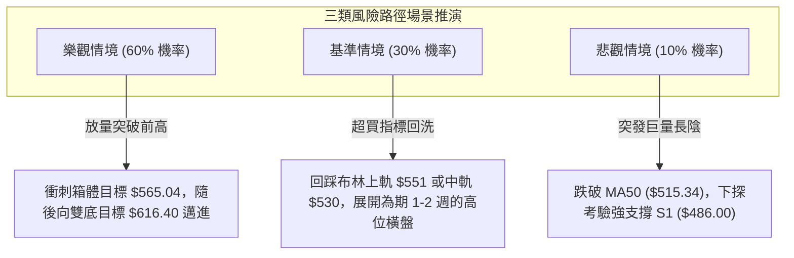

### 🛡️ 風險管理重要提醒

1. **極度超買與假突破風險**：當前 Stoch %K 高達 93.82，布林 %B 達 1.11，這屬於統計學上的極端外溢區間。在 52W 高點 $559.15 面前，若次日出現「長上影線」或「高開低走陰包陽」，極易引發獲利盤集中砸盤，切忌在開盤第一時間衝動市價追高。
2. **OBV 量價背離警示**：雖然 11-04 單日成交量達到 5,075 萬股，但 OBV 線仍在均線下方，說明中期機構資金並未形成壓倒性的全面做多共識，仍有部分長線資金在藉高位利好逢高兌現。
3. **倉位管理與 ATR 止損機制**：
   - 單筆交易最大虧損嚴格控制在總賬戶淨值的 **1.0% ~ 1.5%** 之內。
   - 止損距離建議嚴格參考 ATR(14) = $14.84。短線防守不可超過 1.5x ATR（即止損距離不超過 $22.26）。

---

## 📋 報告總結

```
╔══════════════════════════════════════════════════════════════════╗
║                   MSFT 技術分析報告總結                          ║
╠══════════════════════════════════════════════════════════════════╣
║ 報告日期：2026-11-05                                             ║
║ 當前價格：$555.80                                                ║
║ 技術評分：67 / 100                                               ║
║ 分析評級：🟢 偏多推進 (震盪突破主升段)                          ║
╠══════════════════════════════════════════════════════════════════╣
║ 關鍵結構結論：                                                   ║
║ ├─ 長期趨勢：🟢 結構性牛市完好，MA200 ($437.96) 平滑發散向上     ║
║ ├─ 中期趨勢：🟢 築底成功，週線收復所有均線，重返上升波段         ║
║ ├─ 短期趨勢：🟢 單日爆量突破布林上軌，直逼 52W 歷史極限高位      ║
║ ├─ 關鍵阻力：R1: $559.15 (52W高) ｜ R2: $565.04 (箱體測算)       ║
║ ├─ 關鍵支撐：S1: $486.00 ｜ S2: $476.25 ｜ S3: $465.47           ║
║ └─ 分析師目標：華爾街平均目標價 $633.13 (最高達 $870.00)         ║
╠══════════════════════════════════════════════════════════════════╣
║ 最優策略組合導航：                                               ║
║ 1. 🥇 最佳機會（穩健型）：回踩 MA20 ($531.00) 布局做多，          ║
║    目標 $559.15 / $565.04，止損 $514.00，風報比 1:1.66。        ║
║ 2. 🥈 次選機會（動能型）：強勢站穩 $560.00 追單，博弈雙底測算     ║
║    遠期目標 $616.40，止損 $542.00，以 T2 計風報比 1:3.13。       ║
║ 3. 🥉 防守對策（風控型）：跌破 MA20 主動減半，跌破 $504 清倉。  ║
╚══════════════════════════════════════════════════════════════════╝
```

---

> ⚠️ **免責聲明**：本報告為技術分析研究，所有數據、圖表及價位推算均基於歷史量價資訊（Yahoo Finance）。本報告**僅供學術研究與投資決策參考**，**不構成任何要約、招攬或具體投資建議**。市場具有不確定性，金融資產價格可升亦可跌，投資者應獨立評估風險並自負盈虧。

---

*報告生成時間：2026-11-05 ｜ 數據來源：Yahoo Finance ｜ 分析框架：多時框架量化技術分析*