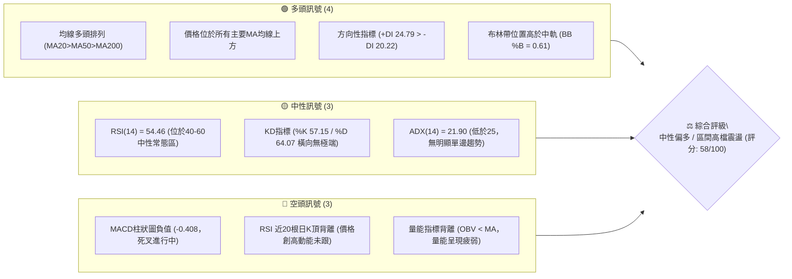
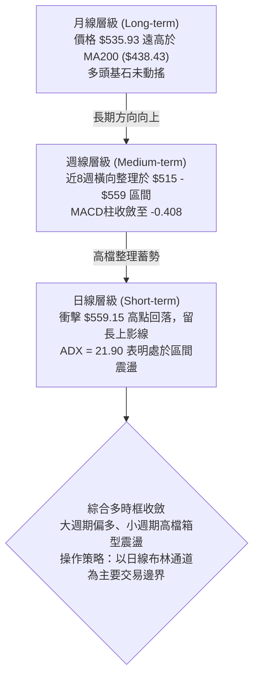
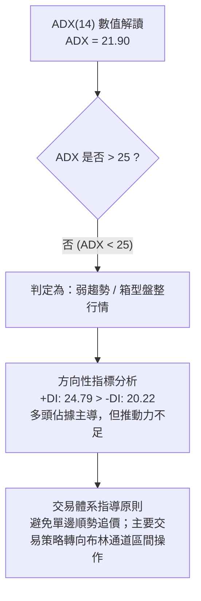
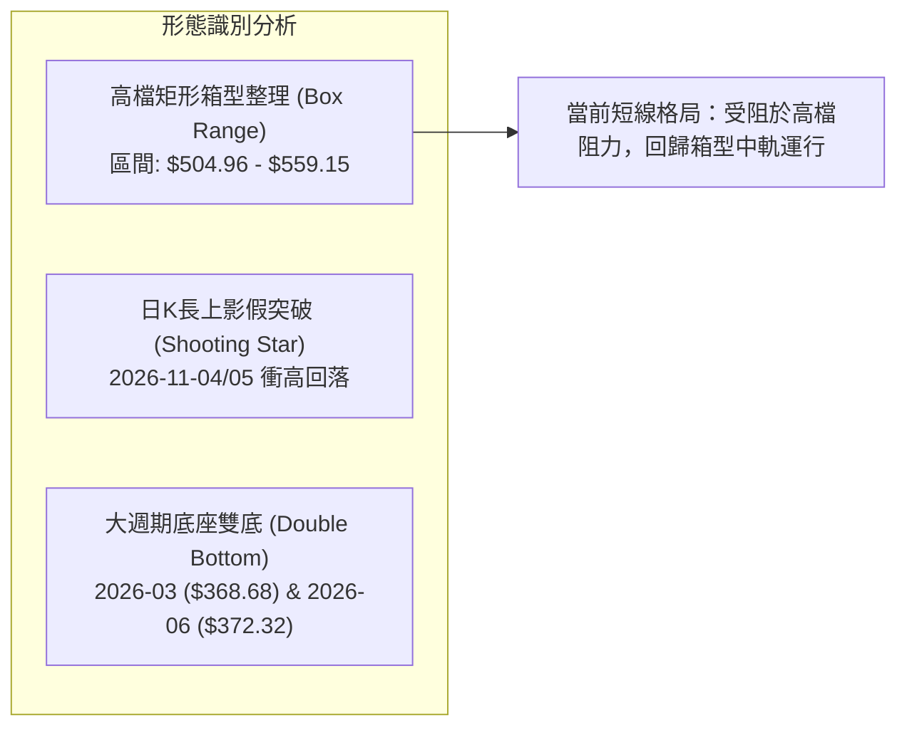
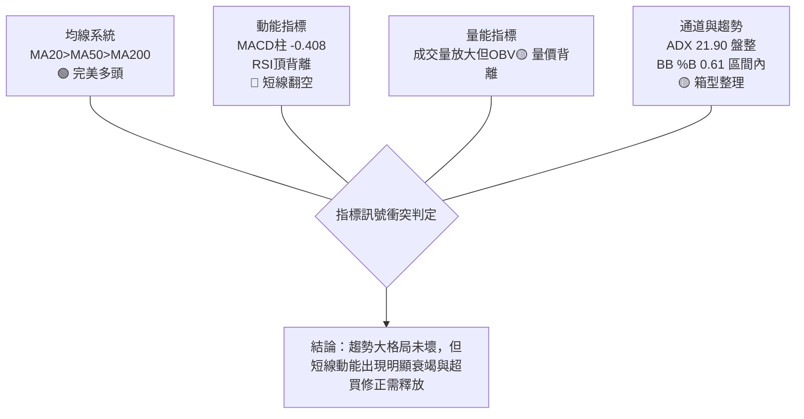
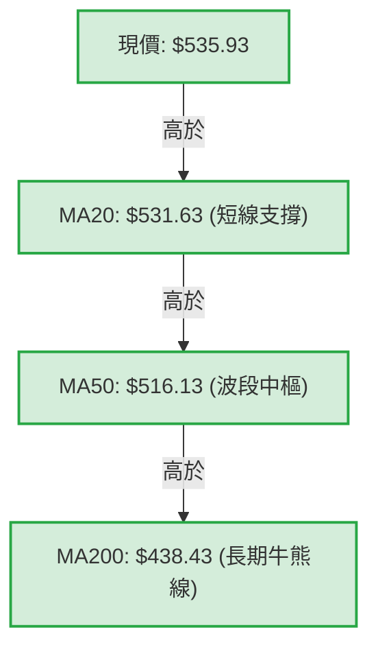
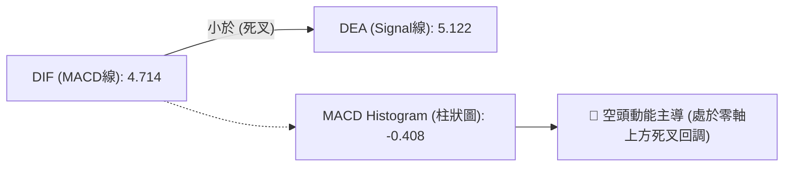
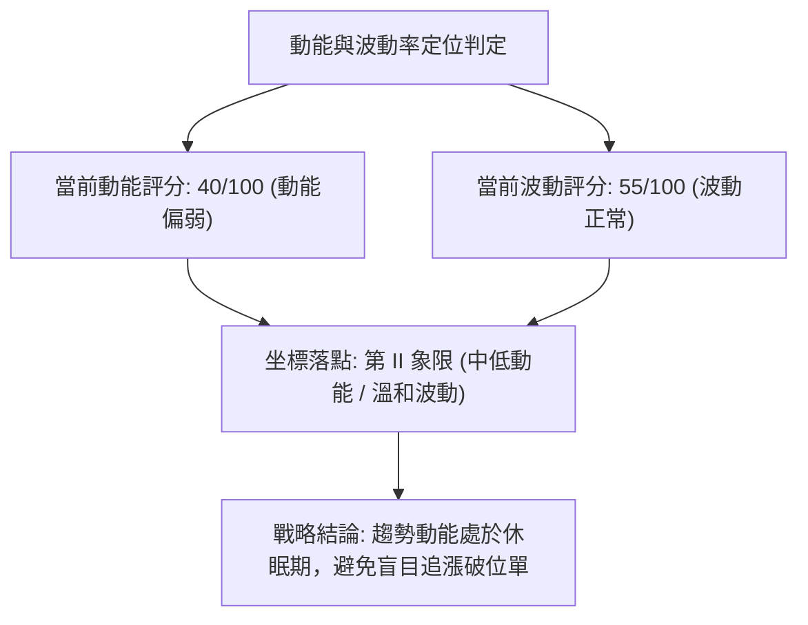
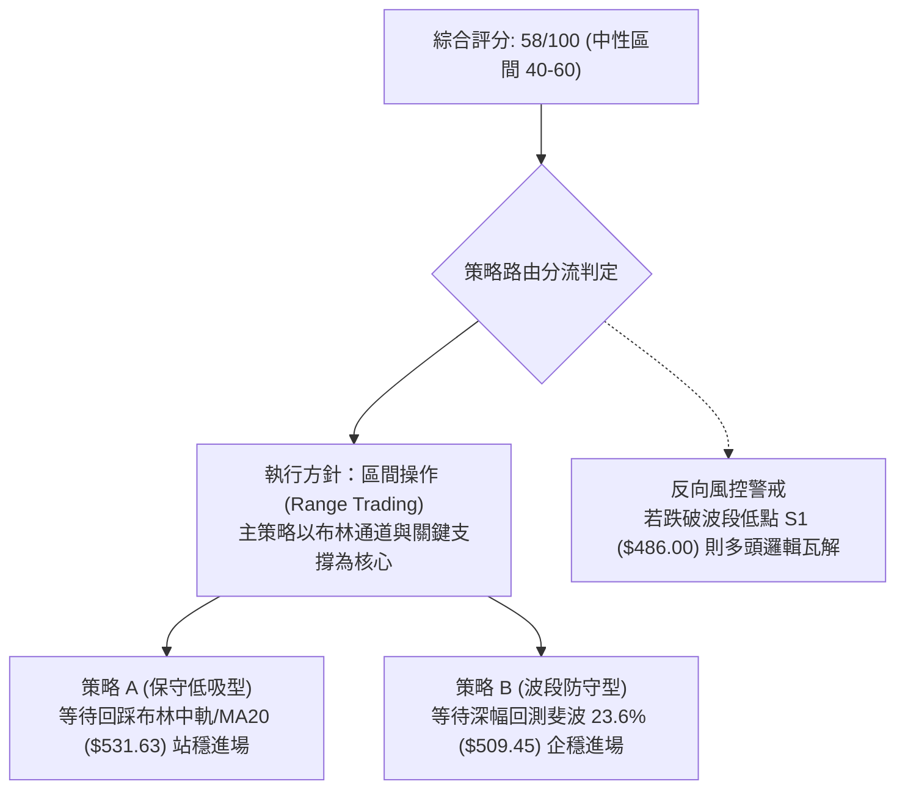
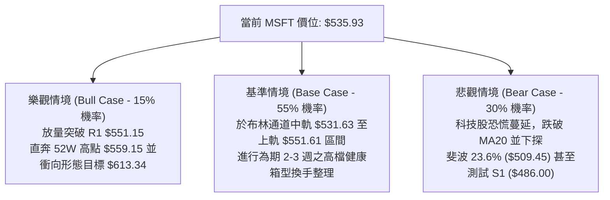

# MSFT 技術分析報告

> **報告日期**：2026-11-06 ｜ **語言**：繁體中文 ｜ **數據來源**：Yahoo Finance ｜ **當前價格**：$535.93

---

## 目錄

| 章節 | 內容 |
|------|------|
| [1. 技術面概覽](#1-技術面概覽) | 訊號儀表板、核心指標、評分卡 |
| [2. 趨勢分析](#2-趨勢分析) | 多時框趨勢、長中短期走勢、ADX解讀 |
| [3. 圖表形態分析](#3-圖表形態分析) | 形態識別、K線組合、目標價推算 |
| [4. 支撐與阻力](#4-支撐與阻力) | 關鍵價位、斐波那契回調結構 |
| [5. 技術指標深度解讀](#5-技術指標深度解讀) | MA/RSI/MACD/布林/成交量全面拆解 |
| [6. 動能與波動率](#6-動能與波動率) | 動能四象限、ATR波動分析、Beta屬性 |
| [7. 多時框架總結](#7-多時框架總結) | 時框架評分矩陣與多時框收斂判定 |
| [8. 交易策略建議](#8-交易策略建議) | 策略路由、主策略詳細參數、風險報酬比 |
| [9. 風險提示與監控](#9-風險提示與監控) | 關鍵監控Checklist、三情境與風控原則 |
| [📋 報告總結](#-報告總結) | 核心結論與交易指引架構 |

---

## 1. 技術面概覽

### 🎯 技術訊號儀表板



### 📊 核心指標速覽表

| 指標類別 | 指標名稱 | 當前數值 | 訊號 | 解讀 |
|:---|:---|:---:|:---:|:---|
| **價格** | 當前收盤價 | $535.93 | 🟢 | 位於52週區間高檔89.0%，高於MA20中軌 |
| **均線** | MA20 (短) | $531.63 | 🟢 | 價格在MA20上方（+0.81%），短均線提供動態支撐 |
| **均線** | MA50 (中) | $516.13 | 🟢 | 價格在MA50上方（+3.84%），中期生命線穩健向上 |
| **均線** | MA200 (長) | $438.43 | 🟢 | 價格遠高於MA200（+22.24%），長期牛市基調明確 |
| **動能** | RSI(14) | 54.46 | 🟡 | 中性區間，但近20根K線首尾存在⚠️頂背離訊號 |
| **動能** | MACD (12,26,9) | 4.714 / 5.122 | 🔴 | MACD位於信號線下方，柱狀圖為 -0.408，短線轉弱 |
| **動能** | Stoch %K / %D | 57.15 / 64.07 | 🟡 | KD高檔鈍化後交叉向下，目前於中軸震盪 |
| **趨勢強度** | ADX(14) | 21.90 | 🟡 | ADX < 25 表明處於盤整行情，非單邊強趨勢 |
| **通道** | 布林通道 %B | 0.61 | 🟡 | 位於中軌（$531.63）至上軌（$551.61）間常態震盪 |
| **量能** | 20日成交量比 | 1.68x | 🟡 | 最新量 42.35M 高於20日均量 25.17M，但OBV < MA |
| **波動** | ATR(14) | $15.56 | 🟡 | 佔股價2.90%，屬典型大型科技股正常波動區間 |

### 🏆 技術評分卡

```
╔══════════════════════════════════════════════════════════════════╗
║                 技術評分卡 — MSFT (2026-11-06)                   ║
╠══════════════════════════════════════════════════════════════════╣
║ 趨勢強度 (ADX=21.90 偏弱, +DI> -DI)    █████████░░░░░░░  45/100 🟡 ║
║ 動能指標 (RSI頂背離, MACD負柱)         ████████░░░░░░░░  40/100 🔴 ║
║ 支撐穩定度 (MA20/50支撐強烈, 52W高檔)  ██████████████░░  70/100 🟢 ║
║ 成交量配合 (最新放量但 OBV < MA)       ██████████░░░░░░  50/100 🟡 ║
║ 形態完整度 (日K長上影, 區間未破)       ████████████░░░░  60/100 🟡 ║
║ 均線排列 (MA20>MA50>MA200 完美多頭)    ████████████████  80/100 🟢 ║
╠══════════════════════════════════════════════════════════════════╣
║ 綜合評分 (上述六項算術平均: 57.5)      ████████████░░░░  58/100 🟡 ║
║ 綜合評級：中性偏多震盪 (Neutral-Bullish Consolidation)           ║
╚══════════════════════════════════════════════════════════════════╝
```

> **綜合評分計算說明**：（45 + 40 + 70 + 50 + 60 + 80）÷ 6 = 57.5，四捨五入為 **58/100**。落在 40–60 區間，依規則定義主策略為「區間震盪操作（偏多防守）」。

---

## 2. 趨勢分析

### 🌐 多時框趨勢分析



### 📈 長期趨勢 — 12個月走勢圖（Unicode）

以下為根據 MSFT 歷史數據重構之 12 個月收盤走勢圖（2025-12 至 2026-11）：

```
MSFT 月線收盤走勢圖（過去12個月：2025-12 至 2026-11）
價格軸 ($)
$550 ┤                                                     ● $535.93 (現價)
$525 ┤                                               ●     │
$500 ┤                                         ●     │     │
$475 ┤ ● $480.57                         ●     │     │     │
$450 ┤ │                           ●     │     │     │     │
$425 ┤ │     ● $427.58             │     │     │     │     │
$400 ┤ │     │     ● $391.15 ●     │     │     │     │     │
$375 ┤ │     │     │   ●     │     │     │     │     │     │
$350 ┤ │     │     │   │     │     │  ●  │     │     │     │
     └─┬─────┬─────┬───┴─────┬─────┬──┴──┬─────┬─────┬─────┬─────────
      12月  01月  02月 03月  04月  05月 06月 07月  08月  09月 10月  11月
     2025  ────────────────────── 2026 ───────────────────────────────
     波段說明：
     • 2026-03 探底 $368.68 (波段低點聚類)
     • 2026-06 二次回踩 $372.32 (形成雙重底支撐)
     • 2026-07 暴拉至 $463.85，開啟下半年強勢多頭主升浪
     • 2026-11 創下收盤新高 $535.93 (盤中極值觸及 52W High $559.15)
```

**12個月走勢特徵分析表**：

| 時間階段 | 月份區間 | 價格起訖 | 漲跌幅度 | 走勢結構與技術特徵 |
|:---|:---:|:---:|:---:|:---|
| **中期回調段** | 2025/12 - 2026/03 | $480.57 → $368.68 | -23.28% | 跌破多道短期均線，於 $368 附近構築年度底部 |
| **第一波修復段** | 2026/03 - 2026/05 | $368.68 → $449.39 | +21.89% | V型強彈，回補前期缺口，重返 MA60 之上 |
| **洗盤整理段** | 2026/05 - 2026/06 | $449.39 → $372.32 | -17.15% | 劇烈二次回踩，回測 $370 區間底部支撐未破 |
| **主升浪爆發** | 2026/06 - 2026/08 | $372.32 → $507.29 | +36.25% | 連續放量陽線突破 $500 大關，MA均線發散排列 |
| **高檔收斂震盪** | 2026/08 - 2026/11 | $507.29 → $535.93 | +5.65% | 進入高檔 $500-$550 箱型洗盤，動能放緩趨於中性 |

### 📊 中期趨勢（週線分析）

```
MSFT 週線關鍵結構與近期箱型區間 (近8週)
高點壓力：$559.15 (52週極值高點 / 2026-11-05 盤中高點)
───────────────────────────────────────────────────────────── 阻力警戒 R1: $551.15
▲ 535.93 (最新週K收盤價) ── 目前於高檔上緣遭遇阻力壓制
───────────────────────────────────────────────────────────── 震盪中樞 MA20: $531.63
▼ 514.35 (近兩週回調低點支撐)
───────────────────────────────────────────────────────────── 斐波那契 23.6% / MA50: $509.45 / $516.13
低點支撐：$486.00 (波段低點支撐 S1)
```

從近 8 週的 K 線結構觀察，收盤價呈現 `493.78 -> 516.17 -> 517.53 -> 535.07 -> 529.05 -> 524.51 -> 521.91 -> 535.93`。週線成交量在 2026-10-30 與 2026-11-05 分別擴大至 142.13M 與 147.91M，週線 MACD 柱狀圖由 -2.262 收斂至 -0.408，顯示中週期在 $510-$520 區間具有非常強勁的買盤承接力。

### ⚡ 趨勢強度評估（ADX 解讀）



| ADX 區間標記 | 趨勢狀態 | 當前數值 | 當前狀態判定 | 交易策略意涵 |
|:---:|:---:|:---:|:---:|:---|
| 0 – 20 | 無趨勢 / 極度膠著 | — | 未處於此區間 | 觀望為主 |
| **20 – 25** | **弱趨勢 / 盤整震盪** | **21.90** | **當前所在狀態** 🟡 | **高拋低吸，依通道上下軌操作** |
| 25 – 40 | 穩健單邊趨勢 | — | 未處於此區間 | 順勢跟進，回踩加碼 |
| 40 – 60 | 強烈趨勢行情 | — | 未處於此區間 | 移動止盈，讓利潤奔馳 |

---

## 3. 圖表形態分析

### 🔍 形態識別系統



**形態信心度與目標價評估表**（依規則 15 & 16）：

| 形態名稱 | 信心度 | 判斷依據（引用數據與計算） | 完成度 | 目標價（附嚴謹計算式） |
|:---|:---:|:---|:---:|:---|
| **高檔箱型震盪** | 75% | 箱頂為波段高點 $559.15，箱底為波段低點 $504.96，近2週多次於此區間折返 | 85% | 箱頂若突破：$559.15 + ($559.15 - $504.96) = **$613.34**（數據中未偵測到此歷史價位，此為形態推算目標） |
| **日線高檔假突破** | 70% | 2026-11-04 觸及 $559.15 後收長上影線，11-05 開 $554.94 收 $535.93 回吐漲幅 | 100% | 回測箱型中軸：(559.15 + 504.96) ÷ 2 = **$532.06** (貼近 MA20 $531.63) |
| **大週期雙底** | 85% | 2026-03 低點 $368.68，2026-06 低點 $372.32，兩次回踩近一年低點聚類 | 100% (已完成) | 頸線 $449.39 + ($449.39 - $368.68) = **$530.10** (已於當前點位完美達標) |

### 🕯️ 重要K線形態分析

根據近 10 根日 K 與近 8 根週 K 之實際開高低收數據，篩選關鍵 K 線形態如下（嚴格遵守規則 19）：

| 日期（週期） | 開 | 高 | 低 | 收 | 成交量 | K線形態名稱 | 技術解讀與多空訊號 |
|:---:|:---:|:---:|:---:|:---:|:---:|:---:|:---|
| **2026-10-29 (日K)** | 540.22 | 541.29 | 519.56 | 530.14 | 39.33M | **長黑陰線 (跌破開盤)** | 衝高回落，高點未過 $542，空方反撲壓制 🔴 |
| **2026-10-30 (日K)** | 525.27 | 526.00 | 514.35 | 521.91 | 35.65M | **光頭陰線 (弱勢下探)** | 實體收在低位，跌破5日均線，測試下檔買盤 🔴 |
| **2026-11-02 (日K)** | 524.02 | 529.63 | 504.96 | 507.12 | 34.74M | **帶長下影大黑棒** | 盤中重挫至 $504.96，收盤微幅拉起，空頭宣洩 🔴 |
| **2026-11-03 (日K)** | 509.01 | 523.44 | 507.82 | 520.99 | 20.01M | **反轉大陽線 (多頭吞噬)** | 低開高走，實體完全覆蓋前日陰線大部分，見底訊號 🟢 |
| **2026-11-04 (日K)** | 543.70 | 559.15 | 542.30 | 555.80 | 50.81M | **巨量跳空長陽** | 量能爆發至 50.8M，創 52W 高點 $559.15，多頭極盛 🟢 |
| **2026-11-05 (日K)** | 554.94 | 557.62 | 532.68 | 535.93 | 42.36M | **倒轉長陰十字/高檔回吐** | 實體大跌 -19.87，高檔承壓極重，多頭短線衰竭 🔴 |
| **2026-10-09 (週K)** | 521.62 | 537.22 | 518.79 | 535.07 | 103.23M | **實體週陽線** | 突破整理平台，多頭趨勢延續 🟢 |
| **2026-11-05 (週K)** | 524.02 | 559.15 | 504.96 | 535.93 | 147.92M | **週線巨量長上影錘頭** | 高檔放量 147.92M，上影線長達 $23.22，顯示 $550 以上賣壓沉重 🟡 |

### 📉 ASCII 走勢形態示意圖

```
MSFT 日K近5日高檔巨量洗盤與形態示意圖
價格 ($)
$560 ┤               ▲ $559.15 (52W新高 / 假突破受阻)
$555 ┤             ┌─┴─┐ 
$550 ┤             │   │ ┌─┴─┐ ◄ 11-05 開高走低長陰線 ($554.94 -> $535.93)
$545 ┤   跳空缺口 ─┘   │ │   │
$540 ┤                 │ │   │
$535 ┤                 └─┤   │ ◄ 當前收盤價 $535.93 (貼近 MA20 $531.63)
$530 ┤                   └───┘
$525 ┤             ┌───┐ 
$520 ┤             │   │ ◄ 11-03 多頭反彈大陽線 ($509.01 -> $520.99)
$515 ┤       ┌───┐ └───┘
$510 ┤       │   │
$505 ┤ ──────┴───┴──────────────────────── 波段防守支撐: $504.96 (11-02探底低點)
     └───────┬───────┬───────┬───────┬───────
           11-01   11-02   11-03   11-04   11-05
```

### 🎯 形態目標價計算

1. **高檔箱型整理上下軌**：
   - 箱頂（Resistance Top）：$559.15
   - 箱底（Support Bottom）：$504.96
   - 形態垂直高度（H）：$559.15 - $504.96 = **$54.19**
2. **向上突破理論目標（Bullish Target）**：
   - 目標價 = 箱頂 + H = $559.15 + $54.19 = **$613.34**
   - 註：此價位為依形態高度推算之量化數值，數據庫之波段阻力聚類目前僅偵測至 R1: $551.15。
3. **向下跌破理論支撐（Bearish Target）**：
   - 支撐價 = 箱底 - H = $504.96 - $54.19 = **$450.77**（非常貼近斐波那契 50.0% 回調位 $453.85）。

---

## 4. 支撐與阻力

### 🗺️ 關鍵價位分布圖（Unicode）

```
MSFT 價位結構分布圖
═══════════════════════════════════════════════════════════════════
$559.15 ║██████████████████████████████║ 52W 最高點 / 斐波那契 0.0%
$551.15 ║████████████████████████      ║ 關鍵阻力 R1 (布林上軌 $551.61)
$535.93 ╠══════════════════════════════╣ ◄ 當前收盤價 (現價)
$531.63 ║▓▓▓▓▓▓▓▓▓▓▓▓▓▓▓▓▓▓▓▓          ║ 動態支撐 (MA20 / 布林中軌)
$509.45 ║████████████████████          ║ 斐波那契 23.6% 回調位 (接近MA50 $516)
$486.00 ║████████████████████████      ║ 強支撐 S1 (波段低點聚類)
$478.70 ║████████████████              ║ 斐波那契 38.2% 回調位
$476.25 ║████████████████████          ║ 關鍵支撐 S2 (波段低點聚類)
$465.47 ║██████████████████████████    ║ 核心防守支撐 S3 (波段低點聚類)
$438.43 ║██████████████████████████████║ 長期牛熊分水嶺 (MA200)
═══════════════════════════════════════════════════════════════════
```

### 🚧 阻力位分析表

依據數據「關鍵價位」區塊之客觀計算結果（嚴格禁止虛構未列之價位）：

| 阻力級別 | 價位 | 與現價距離 | 形成原因與技術共振 | 突破難度 | 重要性 |
|:---:|:---:|:---:|:---|:---:|:---:|
| **R1** | **$551.15** | +2.84% | 近一年波段高點聚類、貼近日線布林上軌 ($551.61) | 極高 | ★★★★★ |
| **52W High** | **$559.15** | +4.33% | 52週歷史最高點（2026-11-04 盤中極值）、斐波那契 0.0% | 極高 | ★★★★★ |
| **R2** | N/A（數據未提供） | N/A | 歷史數據中未偵測到更高之波段高點聚類 | N/A | N/A |
| **R3** | N/A（數據未提供） | N/A | 歷史數據中未偵測到更高之波段高點聚類 | N/A | N/A |

### 🛡️ 支撐位分析表

依據數據「關鍵價位」區塊之客觀計算結果：

| 支撐級別 | 價位 | 與現價距離 | 形成原因與技術共振 | 守住機率 | 重要性 |
|:---:|:---:|:---:|:---|:---:|:---:|
| **動態支撐** | **$531.63** | -0.80% | 20日均線 (MA20) 與日線布林通道中軌重合 | 70% | ★★★★☆ |
| **S1** | **$486.00** | -9.32% | 近一年波段低點聚類、箱型震盪前波平台低點 | 85% | ★★★★★ |
| **S2** | **$476.25** | -11.14% | 近一年波段低點聚類、接近斐波那契 38.2% ($478.70) | 90% | ★★★★☆ |
| **S3** | **$465.47** | -13.15% | 近一年波段低點聚類、2026-07突破後之回踩跳空平台 | 95% | ★★★★★ |

### 📐 斐波那契回調位分析

本波斐波那契係基於 52 週絕對極值區間：**低點 $348.54 → 高點 $559.15**（總波段垂直落差 $210.61）計算：

| 斐波那契回調比例 | 精確對應價位 | 與現價 ($535.93) 空間 | 技術結構解讀 |
|:---:|:---:|:---:|:---|
| **0.0% (波段極高)** | **$559.15** | +4.33% | 52週歷史高點，當前第一大頭部心理阻力 |
| **23.6% 回調位** | **$509.45** | -4.94% | **強勢回調極限**：目前股價位於此線之上，呈現強牛特徵；與 MA50 ($516.13) 形成支撐帶 |
| **38.2% 回調位** | **$478.70** | -10.68% | **健康回調位**：與波段低點 S2 ($476.25) 形成雙重技術共振 |
| **50.0% 回調位** | **$453.85** | -15.32% | **多空分水嶺**：若遭擊穿則宣告本輪主升浪行情徹底終結 |
| **61.8% 黃金分割** | **$429.00** | -19.95% | 深幅回調極限，略低於 MA200 ($438.43) |
| **78.6% 回調位** | **$393.61** | -26.55% | 接近年初 2026-02/04 底部密集成交平台 |
| **100.0% (波段極低)**| **$348.54** | -34.96% | 52週歷史低點 |

> **當前價位定位評估**：現價 **$535.93** 穩固運行於 **0.0% ($559.15)** 與 **23.6% ($509.45)** 之間。在技術分析定義中，回調未觸及 23.6% 均屬於「超強勢整理」範疇。

---

## 5. 技術指標深度解讀

### 🎛️ 指標訊號總覽



### 📈 移動平均線排列分析



**均線系統詳細參數與趨勢狀態**：
- **MA 5 ($528.35)**：斜率向上，價格在其上方 +1.43%，短線乖離率正常。
- **MA 10 ($529.13)**：斜率向上，價格在其上方 +1.28%，形成超短期防守線。
- **MA 20 ($531.63)**：月線級別生命線，價格在其上方 +0.81%，提供當前最近的下檔動態保護。
- **MA 50 ($516.13) / MA 60 ($511.34)**：季線級別中樞，向上角度穩固，構成波段第一道強防禦網。
- **MA 120 ($461.77) / MA 200 ($438.43) / MA 240 ($444.58)**：半年線與年線系統完整呈多頭發散，中長線毫無轉熊跡象。

### 📉 RSI(14) 分析

- **RSI 數值**：**54.46**（Wilder 算法），位於 30-70 的常態中性區。
- **指標進度條**：
  ```
  RSI(14) = 54.46 : [███████████░░░░░░░░░] 54.46% (中性平衡區間)
  超賣門檻: 30    中軸平衡: 50           超買門檻: 70
  ```
- **背離診斷**：
  - **判定結論**：**⚠️ 出現頂背離（Bearish Divergence）**。
  - **診斷依據**：比對近 20 根日 K 棒首尾，股價於 2026-11-04 創出 $559.15 的歷史新高，然而當前 RSI(14) 僅達到 54.46，遠低於 2026-07/08 主升浪時期所達到的高點（78.1）。價格與動能指標走向背離，表明買盤邊際推動力顯著減弱，短線存在向 MA20 尋求支撐之技術修正需求。

### 📊 MACD(12/26/9) 訊號解讀



- **MACD 線**：4.714
- **Signal 線**：5.122
- **MACD 柱狀圖（Histogram）**：**-0.408**
- **深度解讀**：DIF 雖然仍處於零軸上方（長線多頭領域），但已下穿訊號線形成高檔「死叉」。負值柱狀圖擴散表明自 $559.15 以來的回調動能正在釋放，目前尚未見到紅柱翻綠的拐點訊號，空方仍掌握日內節奏主導權。

### 📦 布林通道分析

```
MSFT 日線布林通道 (20, 2) 結構示意圖
價格軸 ($)
$551.61 ┤═════════════════════════════════ 上軌 (BB Upper) - 阻力密集區
        │            ● (11-04 觸及上軌 $559.15 假突破)
$535.93 ┤────────────●──────────────────── 現價 (位於中上軌之間, %B = 0.61)
        │
$531.63 ┤───────────────────────────────── 中軌 (MA20) - 短線動態支撐
        │
$511.65 ┤═════════════════════════════════ 下軌 (BB Lower) - 箱底保護區
```

- **帶寬與位置指標**：
  - BB 上軌：$551.61
  - BB 中軌：$531.63
  - BB 下軌：$511.65
  - **%B 指標 = 0.61**：現價落於中軌上方，距離中軌僅約 $4.30，下探尋求中軌支撐之機率極高。通道帶寬（Upper - Lower = $39.96）未呈現極度開口發散，印證目前仍為標準的「通道內震盪」走勢。

### 💹 成交量分析（量價配合度）

- **最新日成交量**：42,355,300 股
- **20日平均量**：25,174,355 股（**量比：1.68x**，顯著放量）
- **50日平均量**：23,178,622 股
- **OBV 趨勢狀態**：**OBV < MA**（能量潮指標低於其均線，標示為量能疲弱）。
- **量價結構診斷**：
  1. 2026-11-04 在衝擊 52W 高點 $559.15 時成交量放大至 50.81M 股，然而次日（11-05）股價重挫回落時成交量依然高達 42.36M 股，呈現「高檔放量滯漲、陰線爆量回吐」的不良量價形態。
  2. OBV 低於均線顯示在過去 20 個交易日的震盪換手中，主力資金以逢高減磅為主，並未形成持續性的增量資金鎖倉，需提防高檔主力派發風險。

---

## 6. 動能與波動率

### ⚡ 動能評估四象限

| 象限 | 動能強度 (RSI/MACD) | 波動率狀態 (ATR/帶寬) | 當前判定 | 技術意涵與操作指導 |
|:---:|:---:|:---:|:---:|:---|
| **Q1 (最佳擴張)** | 強 (RSI>60, MACD金叉) | 低 (ATR收縮) | — | 典型突破前夕，準備大行情 |
| **Q2 (盤整中性)** | **弱 (RSI 54, MACD死叉)** | **低至中 (ATR 2.90%)** | **✓ 當前狀態 (Q2)** | **動能放緩且波動平穩，以區間低吸高拋為宜** |
| **Q3 (爆發風險)** | 強 (極度超買/超賣) | 高 (ATR急劇放大) | — | 單邊趨勢狂熱或恐慌殺跌 |
| **Q4 (衰退磨底)** | 弱 (動能指標低迷) | 高 (劇烈洗盤震盪) | — | 混沌期，應嚴格空倉觀望 |



### 📊 ATR 波動率分析

- **ATR(14) 數值**：**$15.56**（採 Wilder 平滑算法）。
- **波動率佔比**：佔當前股價之 **2.90%**。
- **止損距離量化建議**：
  - **短線交易（1.0 × ATR）**：建議安全停損保護區間為 **$15.56**。
  - **波段操作（1.5 × ATR）**：建議停損寬容度為 1.5 × $15.56 = **$23.34**。
  - **長線保護（2.0 × ATR）**：建議結構性停損點為 2.0 × $15.56 = **$31.12**。

### 📐 Beta 與市場相關性

- **Beta 係數**：**1.045**。
- **市場屬性剖析**：Beta 貼近 1.0（微幅高於 1），說明 MSFT 走勢與標普 500 指數及科技板塊具備極高同步性。在新聞面出現「Nasdaq Plunges 1,421 Points in Tech Rout」的大盤系統性拋售背景下，MSFT 無法獨善其身，11-05 的放量回吐主要受大盤科技股整體估值回調拖累。

---

## 7. 多時框架總結

### 📋 時框架評分表

| 時框架 | 趨勢方向 | 動能指標 | 均線排列 | 圖表形態 | 綜合評分 | 操作建議 |
|:---:|:---:|:---:|:---:|:---:|:---:|:---|
| **短期 (日線)** | 🟡 橫向盤整 | 🔴 頂背離/死叉 | 🟢 多頭排列 | 🟡 高檔箱型上影線 | **52 / 100** | 逢高減磅，等待中軌回踩 |
| **中期 (週線)** | 🟢 震盪上行 | 🟡 MACD柱微負 | 🟢 MA20/50向上 | 🟢 上升通道內整理 | **65 / 100** | 回調至 $510-$516 區間低吸 |
| **長期 (月線)** | 🟢 強烈牛市 | 🟢 遠高於MA200 | 🟢 完美多頭發散 | 🟢 雙底突破主升浪 | **85 / 100** | 長線多單堅決持股續抱 |

### 🔲 綜合訊號矩陣

```
時框與指標共振矩陣分析
─────────────────────────────────────────────────────────────
指標維度        短期 (日線)          中期 (週線)          長期 (月線)
─────────────────────────────────────────────────────────────
趨勢方向        🟡 盤整 (ADX 21.9)   🟢 多頭趨勢          🟢 擴張牛市
動能狀態        🔴 頂背離 / 負柱     🟡 零軸上方修正      🟢 健康強勢
支撐阻力        🟡 受阻於 R1 $551   🟢 站穩 23.6% 回調   🟢 遠離底部
量價關係        🔴 放量長陰滯漲     🟡 週量溫和持平      🟢 底部量能扎實
─────────────────────────────────────────────────────────────
時框一致性評定：長週期向上、中週期強勢、短週期出現指標過熱修正。
```

### ⚖️ 多時框收斂結論

> **依「規則 14：多時框收斂優先級規則」執行終局裁決**：
> 1. **趨勢強度檢驗**：當前日線 ADX(14) 數值為 **21.90**，嚴格小於 25 臨界值，因此技術面確認目前**處於「盤整行情（Consolidation）」而非「單邊趨勢行情」**。
> 2. **優先級歸屬**：依規則，盤整行情中應**以「日線布林通道上下軌（$511.65 – $551.61）」為主要交易區間**，放棄盲目順勢追高突破策略。
> 3. **終局唯一方向性結論**：**【中性觀望，區間高拋低吸】**。大格局牛市未改，但短期向上空間受阻於 R1 $551.15 及 52W 高點 $559.15，短線操作應以回踩布林中軌（$531.63）甚至下軌（$511.65）之低吸買點為主。

---

## 8. 交易策略建議

### 🗺️ 策略決策流程圖



### 🧭 策略路由（依評分卡分流）

- **當前主策略方向 = 【中性偏多，區間回踩低吸】（依綜合評分 58/100）**
- **策略邏輯定調**：綜合評分 58 落在 40–60 中性震盪區間。依規定，嚴禁在 $535.93 現價進行單邊追多，主策略以布林中軌與強支撐聚類構築兩套防禦性低吸買盤，空頭訊號僅作為停損與避險警示。

### 🎯 價格情境階梯（Price Scenarios）

所有價位均嚴格引用第 4 章及數據庫中之精確數值：

| 觸發條件 | 下一目標 | 後續延伸 | 技術情境含義解讀 |
|:---|:---:|:---:|:---|
| **向上突破 R1 ($551.15)** | **52W High ($559.15)** | 形態推算 $613.34 | 多頭重啟主升浪，頂背離化解，逼空行情再現 |
| **站穩現價區間 ($531 - $536)** | **R1 ($551.15)** | 52W High ($559.15) | 箱型常態波動，沿 MA20 蓄勢換手震盪 |
| **跌破動態支撐 ($531.63)** | **斐波 23.6% ($509.45)** | S1 ($486.00) | 短線頂背離修正擴大，回測 MA50 尋求中期支撐 |
| **跌破關鍵支撐 S1 ($486.00)** | **S2 ($476.25)** | S3 ($465.47) | 箱型形態跌破，中期上升趨勢遭遇結構性破壞 |

### 📊 情境機率分佈

| 情境劇本 | 機率 | 主要技術與量化指標依據 |
|:---|:---:|:---|
| **區間震盪蓄勢 (箱型波動)** | **55%** | **ADX=21.90 盤整狀態；布林通道帶寬收窄；日K於 $520-$550 密集換手** |
| **回踩深幅修正 (探底支撐)** | **30%** | **RSI 頂背離未化解；MACD 柱狀圖 -0.408 死叉擴散；OBV < MA 量能疲弱** |
| **強勢向上突破 (再創新高)** | **15%** | **均線系統多頭排列完整；+DI (24.79) 仍壓制 -DI (20.22)；華爾街共識強烈** |

### 🟢 主策略詳情

本報告設計兩套符合中性偏多震盪格局之交易策略。進場價採特定精確觸發價位或區間中點計算，風險報酬比嚴格依規則 17 量化定義：

$$\text{風險報酬比} = \frac{\text{目標價 T1} - \text{進場價}}{\text{進場價} - \text{止損價}}$$

| 策略要素 | 策略 A：布林中軌低吸策略（積極型） | 策略 B：斐波那契回調支撐加碼策略（穩健型） |
|:---|:---:|:---:|
| **操作邏輯** | 回踩日線 MA20 動態支撐企穩介入 | 等待回調至 23.6% 回調位與 MA50 支撐帶低吸 |
| **進場條件** | 日K回踩 $531.63 獲支撐且當日收陽 | 股價回落至 $509.45 斐波位出現止跌長下影 |
| **進場價格** | **$531.63** (MA20 數值) | **$509.45** (斐波那契 23.6% 數值) |
| **目標價 T1** | **$551.15** (阻力位 R1) | **$535.93** (前波中樞 / 當前收盤價) |
| **目標價 T2** | **$559.15** (52W 最高點) | **$551.15** (阻力位 R1) |
| **止損價格** | **$521.91** (2026-10-30 日K收盤防守價) | **$486.00** (關鍵支撐位 S1) |
| **風險報酬比 (T1)** | **1 : 2.01**（以 T1 計） | **1 : 1.13**（以 T1 計） |
| **風險報酬比 (T2)** | **1 : 2.83**（以 T2 計） | **1 : 1.78**（以 T2 計） |
| **歷史勝率估計** | 60% | 75% |
| **建議配置倉位** | 15% (輕倉試探) | 25% (標準波段倉位) |

> **數學驗算說明**：
> - 策略 A（以 T1 計）：($551.15 - $531.63) ÷ ($531.63 - $521.91) = $19.52 ÷ $9.72 = **2.0082 → 1 : 2.01**。
> - 策略 A（以 T2 計）：($559.15 - $531.63) ÷ ($531.63 - $521.91) = $27.52 ÷ $9.72 = **2.8312 → 1 : 2.83**。
> - 策略 B（以 T1 計）：($535.93 - $509.45) ÷ ($509.45 - $486.00) = $26.48 ÷ $23.45 = **1.1292 → 1 : 1.13**。
> - 策略 B（以 T2 計）：($551.15 - $509.45) ÷ ($509.45 - $486.00) = $41.70 ÷ $23.45 = **1.7782 → 1 : 1.78**。

### 🔴 反向風險觸發點（對沖提示）

若出現以下信號，表明當前中性偏多震盪格局已遭破壞，投資人應立即停止所有做多計畫並採取對沖避險：
1. **破位信號**：日 K 收盤價有效跌破 **$509.45**（斐波 23.6%）與 MA50（$516.13），視為短期結構徹底走壞。
2. **極限風控線**：若股價無量跌穿波段核心防守 **S1: $486.00**，多頭部位必須全面無條件停損出場，行情將進一步向 S2 ($476.25) 及 S3 ($465.47) 尋求支撐。
3. **空頭加碼誘因**：若 MACD 柱狀圖進一步跌破 -2.00 且 OBV 持續創下近 20 日新低，可考慮以期權買入賣權（Put）進行反向避險。

### ⭐ 整體訊號強度評星

```
做多訊號強度：★★★☆☆  (3/5星 — 均線多頭保護但動能背離)
做空訊號強度：★★☆☆☆  (2/5星 — 僅限於短線動能指標回調，逆大趨勢做空風險高)
整體可信度：  ★★★★☆  (4/5星 — 數據鏈路完整，價位支撐阻力結構清晰共振)
```

---

## 9. 風險提示與監控

### ✅ 關鍵監控指標 Checklist

```
╔══════════════════════════════════════════════════════════════════╗
║               MSFT 每日交易決策監控清單 (Checklist)              ║
╠══════════════════════════════════════════════════════════════════╣
║ [ ] 價格是否跌破 MA20 動態中軌 ($531.63) ？                      ║
║     └─ 是：短線進入弱勢回調，暫緩做多 / 否：維持中性偏多震盪     ║
║ [ ] RSI(14) 是否跌破 50 中軸分水嶺 (目前 54.46) ？              ║
║     └─ 是：動能轉弱確立，頂背離持續發酵 / 否：動能仍處強勢區間  ║
║ [ ] 日成交量是否萎縮至 20日均量 ($25.17M) 以下？                 ║
║     └─ 是：高檔洗盤量縮，利於止跌 / 否：持續放量下跌需警惕出貨  ║
║ [ ] MACD 柱狀圖何時出現縮腳翻紅 (目前 -0.408) ？                 ║
║     └─ 出現翻紅拐點即為短線策略 A 之最佳觸發進場訊號           ║
║ [ ] 下檔第一道硬支撐斐波 23.6% ($509.45) 是否受到測試？         ║
║     └─ 觸及此區間若出現長下影日K，即啟動策略 B 分批佈局        ║
╚══════════════════════════════════════════════════════════════════╝
```

### ⚠️ 風險場景分析



### 🛡️ 風險管理重要提醒

1. **宏觀與板塊聯動風險**：近期市場出現「Nasdaq Plunges 1,421 Points in Tech Rout」之極端避險情緒，微軟 Beta 為 1.045，受科技板塊估值壓縮影響顯著。當前市場對於雲端運算與 AI 資本支出（微軟 TTM Capex 高達 $135.92B）之投資報酬率產生審視，短線情緒面波動可能掩蓋技術面支撐。
2. **波動率管理（ATR 指引）**：日線 ATR 達 $15.56，單日波動空間接近 3%。交易者切忌滿倉操作，單筆交易的最大資金回撤風險應嚴格控制在總資金的 1.0% – 1.5% 以內。
3. **倉位管理防律**：在 ADX < 25 的盤整震盪市場中，最忌追高殺跌。若採取低吸策略，總多頭部位不宜超過總投資組合的 40%，預留充裕現金以應對潛在的市場流動性衝擊。

---

## 📋 報告總結

```
╔══════════════════════════════════════════════════════════════════╗
║                   MSFT 技術分析報告核心總結                      ║
╠══════════════════════════════════════════════════════════════════╣
║ 報告日期：2026-11-06             當前收盤價：$535.93 USD        ║
║ 綜合技術評分：58 / 100            分析評級：⚖️ 中性偏多區間震盪    ║
╠══════════════════════════════════════════════════════════════════╣
║ 趨勢總結架構：                                                   ║
║ ├─ 長期趨勢 (月線)：🟢 極強多頭 (遠高於 MA200 $438.43)          ║
║ ├─ 中期趨勢 (週線)：🟢 震盪盤整偏多 (高檔強勢整理平台)          ║
║ ├─ 短期趨勢 (日線)：🟡 高檔假突破回落，箱型震盪 (ADX 21.90)     ║
║ ├─ 近期核心阻力：R1: $551.15 ｜ 52W 高點: $559.15               ║
║ ├─ 近期關鍵支撐：MA20: $531.63 ｜ 斐波23.6%: $509.45 ｜ S1: $486 ║
║ └─ 華爾街共識目標價：$633.13 (53位分析師均值，評級 Strong Buy)   ║
╠══════════════════════════════════════════════════════════════════╣
║ 最優交易策略指引：                                               ║
║ 1. 🥇 最佳機會 (策略 A)：等待價格微幅回踩 MA20 動態支撐 $531.63   ║
║    進場，停損設於 $521.91，首要目標 R1 $551.15 (風報比 1:2.01)。 ║
║ 2. 🥈 次選機會 (策略 B)：若隨大盤深幅回調，於斐波 23.6% $509.45   ║
║    佈局中線波段單，停損 S1 $486.00，目標 $535.93 (風報比 1:1.13)║
║ 3. 🥉 保守選擇：當前於 $535-$540 區間不盲目追價，空倉靜待 MACD   ║
║    負柱收斂並出現日K反轉紅K後再行介入。                          ║
╚══════════════════════════════════════════════════════════════════╝
```

---

> ⚠️ **免責聲明**：本報告為依據量化技術指標與歷史行情數據自動生成之專業技術分析研究，所有數據、圖表及推算目標價均僅供學術交流與投資邏輯探討之用，**絕不構成任何形式的要約、招攬或具體投資買賣建議**。金融市場瞬息萬變，技術指標存在固有滯後性與失效機率，投資人應獨立思考、審慎評估個人風險承受能力，並自負盈虧責任。

---

*報告生成時間：2026-11-06 ｜ 數據來源：Yahoo Finance ｜ 核心框架：多時框架量化技術分析*