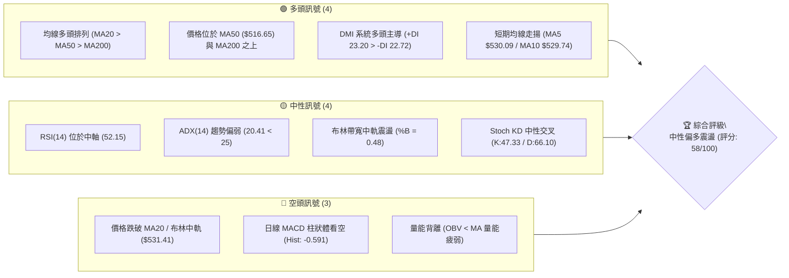
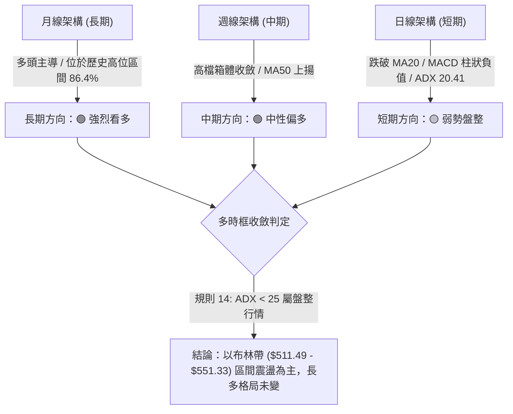
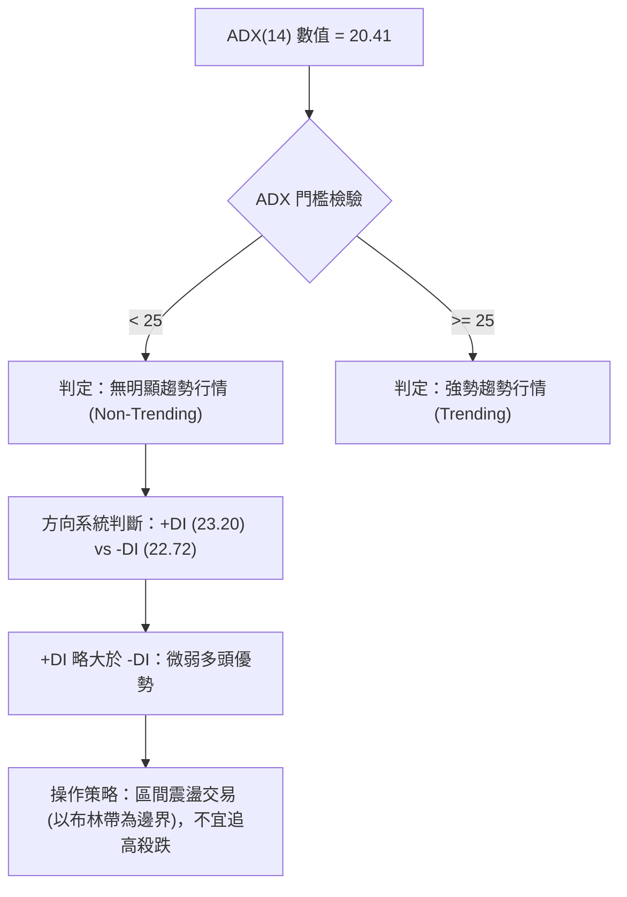
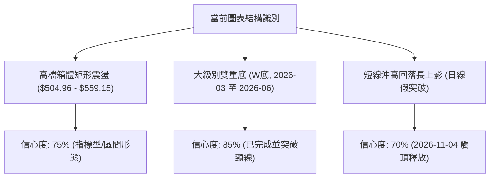
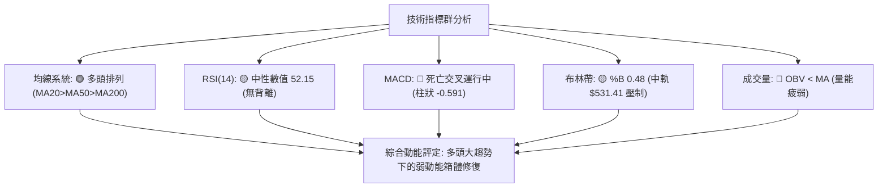
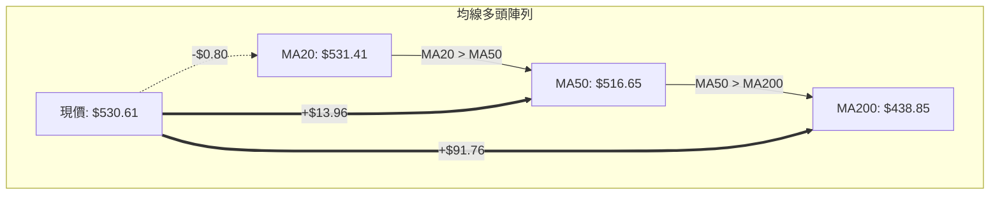
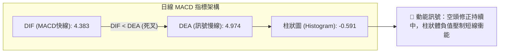
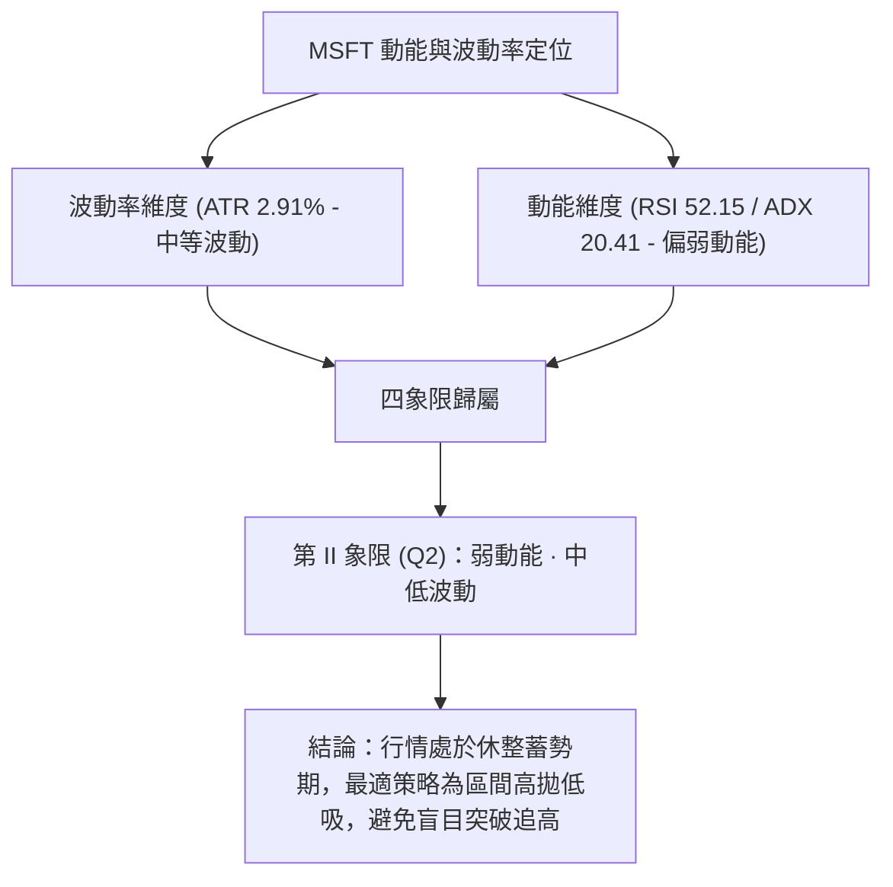
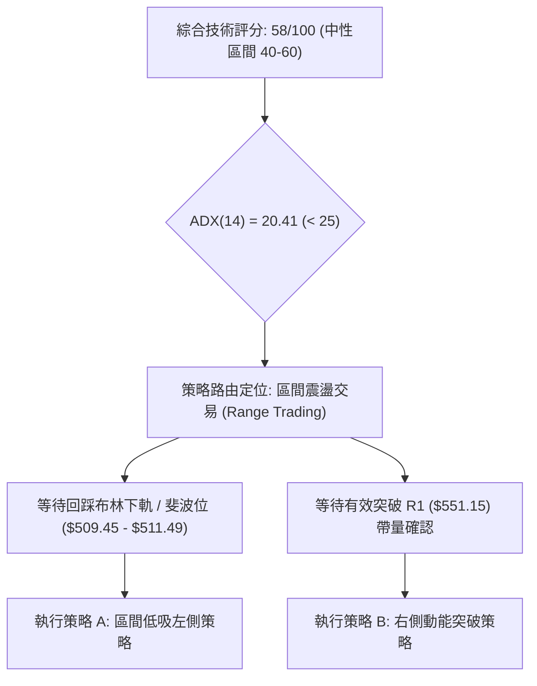
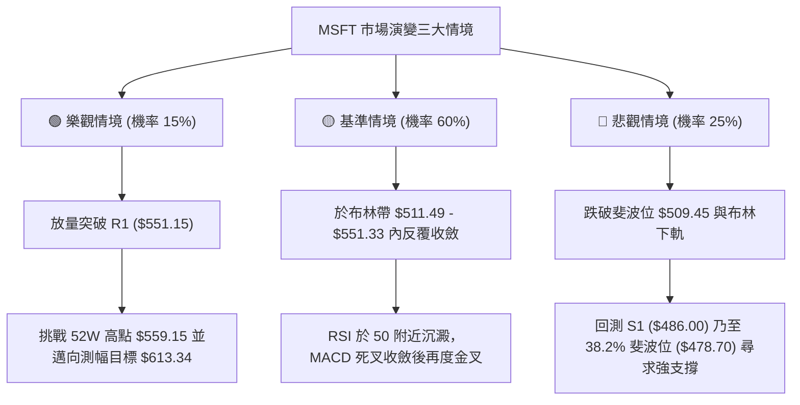

# MSFT 技術分析報告

> **報告日期**：2026-11-07 ｜ **語言**：繁體中文 ｜ **數據來源**：Yahoo Finance ｜ **當前價格**：$530.61

---

## 目錄

| 章節 | 內容 |
|------|------|
| [1. 技術面概覽](#1-技術面概覽) | 訊號儀表板、核心指標、評分卡 |
| [2. 趨勢分析](#2-趨勢分析) | 多時框趨勢、長中短期走勢 |
| [3. 圖表形態分析](#3-圖表形態分析) | 形態識別、K線組合、目標價 |
| [4. 支撐與阻力](#4-支撐與阻力) | 關鍵價位、斐波那契回調 |
| [5. 技術指標深度解讀](#5-技術指標深度解讀) | MA/RSI/MACD/布林/成交量 |
| [6. 動能與波動率](#6-動能與波動率) | 動能評估、ATR、Beta |
| [7. 多時框架總結](#7-多時框架總結) | 時框架評分矩陣 |
| [8. 交易策略建議](#8-交易策略建議) | 多空策略、風險報酬比 |
| [9. 風險提示與監控](#9-風險提示與監控) | 監控指標、風險場景 |

---

## 1. 技術面概覽

### 🎯 技術訊號儀表板



### 📊 核心指標速覽表

| 指標類別 | 指標名稱 | 當前數值 | 訊號 | 解讀 |
|----------|----------|----------|------|------|
| **價格** | 當前收盤價 | $530.61 | 🟡 | 位於52週區間 86.4%，逼近歷史高位區間震盪 |
| **均線** | MA20 | $531.41 | 🔴 | 收盤價略低於 20 日均線（-$0.80，-0.15%），短線承壓 |
| **均線** | MA50 | $516.65 | 🟢 | 顯著位於 50 日均線之上（+$13.96，+2.70%），中期結構穩固 |
| **均線** | MA200 | $438.85 | 🟢 | 遠高於 200 日牛熊分水嶺（+$91.76，+20.91%），長期牛市無虞 |
| **動能** | RSI(14) | 52.15 | 🟡 | 處於 30–70 中性強弱分水嶺，未現超買或超賣 |
| **動能** | MACD (12,26,9) | 4.383 / 4.974 / -0.591 | 🔴 | 快線低於慢線，柱狀體為負值（-0.591），動能短線死叉整理 |
| **趨勢** | ADX(14) | 20.41 | 🟡 | 數值低於 25，表明當前處於無明確趨勢的箱體震盪行情 |
| **波動** | ATR(14) | $15.44 | 🟡 | 佔股價 2.91%，日均絕對波動維持正常區間 |
| **通道** | 布林通道 %B | 0.48 | 🟡 | 緊貼布林中軌（$531.41），多空處於均勢拉鋸 |
| **量能** | 成交量比 / OBV | 1.05x / 疲弱 | 🔴 | 最新量 26.94M，量能微升但 OBV 低於均線，量價配合欠佳 |

### 🏆 技術評分卡

```
╔══════════════════════════════════════════════════════════════╗
║                技術評分卡 — MSFT (2026-11-07)                ║
╠══════════════════════════════════════════════════════════════╣
║ 評估維度      評分進度條                         分數  訊號  ║
╟──────────────────────────────────────────────────────────────╢
║ 趨勢強度      ██████████░░░░░░░░░░░░░░░░░░░░     50   🟡    ║
║ 動能指標      ████████░░░░░░░░░░░░░░░░░░░░░░     40   🔴    ║
║ 支撐穩定度    ████████████████░░░░░░░░░░░░░░     80   🟢    ║
║ 成交量配合    ████████░░░░░░░░░░░░░░░░░░░░░░     40   🔴    ║
║ 形態完整度    ████████████░░░░░░░░░░░░░░░░░░     60   🟡    ║
║ 均線排列      ████████████████░░░░░░░░░░░░░░     80   🟢    ║
╠══════════════════════════════════════════════════════════════╣
║ 綜合評分      ████████████░░░░░░░░░░░░░░░░░░     58   🟡    ║
║               評級：中性偏多盤整 (Neutral Consolidation)     ║
╚══════════════════════════════════════════════════════════════╝
```
*註：綜合評分 = (50 + 40 + 80 + 40 + 60 + 80) ÷ 6 = 58.33，四捨五入至整數為 58（符合嚴格要求 18）。*

---

## 2. 趨勢分析

### 🌐 多時框趨勢分析



### 📈 長期趨勢 — 12個月走勢圖（Unicode）

依據 24 個月收盤歷史數據，過去 12 個月（2025-12 至 2026-11）的月線價格走勢與關鍵轉折點呈現如下：

```
MSFT 月線走勢圖（過去12個月：2025-12 至 2026-11）
價格軸 ($)
$560 ┤                                                    
$530 ┤                                              ●(10) ●(11:現價 $530.61)
$510 ┤                                        ●(8)  ●(9) 
$480 ┤●(12)                                   
$460 ┤                                  ●(7)  
$440 ┤                            ●(5)        
$420 ┤      ●(1)                              
$400 ┤            ●(2)      ●(4)              
$370 ┤                  ●(3:波段低)           ●(6:雙底低)
     └─────────────────────────────────────────────────────────► 時間
      12   01    02    03    04    05    06    07    08    09    10    11 (月份)
      25   26    26    26    26    26    26    26    26    26    26    26 (年份)
```

**走勢特徵分析表格（過去 12 個月）：**

| 時段 | 起訖月份 | 起點收盤 | 終點收盤 | 區間漲跌幅 | 形態與走勢特徵分析 |
|------|----------|----------|----------|------------|--------------------|
| 階段一：回調築底 | 2025-12 → 2026-03 | $480.57 | $368.68 | -23.28% | 延續高檔回檔，於 2026-03 探低 $368.68，釋放中期獲利賣壓 |
| 階段二：初段反彈 | 2026-03 → 2026-05 | $368.68 | $449.39 | +21.89% | 超跌後 V 型快速修復，突破 400 整數關卡並回升至 449 |
| 階段三：二次回踩 | 2026-05 → 2026-06 | $449.39 | $372.32 | -17.15% | 月K急跌回測前低，構築大級別雙重底（$368.68 與 $372.32） |
| 階段四：主升發動 | 2026-06 → 2026-08 | $372.32 | $507.29 | +36.25% | 大成交量推升，7 月巨陽線帶量站上 500 大關，確立長期多頭再起 |
| 階段五：高檔整固 | 2026-08 → 2026-11 | $507.29 | $530.61 | +4.60% | 進入 500–550 箱體震盪，收盤逐月墊高至 2026-11 之 $530.61 |

### 📊 中期趨勢（週線分析）

```
MSFT 週線關鍵結構與近期價格分佈示意圖
$559.15 ───────────────────────────────► 52W 歷史最高點 (2026-11-04 日內觸及)
$551.15 ═══════════════════════════════► 近期阻力位 R1 (10-16 週高點聚類)
$535.07 ┈┈┈┈┈┈┈┈┈┈┈┈┈┈┈┈┈┈┈┈┈┈┈┈┈┈┈┈┈┈┈  10-09 週收盤高點
$530.61 ◄──────────────────────────────  當前收盤價 (2026-11-06)
$516.17 ┈┈┈┈┈┈┈┈┈┈┈┈┈┈┈┈┈┈┈┈┈┈┈┈┈┈┈┈┈┈┈  09-25 週收盤平台
$509.45 -------------------------------► 斐波那契 23.6% 回調位
$486.00 ═══════════════════════════════► 近期支撐位 S1 (波段低點聚類)
$476.25 ═══════════════════════════════► 次級支撐位 S2 (波段低點聚類)
$465.47 ═══════════════════════════════► 強固支撐位 S3 (波段低點聚類)
```

**中期走勢解讀：**
MSFT 自 2026-07 突破 $400 以來，週線 RSI 曾於 2026-08 衝高至 78.1（超買），隨後開展週線級別的指標收斂。近 8 週成交量由 2026-07-31 週的 2.78 億股逐步降至 1 億股上下，但在 2026-11-06 當週暴增至 175,007,600 股，週 K 棒波動加劇（當週低點 $504.96，高點 $559.15，收盤 $530.61），顯示在 52 週新高附近多空籌碼激烈換手，呈現寬幅震盪整理。

### ⚡ 趨勢強度評估（ADX 解讀）



**ADX 趨勢強度對照表：**

| 指標名稱 | 實際數值 | 參考標準區間 | 趨勢強度解讀 | 戰術意義 |
|----------|----------|--------------|--------------|----------|
| **ADX(14)** | 20.41 | < 20: 極弱<br>20–25: 弱趨勢/盤整<br>25–50: 強趨勢<br>> 50: 極強趨勢 | 🟡 處於 20–25 臨界盤整區，趨勢動力衰退 | 順勢突破策略易遭遇假突破，應切換至高拋低吸震盪策略 |
| **+DI** | 23.20 | 多頭推動力 | 🟢 買盤力量微幅佔優 | 多頭防線依然存在，無崩跌風險 |
| **-DI** | 22.72 | 空頭打壓力 | 🔴 賣壓維持同等量級 | 多空雙方處於僵持均衡狀態 |

---

## 3. 圖表形態分析

### 🔍 形態識別系統



**形態信心度與目標價評估表（依規則 15）：**

| 形態名稱 | 信心度 | 判斷依據（引用數據） | 完成度 | 目標價（附嚴格計算式） |
|----------|--------|----------------------|--------|------------------------|
| **長期雙重底 (W底)** | 85% | 第一次波段低點於 2026-03 之 $368.68，第二次波段低點於 2026-06 之 $372.32；頸線為 2026-05 之月收盤高點 $449.39 | 100% (已完全達成) | 形態高度 = $449.39 − $368.68 = $80.71。<br>目標價 = 頸線 $449.39 + 形態高度 $80.71 = **$530.10**。<br>當前價格 $530.61 已完美達成並消化此目標。 |
| **高檔收斂箱體** | 75% | 震盪區間以 52W 高點 $559.15 為頂部，11-02 日K低點 $504.96 及斐波那契位 $509.45 為箱體底部 | 60% (進行中) | 箱體高度 = $559.15 − $504.96 = $54.19。<br>若向上突破 R1($551.15) 與 $559.15，等幅擴展目標 = $559.15 + $54.19 = **$613.34**（數據外推算，僅供箱體突破參考）。<br>若向下跌破 $504.96，測幅目標 = $504.96 − $54.19 = **$450.77**（數據中未直接偵測此點位，回測將尋求 S3 $465.47 支撐）。 |
| **頭肩頂形態** | 20% | 數據中未偵測到完整的左肩與右肩結構，僅有單次沖高 $559.15 | 0% | **訊號不足，僅做指標型解讀**（依規則 15 不強行繪製）。 |

### 🕯️ 重要K線形態分析

依規則 19，僅使用數據庫中「近10根日K」與「近8根週K」的實際開高低收進行精確解讀：

| 日期（週期） | 開盤價 | 最高價 | 最低價 | 收盤價 | K線形態 | 深度解讀 | 訊號 |
|--------------|--------|--------|--------|--------|---------|----------|------|
| **2026-10-29 (日K)** | 540.22 | 541.29 | 519.56 | 530.14 | 長黑實體夾帶下影線 | 開高走低，盤中重挫至 519.56，成交量急增至 39.33M，多頭主力初現出貨分歧。 | 🔴 |
| **2026-11-02 (日K)** | 524.02 | 529.63 | 504.96 | 507.12 | 大陰線 (收最低附近) | 盤中重挫擊穿 510，最低來到 504.96，收在當日極低點，量能達 34.74M，短線恐慌釋放。 | 🔴 |
| **2026-11-03 (日K)** | 509.01 | 523.44 | 507.82 | 520.99 | 低檔反轉中長陽線 | 低開高走，實體陽線吞噬前一日跌幅的大半，形成日線級別「破底翻」轉折訊號。 | 🟢 |
| **2026-11-04 (日K)** | 543.70 | 559.15 | 542.30 | 555.80 | 跳空放量突破大陽線 | 跳空大漲並創下 52W 新高 $559.15，成交量暴增至 50.81M，短多情緒極度亢奮。 | 🟢 |
| **2026-11-05 (日K)** | 554.94 | 557.62 | 532.68 | 535.93 | 高檔放量長黑吞噬 | 開高後迅速引發獲利了結盤，長黑吞噬前一日漲幅過半，成交量 42.51M，確認短線假突破。 | 🔴 |
| **2026-11-06 (日K)** | 525.69 | 538.33 | 524.47 | 530.61 | 止跌十字小陽星 | 縮量至 26.94M，多空於 530 關卡展開平衡拉鋸，下影線回測 524.47 獲初步承接。 | 🟡 |
| **2026-10-30 (週K)** | 527.40 | 541.29 | 514.35 | 521.91 | 中陰線連三跌 | 連續三週陰線整理，低點測試 514.35，成交量放大至 142.13M，週線處於均值回歸。 | 🔴 |
| **2026-11-06 (週K)** | 524.02 | 559.15 | 504.96 | 530.61 | 巨量長上下影紡錘線 | 單週震盪高達 $54.19，週量達 1.75 億股，高低點劇烈測試，確認高檔寬幅震盪。 | 🟡 |

### 📉 ASCII 走勢形態示意圖

```
高檔沖高受阻與箱體震盪示意圖（2026-11-02 至 2026-11-06）
價格 ($)
$559.15 ┬───────────────────────────────● 11-04 創 52W 新高 (遇阻回落)
        │                              ╱ ╲
$545.00 ┤                             ╱   ╲
        │                            ╱     ● 11-05 長黑回跌
$530.61 ┤              ● 11-03 反彈 ╱       ╲    ● 11-06 現價收盤 $530.61
        │             ╱             ╱         ╲  │
$515.00 ┤            ╱             ╱           ╲ │
        │           ╱             ╱             ▼ (回測布林中軌)
$504.96 ┴──────────● 11-02 探底回升
```

### 🎯 形態目標價計算

根據雙重底測幅原理與高檔收斂箱體之實際數據計算：
1. **已兌現目標（長期雙底）**：
   - 底部 1 = $368.68 (2026-03)，底部 2 = $372.32 (2026-06)。
   - 頸線 = $449.39 (2026-05 收盤)。
   - 測幅滿足點 = $449.39 + ($449.39 − $368.68) = **$530.10**。現價 $530.61，已達目標並在此進入橫盤消化期。
2. **短期箱體目標（震盪演繹）**：
   - 箱體上限阻力為 R1：**$551.15**，極端高點為 **$559.15**。
   - 箱體下限支撐為斐波那契 23.6% 回調位：**$509.45**，極端低點為 **$504.96**。
   - 箱體中軸為 MA20：**$531.41**。當前價格 $530.61 恰位於中軸，短線缺乏單邊幾何形態擴展條件。

---

## 4. 支撐與阻力

### 🗺️ 關鍵價位分布圖（Unicode）

```
MSFT 價位結構分布圖 (由實際 OHLCV 與歷史波段計算)
═══════════════════════════════════════════════════════════════
$559.15 ║████████████████████████████████║ 52W 歷史最高點 (強天花板)
$551.15 ║████████████████████████        ║ 關鍵阻力 R1 (波段高點聚類)
$531.41 ║┈┈┈┈┈┈┈┈┈┈┈┈┈┈┈┈┈┈┈┈┈┈┈┈┈┈┈┈┈┈┈┈║ MA20 / 布林中軌 (即時動態阻力)
$530.61 ╠════════════════════════════════╣ ◄ 當前收盤現價 ($530.61)
$511.49 ║▓▓▓▓▓▓▓▓▓▓▓▓▓▓▓▓                ║ 布林下軌支撐
$509.45 ║▓▓▓▓▓▓▓▓▓▓▓▓▓▓▓▓▓▓▓▓            ║ 斐波那契 23.6% 回調位
$486.00 ║████████████████████████        ║ 關鍵支撐 S1 (近一年波段低點聚類)
$476.25 ║████████████████████████████    ║ 關鍵支撐 S2 (波段低點聚類)
$465.47 ║████████████████████████████████║ 強固支撐 S3 (波段低點聚類)
═══════════════════════════════════════════════════════════════
```

### 🚧 阻力位分析表

價位嚴格引用數據庫「關鍵價位」與歷史高點聚類：

| 阻力級別 | 價位 | 形成原因 | 突破難度 | 重要性 |
|----------|------|----------|----------|--------|
| **即時阻力 (動態)** | $531.41 | 日線 MA20 均線位置與布林通道中軌重合，現價正於此線下方蓄勢 | 🟡 中等 (短線多空拉鋸位) | ★★★☆☆ |
| **阻力 R1** | $551.15 | 近一年波段高點聚類位（2026-10-16 週最高點），且逼近布林上軌 ($551.33) | 🔴 極高 (面臨密集獲利解套盤) | ★★★★★ |
| **極端阻力 (52W High)**| $559.15 | 2026-11-04 創下之 52 週歷史天花板，當日留長上影線 | 🔴 極高 (需巨額成交量配合) | ★★★★☆ |

### 🛡️ 支撐位分析表

價位嚴格引用數據庫「關鍵價位」中計算之波段低點聚類 S1/S2/S3：

| 支撐級別 | 價位 | 形成原因 | 守住機率 | 重要性 |
|----------|------|----------|----------|--------|
| **初階支撐 (動態)** | $509.45 | 斐波那契 23.6% 回調位，鄰近日線布林下軌 $511.49 與 11-02 低點 $504.96 | 🟢 75% | ★★★★☆ |
| **支撐 S1** | $486.00 | 近一年波段低點聚類位，距離現價 -8.41%，前期橫盤震盪中樞 | 🟢 85% | ★★★★★ |
| **支撐 S2** | $476.25 | 近一年波段低點聚類位，距離現價 -10.24%，貼近 38.2% 斐波那契位 ($478.70) | 🟢 90% | ★★★★☆ |
| **支撐 S3** | $465.47 | 近一年波段低點聚類位，距離現價 -12.28%，鄰近 MA120 ($462.68) | 🟢 95% | ★★★★★ |

### 📐 斐波那契回調位分析

依據數據庫中 52 週區間（最低 $348.54 → 最高 $559.15，總垂直落差 $210.61）之計算結果：

```
斐波那契回調位階與當前價格落點
0.0%  (52W High)  $559.15 ──────────────────────────────────────────
                           ▲
                           │ 當前價格區間 ($509.45 - $559.15)
                           ▼
23.6%             $509.45 ───────────────── ◄ 當前價格 $530.61 位於此區間
38.2%             $478.70 ──────────────────────────────────────────
50.0%             $453.85 ──────────────────────────────────────────
61.8%             $429.00 ──────────────────────────────────────────
78.6%             $393.61 ──────────────────────────────────────────
100.0%(52W Low)   $348.54 ──────────────────────────────────────────
```

**斐波那契回調深度解讀：**
1. **當前落點位置**：現價 $530.61 位於 0.0% ($559.15) 與 23.6% ($509.45) 之間，處於強勢回調保護區（淺度修正區間）。
2. **多頭健康度評估**：在技術分析常規中，強勢牛市拉回若能守在 23.6% ($509.45) 之上，代表市場買盤承接動能極為強勁，屬於典型強勢盤整；即使短線失守，38.2% 回調位 ($478.70) 緊鄰 S2 支撐 ($476.25)，將構成中期多頭的防禦鐵板。

---

## 5. 技術指標深度解讀

### 🎛️ 指標訊號總覽



### 📈 移動平均線排列分析



**均線系統多週期走勢狀態：**
- **MA 5 ($530.09) / MA 10 ($529.74)**：現價高於 MA5 與 MA10，極短線止跌翻揚。
- **MA 20 ($531.41)**：微幅高於現價 $0.80 (-0.15%)，均線走勢微跌（-0.15%），構成頭頂的第一道均線反壓。
- **MA 60 ($511.92) / MA 50 ($516.65)**：均向上走揚，為多頭提供了厚實的中期緩衝墊。
- **MA120 ($462.68) / MA200 ($438.85) / MA240 ($444.84)**：長期均線呈現標準的多頭發散排列，牛市大格局堅如磐石。

### 📉 RSI(14) 分析

```
RSI(14) 數值位置進度條
0 ──────────── 30 ─────────────────── 50 ── 52.15 ────────────── 70 ──────────── 100
[  極度超賣區  ] [      弱勢區       ]  [中性] █ [    強勢區    ] [  極度超買區  ]
進度條: ██████████████████████████░░░░░░░░░░░░░░░░░░░░░░░░  52.15%
```
- **數值解讀**：Wilder 14 日 RSI 當前為 **52.15**，自前期 70 以上高位徹底回落至中軸 50 附近，代表多方先前的過熱情緒已完成清洗，市場進入冷卻與平衡期。
- **背離分析結論**：經檢驗近 20 根 K 棒價格與 RSI 方向，**無明顯背離**（RSI 隨著價格在 11-04 創高後同步回落，並未在價格創高時出現大幅背道而馳的頂背離，亦未在低檔出現底背離）。

### 📊 MACD(12/26/9) 訊號解讀


- **數值狀態**：DIF (4.383) 位於零軸之上，代表大週期多頭結構仍在；但快線跌破 DEA 慢線 (4.974)，負向柱狀體（-0.591）仍處於空頭動能主導區，顯示拉回整理的時間週期尚未完全走完。

### 📦 布林通道分析

```
布林通道結構與現價示意圖
$551.33 ═══════════════════════════════════════════ BB 上軌 (阻力上限)
        │
$531.41 ┈┈┈┈┈┈┈┈┈┈┈┈┈┈┈┈┈┈┈┈┈┈┈┈┈┈┈┈┈┈┈┈┈┈┈┈┈┈┈ BB 中軌 (MA20 壓制線)
$530.61 ◄現價 ($530.61, %B = 0.48)
        │
$511.49 ═══════════════════════════════════════════ BB 下軌 (支撐下限)
帶寬振幅: $551.33 − $511.49 = $39.84 (7.51% 帶寬)
```
- **布林 %B 分析**：%B 為 **0.48**，代表收盤價位處通道中軌下方極貼近中軌的位置（0.5 為中軌）。布林帶未出現喇叭口單邊擴張，亦未出現極致收口，呈現平行走平的通道震盪格局，上下軌分別於 $551.33 與 $511.49 形成天然的交易箱體邊界。

### 💹 成交量分析（量價配合度）

1. **量能對比**：最新單日成交量為 26,938,400 股，微幅高於 20 日均量 25,603,875 股（量比 1.05x），高於 50 日均量 23,146,666 股。
2. **OBV 能量潮解讀**：數據明確提示「OBV < MA → 量能疲弱」。這表明在 MSFT 從 $504.96 拉升至 $559.15 的過程中，資金以短線博弈換手為主，未見持續性大級別機構主動加倉。量能疲弱與日線長上影線互相驗證，確認短線量價配合度不足，缺乏即刻突破歷史高點的推動力。

---

## 6. 動能與波動率

### ⚡ 動能評估四象限



**動能評估四象限對照表：**

| 象限 | 動能強度 | 波動率狀態 | 當前狀態標註 | 操作意涵與策略評估 |
|------|----------|------------|--------------|--------------------|
| **Q1** | 強 (ADX>25, RSI>60) | 低 (ATR%<2%) | — | 最佳趨勢單邊爆發機會，持股續抱 |
| **Q2** | 弱 (ADX<25, RSI 40-60) | 低/中 (ATR% 2-3%) | **✓ (MSFT 當前狀態)** | **謹慎觀望 / 區間操作：防守優先，以邊界低吸為主** |
| **Q3** | 強 (ADX>25, RSI極值) | 高 (ATR%>4%) | — | 高風險高收益，末升段劇烈拉扯 |
| **Q4** | 弱 (ADX<25, 均線糾結) | 高 (ATR%>4%) | — | 無方向混亂震盪，極易雙向止損，應避免進場 |

### 📊 ATR 波動率分析

- **ATR(14) 數值**：**$15.44**（佔當前股價之 **2.91%**，Wilder 平滑計算）。
- **日內安全邊際**：當前每日合理波動區間約為 ±$15.44。
- **止損距離建議**：
  - 順勢交易常規止損設為 1.5 倍 ATR = $15.44 × 1.5 = **$23.16**。
  - 保守型底線止損設為 2.0 倍 ATR = $15.44 × 2.0 = **$30.88**。
  - 對應當前現價 $530.61，常規多單保護性停損位不應高於 $507.45，與下軌支撐區 ($509.45) 完美契合。

### 📐 Beta 與市場相關性

- **Beta 係數**：**1.045**。
- **市場敏感度解讀**：Beta 略高於 1.0，表明 MSFT 與標普 500 (S&P 500) 及科技板塊高度同頻，波動彈性稍高於市場平均 4.5%。在大盤未現系統性崩跌的前提下，MSFT 難以出現獨立單邊破位行情，更傾向跟隨大盤進行防禦型橫盤消化。

---

## 7. 多時框架總結

### 📋 時框架評分表

| 時框架 | 趨勢方向 | 動能狀態 | 均線排列 | 圖表形態 | 綜合評分 | 建議方向 |
|--------|----------|----------|----------|----------|----------|----------|
| **長期 (月線)** | 🟢 多頭主導 | 🟢 處於強勢區 | 🟢 MA120/240 多頭發散 | 85% 雙底突破滿足 | **82/100** | 核心資產堅定長多持有 |
| **中期 (週線)** | 🟢 中性偏多 | 🟡 RSI 52.1 / MACD柱-0.591 | 🟢 MA50 上揚支撐 | 高檔巨量紡錘線拉鋸 | **65/100** | 逢拉回支撐位分批加碼 |
| **短期 (日線)** | 🟡 震盪整理 | 🔴 MACD死叉 / OBV疲弱 | 🟡 跌破MA20/壓制於中軌 | 52W新高長上影沖高回落 | **45/100** | 不追高，以布林下軌低吸 |

### 🔲 綜合訊號矩陣

| 維度 | 短期 (日線) | 中期 (週線) | 長期 (月線) | 訊號收斂權重與評定 |
|------|-------------|-------------|-------------|--------------------|
| **趨勢方向** | 🟡 盤整 (橫盤) | 🟢 上升 (多頭) | 🟢 強固上升 | 中長期方向為短期的核心支撐壁壘 |
| **動能訊號** | 🔴 空頭 (修正) | 🟡 中性 (走平) | 🟢 強勢 (多頭) | 短期修正壓抑漲勢，但未破壞中期動能 |
| **均線架構** | 🔴 跌破 MA20 | 🟢 MA50 強勁 | 🟢 全排列多頭 | 下方支撐層層遞進，跌空間受限 |
| **量價結構** | 🔴 量能疲弱 | 🟡 爆量換手 | 🟢 放量推升 | 籌碼進入高位鎖定與洗盤期 |

### ⚖️ 多時框收斂結論

> **依「嚴格要求 14」執行精確多時框收斂**：
> 1. **趨勢強度檢驗**：日線 ADX(14) 數值為 **20.41 (< 25)**，嚴格判定當前屬於**盤整行情 (Non-Trending Range-bound Market)**。
> 2. **優先級收斂原則**：由於 ADX < 25，市場並非處於強單邊趨勢，操作主導邏輯不可採用盲目順勢追價，**必須以日線布林通道上下軌（$511.49 – $551.33）作為主要交易區間**。
> 3. **方向性結論**：**中性偏多觀望，區間低吸為主（一致契合第 1 章 58 分評級與第 8 章策略）**。中長期週線、月線多頭均線排列保證了底部支撐 S1 ($486.00) 的極高防禦力，短期日線的 MACD 死叉與 OBV 疲弱則封死了即刻爆發向上的空間。

---

## 8. 交易策略建議

### 🗺️ 策略決策流程圖



### 🧭 策略路由（依評分卡分流）

**當前主策略方向 = 區間震盪中性偏多操作（依評分 58/100，落於 40–60 區間）**
- **操作原則**：當前既非單邊強多（未達 ≥60），亦非轉空破位（未低於 ≤40）。因此策略核心在於**以布林通道與斐波那契回調位為錨進行區間交易**，嚴禁於中軌上方追高，耐心等待價格回測區間下軌或突破關鍵阻力確認。

### 🎯 價格情境階梯（Price Scenarios）

價位嚴格引用下方數據「關鍵價位」與「斐波那契回調位」之實際數值：

| 觸發條件 | 下一目標 | 後續延伸 | 情境含義 |
|----------|----------|----------|----------|
| **向上突破 R1 ($551.15)** | 52W High ($559.15) | 箱體測幅目標 ($613.34) | 短線強勢轉強，確認高檔洗盤結束，重啟歷史單邊升浪 |
| **站穩現價區間 ($530.61)** | MA20 ($531.41) | R1 ($551.15) | 延續布林帶內中軸震盪，消化短線 MACD 負向動能 |
| **向下跌破 23.6% ($509.45)**| 支撐 S1 ($486.00) | 支撐 S2 ($476.25) / S3 ($465.47) | 短線轉弱深化修正，中期回踩 50 日均線及波段密集支撐區 |

### 📊 情境機率分佈

| 情境劇本 | 機率估計 | 主要指標與量價依據 |
|----------|----------|--------------------|
| **情境一：區間箱體震盪** | **60%** | ADX 僅 20.41 缺乏趨勢動能；布林 %B 為 0.48 位於中軌；多空於 530 附近達成量價均勢。 |
| **情境二：回落測試支撐** | **25%** | MACD 柱狀為負 (-0.591) 且日線死叉；OBV 疲弱；11-04 觸頂長黑留長上影線釋放賣壓。 |
| **情境三：直接反彈衝高** | **15%** | 均線 MA20>MA50>MA200 呈完美多頭排列；+DI (23.20) 略壓過 -DI；長期多頭結構保護。 |

### 🟢 主策略詳情（方向依上方路由：中性偏多區間操作）

所有數值均符合規則 17 之嚴格計算定義：
- 風險報酬比 = (目標價 T1 − 進場價) ÷ (進場價 − 止損價)

| 策略要素 | 策略 A（區間下軌低吸策略 — 首選） | 策略 B（突破阻力 R1 右側順勢策略） |
|----------|----------------------------------|----------------------------------|
| **進場條件** | 價格拉回斐波位 $509.45 與布林下軌 $511.49 止跌獲承接 | 日線收盤價強勢帶量實體突破阻力位 R1 ($551.15) |
| **進場價格** | **$510.50**（區間 $509.45–$511.49 中點，符合規則17）| **$551.50**（突破 R1 確認點） |
| **目標價 T1** | **$551.15**（阻力位 R1） | **$559.15**（52W 歷史高點） |
| **目標價 T2** | **$559.15**（52W 歷史最高點） | **$613.34**（箱體等幅測幅外推目標） |
| **止損價格** | **$485.00**（跌破 S1 支撐位 $486.00 止損） | **$531.41**（跌回 MA20 均線下方止損） |
| **風險報酬比 (T1)**| **1 : 1.59**（以 T1 計）<br>算式: (551.15−510.50)÷(510.50−485.00) = 40.65÷25.50 | **1 : 0.38**（以 T1 計，因空間狹小）<br>算式: (559.15−551.50)÷(551.50−531.41) = 7.65÷20.09 |
| **風險報酬比 (T2)**| **1 : 1.91**（以 T2 計）<br>算式: (559.15−510.50)÷(510.50−485.00) = 48.65÷25.50 | **1 : 3.08**（以 T2 計，主利潤空間）<br>算式: (613.34−551.50)÷(551.50−531.41) = 61.84÷20.09 |
| **成功機率** | **65%** | **45%**（受制於 ADX 偏弱） |
| **建議倉位** | **15% - 20%**（底倉分批） | **10%**（右側輕倉追擊） |

### 🔴 反向風險觸發點（對沖提示）

- **全面轉弱破位警訊**：若日線實體跌破重要波段支撐 **S1 ($486.00)**，代表高檔箱體正式向下破位，多頭防線瓦解，投資人應即刻停止一切多頭進場操作，長線持倉者應建立空頭對沖保險。
- **指標反轉破壞點**：若 RSI(14) 跌破 45 且 MACD 柱狀體負值進一步跌破 -3.00，預示短期震盪轉為中期趨勢性回調。

### ⭐ 整體訊號強度評星

```
做多訊號強度：★★★☆☆  (3/5星 — 均線排列完美，但短期動能受阻)
做空訊號強度：★★☆☆☆  (2/5星 — 僅屬日線超買修復，大週期無做空空間)
整體可信度：  ★★★★☆  (4/5星 — 多時框指標收斂度高，價位結構清晰)
```

---

## 9. 風險提示與監控

### ✅ 關鍵監控指標 Checklist

```
╔══════════════════════════════════════════════════════════════╗
║              MSFT 交易風控與關鍵指標監控清單                  ║
╠══════════════════════════════════════════════════════════════╣
║ [ ] 價格是否重新站上 MA20 / 布林中軌 ($531.41)              ║
║ [ ] 日線 MACD 柱狀圖是否由負翻正 (Hist > 0)                  ║
║ [ ] ADX(14) 是否放量回升至 25 以上 (確認新趨勢啟動)          ║
║ [ ] 成交量是否有效超越 20 日均量 (25.60M)，OBV 是否向上翻揚  ║
║ [ ] 斐波那契 23.6% 支撐 ($509.45) 是否遭受有效實體跌破        ║
║ [ ] 關鍵阻力位 R1 ($551.15) 處是否再現長上影獲利出逃型態     ║
╚══════════════════════════════════════════════════════════════╝
```

### ⚠️ 風險場景分析



### 🛡️ 風險管理重要提醒

1. **嚴防「偽突破」追高風險**：當前 ADX 為 20.41，處於典型的無趨勢震盪市。在 11-04 股價衝擊 $559.15 遭長陰反噬即是明證。在 ADX 未有效越過 25 之前，切勿在 R1 ($551.15) 附近追漲。
2. **倉位管理紀律**：建議當前總風險敞口控制在 20% 以內。由於 ATR 為 $15.44，單筆交易的最大止損虧損額度應嚴格限制在總投資組合資金的 1.0%–1.5% 之間。
3. **宏觀事件與財報變數**：近期新聞顯示數據中心建置成本攀升與大選後科技股板塊分化，科技權重股波動加劇，需隨時關注納斯達克指數之系統性聯動效應。

---

## 📋 報告總結

```
╔══════════════════════════════════════════════════════════════╗
║                   MSFT 技術分析報告總結                      ║
╠══════════════════════════════════════════════════════════════╣
║ 報告日期：2026-11-07                                         ║
║ 當前價格：$530.61                                            ║
║ 分析評級：🟡 58/100 (中性偏多震盪整理 / 區間操作)            ║
╟──────────────────────────────────────────────────────────────╢
║ 關鍵結論：                                                   ║
║ ├─ 長期趨勢：🟢 強烈看多 (月線雙底滿足，MA200 遠在下方支撐)  ║
║ ├─ 中期趨勢：🟢 中性偏多 (週線均線多頭排列，高檔寬幅蓄勢)    ║
║ ├─ 短期趨勢：🟡 弱勢盤整 (日線承壓 MA20，MACD 處於死叉修正)  ║
║ ├─ 關鍵支撐：S1: $486.00 ｜ 斐波23.6%: $509.45              ║
║ ├─ 關鍵阻力：R1: $551.15 ｜ 52W High: $559.15               ║
║ └─ 分析師目標：華爾街平均共識價 $634.14 (高 $870 / 低 $440)  ║
╟──────────────────────────────────────────────────────────────╢
║ 最優策略組合：                                               ║
║ 1. 🥇 最佳機會：策略 A (區間下軌 $510.50 低吸，風報酬比 1:1.59)║
║ 2. 🥈 次選機會：布林通道高拋低吸，中軌 $531.41 附近多空觀望  ║
║ 3. 🥉 保守選擇：完全空倉等待價格回測 S1 ($486.00) 再做中線佈局║
╚══════════════════════════════════════════════════════════════╝
```

---

> ⚠️ **免責聲明**：本報告為技術分析研究成果，所有價位、圖表及策略模型均嚴格基於歷史量價數據推導計算。本報告**僅供學術研究與投資決策參考**，**不構成任何要約或投資買賣建議**。金融市場瞬息萬變，投資人應獨立評估風險並自負盈虧。

---

*報告生成時間：2026-11-07 ｜ 數據來源：Yahoo Finance ｜ 分析框架：資深多時框量化技術分析*