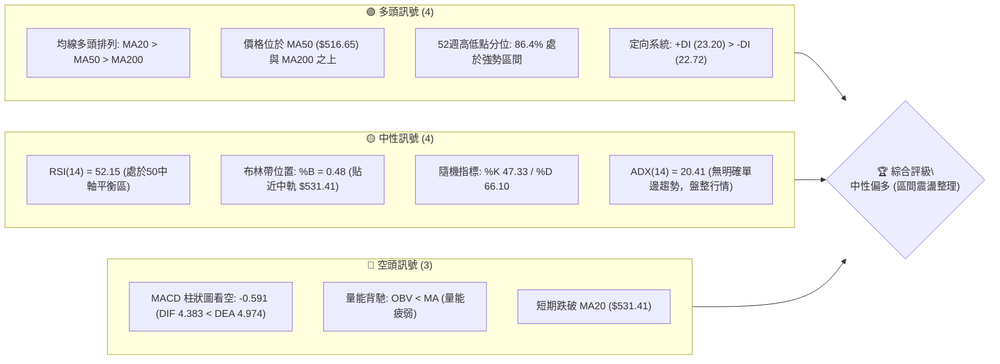
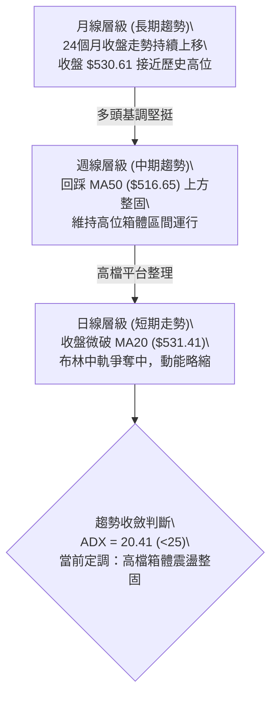
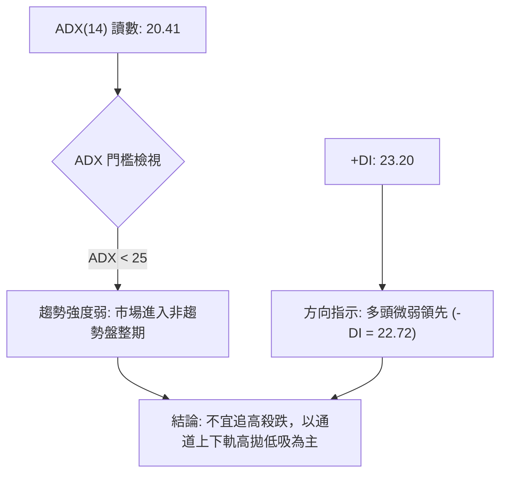
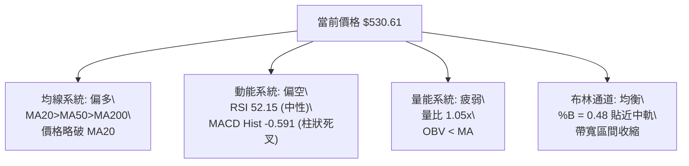
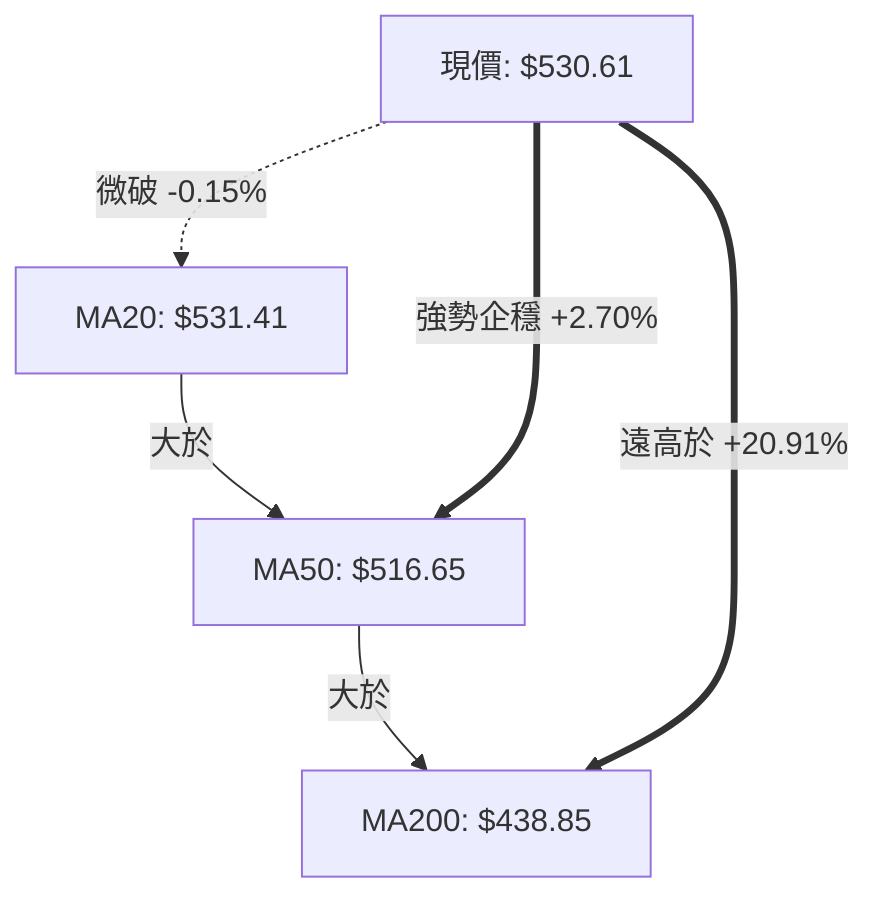
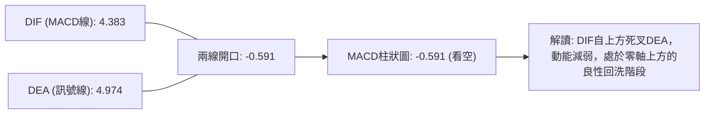
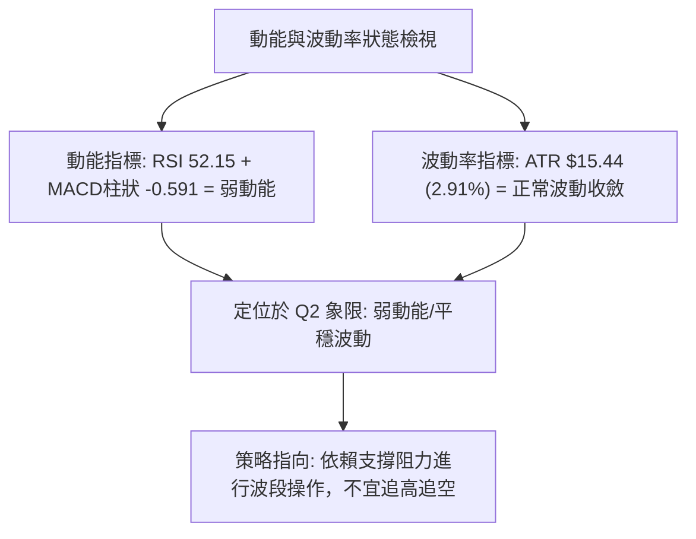
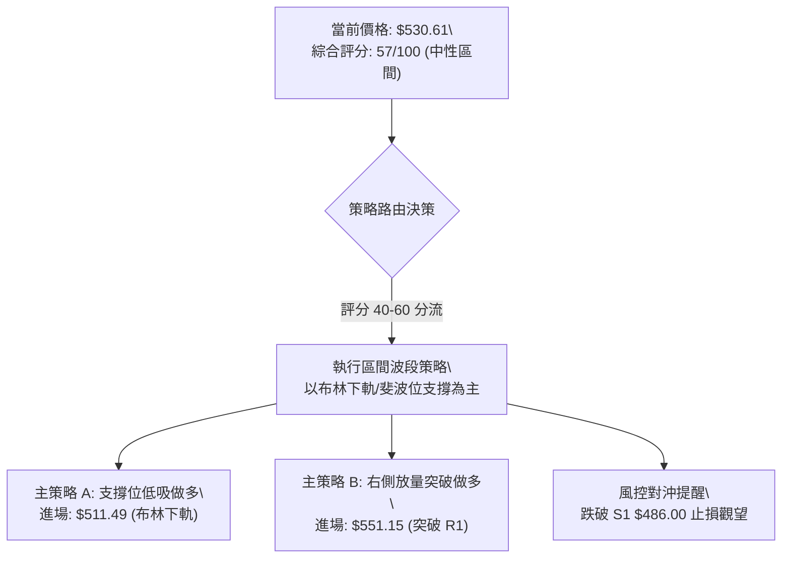
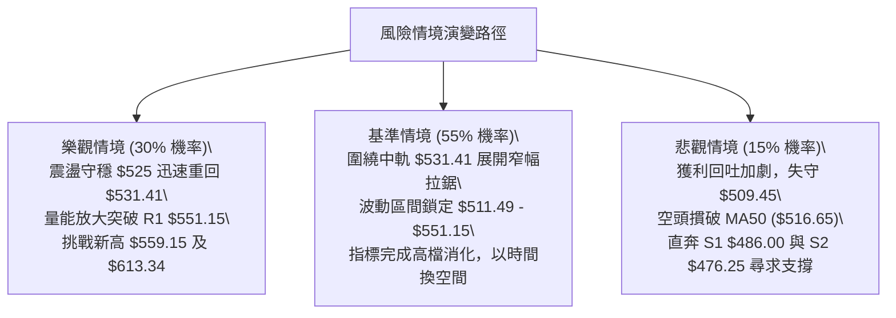

# MSFT 技術分析報告

> **報告日期**：2026-11-08 ｜ **語言**：繁體中文 ｜ **數據來源**：Yahoo Finance ｜ **當前價格**：$530.61

---

## 目錄

| 章節 | 內容 |
|------|------|
| [1. 技術面概覽](#1-技術面概覽) | 訊號儀表板、核心指標、評分卡 |
| [2. 趨勢分析](#2-趨勢分析) | 多時框趨勢、長中短期走勢 |
| [3. 圖表形態分析](#3-圖表形態分析) | 形態識別、K線組合、目標價 |
| [4. 支撐與阻力](#4-支撐與阻力) | 關鍵價位、斐波那契回調 |
| [5. 技術指標深度解讀](#5-技術指標深度解讀) | MA/RSI/MACD/布林/成交量 |
| [6. 動能與波動率](#6-動能與波動率) | 動能評估、ATR、Beta |
| [7. 多時框架總結](#7-多時框架總結) | 時框架評分矩陣 |
| [8. 交易策略建議](#8-交易策略建議) | 多空策略、風險報酬比 |
| [9. 風險提示與監控](#9-風險提示與監控) | 監控指標、風險場景 |

---

## 1. 技術面概覽

### 🎯 技術訊號儀表板



### 📊 核心指標速覽表

| 指標類別 | 指標名稱 | 當前數值 | 訊號 | 解讀 |
|----------|----------|----------|------|------|
| **價格** | 當前收盤價 | $530.61 | 🟡 | 位於52週區間86.4%位置，短線在歷史高點下方強勢整固 |
| **均線** | 短期 MA20 | $531.41 | 🔴 | 收盤價略低於MA20（-$0.80），短線多空在此爭奪中軌 |
| **均線** | 中期 MA50 | $516.65 | 🟢 | 價格在MA50上方+2.70%，中期上升結構維持完好 |
| **均線** | 長期 MA200 | $438.85 | 🟢 | 遠高於長期均線+20.91%，長期多頭趨勢根基極為穩固 |
| **動能** | RSI(14) | 52.15 | 🟡 | 位於50中性水準，無超買超賣，多空動能處於平衡狀態 |
| **動能** | MACD柱狀圖 | -0.591 | 🔴 | MACD線(4.383)位於訊號線(4.974)下方，短線動能處於修正期 |
| **波動** | ATR(14) | $15.44 | 🟡 | 波動率佔價格2.91%，震盪幅度屬常態中等範圍 |
| **量能** | 20日成交量比 | 1.05x | 🟡 | 當日量26.94M略高於20日均量25.60M，但OBV處於均線下方 |

### 🏆 技術評分卡

```
╔══════════════════════════════════════════════════════════════╗
║                 技術評分卡 — MSFT (2026-11-08)               ║
╠══════════════════════════════════════════════════════════════╣
║ 趨勢強度      ██████████░░░░░░░░░░  50/100  🟡 (ADX 20.41 弱趨勢) ║
║ 動能指標      ████████░░░░░░░░░░░░  40/100  🔴 (MACD死亡交叉微跌) ║
║ 支撐穩定度    ██████████████░░░░░░  70/100  🟢 (MA50與S1強支撐)   ║
║ 成交量配合    ████████░░░░░░░░░░░░  40/100  🔴 (OBV < MA 量能偏弱)║
║ 形態完整度    ████████████░░░░░░░░  60/100  🟡 (高檔旗形箱體整理) ║
║ 均線排列      ████████████████░░░░  80/100  🟢 (MA20>50>200 多頭) ║
╠══════════════════════════════════════════════════════════════╣
║ 綜合評分      ████████████░░░░░░░░  57/100  評級：中性偏多 (整固)  ║
╚══════════════════════════════════════════════════════════════╝
```
*註：綜合評分由六項子指標算術平均計算：(50 + 40 + 70 + 40 + 60 + 80) ÷ 6 = 56.67 ≈ 57/100（依規則 18）。*

---

## 2. 趨勢分析

### 🌐 多時框趨勢分析



### 📈 長期趨勢 — 12個月走勢圖（Unicode）

```
MSFT 月線收盤走勢圖（過去12個月：2025-12 至 2026-11）
價格軸 ($)
$550 ┤                                                    ● 530.61 (現在)
$525 ┤                                            ● 521.91
$500 ┤                                    ● 512.90
     ┤                            ● 507.29
$475 ┤● 480.57                    ● 463.85
$450 ┤                    ● 449.39
$425 ┤    ● 427.58    ● 406.13
$400 ┤        ● 391.15
$375 ┤            ● 368.68(低點)  ● 372.32
     └────────────────────────────────────────────────────────────
       12   01  02   03   04   05   06   07   08   09   10   11
     (25) -------------------- (2026) -----------------------
```

#### 走勢特徵分析表格

| 階段區間 | 起止價格 | 漲跌幅 | 結構特徵分析 |
|----------|----------|--------|--------------|
| **2025-12 ～ 2026-03** | $480.57 → $368.68 | -23.28% | 深度回調波段，於2026年3月探至 $368.68 築出波段雙底低點。 |
| **2026-03 ～ 2026-05** | $368.68 → $449.39 | +21.89% | 第一波強勁反彈，快速收復 $400 大關，重啟上升動能。 |
| **2026-05 ～ 2026-06** | $449.39 → $372.32 | -17.15% | 劇烈二次回踩，未破3月低點 $368.68，確立大週期雙底支撐。 |
| **2026-06 ～ 2026-11** | $372.32 → $530.61 | +42.51% | 強勁主升浪，突破前高阻力，並於11月刷新52週新高至 $559.15。 |

### 📊 中期趨勢（週線分析）

中期走勢呈現典型的高檔強勢整固態勢。價格在2026年11月4日當週創出 $559.15 歷史高點後，遭遇獲利回吐賣壓回落，但仍穩穩運行在週線長週期均線及關鍵頸線之上。

```
週線支撐與阻力結構示意圖
────────────────────────────────────────────────────────────────
$559.15 ┬─ 52W 歷史最高點（獲利回吐阻力區）
        │
$551.15 ┼─ 阻力位 R1（近一年高點聚類）
        │
$530.61 ┼─ 現價（圍繞日線布林中軌震盪）
        │
$509.45 ┼─ 斐波那契 23.6% 回調位 / 心理防線
        │
$486.00 ┴─ 支撐位 S1（近一年波段低點聚類，極強防線）
────────────────────────────────────────────────────────────────
```

### ⚡ 趨勢強度評估（ADX 解讀）



#### ADX 趨勢強度對照表

| 指標變數 | 當前數值 | 參考門檻 | 市場結構判斷 |
|----------|----------|----------|--------------|
| **ADX(14)** | **20.41** | < 25 (弱趨勢/盤整) | 行情動能不具備單邊趨勢條件，屬標準的均線圍繞型矩形整理。 |
| **+DI(14)** | **23.20** | > 20 | 多方仍掌控基本陣地，買盤並未潰散。 |
| **-DI(14)** | **22.72** | > 20 | 空方壓制力道逐步逼近，多空處於均勢膠著狀態。 |
| **差值 (+DI - -DI)**| **+0.48** | 接近 0 | 多空勢均力敵，市場等待新的催化劑指引方向。 |

---

## 3. 圖表形態分析

### 🔍 形態識別系統


#### 形態識別與信心度評估表

| 形態類別 | 信心度 | 判斷依據（引用數據） | 完成度 | 目標價（附計算式） |
|----------|--------|----------------------|--------|--------------------|
| **高位箱體整理** | 75% | 依據近10日高點 $559.15 (11-04) 與低點 $504.96 (11-02)，價格多次於此區間內震盪拉鋸。 | 85% | 依據箱體高度推算：箱體頂 $559.15 − 箱體底 $504.96 = $54.19；若向上突破目標為：$559.15 + $54.19 = **$613.34**。 |
| **大型雙底結構** | 80% | 依據24個月歷史收盤數據：2026-03 收盤 $368.68 與 2026-06 收盤 $372.32 構成雙重底。 | 100% (已突破) | 頸線為2026-05高點 $449.39，形態高度 $449.39 − $368.68 = $80.71；突破目標：$449.39 + $80.71 = **$530.10**（當前價格 $530.61 已完美達成並消化目標）。 |
| **頭肩底 / 旗形** | < 50% | 數據中未偵測到標準幾何旗形或頭肩形態。 | N/A（數據未提供） | 訊號不足，僅做指標型解讀（布林帶中軌爭奪）。 |

### 🕯️ 重要K線形態分析

根據提供的「近10根日K」與「近8根週K」四價數據，詳細解析近期關鍵反轉與整理線型：

| 日期（週期） | 開盤價 | 最高價 | 最低價 | 收盤價 | K線形態名稱 | 技術解讀 | 訊號 |
|--------------|--------|--------|--------|--------|-------------|----------|------|
| **2026-11-02 (日)** | $524.02 | $529.63 | $504.96 | $507.12 | 大陰線破位探底 | 長實體陰線重挫，下影線探至 $504.96 測試 $509.45 (斐波23.6%) 支撐。 | 🔴 |
| **2026-11-03 (日)** | $509.01 | $523.44 | $507.82 | $520.99 | 實體下影陽線 | 低開高走吞沒前日跌幅半數以上，確認下檔支撐買盤強勁。 | 🟢 |
| **2026-11-04 (日)** | $543.70 | $559.15 | $542.30 | $555.80 | 跳空放量長陽線 | 向上跳空並創52週新高 $559.15，量能爆出 50.8M，多頭極盛。 | 🟢 |
| **2026-11-05 (日)** | $554.94 | $557.62 | $532.68 | $535.93 | 長陰覆蓋線 (反轉) | 開高走低留長上影線，收盤大跌回吐前日漲幅，形成衝高回落走勢。 | 🔴 |
| **2026-11-06 (日)** | $525.69 | $538.33 | $524.47 | $530.61 | 止跌孕線十字星 | 實體窄小，完全被前一日K棒實體包覆，反映市場多空暫入平衡觀望。 | 🟡 |
| **2026-11-06 (週)** | $524.02 | $559.15 | $504.96 | $530.61 | 長影長腳十字巨震 | 週振幅逾10%（$504.96～$559.15），週量擴增至 175M，屬於高位分歧劇烈的多空拔河K線。 | 🟡 |

### 📉 ASCII 走勢形態示意圖

```
近10日 K線形態演變圖 ($504.96 → $559.15 區間高檔震盪)
價格
$560 ┼                  ╭─ 11-04 創高 $559.15
     │                  │   ┬
$550 ┼                ┌─┴─┐ │
     │                │   │ │ ┬
$540 ┼                │   │ │ │
     │                │   │ └─┼─┘ 11-05 長陰下殺 ($535.93)
$530 ┼ ─ ─ ─ ─ ─ ─ ─ ─│ ─ │ ─ ─ ┼ ─ ┬ ─ ─ ─ ─ ─ ─ ─ ─ MA20 ($531.41)
     │ ┌─┐ ┌─┐ ┌─┐ ┌─┐│   │   │ ┌┴┐ 11-06 孕線整理 ($530.61)
$520 ┼ │ │ │ │ │ │ │ │└───┘ ┌─┐ │ └┬┘
     │ └┬┘ └┬┘ └┬┘ └┬┘     │ │ ┴  ┴
$510 ┼  │   │   │  ┌┴┐     └───┘ 11-03 陽線反擊
     │  │   │   │  │ │
$500 ┼  ┴   ┴   ┴  └─┼─┘ 11-02 探底 $504.96
     └─────────────────────────────────────────────────────
       26  27  28  29 30  02  03  04  05  06  (日期: 10/26 - 11/06)
```

### 🎯 形態目標價計算

根據已成型的高位箱體整理區間：
1. **箱體上限（阻力線）**：$559.15（2026-11-04 日內高點）
2. **箱體下限（支撐線）**：$504.96（2026-11-02 日內低點）
3. **箱體垂直高度**：$559.15 − $504.96 = **$54.19**
4. **向上突破理論目標價**：
   $$\text{目標價 T}_{\text{up}} = \text{箱體上限} + \text{形態高度} = 559.15 + 54.19 = \mathbf{\$613.34}$$
5. **向下破位理論量度目標**：
   $$\text{目標價 T}_{\text{down}} = \text{箱體下限} - \text{形態高度} = 504.96 - 54.19 = \mathbf{\$450.77}$$
   *(註：下破目標 $450.77 接近 50.0% 斐波那契回調位 $453.85)*

---

## 4. 支撐與阻力

### 🗺️ 關鍵價位分布圖（Unicode）

```
MSFT 價位結構分布圖
══════════════════════════════════════════════════════════════
$559.15 ║██████████████████████████████║ 52W 最高點 / 歷史強阻力
$551.15 ║████████████████████████      ║ 關鍵阻力位 R1 (近一年波段高點聚類)
$531.41 ║──────────────────────────────║ 短線均線/布林中軌 MA20
$530.61 ╠══════════════════════════════╣ ◄ 當前收盤價 ($530.61)
$509.45 ║▓▓▓▓▓▓▓▓▓▓▓▓▓▓▓▓▓▓▓▓          ║ 斐波那契 23.6% 回調關鍵支撐
$486.00 ║██████████████████████████████║ 重要支撐 S1 (波段低點聚類)
$478.70 ║▓▓▓▓▓▓▓▓▓▓▓▓▓▓▓▓              ║ 斐波那契 38.2% 回調支撐
$476.25 ║████████████████████          ║ 關鍵支撐 S2 (波段低點聚類)
$465.47 ║██████████████                ║ 強支撐 S3 (波段低點聚類)
══════════════════════════════════════════════════════════════
```

### 🚧 阻力位分析表

所有阻力數據完全引用自波段高點聚類與技術指標計算：

| 阻力級別 | 價位 | 形成原因 | 突破難度 | 重要性 |
|----------|------|----------|----------|--------|
| **R1** | **$551.15** | 近一年波段高點聚類（2026-10-16 週高點），並接近布林上軌 $551.33 | 🔴 高 | ★★★★☆<br>短線多空分水嶺，站穩方能挑戰歷史天花板 |
| **52W High** | **$559.15** | 52週歷史最高點（2026-11-04 盤中創下），巨量長陰套牢區 | 🔴 極高 | ★★★★★<br>歷史心理天花板，必須有大盤或量能爆發配合 |
| **R2 / R3** | *數據中未偵測到* | 原數據中阻力聚類僅計算至 R1，未提供更高聚類點位 | N/A | N/A（數據未提供） |

### 🛡️ 支撐位分析表

所有支撐價位嚴格引用自「關鍵價位」數據區塊：

| 支撐級別 | 價位 | 形成原因 | 守住機率 | 重要性 |
|----------|------|----------|----------|--------|
| **S1** | **$486.00** | 近一年波段低點聚類，距現價 -8.41%，鄰近前期整固平台低點 | 🟢 80% | ★★★★★<br>波段多頭最重要的生命線，不可跌破 |
| **S2** | **$476.25** | 近一年波段低點聚類，距現價 -10.24%，接近 38.2% 斐波那契位 ($478.70) | 🟢 85% | ★★★★☆<br>深幅回調強支撐帶，買盤防禦腹地 |
| **S3** | **$465.47** | 近一年波段低點聚類，距現價 -12.28%，接近 MA120 ($462.68) | 🟢 90% | ★★★☆☆<br>長期結構安全閥，跌至此機率偏低 |

### 📐 斐波那契回調位分析

依據 52 週完整波動區間（低點 $348.54 → 高點 $559.15，總垂直落差 $210.61）之黃金分割比率分析：

| 分割比率 | 價位 | 相對現價位置 | 技術意義與防守強度 |
|----------|------|--------------|--------------------|
| **0.0% (52W High)** | **$559.15** | +5.38% | 歷史極值阻力，回調結構起點。 |
| **23.6%** | **$509.45** | -3.99% | **當前第一道黃金防線**。現價 $530.61 位於 0.0% 與 23.6% 之間（處於極強的多頭淺度回調區域）。11-02 探底 $504.96 即迅速收復此線。 |
| **38.2%** | **$478.70** | -9.78% | 強弱分界線。與 S2 ($476.25) 產生強烈共振，為多頭中期防守底線。 |
| **50.0%** | **$453.85** | -14.47% | 中樞均衡位置，跌破代表升勢遭到根本性破壞。 |
| **61.8%** | **$429.00** | -19.15% | 黃金分割底限，接近 MA200 ($438.85)。 |
| **78.6%** | **$393.61** | -25.82% | 深度破位防線。 |
| **100.0% (52W Low)**| **$348.54** | -34.31% | 52週循環起點。 |

---

## 5. 技術指標深度解讀

### 🎛️ 指標訊號總覽



### 📈 移動平均線排列分析



#### 各週期均線狀態詳細解析

| 均線名稱 | 數值 | 價格相對位置 | 斜率與方向 | 技術解讀 |
|----------|------|--------------|------------|----------|
| **MA5** | $530.09 | +0.10% (上方) | ▲ 上彎 | 超短線在 $530 附近尋得支撐微幅翹頭。 |
| **MA10** | $529.74 | +0.16% (上方) | ▲ 上彎 | 延續短線防守墊高態勢。 |
| **MA20** | $531.41 | -0.15% (下方) | ▼ 微下彎 | 短線阻力位，收盤價微幅受壓於此，反映衝高後的修復。 |
| **MA50** | $516.65 | +2.70% (上方) | ▲ 上升 | 中期生命線，提供強勁多頭動能支撐。 |
| **MA60** | $511.92 | +3.65% (上方) | ▲ 上升 | 形成堅實的下方買盤承接帶。 |
| **MA120** | $462.68 | +14.68% (上方) | ▲ 陡峭上升 | 半年線持續推升，中期波段無虞。 |
| **MA200** | $438.85 | +20.91% (上方) | ▲ 穩步上行 | 年線多頭趨勢堅如磐石。 |

### 📉 RSI(14) 分析

- **當前 RSI 讀數**：**52.15**（Wilder 計算法）
- **RSI 強度進度條**：
  $$\text{RSI(14)}: \quad \blacksquare\blacksquare\blacksquare\blacksquare\blacksquare\square\square\square\square\square \quad 52.15\% \quad (\text{處於中性平衡區})$$
- **區間劃分與解讀**：
  - 70 以上為超買區，30 以下為超賣區。當前讀數 52.15 剛好落於 50 中軸線上，表明市場此前在 11-04 創高時的超買熱度已藉由近兩日的拉回完全釋放，多空動能重新歸零平衡。
- **背離判斷**：
  - 依據近 20 根 K 棒比對分析，**無明顯背離**（價格與 RSI 方向一致走平整固），未出現高檔頂背離或超賣底背離訊號。

### 📊 MACD(12/26/9) 訊號解讀



- **MACD DIF**：4.383
- **MACD DEA (Signal)**：4.974
- **MACD Histogram**：**-0.591** 🔴
- **深度分析**：
  MACD 與訊號線目前均位於零軸上方（遠大於 0），屬於強勢多頭市場中的「次級回檔」。柱狀圖錄得 -0.591，發出短線死亡交叉看空訊號，說明由 $559.15 回落引發的獲利了結籌碼仍在消化中，短期不宜盲目追價。

### 📦 布林通道分析

布林帶寬度由上軌 $551.33 至下軌 $511.49，帶寬為 $39.84。

```
布林通道結構示意圖 (Bollinger Bands, 20, 2)
──────────────────────────────────────────────────────────────────
$551.33 ┬─ 上軌 (Upper Band)  ── 突破阻力壓制
        │
        │
$531.41 ┼─ 中軌 (Middle Band / MA20)  ── 現價緊貼於此 ($530.61, %B=0.48)
        │
        │
$511.49 ┴─ 下軌 (Lower Band)  ── 區間震盪下檔支撐
──────────────────────────────────────────────────────────────────
```
- **BB %B 數值**：**0.48**
- **位置解讀**：%B 介於 0 與 1 之間，0.50 即為中軌。0.48 代表價格極度精準地貼合在布林中軌附近，通道未見喇叭口發散擴張，印證當前市場處於標準的「布林區間收斂震盪」形態。

### 💹 成交量分析（量價配合度）

1. **量能對比**：
   - 最新單日成交量：**26,938,400** 股
   - 20日成交均量：**25,603,875** 股（量比 1.05x，量能溫和）
   - 50日成交均量：**23,146,666** 股
2. **OBV (能量潮) 趨勢**：
   - 指標明示 **OBV < MA → 量能疲弱**。
   - 解讀：在 11-04 爆出 50.8M 大量創下 $559.15 高點後，11-05 及 11-06 成交量快速萎縮（分別降至 42.5M 與 26.9M），且 OBV 下穿其均線，顯示買盤追價意願在高檔不足，屬於典型的「量價未能持續配合」，暗示短期直接V型反轉突破的難度較大。

---

## 6. 動能與波動率

### ⚡ 動能評估四象限

| 象限 | 動能強度 | 波動率狀態 | 當前股票狀態 | 操作評估與策略 |
|------|----------|------------|--------------|----------------|
| **Q1** | 強動能 (趨勢明顯) | 低波動 (溫和上行) | — | 最佳順勢加碼區間 |
| **Q2** | **弱動能 (動能放緩)** | **低/中波動 (收斂整理)** | **✓ (MSFT 處於此區間)** | **謹慎觀望，區間低吸高拋** |
| **Q3** | 強動能 (加速爆發) | 高波動 (多空博弈) | — | 高風險高收益突破策略 |
| **Q4** | 弱動能 (趨勢衰竭) | 高波動 (震盪甩轎) | — | 避免進場，極易兩頭挨打 |



### 📊 ATR 波動率分析

- **ATR(14) 數值**：**$15.44**（採 Wilder 計算法）
- **波動率佔比**：約佔當前股價的 **2.91%**
- **交易應用建議**：
  - **日內正常雜訊過濾區間**：約為 $15.44 的 0.5 倍，即 **$7.72**。
  - **合理波段止損距離**：通常設定在 1.0 ～ 1.5 倍 ATR，即 **$15.44 ～ $23.16**。這意味著在 $530.61 進場的做多部位，防守止損至少應拉開至 $507.45 ～ $515.17 之下，恰與 MA50 ($516.65) 與前期低點 $504.96 相呼應。

### 📐 Beta 與市場相關性

- **Beta 係數**：**1.045**
- **市場連動分析**：
  - Beta 值極度接近 1.0（微幅高於標普500大盤 4.5%）。這顯示微軟兼具科技巨頭的穩定性與適度的進攻彈性。
  - 在整體美股市場（S&P 500 / QQQ）未出現單邊崩跌或大漲的情形下，MSFT 將主要依循自身基本面與高檔整固技術形態運行。

---

## 7. 多時框架總結

### 📋 時框架評分表

| 時框架 | 趨勢方向 | 動能狀態 | 均線排列 | 圖表形態 | 綜合評分 | 建議方向 |
|--------|----------|----------|----------|----------|----------|----------|
| **月線 (長期)** | 🟢 強烈多頭 | 🟢 處於高位偏強區間 | 🟢 MA200之上 (+20.91%) | 大雙底已成，步入多頭主升 | **85 / 100** | 長線堅定持有 |
| **週線 (中期)** | 🟢 多頭完好 | 🟡 柱狀收斂，高檔拔河 | 🟢 MA20>MA50 多頭排列 | 52週高點下方蓄勢 | **65 / 100** | 回調逢低佈局 |
| **日線 (短期)** | 🟡 震盪整理 | 🔴 MACD死叉，RSI落回50 | 🟡 價格跌破MA20 (-0.15%) | 高位箱體、孕線整固 | **45 / 100** | 區間操作/觀望 |

### 🔲 綜合訊號矩陣

```
時框架訊號收斂檢驗矩陣
────────────────────────────────────────────────────────────────
維度           日線 (短期)       週線 (中期)       月線 (長期)
趨勢排列       🟡 震盪整固       🟢 多頭上行       🟢 強烈多頭
動能強度       🔴 負向調整       🟡 偏多趨弱       🟢 處於強勢
關鍵防禦       $511.49 (BB下軌)  $509.45 (斐波位)  $438.85 (MA200)
一致性檢驗     衝突 (日線偏弱 vs 週月線偏多) → 需依收斂規則仲裁
────────────────────────────────────────────────────────────────
```

### ⚖️ 多時框收斂結論

依據多時框收斂規則第 14 條嚴格仲裁：
1. **趨勢/盤整行情判定**：
   當前日線 **ADX(14) 讀數為 20.41 (< 25)**，明確宣告市場目前**處於盤整行情**，而非單邊趨勢行情。
2. **時框優先級權重**：
   在盤整架構下，日線級別以**布林通道上下軌 ($511.49 ～ $551.33) 及箱體上下界**為主要交易區間；中長期週月線的多頭趨勢則作為底層保護傘，限制了下檔空間。
3. **唯一方向性結論**：
   **【中性觀望，區間偏多操作】**。日線級別雖然短線動能指標（MACD死叉、跌破MA20）出現技術回踩，但下方受制於斐波那契 23.6% ($509.45) 及 MA50 ($516.65) 的強勁支撐，空頭向下殺跌動能極為有限。整體技術面定調為高檔良性消化籌碼，第 8 章策略將以此為唯一核心展開。

---

## 8. 交易策略建議

### 🗺️ 策略決策流程圖



### 🧭 策略路由

**當前主策略方向 = 中性偏多區間操作（依評分卡綜合評分 57/100，落於 40–60 區間）**

由于評分處於 40–60 之中性整固區，且 ADX < 25，策略堅決**拒絕追漲殺跌**，主推以關鍵支撐位低吸或右側突破為主的「兩套多頭防禦反擊方案」，空頭僅作為風險防範與對沖參考。

### 🎯 價格情境階梯（Price Scenarios）

價位嚴格引用自「關鍵價位」與技術指標計算數值：

| 觸發條件 | 下一目標 | 後續延伸 | 情境含義 |
|----------|----------|----------|----------|
| **強勢突破 R1 $551.15** | 52W High **$559.15** | 箱體量度目標 **$613.34** | 短線轉強，開啟新一輪單邊上升浪 |
| **站穩現價區間 $530.61** | 中軌/阻力 **$531.41 ~ $551.15** | 區間整固 | 圍繞布林通道維持區間震盪 |
| **失守斐波位 $509.45** | 支撐位 S1 **$486.00** | 支撐位 S2 **$476.25** / S3 **$465.47** | 中期轉弱，回踩測試長期均線支撐 |

### 📊 情境機率分佈

| 情境劇本 | 機率 | 主要技術依據 |
|----------|------|--------------|
| **區間震盪整固 (主情境)** | **55%** | ADX 僅 20.41，布林帶寬度收緊，RSI 52.15 處於中性平衡，市場處於等待籌碼換手的縮量拉鋸期。 |
| **突破上行挑戰前高** | **30%** | 均線長週期呈現完整多頭排列，+DI 仍領先 -DI，大週期雙底支撐紮實，基本面分析師普遍給予強力買入。 |
| **深度回落探底 (跌破S1)** | **15%** | 下方有 23.6% 斐波那契位 ($509.45) 及 MA50 ($516.65) 重重護盤，直接連續貫穿 S1 的機率極低。 |

### 🟢 主策略詳情

*(註：風險報酬比依規則 17 計算：(目標價 T1 − 進場價) ÷ (進場價 − 止損價))*

| 策略要素 | 策略 A（左側支撐低吸 - 首選） | 策略 B（右側放量突破 - 次選） |
|----------|-------------------------------|-------------------------------|
| **進場條件** | 股價回踩布林下軌與斐波那契支撐獲止跌確認 | 股價強勢放量突破近一年阻力位 R1 收盤站穩 |
| **進場價格** | **$511.49** (布林下軌精確值) | **$551.15** (阻力位 R1 精確值) |
| **目標價 T1** | **$551.15** (阻力位 R1) | **$559.15** (52W 歷史高點) |
| **目標價 T2** | **$559.15** (52W 歷史高點) | **$613.34** (箱體高度突破量度目標) |
| **止損價格** | **$486.00** (支撐位 S1) | **$531.41** (原布林中軌轉為支撐) |
| **風險報酬比** | **1 : 1.56**（以 T1 計）<br>*(551.15 - 511.49) ÷ (511.49 - 486.00) = 39.66 ÷ 25.49 = 1.56*<br>*(以 T2 計則為 1 : 1.87)* | **1 : 0.41**（以 T1 計）<br>*(559.15 - 551.15) ÷ (551.15 - 531.41) = 8.00 ÷ 19.74 = 0.41*<br>*(以 T2 計則為 1 : 3.15)* |
| **成功機率** | **65%** | **55%** |
| **建議倉位** | **15% ～ 20%** | **10%** (突破初期輕倉追擊) |

### 🔴 反向風險觸發點（對沖提示）

- **全面轉空警訊**：若日K線以長陰線直接跌穿 **$509.45**（斐波那契 23.6%）且無法快速收復，則短線箱體結構宣告失敗。
- **波段多頭毀滅點**：若進一步擊穿 **S1 ($486.00)**，多頭排列將遭破壞，所有多頭部位應嚴格執行止損或買入反向對沖期權保護，回撤防線將下移至 S2 ($476.25) 與 S3 ($465.47)。

### ⭐ 整體訊號強度評星

```
做多訊號強度：★★★☆☆  (3/5星 — 均線排列偏多，但短線動能指標回落壓制)
做空訊號強度：★★☆☆☆  (2/5星 — 僅短線指標死叉，下檔重重均線支撐完備)
整體可信度：  ★★★★☆  (4/5星 — 震盪箱體特徵顯著，支撐阻力結構清晰)
```

---

## 9. 風險提示與監控

### ✅ 關鍵監控指標 Checklist

```
╔══════════════════════════════════════════════════════════════╗
║               MSFT 每日交易決策監控清單 (Checklist)           ║
╠══════════════════════════════════════════════════════════════╣
║ [ ] 價格是否成功收復 MA20 ($531.41)？                          ║
║     └─ 是: 短線回踩結束，偏多； 否: 繼續向布林下軌靠攏整理。  ║
║ [ ] RSI(14) 能否穩在 50 中軸之上？                            ║
║     └─ 若跌破 45 需防範進一步下探風險。                        ║
║ [ ] MACD 柱狀圖是否開始收斂（由 -0.591 向上縮短）？            ║
║     └─ 柱狀縮短即為短線賣壓衰竭訊號。                          ║
║ [ ] 日成交量是否回到 20 日均量 (25.60M) 之上且 OBV 翻揚？      ║
║     └─ 量能配合方為有效突破之必要條件。                        ║
║ [ ] 價格回踩時是否守住 23.6% 斐波位 ($509.45) 與 S1 ($486.00)？║
║     └─ 關鍵生命線防守，跌破必須堅決執行風險防範。              ║
╚══════════════════════════════════════════════════════════════╝
```

### ⚠️ 風險場景分析



### 🛡️ 風險管理重要提醒

1. **單筆交易風險敞口控制**：
   嚴格限制單筆交易之最大虧損金額不得超過總投資資本的 **1.5% ～ 2.0%**。若採用策略 A（進場 $511.49，止損 $486.00，每股風險 $25.49），10 萬美元規模之帳戶其部位上限應嚴格限制在 60 ～ 75 股之內。
2. **震盪市忌盲目追價**：
   當前 ADX 為 20.41，強行追逐日內長陽線（如 11-04 追高於 $555 以上者）極易遭遇長陰覆蓋反噬。應嚴守「買在支撐、賣在阻力」之紀律。
3. **ATR 波動保護設定**：
   有鑑於目前 ATR 高達 $15.44，日間日內價格劇烈抖動不可避免，止損點切勿放置於極度密集的整數關卡（例如正好放在 $510.00），應刻意預留 0.5 倍 ATR 緩衝區（如設定在 $486.00 支撐位下方），以防遭假破位掃出場。

---

## 📋 報告總結

```
╔══════════════════════════════════════════════════════════════╗
║                   MSFT 技術分析報告總結                      ║
╠══════════════════════════════════════════════════════════════╣
║ 報告日期：2026-11-08                                         ║
║ 當前價格：$530.61                                            ║
║ 分析評級：⚖️ 中性偏多（高位箱體整固，等待突破）              ║
║ 綜合技術評分：57 / 100                                       ║
╠══════════════════════════════════════════════════════════════╣
║ 關鍵結論：                                                   ║
║ ├─ 長期趨勢：🟢 強烈多頭（遠高於 MA200 $438.85 達 +20.91%）  ║
║ ├─ 中期趨勢：🟢 多頭完好（企穩 MA50 $516.65 與多頭均線組）  ║
║ ├─ 短期趨勢：🟡 震盪整理（ADX 20.41 弱趨勢，跌破 MA20 蓄勢） ║
║ ├─ 關鍵支撐：S1: $486.00 ｜ 斐波23.6%: $509.45 ｜ BB下軌: $511.49║
║ ├─ 關鍵阻力：R1: $551.15 ｜ 52W 高點: $559.15                ║
║ └─ 分析師目標：均價 $634.14 (最高 $870.00 / 最低 $440.00)    ║
╠══════════════════════════════════════════════════════════════╣
║ 最優策略組合：                                               ║
║ 1. 🥇 最佳機會：策略 A — 回踩布林下軌 $511.49 逢低分批吸納， ║
║                 停損設於 S1 $486.00，風報比 1:1.56 (目標 R1)。║
║ 2. 🥈 次選機會：策略 B — 放量突破 R1 $551.15 右側追擊，      ║
║                 目標直指箱體量度 $613.34 (以 T2 計風報比 1:3.15)。║
║ 3. 🥉 保守選擇：維持 50% 底倉觀望，等待日線 MACD 重新翻紅金叉║
║                 或放量突破 $551.15 再行加碼。                ║
╚══════════════════════════════════════════════════════════════╝
```

---

> ⚠️ **免責聲明**：本報告為 AI 自動生成之技術分析，所有數據及估算均基於提供的歷史價格資訊。本報告**僅供研究與學術參考**，**不構成任何投資建議**。投資有風險，入市需謹慎。

---

*報告生成時間：2026-11-08 ｜ 數據來源：Yahoo Finance ｜ 分析框架：多時框技術分析*