# MSFT 技術分析報告

> **報告日期**：2026-11-09 ｜ **語言**：繁體中文 ｜ **數據來源**：Yahoo Finance ｜ **當前價格**：$530.61

---

## 目錄

| 章節 | 內容 |
|------|------|
| [1. 技術面概覽](#1-技術面概覽) | 訊號儀表板、核心指標、評分卡 |
| [2. 趨勢分析](#2-趨勢分析) | 多時框趨勢、長中短期走勢 |
| [3. 圖表形態分析](#3-圖表形態分析) | 形態識別、K線組合、目標價 |
| [4. 支撐與阻力](#4-支撐與阻力) | 關鍵價位、斐波那契回調 |
| [5. 技術指標深度解讀](#5-技術指標深度解讀) | MA/RSI/MACD/布林/成交量 |
| [6. 動能與波動率](#6-動能與波動率) | 動能評估、ATR、Beta |
| [7. 多時框架總結](#7-多時框架總結) | 時框架評分矩陣 |
| [8. 交易策略建議](#8-交易策略建議) | 多空策略、風險報酬比 |
| [9. 風險提示與監控](#9-風險提示與監控) | 監控指標、風險場景 |

---

## 1. 技術面概覽

### 🎯 技術訊號儀表板

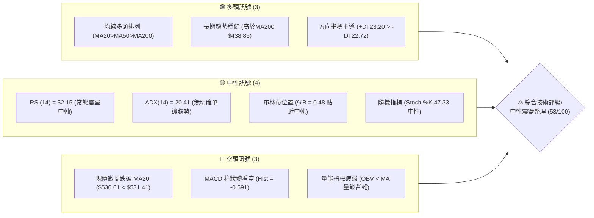

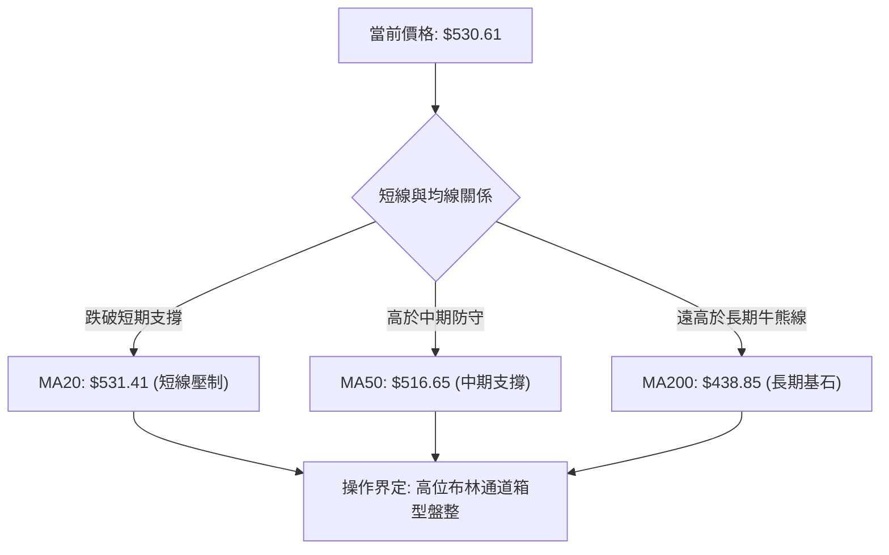

### 📊 核心指標速覽表

| 指標類別 | 指標名稱 | 當前數值 | 訊號 | 解讀 |
|:---|:---|:---|:---:|:---|
| **價格** | 當前收盤價 | $530.61 | 🟡 | 位於52週區間 86.4% 高位，短線進入高檔消化期 |
| **均線** | MA20 (月線) | $531.41 | 🔴 | 現價 $530.61 微幅跌破 MA20 (-0.15%)，短線動能趨緩 |
| **均線** | MA50 (季線) | $516.65 | 🟢 | 現價高於 MA50 (+2.70%)，中期上升趨勢結構未破 |
| **均線** | MA200 (年線) | $438.85 | 🟢 | 現價遠高於 MA200 (+20.91%)，長期牛市架構完好 |
| **動能** | RSI(14) | 52.15 | 🟡 | 位於 50 臨界點附近，無超買或超賣，動能平衡 |
| **動能** | MACD (12,26,9) | 4.383 / 4.974 | 🔴 | MACD 線低於訊號線，柱狀體為 -0.591，短線處死叉調整 |
| **趨勢強度** | ADX(14) | 20.41 | 🟡 | ADX < 25，表明缺乏單邊趨勢，市場處於區間震盪行情 |
| **通道指標** | 布林 %B | 0.48 | 🟡 | 位於中軌 ($531.41) 附近，通道帶寬收窄，蓄勢待變 |
| **波動** | ATR(14) | $15.44 | 🟡 | 波動率佔價格 2.91%，日均震盪幅度適中 |
| **量能** | 量比 / OBV | 1.05x / OBV<MA | 🔴 | 最新量略增但能量潮處於均線下方，多頭進攻量能不足 |

### 🏆 技術評分卡

```
╔══════════════════════════════════════════════════════════════╗
║               技術評分卡 — MSFT (2026-11-09)                 ║
╠══════════════════════════════════════════════════════════════╣
║ 趨勢強度 (Trend)       ██████████░░░░░░░░░░  50/100 🟡 中性   ║
║ 動能指標 (Momentum)    █████████░░░░░░░░░░░  46/100 🔴 偏弱   ║
║ 支撐穩定度 (Support)   █████████████░░░░░░░  64/100 🟢 良好   ║
║ 成交量配合 (Volume)    ████████░░░░░░░░░░░░  42/100 🔴 疲弱   ║
║ 形態完整度 (Pattern)   ██████████░░░░░░░░░░  52/100 🟡 震盪   ║
║ 均線排列 (Moving Avg)  █████████████░░░░░░░  64/100 🟢 多頭   ║
╠══════════════════════════════════════════════════════════════╣
║ 綜合評分 (Composite)   ███████████░░░░░░░░░  53/100 ⚖️ 中性觀望║
║ 評分依據：(50 + 46 + 64 + 42 + 52 + 64) ÷ 6 = 53.0 (規則18)  ║
╚══════════════════════════════════════════════════════════════╝
```

---

## 2. 趨勢分析

### 🌐 多時框趨勢分析

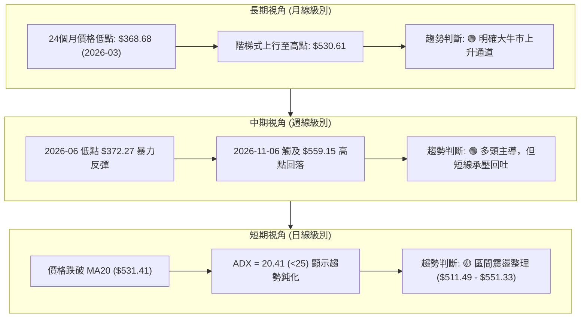

### 📈 長期趨勢 — 12個月走勢圖（Unicode）

以下為根據 MSFT 過去 12 個月收盤數據（2025-11 至 2026-11）繪製之月線價格軸走勢圖：

```
MSFT 月線走勢圖（過去12個月：2025-11 至 2026-11）
價格軸 ($)
$560 ┤                                                    ●(2026-11-06 盤中高點 559.15)
$540 ┤                                                ●   │
$520 ┤                                            ●───┴───● (現價 $530.61)
$500 ┤                                        ●
$480 ┤●───●                               │
$460 ┤    │                           ●   │
$440 ┤    │                       ●   │   │
$420 ┤    │   ●                   │   │   │
$400 ┤    │   │   ●           ●   │   │   │
$380 ┤    │   │   │       ●   │   │   │   │
$360 ┤    │   │   │   ●   │   │   │   │   │
     └────┴───┴───┴───┴───┴───┴───┴───┴───┴───┴───┴───┴────
       11  12  01  02  03  04  05  06  07  08  09  10  11 (月份)
      '25 '25 '26 '26 '26 '26 '26 '26 '26 '26 '26 '26 '26
```

#### 走勢特徵分析表格

| 階段區間 | 起止收盤價 | 區間漲跌幅 | 趨勢性質 | 核心特徵解讀 |
|:---|:---|:---:|:---:|:---|
| **第一階段：高位深度回撤**<br>(2025-11 至 2026-03) | $488.91 → $368.68 | -24.59% | 🔴 空頭下行 | 估值收縮與科技股回調，於 2026-03 探明年度大底 $368.68 |
| **第二階段：震盪築底重啟**<br>(2026-03 至 2026-06) | $368.68 → $372.32 | +0.99% | 🟡 底部雙底構築 | 經歷 2026-04 反彈與 2026-06 二次探底 ($372.32)，確認底部支撐 |
| **第三階段：主升浪爆發**<br>(2026-06 至 2026-08) | $372.32 → $507.29 | +36.25% | 🟢 強勢主升浪 | 業績超預期推動跳空暴漲，突破 $500 大關，成交量顯著放大 |
| **第四階段：高位箱型整理**<br>(2026-08 至 2026-11) | $507.29 → $530.61 | +4.60% | 🟡 高檔矩形震盪 | 進入 $500 - $559.15 區間換手，多次上衝波段高點受阻回落 |

### 📊 中期趨勢（週線分析）

```
MSFT 中期週線壓力與支撐架構示意圖
價格 ($)
$559.15 ────────────────────────────────────── 52週歷史最高點 (強壓力位)
$551.15 ══════════════════════════════════════ 阻力位 R1 (近一年波段高點聚類)
               │ ▲
$530.61 ───────┼─┼──────────────────────────── 當前收盤價 (多空博弈中軸)
               ▼ │
$516.65 ────────────────────────────────────── 中期生命線 (MA50)
$509.45 -------------------------------------- 斐波那契 23.6% 回調關鍵位
$486.00 ══════════════════════════════════════ 核心支撐位 S1 (波段密集防守區)
```

週線指標呈現多頭趨緩特徵：
1. **收盤價結構**：近 5 週收盤價分別為 $535.07、$529.05、$524.51、$521.91、$530.61，整體圍繞 $525-$530 進行高位水平橫盤。
2. **MACD 柱狀體**：週線 MACD 柱狀體連續 4 週為負值（-0.800 → +0.333 → +1.490 → +0.273 → -2.311 → -2.262 → -0.591），顯示中期上升動能已呈現頂部鈍化，未能創出動能新高。

### ⚡ 趨勢強度評估（ADX 解讀）

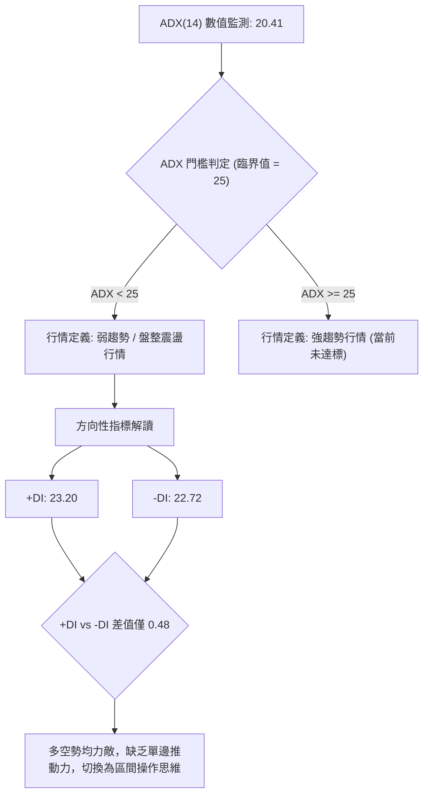

#### ADX 趨勢強度對照表

| ADX 區間 | 趨勢強度級別 | 當前數值判定 | 市場狀態與操作意涵 |
|:---:|:---:|:---:|:---|
| **0 – 20** | 極弱 / 無趨勢 | — | 徹底盤整，指標無效，應嚴格觀望 |
| **20 – 25** | **弱趨勢 / 盤整** | **20.41 (當前狀態)** | **趨勢處於休眠或轉換期，以布林通道與支撐阻力進行區間低買高賣** |
| **25 – 40** | 強趨勢 | — | 單邊趨勢形成，適合順勢突破與均線跟蹤策略 |
| **40 – 60** | 極強趨勢 | — | 主升浪或主跌浪，動能充沛，持股待漲 |
| **60 – 100** | 超強 / 動能竭盡 | — | 趨勢過度拉伸，隨時面臨均值回歸與力竭反轉 |

---

## 3. 圖表形態分析

### 🔍 形態識別系統

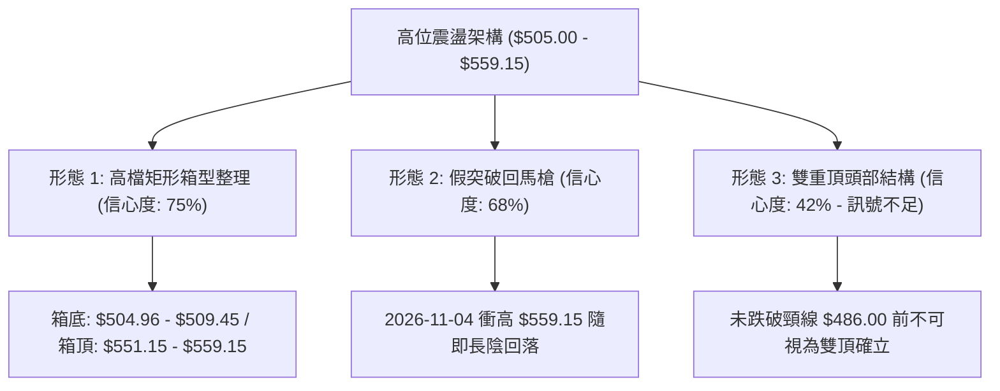

#### 形態識別信心度與量化表（依規則 15）

| 形態名稱 | 信心度 | 判斷依據（引用數據） | 完成度 | 目標價（附嚴謹計算式） |
|:---|:---:|:---|:---:|:---|
| **高檔矩形箱型整理** | **75%** | 上軌聚類於 R1 $551.15 及 52W高點 $559.15；下軌受近兩週低點 $504.96 及斐波那契 23.6% ($509.45) 支撐 | 85% | 箱頂 $551.15，箱底取 $509.45。<br>若向上突破目標：$551.15 + ($551.15 − $509.45) = **$592.85**（由箱體高度推算） |
| **頂部衝高受阻回吐**<br>(假突破型態) | **68%** | 2026-11-04 創 52W 新高 $559.15，次日（11-05）即大跌回吐長上影線，收盤落回 $535.93 | 70% | 假突破後回測箱底目標：**$509.45**（斐波那契 23.6% 支撐位） |
| **潛在雙重頂 (M頭)** | **42%** | **訊號不足，僅做指標型解讀**。兩次高點分別為 2026-10-16 的 $551.15 與 2026-11-04 的 $559.15，但頸線 S1 ($486.00) 遠未被跌破，不可預設為頭部 | 25% | 若未來跌破頸線 $486.00：<br>$486.00 − ($559.15 − $486.00) = **$412.85**（由形態高度推算） |

### 🕯️ 重要K線形態分析

依規則 19，以下嚴格採用數據中「近10根日K」與「近8根週K」之開高低收精確數據進行解讀：

#### 近10根日K棒形態解析

| 日期 | 開 | 高 | 低 | 收 | 成交量 | K線形態名稱 | 形態解讀與市場心理 | 訊號 |
|:---|:---:|:---:|:---:|:---:|:---:|:---|:---|:---:|
| **2026-10-26** | 527.40 | 533.25 | 521.69 | 532.60 | 19,021,000 | 下影小陽線 | 探底回升，買盤在 $521.69 獲得有效支撐 | 🟢 |
| **2026-10-27** | 532.35 | 534.70 | 528.33 | 531.33 | 19,532,300 | 窄幅十字星 | 多空拉鋸，成交量維持低迷，方向未明 | 🟡 |
| **2026-10-28** | 531.82 | 535.00 | 526.14 | 531.01 | 28,594,200 | 紡錘十字星 | 量能放大但實體極小，高檔換手滯漲 | 🟡 |
| **2026-10-29** | 540.22 | 541.29 | 519.56 | 530.14 | 39,333,200 | 長陰射擊線 | 跳空高開衝高至 $541.29 後大幅殺跌，空頭反撲 | 🔴 |
| **2026-10-30** | 525.27 | 526.00 | 514.35 | 521.91 | 35,652,000 | 實體中陰線 | 延續空頭回調，跌破 $520 心理關口，賣壓沉重 | 🔴 |
| **2026-11-02** | 524.02 | 529.63 | 504.96 | 507.12 | 34,743,300 | 破位大陰線 | 盤中下探波段極低 $504.96，收於低位，空頭宣洩 | 🔴 |
| **2026-11-03** | 509.01 | 523.44 | 507.82 | 520.99 | 20,010,200 | 絕地反擊長陽 | 企穩 $507.82 後收復 $520，形成典型低檔反彈線 | 🟢 |
| **2026-11-04** | 543.70 | 559.15 | 542.30 | 555.80 | 50,807,800 | 跳空長陽突破 | 爆量突破創 52W 新高 $559.15，多頭極度亢奮 | 🟢 |
| **2026-11-05** | 554.94 | 557.62 | 532.68 | 535.93 | 42,507,900 | 烏雲蓋頂長陰 | 高開低走，吞噬前日大部分漲幅，高位套牢盤湧現 | 🔴 |
| **2026-11-06** | 525.69 | 538.33 | 524.47 | 530.61 | 26,938,400 | 低開回升陽十字 | 探低 $524.47 獲買盤承接，收盤於 $530.61 暫時止血 | 🟡 |

#### 近8根週K棒形態解析

| 日期 (週末) | 開 | 高 | 低 | 收 | 週成交量 | 週K形態名稱 | 中期趨勢意涵 | 訊號 |
|:---|:---:|:---:|:---:|:---:|:---:|:---|:---|:---:|
| **2026-09-18** | 497.06 | 509.95 | 487.23 | 493.78 | 115,020,700 | 帶長下影陰紡錘 | 中期回踩 S1 ($486.00) 附近獲得強支撐 | 🟢 |
| **2026-09-25** | 494.95 | 519.40 | 491.22 | 516.17 | 123,909,000 | 中陽包覆線 | 強勢反彈，重新站上 $510 關鍵分水嶺 | 🟢 |
| **2026-10-02** | 505.47 | 522.85 | 502.22 | 517.53 | 105,746,200 | 上影小陽線 | 震盪消化 $520 阻力，量能溫和收縮 | 🟡 |
| **2026-10-09** | 521.62 | 537.22 | 518.79 | 535.07 | 103,231,800 | 穩健突破中陽 | 站穩 $530，創下波段收盤新高 | 🟢 |
| **2026-10-16** | 537.53 | 551.15 | 524.43 | 529.05 | 113,488,100 | 長上影倒錘頭 | 觸及阻力位 R1 ($551.15) 遇阻回落，顯露賣壓 | 🔴 |
| **2026-10-23** | 528.70 | 535.57 | 515.70 | 524.51 | 81,449,100 | 縮量陰十字星 | 多空動能同步收縮，中期進入換手期 | 🟡 |
| **2026-10-30** | 527.40 | 541.29 | 514.35 | 521.91 | 142,132,700 | 放量下探陰線 | 考驗下方支撐，週線連續三週收陰跌破短期均線 | 🔴 |
| **2026-11-06** | 524.02 | 559.15 | 504.96 | 530.61 | 175,007,600 | 巨幅震盪十字仙人指路 | 週內振幅高達 $54.19 (10.3%)，放巨量留長上影線 | 🟡 |

### 📉 ASCII 走勢形態示意圖

```
MSFT 箱型震盪與 11-04 假突破形態示意
價格 ($)
$559.15 ┤                  ▲ (11-04 衝高 52W 新高 559.15)
$551.15 ┼─────────────────┼─── R1 阻力線 ───────────────────
$540.00 ┤        ┌───┐    │   │ (11-05 大陰反噬)
$531.41 ┼────────┼───┼────┼───┼─── MA20 / BB中軌 ─────────────
$530.61 ┤        │   │    │   └──● 現價 $530.61 (重回箱內)
$520.00 ┤    ┌───┘   └──┐ │
$509.45 ┼────┼───────────┼─┼─── 斐波那契 23.6% 支撐線 ────────
$504.96 ┤    ▼ (11-02 探底)
         └──────────────────────────────────────────────────
          10-26      10-30    11-04  11-06 (交易日)
```

### 🎯 形態目標價計算

依據形態學幾何量測法則，精確推算後續突破或破位後的量化理論目標：

1. **矩形向上突破目標價**：
   - 形態頸線／上軌阻力：$551.15 (R1)
   - 形態箱底支撐：$509.45 (斐波那契 23.6% 聚類位)
   - 形態箱體高度 $H$ = $551.15 − $509.45 = **$41.70**
   - **向上突破目標價** = $551.15 + $41.70 = **$592.85**（由箱體高度推算）

2. **矩形向下破位理論目標價**：
   - 若未來意外跌破箱底 $509.45：
   - **向下破位目標價** = $509.45 − $41.70 = **$467.75**（由箱體高度推算，與核心支撐 S3 $465.47 高度吻合）

---

## 4. 支撐與阻力

### 🗺️ 關鍵價位分布圖（Unicode）

```
MSFT 價位結構分布圖 (由 OHLCV 與斐波那契精確計算)
═══════════════════════════════════════════════════════════════════
$559.15 ║██████████████████████████████║ 52W 歷史高點 / 斐波那契 0.0%
$551.15 ║████████████████████████      ║ 關鍵阻力 R1 (近一年波段高點聚類)
$551.33 ║▓▓▓▓▓▓▓▓▓▓▓▓▓▓▓▓▓▓▓▓▓▓        ║ 布林帶上軌
        ║                              ║
$531.41 ╠══════════════════════════════╣ 布林帶中軌 / 20日均線 MA20
$530.61 ◄══════════════════════════════╣ 【當前現價 $530.61】
        ║                              ║
$516.65 ║▓▓▓▓▓▓▓▓▓▓▓▓▓▓▓▓▓▓            ║ 50日均線 MA50 (中期生命線)
$511.49 ║▓▓▓▓▓▓▓▓▓▓▓▓▓▓▓▓▓▓            ║ 布林帶下軌
$509.45 ║████████████████████          ║ 斐波那契 23.6% 回調關鍵位
$486.00 ║████████████████████████      ║ 關鍵支撐 S1 (近一年波段低點聚類)
$478.70 ║████████████████              ║ 斐波那契 38.2% 回調位
$476.25 ║████████████████████          ║ 強支撐 S2 (波段密集低點聚類)
$465.47 ║██████████████████████        ║ 強支撐 S3 (深度回調多頭防守底線)
$453.85 ║████████████                  ║ 斐波那契 50.0% 中軸回調位
$438.85 ║██████████████████████████████║ 200日均線 MA200 (長期牛熊分水嶺)
═══════════════════════════════════════════════════════════════════
```

### 🚧 阻力位分析表

依規則 13，價位嚴格引用下方數據提供之數值：

| 阻力級別 | 價位 | 形成原因 | 突破難度 | 重要性 |
|:---|:---:|:---|:---:|:---:|
| **關鍵阻力 R1** | **$551.15** | 近一年波段高點聚類，與布林上軌 ($551.33) 形成強共振 | 極高 | 🔴 核心波段阻力，突破方能重啟單邊大牛市 |
| **阻力位 R2** | N/A | *數據中未偵測到*（僅存在 52W 高點 $559.15 作為極限參考） | — | — |
| **阻力位 R3** | N/A | *數據中未偵測到* | — | — |

*註：歷史最高點 $559.15（2026-11-04 創出）為盤中天花板，距當前現價 +5.38%。*

### 🛡️ 支撐位分析表

依規則 13，價位嚴格引用下方數據提供之數值：

| 支撐級別 | 價位 | 形成原因 | 守住機率 | 重要性 |
|:---|:---:|:---|:---:|:---:|
| **關鍵支撐 S1** | **$486.00** | 近一年波段低點聚類，距現價 -8.41%，中期多頭核心堡壘 | 78% | 🟢 極高，中期多空分水嶺，跌破則宣告波段行情轉空 |
| **強支撐 S2** | **$476.25** | 近一年次級波段低點聚類，與斐波那契 38.2% ($478.70) 形成支撐帶 | 85% | 🟢 極高，若觸及將引發強烈機構回補與逢低搶籌 |
| **底線支撐 S3** | **$465.47** | 近一年深層波段低點聚類，距現價 -12.28%，牛市中期回撤底線 | 92% | 🟢 戰略級防禦位，失守則長期上升架構受到實質威脅 |

### 📐 斐波那契回調位分析

本輪斐波那契計算基準嚴格取自數據提供的 52 週絕對區間：**最低點 $348.54 → 最高點 $559.15**（垂直振幅 $210.61）：

| 斐波那契回調級別 | 精確計算價位 | 距現價差距 | 技術結構解讀與戰略價值 |
|:---|:---:|:---:|:---|
| **0.0% (52W High)** | **$559.15** | +5.38% | 當前上升浪極限頂點，強壓區 |
| **23.6%** | **$509.45** | -3.99% | **第一道緩衝墊**。現價（$530.61）穩居其上，表明回撤幅度極淺，屬強勢多頭整理 |
| **38.2%** | **$478.70** | -9.78% | **黃金分割第一防線**。與 S2 ($476.25) 形成重疊共振帶，健康回調的極限位置 |
| **50.0%** | **$453.85** | -14.47% | 多空平衡中軸，通常為牛市中繼型深蹲洗盤位 |
| **61.8%** | **$429.00** | -19.15% | **黃金分割生命線**。接近 MA200 ($438.85)，為絕對不可破之防線 |
| **78.6%** | **$393.61** | -25.82% | 深度潰縮區，此處若被觸及代表上升趨勢已瓦解 |
| **100.0% (52W Low)**| **$348.54** | -34.31% | 2026 年度大底，週期起點 |

> **當前位置解讀**：現價 **$530.61** 精確運行於 **0.0% ($559.15) 與 23.6% ($509.45)** 的極高位強勢區間（百分比位置為 86.4%）。這表明儘管短期面臨假突破後的技術修正，但在未跌破 $509.45 之前，中長期多頭的控制力依舊毋庸置疑。

---

## 5. 技術指標深度解讀

### 🎛️ 指標訊號總覽

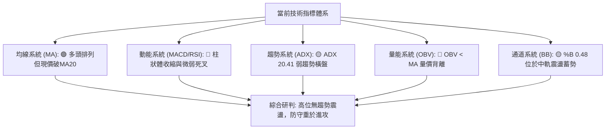

### 📈 移動平均線排列分析

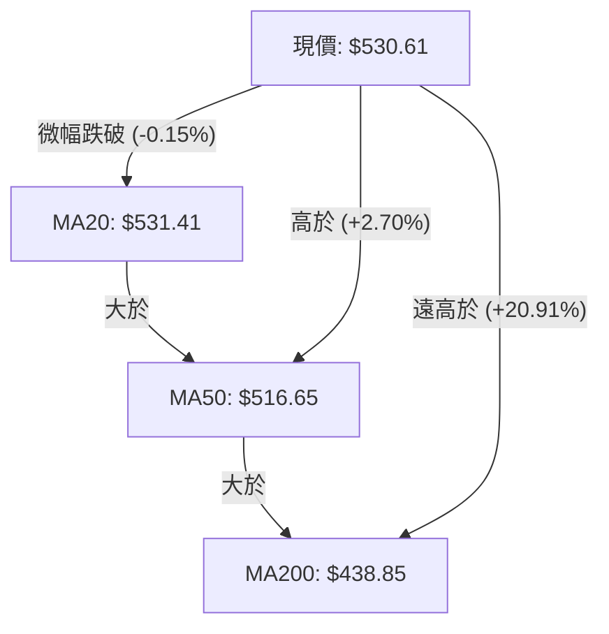

#### 移動平均線詳細量化走勢表

| 均線名稱 | 數值 | 距現價乖離 | 走勢特徵 (ASCII 軌跡) | 技術解讀 |
|:---|:---:|:---:|:---|:---|
| **MA 5** | $530.09 | +0.10% | ▁▁▂▂▂▃▄▅▅▆▇█████▇▇▆▆▆▆▆▆▆▅▅▆▆▇ | 超短期拐頭向上，與現價貼合 |
| **MA 10** | $529.74 | +0.16% | ▁▁▁▂▂▃▄▄▅▅▆▇▇██████████▇▇▇▆▇▇▇ | 短期均線支撐，提供日內反彈動能 |
| **MA 20** | $531.41 | -0.15% | ▁▁▁▁▁▁▂▂▃▃▄▄▅▅▆▆▆▇▇▇██████████ | 月線走平微垂，現價位於其下方，短線壓制 |
| **MA 60** | $511.92 | +3.65% | ▁▁▁▂▂▂▃▃▃▄▄▅▅▅▆▆▇▇▇▇██████████ | 季線穩健昂揚，構成堅實中線防線 |
| **MA 120** | $462.68 | +14.68%| ▁▁▁▁▂▂▂▃▃▃▃▄▄▄▄▅▅▅▆▆▆▆▇▇▇▇████ | 半年線持續上行，多頭主基調未變 |
| **MA 200** | $438.85 | +20.91%| — | 年線長期向上，牛市最根本屏障 |
| **MA 240** | $444.84 | +19.28%| ▁▁▁▁▁▁▁▁▁▂▂▂▂▂▂▂▃▃▃▄▄▅▅▅▆▆▆▇██ | 超長週期均線，奠定歷史級多頭底座 |

### 📉 RSI(14) 分析

```
RSI(14) 動能刻度表
0        20       40   52.15   60       80      100
├────────┼────────┼──────●─────┼────────┼────────┤
 超賣區   偏弱區     中性區     偏強區   超買區
 當前數值: 52.15 (Wilder 計算)
 進度條: [██████████░░░░░░░░░░] 52.15% (中性平衡)
```

1. **數值解讀**：RSI(14) 為 **52.15**，精準座落於 50 榮枯線上方，脫離了前期在 2026-08 創出的 78.1 超買極端區，回歸常態中性水平。
2. **背離檢驗**：數據明確標明「**無明顯背離**」（近 20 根 K 棒首尾之價格與 RSI 運動方向一致）。價格高位震盪，RSI 亦步亦趨，未出現典型的一頂比一頂高的頂背離，亦未出現底背離，表明當前走勢並非極端反轉前夕，而是正常的漲多沉澱。

### 📊 MACD(12,26,9) 訊號解讀

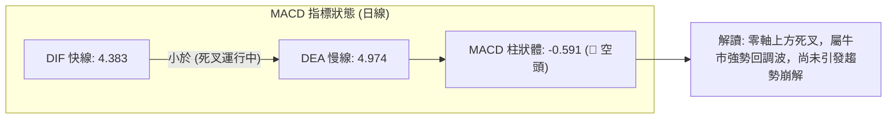

- **DIF 快線**：4.383
- **DEA 慢線**：4.974
- **MACD Histogram**：-0.591（處於負值區間）
- **動能透視**：快線向下穿過慢線形成高位死叉，負柱狀體顯示空頭暫時掌握短線節奏。然而，DIF 與 DEA 雙雙位於零軸上方（零軸上代表牛市格局），此種死叉通常定義為「多頭市場中的獲利回吐修正」，而非轉向熊市。

### 📦 布林通道分析

```
MSFT 日線布林通道 (20, 2) 結構圖
價格 ($)
$551.33 ┬────────────────────────────────────────── 上軌 Upper Band (R1 阻力重合)
        │
$540.00 ┤
        │
$531.41 ┼────────────────────────────────────────── 中軌 Middle Band (MA20 月線)
$530.61 ┤  ◄ 現價 (%B = 0.48，微幅落於中軌下方)
$520.00 ┤
        │
$511.49 ┴────────────────────────────────────────── 下軌 Lower Band (第一線支撐)
```

- **通道參數**：上軌 **$551.33**，中軌 **$531.41**，下軌 **$511.49**。
- **帶寬與位置**：通道帶寬 ($551.33 − $511.49) = $39.84 (約 7.5%)，處於溫和收縮狀態。當前 **%B = 0.48**，股價緊貼中軌下方運行，顯示多空在此處展開拉鋸。依據均值回歸原理，股價在未放量突破前，將持續在 $511.49 至 $551.33 之間進行箱型震盪。

### 💹 成交量分析（量價配合度）

1. **量比分析**：最新日成交量為 **26,938,400**，對比 20 日均量 25,603,875，量比為 **1.05x**，顯示日內換手溫和，無恐慌性拋售，亦無激進搶籌。
2. **量價背離現象**：
   - 2026-11-04 股價衝擊新高 $559.15 時，單日成交量放大至 50,807,800，但次日（11-05）回吐時成交量依然高達 42,507,900，顯示高位拋壓沉重。
   - **OBV 趨勢**：數據明確標示 **OBV < MA**，代表能量潮指標已跌破其均線。資金流入意願減弱，量能未對股價在高檔創高提供持續性背書，呈現量價背離隱憂。

---

## 6. 動能與波動率

### ⚡ 動能評估四象限

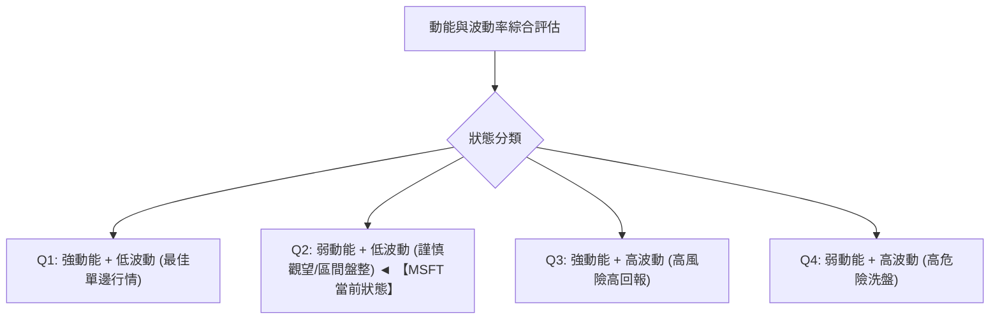

#### 動能與波動四象限對照表

| 象限代號 | 動能強度 | 波動率水準 | 當前狀態匹配 | 市場環境評估與策略處方 |
|:---:|:---:|:---:|:---:|:---|
| **Q1** | 強 (ADX>25, RSI>60) | 低 (ATR%<2%) | — | 絕佳單邊趨勢，持股並順勢加碼 |
| **Q2** | **弱 (ADX=20.41)** | **中低 (ATR%=2.91%)**| **✓ (當前狀態)** | **進入收斂盤整期，避免追漲殺跌，嚴格執行區間邊界操作** |
| **Q3** | 強 (量能井噴) | 高 (ATR%>4%) | — | 突破爆發期，利潤豐厚但需提防劇烈甩轎 |
| **Q4** | 弱 (動能潰散) | 高 (巨幅震盪) | — | 頂部或底部劇烈分歧，市場情緒不穩定，應空倉規避 |

### 📊 ATR 波動率分析

- **ATR(14) 絕對值**：**$15.44**（基於 Wilder 平滑法計算）。
- **ATR 相對價格比**：佔現價比例為 **2.91%**，屬於大型科技股在財報及高位盤整期的典型常態波動。
- **止損距離建議**：
  - **保守型（1.0x ATR）**：$15.44 止損寬度。適用於日內短線或布林下軌掛單交易。
  - **波段型（1.5x ATR）**：**$23.16** 止損寬度。可有效過濾 85% 以上的高位假摔與日內噪聲。
  - **防守極限（2.0x ATR）**：$30.88 止損寬度。對應現價回撤至 $499.73，正好契合 $500 大關與 23.6% 斐波那契回調位 ($509.45) 關鍵防禦圈。

### 📐 Beta 與市場相關性

- **Beta 係數**：**1.045**。
- **市場敏感度解讀**：MSFT 與標普500指數（S&P 500）的相關性極高，波動彈性略高於大盤 4.5%。這意味著其走勢與宏觀科技板塊 beta 緊密同頻，不存在嚴重的個股異象偏離。在大盤處於高檔震盪背景下，MSFT 較難走出完全獨立於市場的暴漲暴跌行情。

---

## 7. 多時框架總結

### 📋 時框架評分表

| 時框架 | 趨勢方向 | 動能狀態 | 均線排列 | 圖表形態 | 綜合評分 | 戰術建議 |
|:---|:---:|:---:|:---:|:---:|:---:|:---|
| **日線級別 (短期)** | 🟡 橫盤震盪 | 🔴 MACD死叉 / RSI中性 | 🟡 破MA20但高於MA50 | 矩形整理 (%B 0.48) | **48/100** | 逢高減碼，回踩下軌低吸 |
| **週線級別 (中期)** | 🟢 震盪偏多 | 🟡 MACD柱微負 / RSI 52 | 🟢 MA20>MA50 多頭排列 | 仙人指路巨震十字 | **58/100** | 中線持股，不破 S1 ($486) 不離場 |
| **月線級別 (長期)** | 🟢 大牛市上升 | 🟢 雙底突破創年度新高 | 🟢 多頭完美發散結構 | 階梯式長牛通道 | **76/100** | 戰略性看多，長線配置無憂 |

### 🔲 綜合訊號矩陣

```
╔══════════════════════════════════════════════════════════════╗
║               MSFT 多維度時框架訊號矩陣                      ║
╠════════════════╦══════════╦══════════════╦═══════════════════╣
║ 分析維度       ║ 短期(日) ║ 中期(週)     ║ 長期(月)          ║
╠════════════════╬══════════╬══════════════╬═══════════════════╣
║ 趨勢方向       ║ 🟡 震盪  ║ 🟢 偏多      ║ 🟢 多頭          ║
║ 均線系統       ║ 🔴 破月線║ 🟢 多頭排列  ║ 🟢 完美多頭發散   ║
║ 動能指標       ║ 🔴 死叉  ║ 🟡 柱狀鈍化  ║ 🟢 良好向上       ║
║ 量能支持       ║ 🔴 背離  ║ 🟡 換手放大  ║ 🟢 溫和擴大       ║
║ 波動狀態       ║ 🟡 收窄  ║ 🔴 振幅擴大  ║ 🟢 穩定健康       ║
╠════════════════╬══════════╩══════════════╩═══════════════════╣
║ 訊號收斂優先級 ║ 依規則14：ADX=20.41 (<25) 判定為【盤整行情】║
║ 主導交易框架   ║ 權重歸於【日線布林通道區間】與【週線關鍵價位】║
╚════════════════╩══════════════════════════════════════════════╝
```

### ⚖️ 多時框收斂結論

> **核心結論**：**當前處於【大牛市背景下的高位箱型盤整行情】（方向：中性觀望，區間低吸高拋）**。

- **收斂邏輯依據（嚴格遵守規則 14）**：
  1. 當前日線 **ADX(14) 為 20.41 (< 25)**，嚴格觸發「**盤整行情**」判定條款。
  2. 依規則 14，當前市場環境不可採取趨勢跟蹤追突破策略，而必須以**日線布林通道上下軌（$511.49 – $551.33）作為核心交易區間**。
  3. 日線短期技術面跌破 MA20 且 MACD 柱狀體收縮，顯示上攻乏力；但週線及月線大格局均線（MA50 $516.65, MA200 $438.85）完好，並不存在系統性崩跌條件。因此，兩者收斂的唯一合理解釋為：**高檔強勢換手與時間換空間**。在未放量跌破 S1 ($486.00) 或突破 R1 ($551.15) 之前，一律定調為中性觀望與區間操作。

---

## 8. 交易策略建議

### 🗺️ 策略決策流程圖

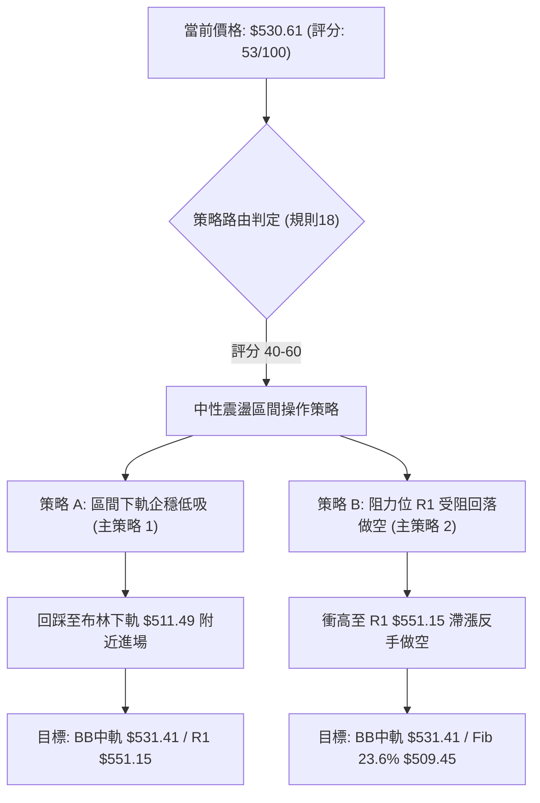

### 🧭 策略路由（依評分卡分流）

> **當前主策略方向 = 區間操作（以布林上下軌為主，等待突破確認；依技術評分卡 53/100，落於 40–60 中性區間）**

本策略杜絕兩頭押注，嚴格遵循盤整期「**高拋低吸，見好就收**」鐵律，禁止在通道中軌（$530.61 現價）盲目追單。

### 🎯 價格情境階梯（Price Scenarios）

以當前收盤價 **$530.61** 為基準，嚴格引用第 4 章數據推演情境：

| 觸發條件 | 下一目標 | 後續延伸 | 情境技術含義 |
|:---|:---:|:---:|:---|
| **強勢突破 R1 ($551.15)** | 52W 高點 **$559.15** | 形態推算目標 **$592.85** | 多頭趨勢重新點火，突破箱頂開啟新一輪主升浪 |
| **維持在 $511.49 – $551.33** | 布林中軌 **$531.41** | — | **當前基準情境**：布林帶內部健康拉鋸換手 |
| **跌破布林下軌及 $509.45** | 關鍵支撐 S1 **$486.00** | 強支撐 S2 **$476.25** | 短線轉弱，高檔震盪擴大為中期波段級別回調 |

### 📊 情境機率分佈

| 情境劃分 | 機率 | 主要指標依據 |
|:---|:---:|:---|
| **區間震盪整理 (維持箱體)** | **55%** | **ADX = 20.41 (<25) 鎖定盤整態勢**；布林帶通道收窄；RSI 52.15 處於中性平衡中軸 |
| **回踩深層支撐 (回探探底)** | **25%** | **MACD 柱狀體為負 (-0.591)**；OBV < MA 量能背離；11-05 長陰線高位套牢盤待消化 |
| **向上突破破頂 (強勢進攻)** | **20%** | 均線長週期呈現多頭排列；+DI (23.20) 微幅高於 -DI (22.72)；基本面長期獲利增長支持 |

### 🟢 主策略詳情（方向：中性區間雙向邊界交易）

依規則 17，風險報酬比嚴格依照公式計算：
- **做多風報比** = $(T1 − 進場價) \div (進場價 − 止損價)$
- **做空風報比** = $(進場價 − T1) \div (止損價 − 進場價)$

| 策略要素 | 策略 A（下軌低吸多頭） | 策略 B（上軌受阻空頭） |
|:---|:---|:---|
| **交易類型** | 區間下限逢低做多 | 區間上限波段做空 |
| **進場條件** | 股價回踩布林下軌與斐波那契 23.6% 獲得支撐 | 股價反彈至阻力位 R1 遇阻滯漲，出現倒錘頭 |
| **進場價格** | **$511.49**（布林帶下軌） | **$551.15**（阻力位 R1） |
| **目標價 T1** | **$551.15**（阻力位 R1） | **$531.41**（布林中軌 MA20） |
| **目標價 T2** | **$559.15**（52W 歷史最高點） | **$509.45**（斐波那契 23.6% 回調位） |
| **止損價格** | **$486.00**（關鍵支撐 S1） | **$559.15**（52W 歷史最高點） |
| **風險報酬比** | **1 : 1.56（以 T1 計）**<br>*(551.15−511.49)÷(511.49−486.00) = 39.66÷25.49*<br>另註：1 : 1.87（以 T2 計） | **1 : 2.47（以 T1 計）**<br>*(551.15−531.41)÷(559.15−551.15) = 19.74÷8.00*<br>另註：1 : 5.21（以 T2 計） |
| **成功機率** | 60% | 55% |
| **建議倉位** | 15%（波段底倉） | 10%（對沖輕倉） |

### 🔴 反向風險觸發點（對沖提示）

- **多頭轉移與止損觸發點**：若日線實體跌破 **$509.45**（斐波那契 23.6%），應將多頭部位砍半；若有效跌破 **$486.00 (S1)**，多頭邏輯全數推翻，必須全面停損出場並建立對沖。
- **空頭平倉與軋空警報點**：若日線放量收盤站上 **$559.15**（52W 高點），代表高檔箱型轉化為破位主升浪，所有空頭頭寸必須無條件市價平倉止損。

### ⭐ 整體訊號強度評星

```
╔══════════════════════════════════════════════════════════════╗
║               訊號評級矩陣 (Rating Stars)                    ║
╠══════════════════════════════════════════════════════════════╣
║ 做多訊號強度：  ★★★☆☆  (3/5星 — 均線長牛支持，但短線震盪)   ║
║ 做空訊號強度：  ★★☆☆☆  (2/5星 — 僅屬技術性回吐，非大空頭)   ║
║ 整體可信度：    ★★★★☆  (4/5星 — 數據指標收斂良好，邊界明確) ║
╚══════════════════════════════════════════════════════════════╝
```

---

## 9. 風險提示與監控

### ✅ 關鍵監控指標 Checklist

```
╔══════════════════════════════════════════════════════════════╗
║                 MSFT 每日交易風控監控清單                     ║
╠══════════════════════════════════════════════════════════════╣
║ [ ] 價格是否跌破月線 MA20 ($531.41) 超過 3 個交易日？        ║
║ [ ] 日成交量突破 40,000,000 且伴隨中長黑K棒（異常出貨量）？  ║
║ [ ] MACD Histogram 負值是否進一步跌破 -1.500（動能擴大）？   ║
║ [ ] RSI(14) 是否向下跌穿 45 臨界支撐軸（轉弱確認）？         ║
║ [ ] ADX(14) 是否自 20.41 向上攀升至 25 以上（趨勢單邊啟動）？ ║
║ [ ] 價格是否回踩 $509.45 (Fib 23.6%) 並出現長下影止跌K線？   ║
╚══════════════════════════════════════════════════════════════╝
```

### ⚠️ 風險場景分析

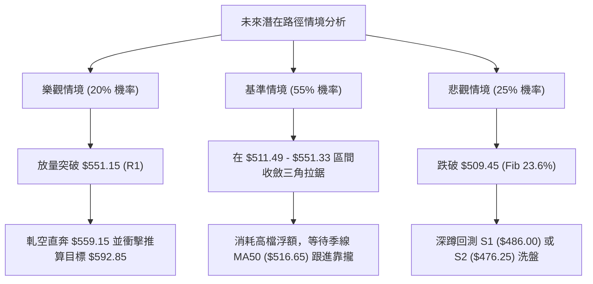

### 🛡️ 風險管理重要提醒

1. **嚴禁追高紀律**：當前股價高於 MA200 年線達 20.91%，且近期剛在 $559.15 遭遇放量長陰反噬，在 $530-$540 區間追進多單具有極高被套風險。
2. **波動防禦（ATR 應用）**：當前 ATR 為 $15.44，意味著日內產生 $10-$15 的上下震盪屬於完全正常的市場隨機噪聲。任何倉位的防守停損設定不可小於 1.0x ATR ($15.44)，建議採用 1.5x ATR (**$23.16**) 作為動態跟蹤止損。
3. **倉位配置上限**：由於 ADX 為 20.41 處於盤整市，整體股票倉位應由趨勢行情的 70%-80% 主動降至 **40%-50%**，保留充沛現金儲備以備在回調至 S1 ($486.00) 附近時從容佈局。

---

## 📋 報告總結

```
╔══════════════════════════════════════════════════════════════════╗
║                    MSFT 技術分析報告總結                         ║
╠══════════════════════════════════════════════════════════════════╣
║ 報告日期：2026-11-09                                             ║
║ 當前價格：$530.61 USD                                            ║
║ 分析評級：⚖️ 中性震盪整理（技術評分：53 / 100）                  ║
╠══════════════════════════════════════════════════════════════════╣
║ 關鍵結論：                                                       ║
║ ├─ 長期趨勢：🟢 完好大牛市，MA200 ($438.85) 長線基石堅不可摧     ║
║ ├─ 中期趨勢：🟢 震盪偏多，受阻於 52W 高點 $559.15 展開良性換手   ║
║ ├─ 短期趨勢：🟡 區間盤整，微跌破 MA20 ($531.41)，ADX=20.41 鈍化 ║
║ ├─ 核心阻力：$551.15 (R1) ｜ 歷史天花板 $559.15                  ║
║ ├─ 核心支撐：$509.45 (Fib 23.6%) ｜ 關鍵底線 $486.00 (S1)        ║
║ └─ 華爾街共識目標價：$636.12 (54位分析師評級：強力買入)          ║
╠══════════════════════════════════════════════════════════════════╣
║ 最優策略組合：                                                   ║
║ 1. 🥇 最佳機會（策略 A）：耐心等待回踩布林下軌 $511.49 企穩低吸， ║
║    嚴格止損置於 S1 ($486.00)，目標上看 R1 ($551.15)。            ║
║ 2. 🥈 次選機會（策略 B）：若反彈至 R1 ($551.15) 遇阻，輕倉做空，  ║
║    止損設於新高 $559.15，目標看回布林中軌 $531.41。              ║
║ 3. 🥉 保守選擇：完全空倉觀望，靜待日線放量突破 $551.15 或實體   ║
║    回踩 $509.45 確認支撐後，再行順勢進場介入。                   ║
╚══════════════════════════════════════════════════════════════════╝
```

---

> ⚠️ **免責聲明**：本報告由 AI 自動生成之技術分析，所有數據及估算均嚴格基於所提供的歷史價格資訊（OHLCV）。本報告**僅供研究與學術參考**，**不構成任何買賣要約或投資建議**。金融市場瞬息萬變，技術指標存在滯後性與失效風險，投資人應自行承擔所有投資風險。

---

*報告生成時間：2026-11-09 ｜ 數據來源：Yahoo Finance ｜ 分析框架：多時框技術分析體系*