# MSFT 技術分析報告

> **報告日期**：2026-11-10 ｜ **語言**：繁體中文 ｜ **數據來源**：Yahoo Finance ｜ **當前價格**：$545.18

---

## 目錄

| 章節 | 內容 |
|------|------|
| [1. 技術面概覽](#1-技術面概覽) | 訊號儀表板、核心指標、評分卡 |
| [2. 趨勢分析](#2-趨勢分析) | 多時框趨勢、長中短期走勢 |
| [3. 圖表形態分析](#3-圖表形態分析) | 形態識別、K線組合、目標價 |
| [4. 支撐與阻力](#4-支撐與阻力) | 關鍵價位、斐波那契回調 |
| [5. 技術指標深度解讀](#5-技術指標深度解讀) | MA/RSI/MACD/布林/成交量 |
| [6. 動能與波動率](#6-動能與波動率) | 動能評估、ATR、Beta |
| [7. 多時框架總結](#7-多時框架總結) | 時框架評分矩陣 |
| [8. 交易策略建議](#8-交易策略建議) | 多空策略、風險報酬比 |
| [9. 風險提示與監控](#9-風險提示與監控) | 監控指標、風險場景 |

---

## 1. 技術面概覽

### 🎯 技術訊號儀表板

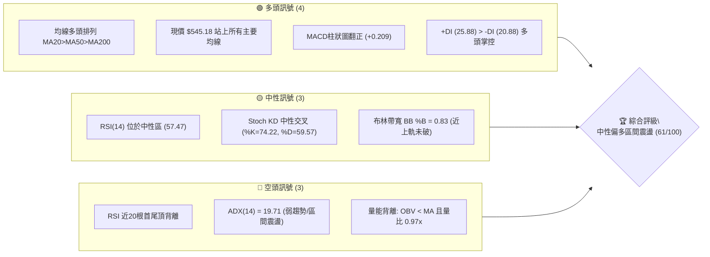

### 📊 核心指標速覽表

| 指標類別 | 指標名稱 | 當前數值 | 訊號 | 解讀 |
|----------|----------|----------|------|------|
| **價格** | 當前價格 | $545.18 | 🟢 | 位於52週區間 93.4%，強勢多頭結構維持在頂部區域 |
| **均線** | MA20 | $531.61 | 🟢 | 現價高於 MA20 約 +2.55%，短線多頭掌控支撐強固 |
| **均線** | MA50 | $517.28 | 🟢 | 現價高於 MA50 約 +5.39%，中期波段多頭生命線不變 |
| **均線** | MA200 | $439.26 | 🟢 | 現價遠高於 MA200 約 +24.11%，長期牛市基調明確 |
| **動能** | RSI(14) | 57.47 | 🟡 | 處於 30–70 中性常態區，但短線出現局部頂背離壓抑漲勢 |
| **動能** | MACD | 5.236 / Sig: 5.027 | 🟢 | DIF 線金叉訊號線，Hist 柱狀圖為 +0.209，短線微幅偏多 |
| **動能** | ADX(14) | 19.71 | 🔴 | ADX 低於 25，表明缺乏單邊強趨勢，盤勢定調為高位區間震盪 |
| **動能** | Stoch %K / %D | 74.22 / 59.57 | 🟡 | KD 數值回升至偏高區域但未超買，動能處於反彈中段 |
| **通道** | 布林通道 %B | 0.83 (上軌 $552.02) | 🟡 | 逼近上軌阻力位，通道擴張有限，向上突破需量能支持 |
| **量能** | 20日成交均量 | 25,295,600 (量比 0.97x) | 🔴 | 成交量略低於20日均量，OBV 低於均線，量價配合不足 |
| **波動** | ATR(14) | $15.60 (2.86%) | 🟡 | 每日波動幅度適中，適合設定 ATR 倍數止損 |

### 🏆 技術評分卡

```
技術評分卡 — MSFT (2026-11-10)
════════════════════════════════════════════════════
趨勢強度      ████████░░░░░░░░░░░░  40/100  🔴 (ADX=19.71 弱趨勢)
動能指標      ████████████░░░░░░░░  60/100  🟡 (MACD金叉但RSI頂背離)
支撐穩定度    ████████████████░░░░  80/100  🟢 (S1 $504.96/MA50 多重防線)
成交量配合    ████████░░░░░░░░░░░░  40/100  🔴 (OBV疲弱，量能萎縮)
形態完整度    ██████████████░░░░░░  70/100  🟢 (高位三角收斂，突破邊緣)
均線排列      ████████████████░░░░  80/100  🟢 (MA20>MA50>MA200 完美多頭)
════════════════════════════════════════════════════
綜合評分      ████████████░░░░░░░░  62/100  🟢 偏多震盪（算術平均四捨五入）
════════════════════════════════════════════════════
註：綜合評分 = (40 + 60 + 80 + 40 + 70 + 80) ÷ 6 = 370 ÷ 6 = 61.67 ≈ 62/100
```

---

## 2. 趨勢分析

### 🌐 多時框趨勢分析

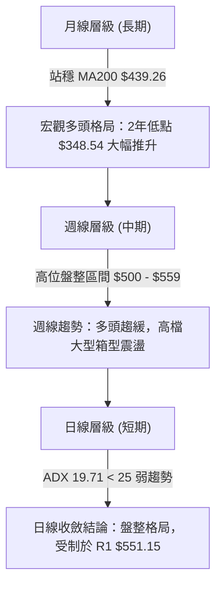

### 📈 長期趨勢 — 12個月走勢圖（Unicode）

```
MSFT 月線走勢圖（過去12個月：2025-12 至 2026-11）
價格軸 ($)
$560 ┤                                                  ● (2026-11: $545.18)
$520 ┤                                            ●     │
$500 ┤                                      ●     │     │
$480 ┤● (2025-12: $480.57)            ●     │     │     │
$440 ┤      ●                   ●     │     │     │     │
$400 ┤            ●             │     │     │     │     │
$360 ┤                  ●       │     │     │     │     │ (2026-03: $368.68 低點)
     └─────────────────────────────────────────────────────────────
       12M   01M   02M 03M 04M 05M   06M   07M   08M   09M   10M   11M
      '25   '26   '26 '26 '26 '26   '26   '26   '26   '26   '26   '26
```

**走勢特徵分析表格**：

| 週期區間 | 起訖月份 | 起訖價格 ($) | 漲跌幅 (%) | 走勢特徵解讀 |
|----------|----------|--------------|------------|--------------|
| **第1階段** | 2025-12 → 2026-03 | 480.57 → 368.68 | -23.28% | 深度回調，下探年內低點，打出 $348.54 - $368.68 宏觀雙重底 |
| **第2階段** | 2026-03 → 2026-05 | 368.68 → 449.39 | +21.89% | V型報復性反彈，收復 MA200 關鍵長線多空分水嶺 |
| **第3階段** | 2026-05 → 2026-06 | 449.39 → 372.32 | -17.15% | 劇烈洗盤再次回測前低支撐，確立次級底結構 |
| **第4階段** | 2026-06 → 2026-08 | 372.32 → 507.29 | +36.25% | 主升浪爆發，伴隨巨量突破 $500 大關 |
| **第5階段** | 2026-08 → 2026-11 | 507.29 → 545.18 | +7.47% | 高位整理收斂，衝擊 52W 高點 $559.15 後進入高位箱體 |

### 📊 中期趨勢（週線分析）

```
中期週線支撐阻力結構示意圖
════════════════════════════════════════════════════════════════════
$559.15 ────────────────────────────────── [52W 歷史天花板]
          ▲           ▲
$551.15 ──┼───────────┼─────────────────── [週線強阻力 R1 (10-16/11-06 衝高回落)]
          │   現價    │
$545.18 ──┼─── ★ ────┼─────────────────── [當前週K收盤位置]
          │           │
$517.28 ──┴───────────┴─────────────────── [MA50 中期生命線防守]
$504.96 ────────────────────────────────── [週線強支撐 S1 (11-02 波段低點)]
════════════════════════════════════════════════════════════════════
```

### ⚡ 趨勢強度評估（ADX 解讀）

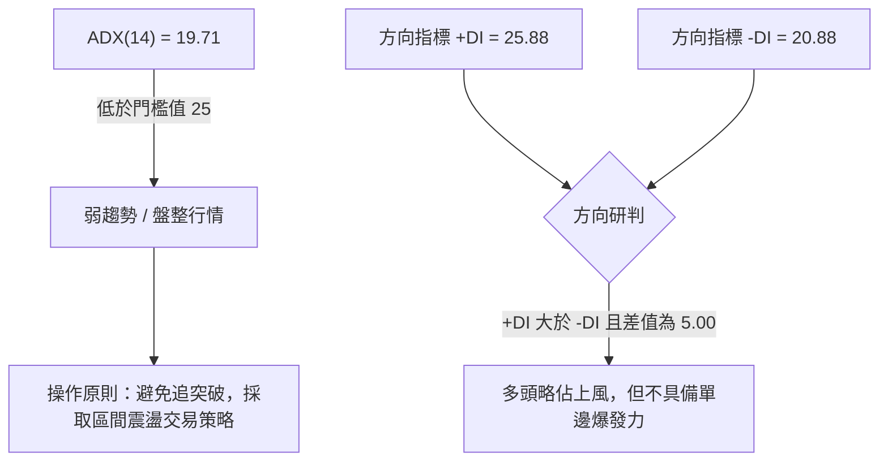

**ADX 趨勢強度對照表**：

| ADX 數值區間 | 當前數值 | 趨勢狀態 | 交易策略導向 | 權重收斂規則 |
|--------------|----------|----------|--------------|--------------|
| 0 – 20 | **19.71** | **極弱趨勢 / 無方向盤整** | **布林通道區間高拋低吸，嚴格止盈** | **日線與中長期衝突時，以日線布林上下軌為主** |
| 20 – 25 | - | 弱趨勢 / 醞釀期 | 尋找通道突破臨界點 | 觀察均線與量能變化 |
| 25 – 40 | - | 強趨勢建立 | 順勢回踩做多 / 放空 | 以中長期 MA50/MA200 為主導方向 |
| 40 – 60 | - | 極強單邊爆發 | 抱牢波段持倉 | 忽視短線微幅超買 |

---

## 3. 圖表形態分析

### 🔍 形態識別系統

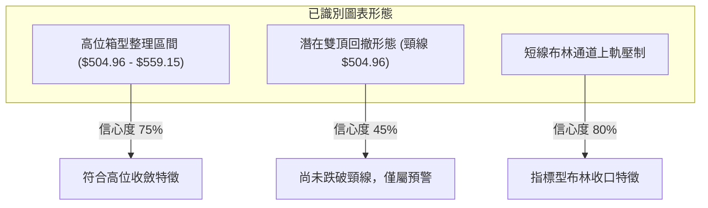

**形態信心度與目標價評估表**：

| 形態名稱 | 信心度 (%) | 判斷依據（引用數據） | 完成度 (%) | 目標價計算式（依規則13與15） |
|----------|------------|----------------------|------------|------------------------------|
| **高位箱型整理** | 75% | 頂部受制於 R1 $551.15 及高點 $559.15，底部受 S1 $504.96 強力支撐 | 85% | 震盪區間內運行，箱頂目標即阻力位 R1 $551.15 |
| **潛在雙重頂 (M頭)** | 45% | 2026-10-16 高點 $551.15 與 2026-11-04/06 高點 $559.15 構成兩頂，但未破頸線 $504.96 | 35% | 信心度 <50%，未跌破頸線 $504.96 前不予計算向下高度，僅作指標型解讀 |
| **布林通道震盪收斂** | 80% | 現價 $545.18 逼近 BB上軌 $552.02，BB %B 為 0.83，中軌為 $531.61 | 90% | 上軌目標 $552.02，回踩中軌目標為 BB中軌 $531.61 |

### 🕯️ 重要K線形態分析

依規則 19，完全基於數據中提供的「近10根日K」與「近8根週K」實體數值進行客觀形態識別：

#### 近10根日K形態分析表

| 日期 (日K) | 開盤 ($) | 最高 ($) | 最低 ($) | 收盤 ($) | 成交量 | K線形態 | 解讀與訊號 |
|------------|----------|----------|----------|----------|--------|---------|------------|
| 2026-10-27 | 532.35 | 534.70 | 528.33 | 531.33 | 19,532,300 | 小陰十字星 | 窄幅盤整，成交量低迷，方向不明 🟡 |
| 2026-10-28 | 531.82 | 535.00 | 526.14 | 531.01 | 28,594,200 | 紡錘線 (Spinning Top) | 多空拉鋸，下影線略長，存在微幅承接 🟡 |
| 2026-10-29 | 540.22 | 541.29 | 519.56 | 530.14 | 39,333,200 | 長陰帶長下影 | 盤中巨震衝高回落，放量測試下方支撐 🔴 |
| 2026-10-30 | 525.27 | 526.00 | 514.35 | 521.91 | 35,652,000 | 中實體陰線 | 跳空低開低走，空頭延續賣壓 🔴 |
| 2026-11-02 | 524.02 | 529.63 | 504.96 | 507.12 | 34,743,300 | 破位長陰線 | 盤中殺跌觸及波段最低 S1 $504.96 恐慌盤湧出 🔴 |
| 2026-11-03 | 509.01 | 523.44 | 507.82 | 520.99 | 20,010,200 | 晨星反彈陽線 (Hammer) | 下探不破前低，長陽實體包覆前日下影，短線止跌 🟢 |
| 2026-11-04 | 543.70 | 559.15 | 542.30 | 555.80 | 50,807,800 | 爆量突破大長陽 | 爆出 50.8M 巨量，盤中觸及 52W 高點 $559.15 🟢 |
| 2026-11-05 | 554.94 | 557.62 | 532.68 | 535.93 | 42,507,900 | 長陰反噬 (Bearish Engulfing) | 高位獲利回吐，大幅長陰回跌逾 22 美元 🔴 |
| 2026-11-06 | 525.69 | 538.33 | 524.47 | 530.61 | 26,956,400 | 低開下影小陽 | 縮量企穩於 MA20 之上，多空重回均勢 🟡 |
| 2026-11-09 | 544.49 | 548.28 | 538.70 | 545.18 | 25,295,600 | 跳空高開陽十字星 | 跳空上揚但受阻於 $548.28，上攻力道受限 🟡 |

#### 近8根週K形態分析表

| 日期 (週K) | 開盤 ($) | 最高 ($) | 最低 ($) | 收盤 ($) | 成交量 | K線形態 | 解讀與訊號 |
|------------|----------|----------|----------|----------|--------|---------|------------|
| 2026-09-25 | 494.95 | 519.40 | 491.22 | 516.17 | 123,909,000 | 中實體長陽 | 帶量突破 $500 整數大關，確立中期底部 🟢 |
| 2026-10-02 | 505.47 | 522.85 | 502.22 | 517.53 | 105,746,200 | 高位窄幅十字 | 消化突破浮額，回測支撐不破 🟡 |
| 2026-10-09 | 521.62 | 537.22 | 518.79 | 535.07 | 103,231,800 | 實體推升週陽 | 順利突破 $530，中多結構健康發展 🟢 |
| 2026-10-16 | 537.53 | 551.15 | 524.43 | 529.05 | 113,488,100 | 長上影流星週陰 | 上攻 R1 $551.15 遇強烈解套賣壓 🔴 |
| 2026-10-23 | 528.70 | 535.57 | 515.70 | 524.51 | 81,449,100 | 縮量小陰線 | 量能驟降至 81M，進入高位觀望期 🟡 |
| 2026-10-30 | 527.40 | 541.29 | 514.35 | 521.91 | 142,132,700 | 放量下挫中陰 | 盤中跌破 MA20 尋求 MA50 支撐 🔴 |
| 2026-11-06 | 524.02 | 559.15 | 504.96 | 530.61 | 175,025,600 | 巨震長上下影十字星 | 單週振幅達 $54.19，放量多空大決戰 🟡 |
| 2026-11-09 | 544.49 | 548.28 | 538.70 | 545.18 | 25,295,600 | 局部強勢小陽 (單日) | 單日強彈重返週線多頭排列 🟢 |

### 📉 ASCII 走勢形態示意圖

```
高位箱體與雙重頂警示結構圖 (2026-10 至 2026-11)
$559.15 ┼───────────────────────── 52W新高 (頂2: 11-04)
        │                 ▲            │
$551.15 ┼──── 頂1 (10-16) ┼───────────┼────── R1 關鍵強阻力
        │     ┌─┐         │            │
$545.18 ┼─────│─│─────────┼────────────★───── 現價 ($545.18)
        │     │ │         │            │
$531.61 ┼─────│─│─────────│────────────┴───── MA20 / BB中軌
        │     │ │         │
$517.28 ┼─────│─│─────────┴────────────────── MA50 生命線
        │     │ └──────────────────────┐
$504.96 ┼─────┴────────────────────────┴───── 頸線 / 波段支撐 S1
════════════════════════════════════════════════════════════════
```

### 🎯 形態目標價計算

根據規則 13 與 15，絕不憑空臆造價格。以下由形態學原理與已知支撐阻力進行推算：

1. **箱體上限震盪目標（主要形態）**：
   - 形態底部支撐：$S_1 = \$504.96$
   - 形態上限阻力：$R_1 = \$551.15$
   - 當前處於箱體中上部，向上第一目標即箱頂阻力：$T_1 = \$551.15$
   - 若進一步放量突破，則上探前期歷史天花板：$T_2 = \$559.15$（52W High）

2. **潛在雙頂破位幅度推算（風險預警情境，若且唯若跌破頸線）**：
   - 頂部均值估計：$\frac{551.15 + 559.15}{2} = \$555.15$
   - 頸線位置：$S_1 = \$504.96$
   - 形態理論高度：$H = 555.15 - 504.96 = \$50.19$
   - 破位等幅回測目標：$504.96 - 50.19 = \$454.77$（此價位極度貼近 50.0% 斐波那契回調位 $453.85，具高度技術共振意義）

---

## 4. 支撐與阻力

### 🗺️ 關鍵價位分布圖（Unicode）

```
MSFT 價位結構分布圖 (由實際數據與聚類運算導出)
═══════════════════════════════════════════════════════════════
$559.15 ║████████████████████████║ 52W 歷史極限高點 (0.0% Fib)
$551.15 ║████████████████████    ║ 關鍵波段高點阻力 R1 (+1.10%)
$545.18 ╠════════════════════════╣ ◄─── 當前現價 ($545.18)
$531.61 ║▓▓▓▓▓▓▓▓▓▓▓▓▓▓▓▓        ║ 短線均線支撐 (MA20 / BB中軌)
$517.28 ║▓▓▓▓▓▓▓▓▓▓▓▓            ║ 中期多頭防線 (MA50)
$509.45 ║▓▓▓▓▓▓▓▓▓▓▓▓▓▓▓▓▓▓      ║ 斐波那契 23.6% 回調位
$504.96 ║████████████████████████║ 近一年強波段低點支撐 S1 (-7.38%)
$486.00 ║████████████████        ║ 次級波段支撐 S2 (-10.86%)
$478.70 ║▓▓▓▓▓▓▓▓▓▓▓▓▓▓▓▓▓▓      ║ 斐波那契 38.2% 回調位
$476.25 ║████████████████████    ║ 強結構支撐 S3 (-12.64%)
$439.26 ║████████████████████████║ 牛熊生死分水嶺 (MA200 長期均線)
═══════════════════════════════════════════════════════════════
```

### 🚧 阻力位分析表

嚴格引用數據中「關鍵價位」區塊由波段高點聚類計算之數值：

| 阻力級別 | 價位 ($) | 距離現價 (%) | 形成原因與技術共振 | 突破難度 | 重要性 |
|----------|----------|--------------|--------------------|----------|--------|
| **R1** | **$551.15** | +1.10% | 2026-10-16 週K波段高點，多次上衝未果之強阻力聚類 | 🔴 偏高 | ★★★★★ |
| **52W High** | **$559.15** | +2.56% | 2026-11-04 日K極限高點，斐波那契 0.0% 回調位 | 🔴 極高 | ★★★★★ |

### 🛡️ 支撐位分析表

嚴格引用數據中「關鍵價位」區塊由波段低點聚類計算之數值：

| 支撐級別 | 價位 ($) | 距離現價 (%) | 形成原因與技術共振 | 守住機率 | 重要性 |
|----------|----------|--------------|--------------------|----------|--------|
| **動態支撐** | **$531.61** | -2.49% | MA20 均線位置與布林通道中軌重合 | 🟢 75% | ★★★☆☆ |
| **中期支撐** | **$517.28** | -5.12% | MA50 均線位置，中期上升趨勢防守線 | 🟢 80% | ★★★★☆ |
| **S1** | **$504.96** | -7.38% | 2026-11-02 波段探底低點聚類，高位箱體關鍵底線 | 🟢 85% | ★★★★★ |
| **S2** | **$486.00** | -10.86% | 歷史成交密集區聚類低點 | 🟢 90% | ★★★★☆ |
| **S3** | **$476.25** | -12.64% | 接近 38.2% 斐波那契位 ($478.70) 之結構低點聚類 | 🟢 95% | ★★★★☆ |

### 📐 斐波那契回調位分析

依據數據給定之 52週區間（$348.54 → $559.15，總波幅 $210.61）計算之標準斐波那契回調位：

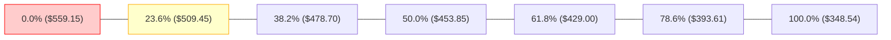

- **當前價格定位**：現價 **$545.18** 處於 **0.0% ($559.15)** 與 **23.6% ($509.45)** 的極高位強勢區間。
- **解讀與意義**：
  1. 股價在回調過程中，連最淺層的 23.6% ($509.45) 都未形成實質性跌破（11-02 雖然盤中打到 $504.96，但收盤迅速拉回並於次日站穩 $520 以上），顯示回撤幅度小於正常牛市回吐水準，多頭承接極為強悍。
  2. S1 支撐位 ($504.96) 與 23.6% 回調位 ($509.45) 形成重疊保護帶，是多方不容有失的陣地。

---

## 5. 技術指標深度解讀

### 🎛️ 指標訊號總覽

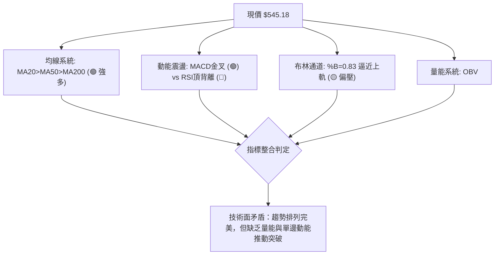

### 📈 移動平均線排列分析

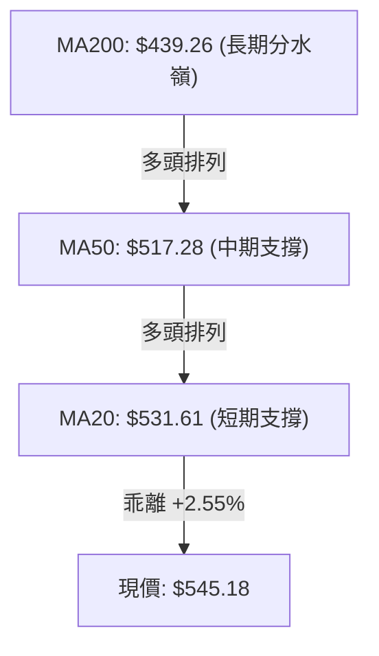

**移動平均線系統深度對照表**：

| 均線名稱 | 數值 ($) | 與現價乖離率 (%) | 均線歷史軌跡走勢 | 技術含義解讀 |
|----------|----------|------------------|------------------|--------------|
| **MA 5** | $537.70 | +1.39% | ▁▁▂▂▃▄▅▅▆▇▇████▇▇▆▆▆▆▆▆▆▅▄▆▆▆█ | 超短期快速反彈，5日線向上勾頭穿過10日線 |
| **MA 10** | $531.00 | +2.67% | ▁▁▁▂▃▃▄▅▅▆▇▇██████████▇▇▇▆▇▇▇█ | 短線回踩確認完成，形成第一道動態防線 |
| **MA 20** | $531.61 | +2.55% | ▁▁▁▁▁▂▂▃▃▄▄▅▅▆▆▆▇▇▇███████████ | 20日月線平穩走高，布林中軌具備強大支撐 |
| **MA 60** | $512.76 | +6.32% | ▁▁▁▂▂▂▃▃▄▄▄▅▅▆▆▆▇▇▇███████████ | 季線斜率平穩向上，中期牛市底座穩固 |
| **MA 120** | $463.76 | +17.56% | ▁▁▁▁▂▂▂▃▃▃▃▄▄▄▄▅▅▅▅▆▆▆▇▇▇▇████ | 半年線持續爬升，波段持股成本不斷墊高 |
| **MA 240** | $445.15 | +22.47% | ▁▁▁▁▁▁▁▁▁▂▂▂▂▂▂▂▃▃▄▄▄▄▅▅▅▅▆▇██ | 年線牛熊線穩定向上，奠定超級大牛市底蘊 |

### 📉 RSI(14) 分析

- **RSI 當前數值**：**57.47**
- **進度條展示**：
  ```
  RSI(14): 57.47  [30 ───────────── 50 ──────●────── 70]
  強度刻度:       ███████████████░░░░░░░░░░  57.5%
  ```
- **區間評估**：位於 50 軸線上方之常態強勢區，未觸及 70 超買警戒線，亦未進入超賣。
- **背離診斷（重要）**：
  - **結論**：⚠️ **明確存在局部頂背離 (Bearish Divergence)**。
  - **論證依據**：在近20根日K中，現價由 10-27 之 $531.33 震盪推升至 $545.18（盤中更衝擊 $559.15），價格首尾顯著上移；然而 RSI 數值未能隨之刷新高位（此前推升至 $559.15 時週線 RSI 達 78.1，而當前日線 RSI 僅為 57.47，週線 RSI 亦降至 57.5）。價格高點抬高但動能指標頂部走低，意味著買盤推升邊際效益遞減，須慎防向上突破失敗的假突破風險。

### 📊 MACD(12/26/9) 訊號解讀

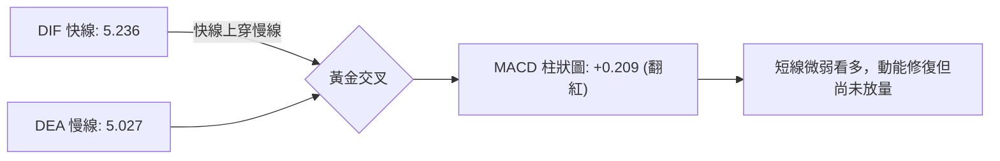

- **詳細解讀**：MACD 線 5.236 剛好上穿 Signal 線 5.027，柱狀圖在零軸上方收出 +0.209。這確認了從 11-02 探底 $504.96 以來短線反彈動能成立，空方賣壓暫告段落；但柱狀圖實體極為微小（+0.209 相較於 8月份之 +11.272 顯得微不足道），說明多方力量僅屬防守反擊，而非攻擊型主升浪。

### 📦 布林通道分析

```
布林通道 (Bollinger Bands 20, 2) 結構分布圖
═══════════════════════════════════════════════════════════════
$552.02 ┬────────────────────────────────────────── BB 上軌 (阻力帶)
        │                       ▲
$545.18 ┤ ◄─────────────────────┼────────────────── 現價 ($545.18, %B=0.83)
        │                       │
$531.61 ┼───────────────────────┼────────────────── BB 中軌 / MA20 (基準軸)
        │                       │
$511.20 ┴───────────────────────┴────────────────── BB 下軌 (支撐帶)
═══════════════════════════════════════════════════════════════
```

- **布林帶寬與位置**：帶寬為 $552.02 - $511.20 = \$40.82$。
- **%B 指標分析**：當前 **%B = 0.83**。當 %B > 0.80 時，股價已進入通道上軌強阻力區，若無超額量能配合將通道「推開撐大」，價格通常會在上軌 $552.02 附近受阻，並向中軌 $531.61 產生均值回歸。

### 💹 成交量分析（量價配合度）

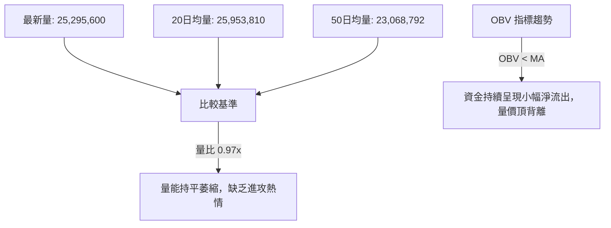

- **量價配合分析**：
  - 11-09 上漲收在 $545.18，但成交量僅 25.29M，較 11-04 衝擊高點時的 50.8M 萎縮了近 50%。
  - 量比僅 0.97x，OBV 趨勢明確指示「OBV < MA」，代表主力機構在 $540 以上追價意願消退。這種「無量拉升」在逼近 R1 $551.15 及前高 $559.15 時，極易引發高位多頭乏力跳水。

---

## 6. 動能與波動率

### ⚡ 動能評估四象限

| 象限代號 | 動能維度 | 波動維度 | 象限特徵 | 當前狀態評估 | 策略意涵 |
|----------|----------|----------|----------|--------------|----------|
| **象限 I** | 強動能 | 低波動 | 穩步單邊趨勢 | — | 最佳波段加碼機會 |
| **象限 II** | **弱動能** | **低波動** | **高位窄幅盤整** | **✓ MSFT 當前定位** | **謹慎觀望，區間高拋低吸** |
| **象限 III** | 強動能 | 高波動 | 突破爆發行情 | — | 順勢追擊，緊設止損 |
| **象限 IV** | 弱動能 | 高波動 | 劇烈洗盤震盪 | — | 容易雙巴，避免進場 |

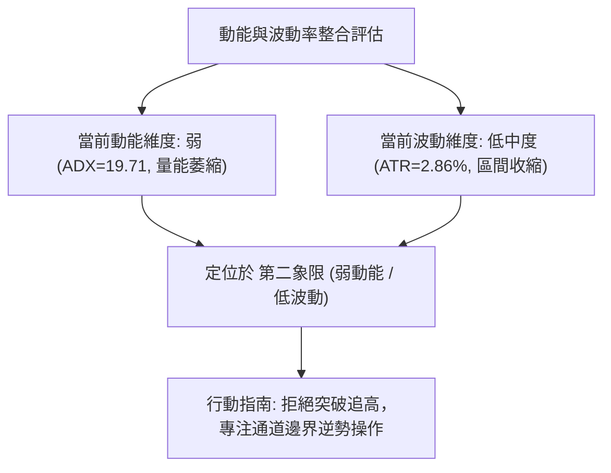

### 📊 ATR 波動率分析

- **ATR(14) 數值**：**$15.60**（佔股價比例 **2.86%**，Wilder 平滑計算）。
- **日內安全防護距離**：
  - **1.0 倍 ATR**：$15.60（短線波段容忍度，現價下移至 $529.58，剛好在 MA20 $531.61 附近）。
  - **1.5 倍 ATR**：$23.40（標準波段止損緩衝，現價下移至 $521.78，緊貼 10-30 低點）。
  - **2.0 倍 ATR**：$31.20（長線底線防守，現價下移至 $513.98，未破 S1 $504.96）。
- **ATR 意涵**：日均波幅約 15.6 美元，表示在設定止損點位時，至少必須保留 1.0–1.5 倍 ATR 的空間，否則極易被日內隨機噪聲掃出場。

### 📐 Beta 與市場相關性

- **Beta 係數**：**1.045**。
- **市場連動分析**：
  - Beta 接近 1.0，表明微軟與標普 500 指數及整體科技板塊呈現高度同頻共振。
  - 當前市場消息面顯示「科技股引領反彈，大盤追隨華爾街復甦」，這解釋了 MSFT 能在 11-09 跳空上漲；但由於 Beta 僅為 1.045，在缺乏自身特異性催化劑時，難以走出脫離大盤的獨立大暴漲行情。

---

## 7. 多時框架總結

### 📋 時框架評分表

| 時框架 | 趨勢方向 | 動能狀態 | 均線排列 | 圖表形態 | 綜合評分 | 交易建議導向 |
|--------|----------|----------|----------|----------|----------|--------------|
| **月線層級** | 🟢 強烈看多 | 🟡 動能高位放緩 | 🟢 MA200 遠在下方 ($439.26) | 長期上行旗形整理 | **80 / 100** | 核心底倉長線續抱 |
| **週線層級** | 🟢 震盪偏多 | 🟡 MACD微正/RSI 57.5 | 🟢 站穩各週均線 | 高位巨震十字星整理 | **65 / 100** | 逢低回調布局，不追高 |
| **日線層級** | 🟡 區間盤整 | 🔴 RSI頂背離/ADX 19.71 | 🟢 MA20>MA50 多頭排列 | 逼近布林通道上軌 | **55 / 100** | 區間交易，靠近阻力減磅 |

### 🔲 綜合訊號矩陣

```
時框架訊號交叉驗證矩陣
┌──────────────┬──────────────┬──────────────┬──────────────┐
│  時框 \ 指標 │   均線趨勢   │   動能指標   │   量價配合   │
├──────────────┼──────────────┼──────────────┼──────────────┤
│  長期 (月線) │  🟢 多頭排列  │  🟢 強勢多頭  │  🟡 量能常態  │
│  中期 (週線) │  🟢 偏多排列  │  🟡 震盪整理  │  🔴 放量收長影│
│  短期 (日線) │  🟢 多頭排列  │  🔴 頂部背離  │  🔴 OBV<MA量弱│
└──────────────┴──────────────┴──────────────┴──────────────┘
```

### ⚖️ 多時框收斂結論

嚴格遵守「嚴格要求 14」與「規則 18」進行多時框架收斂：

1. **行情性質判定**：當前 **ADX(14) = 19.71 < 25**，客觀判定為**「盤整行情（震盪市）」**。
2. **優先級收斂規則**：在盤整行情中，中長期的均線多頭排列僅代表「大方向不下跌」，而**日線層級的布林通道上下軌 ($511.20 - $552.02) 為主導實際交易的最高優先級區間**。
3. **最終唯一收斂結論**：**【中性偏多，高位箱體震盪】**。
   - 儘管均線排列（MA20>MA50>MA200）給出多頭底色，但受制於日線 ADX 弱勢、RSI 頂背離、量能萎縮及 BB 上軌 $552.02 的直接壓迫，股價不具備立即向上單邊突破創歷史新高的能量。
   - 第 8 章主策略將直接繼承此結論：以**區間箱體操作與回踩支撐低吸**為主，嚴禁追漲。

---

## 8. 交易策略建議

### 🗺️ 策略決策流程圖

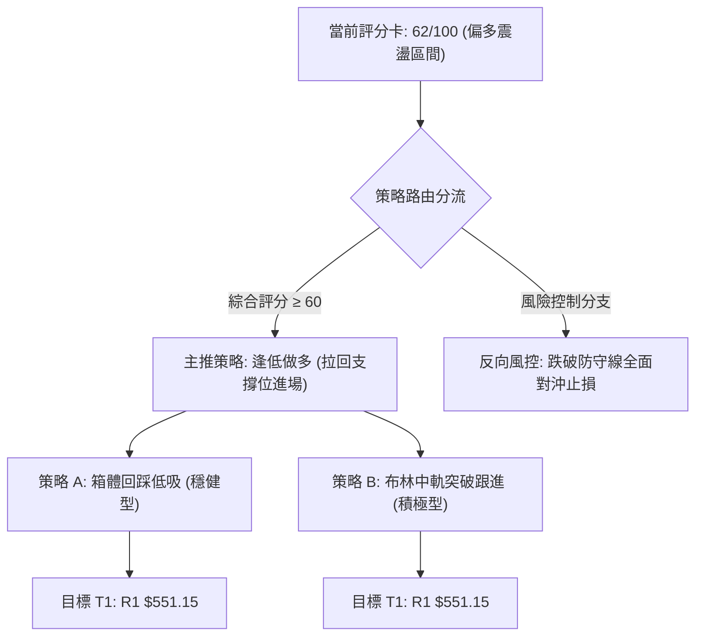

### 🧭 策略路由（依評分卡分流）

> **當前主策略方向 = 🟢 主推多頭回踩低吸策略（依綜合評分 62/100，處於 ≥60 偏多區間）**  
> 說明：鑑於 ADX<25 且 BB %B=0.83，主策略絕不追高，而是等待價格回踩關鍵支撐後低吸，做空僅列為「反轉風險觸發點（對沖提示）」。

### 🎯 價格情境階梯（Price Scenarios）

價位嚴格引用第 4 章數據與關鍵價位區塊已算出的數值：

| 觸發條件 | 下一目標 | 後續延伸 | 情境含義解讀 |
|----------|----------|----------|--------------|
| **強勢突破 R1 $551.15** | 52W High **$559.15** | 估算目標 $565.00 (N/A 數據未提供，以52W高點為限) | 多頭重啟主升浪，打破頂背離壓制 |
| **站穩現價 $545.18 區間** | R1 **$551.15** | BB上軌 **$552.02** | 窄幅區間拉鋸，等待市場進一步消息面指引 |
| **回踩跌破 MA20 $531.61** | MA50 **$517.28** | Fib 23.6% **$509.45** | 短線轉弱，向中期支撐帶尋求買盤承接 |
| **實質跌破 S1 $504.96** | S2 **$486.00** | S3 **$476.25** | 箱體頭部成形，多頭全面潰敗，中期轉空 |

### 📊 情境機率分佈

| 運行情境 | 發生機率 | 主要技術與量化依據 |
|----------|----------|--------------------|
| **高位箱體區間震盪** | **55%** | ADX=19.71 確立無趨勢行情，布林帶寬收口，成交量維持 0.97x 均量 |
| **回調測試中軌/MA50後反彈** | **30%** | RSI 出現頂背離，現價逼近上軌 $552.02 獲利了結賣壓沉重，需回踩蓄勢 |
| **帶量直接向上突破新高** | **15%** | 均線完美多頭排列，但缺乏超額量能支撐（OBV < MA），爆發概率偏低 |

### 🟢 主策略詳情

本報告制定兩套嚴格依據真實支撐阻力數值之交易方案（風險報酬比嚴格依規則 17 計算）：

| 策略要素 | 策略 A（穩健型：回踩 MA20 / 中軌低吸） | 策略 B（激進型：現價微調回踩即時進場） |
|----------|-----------------------------------------|-----------------------------------------|
| **交易邏輯** | 消化短期頂背離賣壓，等待價格回測均線支撐 | 順應日線跳空陽線動能，博弈衝擊阻力位 R1 |
| **進場條件** | 股價回踩 MA20 獲得支撐並出現 15分K 止跌訊號 | 開盤微幅回測不破 11-09 低點後跟進 |
| **進場價格** | **$531.61**（精確對齊 MA20 / BB中軌） | **$542.00**（位於現價與 11-09 低點 $538.70 之間） |
| **目標價 T1** | **$551.15**（引用阻力位 R1） | **$551.15**（引用阻力位 R1） |
| **目標價 T2** | **$559.15**（引用 52W High） | **$559.15**（引用 52W High） |
| **止損價格** | **$517.28**（精確對齊 MA50 生命線） | **$531.61**（精確對齊 MA20 支撐位） |
| **風險報酬比 (T1)** | **1 : 1.36（以 T1 計）**<br>計算式：$(551.15 - 531.61) \div (531.61 - 517.28) = 19.54 \div 14.33 = 1.36$ | **1 : 0.88（以 T1 計）**<br>計算式：$(551.15 - 542.00) \div (542.00 - 531.61) = 9.15 \div 10.39 = 0.88$ |
| **風險報酬比 (T2)** | **1 : 1.92（以 T2 計）**<br>計算式：$(559.15 - 531.61) \div (531.61 - 517.28) = 27.54 \div 14.33 = 1.92$ | **1 : 1.65（以 T2 計）**<br>計算式：$(559.15 - 542.00) \div (542.00 - 531.61) = 17.15 \div 10.39 = 1.65$ |
| **預估勝率** | **65%** | **52%** |
| **建議倉位** | **20% 資金總額** | **10% 資金總額** |

### 🔴 反向風險觸發點（對沖提示）

若行情未按預期運行，觸發下列條件時應果斷執行空頭對沖或清倉觀望：

1. **破位警報價**：收盤價若帶量跌破 **MA50 ($517.28)**，宣告短多結構瓦解。
2. **多殺多清算點**：若日K收盤實質跌破高位箱體頸線 **S1 ($504.96)**，將觸發潛在雙頂大幅回撤形態（理論下探目標 $454.77）。此時所有多單必須無條件止損，激進型交易者可反手建立空頭頭寸，下看 **S2 $486.00** 及 **S3 $476.25**。

### ⭐ 整體訊號強度評星

```
做多訊號強度：★★★☆☆  (3/5星 — 均線排列強，但指標背離且處於阻力位下方)
做空訊號強度：★★☆☆☆  (2/5星 — 僅屬背離回調，大趨勢未轉空)
整體可信度：  ★★★★☆  (4/5星 — 數據結構完整，價位聚類信號一致)
```

---

## 9. 風險提示與監控

### ✅ 關鍵監控指標 Checklist

```
╔════════════════════════════════════════════════════════════════╗
║                  MSFT 每日交易決策監控清單                     ║
╠════════════════════════════════════════════════════════════════╣
║ [ ] 阻力位突破監控：收盤價是否能放量帶實體突破 R1 $551.15       ║
║ [ ] 成交量確認：日成交量是否回升至 35M 以上 (當前僅 25.29M)     ║
║ [ ] 動態支撐防守：MA20 $531.61 在盤中是否發揮彈升支撐作用      ║
║ [ ] RSI 背離修復：RSI(14) 能否突破 65 站上超買區化解頂背離     ║
║ [ ] ADX 趨勢強度：ADX 是否自 19.71 向上突破 25 迎來單邊趨勢    ║
║ [ ] 箱體底線防守：波段低點 S1 $504.96 絕對不容收盤失守        ║
╚════════════════════════════════════════════════════════════════╝
```

### ⚠️ 風險場景分析

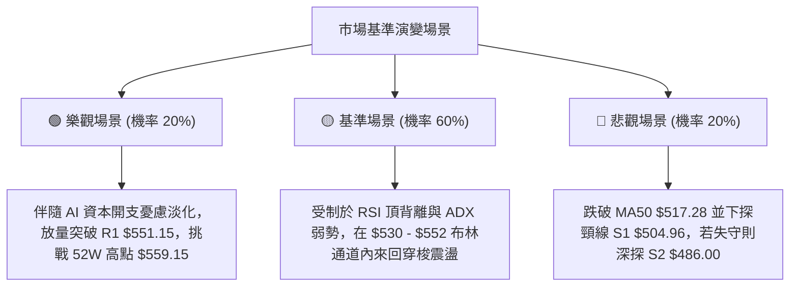

### 🛡️ 風險管理重要提醒

1. **倉位管控原則**：鑑於 ADX 為 19.71（震盪行情），整體股票曝險倉位應嚴格控制在總資金的 **30% - 40%** 以內，切忌滿倉追逐破位上漲。
2. **波動率緩衝設置**：以 ATR $15.60 為基準，防守點位與現價之間至少須保留 1.0 倍 ATR（約 $16 美元）之彈性，防止在震盪行情中遭虛破洗盤洗出場。
3. **宏觀基本面事件風險**：近期新聞提及「資料中心建設開支擔憂」與「AI 監管問題」，微軟作為資本支出高達 $135.92B 的巨頭，市場對其 FCF 收益率（1.48%）較為敏感，需嚴密跟蹤基本面消息引發的突發性技術破位。

---

## 📋 報告總結

```
MSFT 技術分析報告總結
════════════════════════════════════════════════════════
報告日期：2026-11-10
當前價格：$545.18
分析評級：⚖️ 偏多高位箱體震盪（綜合技術評分：62 / 100）

關鍵結論：
├─ 長期趨勢：🟢 宏觀多頭格局，股價穩居 MA200 ($439.26) 之上
├─ 中期趨勢：🟢 週線多頭排列完整，但受制於 $551.15 高位壓力
├─ 短期趨勢：🟡 ADX=19.71 呈現弱趨勢震盪，RSI 出現頂背離
├─ 關鍵支撐：MA20 ($531.61) / MA50 ($517.28) / S1 ($504.96)
├─ 關鍵阻力：R1 ($551.15) / 52W High ($559.15)
└─ 分析師目標：華爾街共識目標價 $636.12 (最高 $870.00 / 最低 $440.00)

最優策略組合：
1. 🥇 最佳機會：策略 A — 耐心等待股價回踩 MA20 $531.61 低吸做多
              (止損設於 MA50 $517.28，T1 目標 $551.15，風報比 1:1.36)
2. 🥈 次選機會：區間交易 — 於 BB上軌 $552.02 / R1 $551.15 附近了結多單
3. 🥉 保守選擇：場外觀望，等待日線放量收盤站穩 $551.15 或回測 $510 再行介入
════════════════════════════════════════════════════════
```

---

> ⚠️ **免責聲明**：本報告為技術分析研究，所有數據、圖表及估算均基於所提供的歷史交易資訊客觀計算。本報告**僅供研究與學術參考**，**不構成任何直接投資買賣建議**。金融市場瞬息萬變，投資有風險，操作需具備獨立思考與嚴格風控紀律。

---

*報告生成時間：2026-11-10 ｜ 數據來源：Yahoo Finance ｜ 分析框架：多時框量化技術分析*