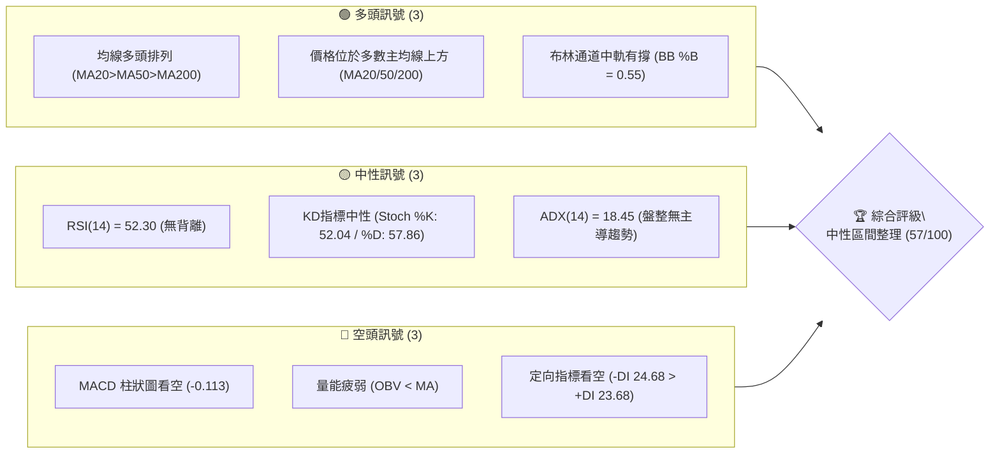
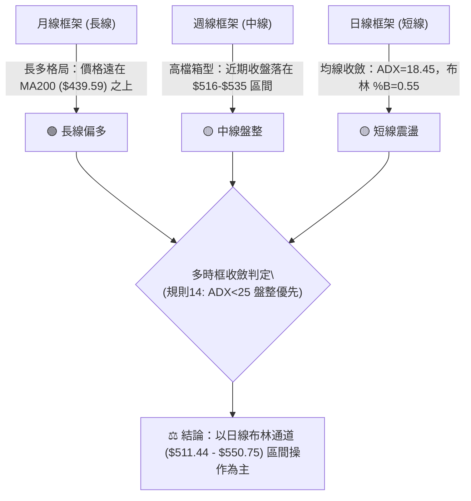
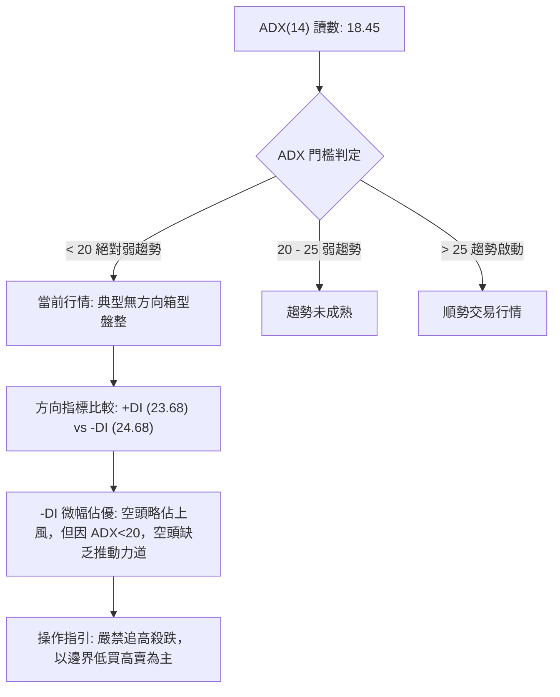
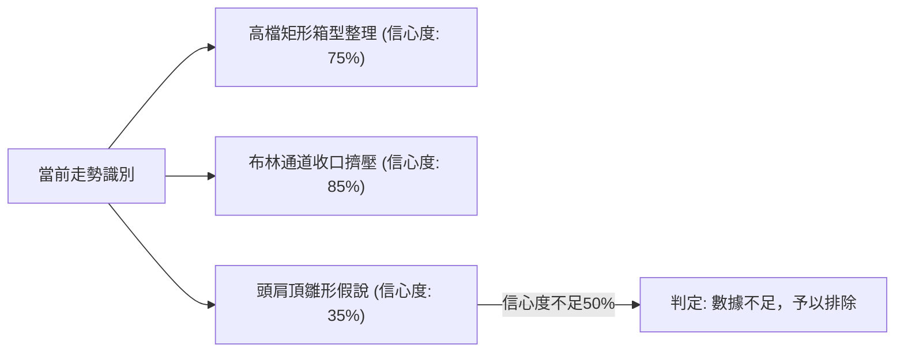
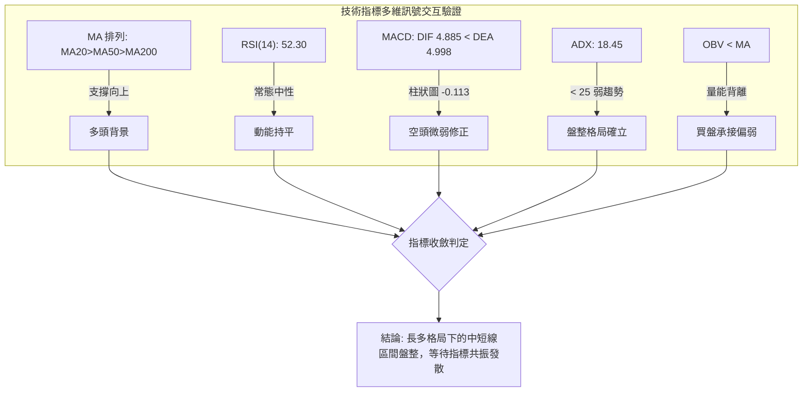
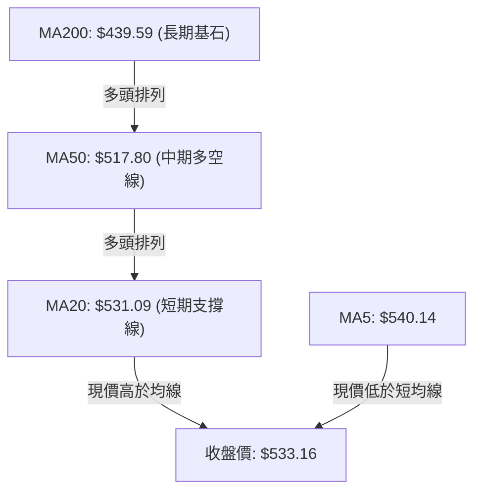
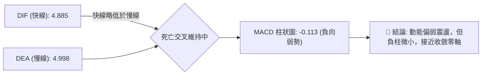
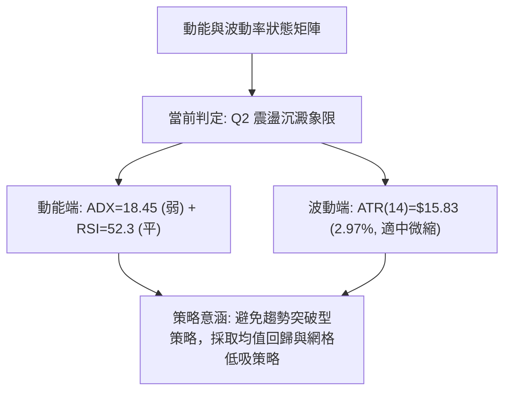
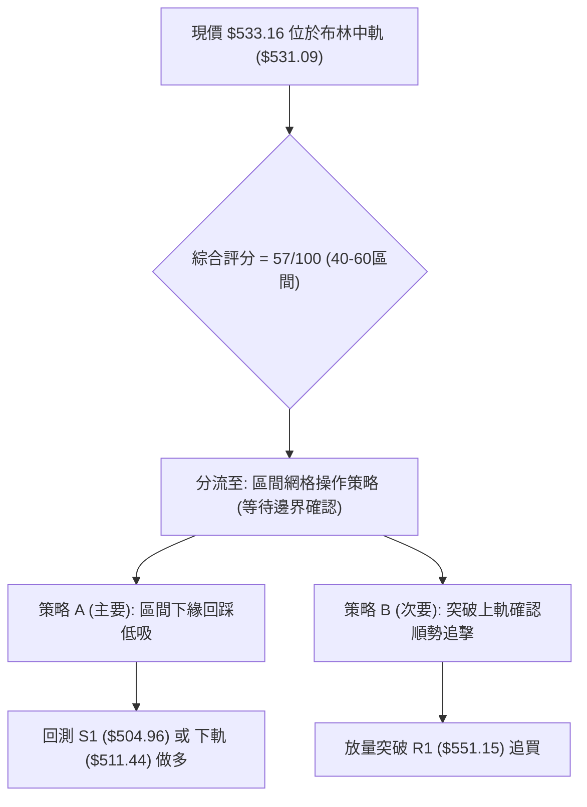
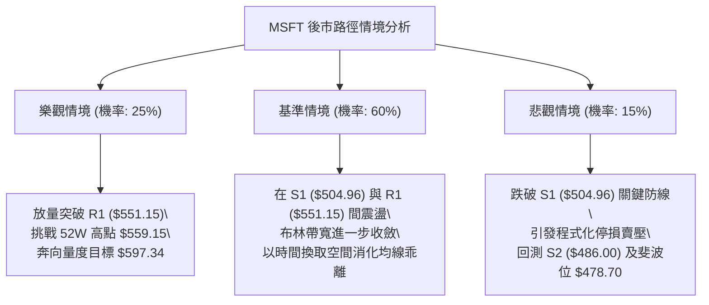

# MSFT 技術分析報告

> **報告日期**：2026-11-11 ｜ **語言**：繁體中文 ｜ **數據來源**：Yahoo Finance ｜ **當前價格**：$533.16

---

## 目錄

| 章節 | 內容 |
|------|------|
| [1. 技術面概覽](#1-技術面概覽) | 訊號儀表板、核心指標、評分卡 |
| [2. 趨勢分析](#2-趨勢分析) | 多時框趨勢、長中短期走勢 |
| [3. 圖表形態分析](#3-圖表形態分析) | 形態識別、K線組合、目標價 |
| [4. 支撐與阻力](#4-支撐與阻力) | 關鍵價位、斐波那契回調 |
| [5. 技術指標深度解讀](#5-技術指標深度解讀) | MA/RSI/MACD/布林/成交量 |
| [6. 動能與波動率](#6-動能與波動率) | 動能評估、ATR、Beta |
| [7. 多時框架總結](#7-多時框架總結) | 時框架評分矩陣 |
| [8. 交易策略建議](#8-交易策略建議) | 多空策略、風險報酬比 |
| [9. 風險提示與監控](#9-風險提示與監控) | 監控指標、風險場景 |

---

## 1. 技術面概覽

### 🎯 技術訊號儀表板



### 📊 核心指標速覽表

| 指標類別 | 指標名稱 | 當前數值 | 訊號 | 解讀 |
|----------|----------|----------|------|------|
| **價格** | 當前價格 | $533.16 | 🟢 | 高於 MA20、MA50、MA200，處於 52 週高低區間 87.7% 高檔位置 |
| **均線** | MA20 | $531.09 | 🟢 | 價格在 MA20 上方 (+0.39%)，短期均線有微幅支撐 |
| **均線** | MA50 | $517.80 | 🟢 | 價格在 MA50 上方 (+2.97%)，中期生命線穩健向上 |
| **均線** | MA200 | $439.59 | 🟢 | 價格在 MA200 上方 (+21.29%)，長期多頭基調穩固 |
| **動能** | RSI(14) | 52.30 | 🟡 | 位於 30–70 中性常態區間，買賣力量均衡，無背離現象 |
| **動能** | MACD (12,26,9) | 4.885 / 4.998 | 🔴 | DIF 線略低於 DEA 線，MACD 柱狀圖為 -0.113，短線動能偏空 |
| **動能** | DMI / ADX | ADX: 18.45 | 🟡 | ADX < 25 表明為盤整無趨勢格局；-DI (24.68) 微幅高於 +DI (23.68) |
| **通道** | 布林通道 | $511.44–$550.75 | 🟡 | %B = 0.55，收盤價緊貼中軌上方，通道帶寬收斂 |
| **量能** | OBV / 量比 | 26.90M (1.03x) | 🔴 | 日量持平於20日均量，但 OBV < MA，波段累計能量呈現疲弱背離 |
| **波動** | ATR(14) | $15.83 | 🟡 | 佔現價 2.97%，波動幅度適中，盤整壓縮特徵顯著 |

### 🏆 技術評分卡

```
╔══════════════════════════════════════════════════════════════════╗
║                 技術評分卡 — MSFT (2026-11-11)                  ║
╠══════════════════════════════════════════════════════════════════╣
║ 趨勢強度 (ADX=18.45, 盤整弱勢)   ████████░░░░░░░░░░░░  40/100 🔴 ║
║ 動能指標 (RSI=52.3, MACD柱=-0.11)██████████░░░░░░░░░░  50/100 🟡 ║
║ 支撐穩定度 (S1=$504.96/MA50有守) ██████████████░░░░░░  70/100 🟢 ║
║ 成交量配合 (OBV<MA, 量能疲弱)    ████████░░░░░░░░░░░░  40/100 🔴 ║
║ 形態完整度 (區間箱型震盪整理)    ████████████░░░░░░░░  60/100 🟡 ║
║ 均線排列 (MA20>MA50>MA200多頭)   ████████████████░░░░  80/100 🟢 ║
╠══════════════════════════════════════════════════════════════════╣
║ 綜合評分 (六項算術平均：340÷6)   ███████████░░░░░░░░░  57/100 🟡 ║
║ 評級結論：中性偏多觀望 (區間震盪整理，等待布林突破)               ║
╚══════════════════════════════════════════════════════════════════╝
```

---

## 2. 趨勢分析

### 🌐 多時框趨勢分析



### 📈 長期趨勢 — 12個月走勢圖（Unicode）

依據月度歷史收盤價繪製之 12 個月走勢圖（2025-12 至 2026-11）：

```
MSFT 月線走勢圖（過去12個月：2025-12 至 2026-11）
價格軸 ($)
$540 ┤                                                 ● $533.16 (現價)
$520 ┤                                           ●     │
$500 ┤                                     ●     │     │
$480 ┤ ● $480.57                           │     │     │
$460 ┤ │                             ●     │     │     │
$440 ┤ │                       ●     │     │     │     │
$420 ┤ │     ● $427.58         │     │     │     │     │
$400 ┤ │     │     ● $391.15   │     │     │     │     │
$380 ┤ │     │     │     ●     │     │     │     │     │
$360 ┤ │     │     │     │     │     ● $372.32   │     │
$340 ┤ ┼─────┼─────┼─────┼─────┼─────┼─────┼─────┼─────┼────────────
       12    01    02    03    04    05    06    07    08    09    10    11
     (2025)                      (2026 年月份)
     低點：$368.68 (2026-03) ────► 52W高點：$559.15 (盤中) / 收盤最高 $533.16
```

**走勢特徵分析表格**：

| 階段區間 | 起始收盤 | 結束收盤 | 漲跌幅 (%) | 趨勢特徵描述 |
|----------|----------|----------|------------|--------------|
| **2025-12 ~ 2026-03** | $480.57 | $368.68 | -23.28% | **波段深度下殺**：自高檔連續拉回，於 2026-03 見低點 $368.68（52週低點為 $348.54）。 |
| **2026-03 ~ 2026-05** | $368.68 | $449.39 | +21.89% | **第一波反彈修復**：強勁 V 型修復，站回 400 元大關。 |
| **2026-05 ~ 2026-06** | $449.39 | $372.32 | -17.15% | **二次探底打底**：回測 $370 附近完成雙重底打底結構。 |
| **2026-06 ~ 2026-08** | $372.32 | $507.29 | +36.25% | **主升浪突破**：爆量急拉，一舉收復所有均線，突破 500 元心理關卡。 |
| **2026-08 ~ 2026-11** | $507.29 | $533.16 | +5.10% | **高檔收斂箱型**：漲勢放緩，在 $505–$550 展開橫盤消化套牢籌碼。 |

### 📊 中期趨勢（週線分析）

從近 20 週收盤走勢可見，價格在 2026-07 突破後，近 8 週收盤價始終緊鎖在 $516.17 至 $535.07 狹幅區間：

```
中期週線壓力與支撐示意圖：
$559.15 ┬─────────────────────────────── 52W 盤中歷史最高價 (阻力上限)
$551.15 ┼─────────────────────────────── 近一年波段高點聚類 (R1 關鍵阻力)
        │       ┌──┐            ┌──┐    
        │   ┌───┤  ├───┐    ┌───┤  ├───  現價 $533.16 位於中軸盤整帶
$531.09 ┼───┴───┴──┴───┴────┴───┴──┴─── 週布林/日MA20 中軸支撐
        │                               
$504.96 ┴─────────────────────────────── 波段低點聚類 (S1 關鍵防線)
```

週線 MACD 柱狀圖從 2026-08-07 的 +11.272 大幅消退至當前的 -0.113，表明中期上升動能已完全進入休眠狀態，多空在此進入拉鋸互持的無趨勢階段。

### ⚡ 趨勢強度評估（ADX 解讀）



**ADX 趨勢強度對照表**：

| 指標項 | 當前數值 | 參考標準 | 當前狀態判定 | 交易涵義 |
|--------|----------|----------|--------------|----------|
| **ADX(14)** | **18.45** | < 20: 盤整 / > 25: 趨勢 | **絕對無趨勢盤整** | 順勢指標失效，均線糾結，避免追突破 |
| **+DI(14)** | **23.68** | 多方攻擊力道 | **弱勢均衡** | 多頭上攻能量不足，未能突破 25 |
| **-DI(14)** | **24.68** | 空方打壓力道 | **微幅領先** | 空方略勝一籌，但並未構成單邊壓制 |
| **DI 差值** | **-1.00** | 絕對值 > 10 具趨勢性 | **勢均力敵** | 多空雙方於現價 $533 展開陣地戰 |

---

## 3. 圖表形態分析

### 🔍 形態識別系統



**圖表形態識別與信心度評估表**：

| 形態名稱 | 信心度 | 判斷依據（引用數據） | 完成度 | 目標價（附計算式） |
|----------|--------|----------------------|--------|--------------------|
| **高檔矩形箱型整理** | **75%** | 價格在區間下緣波段低點 S1 ($504.96) 與上緣波段高點 R1 ($551.15) 之間來回震盪超過8週。 | **85%** | 箱體高度 = $551.15 - $504.96 = $46.19。<br>向上突破目標 = $551.15 + $46.19 = **$597.34**<br>向下跌破目標 = $504.96 - $46.19 = **$458.77** |
| **布林帶寬收斂擠壓** | **85%** | BB 上軌 $550.75 與下軌 $511.44 帶寬收縮至 7.37%，價格緊貼中軌 $531.09。 | **90%** | 指標型形態：中軌 $531.09 守穩，目標上軌 **$550.75**；失守目標下軌 **$511.44**。 |
| **潛在頭肩頂雛形** | **35%** | 左肩 10-16 高 $551.15，頭部 11-04 高 $559.15，頸線約在 $504.96，但右肩尚未成形且無右側跌破。 | **30%** | 訊號不足（信心度 < 50%），依規則 15 不予採納為主要交易依據。 |

### 🕯️ 重要K線形態分析

依規則 19，僅使用數據中「近 10 根日 K」與「近 8 根週 K」實際數據進行分析：

**近 10 根日 K 線形態解讀表**：

| 日期 (日K) | 開盤 | 最高 | 最低 | 收盤 | 成交量 | K線形態名稱 | 專業解讀與訊號 | 訊號 |
|------------|------|------|------|------|--------|-------------|----------------|------|
| 2026-10-28 | 531.82 | 535.00 | 526.14 | 531.01 | 28,594,200 | 十字星線 (Doji) | 開收幾近同價，上下影線均衡，多空膠著。 | 🟡 |
| 2026-10-29 | 540.22 | 541.29 | 519.56 | 530.14 | 39,333,200 | 長黑實體夾長下影 | 帶量下殺後見買盤支撐，高檔出脫壓力顯現。 | 🔴 |
| 2026-10-30 | 525.27 | 526.00 | 514.35 | 521.91 | 35,652,000 | 延續性黑K | 延續跌勢收於低位，測試短期下檔均線。 | 🔴 |
| 2026-11-02 | 524.02 | 529.63 | 504.96 | 507.12 | 34,743,300 | 實體大陰線 | 跌破 510，盤中下探波段關鍵低點 S1 ($504.96)。 | 🔴 |
| 2026-11-03 | 509.01 | 523.44 | 507.82 | 520.99 | 20,010,200 | 底部反彈陽線 | 守住 S1 低點後向上反彈，縮量回補。 | 🟢 |
| 2026-11-04 | 543.70 | 559.15 | 542.30 | 555.80 | 50,807,800 | 跳空放量長紅棒 | 跳空高開並爆量 50.8M 創 52W 高點 $559.15，多方極盛。 | 🟢 |
| 2026-11-05 | 554.94 | 557.62 | 532.68 | 535.93 | 42,507,900 | 帶量避雷針中長黑 | 高檔創高後遭遇巨量拋壓，長上影線顯示獲利了結。 | 🔴 |
| 2026-11-06 | 525.69 | 538.33 | 524.47 | 530.61 | 26,956,400 | 低開回升陽線 | 開盤回測中軌後企穩拉升，多頭防守中軌。 | 🟡 |
| 2026-11-09 | 544.49 | 548.28 | 538.70 | 545.18 | 25,337,400 | 溫和實體紅K | 量能溫和縮減，價格再度逼近上軌阻力區。 | 🟢 |
| 2026-11-10 | 542.98 | 544.19 | 526.37 | 533.16 | 26,902,100 | 長下影中陰線 | 盤中下探 $526.37 後收腳於 MA20 ($531.09) 之上。 | 🟡 |

**近 8 根週 K 線形態解讀表**：

| 日期 (週K) | 開盤 | 最高 | 最低 | 收盤 | 成交量 | K線形態名稱 | 專業解讀與訊號 | 訊號 |
|------------|------|------|------|------|--------|-------------|----------------|------|
| 2026-09-25 | 494.95 | 519.40 | 491.22 | 516.17 | 123,909,000 | 突破中長紅K | 放量突破 510 關卡，奠定高檔震盪箱底。 | 🟢 |
| 2026-10-02 | 505.47 | 522.85 | 502.22 | 517.53 | 105,746,200 | 高檔十字整理線 | 量縮盤整，多空暫歇。 | 🟡 |
| 2026-10-09 | 521.62 | 537.22 | 518.79 | 535.07 | 103,231,800 | 推進實體紅K | 續創波段收盤新高，動能維持溫和。 | 🟢 |
| 2026-10-16 | 537.53 | 551.15 | 524.43 | 529.05 | 113,488,100 | 倒狀錘頭帶上影 | 衝擊 R1 ($551.15) 未果回落，留下明顯賣壓。 | 🔴 |
| 2026-10-23 | 528.70 | 535.57 | 515.70 | 524.51 | 81,449,100 | 量縮小陰K | 連續兩週回檔，量能顯著萎縮。 | 🔴 |
| 2026-10-30 | 527.40 | 541.29 | 514.35 | 521.91 | 142,132,700 | 帶量下探十字黑K | 放量測試下檔均線支撐，買賣換手激烈。 | 🟡 |
| 2026-11-06 | 524.02 | 559.15 | 504.96 | 530.61 | 175,025,600 | 巨幅震盪紡錘線 | 爆量涵蓋 52W 高低點 ($559.15/$504.96)，洗盤劇烈。 | 🟡 |
| 2026-11-10 | 544.49 | 548.28 | 526.37 | 533.16 | 52,239,500 | 壓縮孕線 (部分週) | 波動範圍完全包覆於前週之內，待方向確認。 | 🟡 |

### 📉 ASCII 走勢形態示意圖

近期日線高檔矩形箱體與 11-04 假突破形態示意：

```
$559.15 ┬───────────────────── ▲ 2026-11-04 假突破高點 (衝高回落)
        │                     ││
$551.15 ┼─[ 箱體頂部 R1 ]─────┼┼─────────────── 阻力上限
        │     ┌─┐             ││       ┌─┐
        │   ┌─┘ └─┐           ││     ┌─┘ └─┐ ◄ 2026-11-09 高點 $548.28
        │   │     │           ││     │     │
$533.16 ┼───┼─────┼───────────┼┼─────┼─────● ◄ 現價 $533.16 (箱體中樞)
        │   │     │   ┌─┐     ││ ┌─┐ │     
$517.80 ┼───┼─────┼───┘ └───┐ ││ │ └─┘     ◄ MA50 生命線
        │   │     │         │ ││ │
$504.96 ┴─[ 箱體底部 S1 ]───┴─┴┴─┴─────────── 關鍵波段支撐 (2026-11-02 守住)
```

### 🎯 形態目標價計算

根據上述已確認之「高檔矩形箱型」進行對稱等幅量度計算：

1. **頸線（箱體邊界）定義**：
   - 上邊界阻力線：$551.15（R1 波段高點）
   - 下邊界支撐線：$504.96（S1 波段低點）
2. **形態高度 ($H$)**：
   $$H = \text{箱頂 } \$551.15 - \text{箱底 } \$504.96 = \$46.19$$
3. **向上突破量度目標價**：
   $$\text{目標價 } T_{\text{up}} = \text{箱頂 } \$551.15 + H (\$46.19) = \$597.34$$
4. **向下跌破量度目標價**：
   $$\text{目標價 } T_{\text{down}} = \text{箱底 } \$504.96 - H (\$46.19) = \$458.77$$

---

## 4. 支撐與阻力

### 🗺️ 關鍵價位分布圖（Unicode）

```
MSFT 價位結構分布圖 (由 OHLCV 聚類計算)
═════════════════════════════════════════════════════════════════════
$559.15 ║██████████████████████████████║ 52週歷史高點 / 斐波那契 0.0%
$551.15 ║████████████████████████      ║ 強阻力 R1 (近一年波段高點聚類)
$550.75 ║▓▓▓▓▓▓▓▓▓▓▓▓▓▓▓▓▓▓            ║ 布林通道上軌
$533.16 ╠══════════════════════════════╣ ◄ 當前收盤價 ($533.16)
$531.09 ║░░░░░░░░░░░░░░░░░░░░          ║ 短期均線 MA20 / 布林中軌
$517.80 ║░░░░░░░░░░░░░░                ║ 中期趨勢線 MA50
$511.44 ║▓▓▓▓▓▓▓▓▓▓▓▓                  ║ 布林通道下軌
$509.45 ║████████████████              ║ 斐波那契 23.6% 回調位
$504.96 ║██████████████████████        ║ 關鍵支撐 S1 (近一年波段低點聚類)
$486.00 ║████████████████              ║ 中期支撐 S2 (波段低點聚類)
$478.70 ║████████████                  ║ 斐波那契 38.2% 回調位
$476.25 ║████████████████████          ║ 強防守支撐 S3 (波段低點聚類)
═════════════════════════════════════════════════════════════════════
```

### 🚧 阻力位分析表

依據數據庫中已計算之波段高點聚類與 OHLCV 指標：

| 阻力級別 | 價位 | 形成原因 | 突破難度 | 重要性 |
|----------|------|----------|----------|--------|
| **R1** | **$551.15** | 近一年波段高點聚類（2026-10-16 週高點 $551.15 及日線密集套牢區） | 🔴 極高 | 關鍵高檔分水嶺，突破方能打開挑戰 52W 高點 $559.15 空間 |
| **R2** | N/A（數據未提供） | 數據中未偵測到 R2 價位，以 52W 高點 **$559.15** 作為延伸阻力 | 🔴 極高 | 52 週最高極值，11-04 衝擊後爆量留長黑 |
| **R3** | N/A（數據未提供） | 數據中未偵測到 R3 價位，以箱體等幅目標 **$597.34** 為遠端參考 | 🔴 極高 | 形態量度目標位 |

### 🛡️ 支撐位分析表

依據數據庫中「關鍵價位」區塊波段低點聚類計算：

| 支撐級別 | 價位 | 形成原因 | 守住機率 | 重要性 |
|----------|------|----------|----------|--------|
| **S1** | **$504.96** | 近一年波段低點聚類（2026-11-02 日低點 $504.96，多次回測不破） | 🟢 75% | 多頭防守第一道大門，跌破則箱體架構瓦解 |
| **S2** | **$486.00** | 近一年波段低點聚類（8月回調低點 $483.24 聚類中樞） | 🟡 85% | 中級修正關鍵支撐位，接近 MA120 ($464.70) 緩衝帶 |
| **S3** | **$476.25** | 近一年波段低點聚類（與斐波那契 38.2% 位 $478.70 形成雙重支撐） | 🟢 90% | 長期多頭防線，不可失守之鐵底 |

### 📐 斐波那契回調位分析

基準區間：52 週低點 **$348.54** 至 52 週高點 **$559.15**，波段總垂直振幅為 $210.61。

| 斐波那契回調層級 | 計算價位 | 當前相對位置 | 技術涵義解讀 |
|------------------|----------|--------------|--------------|
| **0.0% (52W High)** | **$559.15** | 現價下方 -4.65% | 歷史極限阻力位，需強勁催化劑方能越過。 |
| **23.6% 回調位** | **$509.45** | 現價下方 -4.45% | **強勢回調臨界點**。現價 $533.16 位於 0.0% 與 23.6% 之間極高位。 |
| **38.2% 回調位** | **$478.70** | 現價下方 -10.21% | 正常回調分界線，與 S3 支撐 ($476.25) 形成重疊共振支撐區。 |
| **50.0% 回調位** | **$453.85** | 現價下方 -14.88% | 中樞平衡點，接近 MA240 ($445.39)。 |
| **61.8% 回調位** | **$429.00** | 現價下方 -19.54% | 黃金分割強支撐，長期多空趨勢牛熊轉換線。 |
| **78.6% 回調位** | **$393.61** | 現價下方 -26.17% | 深度回調極限。 |
| **100.0% (52W Low)**| **$348.54** | 現價下方 -34.63% | 52 週低點。 |

**現價落點解讀**：
當前收盤價 **$533.16** 運行於 **0.0% ($559.15)** 與 **23.6% ($509.45)** 的極高檔強勢區間。股價回調幅度甚至未達 23.6% 黃金分割位，彰顯中期多方架構極具抗跌韌性。只要價格維持在 $509.45 之上，任何短期回檔皆屬於多頭強勢整理。

---

## 5. 技術指標深度解讀

### 🎛️ 指標訊號總覽



### 📈 移動平均線排列分析



**移動平均線體系詳解表**：

| 均線名稱 | 數值 | 價格相距 | 均線走勢軌跡 | 多空狀態 | 技術解讀 |
|----------|------|----------|--------------|----------|----------|
| **MA5** | $540.14 | -1.29% | ▁▁▁▂▃▄▅▅▆▇▇██▇▇ (下彎) | 🔴 短線下彎 | 近 5 日沖高回落，短線受制於 5 日線阻力 |
| **MA10** | $531.18 | +0.37% | ▁▁▂▂▃▄▄▅▆▇▇██████ (走平) | 🟢 支撐有守 | 短線跌勢放緩，在 10 日線獲承接 |
| **MA20** | $531.09 | +0.39% | ▁▁▁▁▂▂▂▃▃▄▅▅▆▆▆▇ (微揚) | 🟢 短多支撐 | 價格穩守 20 日線，布林中軌支撐有效 |
| **MA50** | $517.80 | +2.97% | ▁▁▂▂▃▄▄▅▆▇▇██████ (上揚) | 🟢 中期看多 | 中期多頭防線，回測提供強力買盤保護 |
| **MA60** | $513.66 | +3.80% | ▁▁▁▂▂▂▃▃▄▄▄▅▅▆▆▇▇ (上揚) | 🟢 季線支撐 | 季線穩健推升，支撐高於下軌 $511.44 |
| **MA120**| $464.70 | +14.73%| ▁▁▁▁▂▂▂▃▃▃▃▄▄▄▄▅ (上揚) | 🟢 半年線健康 | 半年線陡峭上揚，確認中期波段趨勢 |
| **MA200**| $439.59 | +21.29%| ▁▁▁▁▁▁▁▁▁▂▁▂▂▂▂ (上揚) | 🟢 牛市生命線 | 乖離率 +21.29%，長期牛市基調穩固 |

### 📉 RSI(14) 分析

當前數值：**52.30**（Wilder 計算方法）。

```
RSI(14) 數值儀表板：
0                      30              50    52.30         70                    100
├──────────────────────┼───────────────┼───────●───────────┼──────────────────────┤
│       超賣區間       │      弱勢區   │  中性平衡帶   │       強勢區         │       超買區間       │
[░░░░░░░░░░░░░░░░░░░░░░]               [████████░░░░░░░░░░]
```

- **超買超賣判定**：數值 52.30 位於 30 至 70 之絕對中性區間，多空力量處於完全均勢狀態。
- **背離判斷**：
  - 根據近 20 根 K 棒首尾與指標比對，RSI 在 50 上下收斂震盪，**無明顯頂背離或底背離**。
  - 週線 RSI 從 2026-08-07 的 78.1 高檔順利降溫至當前的 52.3，已成功化解中長線指標超買風險。

### 📊 MACD(12/26/9) 訊號解讀



- **數值狀態**：DIF 4.885，DEA 4.998，差值（Histogram）為 **-0.113**。
- **解讀**：DIF 雖仍維持在零軸上方的高位，代表大級別多頭趨勢仍在，但快線死叉慢線，柱狀圖在零軸下方微幅擴展，顯示日線級別仍處於動能修正的洗盤階段，尚未見到底部轉折的金叉訊號。

### 📦 布林通道分析

布林帶參數 (20, 2)：
- **BB 上軌**：$550.75
- **BB 中軌 (MA20)**：$531.09
- **BB 下軌**：$511.44
- **當前收盤價**：$533.16
- **帶寬 (%B)**：0.55

```
布林通道當前位置 ASCII 示意圖：
$550.75 ┬────────────────────────────────────────── 上軌 (壓力區)
        │
        │
$533.16 ┼─────────────────● (現價, %B = 0.55)
$531.09 ┼────────────────────────────────────────── 中軌 MA20 (支撐區)
        │
        │
$511.44 ┴────────────────────────────────────────── 下軌 (超賣防線)
```

- **通道形態解讀**：帶寬顯著壓縮，%B 值為 0.55，說明現價自中軌微幅起跳，徘徊於中軌至上軌的上半部常態通道中。通道走平且收窄，高度符合盤整特徵，暗示新一輪變盤突破即將到來。

### 💹 成交量分析（量價配合度）

- **量比指標**：最新成交量 26,902,100 股，相較於 20 日均量 26,108,405 股，量比為 **1.03x**，成交量處於常態水準。
- **50 日均量對比**：50 日均量為 23,063,492 股，近期整體交易熱度略高於中期平均。
- **OBV（能量潮）分析**：數據顯示 **OBV < MA**。在股價高位徘徊 $533 的過程中，OBV 未能領先創高反而跌破其移動平均線，呈現出「價平量縮、量能隱性背離」的疲弱跡象。這表明主流機構大資金在突破前夕保持審慎，並未進行激進的突破性加倉。

---

## 6. 動能與波動率

### ⚡ 動能評估四象限

| 象限 | 動能維度 (Momentum) | 波動維度 (Volatility) | 當前判定 | 特徵與操作評估 |
|------|----------------------|-----------------------|----------|----------------|
| **Q1 (最佳順勢)** | 強動能 (ADX>25, MACD柱>0) | 低波動 (ATR%<2%) | — | 穩定單邊趨勢，最安全持倉階段 |
| **Q2 (震盪沉澱)** | **弱動能 (ADX=18.45, MACD柱=-0.11)** | **低/中波動 (ATR%=2.97%)** | **✓ (當前狀態)** | **動能沉澱、波幅壓縮，宜區間低吸高拋，謹慎觀望** |
| **Q3 (極限博弈)** | 強動能 (單邊大陽線) | 高波動 (ATR%>4%) | — | 主升浪或主跌浪，高收益伴隨高滑點 |
| **Q4 (混亂洗盤)** | 弱動能 (無主導方向) | 高波動 (無序巨震) | — | 假突破頻繁，嚴格禁止參與 |



### 📊 ATR 波動率分析

- **ATR(14) 數值**：**$15.83**（佔當前股價之 2.97%，Wilder 平滑法）。
- **日內波動區間參考**：MSFT 目前正常單日上下波動空間約為 ±$15.83。
- **風控止損距離建議**：
  - **保守型（波段交易）**：建議給予 2.0 × ATR = **$31.66** 的緩衝空間。
  - **激進型（短線區間）**：建議給予 1.0 × ATR = **$15.83** 的嚴格止損點。

### 📐 Beta 與市場相關性

- **Beta 係數**：**1.045**。
- **大盤相關性解讀**：MSFT 與標普 500 指數（S&P 500）及那斯達克 100 指數（QQQ）保持高度同步（幾乎等比例 1:1.045 聯動）。其短期震盪整理很大程度上受到整體科技權值股板塊的修整影響，個股特異性風險偏低，系統性市場風險主導其短線走勢。

---

## 7. 多時框架總結

### 📋 時框架評分表

| 時框架 | 趨勢方向 | 動能狀態 | 均線排列 | 圖表形態 | 綜合評分 | 建議方向 |
|--------|----------|----------|----------|----------|----------|----------|
| **長線 (月線)** | 🟢 多頭推升 | 🟢 充沛強勁 | 🟢 多頭排列 | 巨型階梯突破 | **85/100** | 長線波段堅定持有 |
| **中線 (週線)** | 🟡 高檔整理 | 🟡 動能消退 | 🟢 多頭支撐 | 箱型高檔震盪 | **60/100** | 區間震盪，逢低吸納 |
| **短線 (日線)** | 🟡 橫盤拉鋸 | 🔴 MACD柱翻黑 | 🟡 均線收斂 | 布林通道壓縮 | **50/100** | 中性觀望，高拋低吸 |

### 🔲 綜合訊號矩陣

```
時框維度        長線 (月K)        中線 (週K)        短線 (日K)       訊號一致性評估
─────────────────────────────────────────────────────────────────────────────
價格 vs MA      ● 遠高於MA200     ● 高於MA20週      ● 貼合MA20日     🟢 高度一致 (多頭基底)
動能指標        ● 月MACD金叉      ● 週MACD柱走低    ● 日MACD負向     🔴 存在衝突 (短線修正)
成交量能        ● 歷史充沛        ● 週量持平        ● OBV<MA量弱     🟡 部分背離 (量價猶豫)
通道位置        ● 上軌運行        ● 中上軌之間      ● 中軌上方(%B=0.55)🟢 一致穩定 (支撐未破)
─────────────────────────────────────────────────────────────────────────────
整體收斂結論：中長期牛市完全未破壞，短線陷入低波動盤整，日線等級為健康洗盤。
```

### ⚖️ 多時框收斂結論

依據「嚴格要求 14」之多時框收斂規則：
1. **行情性質判定**：當前 ADX(14) 數值為 **18.45**，遠低於 25 的趨勢分水嶺，**嚴格判定當前屬於「盤整行情」**。
2. **時框優先權取捨**：依規則，盤整行情中中長期趨勢僅提供大背景支撐，交易重心應轉移至**「日線布林通道上下軌 ($511.44 – $550.75)」**所構築的區間邊界。
3. **唯一收斂方向**：**🟡 中性觀望（箱型區間操作）**。
   - 儘管中長線均線全面多頭排列（評分給予長線 85 分），但日線動能柱負向且 OBV 疲弱，禁止追漲；
   - 本分析收斂結論與第 1 章評分卡（綜合評分 57/100，中性偏多區間震盪）及後續第 8 章之主策略完全保持一致。

---

## 8. 交易策略建議

### 🗺️ 策略決策流程圖



### 🧭 策略路由（依評分卡分流）

> **當前主策略方向 = 🟡 中性偏多區間操作（依綜合評分 57/100，介於 40–60 之間）**

由於評分卡落於 40–60 區間，ADX 僅 18.45，不宜採用激進單邊重倉策略。主推「布林下軌及關鍵支撐處逢低佈局」的區間震盪低吸策略，同時備妥「右側突破追價策略」。

### 🎯 價格情境階梯（Price Scenarios）

價位嚴格引用自數據庫波段高低點聚類與斐波那契回調位：

| 觸發條件 | 下一目標 | 後續延伸 | 情境含義 |
|----------|----------|----------|----------|
| **強勢突破 R1 ($551.15)** | 52W 高點 $559.15 | 箱體目標 $597.34 | **短線放量轉強**：徹底擺脫盤整，開啟新一輪主升浪 |
| **站穩現價區間 ($531–$535)** | 布林上軌 $550.75 | R1 阻力 $551.15 | **區間常態震盪**：維持中軌上方強勢整理，消化浮額 |
| **跌破 S1 ($504.96)** | 中期支撐 S2 ($486.00) | 強防守 S3 ($476.25) | **中期轉弱修正**：箱體破位，考驗 38.2% 斐波那契回調位 |

### 📊 情境機率分佈

| 情境劇本 | 機率 | 主要依據與技術邏輯 |
|----------|------|--------------------|
| **情境一：高檔區間震盪** | **55%** | ADX=18.45 顯示趨勢極弱，布林帶寬收窄，成交量維持 1.03x 平均量，多空缺乏催化劑打破平衡。 |
| **情境二：回踩下軌後反彈** | **30%** | MACD 柱狀圖為 -0.113，OBV < MA 量能疲弱，短線可能下探 S1 ($504.96) 或下軌 ($511.44) 尋求買盤。 |
| **情境三：向下破位大跌** | **15%** | MA50 ($517.80) 與 MA200 ($439.59) 結構極度扎實，除非系統性黑天鵝，直接摜破 S3 機率極低。 |

### 🟢 主策略詳情

進場價為區間時，以區間中點計算風險報酬比（規則 17）：

| 策略要素 | 策略 A（下軌支撐低吸策略） | 策略 B（R1 突破追擊策略） |
|----------|----------------------------|----------------------------|
| **策略類型** | 逆勢左側低吸（勝率高、盈虧比優） | 順勢右側突破（動能強、需防假突破） |
| **進場條件** | 價格回測布林下軌至 S1，出現日 K 收腳止跌訊號 | 日 K 帶量突破並收盤於 R1 ($551.15) 之上 |
| **進場價格** | **$508.20**（區間 $504.96–$511.44 中點） | **$551.15**（精確突破點） |
| **目標價 T1** | **$531.09**（布林中軌 / MA20） | **$559.15**（52 週歷史高點） |
| **目標價 T2** | **$551.15**（高檔阻力 R1） | **$597.34**（形態等幅延伸目標） |
| **止損價格** | **$499.00**（有效跌破 S1 $504.96 及 23.6% 斐波位）| **$543.00**（跌回 11-09 開盤低點並重回箱內）|
| **風險報酬比** | **1 : 2.49（以 T1 計）**<br>計算式：(531.09-508.20)÷(508.20-499.00) = 22.89÷9.20<br>*(若以 T2 計則為 1 : 4.67)* | **1 : 0.98（以 T1 計）**<br>計算式：(559.15-551.15)÷(551.15-543.00) = 8.00÷8.15<br>*(若以 T2 計則為 1 : 5.67)* |
| **成功機率** | **65%** | **45%** |
| **建議倉位** | **15% - 20%**（分批進場） | **10%**（底倉試單） |

### 🔴 反向風險觸發點（對沖提示）

- **多頭防禦警戒線**：收盤價若**跌破 $504.96 (S1)**，即代表高檔橫盤構築失敗，轉為中期雙頂或頭肩頂態勢。多頭部位應全面降低 50% 以上倉位，或買入等值 Put 期權對沖下行風險至 S2 ($486.00)。
- **假突破反轉訊號**：若價格再次衝破 $551.15 但隨後單日留下超過 $15 的巨幅長上影線（類似 2026-11-05 走勢），且成交量放大至 40M 股以上，此為主力高檔出貨之倒 V 反轉訊號，多方必須即刻離場觀望。

### ⭐ 整體訊號強度評星

```
做多訊號強度：★★★☆☆  (3/5星 — 均線排列多頭，但動能與量能欠缺突破爆發力)
做空訊號強度：★★☆☆☆  (2/5星 — 僅有MACD弱勢背離，均線多頭壓制做空空間)
整體可信度：  ★★★★☆  (4/5星 — 盤整箱體邊界明確，指標高度收斂於中性區間)
```

---

## 9. 風險提示與監控

### ✅ 關鍵監控指標 Checklist

```
╔══════════════════════════════════════════════════════════════════╗
║                   MSFT 每日交易決策監控清單                      ║
╠══════════════════════════════════════════════════════════════════╣
║ [ ] 價格收盤是否跌破 MA20 ($531.09) 轉為中軌下方運行            ║
║ [ ] RSI(14) 是否跌破 50 多空分水嶺進入空頭佔優區                 ║
║ [ ] MACD 柱狀圖是否持續擴大負值 (當前 -0.113) 形成加速下探       ║
║ [ ] ADX(14) 是否上揚突破 20 (當前 18.45)，釋放趨勢啟動訊號      ║
║ [ ] 單日成交量是否異常突破 4,000 萬股 (量比 > 1.5x) 引發異動     ║
║ [ ] 下檔關鍵防線 S1 ($504.96) 是否遭遇實體黑 K 摜破              ║
║ [ ] 上檔關鍵高點 R1 ($551.15) 是否獲得有效收盤突破確認          ║
╚══════════════════════════════════════════════════════════════════╝
```

### ⚠️ 風險場景分析



### 🛡️ 風險管理重要提醒

1. **嚴禁追逐盤中高點**：
   在 ADX 低於 20 的低動能環境下，任何盤中脫離布林通道上軌（$550.75）的激進買盤極易遭遇空頭回馬槍（參考 11-04 衝高 $559.15 隨即在 11-05 暴跌至 $532.68 的教訓）。
2. **波動率壓縮引發的突破風險**：
   布林通道帶寬收窄往往預示著「暴風雨前的平靜」。一旦 ADX 突破 25，通常伴隨每日振幅大於 2 倍 ATR（即單日 > $31 的劇烈波動）。當突破發生時，順應突破方向執行止損是唯一存活法則。
3. **倉位管理紀律**：
   - 總部位暴露不得超過投資組合的 20%。
   - 區間震盪交易嚴格執行分批建倉原則（30%-30%-40%）。
   - 單筆交易的最大本金虧損額度必須嚴格控制在總資金的 1.0%–1.5% 之內。

---

## 📋 報告總結

```
╔══════════════════════════════════════════════════════════════════╗
║                   MSFT 技術分析報告總結                          ║
╠══════════════════════════════════════════════════════════════════╣
║ 報告日期：2026-11-11                                            ║
║ 當前價格：$533.16                                                ║
║ 分析評級：⚖️ 中性偏多區間盤整 (技術評分卡：57/100)               ║
║                                                                  ║
║ 關鍵結論：                                                       ║
║ ├─ 長期趨勢：🟢 穩健多頭 (遠高於 MA200 $439.59，乖離健康)        ║
║ ├─ 中期趨勢：🟡 箱型整理 (受制於波段高點 R1 $551.15)              ║
║ ├─ 短期趨勢：🟡 均線收斂 (ADX=18.45 弱趨勢，圍繞 MA20 震盪)       ║
║ ├─ 關鍵支撐：S1: $504.96 ｜ S2: $486.00 ｜ S3: $476.25           ║
║ ├─ 關鍵阻力：R1: $551.15 ｜ 52W高點: $559.15 ｜ 箱體延伸: $597.34 ║
║ └─ 分析師目標：華爾街共識均價 $636.12 (最高 $870.00 / 最低 $440)  ║
║                                                                  ║
║ 最優策略組合：                                                   ║
║ 1. 🥇 最佳機會：策略 A (回踩 S1-布林下軌 $508.20 逢低佈局做多)   ║
║    → 風險報酬比 1 : 2.49 (以 T1 $531.09 計)，高勝率之區間套利   ║
║ 2. 🥈 次選機會：策略 B (帶量突破 R1 $551.15 順勢追擊突破單)      ║
║    → 風險報酬比 1 : 5.67 (以 T2 $597.34 計)，博取新主升浪      ║
║ 3. 🥉 保守選擇：場外完全觀望，靜待 ADX > 25 且方向明朗化再介入   ║
╚══════════════════════════════════════════════════════════════════╝
```

---

> ⚠️ **免責聲明**：本報告為 AI 自動生成之技術分析，所有數據及估算均基於提供的歷史價格資訊。本報告**僅供研究與學術參考**，**不構成任何投資建議**。投資有風險，入市需謹慎。

---

*報告生成時間：2026-11-11 ｜ 數據來源：Yahoo Finance ｜ 分析框架：多時框技術分析*