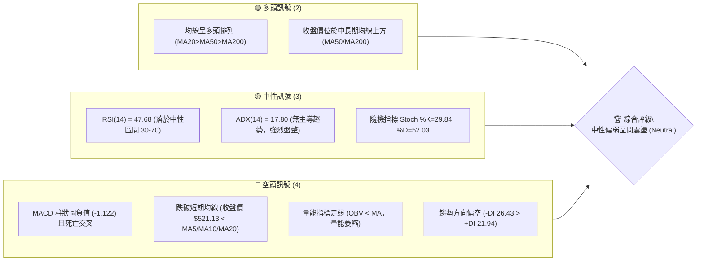
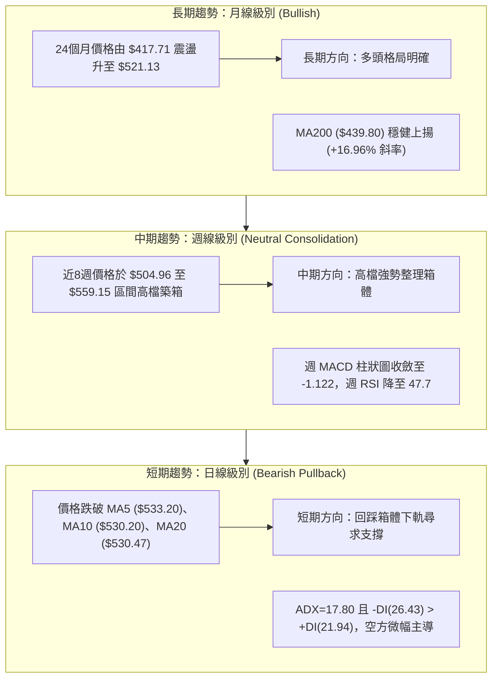
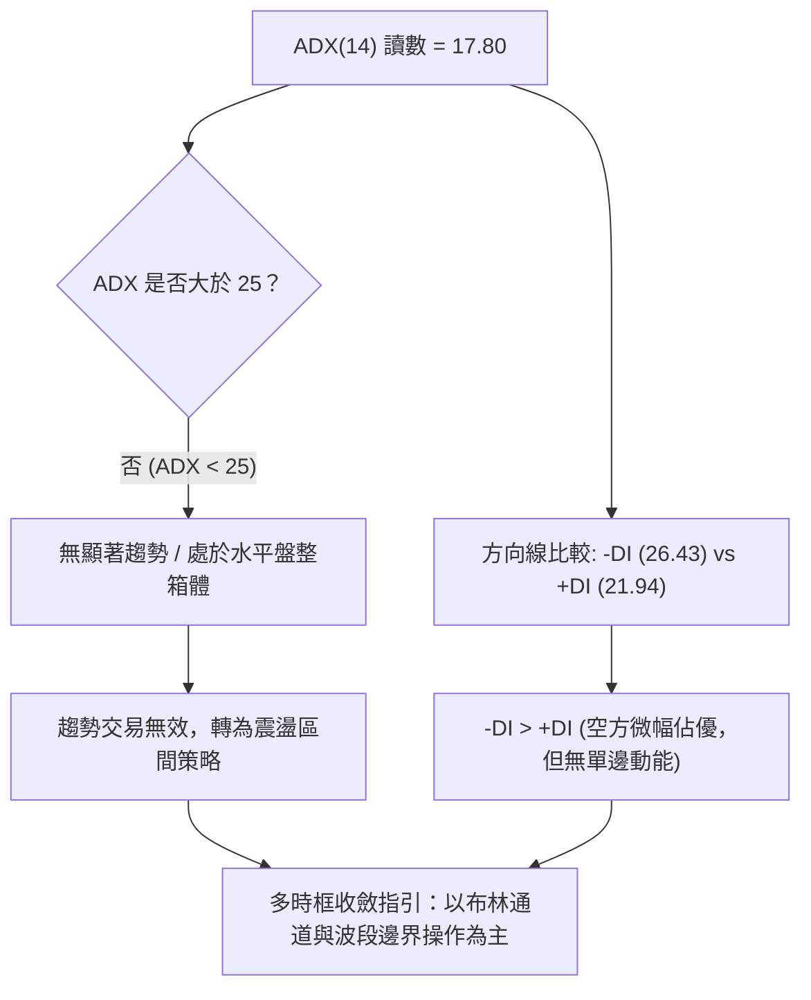
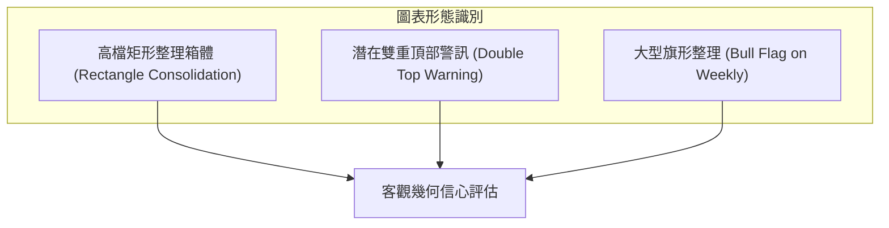
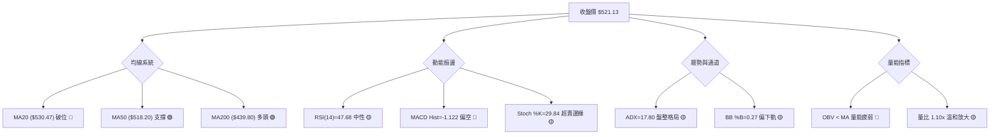
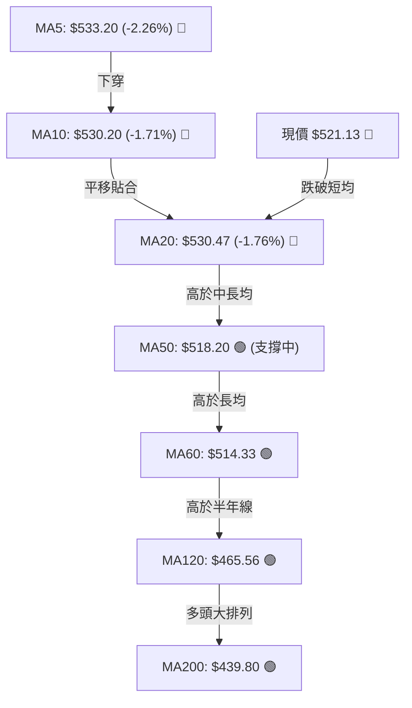
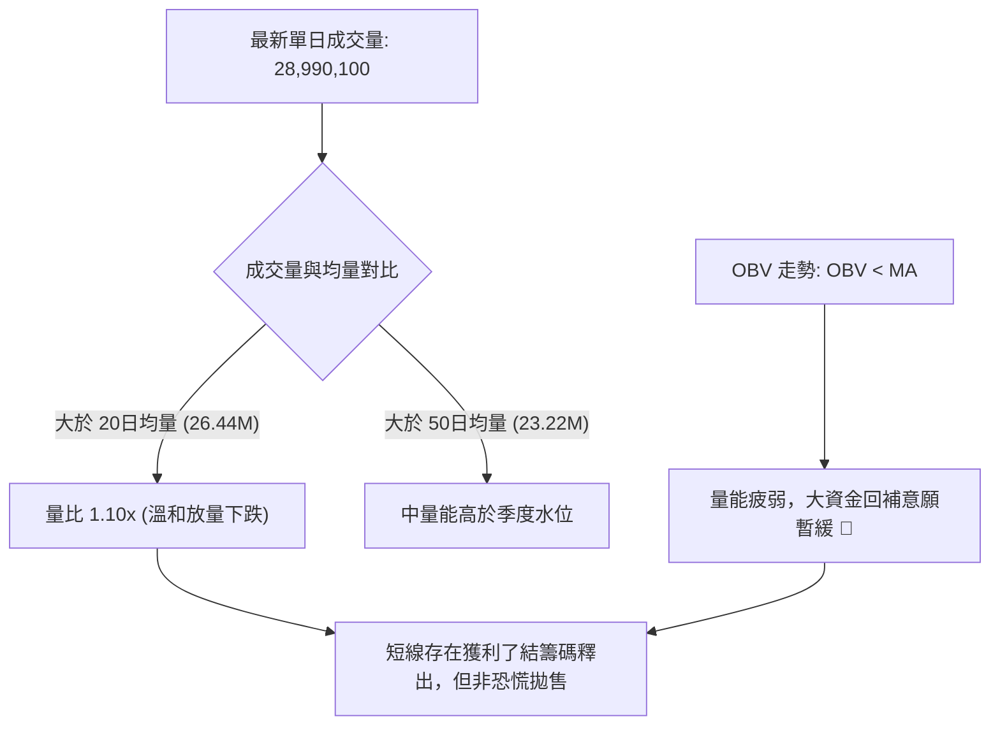
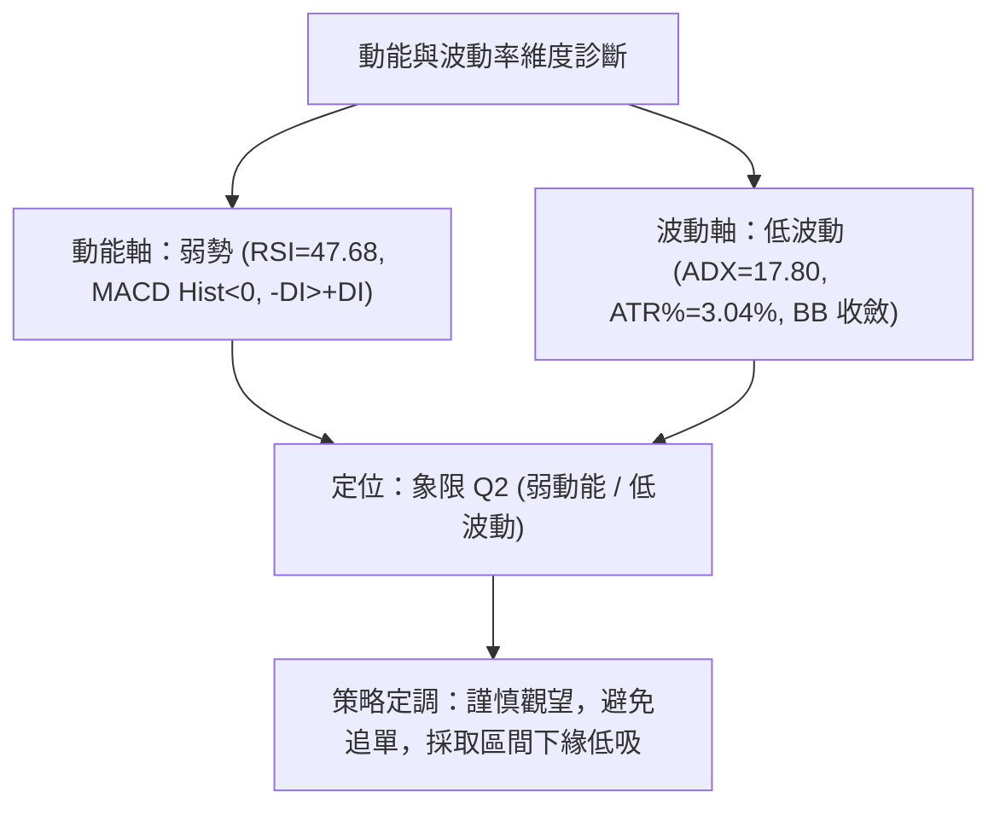
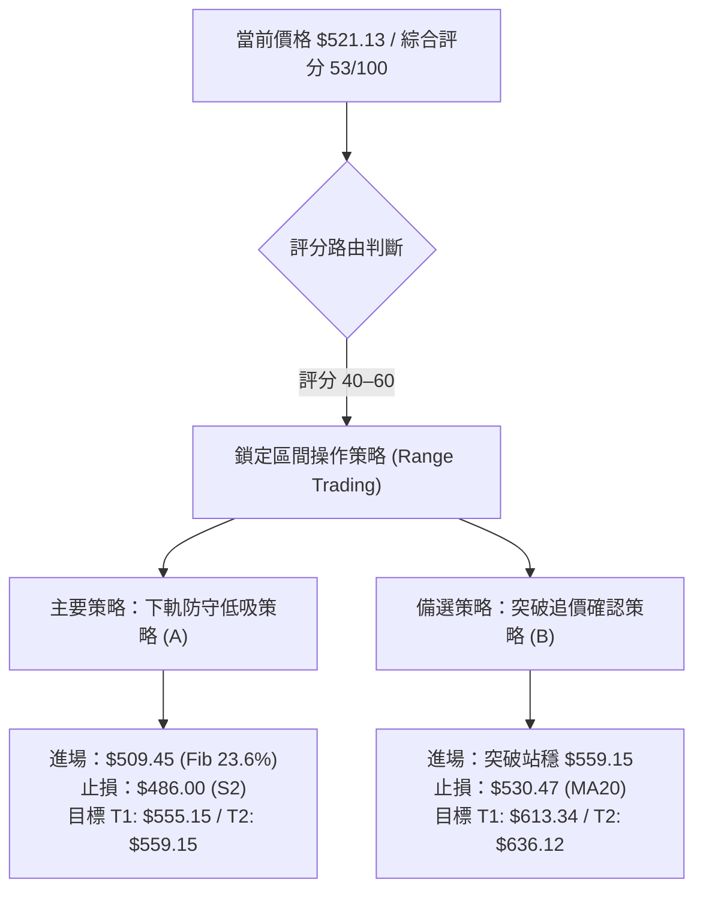
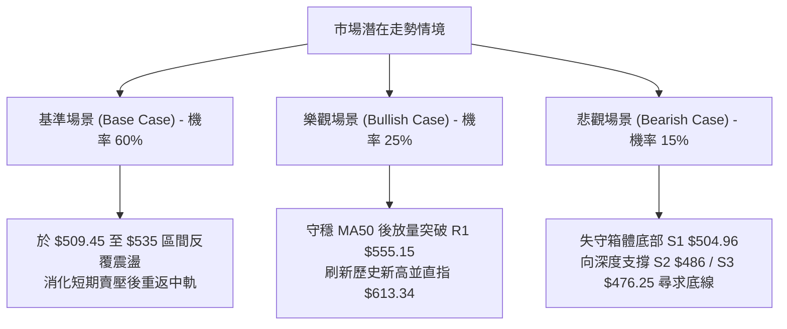

# MSFT 技術分析報告

> **報告日期**：2026-11-12 ｜ **語言**：繁體中文 ｜ **數據來源**：Yahoo Finance ｜ **當前價格**：$521.13

---

## 目錄

| 章節 | 內容 |
|------|------|
| [1. 技術面概覽](#1-技術面概覽) | 訊號儀表板、核心指標、評分卡 |
| [2. 趨勢分析](#2-趨勢分析) | 多時框趨勢、長中短期走勢 |
| [3. 圖表形態分析](#3-圖表形態分析) | 形態識別、K線組合、目標價 |
| [4. 支撐與阻力](#4-支撐與阻力) | 關鍵價位、斐波那契回調 |
| [5. 技術指標深度解讀](#5-技術指標深度解讀) | MA/RSI/MACD/布林/成交量 |
| [6. 動能與波動率](#6-動能與波動率) | 動能評估、ATR、Beta |
| [7. 多時框架總結](#7-多時框架總結) | 時框架評分矩陣 |
| [8. 交易策略建議](#8-交易策略建議) | 多空策略、風險報酬比 |
| [9. 風險提示與監控](#9-風險提示與監控) | 監控指標、風險場景 |
| [📋 報告總結](#-報告總結) | 總體結論與策略指引 |

---

## 1. 技術面概覽

### 🎯 技術訊號儀表板



### 📊 核心指標速覽表

| 指標類別 | 指標名稱 | 當前數值 | 訊號 | 解讀 |
|:---|:---|:---|:---:|:---|
| **價格** | 當前收盤價 | $521.13 | 🟡 | 位於52週區間 81.9% 高位，短期處於高檔拉回整理階段 |
| **短期均線** | MA20 (布林中軌) | $530.47 | 🔴 | 收盤價跌破 MA20 (-1.76%)，短期動能由多翻空 |
| **中期均線** | MA50 | $518.20 | 🟢 | 收盤價守於 MA50 之上 (+0.57%)，提供短線動態支撐防線 |
| **長期均線** | MA200 | $439.80 | 🟢 | 顯著高於年線 (+18.49%)，長期牛市基調完好未破 |
| **動能指標** | RSI(14) | 47.68 | 🟡 | 位於 30–70 中性平衡區，多空勢力短期拉鋸，無超買超賣 |
| **趨勢指標** | MACD (12,26,9) | 3.596 / 4.718 | 🔴 | MACD 線低於 Signal 線，Hist 柱狀圖為 -1.122，空方動能釋放 |
| **趨勢強度** | ADX (14) | 17.80 | 🟡 | ADX < 25 表示處於低波動無趨勢盤整；-DI(26.43) > +DI(21.94) |
| **波動指標** | ATR(14) | $15.86 | 🟡 | 佔股價 3.04%，日內標準波動範圍，未見極端恐慌擴張 |
| **通道位置** | Bollinger %B | 0.27 | 🟡 | 位於下軌 ($510.36) 與中軌 ($530.47) 間，偏向通道下半部 |
| **量能指標** | OBV 趨勢 | OBV < MA | 🔴 | 量能指標落於均量線下方，資金承接力道趨緩 |

### 🏆 技術評分卡

```
╔══════════════════════════════════════════════════════════════════╗
║                   技術評分卡 — MSFT (2026-11-12)                ║
╠══════════════════════════════════════════════════════════════════╣
║ 趨勢強度 (ADX=17.80, -DI>+DI)   ████████░░░░░░░░░░░░   40/100 🔴 ║
║ 動能指標 (RSI=47.68, MACD<0)    ████████░░░░░░░░░░░░   40/100 🔴 ║
║ 支撐穩定度 (守住MA50, 近S1)      ██████████████░░░░░░   70/100 🟢 ║
║ 成交量配合 (OBV疲弱, 量比1.10)   ████████░░░░░░░░░░░░   40/100 🔴 ║
║ 形態完整度 (區間箱體未破)        ████████████░░░░░░░░   60/100 🟡 ║
║ 均線排列 (MA20>MA50>MA200)      ██████████████░░░░░░   70/100 🟢 ║
╠══════════════════════════════════════════════════════════════════╣
║ 綜合評分 (六項算術平均四捨五入) ██████████░░░░░░░░░░   53/100 🟡 ║
║ 評級結論：中性震盪 (Neutral Consolidation) - 建議區間操作        ║
╚══════════════════════════════════════════════════════════════════╝
```
*(計算式：(40 + 40 + 70 + 40 + 60 + 70) ÷ 6 = 320 ÷ 6 = 53.33 → 53/100)*

---

## 2. 趨勢分析

### 🌐 多時框趨勢分析



### 📈 長期趨勢 — 12個月走勢圖（Unicode）

以下為根據 MSFT 過去 12 個月（2025-12 至 2026-11）實際收盤價繪製之月線走勢圖：

```
MSFT 月線走勢圖（過去12個月：2025-12 至 2026-11）
價格 ($)
$550 ┤                                                 
$525 ┤                                           ●521.91 ●521.13 (現價)
$500 ┤                                     ●507.29 ●512.90
$475 ┤ ●480.57                             ●463.85
$450 ┤                             ●449.39
$425 ┤         ●427.58
$400 ┤                 ●406.13
$375 ┤     ●391.15         ●372.32
$350 ┤         ●368.68(低點)
     └─────────────────────────────────────────────────────────►
        12   01  02  03  04  05  06  07  08  09  10  11 (月份)
       2025 |                      2026
```

#### 走勢特徵分析表格

| 階段區間 | 起訖月份 | 起點收盤 | 終點收盤 | 區間漲跌幅 | 結構特徵分析 |
|:---|:---:|:---:|:---:|:---:|:---|
| **第一階段：深幅回調** | 2025-12 至 2026-03 | $480.57 | $368.68 | -23.28% | 連續4個月下行，於 2026-03 探得波段谷底 $368.68 (接近52週低點 $348.54) |
| **第二階段：震盪築底** | 2026-03 至 2026-06 | $368.68 | $372.32 | +0.99% | 4月反彈至 $406.13，5月衝高 $449.39 後6月再次回測 $372.32，形成穩固雙底架構 |
| **第三階段：主升拉升** | 2026-06 至 2026-08 | $372.32 | $507.29 | +36.25% | 連續巨幅長紅推進，收復 500 美元大關，重返多頭主升段 |
| **第四階段：高檔震盪** | 2026-08 至 2026-11 | $507.29 | $521.13 | +2.73% | 進入高位水平箱體整理，在 $510–$550 區間進行籌碼換手與均線收斂 |

### 📊 中期趨勢（週線分析）

中期走勢呈現典型的高檔箱體震盪架構。近 20 週收盤價於 2026-07-24 觸及 $380.98 後爆發放量拉升（2026-07-31 單週成交量達 2.78 億股），隨後於 2026-08 登上 500 美元整數關卡。近 8 週價格收盤維持在 $516.17 至 $535.07 窄幅波動，波段高點見於 2026-11-04 之盤中歷史高點 $559.15。

```
中期壓力與支撐示意圖
$560 ────────────────────────────────────────── 52週高點 $559.15 (強壓力區)
      ▲           ▲
$540 ─┼───────────┼──────── 阻力密集區 R1: $555.15
      │  震盪箱體 │
$520 ─┼─────●─────┼──────── 現價: $521.13 / MA50: $518.20
      │           │
$500 ─┴───────────┴──────── 波段支撐 S1: $504.96 / 斐波那契 23.6%: $509.45
```

### ⚡ 趨勢強度評估（ADX 解讀）



#### ADX 趨勢強度對照表

| ADX 區間 | 趨勢狀態 | 當前數值 | 診斷結果 | 操作意涵 |
|:---|:---|:---:|:---:|:---|
| 0 – 20 | 極弱 / 無趨勢盤整 | **17.80** | **符合當前狀態** | 嚴禁追價，趨勢突破高機率為假突破；應採逆勢或區間回調操作 |
| 20 – 25 | 趨勢醞釀中 | - | - | 動能未凝聚 |
| 25 – 40 | 強趨勢形成 | - | - | 順勢單邊操作 |
| 40 – 60 | 極強趨勢 | - | - | 順勢加碼，嚴設移動止損 |
| 60 – 100 | 超強動能 / 接近力竭 | - | - | 提防趨勢反轉 |

---

## 3. 圖表形態分析

### 🔍 形態識別系統



#### 形態識別信心度評估表

| 形態名稱 | 信心度 | 判斷依據（引用數據） | 完成度 | 目標價（附計算式） |
|:---|:---:|:---|:---:|:---|
| **高檔矩形整理箱體** | 75% | 箱體頂部為波段高點 $559.15 (2026-11-04/06)，箱體底部為多次回測低點 $504.96 (2026-11-02/06)，區間幅度約 $54.19 | 80% | 向上突破：頸線 $559.15 + 高度 $54.19 = **$613.34**<br>向下跌破：底部 $504.96 - 高度 $54.19 = **$450.77** |
| **潛在雙重頂部** | 45% | 左頂 $551.15 (2026-10-16)，右頂 $559.15 (2026-11-04)，頸線暫定於波段低點 $504.96；但 ADX 僅 17.80 且價格守於 MA50 之上，未正式破線 | 35% | 訊號不足，僅做空方指標防範解讀。若確認跌破頸線 $504.96，形態測幅 = $504.96 - ($559.15 - $504.96) = **$450.77** |
| **週線多頭旗形** | 60% | 旗桿為 2026-07 由 $380.98 拉升至 $507.29（高度 $126.31），近3個月於 $500–$550 窄幅收斂旗面 | 65% | 待放量突破阻力位 R1 $555.15 及高點 $559.15，目標 = $559.15 + $126.31 = **$685.46** |

### 🕯️ 重要 K 線形態分析

依據提供之「近 10 根日 K」與「近 8 根週 K」實際數據進行客觀解讀：

#### 近 10 根日 K 棒形態解讀

| 日期 | 開盤價 | 最高價 | 最低價 | 收盤價 | K線形態名稱 | 技術解讀 | 訊號 |
|:---|:---:|:---:|:---:|:---:|:---|:---|:---:|
| 2026-10-29 | 540.22 | 541.29 | 519.56 | 530.14 | 長下影中陰線 | 盤中下探 $519.56 後獲買盤拉回，多空激烈爭奪 | 🟡 |
| 2026-10-30 | 525.27 | 526.00 | 514.35 | 521.91 | 連續陰線 | 開低走低，下探考驗下檔支撐力道 | 🔴 |
| 2026-11-02 | 524.02 | 529.63 | 504.96 | 507.12 | 實體大陰線 | 盤中殺破 $510 探得波段低點 S1 $504.96，收於低檔 | 🔴 |
| 2026-11-03 | 509.01 | 523.44 | 507.82 | 520.99 | 破底翻陽包陰 | 開低走高收復昨日失土，確認低位 $504.96 具強支撐 | 🟢 |
| 2026-11-04 | 543.70 | 559.15 | 542.30 | 555.80 | 跳空放量光頭大陽線 | 巨量 50.8M 突破創 52 週新高 $559.15，多方極強噴發 | 🟢 |
| 2026-11-05 | 554.94 | 557.62 | 532.68 | 535.93 | 長黑流星覆蓋線 | 高檔爆量沖高回落，長實體陰線吞噬前一日大半漲幅 | 🔴 |
| 2026-11-06 | 525.69 | 538.33 | 524.47 | 530.61 | 縮量小陽反彈線 | 跌勢暫歇，量能萎縮至 26.9M，多空處於觀望中繼 | 🟡 |
| 2026-11-09 | 544.49 | 548.28 | 538.70 | 545.18 | 跳空上揚中陽線 | 開高走高重新挑戰上軌，但未能突破前高 $557.62 | 🟢 |
| 2026-11-10 | 542.98 | 544.19 | 526.37 | 533.16 | 回調陰線 | 受制於短期均線壓力，再次走低回測中軌 | 🔴 |
| 2026-11-11 | 534.24 | 534.76 | 518.45 | 521.13 | 實體中陰線 | 跌破 20 日均線 ($530.47)，收於當日相對低檔 $521.13 | 🔴 |

#### 近 8 根週 K 棒形態解讀

| 日期 (週末) | 開盤價 | 最高價 | 最低價 | 收盤價 | 週K形態名稱 | 技術解讀 | 訊號 |
|:---|:---:|:---:|:---:|:---:|:---|:---|:---:|
| 2026-09-25 | 494.95 | 519.40 | 491.22 | 516.17 | 實體大陽線 | 突破 500 大關，展開箱體上攻 | 🟢 |
| 2026-10-02 | 505.47 | 522.85 | 502.22 | 517.53 | 高檔高浪十字星 | 多空勢均力敵，高檔動能放緩 | 🟡 |
| 2026-10-09 | 521.62 | 537.22 | 518.79 | 535.07 | 溫和走揚中陽線 | 穩步盤堅，收盤創階段新高 | 🟢 |
| 2026-10-16 | 537.53 | 551.15 | 524.43 | 529.05 | 長上影紡錘線 | 衝擊 $551.15 受阻回落，顯露上檔解套與獲利賣壓 | 🔴 |
| 2026-10-23 | 528.70 | 535.57 | 515.70 | 524.51 | 縮量整理小陰線 | 波動率收縮，成交量降至 81.4M | 🟡 |
| 2026-10-30 | 527.40 | 541.29 | 514.35 | 521.91 | 下探回拉陰線 | 量能放大至 142.1M，下檔開始有防守買盤進場 | 🟡 |
| 2026-11-06 | 524.02 | 559.15 | 504.96 | 530.61 | 巨幅震盪長影十字 | 單週振幅 $54.19 (10.3%)，爆量 1.75 億股，確立寬幅箱體邊界 | 🟡 |
| 2026-11-11 | 544.49 | 548.28 | 518.45 | 521.13 | 轉弱拉回小陰棒 | 尚未過半週已呈現承壓回落，週收盤下探考驗下半部 | 🔴 |

### 📉 ASCII 走勢形態示意圖

```
MSFT 箱體整理與雙頂警戒示意圖 (2026-10 至 2026-11)
價格 ($)
$560 ┤                頂部1                頂部2
     │               $551.15              $559.15
$550 ┤                  ╭───╮              ╭───╮
     │                 ╭╯   ╰╮            ╭╯   ╰╮
$540 ┤                ╭╯     ╰╮          ╭╯     ╰╮
     │               ╭╯       ╰╮        ╭╯       ╰╮
$530 ┤──────中軌─────╯─────────╰────────╯─────────╰── MA20: $530.47
     │                                            ● 現價: $521.13
$520 ┤                                           
     │                      頸線/箱體底部
$510 ┤──────────────────────── S1: $504.96 ───────────────────────
     │                          ╰────────╯
$500 ┤                           支撐確認
     └──────────────────────────────────────────────────────────► 時間
```

### 🎯 形態目標價計算

根據上述已確認之「高檔矩形整理箱體」進行幾何測幅計算：
- **形態上軌（阻力）**：52 週新高 $559.15 (由 2026-11-04 日 K 及 2026-11-06 週 K 確立)
- **形態下軌（頸線）**：支撐位 S1 $504.96 (由 2026-11-02 日 K 及 2026-11-06 週 K 確立)
- **箱體垂直高度 ($H$)**：$559.15 - $504.96 = **$54.19**

1. **若向上突破箱體上軌**：
   $$\text{目標價} = \text{箱頂} + H = 559.15 + 54.19 = \mathbf{\$613.34}$$
2. **若向下跌破箱體頸線**：
   $$\text{目標價} = \text{頸線} - H = 504.96 - 54.19 = \mathbf{\$450.77}$$
   *(註：下行目標 $450.77 恰位於斐波那契 50.0% 回調位 $453.85 附近，具備極強結構對應)*

---

## 4. 支撐與阻力

### 🗺️ 關鍵價位分布圖（Unicode）

```
MSFT 價位結構分布圖 (由 OHLCV 與斐波那契精密推算)
═════════════════════════════════════════════════════════════════
$559.15 ║██████████████████████████████████████║ 52週歷史高點 / Fib 0.0%
$555.15 ║████████████████████████████████      ║ 關鍵波段阻力 R1 (+6.53%)
$530.47 ║--------------------------------------║ 短期均線壓力 MA20 / 布林中軌
$521.13 ╠══════════════════════════════════════╣ ◄ 當前收盤價 (Last Close)
$518.20 ║┈┈┈┈┈┈┈┈┈┈┈┈┈┈┈┈┈┈┈┈┈┈┈┈┈┈┈┈┈┈┈┈┈┈┈┈┈┈║ 動態防守線 MA50 (+0.57%)
$510.36 ║▓▓▓▓▓▓▓▓▓▓▓▓▓▓▓▓▓▓▓▓                  ║ 布林通道下軌 (BB Lower)
$509.45 ║▓▓▓▓▓▓▓▓▓▓▓▓▓▓▓▓▓▓▓▓▓▓▓▓              ║ 斐波那契 23.6% 回調位
$504.96 ║████████████████████████████████      ║ 強支撐 S1 (箱體頸線, -3.10%)
$486.00 ║██████████████████████                ║ 次級波段支撐 S2 (-6.74%)
$478.70 ║████████████████████████              ║ 斐波那契 38.2% 回調位
$476.25 ║████████████████████                  ║ 中期波段防線 S3 (-8.61%)
$439.80 ║██████████████████████████████████████║ 長期牛熊分水嶺 MA200
═════════════════════════════════════════════════════════════════
```

### 🚧 阻力位分析表

依據數據「關鍵價位」區塊波段高點聚類與 OHLCV 計算結果列出，數據中未偵測到 R2、R3 聚類數值，僅嚴格引用 R1 及 52W 高點：

| 阻力級別 | 價位 | 形成原因 | 突破難度 | 重要性 |
|:---|:---:|:---|:---:|:---|
| **關鍵阻力 R1** | **$555.15** | 近一年波段高點聚類壓力（2026-11-04 收盤 $555.80、2026-10-16 高點 $551.15 之高位套牢密集成交區） | 極高 | ★★★★★ |
| **52W 高點 (Fib 0.0%)** | **$559.15** | 2026-11-04 創下之 52 週歷史天花板，矩形頂部，存在多頭獲利解套雙重賣壓 | 極高 | ★★★★★ |
| *阻力位 R2* | *N/A* | *數據中未偵測到此層級聚類數值，依規則不予編造* | - | - |
| *阻力位 R3* | *N/A* | *數據中未偵測到此層級聚類數值，依規則不予編造* | - | - |

### 🛡️ 支撐位分析表

依據數據「關鍵價位」區塊波段低點聚類與 OHLCV 計算結果嚴格列出：

| 支撐級別 | 價位 | 形成原因 | 守住機率 | 重要性 |
|:---|:---:|:---|:---:|:---|
| **關鍵支撐 S1** | **$504.96** | 近一年波段低點聚類（2026-11-02 探底 $504.96、2026-11-06 週低點 $504.96 重合，箱體下緣頸線） | 70% | ★★★★★ |
| **次級支撐 S2** | **$486.00** | 近一年波段低點聚類（2026-08-21 當週回踩低點聚類區間） | 80% | ★★★★☆ |
| **防守支撐 S3** | **$476.25** | 近一年波段低點聚類（逼近斐波那契 38.2% 回調位 $478.70，具備多重結構匯聚） | 85% | ★★★★☆ |

### 📐 斐波那契回調位分析

本波回調計算以 52 週完整循環低點 **$348.54** 至歷史高點 **$559.15**（總垂直落差 $210.61）進行精密劃分：

| 斐波那契比例 | 價位 | 當前相對位置與技術意義 |
|:---:|:---:|:---|
| **0.0% (52W High)** | **$559.15** | 牛市極限推升位，波段強壓力頂部 |
| **23.6%** | **$509.45** | **現價 ($521.13) 正運行於 0.0% 與 23.6% 之間**。此處為強勢拉回第一道支撐線，與布林下軌 ($510.36) 及 S1 ($504.96) 形成緊密之**多頭三重護城河**。 |
| **38.2%** | **$478.70** | 中度回檔防線，與波段低點 S3 ($476.25) 產生空間重疊，若 S1 告失將直指此區間 |
| **50.0%** | **$453.85** | 多空中樞平衡點，接近箱體向下跌破之測幅目標 $450.77 |
| **61.8%** | **$429.00** | 黃金分割強防守位，落於年線 MA200 ($439.80) 下方不遠處 |
| **78.6%** | **$393.61** | 深幅回調位，守衛 2026 年初起漲平台 |
| **100.0% (52W Low)** | **$348.54** | 52 週絕對底部 |

**分析解讀**：現價 $521.13 仍保持在 23.6% 回調位 ($509.45) 之上，顯示截至目前為止的拉回仍屬於**牛市架構內的最淺層健康修正**，並未破壞中長期上升趨勢。

---

## 5. 技術指標深度解讀

### 🎛️ 指標訊號總覽



### 📈 移動平均線排列分析



#### 均線矩陣詳細狀態表

| 均線名稱 | 當前價格 | 與現價偏離 (%) | 5日斜率變動 | 狀態解讀 |
|:---|:---:|:---:|:---:|:---|
| **MA 5** | $533.20 | -2.26% | ▁▁▁▃▄▄▅▆▇▇██▇▇ (下彎) | 極短線下墜，對股價構成首要反彈壓力 |
| **MA 10** | $530.20 | -1.71% | ▁▁▂▃▃▄▅▆▆▇████ (走平轉跌) | 短期反壓，阻擋多方快速回升 |
| **MA 20** | $530.47 | -1.76% | ▁▁▁▁▂▂▃▃▄▄▅▅▆▆ (由升轉平) | 布林中軌，跌破後短線由多轉空，轉為強阻力 |
| **MA 50** | $518.20 | +0.57% | 穩定上行 | 中期生命線，現價僅高出 $2.93，多頭不可退讓防線 |
| **MA 60** | $514.33 | +1.32% | ▁▁▁▂▂▃▃▃▄▄▅▅▆▆ (上升) | 季線強勁支撐，貼近箱體下軌 |
| **MA 120** | $465.56 | +11.94% | ▁▁▁▁▂▂▂▂▃▃▃▄▄▄ (平穩走升) | 半年線防線，中長線多方籌碼鎖定良好 |
| **MA 200** | $439.80 | +18.49% | 穩定揚升 | 確立大級別長期多頭排列 (MA20>MA50>MA200) |
| **MA 240** | $445.55 | +16.96% | ▁▁▁▁▁▁▁▁▁▁▂▂▂ (持續向上) | 長期均線架構完全健康 |

### 📉 RSI(14) 分析

當前 Wilder RSI(14) 讀數為 **47.68**。

```
RSI (14) 指標計量條：
0 ────────── 30 ──────────────── 50 ─────────────── 70 ────────── 100
[ 超賣區間 ]  [      弱勢區間    ]   [   強勢區間   ]   [ 超買區間 ]
░░░░░░░░░░░░░░░░░░░░░░░░░░░░░░░░█░░░░░░░░░░░░░░░░░░░░░░░░░░░░░░░░
                                47.68 (中性偏空拉鋸)
進度條: ██████████░░░░░░░░░░ 47.68%
```

- **超買超賣判斷**：RSI 脫離了 10 月衝擊歷史高位時的過熱狀態，目前落入 40–50 之弱勢中性平衡區，既無超買風險，亦尚未觸及 30 以下之超賣區，指標處於動能冷卻與沉澱階段。
- **背離判斷**：依據近 20 根 K 棒分析，數據明確提示「**無明顯背離**」。股價高點 $559.15 對應之動能並未形成標準頂背離，本次下跌純屬高檔遇阻後的技術性均值回歸。

### 📊 MACD(12,26,9) 訊號解讀


- **快慢線位置**：MACD 線 (3.596) 與 Signal 線 (4.718) 均位於零軸（0.00）之上，確認中長期多頭市場基調並未改變。
- **柱狀圖動態**：然而短期 MACD 處於死亡交叉狀態，柱狀圖為 **-1.122**。負值連續延續，顯示空方動能仍在釋放釋放過程中，短線尚未見到底部金叉轉折訊號。

### 📦 布林通道分析

```
MSFT 布林通道位置示意圖 (BB 20, 2.0)
價格 ($)
$550.57 ┤═══════════════════════════════════════ BB 上軌 (Upper Band)
        │
$540.00 ┤
        │
$530.47 ┤─────────────────────────────────────── BB 中軌 (MA20: $530.47)
        │                      ● 現價: $521.13 (%B = 0.27)
$520.00 ┤
        │
$510.36 ┤═══════════════════════════════════════ BB 下軌 (Lower Band)
```

- **通道帶寬**：上軌 $550.57 與下軌 $510.36 形成寬度約 $40.21 (7.7%) 的震盪通道。
- **%B 位置解讀**：當前 **%B = 0.27**，意指股價已經回落至通道下半部（低於中軌 0.5），正逼近下軌 0.0 之支撐區域。在 ADX=17.80 的盤整行情中，布林通道下軌往往構成強烈之均值回歸支撐位。

### 💹 成交量分析（量價配合度）



- **量能結構**：最新交易日成交量為 28,990,100 股，略高於 20 日均量（量比 1.10x），但伴隨陰線收盤，顯示短期賣盤稍佔優勢。
- **OBV 趨勢確認**：數據明確指出「OBV 趨勢：OBV < MA → 量能疲弱」。這說明資金在創新高 $559.15 後未進行追高推升，整體呈現高位縮量陰跌格局，量能尚未確認價格的向上突破。

---

## 6. 動能與波動率

### ⚡ 動能評估四象限



#### 四象限特徵定位表

| 象限代號 | 動能狀態 | 波動狀態 | 當前標記 | 特徵解讀與操作指引 |
|:---:|:---:|:---:|:---:|:---|
| **Q1** | 強 | 低 | - | 穩健單邊慢牛，最佳持股機會 |
| **Q2** | **弱** | **低** | **✓ (MSFT 當前狀態)** | **高檔震盪整理，盤整蓄勢；宜在區間下軌尋求低吸，耐心等待方向確立** |
| **Q3** | 強 | 高 | - | 劇烈單邊行情，高風險高收益爆發期 |
| **Q4** | 弱 | 高 | - | 恐慌崩跌或多空絞殺，嚴禁進場 |

### 📊 ATR 波動率分析

- **ATR(14) 絕對數值**：**$15.86**（佔當前股價 3.04%，Wilder 平滑計算）。
- **日內波動特徵**：股價每日平均常態波動幅度約為 15–16 美元。
- **風控止損測算依據**：
  - *1.0 倍 ATR*：$15.86 → 適合超短線或當沖交易作為追蹤止損距離。
  - *1.5 倍 ATR*：$23.79 → 適合波段波段交易保護空間，可有效過濾盤中毛刺噪音。
  - *2.0 倍 ATR*：$31.72 → 適合中長線頭寸之防守底線。

### 📐 Beta 與市場相關性

- **Beta 係數**：**1.045**。
- **市場敏感度解讀**：MSFT 之 Beta 極度接近 1.0，表明其價格波動節奏與標普 500 指數及整體科技板塊（如 QQQ）高度同步，不具備極端的獨立異動性，受大盤宏觀流動性與科技權值板塊情緒共振主導。
- **機構籌碼定錨**：機構持股比率高達 **76.2%**，空頭借券比率（Short Float）極低僅 **0.8%**（Short Ratio 2.78），顯示籌碼結構固若金湯，無任何大型機構惡意放空做空跡象。

---

## 7. 多時框架總結

### 📋 時框架評分表

| 時框架 | 趨勢方向 | 動能狀態 | 均線排列 | 形態結構 | 綜合評分 | 建議方向 |
|:---|:---:|:---:|:---:|:---:|:---:|:---:|
| **短期 (日線)** | 偏弱震盪 🔴 | MACD 柱負值, RSI 47.7 🔴 | 跌破 MA20，MA50 支撐 🟡 | 矩形下緣回測 🟡 | 45/100 🔴 | 觀望，等待止跌回穩 |
| **中期 (週線)** | 區間震盪 🟡 | 週柱收斂, RSI 47.7 🟡 | 多頭排列收斂 🟢 | 箱體整理未破 🟡 | 55/100 🟡 | 區間操作，下軌分批買 |
| **長期 (月線)** | 明確多頭 🟢 | 長線向上推升 🟢 | MA200 完美上揚 🟢 | 大級別牛市推升 🟢 | 80/100 🟢 | 長線堅定持有 |

### 🔲 綜合訊號矩陣

```
時框訊號一致性矩陣 (Timeframe Convergence Matrix)
══════════════════════════════════════════════════════════════════
指標維度        日線 (Daily)       週線 (Weekly)      月線 (Monthly)
──────────────────────────────────────────────────────────────────
均線排列        🟡 中性 (破MA20)    🟢 多頭 (守MA50)   🟢 強烈多頭
動能指標        🔴 空方主導        🟡 中性平衡        🟢 偏多主導
形態邊界        🔴 考驗下緣        🟡 寬幅箱體        🟢 階梯上升
量能健康        🔴 OBV疲弱         🟡 縮量整理        🟢 長期放量
──────────────────────────────────────────────────────────────────
時框結論        短期回踩           中期震盪           長期看漲
══════════════════════════════════════════════════════════════════
```

### ⚖️ 多時框收斂結論

> **依據多時框收斂規則（規則 14）**：
> 1. **行情性質診斷**：當前 ADX(14) 讀數為 **17.80 (< 25)**，嚴格界定為「**典型盤整行情**」，而非單邊趨勢行情。
> 2. **主導維度收斂**：在無趨勢的盤整架構下，**以日線布林通道上下軌 ($510.36 – $550.57) 與波段支撐/阻力為主要交易區間**。中長期月線雖然多頭完好，但短期無法推動單邊噴發；日線跌破 MA20 帶來了向箱體下緣回測的拉回。
> 3. **唯一方向性結論**：**中性觀望，偏向區間低吸（Neutral to Range Buy）**。綜合評分為 **53/100**，短線切忌追空亦不可盲目追多，交易核心聚焦於箱體底部支撐區域的低接機會。

---

## 8. 交易策略建議

### 🗺️ 策略決策流程圖



### 🧭 策略路由（依評分卡分流）

**當前主策略方向 = 中性震盪區間操作（依評分 53/100，落於 40–60 區間）**  
本策略專注於利用布林通道與斐波那契強支撐進行「**下軌回踩承接，上軌壓力調節**」的高勝率區間交易，不進行盲目單邊押注。

---

### 🎯 價格情境階梯（Price Scenarios）

所有價位均嚴格引用自第 4 章及數據計算清單：

| 觸發條件 | 下一目標 | 後續延伸 | 情境含義 |
|:---|:---:|:---:|:---|
| **向上突破 R1 $555.15 並攻克 $559.15** | 箱體測幅目標 $613.34 | 分析師平均目標 $636.12 | 箱體正式向上爆發，重啟大級別主升浪 |
| **守住 Fib 23.6% ($509.45) 至現價區間** | 回測 MA20 $530.47 | 挑戰布林上軌 $550.57 | 維持箱體內健康震盪，均線回歸整理 |
| **跌破 S1 $504.96 箱體頸線** | 次級支撐 S2 $486.00 | Fib 38.2% $478.70 / S3 $476.25 | 短期形態破位，轉為中期深度回檔 |

---

### 📊 情境機率分佈

| 情境劇本 | 發生機率 | 主要判定依據與數據驗證 |
|:---|:---:|:---|
| **情境一：區間震盪蓄勢 (維持箱體)** | **60%** | **ADX=17.80 強烈印證無趨勢特徵**；布林通道帶寬收窄；股價緊貼 MA50 ($518.20) 與布林下軌 ($510.36)，上下均具備強大籌碼支撐與反壓。 |
| **情境二：回測支撐再反彈 (下探深吸)** | **25%** | **MACD 柱狀圖負值 (-1.122)** 且 RSI 降至 47.68，空方動能尚未完全耗盡，極可能短暫插針測試 S1 ($504.96) 或 Fib 23.6% ($509.45) 誘空後回升。 |
| **情境三：直接破位下瀉 (趨勢反轉)** | **15%** | 機構持股達 76.2%，Short Float 僅 0.8%，長期均線 MA200 遠在 $439.80 且持續上揚，直接跌破 S2 ($486.00) 機率極低。 |

---

### 🟢 主策略詳情（區間與突破策略）

依嚴格要求 17 定義：  
$$\text{風險報酬比} = \frac{\text{目標價 T1} - \text{進場價}}{\text{進場價} - \text{止損價}}$$  
所有計算數值精確驗算如下：

| 策略要素 | 策略 A（下軌支撐回踩承接 — 首選） | 策略 B（突破歷史高點順勢追擊 — 次選） |
|:---|:---|:---|
| **策略邏輯** | 於箱體下軌與 Fib 23.6% 密集支撐區掛單低吸 | 待盤整徹底結束，帶量突破歷史高點後順勢上車 |
| **進場條件** | 股價回踩至 Fib 23.6% $509.45 企穩不破時進場 | 日 K 收盤價實質突破 52W 高點 $559.15 並獲確認 |
| **進場價格** | **$509.45** | **$559.15** |
| **止損價格** | **$486.00**（引用 S2，跌破確立破位） | **$530.47**（引用破位前中軌 MA20） |
| **目標價 T1** | **$555.15**（引用波段高點阻力 R1） | **$613.34**（矩形突破測幅：$559.15 + $54.19） |
| **目標價 T2** | **$559.15**（引用 52 週歷史高點） | **$636.12**（引用分析師共識平均目標價） |
| **風險報酬比** | **1 : 1.95（以 T1 計）**<br>*(555.15 - 509.45) ÷ (509.45 - 486.00)<br>= 45.70 ÷ 23.45 = 1.9488*<br><br>另標注：**1 : 2.12（以 T2 計）**<br>*(559.15 - 509.45) ÷ 23.45 = 49.70 ÷ 23.45 = 2.119* | **1 : 1.89（以 T1 計）**<br>*(613.34 - 559.15) ÷ (559.15 - 530.47)<br>= 54.19 ÷ 28.68 = 1.889*<br><br>另標注：**1 : 2.68（以 T2 計）**<br>*(636.12 - 559.15) ÷ 28.68 = 76.97 ÷ 28.68 = 2.683* |
| **成功機率** | **65%** | **55%** (受制於 ADX 較低，需量能爆發確認) |
| **建議倉位** | **15% – 20%**（底倉分批布局） | **10%**（右側突破動能倉） |

---

### 🔴 反向風險觸發點（對沖提示）

- **多單全面止損與避險訊號**：若日 K 收盤價實體**跌破 $504.96 (S1)**，即確認跌破近 2 個月震盪箱體，潛在雙頂形態隱憂升級。多頭頭寸應立即減倉 50%，若進一步失守 **$486.00 (S2)**，應全數清倉多單並啟動反向避險保護。
- **空方陷阱警訊**：若盤中刺破 $504.96 但日 K 迅速收出長下影線（類似 2026-11-03 之破底翻陽棒），嚴禁追空，提防主力洗盤假跌破。

---

### ⭐ 整體訊號強度評星

```
做多訊號強度：★★★☆☆  (3/5 星 — 支撐強勁但短期動能受阻)
做空訊號強度：★★☆☆☆  (2/5 星 — 受制於長線均線強多頭壓制)
整體可信度：  ★★★★☆  (4/5 星 — 數據完整，價位邊界極為明晰)
```

---

## 9. 風險提示與監控

### ✅ 關鍵監控指標 Checklist

```
╔══════════════════════════════════════════════════════════════════╗
║                    MSFT 每日交易風控監控清單                     ║
╠══════════════════════════════════════════════════════════════════╣
║ [ ] 價格是否跌破 MA50 動態生命線 ($518.20)                      ║
║ [ ] RSI(14) 是否跌破 40 弱勢邊界或反彈突破 50 中樞              ║
║ [ ] MACD 柱狀圖是否縮小負值 (-1.122 向 0 軸收斂轉紅)            ║
║ [ ] 日成交量是否在跌破 $509.45 時異常放大超過 35M (異常拋售)     ║
║ [ ] ADX(14) 是否從 17.80 開始突破 25 (確認單邊趨勢啟動)         ║
║ [ ] 收盤價能否重新收復 MA20 布林中軌 ($530.47)                  ║
║ [ ] 下檔核心頸線 S1 ($504.96) 之防守完整性                      ║
╚══════════════════════════════════════════════════════════════════╝
```

### ⚠️ 風險場景分析



### 🛡️ 風險管理重要提醒

1. **嚴防低 ADX 震盪洗盤**：ADX 僅 17.80 表明當前絕非突破追單的良機，任何盤中急拉均容易因動能不足而形成「假突破」（如 2026-11-05 衝高 $557.62 後殺至 $535.93），切忌在壓力位 R1 $555.15 附近市價追買。
2. **波動率定錨倉位**：基於 ATR = $15.86，單筆交易之最大止損距離應抓 1.5 倍 ATR（約 $23.79）。若以總帳戶承擔 1% 風險計算，部位規模應嚴格限制在總資產的 15%–20% 之內。
3. **科技板塊聯動性風險**：Beta 為 1.045 且微軟作為市值 3.87 兆美元之巨型權值股，其走勢極度受納斯達克指數與大盤資金水位制約，交易時必須同步關注總體科技 ETF 之資金流向。

---

## 📋 報告總結

```
╔══════════════════════════════════════════════════════════════════╗
║                   MSFT 技術分析報告總結 (2026-11-12)             ║
╠══════════════════════════════════════════════════════════════════╣
║ 當前收盤價：$521.13                                              ║
║ 分析評級：  ⚖️ 53/100 (中性區間整理 / Neutral Consolidation)      ║
║                                                                  ║
║ 核心多時框結論：                                                 ║
║ ├─ 長期趨勢 (月線)：🟢 堅定看多，長均 MA200 ($439.80) 完美上揚   ║
║ ├─ 中期趨勢 (週線)：🟡 箱體震盪，介於 $504.96 至 $559.15 橫盤    ║
║ ├─ 短期趨勢 (日線)：🔴 偏弱拉回，受阻於 MA20 ($530.47) 回測支撐  ║
║ ├─ 關鍵支撐防線：  $509.45 (Fib 23.6%) / $504.96 (S1 箱體頸線)   ║
║ ├─ 關鍵波段阻力：  $555.15 (R1 阻力) / $559.15 (52W 歷史高點)    ║
║ └─ 分析師平均目標：$636.12                                       ║
║                                                                  ║
║ 最優策略指引：                                                   ║
║ 1. 🥇 最佳機會（策略 A）：於 Fib 23.6% $509.45 附近逢低掛單承接，║
║    嚴設止損於 S2 $486.00，博弈反彈目標 R1 $555.15 (風報比 1:1.95)║
║ 2. 🥈 次選機會（策略 B）：待實質放量攻克 $559.15 後順勢進場追多，║
║    目標鎖定箱體等幅測算位 $613.34 (風報比 1:1.89)               ║
║ 3. 🥉 保守選擇：在股價重新站穩布林中軌 MA20 ($530.47) 之前，維持║
║    觀望現金部位，靜待日線 MACD 出現零下第一根紅柱確認動能反轉。  ║
╚══════════════════════════════════════════════════════════════════╝
```

---

> ⚠️ **免責聲明**：本報告為技術分析研究，所有數據、圖表及價位推算均基於歷史量價資訊（Yahoo Finance），僅供學術研究與投資策略討論參考，**不構成任何要約、招攬或具體投資建議**。金融市場瞬息萬變，投資人應獨立評估風險，自負盈虧。

---
*報告完成時間：2026-11-12 ｜ 分析資歷框架：15年+ 多時框量化與圖表形態分析 ｜ 標的：微軟 (NASDAQ: MSFT)*