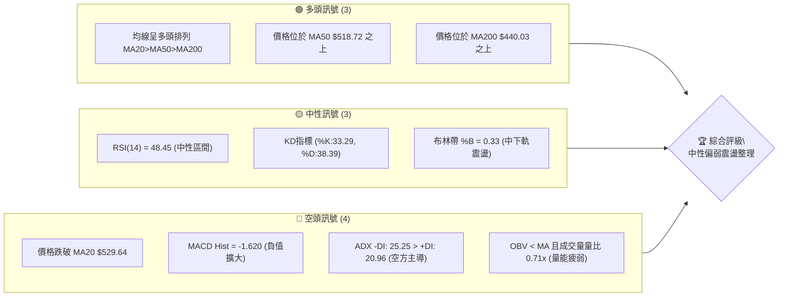
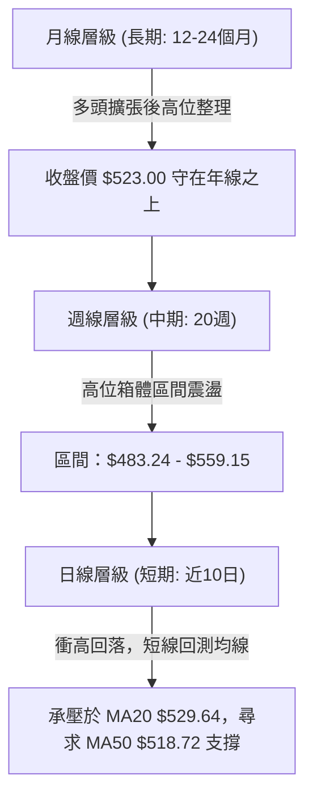
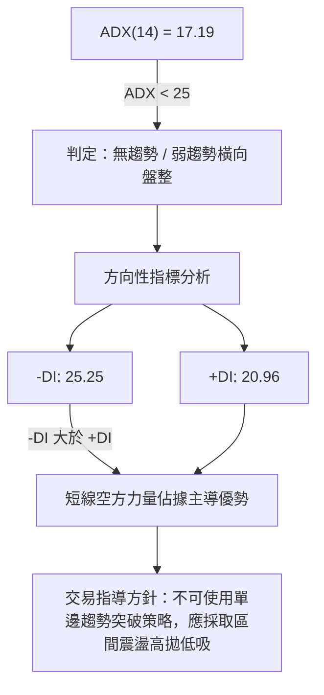
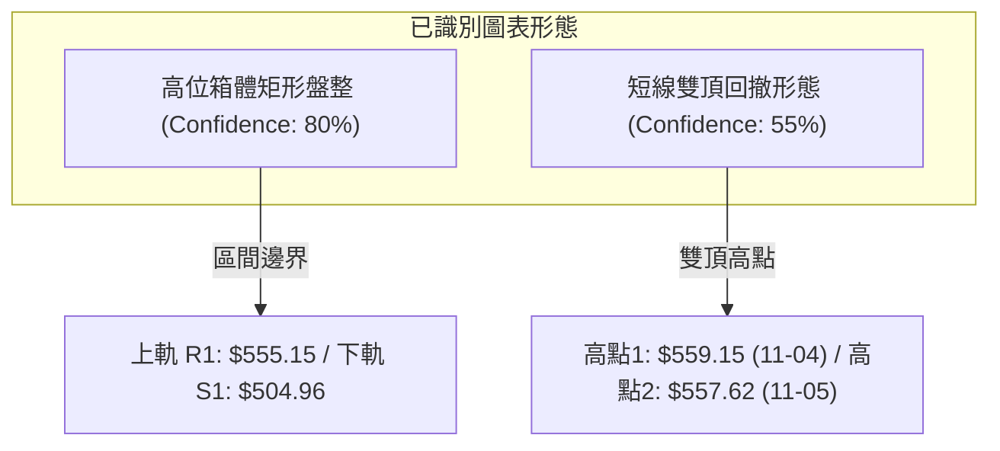
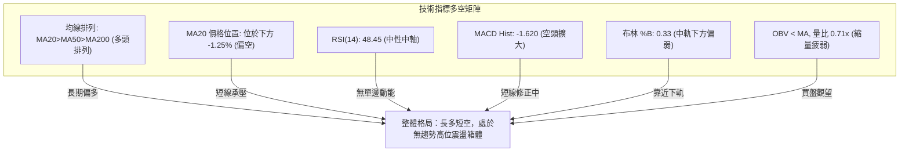
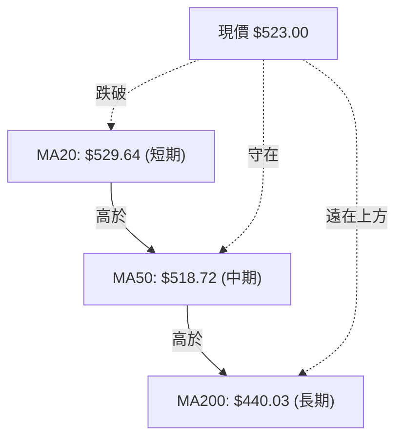
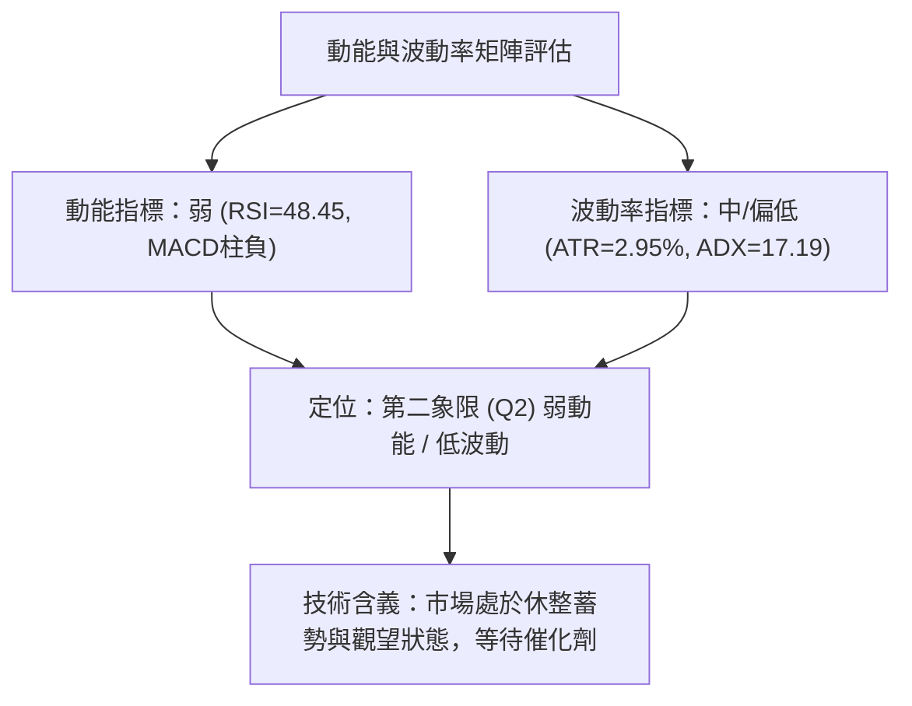
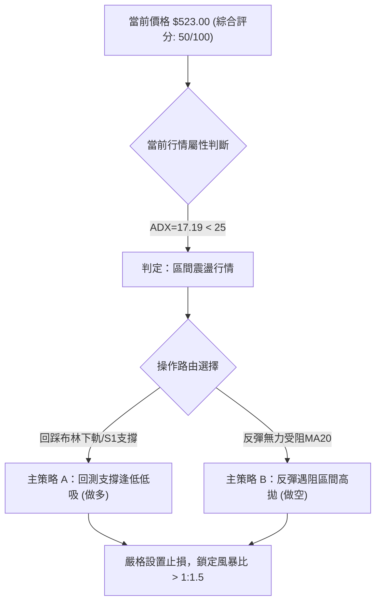
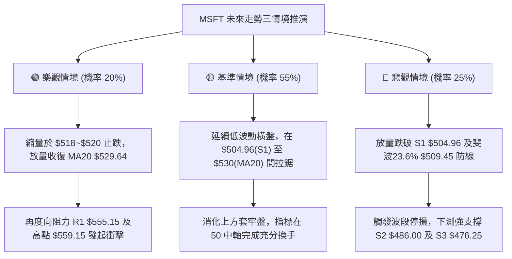

# MSFT 技術分析報告

> **報告日期**：2026-11-13 ｜ **語言**：繁體中文 ｜ **數據來源**：Yahoo Finance ｜ **當前價格**：$523.00

---

## 目錄

| 章節 | 內容 |
|------|------|
| [1. 技術面概覽](#1-技術面概覽) | 訊號儀表板、核心指標、評分卡 |
| [2. 趨勢分析](#2-趨勢分析) | 多時框趨勢、長中短期走勢 |
| [3. 圖表形態分析](#3-圖表形態分析) | 形態識別、K線組合、目標價 |
| [4. 支撐與阻力](#4-支撐與阻力) | 關鍵價位、斐波那契回調 |
| [5. 技術指標深度解讀](#5-技術指標深度解讀) | MA/RSI/MACD/布林/成交量 |
| [6. 動能與波動率](#6-動能與波動率) | 動能評估、ATR、Beta |
| [7. 多時框架總結](#7-多時框架總結) | 時框架評分矩陣 |
| [8. 交易策略建議](#8-交易策略建議) | 多空策略、風險報酬比 |
| [9. 風險提示與監控](#9-風險提示與監控) | 監控指標、風險場景 |

---

## 1. 技術面概覽

### 🎯 技術訊號儀表板



### 📊 核心指標速覽表

| 指標類別 | 指標名稱 | 當前數值 | 訊號 | 解讀 |
|----------|----------|----------|------|------|
| **價格** | 當前收盤價 | $523.00 | 🟡 | 位於52週區間82.8%高位，短線自52W高點回落 |
| **均線** | MA20 (月線) | $529.64 | 🔴 | 收盤價低於MA20（-$6.64，-1.25%），短線承壓 |
| **均線** | MA50 (季線) | $518.72 | 🟢 | 收盤價高於MA50（+$4.28，+0.82%），中期支撐仍在 |
| **均線** | MA200 (年線) | $440.03 | 🟢 | 收盤價遠高於年線（+$82.97，+18.86%），長期多頭基調 |
| **動能** | RSI(14) | 48.45 | 🟡 | 位於40-60中性格局，無超買超賣，多空動能暫時平衡 |
| **動能** | MACD(12,26,9) | Hist: -1.620 | 🔴 | 快線2.693低於慢線4.313，柱狀圖為負，動能偏空 |
| **趨勢** | ADX(14) | 17.19 | 🟡 | 數值小於25，代表目前處於無明顯單邊趨勢的盤整行情 |
| **量能** | 20日成交量比 | 0.71x | 🔴 | 成交量18.59M低於20日均量26.17M，OBV低於均線顯示追價乏力 |
| **波動** | ATR(14) | $15.42 | 🟡 | 波動率佔股價2.95%，屬於中等正常波動水準 |

### 🏆 技術評分卡

```
╔══════════════════════════════════════════════════════════════╗
║               技術評分卡 — MSFT (2026-11-13)                 ║
╠══════════════════════════════════════════════════════════════╣
║ 趨勢強度 (ADX=17.19, -DI主導)   ████████░░░░░░░░░░░░  40/100 🔴 ║
║ 動能指標 (RSI=48.45, MACD柱負)  ████████░░░░░░░░░░░░  40/100 🔴 ║
║ 支撐穩定度 (守住S1與MA50)       ██████████████░░░░░░  70/100 🟢 ║
║ 成交量配合 (量比0.71x, OBV偏弱) ██████░░░░░░░░░░░░░░  30/100 🔴 ║
║ 形態完整度 (區間矩形震盪整理)   ████████████░░░░░░░░  60/100 🟡 ║
║ 均線排列 (多頭排列但跌破MA20)   ████████████░░░░░░░░  60/100 🟡 ║
╠══════════════════════════════════════════════════════════════╣
║ 綜合評分 (六項算術平均四捨五入) ██████████░░░░░░░░░░  50/100 🟡 ║
║ 評級結論：中性觀望 / 區間震盪整理 (Neutral Consolidation)    ║
╚══════════════════════════════════════════════════════════════╝
```

---

## 2. 趨勢分析

### 🌐 多時框趨勢分析



### 📈 長期趨勢 — 12個月走勢圖（Unicode）

依據 2025-12 至 2026-11 之月線收盤價繪製：
```
MSFT 月線走勢圖（過去12個月：2025-12 至 2026-11）
價格 ($)
$530 ┤                                                 ● $523.00 (現在)
$520 ┤                                           ● $521.91
$510 ┤                                     ● $512.90
$500 ┤                               ● $507.29
$480 ┤● $480.57
$460 ┤                         ● $463.85
$440 ┤                   ● $449.39
$420 ┤       ● $427.58
$400 ┤             ● $406.13
$390 ┤   ● $391.15
$370 ┤         ● $368.68 (波段低點)   ● $372.32
     └─────────────────────────────────────────────────────────────
       12  01  02  03    04    05    06    07    08    09    10    11 (月)
       '25 <----------------------- 2026 ------------------------>
```

#### 走勢特徵分析表格

| 階段區間 | 月份起訖 | 收盤價區間 ($) | 區間幅度 | 趨勢特徵與價量配合解讀 |
|----------|----------|----------------|----------|------------------------|
| **深幅回調** | 2025-12 ~ 2026-03 | $480.57 → $368.68 | -23.28% | 連續4個月下挫，於2026年3月觸及波段低點 $368.68 |
| **初期反彈** | 2026-03 ~ 2026-05 | $368.68 → $449.39 | +21.89% | 雙月強力反彈，收復440元整數大關並重返年線 |
| **二次探底** | 2026-05 ~ 2026-06 | $449.39 → $372.32 | -17.15% | 單月重挫回測前低，構築大級別雙重底支撐（$368.68/$372.32） |
| **主升浪推進** | 2026-06 ~ 2026-08 | $372.32 → $507.29 | +36.25% | 7月單月暴漲至 $463.85，8月強勢站上500美元關卡 |
| **高位箱體橫盤** | 2026-08 ~ 2026-11 | $507.29 → $523.00 | +3.10% | 進入高位窄幅收斂，創下52W高點 $559.15 後進入橫向盤整 |

### 📊 中期趨勢（週線分析）

```
MSFT 中期週線壓力與支撐示意圖
$560 ┤                    ▲ 52W High $559.15 (波段天花板)
$555 ┤                    ══════════════════════ 阻力位 R1: $555.15
$540 ┤               ╭──╮
$530 ┤         ╭──╮  │  │  ╭──  ◄ 當前收盤價: $523.00
$520 ┤   ╭──╮  │  │  │  │  │    ══════════════════════ MA50: $518.72
$510 ┤───╯  ╰──╯  ╰──╯  ╰──╯    ══════════════════════ 斐波那契 23.6%: $509.45
$505 ┤                           ══════════════════════ 支撐位 S1: $504.96
     └─────────────────────────────────────────────────────────────
      09/25 10/02 10/09 10/16 10/23 10/30 11/06 11/12 (週K時間軸)
```

從近8週週K走勢觀察，MSFT在2026-10-09首度收於 $535.07，其後於2026-11-06當週盤中衝高至52W高點 $559.15，然而收盤回吐至 $530.61，形成長上影線。最新一週（截至2026-11-12）收於 $523.00，週成交量降至99.94M，呈現典型的高位縮量滯漲態勢。

### ⚡ 趨勢強度評估（ADX 解讀）



#### ADX 強度對照表

| 指標變數 | 當前讀數 | 門檻區間 | 趨勢狀態判定 | 交易策略意涵 |
|----------|----------|----------|--------------|--------------|
| **ADX(14)** | **17.19** | 0 ~ 25 | 弱趨勢 / 無方向盤整 | 趨勢跟隨指標失效，價格容易在區間內來回拉鋸 |
| **+DI(14)** | **20.96** | 參照 -DI | 多方動能衰退 | 多頭缺乏足夠推動力發動持續性上攻 |
| **-DI(14)** | **25.25** | 參照 +DI | 空方動能領先 | 短期賣壓佔優，需提防價格進一步向下考驗支撐 |

---

## 3. 圖表形態分析

### 🔍 形態識別系統



依規則 15 評估形態信心度：

| 形態名稱 | 信心度 | 判斷依據（引用數據） | 完成度 | 目標價（附精確計算式） |
|----------|--------|----------------------|--------|------------------------|
| **高位箱體整理** | **80%** | 價格在近一個月波動範圍受制於 R1: $555.15 與 S1: $504.96 之間，ADX=17.19 確認盤整。 | 75% | 箱體等幅下測目標 = 箱體底 $504.96 − (箱頂 $555.15 − 箱底 $504.96) = $504.96 − $50.19 = **$454.77**（跌破確認後；當前仍在箱內） |
| **日線潛在雙頂** | **55%** | 11-04日高點 $559.15 與 11-05日高點 $557.62 形成微型雙頂，頸線為11-06低點 $524.47。 | 60% | 頸線 $524.47 − (雙頂平均 $558.39 − 頸線 $524.47) = $524.47 − $33.92 = **$490.55**（形態高度推算） |
| **大型頭肩底** | **<50%** | 2026年歷史底部數據不足以確認完整右肩頸線突破。 | N/A | **訊號不足，僅做指標型解讀**（依規則 15 不予採納） |

### 🕯️ 重要K線形態分析

依規則 19，完全依據數據中「近10根日K」與「近8根週K」的實際 OHLC 數據判斷：

| 日期（週期） | 開盤價 | 最高價 | 最低價 | 收盤價 | K線形態名稱 | 技術解讀 | 訊號 |
|--------------|--------|--------|--------|--------|-------------|----------|------|
| **11-04 (日K)** | 543.70 | 559.15 | 542.30 | 555.80 | **實體大陽線** | 突破放量上攻（50.8M股），創52週新高 $559.15，多方動能達到極致 | 🟢 |
| **11-05 (日K)** | 554.94 | 557.62 | 532.68 | 535.93 | **長陰反噬 / 烏雲罩頂** | 高開低走重挫近20美元，完全回吐前日漲幅，42.5M大量出貨訊號 | 🔴 |
| **11-06 (日K)** | 525.69 | 538.33 | 524.47 | 530.61 | **低開反彈小陽線** | 低位暫獲支撐，但成交量縮減至26.96M，顯示買盤謹慎 | 🟡 |
| **11-09 (日K)** | 544.49 | 548.28 | 538.70 | 545.18 | **高開震盪陽線** | 試圖反抽突破，但未過前高即遇阻，量能持續遞減至25.34M | 🟡 |
| **11-10 (日K)** | 542.98 | 544.19 | 526.37 | 533.16 | **帶下影小陰線** | 再次失守540關卡，高點逐步下移，呈現空方壓制節奏 | 🔴 |
| **11-11 (日K)** | 534.24 | 534.76 | 518.45 | 521.13 | **中實體陰線** | 跌破MA20與520關卡，最低見 $518.45（逼近MA50），空方掌控局勢 | 🔴 |
| **11-12 (日K)** | 521.10 | 529.66 | 520.00 | 523.00 | **縮量十字小陽星** | 最低 $520.00 守住整數，縮量至18.59M（量比0.71x），多空短線陷入僵局 | 🟡 |
| **11-06 (週K)** | 524.02 | 559.15 | 504.96 | 530.61 | **長上影流星線 (Shooting Star)** | 單週振幅逾54美元，巨量175M於高位爆發，收盤大幅回落，強烈見頂預警 | 🔴 |
| **11-12 (週K)** | 544.49 | 548.28 | 518.45 | 523.00 | **回調中陰線** | 週K連續兩週走弱，重心持續下移，承壓於530美元下方 | 🔴 |

### 📉 ASCII 走勢形態示意圖

```
日K線雙頂回落與箱體結構示意圖
價格 ($)
$560 ┤               [頂1: $559.15]
$555 ┤                     ╭─╮        [頂2: $557.62]
$550 ┤                     │ │              ╭─╮
$545 ┤                     │ │        ╭─╮   │ │
$540 ┤                     │ │        │ │   │ │
$535 ┤               ╭─╮   │ │        │ │   │ ╰───╮
$530 ┤               │ │   │ │  ╭─╮   │ │   │     │        [現價: $523.00]
$525 ┤   ╭─╮         │ │   │ │  │ │   │ │   │     ╰─╮         ┌─┐
$520 ┤   │ ╰───╮     │ │   │ │  │ │   │ │   │       ╰───╮     │ │
$515 ┤   │     │     │ │   │ │  │ │   │ │   │           ╰───┐ │ │
$510 ┤   │     ╰─╮   │ │   │ │  │ │   │ │   │               └─┘ │
$505 ┤   │       ╰───╯ └───╯ └──┴─╯───┴─┴───┴───────────────────┴──── 支撐 S1: $504.96
     └─────────────────────────────────────────────────────────────
        10/30  11/02  11/03 11/04 11/05 11/06 11/09 11/10 11/11 11/12 (日K)
```

### 🎯 形態目標價計算

1. **高位箱體理論下測目標價**：
   - 箱體頂部（阻力 R1）：$555.15
   - 箱體底部（支撐 S1）：$504.96
   - 箱體高度 $H = \$555.15 - \$504.96 = \$50.19$
   - 若未來有效跌破 $504.96，測量下行目標價 $T_{box} = \$504.96 - \$50.19 = \mathbf{\$454.77}$。
2. **微型雙頂理論量度跌幅**：
   - 雙頂平均高點：$(\$559.15 + \$557.62) / 2 = \$558.39$
   - 雙頂頸線位（11-06低點）：$524.47
   - 形態高度 $h = \$558.39 - \$524.47 = \$33.92$
   - 理論跌破目標價 $T_{double\_top} = \$524.47 - \$33.92 = \mathbf{\$490.55}$（接近下方重要支撐 S2: $486.00）。

---

## 4. 支撐與阻力

### 🗺️ 關鍵價位分布圖（Unicode）

```
MSFT 價位結構分布圖
═══════════════════════════════════════════════════════════
$559.15 ║████████████████████████████████║ 52W High (歷史極值)
$555.15 ║██████████████████████████      ║ 關鍵阻力 R1 (+6.15%)
$549.55 ║▓▓▓▓▓▓▓▓▓▓▓▓▓▓▓▓▓▓▓            ║ 布林通道上軌
$529.64 ║▒▒▒▒▒▒▒▒▒▒▒▒                    ║ 布林中軌 / MA20 (短線反壓)
$523.00 ╠════════════════════════════════╣ ◄ 當前收盤價 ($523.00)
$518.72 ║░░░░░░░░░░░░                    ║ MA50 均線支撐
$509.74 ║▒▒▒▒▒▒▒▒▒▒▒▒▒▒▒▒                ║ 布林通道下軌
$509.45 ║▓▓▓▓▓▓▓▓▓▓▓▓▓▓▓▓                ║ 斐波那契 23.6% 回調位
$504.96 ║████████████████████            ║ 近期支撐 S1 (-3.45%)
$486.00 ║████████████████████████        ║ 強支撐 S2 (-7.07%)
$476.25 ║████████████████████████████    ║ 極強支撐 S3 (-8.94%)
═══════════════════════════════════════════════════════════
```

### 🚧 阻力位分析表

全部價位引用技術數據之精確數值：

| 阻力級別 | 價位 ($) | 距現價幅離 | 形成原因與結構強度 | 突破難度 | 重要性評級 |
|----------|----------|------------|--------------------|----------|------------|
| **短線反壓** | **$529.64** | +1.27% | 布林帶中軌與 MA20 交匯處，5日/10日/20日均線密集壓制區 | 中等 | 🟡 次要阻力 |
| **次要阻力** | **$549.55** | +5.08% | 布林通道上軌壓力線，近期衝高回落換手密集區 | 較高 | 🟡 中級阻力 |
| **關鍵阻力 R1** | **$555.15** | +6.15% | 近一年波段高點聚類位，近兩週多次上攻均在此處遭遇巨量拋壓 | 極高 | 🔴 核心強阻力 |
| **52W 高點** | **$559.15** | +6.91% | 2026-11-04 錄得之52週最高價，極端多頭情緒瓦解處 | 極高 | 🔴 歷史天花板 |

### 🛡️ 支撐位分析表

全部價位引用技術數據之精確數值：

| 支撐級別 | 價位 ($) | 距現價幅離 | 形成原因與結構強度 | 守住機率 | 重要性評級 |
|----------|----------|------------|--------------------|----------|------------|
| **動態支撐** | **$518.72** | -0.82% | 50日移動平均線 (MA50)，中期多頭防線，昨日低點 $518.45 獲得初步支撐 | 65% | 🟢 短線防線 |
| **技術支撐** | **$509.45** | -2.59% | 斐波那契 23.6% 回調位，緊鄰布林帶下軌 $509.74 | 70% | 🟢 技術共振區 |
| **近期支撐 S1** | **$504.96** | -3.45% | 近一年波段低點聚類位，11-02當日下影線低點，箱體下邊界 | 80% | 🟢 核心強支撐 |
| **強支撐 S2** | **$486.00** | -7.07% | 近一年波段次級低點聚類位，8月中下旬回調整理平台 | 85% | 🟢 波段護城河 |
| **極強支撐 S3** | **$476.25** | -8.94% | 近一年重大波段低點聚類位，接近斐波那契 38.2% ($478.70) | 90% | 🟢 終極防守位 |

### 📐 斐波那契回調位分析

依據 52 週波動區間（低點 $348.54 → 高點 $559.15，總垂直垂直波幅 $210.61）之回調位：

```
斐波那契回調層級解讀
$559.15 ├─ 0.0% (52W High) 頂部壓力
         │
$523.00 ├─ [當前現價落點] ── 位於 0.0% 與 23.6% 之間的強勢高位整理區
         │
$509.45 ├─ 23.6% 回調位 ── 第一道關鍵回檔防線（跌幅未達極限，屬強勢整理）
         │
$478.70 ├─ 38.2% 回調位 ── 中期回調健康分水嶺（緊鄰波段支撐 S3: $476.25）
         │
$453.85 ├─ 50.0% 回調位 ── 多空強弱平衡中軸
         │
$429.00 ├─ 61.8% 回調位 ── 黃金分割黃金支撐位（逼近 MA200 $440.03）
         │
$393.61 ├─ 78.6% 回調位 ── 深幅調整極限位
         │
$348.54 └─ 100.0% (52W Low) 歷史底部
```

- **位置解讀**：當前現價 $523.00 處於 0.0% ($559.15) 至 23.6% ($509.45) 之間。
- **技術意義**：在經歷大幅上漲後，價格回調連 23.6% 的淺幅回調位都未實質跌破，在道氏理論與斐波那契架構下，仍屬於**強勢多頭格局中的局部回撤**。只有當日線實體跌破 $509.45，才會打開下探 38.2%（$478.70）的空間。

---

## 5. 技術指標深度解讀

### 🎛️ 指標訊號總覽



### 📈 移動平均線排列分析



#### 均線系統深度診斷表

| 均線名稱 | 當前價格 | 與現價差額 | 偏差率 | 趨勢斜率 | 技術意涵解讀 |
|----------|----------|------------|--------|----------|--------------|
| **MA 5** | $530.62 | -$7.62 | -1.44% | 下彎 ▼ | 超短線下行壓制，5日均線成為日內反彈首要阻力 |
| **MA 10** | $529.48 | -$6.48 | -1.22% | 下彎 ▼ | 短線扣高走低，與 MA20 形成糾結向下反壓 |
| **MA 20** | $529.64 | -$6.64 | -1.25% | 下彎 ▼ | 月線失守，短線多頭防守轉為被動，上升斜率趨平 |
| **MA 50** | $518.72 | +$4.28 | +0.82% | 上揚 ▲ | 季線持續攀升，多頭核心生命線，提供強勁動態支撐 |
| **MA 60** | $514.99 | +$8.01 | +1.55% | 上揚 ▲ | 中期支撐帶，斜率穩定向上 |
| **MA120** | $466.44 | +$56.56 | +12.13%| 上揚 ▲ | 半年線顯著落後，中長期資金成本優勢顯著 |
| **MA200** | $440.03 | +$82.97 | +18.86%| 上揚 ▲ | 牛熊分界線穩定上行，長期牛市基調完全未被破壞 |
| **MA240** | $445.70 | +$77.30 | +17.34%| 上揚 ▲ | 超長期均線平穩，支撐長期估值中樞 |

### 📉 RSI(14) 分析

- **當前讀數**：**48.45**（Wilder 計算法）
- **動能強度進度條**：
  ```
  RSI(14): [█████████░░░░░░░░░░] 48.45% (中性平衡區間 30~70)
  ```
- **區間評估**：
  RSI 位於 50 多空中軸略下方（48.45），顯示自 11-04 創高以來的多頭超買動能已完全釋放完畢，目前市場進入多空暫時均衡狀態，無超買（>70）或超賣（<30）極端情況。
- **背離分析判斷**：
  - **日線背離判定**：檢視數據指出「RSI 背離：無明顯背離（僅比較近20根K棒首尾的價格與RSI方向）」。價格從20週前 $389.76 漲至 $523.00，RSI由49.8微降至48.4，未出現價格創新高而 RSI 急劇走低的標準大型頂背離，亦無底背離訊號。
  - **結論**：指標呈中性震盪，短線不具備單邊突破背離引導條件。

### 📊 MACD(12/26/9) 訊號解讀


- **數值狀態**：DIF快線（2.693）處於零軸之上，但低於訊號線DEA（4.313），形成高位死叉後續跌態勢。
- **柱狀圖動態**：MACD Hist 為 **-1.620**。回顧近幾週週K柱狀圖：
  - 10-09: +1.490 → 10-16: +0.273 → 10-23: -2.311 → 10-30: -2.262 → 11-06: -0.591 → 11-12: -1.620
  - 柱狀圖在零軸下方再度走擴，代表短線回調動能尚未衰竭，修正行情仍未結束。

### 📦 布林通道分析

```
MSFT 日線布林通道結構 (20日, 2倍標準差)
═══════════════════════════════════════════════════════════
$549.55 ├──────────────────────────── 上軌 Upper Band (+5.08%)
         │
$529.64 ├- - - - - - - - - - - - - - 中軌 Middle Band (MA20: $529.64)
         │  ◄ 當前現價: $523.00 (%B = 0.33)
$509.74 ├──────────────────────────── 下軌 Lower Band (-2.54%)
═══════════════════════════════════════════════════════════
```

- **通道帶寬與形態**：通道寬度 $W = \$549.55 - \$509.74 = \$39.81$（帶寬佔比約 7.5%），帶寬並未呈現急劇張口或極度收口，處於平緩橫向延伸狀態。
- **%B 位置解讀**：**%B = 0.33**，表明價格已由中軌跌向通道下半部，位於中軌（0.5）與下軌（0.0）之間的三分之一處，屬於「弱勢震盪」區域，下軌 $509.74 與斐波那契回調位 $509.45 高度重合，構成即期下方強支撐屏障。

### 💹 成交量分析（量價配合度）

```
成交量對比進度條 (最新 18.59M vs 20日均量 26.17M)
最新成交量: [███████░░░░░░░░░░] 18.59M (量比 0.71x)
20日均量:   [██████████░░░░░░░] 26.17M
50日均量:   [█████████░░░░░░░░] 23.29M
```

- **量價關係解讀**：
  1. **放量滯漲與縮量回調**：11-04 股價衝高至 $559.15 時放量至 50.8M，次日 11-05 暴跌時亦伴隨 42.5M 的巨量，顯現主力資金高位套現跡象。
  2. **縮量下挫尋底**：近三日（11-10 至 11-12）成交量分別為 26.9M、29.1M 及 18.59M，量能顯著萎縮。11-12 創下近期地量 18.59M（量比 0.71x），顯示空方主動性拋壓開始衰竭，但同時買盤極度匱乏。
  3. **OBV（能量潮）分析**：數據顯示「OBV < MA → 量能疲弱」，OBV 運行於其均線下方，說明資金淨流出，量能未能對價格走勢形成正向確認，短線難以支持強勢V型反轉。

---

## 6. 動能與波動率

### ⚡ 動能評估四象限



#### 四象限狀態分佈表

| 象限 | 動能強度 | 波動率 | 當前標記 | 策略指導與市場心理評估 |
|------|----------|--------|----------|------------------------|
| **Q1** | 強 (Bullish) | 低 (Low Vol) | — | 最佳穩健做多機會，趨勢平穩上行 |
| **Q2** | **弱 (Bearish/Neutral)** | **低 (Low Vol)** | **✓ (當前狀態)** | **謹慎觀望，多空雙方觀望情緒濃，以區間低吸高拋或等待破局為主** |
| **Q3** | 強 (High Momentum) | 高 (High Vol) | — | 高風險高收益階段，突破暴漲或暴跌 |
| **Q4** | 弱 (Weak) | 高 (High Vol) | — | 恐慌拋售或無序震盪，嚴格避免持倉 |

### 📊 ATR 波動率分析

- **ATR(14) 數值**：**$15.42**（Wilder 計算法）
- **價格佔比**：$15.42 / \$523.00 = \mathbf{2.95\%}$
- **波動特性評估**：日均波幅約 15.42 美元，佔比低於 3%，顯示標的屬於中大型權值股的常態良性波動，未出現異常失控波動。
- **動態止損與倉位設定建議**：
  - **超短線/日內交易止損**：設定為 $1.0 \times \text{ATR} = \mathbf{\$15.42}$
  - **波段交易止損**：設定為 $1.5 \times \text{ATR} = \$23.13$
  - **中期防守寬容度**：設定為 $2.0 \times \text{ATR} = \$30.84$
  - 若在現價 $523.00 建立多頭部位，合理的技術止損位不應小於 $\$523.00 - \$15.42 = \$507.58$，此價位恰好位於布林下軌 $509.74 與支撐 S1 $504.96 之間，能有效過濾盤中毛刺雜訊。

### 📐 Beta 與市場相關性

- **Beta 數值**：**1.045**
- **市場特徵分析**：
  - MSFT 的 Beta 值非常接近 1.0，表明其與標普500指數（S&P 500）及整體美股市場具備極高的同步性（略微高出 4.5% 的系統性彈性）。
  - 在整體科技股板塊受到宏觀流動性或權重股調整衝擊時，MSFT 難以走出完全獨立的逆勢行情；因此，交易佈局必須緊密跟隨美股大盤環境。
  - 當前空頭借用其 0.8% 的極低空頭流通比（Short % Float）與 2.78 的 Short Ratio，顯示市場並無大規模空頭惡意狙擊，股價回調主要來自高位多頭獲利了結盤的釋放。

---

## 7. 多時框架總結

### 📋 時框架評分表

| 時框架 | 趨勢方向 | 動能狀態 | 均線排列 | 圖表形態 | 綜合評分 | 戰略建議 |
|--------|----------|----------|----------|----------|----------|----------|
| **長期 (月線)** | 🟢 向上偏多 | 🟡 中性平衡 | 🟢 多頭排列 | 歷史高位震盪箱體 | **75/100** | 長線多頭持股，逢深幅回調加碼 |
| **中期 (週線)** | 🟡 橫向震盪 | 🔴 動能回落 | 🟢 MA50向上 | 高位長上影流星線壓制 | **50/100** | 中期區間操作，嚴控持倉水位 |
| **短期 (日線)** | 🔴 弱勢修正 | 🔴 空方佔優 | 🔴 跌破MA20 | 雙頂回落，考驗下軌支撐 | **35/100** | 短線禁止盲目追高，等待止跌訊號 |

### 🔲 綜合訊號矩陣

```
時框架訊號矩陣分佈
週期維度      均線趨勢     動能指標     量價配合     支撐阻力驗證   最終方向
────────────────────────────────────────────────────────────────
短期 (日K)    🔴 破MA20    🔴 MACD死叉  🔴 縮量觀望  🟡 考驗MA50     🔴 偏空調整
中期 (週K)    🟢 守MA50    🟡 RSI=48.4  🔴 流星陰線  🟢 守斐波23.6%  🟡 區間震盪
長期 (月K)    🟢 遠高MA200 🟢 多頭架構  🟢 機構控盤  🟢 守500大關    🟢 多頭主導
────────────────────────────────────────────────────────────────
```

### ⚖️ 多時框收斂結論

依「嚴格要求 14」與「規則 18」進行多時框訊號收斂：
1. **趨勢/盤整行情判定**：當前日線 ADX(14) 讀數為 **17.19**，遠小於 25 臨界值，明確判定當前為**盤整行情（Consolidation Market）**，而非單邊趨勢行情。
2. **多時框收斂優先級**：在盤整行情中，依規則 14 規定，**以日線布林通道上下軌（$509.74 ~ $549.55）為主要交易區間**。中長期的多頭排列（MA20>MA50>MA200）提供下檔堅實防護，而短線的跌破 MA20 則確立了向區間下軌尋求支撐的路徑。
3. **唯一方向性結論**：**中性觀望 / 區間震盪整理（偏下軌防守）**。
   - 綜合技術評分精確為 **50/100**（第 1 章六項子評分之算術平均）。
   - 交易主基調為：**不追空、不追高，依託布林通道下軌及關鍵支撐 S1 進行防守型逢低佈局，並於中軌上方逐步減速獲利**。

---

## 8. 交易策略建議

### 🗺️ 策略決策流程圖



### 🧭 策略路由（依評分卡分流）

> **當前主策略方向 = 中性區間震盪操作（依綜合評分 50/100）**
> 
> 由於評分處於 40–60 之中性區間，不具備單邊重倉追擊條件。依據規則 14 與規則 17，採取**以布林帶下軌及重要支撐 S1 為核心的區間下緣低吸多頭策略為主**，輔以**反彈受阻於中軌的極輕倉高拋策略**，嚴格「等待支撐或阻力位觸及確認」。

### 🎯 價格情境階梯（Price Scenarios）

價位完全嚴格引用數據區塊之精確數值：

| 觸發條件 | 下一目標 | 後續延伸 | 情境技術含義解讀 |
|----------|----------|----------|------------------|
| **向上突破 R1 $555.15** | 52W High $559.15 | N/A（數據未提供） | 強勢突破箱頂，宣告重啟大級別主升浪 |
| **向上收復 MA20 $529.64** | 布林上軌 $549.55 | 關鍵阻力 R1 $555.15 | 短線止跌轉強，多頭重掌短線定價權 |
| **站穩現價區間 $520.00~$523.00** | MA20 $529.64 | 布林上軌 $549.55 | 區間震盪整理，消化上方套牢籌碼 |
| **回踩跌破 MA50 $518.72** | 斐波23.6% $509.45 | 關鍵支撐 S1 $504.96 | 短線震盪探底，考驗箱體下軌支撐強度 |
| **有效跌破 S1 $504.96** | 強支撐 S2 $486.00 | 極強支撐 S3 $476.25 | 箱體向下破位，中期多頭架構遭到破壞 |

### 📊 情境機率分佈

| 運行情境 | 機率預測 | 主要依據與指標支撐 |
|----------|----------|--------------------|
| **情境一：區間震盪築底** | **55%** | ADX=17.19 確認盤整無趨勢；RSI=48.45 處於中性；布林下軌 $509.74 與 S1 $504.96 提供堅實下檔緩衝。 |
| **情境二：回落探底破位** | **25%** | MACD 柱狀圖 -1.620 擴大；-DI=25.25 > +DI=20.96 空方主導；OBV 低於均線顯示買盤動能不足。 |
| **情境三：直接反轉上攻** | **20%** | 長期均線維持多頭排列（MA20>MA50>MA200）；但缺乏短期成交量配合（量比僅0.71x），直接突破難度大。 |

### 🟢 主策略詳情（區間震盪操作）

所有數值均基於第 4 章關鍵價位，進場價為區間時以中點計算，風險報酬比精確計算：

| 策略要素 | 策略 A（下軌支撐逢低低吸 - 多） | 策略 B（中軌遇阻高拋對沖 - 空） |
|----------|---------------------------------|---------------------------------|
| **進場條件** | 價格回踩 S1 與斐波 23.6% 區域企穩出現止跌K棒 | 價格反彈至 MA20 與布林中軌受阻回落 |
| **進場價格** | **$507.21**（區間 $504.96~$509.45 之區間中點） | **$529.64**（MA20 / 布林中軌反壓位） |
| **目標價 T1** | **$529.64**（MA20 / 布林中軌） | **$518.72**（MA50 支撐位） |
| **目標價 T2** | **$549.55**（布林通道上軌） | **$504.96**（關鍵支撐位 S1） |
| **止損價格** | **$495.00**（跌破 S1 $504.96 及整數防線） | **$537.00**（突破站穩 MA20 上方 1.5%） |
| **風險報酬比** | **1 : 1.84**（以 T1 計）<br>*(529.64-507.21)/(507.21-495.00)=22.43/12.21*<br>另：**1 : 3.47**（以 T2 計，分子 42.34） | **1 : 1.48**（以 T1 計）<br>*(529.64-518.72)/(537.00-529.64)=10.92/7.36*<br>另：**1 : 3.35**（以 T2 計，分子 24.68） |
| **成功機率** | **65%** | **50%** |
| **建議倉位** | **15% ~ 20%** | **5% ~ 10%**（輕倉防禦） |

### 🔴 反向風險觸發點（對沖提示）

- **多頭止損與對沖觸發**：若日線收盤價實體跌破 **$504.96 (S1)**，代表箱體震盪失敗，空方突破確立，應立即全數平倉多頭，並啟動反向避險機制，防範價格向下測試 **$486.00 (S2)**。
- **空頭止損與平倉觸發**：若日線放量收復 **$529.64 (MA20)** 且成交量重回 25M 以上，空方對沖應即刻止損離場，避免遭遇軋空行情。

### ⭐ 整體訊號強度評星

```
做多訊號強度：★★★☆☆  (3.0/5星 - 倚託長多格局與S1強支撐，但短線動能待修復)
做空訊號強度：★★☆☆☆  (2.0/5星 - 僅限短線均線反壓，下檔均線層層密布)
整體可信度：  ★★★★☆  (4.0/5星 - 盤整特徵極為明確，指標互相印證度高)
```

---

## 9. 風險提示與監控

### ✅ 關鍵監控指標 Checklist

```
╔══════════════════════════════════════════════════════════════╗
║               每日技術面監控清單 (Checklist)                 ║
╠══════════════════════════════════════════════════════════════╣
║ [ ] 價格是否跌破 MA50 動態支撐位 ($518.72)                   ║
║ [ ] 價格回踩 S1 ($504.96) 是否出現日K下影線或放量承接買盤      ║
║ [ ] 日成交量能否放大至 26.17M (20日均量) 之上打破縮量僵局    ║
║ [ ] RSI(14) 是否跌破 40 進入弱勢區，或重返 50 多空中軸之上    ║
║ [ ] MACD 綠色柱狀圖 (-1.620) 是否開始縮短形成底分型走勢       ║
║ [ ] ADX(14) 讀數是否突破 25，標誌單邊趨勢行情重新啟動         ║
╚══════════════════════════════════════════════════════════════╝
```

### ⚠️ 風險場景分析



### 🛡️ 風險管理重要提醒

1. **嚴防「縮量陰跌」陷阱**：目前最新成交量僅 18.59M（量比 0.71x），OBV 低於均線。縮量狀態下的反彈往往是「無量誘多」，切勿在 $529.64（MA20）下方急於追價。
2. **波動率定價保護**：當前 ATR(14) 為 $15.42，代表單日正常晃動即可能達 15 美元。任何進場策略的止損點嚴禁小於 1.0 倍 ATR（$15.42），否則極易在正常的盤整毛刺中被無謂震盪洗出場。
3. **倉位總量控管**：在 ADX < 25 的盤整震盪期中，資金使用效率下降，建議**整體股票倉位控制在 30%~40% 以內**，保留充足現金儲備，靜待放量突破訊號出現後再行順勢加碼。

---

## 📋 報告總結

```
╔══════════════════════════════════════════════════════════════╗
║               MSFT 技術分析報告總結                          ║
╠══════════════════════════════════════════════════════════════╣
║ 報告日期：2026-11-13                                         ║
║ 當前收盤：$523.00                                            ║
║ 綜合評分：50/100 (算術平均)                                  ║
║ 分析評級：⚖️ 中性觀望 / 區間震盪整理 (Neutral Consolidation) ║
╠══════════════════════════════════════════════════════════════╣
║ 關鍵結論：                                                   ║
║ ├─ 長期趨勢：🟢 強勢多頭 (均線多頭排列 MA20>MA50>MA200)     ║
║ ├─ 中期趨勢：🟡 區間震盪 (箱體範圍 $504.96 ~ $555.15)        ║
║ ├─ 短期趨勢：🔴 弱勢修正 (受制於 MA20 $529.64，尋求MA50支撐) ║
║ ├─ 關鍵支撐：S1: $504.96 ｜ 斐波23.6%: $509.45 ｜ MA50: $518.72 ║
║ ├─ 關鍵阻力：MA20: $529.64 ｜ 布林上軌: $549.55 ｜ R1: $555.15 ║
║ └─ 分析師共識目標：$636.12 (54位分析師均值，評級 Strong Buy) ║
╠══════════════════════════════════════════════════════════════╣
║ 最優策略組合：                                               ║
║ 1. 🥇 最佳機會：回踩支撐 S1 與斐波23.6%區間中點 $507.21 佈局 ║
║    多單，止損設 $495.00，目標 T1: $529.64 (風報比 1:1.84)    ║
║ 2. 🥈 次選機會：反彈遇阻 MA20 $529.64 輕倉對沖做空，目標      ║
║    T1: $518.72，止損設 $537.00 (風報比 1:1.48)              ║
║ 3. 🥉 保守選擇：維持場外空倉觀望，耐心等待日線放量收復        ║
║    $529.64 或回測 $504.96 企穩確認後再行介入                ║
╚══════════════════════════════════════════════════════════════╝
```

---

> ⚠️ **免責聲明**：本報告為 AI 自動生成之技術分析，所有數據及估算均基於提供的歷史價格資訊。本報告**僅供研究與學術參考**，**不構成任何投資建議**。投資有風險，入市需謹慎。

---

*報告生成時間：2026-11-13 ｜ 數據來源：Yahoo Finance ｜ 分析框架：多時框技術分析*