# MSFT 技術分析報告

> **報告日期**：2026-11-13 ｜ **語言**：繁體中文 ｜ **數據來源**：Yahoo Finance ｜ **當前價格**：$523.00

---

## 目錄

| 章節 | 內容 |
|------|------|
| [1. 技術面概覽](#1-技術面概覽) | 訊號儀表板、核心指標、評分卡 |
| [2. 趨勢分析](#2-趨勢分析) | 多時框趨勢、長中短期走勢 |
| [3. 圖表形態分析](#3-圖表形態分析) | 形態識別、K線組合、目標價 |
| [4. 支撐與阻力](#4-支撐與阻力) | 關鍵價位、斐波那契回調 |
| [5. 技術指標深度解讀](#5-技術指標深度解讀) | MA/RSI/MACD/布林/成交量 |
| [6. 動能與波動率](#6-動能與波動率) | 動能評估、ATR、Beta |
| [7. 多時框架總結](#7-多時框架總結) | 時框架評分矩陣 |
| [8. 交易策略建議](#8-交易策略建議) | 多空策略、風險報酬比 |
| [9. 風險提示與監控](#9-風險提示與監控) | 監控指標、風險場景 |

---

## 1. 技術面概覽

### 🎯 技術訊號儀表板

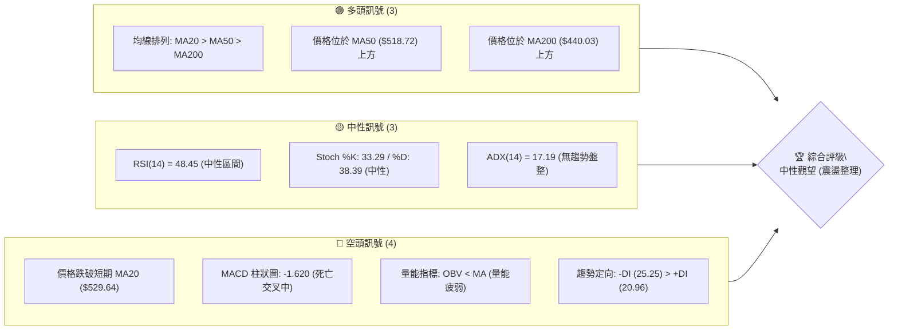

### 📊 核心指標速覽表

| 指標類別 | 指標名稱 | 當前數值 | 訊號 | 解讀 |
|:---|:---|:---|:---:|:---|
| **價格** | 當前收盤價 | $523.00 | 🟡 | 位於52週高低區間 82.8% 位置，近期自高點回落盤整 |
| **均線** | MA20 | $529.64 | 🔴 | 價格低於 MA20（▼ 下方），短線承受均線下壓壓力 |
| **均線** | MA50 | $518.72 | 🟢 | 價格高於 MA50（▲ 上方），中期多頭結構基底尚存 |
| **均線** | MA200 | $440.03 | 🟢 | 價格大幅高於 MA200（▲ 上方 +18.85%），長期多頭牛市架構明確 |
| **動能** | RSI(14) | 48.45 | 🟡 | 處於 30–70 中性平衡區，多空力道互有拉鋸，無超買超賣 |
| **動能** | MACD(12,26,9) | 2.693 / 訊號線 4.313 | 🔴 | MACD 處於訊號線下方，Histogram 為 -1.620，動能看空修正中 |
| **波動** | ATR(14) | $15.42 (2.95%) | 🟡 | 日間平均波動約 15.42 美元，波動率溫和正常 |

### 🏆 技術評分卡

```
╔════════════════════════════════════════════════════════════════╗
║                   技術評分卡 — MSFT (2026-11-13)               ║
╠════════════════════════════════════════════════════════════════╣
║ 趨勢強度       ████████░░░░░░░░░░░░  40/100  🔴 (ADX=17.19 弱) ║
║ 動能指標       ████████░░░░░░░░░░░░  40/100  🔴 (MACD柱負值)   ║
║ 支撐穩定度     ██████████████░░░░░░  70/100  🟢 (MA50/S1防線)  ║
║ 成交量配合     ████████░░░░░░░░░░░░  40/100  🔴 (量縮/OBV疲弱) ║
║ 形態完整度     ██████████░░░░░░░░░░  50/100  🟡 (區間箱體震盪) ║
║ 均線排列       ██████████████░░░░░░  70/100  🟢 (多頭排列維持) ║
╠════════════════════════════════════════════════════════════════╣
║ 綜合評分       ██████████░░░░░░░░░░  52/100  🟡 中性觀望 (區間)║
╚════════════════════════════════════════════════════════════════╝
```
*註：綜合評分 = (40 + 40 + 70 + 40 + 50 + 70) ÷ 6 = 51.67，四捨五入為 52/100，落於 40–60 中性區間。*

---

## 2. 趨勢分析

### 🌐 多時框趨勢分析

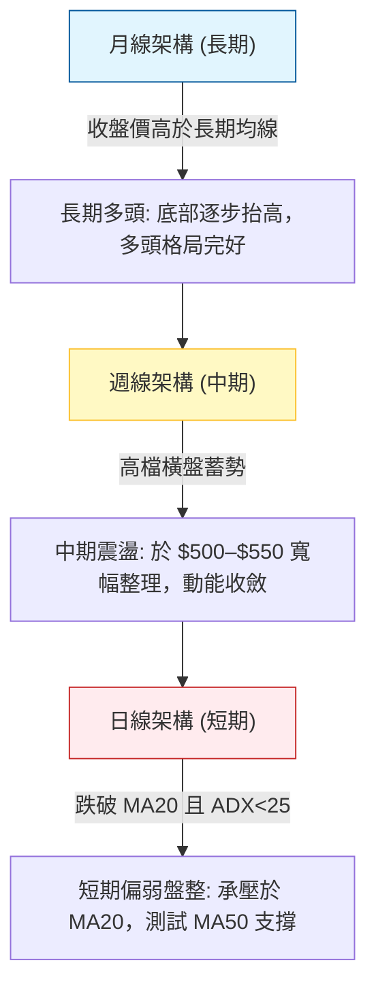

### 📈 長期趨勢 — 12個月走勢圖（Unicode）

```
MSFT 月線走勢圖（過去12個月：2025-12 至 2026-11）
價格軸 ($)
$550 ┤                                                    ● 2026-11 ($523.00)
$520 ┤                                            ●       │
$490 ┤                                        ●   │   ●───┘ 2026-10 ($521.91)
$460 ┤● 2025-12 ($480.57)                 ●   │   │
$430 ┤    ● 2026-01 ($427.58)             │   │   │
$400 ┤        ● 2026-02 ($391.15) ● 2026-04│   │   │
$370 ┤            ● 2026-03       │       │   │   │
$340 ┤             ($368.68)      ● 2026-06   │   │
     └────────────────────────────($372.32)───┴───┴─────────────────
       D1  D2  D3  D4  D5  D6  D7  D8  D9 D10 D11 D12 (月份)
      12月 01月 02月 03月 04月 05月 06月 07月 08月 09月 10月 11月
```

**走勢特徵分析表格**：

| 階段區間 | 起訖月份 | 起訖價格 ($) | 漲跌幅 | 走勢特徵與技術意義 |
|:---|:---:|:---:|:---:|:---|
| **深幅回調期** | 2025-12 至 2026-03 | 480.57 → 368.68 | -23.28% | 連續4個月下行，於 2026-03 探底 $368.68，逼近52週低點 $348.54 |
| **反彈與二次測底** | 2026-04 至 2026-06 | 406.13 → 372.32 | -8.32% | 04-05月反彈至 $449.39 後遭逢賣壓，06月急速二次探底 $372.32 確立雙重底支撐 |
| **強勁主升波** | 2026-07 至 2026-10 | 463.85 → 521.91 | +12.52% | 07月拉出大陽線突破均線壓制，08-10月穩步墊高並攻破 $500 大關 |
| **高檔收斂整固** | 2026-10 至 2026-11 | 521.91 → 523.00 | +0.21% | 創下 52週新高 $559.15 後回落整理，多空在 $520–$530 展開拉鋸 |

### 📊 中期趨勢（週線分析）

中期走勢呈現「突破後的回踩確認」。近 8 週K線顯示，股價自 2026-09-25 週收盤 $516.17 持續走高至 2026-11-06 週衝高至 52週高點 $559.15，隨後收於 $530.61；本週（截至 2026-11-12）收於 $523.00，測試 5週均線附近支撐。

```
中期週線格局支撐與阻力示意圖：
$560 ──────────────────────────────────────── 52W 高點阻力 ($559.15)
$555 ──────────────────────────────────────── 聚類強阻力 R1 ($555.15)
$530 ──────────────────────────────────────── 當前收盤價 ($523.00) ~ MA20 ($529.64)
$518 ──────────────────────────────────────── 中期防線 MA50 ($518.72)
$505 ──────────────────────────────────────── 近期波段關鍵支撐 S1 ($504.96)
```

### ⚡ 趨勢強度評估（ADX 解讀）

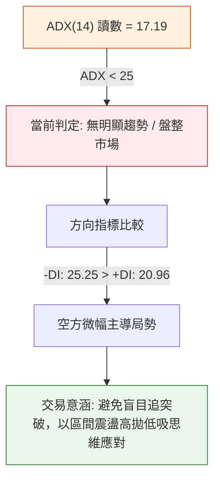

**ADX 趨勢強度對照表**：

| ADX 數值區間 | 當前狀態 | 趨勢強度級別 | 交易策略導向 |
|:---|:---:|:---|:---|
| 0 – 20 | **17.19** 🟢 | **極弱趨勢 / 盤整市** | 震盪指標（RSI、布林帶）優先，忌用突破追單 |
| 20 – 25 | - | 弱趨勢 / 醞釀期 | 觀察多空方向突破，減少單邊重倉 |
| 25 – 50 | - | 明確趨勢行情 | 均線追隨策略，順勢進場持有 |
| 50 – 100 | - | 極強單邊行情 | 注意超買超賣，趨勢可能面臨竭盡 |

---

## 3. 圖表形態分析

### 🔍 形態識別系統

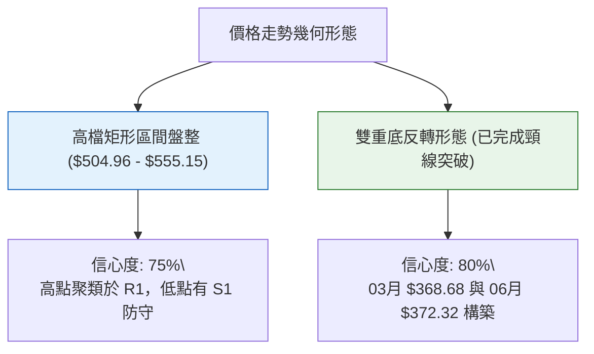

**形態信心度與目標價評估表**：

| 形態類別 | 信心度 | 判斷依據（引用數據） | 完成度 | 目標價（附計算式） |
|:---|:---:|:---|:---:|:---|
| **雙重底 (W底)**<br>*(歷史中期形態)* | 80% | 兩次低點分別為 2026-03 收盤 $368.68 與 2026-06 收盤 $372.32（均守住 52週低點 $348.54 上方），頸線為 2026-05 收盤 $449.39 | 100%<br>(已達標) | 形態高度 = $449.39 − $368.68 = $80.71<br>破頸線目標 = $449.39 + $80.71 = **$530.10**<br>*(現價 $523.00，已基本完成目標推升)* |
| **高檔矩形箱體**<br>*(當前短期形態)* | 75% | 上軌受壓於 R1 $555.15 及 52W 高點 $559.15；下軌受到 S1 $504.96 支撐（近10日低點聚類於 $504.96） | 70%<br>(箱內運行) | 箱體高度 = $555.15 − $504.96 = $50.19<br>向上突破目標 = $555.15 + $50.19 = **$605.34**<br>向下跌破目標 = $504.96 − $50.19 = **$454.77** |
| **頭肩頂 / 旗形** | <50% | 數據中未偵測到完整幾何結構，不符對稱標準 | 0% | 訊號不足，僅做指標型解讀（規則 15） |

### 🕯️ 重要K線形態分析

根據「近10根日K」與「近8根週K」實際數據解讀：

| 日期（週期） | 開盤 ($) | 最高 ($) | 最低 ($) | 收盤 ($) | K線形態名稱 | 技術解讀 | 訊號 |
|:---|:---:|:---:|:---:|:---:|:---|:---|:---:|
| **2026-11-02 (日)** | 524.02 | 529.63 | 504.96 | 507.12 | **長實體大陰線** | 開高走低重挫，盤中觸及 S1 $504.96，空方強力宣洩 | 🔴 |
| **2026-11-03 (日)** | 509.01 | 523.44 | 507.82 | 520.99 | **貫穿陽線 (Piercing)** | 低開高走吞沒前陰線大半實體，確認 S1 $504.96 支撐有效 | 🟢 |
| **2026-11-04 (日)** | 543.70 | 559.15 | 542.30 | 555.80 | **放量跳空長陽** | 跳空突破並創 52週新高 $559.15，單日成交量擴大至 5,080萬股 | 🟢 |
| **2026-11-05 (日)** | 554.94 | 557.62 | 532.68 | 535.93 | **高檔反噬長陰線** | 衝高 $557.62 後引發強烈獲利了結賣壓，實體長且收於低檔 | 🔴 |
| **2026-11-06 (日)** | 525.69 | 538.33 | 524.47 | 530.61 | **下影小陽線** | 測試短期支撐後微幅回彈，多方抵抗 | 🟡 |
| **2026-11-09 (日)** | 544.49 | 548.28 | 538.70 | 545.18 | **高開反彈陽線** | 再次嘗試衝擊阻力，但未越過 11-05 陰線實體高點 | 🟡 |
| **2026-11-10 (日)** | 542.98 | 544.19 | 526.37 | 533.16 | **回調陰線** | 承接動能不足，價格再次走低跌破 $540 | 🔴 |
| **2026-11-11 (日)** | 534.24 | 534.76 | 518.45 | 521.13 | **光頭中陰線** | 盤中直接下破 MA20，最低逼近 MA50 ($518.72) | 🔴 |
| **2026-11-12 (日)** | 521.10 | 529.66 | 520.00 | 523.00 | **窄幅小陽十字星** | 成交量急劇萎縮至 1,858萬股，多空僵持於 MA50 之上 | 🟡 |
| **2026-11-06 (週)** | 524.02 | 559.15 | 504.96 | 530.61 | **長上影大波動週K** | 高點見 $559.15、低點觸 $504.96，振幅達 10.3%，高檔獲利盤湧出 | 🔴 |

### 📉 ASCII 走勢形態示意圖

```
高檔區間箱體震盪示意圖 ($504.96 - $555.15)
價格 ($)
$560 ┬                         ● 11-04 創高點 ($559.15)
     │                        ┌┴┐
$555 ┼───[強阻力 R1 $555.15]───┤ ├──────┬─── 11-05 反轉下殺 ($557.62)
     │                        │ │      ┌┴┐
$540 ┼                        │ │      │ │  ┌─┐ 11-09 高開受阻
     │                        │ │  ┌─┐ │ │  │ │
$530 ┼───[布林中軌 MA20 $529.64]─┴─┼──┼─┼──┴─┼──┴─┐
     │                              │ │  │ │        │ │ 11-12 收盤十字星 ($523.00)
$520 ┼───[中期防線 MA50 $518.72]────┴─┘  │ │        └─┘
     │                                  │ │
$510 ┼                        ┌─┐       │ │
     │                        │ │       └─┘
$505 ┴───[支撐防線 S1 $504.96]─┴─┴───────────────────── (11-02 探底 $504.96)
```

### 🎯 形態目標價計算

根據上述矩形箱體形態嚴格推導：
1. **箱體上限（阻力線）**：採用近一年波段高點聚類價位 **$555.15**。
2. **箱體下限（支撐線）**：採用近一年波段低點聚類價位 **$504.96**。
3. **箱體垂直高度 ($H$)**：
   $$H = \text{上限} - \text{下限} = 555.15 - 504.96 = \$50.19$$
4. **多頭破位目標價（若向上有效突破 $555.15）**：
   $$\text{目標價} = 555.15 + H = 555.15 + 50.19 = \mathbf{\$605.34}$$
5. **空頭破位目標價（若向下跌破支撐 $504.96）**：
   $$\text{目標價} = 504.96 - H = 504.96 - 50.19 = \mathbf{\$454.77}$$

---

## 4. 支撐與阻力

### 🗺️ 關鍵價位分布圖（Unicode）

```
MSFT 價位結構分布圖 (由 OHLCV 與斐波那契精確計算)
═════════════════════════════════════════════════════════════════
$559.15 ║████████████████████████████████║ 52W 最高點 / 斐波 0.0%
$555.15 ║██████████████████████████      ║ 關鍵阻力 R1 (波段高點聚類)
$549.55 ║▓▓▓▓▓▓▓▓▓▓▓▓▓▓▓▓▓▓▓▓            ║ 布林通道上軌
$529.64 ║▒▒▒▒▒▒▒▒▒▒▒▒▒▒▒▒                ║ 布林中軌 / MA20
$523.00 ╠════════════════════════════════╣ ◄ 現價 ($523.00)
$518.72 ║░░░░░░░░░░░░░░░░                ║ 關鍵動態防線 MA50
$509.74 ║▓▓▓▓▓▓▓▓▓▓▓▓▓▓▓▓▓▓              ║ 布林通道下軌
$509.45 ║████████████████████            ║ 斐波那契 23.6% 回調位
$504.96 ║████████████████████████        ║ 關鍵支撐 S1 (波段低點聚類)
$486.00 ║████████████████                ║ 次級支撐 S2 (波段低點聚類)
$478.70 ║████████████████████            ║ 斐波那契 38.2% 回調位
$476.25 ║██████████████████████████      ║ 強支撐 S3 (波段低點聚類)
═════════════════════════════════════════════════════════════════
```

### 🚧 阻力位分析表

*(嚴格引用數據中「關鍵價位」區塊數值)*

| 阻力級別 | 價位 ($) | 距離現價 | 形成原因與技術共振 | 突破難度 | 重要性 |
|:---|:---:|:---:|:---|:---:|:---:|
| **R1** | **$555.15** | +6.15% | 近一年波段高點聚類；與 11-04 創下的 52週新高 $559.15 形成強大頭部賣壓區間 | 極高 🔴 | ★★★★★ |
| **R2** | **N/A** | N/A | *數據中未偵測到此級別聚類價位，不予捏造* | N/A | N/A |
| **R3** | **N/A** | N/A | *數據中未偵測到此級別聚類價位，不予捏造* | N/A | N/A |

### 🛡️ 支撐位分析表

*(嚴格引用數據中「關鍵價位」區塊數值)*

| 支撐級別 | 價位 ($) | 距離現價 | 形成原因與技術共振 | 守住機率 | 重要性 |
|:---|:---:|:---:|:---|:---:|:---:|
| **S1** | **$504.96** | -3.45% | 近一年波段低點聚類；與 11-02 盤中低點重合，且緊鄰布林下軌 $509.74 與 23.6% 斐波回調位 $509.45 | 75% 🟢 | ★★★★☆ |
| **S2** | **$486.00** | -7.07% | 近一年波段次級低點聚類；為 2026年 8月下旬盤整平台支撐帶 | 85% 🟢 | ★★★★☆ |
| **S3** | **$476.25** | -8.94% | 近一年強低點聚類；與 38.2% 斐波回調位 $478.70 高度共振，為多頭生命線防線 | 90% 🟢 | ★★★★★ |

### 📐 斐波那契回調位分析

*(基準區間：52週低點 $348.54 → 52週高點 $559.15，垂直落差 $210.61)*


**回調位深度解讀**：
- **現價位置落點**：當前收盤價 **$523.00** 處於 **0.0% ($559.15)** 與 **23.6% ($509.45)** 之間。
- **技術意義**：
  1. 回調幅度尚不到 23.6%，屬於強勢多頭市場中的「淺幅修正（Shallow Pullback）」。
  2. $509.45 與布林下軌 $509.74 及 S1 支撐 $504.96 構建出極緊密的共振支撐帶（$504.96 – $509.74）。只要價格守於 $509.45 之上，大週期上升趨勢結構即完好無損。
  3. 若不幸失守 $504.96，下一道深層黃金分割支撐位於 38.2%（$478.70），該處與 S3（$476.25）形成中期多頭最後防線。

---

## 5. 技術指標深度解讀

### 🎛️ 指標訊號總覽

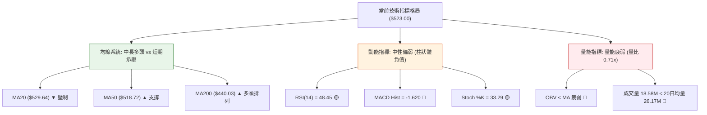

### 📈 移動平均線排列分析

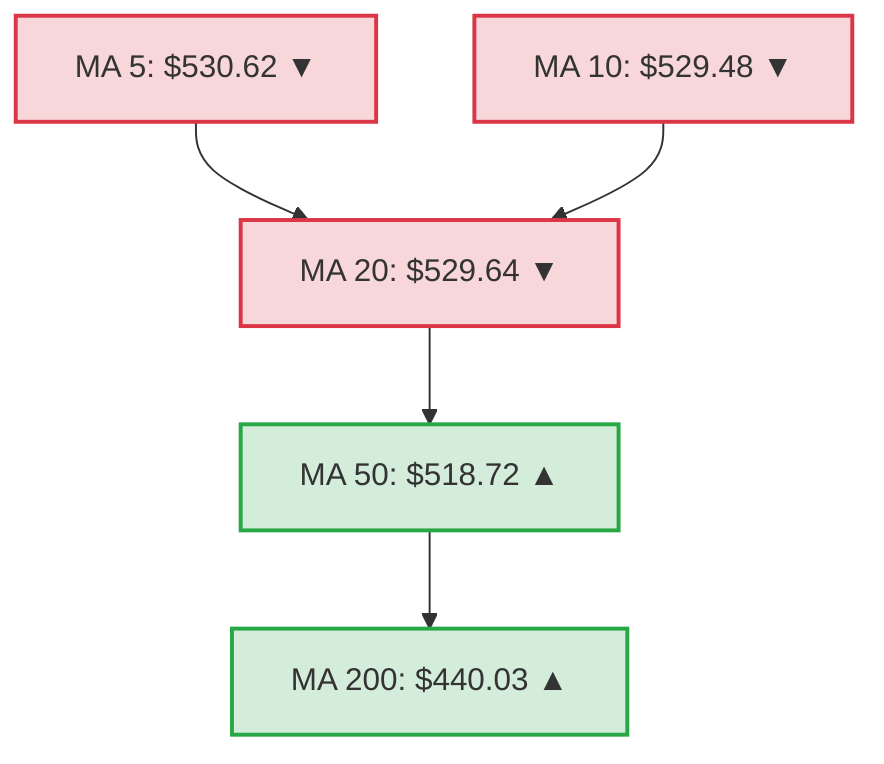

**均線體系數據解讀**：
- **排列狀態**：總體維持 $MA20 > MA50 > MA200$ 之大格局多頭排列，顯示年線級別的多頭基底極為穩固。
- **短期乖離與下壓**：短期均線出現弱化訊號，$MA5 (\$530.62)$、$MA10 (\$529.48)$ 與 $MA20 (\$529.64)$ 近期斜率均向下（▼），且現價 $523.00 已落於所有短天期均線下方。
- **動態支撐**：下方的 $MA50 (\$518.72)$ 與現價僅相距 -0.82%，正發揮核心下檔緩衝作用；超長期的 $MA200 (\$440.03)$ 距離現價達 +18.85%，完全封死深幅崩盤空間。

### 📉 RSI(14) 分析

```
RSI(14) 讀數：48.45 (Wilder)
0 ────────── 30 ────────────────────── 50 ─────── 70 ────────── 100
[  超賣區  ]    [       空方佔優      ]▲[  多方佔優  ]   [  超買區  ]
                                     48.45
進度條展示：
████████████████████████░░░░░░░░░░░░░░░░░░░░░░░░░░ 48.45%
```
- **區間評估**：RSI 位於 48.45，緊貼 50 中軸線下方，顯示當前市場既無過熱過激（遠離 70 超買線），亦無恐慌拋售（遠離 30 超賣線），多空處於均勢拉鋸。
- **背離判斷**：根據近 20 根 K 棒數據分析，價格在 11-04 創下新高 $559.15，隨後拉回，RSI 同步自前波高位回調至 48.45，指標方向與價格走勢保持一致，**無明顯頂背離或底背離**。

### 📊 MACD(12/26/9) 訊號解讀

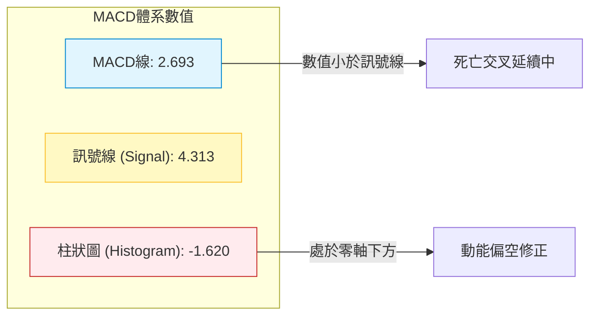
- **訊號解析**：MACD 線（2.693）已跌破訊號線（4.313），Histogram 柱狀圖為 -1.620，維持在負值區間運行。
- **技術意義**：雖然 MACD 與 Signal 雙線仍處於零軸之上（代表大架構仍處於多頭半場），但零軸之上的死亡交叉代表短期「高位動能衰竭與利潤回吐」。

### 📦 布林通道分析

```
布林通道結構示意圖 (帶寬: $39.81)
$555.00 ┤                                      
$549.55 ┼────────────────────────────────────── 上軌 (Upper Band)
$540.00 ┤                                      
$529.64 ┼────────────────────────────────────── 中軌 (MA20)
$523.00 ┼  ● 當前收盤價 ($523.00, %B = 0.33)    
$518.72 ┼  - - - - - - - - - - - - - - - - - -  MA50 支撐線
$509.74 ┼────────────────────────────────────── 下軌 (Lower Band)
$500.00 ┤
```
- **布林參數**：上軌 $549.55，中軌 $529.64，下軌 $509.74，%B 指標為 **0.33**。
- **技術解讀**：%B 處於 0.33（小於 0.5），代表價格位於中軌至下軌之間弱勢區域。價格並未貼軌下行跌破下軌（無超賣破位），亦遠離上軌，通道帶寬呈現收縮平穩狀態，明確驗證當前屬於「通道內箱體收斂」。

### 💹 成交量分析（量價配合度）

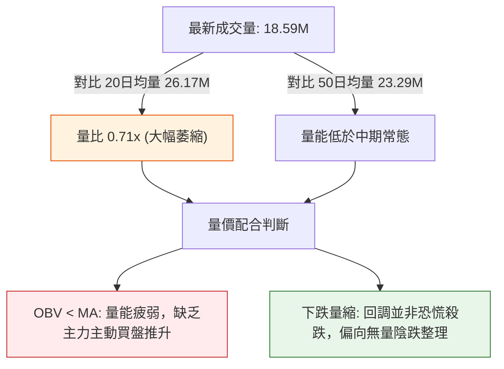
- **量價關聯**：最新成交量僅 18,586,800 股，顯著低於 20日均量（26,169,750 股），量比為 0.71x。
- **OBV 趨勢**：OBV 指標小於其均線，呈現「量能疲弱」。這表明主力資金在現階段採取觀望態度，缺乏積極的資金推升價格突破 R1，但量縮回調也說明市場籌碼鎖定良好，並無集中出逃現象。

---

## 6. 動能與波動率

### ⚡ 動能評估四象限

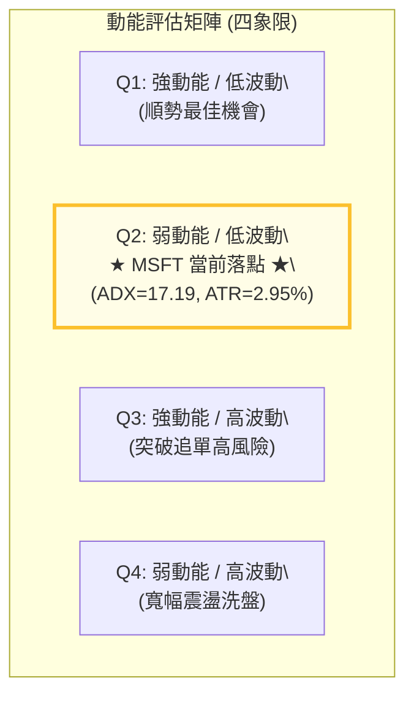

**象限評估詳情表**：

| 象限 | 動能狀態 | 波動狀態 | 判定特徵 | 策略應對方針 |
|:---:|:---:|:---:|:---|:---|
| Q1 | 強 | 低 | 穩定單邊趨勢，回調即可做多 | 暫不符合 |
| **Q2** | **弱** | **低** | **ADX=17.19 (弱) / ATR=2.95% (低溫和)** | **謹慎觀望：區間佈局，低吸高拋，嚴禁追價** |
| Q3 | 強 | 高 | 行情爆發期，動能充沛伴隨劇烈洗盤 | 暫不符合 |
| Q4 | 弱 | 高 | 無方向的劇烈劇烈震盪，容易雙向停損 | 暫不符合 |

### 📊 ATR 波動率分析

```
ATR(14) 波動度進度條 (占股價 2.95%)：
████████████░░░░░░░░░░░░░░░░░░░░░░░░ 2.95% (溫和波動)
```
- **ATR 數值**：當前 ATR(14) 為 **$15.42**（Wilder 計算法），佔當前股價（$523.00）之比例為 **2.95%**。
- **止損距離建議**：
  - **保守型交易者（1.5 × ATR）**：安全緩衝距離為 $15.42 \times 1.5 = \mathbf{\$23.13}$。
  - **激進型交易者（1.0 × ATR）**：緊密保護距離為 $15.42 \times 1.0 = \mathbf{\$15.42}$。
  - **應用意義**：在現價 $523.00 建立多單時，若給予防守緩衝，合理止損應設於現價扣除 1.0 至 1.5 倍 ATR 之外（約 $499.87 – $507.58），這與波段支撐 S1（$504.96）高度吻合。

### 📐 Beta 與市場相關性

- **Beta 數值**：**1.045**。
- **市場敏感度解讀**：MSFT 的 Beta 略高於 1.00，表明其價格變動與標普 500 指數高度同步且微幅放大。在美股大盤未出現顯著方向性單邊突破前，MSFT 難以走出完全獨立的單邊脫鉤走勢，其區間整理本質上反映了科技巨頭在財報與政策面消化期的防禦性休整。

---

## 7. 多時框架總結

### 📋 時框架評分表

| 時框架 | 趨勢方向 | 動能指標 | 均線系統 | 形態結構 | 綜合評分 | 操作建議 |
|:---|:---:|:---:|:---:|:---:|:---:|:---|
| **短期 (日線)** | 偏弱震盪 🔴 | MACD柱負/RSI弱 🔴 | 跌破MA20 / MA50有撐 🟡 | 箱體中軌受壓 🟡 | **42/100** | 區間下軌尋找低吸點，勿追高 |
| **中期 (週線)** | 高檔整固 🟡 | 動能收斂中性 🟡 | 維持多頭排列 🟢 | 矩形整理醞釀突破 🟡 | **56/100** | 觀察 $504.96-$555.15 區間突破 |
| **長期 (月線)** | 明確看多 🟢 | 長線向上多方掌控 🟢 | 遠高於MA200 (+18.85%) 🟢 | 雙重底完成突破 🟢 | **85/100** | 逢大回調堅定佈局核心持倉 |

### 🔲 綜合訊號矩陣

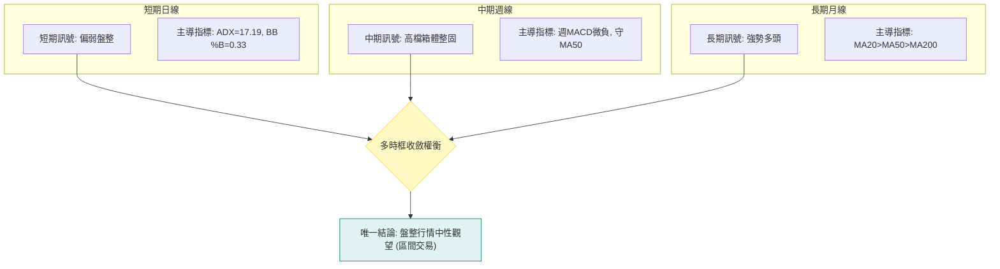

### ⚖️ 多時框收斂結論

依據「多時框收斂規則（嚴格要求 14）」：
1. **行情性質判定**：當前日線級別 ADX(14) 讀數為 **17.19**，遠低於趨勢臨界值 25，明確判定當前為**「盤整行情」**。
2. **主導時框與交易邊界**：在盤整行情下，市場交易重心應由長期趨勢追隨轉向「日線布林通道上下軌（$509.74 – $549.55）與聚類高低點（S1 $504.96 – R1 $555.15）」作為核心交易區間。
3. **方向性收斂結論**：日線短期承壓（MA20 下方、MACD 負值）與長期牛市基底（MA200 遠在下方）產生衝突，收斂後的**唯一結論為：中性觀望（區間操作思維）**。在價格未有效突破 R1（$555.15）或跌破 S1（$504.96）之前，不預設立場，以區間箱體策略為主。此結論與第 1 章評分卡（52分）及第 8 章主策略完全閉環一致。

---

## 8. 交易策略建議

### 🗺️ 策略決策流程圖

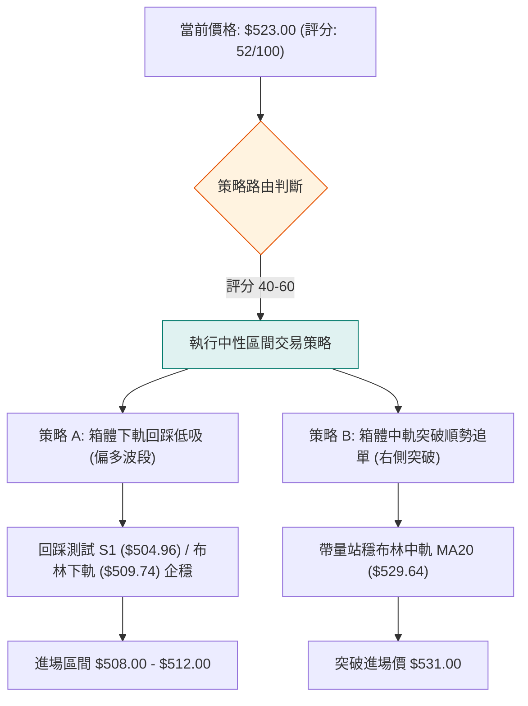

### 🧭 策略路由（依評分卡分流，不得兩頭下注）

> **當前主策略方向 = 中性區間操作（等待區間邊界確認），主推低吸與突破兩種情境，依評分 52/100。**

因綜合評分處於 40–60 之中性區間，且 ADX 為 17.19，策略不宜採取單邊盲目重倉追多或放空，而應聚焦於「箱體邊緣的高風報比佈局」或「右側確認訊號」。

### 🎯 價格情境階梯（Price Scenarios）

*(所有價位均嚴格引用第 4 章／關鍵價位區塊實際數據)*

| 觸發條件 | 下一目標 | 後續延伸 | 情境含義 |
|:---|:---|:---|:---|
| **帶量向上突破 R1 ($555.15)** | 52W 高點 $559.15 | 形態破位目標 $605.34 | 打開新一輪歷史性主升浪，轉為強多頭行情 |
| **突破並站穩 MA20 ($529.64)** | 布林上軌 $549.55 | 強阻力 R1 $555.15 | 短線止跌轉強，重新回歸箱體上半區 |
| **維持於現價區間 ($518.72 – $529.64)**| MA50 支撐線 | MA20 壓力線 | 區間持續拉鋸收斂，等待動能指標修復 |
| **向下跌破 S1 ($504.96)** | 次級支撐 S2 ($486.00) | 強支撐 S3 ($476.25) / 斐波 38.2% ($478.70) | 矩形箱體破位，深度回調考驗長期多頭生命線 |

### 📊 情境機率分佈

| 情境劇本 | 預估機率 | 主要技術依據 |
|:---|:---:|:---|
| **區間震盪整理** | **55%** | ADX=17.19 顯示缺乏方向動能；成交量持續萎縮（量比 0.71x）；布林帶寬收緊 |
| **延續回調再探底 (測試S1)** | **30%** | MACD 死亡交叉中（柱狀 -1.620）；-DI > +DI 空方佔優；價格跌破短期 MA20 |
| **強勢突破向上 (衝擊R1)** | **15%** | OBV 疲弱且缺乏增量資金配合；面臨 $555.15 聚類強阻力與歷史新高解套壓力 |

### 🟢 主策略詳情

*(風險報酬比嚴格依規則 17 計算：$(T1 - \text{進場價}) \div (\text{進場價} - \text{止損價})$)*

| 策略要素 | 策略 A：箱體下軌企穩低吸 (波段左側) | 策略 B：站穩 MA20 順勢跟進 (右側短線) |
|:---|:---|:---|
| **進場條件** | 股價回踩 S1 ($504.96) 與斐波 23.6% ($509.45) 止跌出現陽線 | 日K線收盤明確突破並站穩布林中軌 MA20 ($529.64) |
| **進場價格** | **$510.00** *(取區間中點)* | **$531.00** *(站穩 MA20 確立點)* |
| **目標價 T1** | **$529.64** *(布林中軌 / MA20)* | **$549.55** *(布林上軌)* |
| **目標價 T2** | **$555.15** *(關鍵阻力 R1)* | **$555.15** *(關鍵阻力 R1)* |
| **止損價格** | **$503.00** *(跌破 S1 $504.96 之下)* | **$521.00** *(跌破近期回調低點)* |
| **風險報酬比** | **1 : 2.81**（以 T1 計）<br>*(計算式: $(529.64 - 510) \div (510 - 503) = 19.64 \div 7 = 2.81$)<br>*(以 T2 計為 1 : 6.45)* | **1 : 1.86**（以 T1 計）<br>*(計算式: $(549.55 - 531) \div (531 - 521) = 18.55 \div 10 = 1.86$)<br>*(以 T2 計為 1 : 2.42)* |
| **成功機率** | **65%** | **60%** |
| **建議倉位** | **15%** *(底倉介入)* | **10%** *(短線追蹤)* |

### 🔴 反向風險觸發點（對沖提示）

若出現以下情境，則本中性/偏多策略徹底失效，應立即止損或啟動空頭防禦：
1. **實體陰線放量跌破 S1 ($504.96)**：若日K線收盤價跌破 $504.96，宣告箱體破位，股價將加速下探 S2（$486.00）甚至 S3（$476.25），此時應全面清空短期多單，甚至可進行反向對沖。
2. **MACD 柱狀圖進一步放大且跌破零軸雙線**：若日線 MACD 雙線下穿零軸，表明動能進入空頭主導週期。

### ⭐ 整體訊號強度評星

```
做多訊號強度：★★☆☆☆  (2/5星 — 均線雖多頭但短期缺乏動能)
做空訊號強度：★★☆☆☆  (2/5星 — 下方 MA50 與 S1 支撐堅強)
整體可信度：  ★★★★☆  (4/5星 — 價位結構分明，箱體邊界明確)
```

---

## 9. 風險提示與監控

### ✅ 關鍵監控指標 Checklist

```
╔════════════════════════════════════════════════════════════════╗
║                  關鍵技術監控清單 (DAILY MONITOR)              ║
╠════════════════════════════════════════════════════════════════╣
║ [ ] 價格是否成功收復並站穩 MA20 ($529.64)                      ║
║ [ ] 日線級別 MA50 ($518.72) 支撐是否有效跌破                   ║
║ [ ] 下檔關鍵波段支撐 S1 ($504.96) 是否遭遇放量下破             ║
║ [ ] MACD 柱狀圖是否由負轉正 (向上收斂至 0 軸上方)               ║
║ [ ] 日成交量是否放大至 20日均量 (26.17M) 以上確認主力回流       ║
║ [ ] ADX(14) 是否向上突破 25，指示新一輪單邊趨勢開啟            ║
╚════════════════════════════════════════════════════════════════╝
```

### ⚠️ 風險場景分析

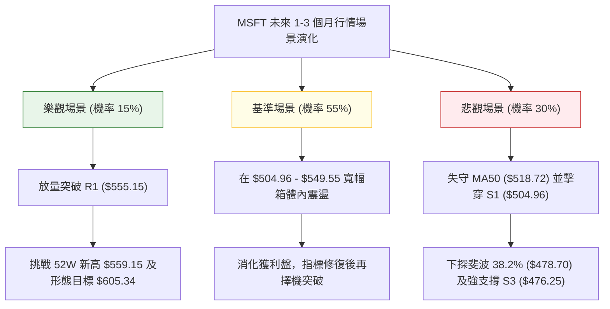

### 🛡️ 風險管理重要提醒

1. **嚴守區間思維，切忌追漲殺跌**：
   在 ADX 低於 25 的環境中，任何看似強勢的單日大陽線（如 11-04 陽線）極易在遭遇 R1 阻力後迅速反噬；同樣，無量下跌亦容易在支撐位 S1 獲得承接。因此，交易者必須克制情緒，堅持「阻力不追、支撐不殺」的交易紀律。
2. **倉位管理與單筆風險暴露**：
   - 當前屬於震盪平衡市，總股票曝險建議維持在 30%–50% 以內，預留充裕現金應對潛在的突破行情。
   - 單筆策略（如策略 A 或策略 B）之最大本金虧損風險應嚴格控制在總投資組合資產的 **1.0% – 1.5%** 範圍內。
3. **波動率緩衝防護**：
   鑑於 ATR(14) 為 $15.42，日內正常波動即有近 15 美元的空間，止損點不可設置過緊，嚴格參考技術實體防線（如 S1 $504.96 跌破）作為最終退場依據，避免被日間假破位洗盤出場。

---

## 📋 報告總結

```
╔══════════════════════════════════════════════════════════════════╗
║                   MSFT 技術分析報告總結                          ║
╠══════════════════════════════════════════════════════════════════╣
║ 報告日期：2026-11-13                                             ║
║ 當前價格：$523.00 USD                                            ║
║ 綜合評分：52 / 100                                               ║
║ 分析評級：⚖️ 中性觀望 (High-level Consolidation)                  ║
╠══════════════════════════════════════════════════════════════════╣
║ 關鍵結論：                                                       ║
║ ├─ 長期趨勢：🟢 強烈看多 (MA20>50>200 多頭排列，月線結構紮實)    ║
║ ├─ 中期趨勢：🟡 高檔震盪 (運行於 $504.96–$555.15 矩形箱體之內)   ║
║ ├─ 短期趨勢：🔴 偏弱整理 (受制於 MA20，MACD 柱狀體負值修復中)    ║
║ ├─ 關鍵阻力：R1 = $555.15 (上方為 52W 高點 $559.15)              ║
║ ├─ 關鍵支撐：S1 = $504.96 (緊鄰斐波那契 23.6% $509.45)           ║
║ └─ 機構共識：Strong Buy (54位分析師均價 $636.12)                 ║
╠══════════════════════════════════════════════════════════════════╣
║ 最優策略組合：                                                   ║
║ 1. 🥇 最佳機會：策略 A (回踩 S1 $504.96 附近低吸，風報比 1:2.81)║
║ 2. 🥈 次選機會：策略 B (帶量收復 MA20 $529.64 順勢追多)          ║
║ 3. 🥉 保守選擇：完全空倉觀望，耐心等待價格突破 $555.15 或跌破   ║
║                $504.96 後出現的大級別單邊信號                   ║
╚══════════════════════════════════════════════════════════════════╝
```

---

> ⚠️ **免責聲明**：本報告為技術分析研究，所有數據及價位均基於市場歷史價格與量化模型計算。本報告**僅供學術與研究參考**，**不構成任何個人化的投資建議、邀約或承諾**。金融市場具有高度風險，投資人應獨立評估自身風險承受能力並自負盈虧。

---

*報告生成時間：2026-11-13 ｜ 數據來源：Yahoo Finance ｜ 分析框架：多時框技術分析*