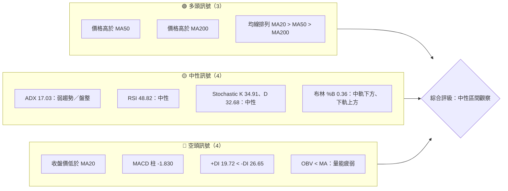
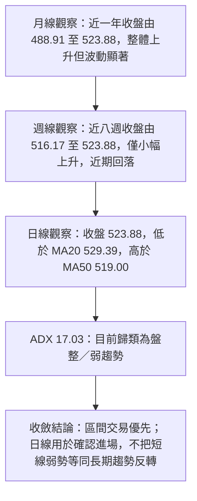
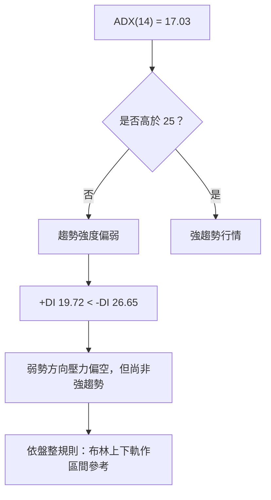
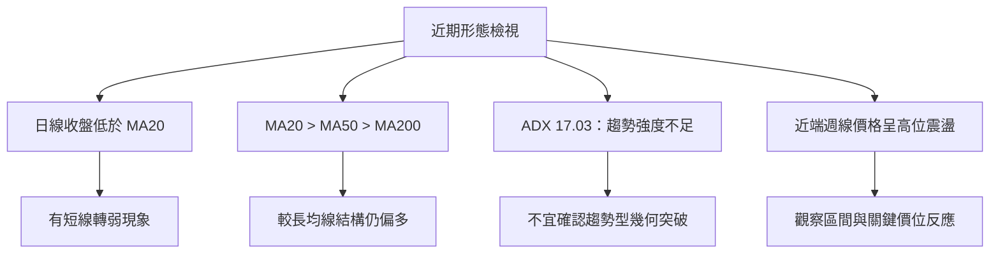
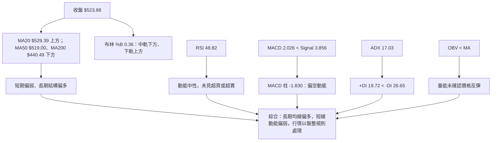
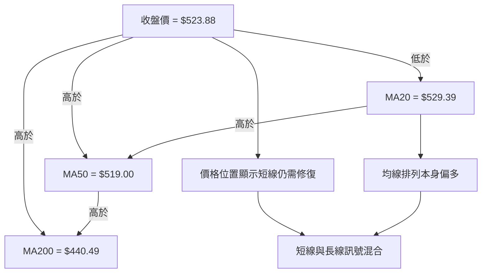
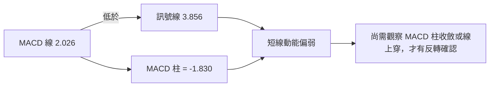
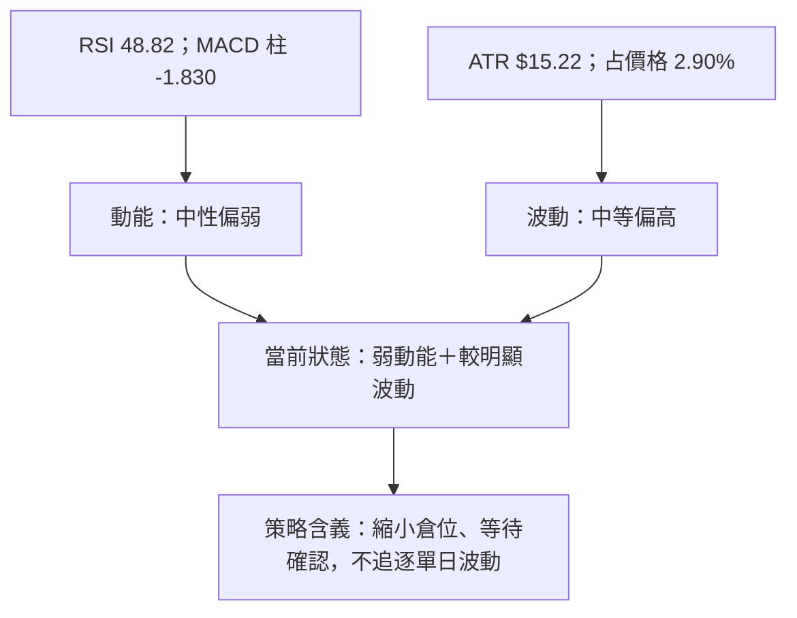
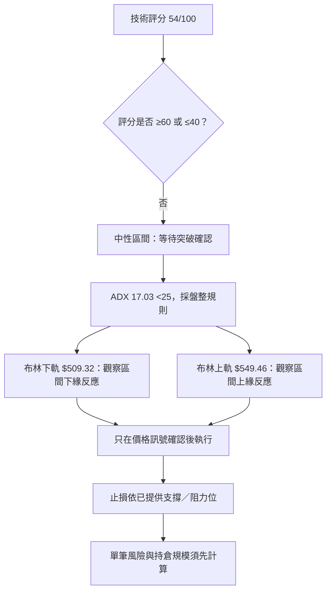
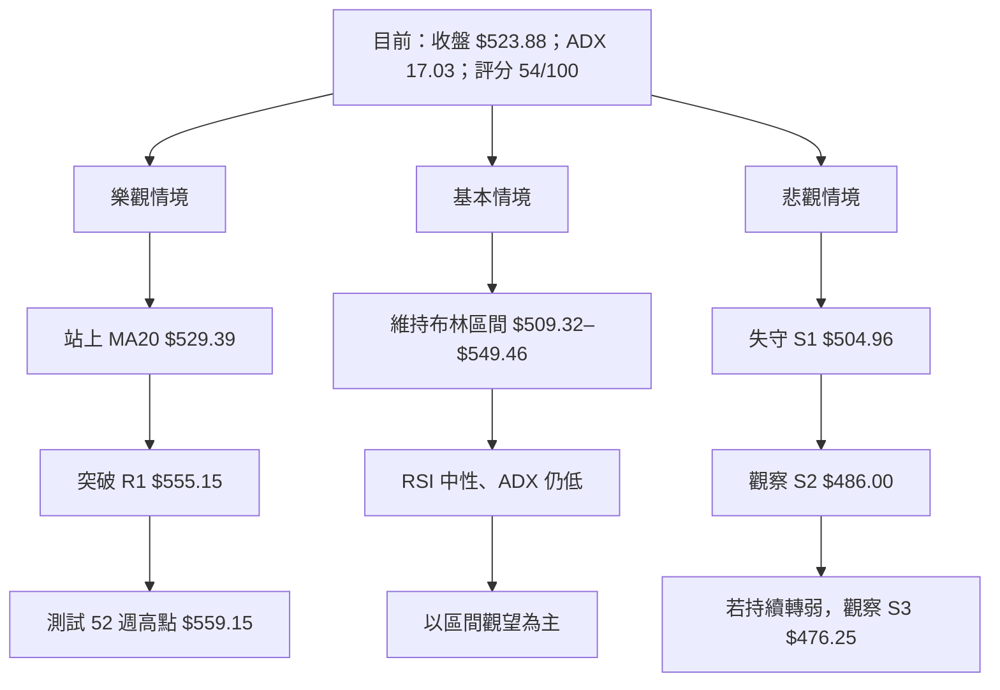

# MSFT 技術分析報告

> **報告日期**：2026-11-14 ｜ **語言**：繁體中文 ｜ **數據來源**：使用者提供之 Yahoo Finance 數據包 ｜ **當前價格**：**$523.88**

---

## 目錄

| 章節 | 內容 |
|------|------|
| [1. 技術面概覽](#1-技術面概覽) | 訊號儀表板、核心指標、評分卡 |
| [2. 趨勢分析](#2-趨勢分析) | 多時框趨勢、長中短期走勢 |
| [3. 圖表形態分析](#3-圖表形態分析) | 形態識別、K 線組合、目標價 |
| [4. 支撐與阻力](#4-支撐與阻力) | 關鍵價位、斐波那契回調 |
| [5. 技術指標深度解讀](#5-技術指標深度解讀) | MA、RSI、MACD、布林、成交量 |
| [6. 動能與波動率](#6-動能與波動率) | 動能評估、ATR、Beta |
| [7. 多時框架總結](#7-多時框架總結) | 時框架評分矩陣 |
| [8. 交易策略建議](#8-交易策略建議) | 區間策略、條件觸發、風險報酬比 |
| [9. 風險提示與監控](#9-風險提示與監控) | 監控指標、風險場景 |

---

## 1. 技術面概覽

### 🎯 技術訊號儀表板



訊號數量是依快照中列出的主要項目作分類，不代表各訊號具有相同權重。整體呈現「長期均線結構偏多、短線動能偏弱、趨勢強度不足」的混合狀態。

### 📊 核心指標速覽表

| 指標類別 | 指標名稱 | 當前數值 | 訊號 | 解讀 |
|----------|----------|----------:|:---:|------|
| **價格** | 收盤價 | **$523.88** | 🟡 | 本報告當前價格；位於 52 週區間的 83.3% 位置 |
| **均線** | MA20 | $529.39 | 🔴 | 收盤價低於 MA20，短期價格尚未收復短均線 |
| **均線** | MA50 | $519.00 | 🟢 | 收盤價高於 MA50，短中期支撐仍在 |
| **均線** | MA200 | $440.49 | 🟢 | 價格明顯高於 MA200，長期均線趨勢偏多 |
| **動能** | RSI(14) | 48.82 | 🟡 | 中性區域，未達超買或超賣 |
| **動能** | MACD | 2.026 | 🔴 | MACD 線低於訊號線 3.856，柱狀圖為負 |
| **趨勢** | ADX(14) | 17.03 | 🟡 | 低於 25，趨勢強度偏弱，偏向盤整判讀 |
| **波動** | ATR(14) | $15.22 | 🟡 | 約為收盤價的 2.90%，單日波動不可忽視 |
| **成交量** | 最新量／20 日均量 | 1.00x | 🟡 | 最新成交量與 20 日均量接近 |
| **量能** | OBV 趨勢 | OBV < MA | 🔴 | 量能趨勢未確認價格反彈 |

### 🏆 技術評分卡

評分採 **0–100 分**。六個子評分算術平均後四捨五入：  
\((58+46+62+42+45+70) ÷ 6 = 53.83\)，故綜合評分為 **54/100**。

```text
╔══════════════════════════════════════════════════════════════╗
║                 技術評分卡 — MSFT（2026-11-14）              ║
╠══════════════════════════════════════════════════════════════╣
║ 趨勢強度      ████████████░░░░░░░░  58/100  🟡               ║
║ 動能指標      █████████░░░░░░░░░░░  46/100  🟡               ║
║ 支撐穩定度    ████████████░░░░░░░░  62/100  🟢               ║
║ 成交量配合    ████████░░░░░░░░░░░░  42/100  🔴               ║
║ 形態完整度    █████████░░░░░░░░░░░  45/100  🟡               ║
║ 均線排列      ██████████████░░░░░░  70/100  🟢               ║
╠══════════════════════════════════════════════════════════════╣
║ 綜合評分      ███████████░░░░░░░░░  54/100  ⚖️ 中性          ║
║ 計算方式：六項子評分算術平均，四捨五入至整數                 ║
╚══════════════════════════════════════════════════════════════╝
```

| 子項 | 評分 | 評分理由 |
|------|---:|----------|
| 趨勢強度 | 58 | 價格高於 MA50、MA200，但 ADX 僅 17.03，趨勢確認度有限 |
| 動能指標 | 46 | RSI 中性；MACD 柱為負，且 -DI 高於 +DI |
| 支撐穩定度 | 62 | 已提供 S1、S2、S3 三層支撐，但價格仍未回到 MA20 上方 |
| 成交量配合 | 42 | 最新量與 20 日均量相近，OBV < MA，缺乏積極量能確認 |
| 形態完整度 | 45 | 近端價格反覆震盪，沒有足夠數據確認高信心幾何形態 |
| 均線排列 | 70 | MA20 > MA50 > MA200 為多頭排列；但收盤價仍低於 MA20 |

---

## 2. 趨勢分析

### 🌐 多時框趨勢分析



| 時框 | 可用數據 | 趨勢判斷 | 判斷限制 |
|------|----------|----------|----------|
| 長期／月線 | 24 個月月末收盤、MA200、MA240 | 整體偏多但波動大；價格高於 MA200、MA240 | 月線 OHLC 未提供，不能判斷月 K 形態 |
| 中期／週線 | 近 20 週收盤與近 8 根週 K | 近期高位震盪，短線動能轉弱 | 週線樣本中，MACD 柱由正轉負後反覆，方向未完全一致 |
| 短期／日線 | 近 10 根日 K、日線指標 | MA20 下方、MACD 偏空，仍高於 MA50 | ADX 低於 25，短線波動容易反覆 |

### 📈 長期趨勢 — 12 個月走勢圖

以下以 **2025-12 至 2026-11 的 12 個月收盤價**繪製。另列出 2025-11 作為起始比較點，故圖中共呈現 13 個月末資料點。此圖為月末收盤序列，**不是月內最高／最低價圖**。

```text
MSFT 月線收盤走勢圖（12 個月區間，附起始比較點）
價格（美元）
 530 ┤                                      ● 523.88（2026-11）
 510 ┤                              ●───────●
 490 ┤ ● 488.91                    │
 470 ┤                              │
 450 ┤                         ●────┘
 430 ┤                   ●
 410 ┤
 390 ┤             ●
 370 ┤       ●           ●
     └────────────────────────────────────────────────────
      25-11 25-12 26-01 26-02 26-03 26-04 26-05 26-06
                                             26-07 26-08
                                             26-09 26-10 26-11

月末收盤：
25-11 488.91  25-12 480.57  26-01 427.58  26-02 391.15
26-03 368.68  26-04 406.13  26-05 449.39  26-06 372.32
26-07 463.85  26-08 507.29  26-09 512.90  26-10 521.91
26-11 523.88
```

#### 走勢特徵分析

| 階段 | 月末收盤變化 | 價格變化 | 技術特徵 |
|------|--------------|----------:|----------|
| 2025-11 → 2026-03 | $488.91 → $368.68 | 約 **-24.6%** | 月末收盤連續回落，形成此序列的主要下跌段 |
| 2026-03 → 2026-05 | $368.68 → $449.39 | 約 **+21.9%** | 月末收盤快速反彈，但尚不能單憑月收盤推斷形態反轉 |
| 2026-05 → 2026-06 | $449.39 → $372.32 | 約 **-17.2%** | 反彈後再度大幅回落，凸顯高波動特徵 |
| 2026-06 → 2026-10 | $372.32 → $521.91 | 約 **+40.2%** | 月末收盤逐月回升，形成較明顯的中期復甦段 |
| 2025-11 → 2026-11 | $488.91 → $523.88 | 約 **+7.2%** | 12 個月區間終點高於起點，但路徑波動明顯 |

> 百分比按表列月末收盤計算，四捨五入至小數一位；不代表期間內最高或最低報酬。

### 📊 中期趨勢（週線分析）

近 8 根週 K 收盤由 2026-09-25 的 $516.17 升至 2026-11-13 的 $523.88，累計約 **+1.5%**。但中途收盤曾升至 $535.07，之後回落至目前價格，顯示上方仍有賣壓。

```text
週線收盤與區間示意（非比例 OHLC 圖）
$559.15  ───────────────────────── 52 週高點
$548.28  ────────┐                  11/13 週高
$535.07  ────●───┘                  10/09 週收盤
$530.61  ──────────────────●        11/06 週收盤
$523.88  ─────────────────────●     11/13 當前收盤
$516.17  ●                           09/25 週收盤
$504.96  ─────────────────────────  S1
$486.00  ─────────────────────────  S2
```

週線表現與日線快照並非完全同步：近週收盤顯示價格仍處於較高區域，但日線 MACD 柱為負、收盤低於 MA20。依 ADX 17.03 的盤整判讀，這種衝突應採 **區間與條件觸發**，不宜把週線上升單獨解讀為強勢趨勢。

### ⚡ 趨勢強度評估（ADX 解讀）



| ADX 區間 | 一般解讀 | MSFT 當前狀態 |
|---------|----------|---------------|
| 低於 20 | 趨勢弱、較可能盤整 | **17.03，符合** |
| 20–25 | 趨勢建立中的過渡區 | 不適用 |
| 高於 25 | 趨勢力量較明顯 | 不符合 |
| 高於 40 | 強趨勢 | 不符合 |

**方向與強度需分開看：** -DI 26.65 高於 +DI 19.72，代表空方方向性壓力較強；但 ADX 只有 17.03，因此較合理的描述是「盤整中的偏弱勢壓力」，而非已確認的強空頭趨勢。

---

## 3. 圖表形態分析

### 🔍 形態識別系統

目前數據提供月末收盤、近期週線和日線 OHLC，但不足以完整確認多個波峰、波谷與頸線結構。因此不宣稱頭肩、雙頂、雙底或三角形等幾何形態；以下僅確認指標型結構。



| 形態／結構 | 信心度 | 判斷依據（引用數據） | 完成度 | 目標價 |
|-----------|-------:|----------------------|------:|--------|
| 頭肩頂／頭肩底 | 低於 50%；**訊號不足** | 僅有有限週線與 10 根日 K，未提供足夠波峰、波谷序列與頸線 | N/A | N/A（數據未提供足以確認形態的頸線與形態高度） |
| 雙頂／雙底 | 低於 50%；**訊號不足** | 雖可觀察近期價格回落與反彈，但不足以嚴格確認兩個等高／等低轉折與頸線 | N/A | N/A（數據未提供足以確認形態的頸線與形態高度） |
| 三角形／旗形 | 低於 50%；**訊號不足** | 近端收盤有震盪，但缺少可驗證的收斂趨勢線或旗桿結構 | N/A | N/A（數據未提供足以確認形態的邊界與高度） |
| 均線排列 | **80%** | MA20 $529.39 > MA50 $519.00 > MA200 $440.49 | 已形成，但價格低於 MA20 | 不作形態目標價 |
| 布林通道位置 | **90%** | %B 0.36；收盤價在下軌 $509.32 與中軌 $529.39 之間 | 已確認為通道內位置 | 不作幾何形態目標價 |

> 信心度只代表對表列技術結構的判斷把握，不是未來價格走勢的機率。

### 🕯️ 重要 K 線形態分析

以下 K 線判斷只使用所提供的「近 10 根日 K」與「近 8 根週 K」OHLC。由於近端缺少一組足以確認高信心反轉組合的連續結構，表內主要列出有代表性的 K 棒，不把普通單根 K 棒強行命名為確定反轉形態。

#### 近端日 K

| 日期（日 K） | 開 | 高 | 低 | 收 | K 線形態 | 解讀 | 訊號 |
|------|------:|------:|------:|------:|----------|------|:---:|
| 2026-11-02 | 524.02 | 529.63 | 504.96 | 507.12 | 長實體陰線，非典型錘頭 | 收盤低於開盤，當日下影短於實體，單根不足以確認反轉 | 🔴 |
| 2026-11-03 | 509.01 | 523.44 | 507.82 | 520.99 | 陽線 | 買方收復前一交易日部分跌幅，但不能單憑此棒認定趨勢反轉 | 🟢 |
| 2026-11-04 | 543.70 | 559.15 | 542.30 | 555.80 | 陽線 | 收盤接近日內高位；當日最高價為資料中提供的 52 週高點 | 🟢 |
| 2026-11-05 | 554.94 | 557.62 | 532.68 | 535.93 | 長實體陰線 | 上方賣壓明顯；與前一日相比轉弱，但不構成完整吞噬確認 | 🔴 |
| 2026-11-06 | 525.69 | 538.33 | 524.47 | 530.61 | 小實體陽線 | 收盤高於開盤，實體相對較小，方向訊息有限 | 🟡 |
| 2026-11-09 | 544.49 | 548.28 | 538.70 | 545.18 | 小實體陽線 | 上下影均存在，單根屬於猶豫型價格表現 | 🟡 |
| 2026-11-10 | 542.98 | 544.19 | 526.37 | 533.16 | 陰線 | 收盤低於開盤，短線賣壓增加 | 🔴 |
| 2026-11-11 | 534.24 | 534.76 | 518.45 | 521.13 | 陰線 | 延續回落，收盤接近日內低位一側 | 🔴 |
| 2026-11-12 | 521.10 | 529.66 | 520.00 | 523.00 | 小實體陽線 | 開收差距有限，呈現短暫穩定，未確認反彈趨勢 | 🟡 |
| 2026-11-13 | 519.75 | 526.42 | 513.82 | 523.88 | 陽線 | 收盤高於開盤，但仍低於 MA20；單根偏中性至輕微正面 | 🟡 |

#### 近端週 K

| 日期（週 K） | 開 | 高 | 低 | 收 | K 線形態 | 解讀 | 訊號 |
|------|------:|------:|------:|------:|----------|------|:---:|
| 2026-10-09 | 521.62 | 537.22 | 518.79 | 535.07 | 陽線 | 收盤接近當週高位，顯示當週買方占優 | 🟢 |
| 2026-10-16 | 537.53 | 551.15 | 524.43 | 529.05 | 陰線 | 波動區間擴大且收低於開盤，反映上方賣壓 | 🔴 |
| 2026-10-23 | 528.70 | 535.57 | 515.70 | 524.51 | 陰線 | 收盤低於開盤，仍處高位震盪區 | 🔴 |
| 2026-10-30 | 527.40 | 541.29 | 514.35 | 521.91 | 陰線 | 週內上探後收低，反彈未能延續 | 🔴 |
| 2026-11-06 | 524.02 | 559.15 | 504.96 | 530.61 | 陽線、寬幅週 K | 當週波動範圍大，收盤高於開盤；單週方向與區間波動並存 | 🟡 |
| 2026-11-13 | 544.49 | 548.28 | 513.82 | 523.88 | 陰線 | 收盤低於開盤，週內上方受壓，偏短線轉弱 | 🔴 |

### 📉 ASCII 走勢形態示意圖

此圖只概括近期價格由週收盤資料呈現的震盪，不表示存在已確認的三角形、旗形或頭肩形態。

```text
MSFT 近期週收盤結構示意
$559.15 ────────────────● 11/06 週內高
$548.28 ─────────────────────────● 11/13 週內高
$535.07 ──● 10/09 週收
$530.61 ───────────────────────● 11/06 週收
$523.88 ─────────────────────────────● 11/13 當前收盤
$516.17 ● 09/25 週收
$504.96 ────────────────┴───────────── S1

            10/09 反彈 → 10/16–10/30 回落
                           11/06 寬幅波動
                                         11/13 收低
```

### 🎯 形態目標價計算

- **已確認的幾何形態目標價：N/A（數據未提供）**。目前沒有足夠幾何條件確認頸線、形態高度與突破方向。
- **不套用形態高度計算式**，以免將未確認的圖形誤當作有效形態。
- 可供情境觀察的明確價位，限於資料已列出的 **R1 $555.15、52 週高點 $559.15、S1 $504.96、S2 $486.00、S3 $476.25** 與已提供的布林通道數值。這些價位不等同形態推算目標。

---

## 4. 支撐與阻力

### 🗺️ 關鍵價位分布圖

以下按數據提供的實際價位排列。除 R1 外，資料中沒有提供 R2、R3 的波段高點聚類結果，故標示 **N/A（數據未提供）**。52 週高點獨立列示，不冒充 R2。

```text
MSFT 價位結構分布圖（由高至低）
══════════════════════════════════════════════════════════════
$559.15 ║████████████████████║ 52 週高點（提供數據）
$555.15 ║██████████████████  ║ R1（阻力聚類）
R2      ║ N/A                ║ N/A（數據未提供）
R3      ║ N/A                ║ N/A（數據未提供）
$549.46 ║───────────────     ║ 布林上軌（指標參考）
$529.39 ║───────────────     ║ 布林中軌／MA20
$523.88 ╠════════════════════╣ ◄ 當前收盤價
$519.00 ║───────────────     ║ MA50
$509.32 ║───────────────     ║ 布林下軌
$509.45 ║····················║ 斐波那契 23.6%
$504.96 ║▓▓▓▓▓▓▓▓▓▓▓▓▓▓▓▓▓▓║ S1（支撐聚類）
$486.00 ║▓▓▓▓▓▓▓▓▓▓▓▓▓▓     ║ S2（支撐聚類）
$478.70 ║····················║ 斐波那契 38.2%
$476.25 ║▓▓▓▓▓▓▓▓▓▓▓▓       ║ S3（支撐聚類）
$453.85 ║····················║ 斐波那契 50.0%
$429.00 ║····················║ 斐波那契 61.8%
══════════════════════════════════════════════════════════════
```

> 布林軌、均線、支撐阻力聚類與斐波那契回調位性質不同；圖中並列僅為位置比較，不表示其支撐／阻力強度相同。

### 🚧 阻力位分析表

| 阻力級別 | 價位 | 形成原因 | 突破難度 | 重要性 |
|----------|------:|----------|----------|--------|
| R1 | **$555.15** | 資料提供的近一年波段高點聚類 | 中高 | 高；短線若收復並站穩，可改善上方結構 |
| 52 週高點 | **$559.15** | 資料提供的 52 週高點；亦見於 2026-11-04 日 K 高點 | 高 | 高；與 R1 接近，形成上方供給觀察區，但不另命名為 R2 |
| R2 | **N/A（數據未提供）** | 關鍵價位區塊未列出 R2 聚類 | N/A | N/A |
| R3 | **N/A（數據未提供）** | 關鍵價位區塊未列出 R3 聚類 | N/A | N/A |

短線回升需先改善收盤價與 MA20 的相對位置，再觀察 R1。由於 ADX 偏低，單日觸及或短暫穿越阻力，不足以單獨確認趨勢突破。

### 🛡️ 支撐位分析表

| 支撐級別 | 價位 | 形成原因 | 守住機率判斷 | 重要性 |
|----------|------:|----------|--------------|--------|
| S1 | **$504.96** | 近一年波段低點聚類；亦見於 2026-11-02 日低與 2026-11-06 週低 | 中；價格距離不遠，但仍需觀察收盤反應 | 高 |
| S2 | **$486.00** | 近一年波段低點聚類 | 中低；若 S1 失守，該層為下一個聚類參考 | 高 |
| S3 | **$476.25** | 近一年波段低點聚類 | 中低；作為更深回落的支撐參考 | 中高 |

守住機率為技術性定性判斷，不是統計模型機率。若沒有後續日線收盤與成交量確認，支撐位不應視為必然有效。

### 📐 斐波那契回調位分析

| 回調比例 | 價位 |
|---------:|-----:|
| 0.0%（52 週高） | $559.15 |
| 23.6% | $509.45 |
| 38.2% | $478.70 |
| 50.0% | $453.85 |
| 61.8% | $429.00 |
| 78.6% | $393.61 |
| 100.0%（52 週低） | $348.54 |

當前收盤 **$523.88**，高於 23.6% 回調位 **$509.45**，低於 52 週高點 **$559.15**。因此，按提供的回撤標記，現價位於 **0.0% 至 23.6% 回調位之間**，仍處於 52 週區間上半部。

- **偏多解讀：** 若股價維持在 $509.45 上方，較淺回撤結構尚未被破壞。
- **偏弱解讀：** 收盤跌破 $509.45 後，需觀察是否向 S1 $504.96 及 38.2% 回調位 $478.70 延伸；兩者並非同一計算來源，應分開看待。
- 斐波那契位置是區間分析工具，不能單獨作為進場訊號。

---

## 5. 技術指標深度解讀

### 🎛️ 指標訊號總覽



### 📈 移動平均線排列分析



| 均線 | 數值 | 收盤價相對位置 | 解讀 |
|------|------:|----------------|------|
| MA20 | $529.39 | 收盤低於 MA20 $5.51，約低 1.04% | 短線修復尚未完成 |
| MA50 | $519.00 | 收盤高於 MA50 $4.88，約高 0.94% | 中期支撐仍在，但緩衝不大 |
| MA200 | $440.49 | 收盤高於 MA200 $83.39，約高 18.93% | 長期趨勢結構仍偏多 |
| MA 排列 | MA20 > MA50 > MA200 | 多頭排列 | 排列偏多，但不等同價格短線已轉強 |

**整合判斷：** MA 排列提供中長期正面背景；但現價低於 MA20，MACD 柱為負，且 -DI 大於 +DI，表示短線仍有逆風。以 ADX 17.03 判定目前不是高信心趨勢行情，因此應以區間操作和突破確認為主。

### 📉 RSI(14) 分析

```text
RSI(14) 強度位置
0        20        30        50        70        80       100
|---------|---------|---------|---------|---------|---------|
                          ▲
                        48.82
進度條：██████████░░░░░░░░░░  48.82 / 100
區域：30–70 中性區
```

- RSI 為 **48.82**，位於 30–70 中性範圍，接近 50 軸下方，反映方向動能不強。
- RSI 未進入超買區，因此目前無法用超買作為「必須回落」的依據。
- RSI 未進入超賣區，因此也沒有明確的極端超賣反彈訊號。
- 數據包明示：**近 20 根 K 棒首尾比較無明顯背離**。
- **頂背離：未偵測到明確訊號。**
- **底背離：未偵測到明確訊號。**
- 背離結論受限於所提供的摘要方法與 RSI 序列；未提供逐根完整 RSI 與價格對照，故不對局部背離作額外推測。

### 📊 MACD(12/26/9) 訊號解讀



| MACD 元素 | 數值 | 判讀 |
|-----------|-----:|------|
| MACD 線 | 2.026 | 仍為正值，但低於訊號線 |
| 訊號線 | 3.856 | 高於 MACD 線 |
| MACD 柱 | -1.830 | 負值，顯示短線動能偏空 |
| 交叉狀態 | MACD < Signal | 空方訊號占優，但需搭配價格與成交量確認 |

**背離判斷：** 數據提供的整體 RSI 背離結果為「無明顯背離」。MACD 未附完整逐日線／柱資料以比對價格波峰或波谷，因此 **MACD 頂背離或底背離均無法確認；不是以未提供資料推定存在背離**。

### 📦 布林通道分析

```text
MSFT 布林通道位置示意（$）
上軌  $549.46  ═════════════════════════════
                 通道上方空間
中軌  $529.39  ────────────┬────────────────
                           │ 現價 $523.88
下軌  $509.32  ════════════┴════════════════
                 目前在下軌與中軌之間

%B = 0.36
通道寬度 = $549.46 − $509.32 = $40.14
通道寬度相對中軌約 7.58%
```

- 現價 **$523.88** 低於中軌 **$529.39**，高於下軌 **$509.32**。
- %B **0.36**，表示價格位於布林通道偏下半部，但尚未觸及下軌。
- 依 ADX 低於 25 的盤整規則，布林上下軌可用作區間參考；但觸及通道邊界不代表必然反轉。
- 通道寬度約為中軌的 7.58%，這是由提供的布林數值計算；未提供歷史通道寬度序列，故無法確認通道正在擴張或收斂。

### 💹 成交量分析（量價配合度）

| 量能數據 | 數值 | 解讀 |
|----------|-----:|------|
| 最新成交量 | 26,155,900 | 與 20 日均量接近 |
| 20 日均量 | 26,238,120 | 最新量約為均量的 1.00 倍 |
| 50 日均量 | 23,331,624 | 最新量高於 50 日均量，但單日差異不代表持續放量 |
| OBV 趨勢 | OBV < MA | 量能趨勢疲弱，尚未確認價格上行 |

近期日線成交量包含 2026-11-04 的 50,807,800 股，明顯高於其他多數列示日，但當日收盤後股價在其後幾個交易日回落。單日放量不能直接判斷為吸籌或派發；結合 OBV < MA，量價配合目前評為偏弱。

**量價結論：** 價格仍位於 52 週區間高位，但 OBV 未確認、最新量約為 20 日均量，故反彈若沒有持續放量和 OBV 改善，突破訊號的可信度有限。

---

## 6. 動能與波動率

### ⚡ 動能評估四象限

RSI 48.82、MACD 柱 -1.830、ADX 17.03 均顯示當前動能並不強；ATR 為價格的 2.90%，代表波動幅度仍足以讓短線進場承受較大價格變化。故目前最符合「動能偏弱、波動中等偏高」的觀察區，而不是強趨勢追價區。

| 象限 | 動能 | 波動 | 當前狀態 | 評估 |
|------|------|------|----------|------|
| Q1 | 強 | 低 | — | 方向清晰、風險較可控；目前不符合 |
| Q2 | 弱 | 低 | — | 可能適合耐心觀望；波動並不特別低 |
| Q3 | 強 | 高 | — | 高風險高收益；目前沒有足夠趨勢強度 |
| **Q4** | **弱** | **中等偏高** | **✓** | **避免追價，等待區間邊界反應或突破確認** |



### 📊 ATR 波動率分析

| 項目 | 數值 | 解讀 |
|------|-----:|------|
| ATR(14) | $15.22 | 14 期 Wilder 平均真實波幅 |
| ATR／收盤價 | 2.90% | 一個 ATR 相當於現價約 2.90% |
| 單日風險含義 | N/A（數據未提供每日預期分布） | ATR 是平均真實波幅，不是最大可能損失，也非價格方向預測 |

交易風險管理要點：

1. ATR 可用於衡量波動大小，但本報告的明確止損價仍採用已列示的支撐／阻力價位，不把 ATR 推算價冒充為資料提供價位。
2. 若實際交易採用波動緩衝，需根據交易者可承受損失調整股數；不可因為固定股數而忽略 $15.22 的平均波幅。
3. 當價格接近支撐或阻力時，單日波幅可能使盤中觸價後回復；因此應預先定義採用收盤確認還是盤中觸價規則。
4. ATR 數值可能隨波動變化而改變，不能長期固定使用本次快照。

### 📐 Beta 與市場相關性

- MSFT Beta 為 **1.045**。按該指標的通常解讀，過去樣本中的股票波動敏感度略高於市場基準。
- Beta **不是相關係數**，不能據此說 MSFT 與大盤的相關係數為 1.045，也不能直接推導其與指數的精確同步程度。
- 數據未提供採樣期間、基準指數及回歸細節，因此對 Beta 的解讀僅限於方向性敏感度參考。
- 在大盤波動上升的環境下，MSFT 的個股事件與科技股風格變化也可能放大價格波動。

---

## 7. 多時框架總結

### 📋 時框架評分表

| 時框架 | 趨勢方向 | 動能 | 均線排列 | 形態 | 綜合評分 | 建議 |
|--------|----------|------|----------|------|----------:|------|
| 長期／月線 | 🟢 偏多；近 12 個月收盤端點上升，價格高於 MA200 | 🟡 月收盤路徑波動較大 | 🟢 MA20 > MA50 > MA200 | 🟡 未確認幾何形態 | 62/100 | 保留長期偏多背景，避免把短期回落視為已確立反轉 |
| 中期／週線 | 🟡 高位震盪；週收盤端點小幅上升 | 🔴 近期週 MACD 柱為負 | 🟡 近端週線有回落壓力；週 MA 資料未另提供 | 🟡 未確認形態 | 53/100 | 等待週線價格與量能確認 |
| 短期／日線 | 🟡 盤整偏弱 | 🔴 MACD 柱負、-DI 高於 +DI | 🟡 均線多頭排列，但現價低於 MA20 | 🟡 區間結構較明顯 | 47/100 | 以布林區間和支撐阻力設條件單 |

以上時框架分數是技術判讀摘要，不是第 1 章六項評分卡的子項，也不參與第 1 章綜合評分計算。第 1 章正式綜合評分為 **54/100**。

### 🔲 綜合訊號矩陣

| 訊號維度 | 短期（日線） | 中期（週線） | 長期（較長均線／月收盤） | 一致性 |
|----------|--------------|--------------|--------------------------|--------|
| 價格結構 | 低於 MA20、高於 MA50 | 收盤從週內高位回落 | 月末收盤高於 2025-11 | 🟡 不完全一致 |
| 動能 | MACD 柱負、RSI 中性 | 週 MACD 柱最新負值 | 未提供月線 MACD | 🔴 短線偏弱 |
| 趨勢強度 | ADX 17.03 | 週線未提供 ADX | 長期均線向上背景 | 🟡 |
| 量能 | OBV < MA | 近期週成交量有變化，未提供週 OBV | N/A（數據未提供） | 🔴 量能確認不足 |
| 支撐／阻力 | 現價處於 S1 與 R1 之間 | 上方 R1、下方 S1 可作區間參考 | 52 週高低區間仍寬 | 🟡 |

### ⚖️ 多時框收斂結論

1. **行情分類：盤整／弱趨勢。** ADX(14) 為 **17.03，低於 25**。
2. **主導規則：盤整行情以日線布林通道上下軌作主要區間參考。**
3. **方向取捨：** 月線／長均線結構偏多，但日線 MACD、DI 與 OBV 偏弱；由於 ADX 未達趨勢行情門檻，不以長期均線方向直接推導短線追多。
4. **唯一方向性結論：中性觀望、區間操作。**
5. 這一收斂結論對應第 1 章 **54/100** 的中性評分，與第 8 章的區間策略方向一致。

---

## 8. 交易策略建議

### 🗺️ 策略決策流程圖



**當前主策略方向 = 中性區間操作（依評分 54/100）；等待突破確認。**

以下策略是條件式情境，不是同時做多做空的無條件建議。採用的進場、止損及目標價均取自資料列出的布林值、關鍵價位或當前收盤，不額外捏造價位。

### 🎯 價格情境階梯

| 觸發條件 | 下一目標 | 後續延伸 | 情境含義 |
|----------|----------|----------|----------|
| 收盤確認突破 R1 **$555.15** | 52 週高點 **$559.15** | N/A（數據未提供更高阻力聚類） | 短線轉強；突破後仍需成交量與 OBV 確認 |
| 維持在布林下軌 **$509.32** 至上軌 **$549.46** 之間 | 中軌 **$529.39** 為指標參考 | 盤整持續；上軌與下軌均不保證反轉 | ADX 偏低下的區間情境 |
| 跌破 S1 **$504.96** | S2 **$486.00** | S3 **$476.25** | 結構轉弱，支撐逐層失守 |
| 回落至 23.6% 回調位 **$509.45** 下方 | 觀察 S1 **$504.96** | 再觀察 38.2% 回調位 **$478.70** | 淺回撤結構轉弱；菲波位與支撐聚類需分開確認 |

> R2、R3：N/A（數據未提供）。在沒有提供後續阻力聚類前，不延伸杜撰突破目標。

### 📊 情境機率分佈

以下是依目前技術指標所作的**主觀情境權重估計**，不是歷史回測勝率或統計模型輸出。

| 情境 | 機率 | 主要依據 |
|------|------:|----------|
| 繼續上行／反彈 | 25% | 價格高於 MA50 與 MA200、均線排列多頭；但 MACD 柱負、OBV < MA，限制上行信心 |
| 區間震盪 | 45% | ADX 17.03 低於 25、RSI 48.82 中性、布林 %B 0.36，符合盤整判斷 |
| 回落／再探支撐 | 30% | -DI 26.65 高於 +DI 19.72、收盤低於 MA20、MACD 柱負；但價格仍高於 MA50、S1 |

### 📊 區間策略詳情

| 策略要素 | 策略 A：區間下緣反彈觀察 | 策略 B：區間上緣轉弱觀察 |
|----------|---------------------------|-----------------------------|
| 方向 | 條件式偏多 | 條件式偏空／風險對沖 |
| 進場條件 | 價格回測布林下軌並出現止跌確認；不能只因觸及下軌而進場 | 價格接近布林上軌後轉弱，且回落確認；不在上漲途中盲目做空 |
| 進場價格 | **$509.32**（布林下軌；條件觸發參考） | **$549.46**（布林上軌；條件觸發參考） |
| 止損價格 | **$486.00**（S2） | **$559.15**（52 週高點） |
| 目標價 T1 | **$523.88**（當前收盤價；情境參考） | **$523.88**（當前收盤價；情境參考） |
| 目標價 T2 | **$555.15**（R1） | **$504.96**（S1） |
| 風險報酬比 | **1 : 0.62（以 T1 計）**；**1 : 1.96（以 T2 計）** | **1 : 2.64（以 T1 計）**；**1 : 4.59（以 T2 計）** |
| 成功機率 | 估計 45%；為技術情境主觀估計，不是回測勝率 | 估計 40%；為技術情境主觀估計，不是回測勝率 |
| 建議倉位 | 僅小倉；須按帳戶可承受風險計算 | 僅作條件式風險控制，不作主要方向押注 |

#### 風險報酬比計算核對

- **策略 A，以 T1 計：**  
  風險 = $509.32 − $486.00 = **$23.32**；  
  報酬 = $523.88 − $509.32 = **$14.56**；  
  報酬／風險 = 14.56 ÷ 23.32 = **0.62**，故為 **1 : 0.62**。

- **策略 A，以 T2 計：**  
  報酬 = $555.15 − $509.32 = **$45.83**；  
  45.83 ÷ 23.32 = **1.96**，故為 **1 : 1.96**。

- **策略 B，以 T1 計：**  
  風險 = $559.15 − $549.46 = **$9.69**；  
  報酬 = $549.46 − $523.88 = **$25.58**；  
  25.58 ÷ 9.69 = **2.64**，故為 **1 : 2.64**。

- **策略 B，以 T2 計：**  
  報酬 = $549.46 − $504.96 = **$44.50**；  
  44.50 ÷ $9.69 = **4.59**，故為 **1 : 4.59**。

> 上述報酬比取決於指定價位成交，未納入滑價、手續費、跳空與未能成交風險。策略 A 以 T1 計的報酬風險比低於 1，除非進場訊號與風險控制條件特別明確，否則不宜單憑該比值交易。

### 🔴 反向風險觸發點（對沖提示）

- **下行風險：** 收盤跌破 S1 **$504.96**，並且 OBV 持續低於其均線，則觀察 S2 **$486.00**，再觀察 S3 **$476.25**。
- **上行風險：** 若收盤確認站上 R1 **$555.15**，並進一步接近／突破 52 週高點 **$559.15**，區間偏空情境失效。
- **動能反轉觀察：** MACD 線由低於訊號線轉為上穿、MACD 柱轉正、RSI 回到 50 上方且 OBV 改善，可提升反彈確認度；在快照未更新前不假定上述條件已發生。
- 以上為風險監控條件，不是反向完整交易指令。

### ⭐ 整體訊號強度評星

```text
做多訊號強度：★★☆☆☆  (2/5 星)
做空訊號強度：★★☆☆☆  (2/5 星)
整體可信度：  ★★★☆☆  (3/5 星)
主結論：中性區間；等待支撐／阻力反應及突破確認
```

---

## 9. 風險提示與監控

### ✅ 關鍵監控指標 Checklist

```text
╔══════════════════════════════════════════════════════════════╗
║                 MSFT 技術監控清單                            ║
╠══════════════════════════════════════════════════════════════╣
║ □ 收盤是否站回 MA20 $529.39？                                ║
║ □ MA50 $519.00 是否持續守住？                                ║
║ □ 布林下軌 $509.32 與 S1 $504.96 是否獲得收盤確認？          ║
║ □ 上方 R1 $555.15 是否被有效收復？                           ║
║ □ 52 週高點 $559.15 是否被突破並有量能確認？                 ║
║ □ RSI 是否由 48.82 明確改善，並脫離 50 軸附近盤整？          ║
║ □ MACD 柱 -1.830 是否收斂、轉正或繼續擴大？                  ║
║ □ +DI 19.72 是否回升至 -DI 26.65 之上？                      ║
║ □ OBV < MA 是否改善？                                        ║
║ □ ADX 17.03 是否上升至 25 以上，改變盤整判斷？               ║
║ □ 最新成交量是否持續高於均量，而非只有單日異常？             ║
╚══════════════════════════════════════════════════════════════╝
```

### ⚠️ 風險場景分析



| 情境 | 觸發觀察 | 技術含義 | 監控重點 |
|------|----------|----------|----------|
| 樂觀 | 收盤回到 MA20 上方，並突破 R1 $555.15 | 短線動能可能修復，之後觀察 $559.15 | 突破須有成交量與 OBV 配合 |
| 基本 | 價格在布林下軌 $509.32 與上軌 $549.46 間反覆 | ADX 低環境下區間延續 | 留意 RSI、MACD 是否仍缺乏方向 |
| 悲觀 | 跌破 S1 $504.96，進一步失守 S2 $486.00 | 支撐依序轉弱，回落風險增加 | 觀察 S3 $476.25；不以單日下影線判定支撐成功 |

### 🛡️ 風險管理重要提醒

1. **區間判斷不是保證價格會在區間內運行。** 若突發消息、財報或市場事件造成跳空，布林區間與靜態支撐可能迅速失效。
2. **技術價位應與交易規則搭配。** 需事先決定使用收盤確認或盤中觸價；兩者執行結果不同。
3. **避免把一次觸及當成突破。** ADX 目前只有 17.03，短線假突破及回到區間的風險較高。
4. **成交量確認仍不足。** OBV < MA，若價格上漲而量能與 OBV 未改善，突破的可信度可能較低。
5. **控制單筆損失與總曝險。** 倉位大小應由「可承受損失 ÷ 每股止損風險」計算，不應僅依主觀成功機率調高倉位。
6. **注意波動幅度。** ATR 為 $15.22、約占價格 2.90%；小幅超出預期的盤中波動也可能影響風險報酬。
7. **支撐與目標不是保證成交價。** 市價跳空、流動性及滑價都可能令實際進出場與表列數值不同。
8. **技術訊號與基本面預期應分開。** 分析師共識目標 $636.12 是另一項資料，並非本報告依技術形態推算的目標價，不應拿來替代技術阻力價。
9. **指標不可孤立使用。** RSI 中性不能抵銷 MACD 負柱與 OBV 疲弱；長期均線多頭排列也不能單獨否定短線價格低於 MA20 的事實。
10. **評分是快照結論。** 隨日線收盤、成交量與指標更新，54/100 的評分和區間判斷可能改變。

---

## 📋 報告總結

```text
╔══════════════════════════════════════════════════════════════╗
║                  MSFT 技術分析報告總結                       ║
╠══════════════════════════════════════════════════════════════╣
║ 報告日期：2026-11-14                                         ║
║ 當前價格：$523.88                                            ║
║ 分析評級：⚖️ 中性區間觀望                                    ║
║ 綜合評分：54/100（六項技術評分算術平均後四捨五入）           ║
╠══════════════════════════════════════════════════════════════╣
║ 長期趨勢：🟢 價格高於 MA200，長期均線排列偏多                 ║
║ 中期趨勢：🟡 週線高位震盪，近期動能轉弱                       ║
║ 短期趨勢：🔴 收盤低於 MA20，MACD 柱為負，OBV 疲弱            ║
║ 關鍵支撐：S1 $504.96；S2 $486.00；S3 $476.25                  ║
║ 關鍵阻力：R1 $555.15；52 週高點 $559.15                       ║
║ 分析師共識目標：$636.12（非本報告技術形態目標）              ║
╠══════════════════════════════════════════════════════════════╣
║ 最優策略組合：                                                ║
║ 1. 🥇 等待布林區間邊緣反應；不在區間中央追價                   ║
║ 2. 🥈 收盤確認突破 R1 $555.15 後，再觀察 $559.15               ║
║ 3. 🥉 若跌破 S1 $504.96，依序監控 S2 $486.00、S3 $476.25       ║
╚══════════════════════════════════════════════════════════════╝
```

本次主要結論為：**ADX 17.03，屬弱趨勢／盤整；長期均線結構偏多，但短期 MACD、DI 與 OBV 偏弱。綜合評分 54/100，因此以中性區間觀望為主，等待支撐反應或阻力突破確認。**

---

> ⚠️ **免責聲明**：本報告為 AI 根據使用者提供之歷史價格與技術指標自動生成，僅供研究與學術參考，不構成投資建議或買賣邀約。技術價位、情境權重與策略示例不保證實際走勢或成交結果。投資有風險，入市需謹慎。

*報告生成時間：2026-11-14 ｜ 數據來源：使用者提供之 Yahoo Finance 數據包 ｜ 分析框架：多時框技術分析*