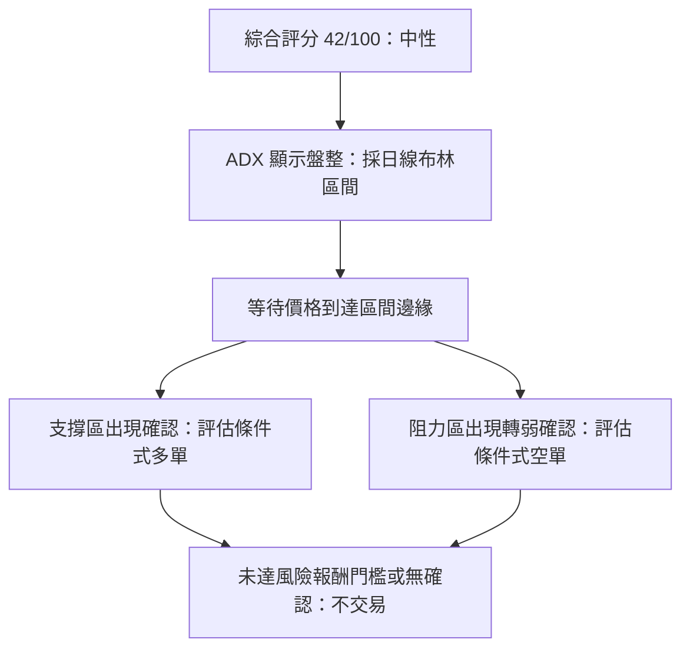

# MSFT 技術分析報告

> **報告日期**：2026-11-26 ｜ **語言**：繁體中文 ｜ **數據來源**：Yahoo Finance ｜ **當前價格**：$489.93（2026-11-25 收盤）

---

## 目錄

| 章節 | 內容 |
|------|------|
| [1. 技術面概覽](#1-技術面概覽) | 核心指標速覽、評分卡 |
| [2. 趨勢分析](#2-趨勢分析) | 長中短期走勢、ADX |
| [3. 圖表形態分析](#3-圖表形態分析) | 形態、K線、缺口 |
| [4. 支撐與阻力](#4-支撐與阻力) | 關鍵價位、斐波那契 |
| [5. 技術指標深度解讀](#5-技術指標深度解讀) | MA／RSI／MACD／布林／成交量／進階指標 |
| [6. 動能與波動率](#6-動能與波動率) | ATR、Beta、相對強度 |
| [7. 多時框架總結](#7-多時框架總結) | 時框架方向與收斂 |
| [8. 交易策略建議](#8-交易策略建議) | 歷史基準、情境、策略與風險報酬比 |
| [9. 風險提示與監控](#9-風險提示與監控) | 監控指標、風險場景 |

---

## 1. 技術面概覽

MSFT 短線偏空、中期訊號轉弱，但月線仍偏多；目前的技術結構較適合觀望區間邊緣，而不是追價。日線價格位於短期均線下方，MACD 與量價訊號偏弱；另一方面，價格仍高於長期均線，且歷史同狀態樣本在中短期的上漲比例略高於全部交易日。最大的反向風險是週線動能已轉弱，若支撐失守，月線偏多不足以抵消短線下行壓力。

### 📊 核心指標速覽表

| 指標類別 | 指標名稱 | 當前數值 | 訊號 | 解讀 |
|----------|----------|----------|------|------|
| **價格** | 當前價格 | **$489.93** | 🟡 | 位於一年區間中上段，但近期自高位回落 |
| **均線** | MA20／MA50／MA200 | 見第 5 章 | 🔴 | 價格低於短中期均線，仍高於長期均線 |
| **動能** | RSI(14)（日線） | 見第 5 章 | 🟡 | 中性偏弱，尚未進入超賣區 |
| **動能** | MACD 柱（日線） | 見第 5 章 | 🔴 | 空方動能占優 |
| **趨勢** | ADX(14) | 見第 2 章 | 🟡 | 趨勢強度不足，按盤整規則看待 |
| **波動** | ATR(14) | 見第 6 章 | 🟡 | 日常價格波動幅度偏大，止損需留意跳動 |
| **多時框** | 一致性 | 見第 7 章 | 🟡 | 日、週、月方向分歧 |

### 🏆 技術評分卡

綜合評分為六項子評分的算術平均，四捨五入至整數；分數落在中性區，依第 8 章採區間操作與等待確認，不同時強推多空。

| 維度 | 評分（0–100） | 訊號 | 主要依據 |
|------|---------------|------|----------|
| 趨勢強度 | 42 | 🟡 | ADX 顯示趨勢力道不足，見第 2 章 |
| 動能指標 | 38 | 🔴 | MACD 偏空、RSI 未形成明確反轉，見第 5 章 |
| 支撐穩定度 | 58 | 🟡 | 多層支撐與價值區下緣相近，但日線動能偏弱，見第 4、5 章 |
| 成交量配合 | 35 | 🔴 | OBV、A/D 及量比均未確認反彈，見第 5 章 |
| 形態完整度 | 35 | 🔴 | 缺少可確認的反轉或延續形態，見第 3 章 |
| 均線排列 | 42 | 🟡 | 短中期均線壓價，長期均線仍提供支撐，見第 5 章 |
| **綜合評分** | **42** | **中性** | 六項平均：250 ÷ 6，四捨五入至整數 |

---

## 2. 趨勢分析

長期結構仍有由低位反彈的特徵，但近期升勢明顯降溫；週線從高位回落且週 MACD 柱轉負，短中期偏弱。ADX 處於盤整區，因此按照規則以日線布林通道上下軌作為主要交易區間，不以短線波動推翻月線方向。

### 📈 長期趨勢（近 12 個月）

月收盤呈現先跌、反彈、再創階段高位後回落的結構。下表以月收盤階段整理，最後一段為截至最新收盤日的未完成月份。

| 階段 | 起訖收盤 | 階段漲跌幅 | 特徵 |
|------|----------|------------|------|
| 2025-12 至 2026-03 | $479.64 → $367.97 | -23.3% | 持續下探，長期走勢由高位轉弱 |
| 2026-04 至 2026-06 | $405.35 → $371.60 | -8.3% | 反彈後再度回落，底部尚未穩固 |
| 2026-07 至 2026-10 | $462.95 → $520.90 | +12.5% | 強勢反彈並延續至階段高位 |
| 2026-11 月內 | 2026-10 月末收盤 → 最新收盤（見第 1 章） | -5.9% | 高位回撤，短線升勢降溫 |

> **資料來源：**月收盤為 Yahoo Finance；區間漲跌幅為依月收盤計算。

### 📊 中期趨勢（週線）

週線在夏季急升後進入高位整理，最近幾週回落速度加快。最近一週收盤較前週回升，但週 MACD 柱仍為負，尚未構成週線動能反轉確認。

| 觀察項目 | 數值或方向 | 解讀 |
|----------|------------|------|
| 近期週線收盤變化 | 2026-11-13：$522.87；2026-11-20：$484.52；2026-11-25：$489.93 | 先急跌、後小幅回升，反彈尚未收復前一週跌幅 |
| 週線趨勢均線 | 收盤低於週 MA20 | 週線方向中性，趨勢均線仍構成上方壓力 |
| 週 RSI | 52.26 | 仍高於中性分界，但近週數值從高位回落 |
| 週 MACD 柱 | -3.191 | 週線動能轉弱，與月線偏多訊號相抵 |
| 週線方向 | 中性 | 週線尚未符合偏多或偏空的雙條件方向規則 |

### ⚡ 趨勢強度（ADX）

| 指標 | 數值 | 解讀 |
|------|------|------|
| ADX(14) | 18.83 | 低於趨勢行情門檻，屬弱趨勢／盤整 |
| +DI | 17.52 | 買方方向動能較弱 |
| −DI | 30.68 | 賣方方向動能較強 |
| 行情分類 | 盤整行情 | ADX 低於 25，依規則以日線布林上下軌作為主要交易區間 |
| 多空交叉判讀 | −DI 高於 +DI | 盤整框架內仍有短線空方優勢，不等於已確認下跌趨勢 |

---

## 3. 圖表形態分析

目前資料不支持高信心度的頭肩、雙底或旗形等幾何形態判定；較可靠的解讀是短線跌勢、低位反彈嘗試，以及價格接近布林下軌。最近的跳空缺口已回補，不再構成未回補缺口支撐或阻力。

### 🔍 形態識別

| 形態 | 信心度 | 判斷依據 | 完成度 | 目標價 |
|------|--------|----------|--------|--------|
| 近端下跌後的反彈嘗試 | 中 | 近期週線急跌後收盤小幅回升，但週 MACD 柱仍負值，未收復週趨勢均線 | 尚未確認反轉 | N/A（數據中未偵測到可計算的形態目標） |
| 布林通道下半部運行 | 中 | 日線 %B 位於下半區，收盤低於中軌且靠近下軌 | 指標型狀態，非幾何形態 | 不適用 |
| 頭肩、雙底、旗形等幾何形態 | 低 | 僅有有限期間 OHLC 展示，無法驗證完整頸線、肩部或旗桿結構 | 訊號不足，僅做指標型解讀 | N/A（數據中未偵測到） |

### 🕯️ 重要 K 線形態

下表只使用近十根日 K 與近八根週 K 的 OHLC；週線最新一根仍是進行中的週 K。K 棒名稱為對當根 OHLC 的形狀描述，不單獨視為反轉確認。

| 日期／時框 | 開 | 高 | 低 | 收 | K 線形態 | 解讀 | 訊號 |
|------|----:|----:|----:|----:|---------|------|------|
| 2026-11-20／日 K | $493.74 | $503.80 | $481.03 | $484.52 | 長實體黑 K，帶上影 | 收盤靠近低位，顯示當日賣壓主導 | 🔴 |
| 2026-11-25／日 K | $485.23 | $493.44 | $477.39 | $489.93 | 下影線較長的反彈 K | 低位有買盤承接，但單根 K 棒不足以確認趨勢反轉 | 🟡 |
| 2026-11-20／週 K | $524.08 | $526.93 | $481.03 | $484.52 | 長實體黑 K | 週內跌幅大且收盤偏低，週線賣壓明顯 | 🔴 |
| 2026-11-25／週 K（進行中） | $506.06 | $509.15 | $477.39 | $489.93 | 黑 K、下影線較長 | 尚未收週；低位承接存在，但不能當作完整週線反轉訊號 | 🟡 |

### 跳空缺口

| 日期 | 方向 | 缺口區間 | 缺口幅度 | 是否回補 | 技術含義 |
|------|------|----------|----------|----------|----------|
| 2026-11-04 | 向上跳空 | $522.43–$541.25 | 3.6% | 已回補 | 缺口已被價格回補，不列為未回補缺口支撐 |

---

## 4. 支撐與阻力

近一年波段價位顯示，上方阻力集中在 R1 與 R2；下方有多層支撐，但現價與第一支撐之間距離有限。阻力區與斐波那契回調位部分重疊，支撐區則與布林下半部、價值區上緣附近的技術背景相互參照；不同指標的計算方法不同，不應把重疊視為支撐必然有效。

### 🚧 阻力位分析表

阻力位來自近一年波段高點聚類；資料中未偵測到第三個波段阻力位。

| 阻力級別 | 價位 | 形成原因 | 突破難度 | 重要性 |
|----------|------:|----------|----------|--------|
| R1 | $514.28 | 近一年波段高點聚類；亦接近短中期均線與回撤壓力帶 | 中 | 第一個主要反彈檢驗位 |
| R2 | $554.08 | 近一年波段高點聚類，接近一年高位區 | 高 | 若有效突破，才較能改善中期結構 |
| R3 | 數據中未偵測到 | 無第三個波段阻力聚類 | — | 不以未列出的價位補造 |

### 🛡️ 支撐位分析表

支撐位來自近一年波段低點聚類。

| 支撐級別 | 價位 | 形成原因 | 守住可能性 | 重要性 |
|----------|------:|----------|------------|--------|
| S1 | $485.06 | 近一年波段低點聚類，為最近的波段支撐 | 中 | 短線支撐觀察點 |
| S2 | $475.34 | 近一年波段低點聚類；與日線布林下軌附近區域相近 | 中 | 若 S1 失守，下一層支撐參考 |
| S3 | $466.33 | 近一年波段低點聚類，接近長期趨勢支撐區 | 低至中 | 失守將削弱長線反彈結構 |

### 樞軸點補充

波段支撐與阻力均已有多個價位，故樞軸點不替代或重標波段價位；列於此處供短線觀察。

| 樞軸類別 | 價位 | 用途 |
|----------|------:|------|
| 樞軸 PR2 | $566.30 | 高於主要波段阻力，僅供延伸參考 |
| 樞軸 PR1 | $543.60 | 上方公式阻力參考 |
| 樞軸 P | $527.39 | 月度公式中樞 |
| 樞軸 PS1 | $504.69 | 價格反彈時的公式參考位 |
| 樞軸 PS2 | $488.49 | 近端公式支撐參考 |

### 📐 斐波那契回調位分析

斐波那契位直接採用 52 週高低區間計算值。現價位於 23.6% 與 38.2% 回調位之間，顯示價格已自一年高位回撤，但尚未跌至區間中段回調位。

| 回調比例 | 價位 | 解讀 |
|----------|------:|------|
| 23.6% | $508.46 | 現價上方的第一個斐波那契回升／回撤參考位 |
| 38.2% | $477.78 | 現價下方的重要回調參考位 |
| 50.0% | $452.97 | 更深一層的區間中段回調參考位 |
| 61.8% | $428.17 | 深度回撤參考位 |
| 78.6% | $392.85 | 深度回撤參考位 |

---

## 5. 技術指標深度解讀

均線與 MACD 偏空、RSI 尚未超賣、布林位置偏弱；訊號方向大致一致，但 RSI 與月線狀態保留反彈可能。成交量指標未確認買方接手，因此目前較像弱勢整理，而不是已確認的趨勢反轉。

### 📈 均線、RSI、MACD、布林通道

| 指標 | 數值 | 訊號 | 解讀 |
|------|------|------|------|
| MA20／MA50／MA200 | MA20 $516.38；MA50 $518.64；MA200 $443.23；均線排列：混合 | 🔴 | 收盤低於 MA20、MA50，高於 MA200；短中期壓力仍在，長期結構未完全轉空 |
| RSI(14)（日線）與背離 | RSI 38.99；背離：無明顯背離 | 🟡 | RSI 位於中性區偏弱一側；近二十根 K 棒首尾比較未偵測到明顯頂背離或底背離 |
| MACD 線／Signal／柱（日線） | MACD -8.346；Signal -4.145；Hist -4.201 | 🔴 | MACD 線低於 Signal，柱體為負，日線空方動能較強 |
| 布林上軌／中軌／下軌／%B | 上軌 $553.72；中軌 $516.38；下軌 $479.04；%B 0.15 | 🔴 | 收盤在中軌下方並接近下軌區域，反映價格偏弱；但低 %B 本身不等於反轉訊號 |

**指標整合：**MA20、MA50、MACD 與布林位置均指向日線偏弱，彼此確認；RSI 未進入超賣，表示賣壓仍可能延續，也沒有背離提供反轉佐證。價格仍高於 MA200，故長期結構與短線訊號有所矛盾，應以盤整規則下的區間交易規劃處理，而非將日線疲弱直接外推為長期空頭趨勢。

### 💹 成交量（量價配合度）

| 指標 | 數值 | 訊號 | 解讀 |
|------|------|------|------|
| 最新成交量 | 26,733,600 | 🟡 | 低於 20 日均量，但高於近期回落前部分交易日的量能 |
| 20 日均量／量比 | 30,662,685／0.87x | 🔴 | 最新成交量低於均量，反彈買盤未顯示明確放大 |
| 50 日均量 | 25,313,786 | 🟡 | 最新成交量略高於較長週期均量，單日量能不足以確認趨勢 |
| OBV 趨勢 | OBV < MA；量能疲弱 | 🔴 | 量能未確認價格反彈，對多方不利 |
| A/D 線 | 近 20 根不高於 20 日均值；A/D 下降、價格下跌 | 🔴 | A/D 與價格同向下行，確認近期累積／派發動能偏弱 |

量比低於均量、OBV 位於其均線下方，而 A/D 與價格同向下降，三者均未支持買方累積。這使得低位反彈的可信度較低；需要觀察價格反彈時成交量與 OBV 是否同步改善。

### 🧭 進階指標

| 指標 | 數值 | 收盤相對位置 | 解讀 |
|------|------|--------------|------|
| 一目均衡表（轉換線／基準線／雲層） | 轉換線 $502.16；基準線 $517.73；當前雲層先行帶 A $526.06／B $512.71；前方雲層先行帶 A $509.95／B $517.73 | 雲層下方；轉換線低於基準線 | 日線一目均衡偏空；與短期均線、MACD 一致，與價格仍高於 MA200 的長期狀態相抵 |
| 成交量分布（POC／價值區） | POC $396.04；價值區 $365.39–$488.01，涵蓋 76% 成交量 | 收盤位於價值區上方 | 價格高於主要成交密集區上緣，長期累積成本帶仍在下方；但不代表短線支撐必然有效 |
| 錨定 VWAP（自 52 週高點／低點） | 自 52 週高點起 $518.43；自 52 週低點起 $466.28 | 低於高點錨定 VWAP，高於低點錨定 VWAP | 高點以來買入者整體面臨壓力，低點以來買入者仍處於有利位置；與短線偏弱、長期未完全破壞的解讀一致 |
| A/D 線 | 近 20 根不高於其 20 日均值；A/D 下降 | — | 資金流向偏弱，與 OBV、價格回落共同確認近期賣壓 |

---

## 6. 動能與波動率

波動率足以令過窄止損容易被一般日內波動觸及；但放寬止損也會增加單筆風險，應以預先計算倉位控制。相對強度顯示 MSFT 近一月落後 VTI、但不同期間均優於 QQQ；這支持中期相對韌性，卻不足以推翻日線偏弱的主策略。

### 📊 ATR 波動率分析

| 指標 | 數值 | 解讀 |
|------|------|------|
| ATR(14) | $16.86 | Wilder 平均真實波幅，作為日常波動尺度 |
| ATR 佔價格比例 | 3.44% | 單日常態波動相對顯著，不能以緊貼價格的止損取代結構止損 |
| 1.5 倍 ATR 距離 | $25.29 | 作為較寬鬆波動緩衝的參考距離，不等同建議止損價 |
| 2 倍 ATR 距離 | $33.72 | 壓力情境的波動距離參考；若採用，應同步縮小部位 |
| 交易應用 | 以第 8 章結構價位設定止損 | ATR 用於核對止損是否過近；若止損距離與預算風險不合，調整倉位而非任意移動止損 |

### 📐 Beta 與相對強度

Beta 反映相對市場的歷史敏感度，不是短期方向預測。相對強度以下表列示的市場脈絡期間與價格報酬為準。

| 基準 | 期間 | MSFT 報酬 | 基準報酬 | 超額報酬 |
|------|------|-----------:|---------:|---------:|
| VTI（美國整體市場） | 1 個月 | -6.8% | -5.8% | -1.1% |
| VTI（美國整體市場） | 3 個月 | -0.0% | -6.4% | +6.4% |
| VTI（美國整體市場） | 6 個月 | +20.2% | -4.2% | +24.4% |
| QQQ（Nasdaq-100） | 1 個月 | -6.8% | -10.4% | +3.6% |
| QQQ（Nasdaq-100） | 3 個月 | -0.0% | -10.3% | +10.3% |
| QQQ（Nasdaq-100） | 6 個月 | +20.2% | -12.5% | +32.7% |

| 風險指標 | 數值／趨勢 | 解讀 |
|----------|------------|------|
| Beta | 1.045 | 歷史上對市場波動的敏感度略高於基準水平 |
| 對 VTI 比值趨勢 | 相對走強，比值高於其 50 日均值 | 中期相對韌性支持等待多方確認，不足以抵消短線技術偏弱 |
| 對 QQQ 比值趨勢 | 相對走強，比值高於其 50 日均值 | 在科技股基準走弱期間具相對抗跌性，對區間下緣布局略有支持 |
| 對主策略的影響 | 中期支持、短期相抵 | 相對強度傾向支持逢低觀察，但日線結構仍要求等待支撐確認 |

> **資料來源：**Beta 為市場資料；相對強度為市場脈絡區塊所列價格報酬，不含股息，計算截至 2026-11-24。

---

## 7. 多時框架總結

多時框一致性為 **1/3（多空分歧）**。日線偏空、週線中性、月線偏多；由於 ADX 顯示盤整，交易框架依規則採日線布林通道區間，而不把月線偏多當成短線買入確認。

### 📋 時框架方向表

以下方向、RSI、MACD 柱與趨勢均線照列多時框指標快照；月線 MACD 柱因資料不足維持原標示。

| 時框架 | 趨勢方向 | RSI(14) | MACD 柱 | 收盤 vs 趨勢均線 | 形態 | 建議 |
|--------|----------|---------|---------|------------------|------|------|
| 日線 | 偏空 | 38.99 | -4.201 | 低於 MA50 $518.64 | 偏空動能、低位區間測試 | 依盤整規則等待支撐反應，不追空 |
| 週線 | 中性 | 52.26 | -3.191 | 低於 MA20 $493.66 | 高位回落、週動能轉弱 | 等待週線重回趨勢均線上方或支撐確認 |
| 月線 | 偏多 | 54.57 | N/A（數據未提供） | 高於 MA10 $447.59 | 長線反彈結構仍在 | 作為中長期背景，不作日線進場依據 |

### ⚖️ 多時框收斂結論

| 收斂項目 | 結論 |
|----------|------|
| 行情分類 | 盤整行情，ADX 低於趨勢行情門檻 |
| 主導交易框架 | 日線布林通道上下軌為主要區間參考 |
| 時框衝突處理 | 月線偏多只保留為背景；日線與週線動能較弱，採等待區間邊緣確認，而非直接追多 |
| 唯一方向性結論 | **中性觀望** |
| 與第 8 章策略一致性 | 主策略為等待可交易區域與確認訊號；不以評分中性解讀為同時做多、做空 |

---

## 8. 交易策略建議

**當前主策略方向 = 中性區間操作（依評分 42/100）**：以等待價格抵達區間邊緣並取得確認為主；下列多空條件是不同時點的條件式方案，不是同時持倉或同時下單。

### 📊 歷史基準機率

今日狀態定義為 RSI(14) 位於 30–50 且收盤高於 MA200；樣本期間為 2016-11-25 至 2026-11-25，共 2,514 個交易日。數字為價格報酬、不含股息；上漲比例是歷史頻率而非預測，且相同狀態交易日及持有期互相重疊，樣本段數比交易日數更接近獨立事件數。

| 持有期 | 相同狀態樣本（段數） | 上漲比例 | 中位數報酬 | 25%–75% 分位 | 全部交易日上漲比例／中位數 |
|--------|----------------------|----------|------------|--------------|----------------------------|
| 5 日 | 422（110 段） | 57% | +0.6% | -1.7% – +2.9% | 58%／+0.6% |
| 20 日 | 413（108 段） | 66% | +2.4% | -1.3% – +5.8% | 62%／+2.1% |
| 60 日 | 413（108 段） | 65% | +6.1% | -3.2% – +13.4% | 70%／+5.8% |

相同狀態在較短至中期的歷史上漲比例與全部交易日相近或略高，但較長持有期的上漲比例低於全部交易日。各持有期僅有約百段獨立事件，且觀察值有重疊，因此不能把差異當成可靠的預測優勢。這些基準對逢低觀察略有支持，與等待確認的中性主策略相容，但不構成直接買入理由。

### 🎯 價格情境階梯（Price Scenarios）

價位標籤均對應第 4 章的波段價位；可能性採高／中／低等級，並非數值機率。

| 觸發條件 | 下一目標 | 後續延伸 | 可能性 | 依據 |
|----------|----------|----------|--------|------|
| 有效突破 R1 | R2 | 樞軸 PR1 | 低至中 | 需收盤確認並改善量能；日線均線與一目雲層仍是上方壓力 |
| 價格在現有區間內止跌並重新轉強 | 先看布林中軌，再看 R1 | 樞軸 P | 中 | ADX 屬盤整，區間回歸有技術基礎；目前 OBV 與 A/D 尚未確認 |
| 跌破 S1 並持續收在其下 | S2 | S3 | 中 | 日線動能偏弱；若支撐失守，下一波段支撐成為觀察目標 |
| 跌破 S3 | 斐波那契 50.0% 回調位 | 斐波那契 61.8% 回調位 | 低 | 將削弱長期反彈結構；此為風險情境，不是既定預測 |

### 🟢 主策略詳情

以下入場、止損及目標均取自第 4 章已列出的波段、斐波那契或一目價位。僅在觸發條件成立後考慮執行；兩種策略是互斥的條件式方案，未達確認或報酬門檻時維持觀望。

| 策略要素 | 策略 A：支撐反彈多單 | 策略 B：阻力轉弱空單 |
|----------|----------------------|----------------------|
| 進場條件 | 價格回落至 S3，出現止跌確認；量能或短線動能不再惡化 | 價格反彈至 R1，出現轉弱確認；不在支撐區追空 |
| 進場價格 | $466.33 | $514.28 |
| 目標價 T1 | $508.46 | $485.06 |
| 目標價 T2 | $514.28 | $475.34 |
| 止損價格 | $452.97 | $526.06 |
| 風險報酬比 | **1 : 3.15（以 T1 計）**；以 T2 計 1 : 3.59 | **1 : 2.48（以 T1 計）**；以 T2 計 1 : 3.31 |
| 比值核算 | (508.46 − 466.33) ÷ (466.33 − 452.97) = 3.15 | (514.28 − 485.06) ÷ (526.06 − 514.28) = 2.48 |
| 把握度 | 中低：歷史基準略支持中短期反彈，但 OBV、A/D 與日線 MACD 未確認 | 中低：日線動能偏弱，但屬盤整框架，須等阻力附近轉弱訊號 |
| 建議倉位 | 每筆風險以帳戶淨值的 0.25%–0.50% 為上限，依止損距離反推股數 | 每筆風險以帳戶淨值的 0.25%–0.50% 為上限，依止損距離反推股數 |
| 執行狀態 | 未到條件價位或未止跌確認：不交易 | 未到條件價位或未轉弱確認：不交易 |

> 兩個條件式方案的 T1 風險報酬比均達到最低要求；但目前並非進場訊號。主要行動仍是觀望，等待價格接近相應價位並出現確認。

### 🔴 反向風險觸發點（對沖提示）

| 風險訊號 | 對主策略的影響 | 風控處理 |
|----------|----------------|----------|
| S1 失守且日線收盤無法收回 | 支撐反彈方案的勝算降低，弱勢可能延伸至下一支撐 | 不提前接刀；重新評估多單觸發條件 |
| S3 失守 | 長期反彈結構轉弱，月線偏多背景受損 | 停止執行支撐反彈方案，依預設止損處理 |
| 收復 R1 並伴隨量能改善 | 區間偏弱判讀可能失效，空單方案風險上升 | 不在突破後追空，等待阻力有效性重新評估 |
| 日線回到布林中軌上方，且 MACD、OBV 同步改善 | 反彈確認強度提高，原本偏弱的短線判斷須調整 | 先等待收盤確認，再考慮更新區間假設 |

---

## 9. 風險提示與監控

近期主要風險是日線弱勢延續並造成支撐失守；反向風險則是相對強度與長期均線支撐促成快速反彈。財報在最新收盤日後的 63 個日曆天，若交易仍延續至財報期間，需面對跳空及止損不能保證成交的風險。

### ✅ 關鍵監控指標

| 監控項目 | 價位／事件 | 觸發後動作 |
|----------|------------|------------|
| 近端波段支撐 | S1（見第 4 章） | 觀察收盤能否守穩；未確認前不加碼 |
| 下一層支撐 | S2、S3（見第 4 章） | 評估支撐反彈方案是否到達條件；若有效跌破則依預設停損 |
| 近端波段阻力 | R1（見第 4 章） | 觀察是否有效突破，或在此出現轉弱訊號 |
| 日線動能 | MACD、RSI、布林位置（見第 5 章） | 觀察 MACD 是否收斂、價格是否收回布林中軌；避免以單一指標決策 |
| 量價確認 | OBV、A/D、量比（見第 5 章） | 價格反彈但量能未改善時，不視為充分確認 |
| 下次財報日 | 2027-01-27；距最新收盤日 63 個日曆天 | 若策略仍持倉並進入財報期間，降低倉位或預先規劃事件風險；財報跳空時止損不保證成交 |
| 跳空缺口 | 2026-11-04 缺口已回補 | 不把已回補缺口視為未回補支撐或阻力 |

### ⚠️ 風險場景

| 情境 | 觸發條件 | 參考價位 | 可能性 | 應對 |
|------|----------|----------|--------|------|
| 樂觀 | 支撐區守穩，價格收復短期均線並伴隨量能改善 | 先看布林中軌，再看 R1 | 中低 | 只在收盤與量能共同確認後評估多單 |
| 基本 | ADX 維持盤整，價格在支撐與阻力之間震盪 | 以布林上下軌及 S1／R1 作區間觀察 | 中 | 等待價格接近區間邊緣，不在區間中段追價 |
| 悲觀 | S1 失守，且日線動能及量價持續偏弱 | S2、S3；若再失守，觀察斐波那契 50.0% 回調位 | 中 | 停止支撐反彈假設，依既定停損和風險預算減少曝險 |

### 🛡️ 風險管理提醒

- 依策略止損距離反推部位大小；不要先決定股數，再把止損放到不合理的位置。
- 支撐位不是保證有效的價格；若日線收盤失守，應依原定風控處理，不以盤中短暫反彈作為任意延後止損的理由。
- 量能尚未確認反彈，避免在價格接近支撐時一次投入全部預定倉位。
- 若持倉跨越財報日，應預先考慮跳空風險；一般止損單無法保證以指定價格成交。
- 歷史基準描述的是過去相同狀態的頻率，不代表未來結果；不得以歷史上漲比例取代交易確認與倉位管理。

---

## 📋 報告總結

| 項目 | 結論 |
|------|------|
| 報告日期 | 2026-11-26 |
| 當前價格 | 見標題與第 1 章（2026-11-25 收盤） |
| 綜合評分／方向 | 42/100，中性 |
| 長期／中期／短期趨勢 | 🟢 月線偏多背景仍在；🟡 週線中性且動能轉弱；🔴 日線偏空 |
| 關鍵支撐／關鍵阻力 | 支撐：S1、S2、S3（見第 4 章）；阻力：R1、R2（見第 4 章） |
| 🥇 最佳機會 | **觀望，等待價格到達可交易價位並取得確認** |
| 最大風險 | 日線弱勢延續並跌破支撐；若持倉跨財報，另有跳空與止損滑價風險 |

> ⚠️ **免責聲明**：本報告為 AI 自動生成之技術分析，所有數據及估算均基於歷史價格資訊。本報告僅供研究與學術參考，不構成任何投資建議。投資有風險，入市需謹慎。

---

## 資料與來源

| 項目 | 內容 |
|------|------|
| 價格 | 489.93 USD，2026-11-25 收盤（Yahoo Finance 日線） |
| K 棒 | 501 根日線，2024-11-26 至 2026-11-25（Yahoo Finance）；較長期間的價位與基準機率取自價格資料庫 |
| 關鍵價位回溯期間 | 阻力 近一年、支撐 近一年 |
| 下次財報日 | 2027-01-27（Yahoo Finance，日期可能調整） |
| 有回應的資料來源 | Yahoo Finance、Finviz、StockAnalysis、Roic.ai |
| 由程式計算 | 所有指標、R1–S3 與斐波那契價位、多時框方向、相對強度、缺口、歷史基準機率、綜合評分 |
| 撰寫模型 | openai / gpt-6-luna |

> 本區塊由產生報告的程式依實際取得的資料填寫，非模型撰寫。「由程式計算」的數字不是模型的估計；其餘判斷（評分、情境、策略）是模型的分析。
