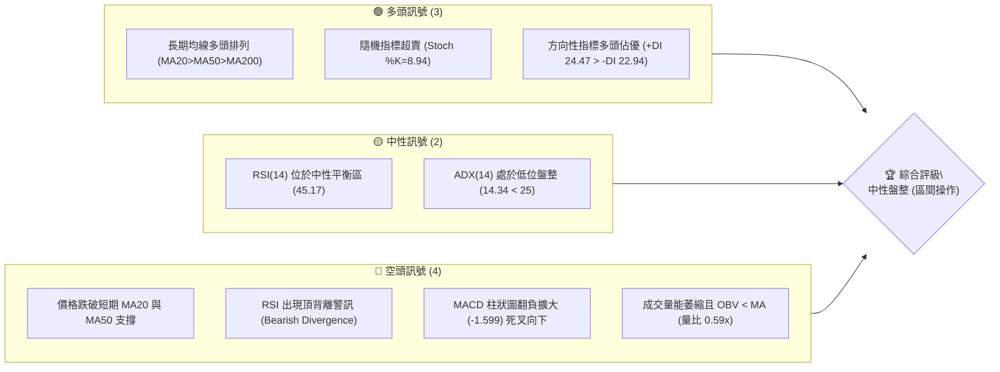
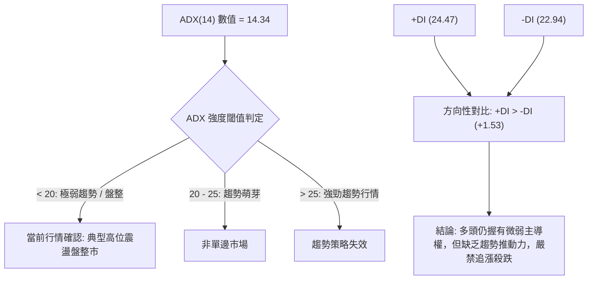
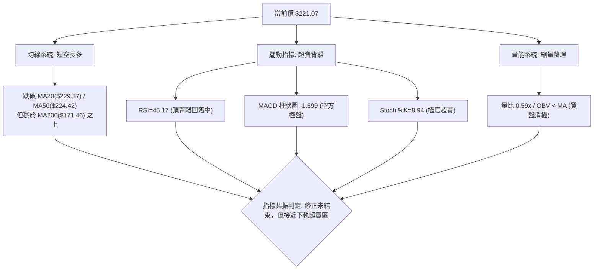
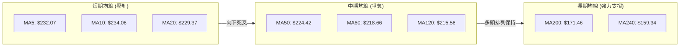
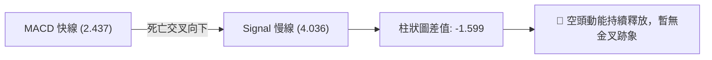
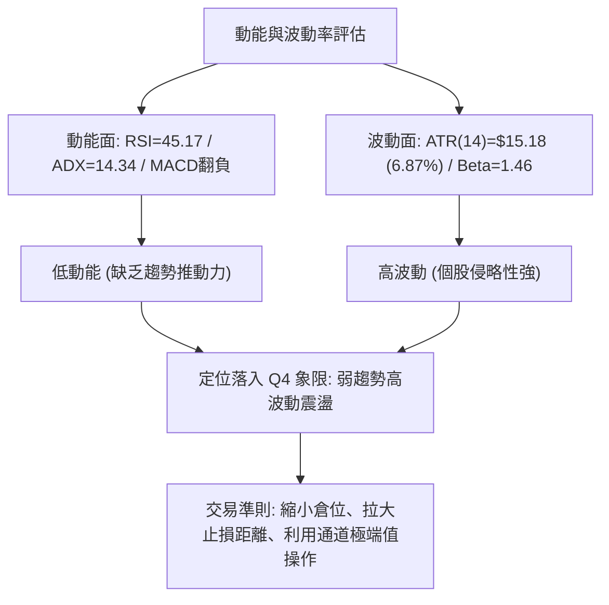
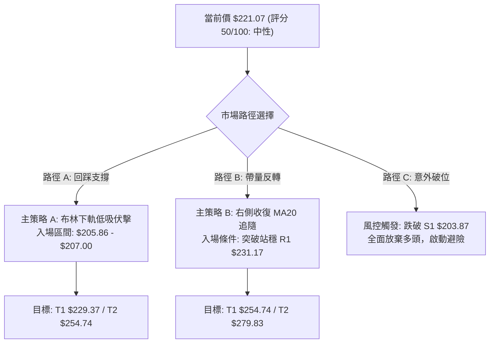
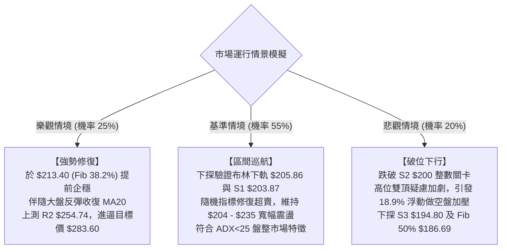

# NBIS 技術分析報告

> **報告日期**：2026-10-11 ｜ **語言**：繁體中文 ｜ **數據來源**：Yahoo Finance ｜ **當前價格**：$221.07

---

## 目錄

| 章節 | 內容 |
|------|------|
| [1. 技術面概覽](#1-技術面概覽) | 訊號儀表板、核心指標、評分卡 |
| [2. 趨勢分析](#2-趨勢分析) | 多時框趨勢、長中短期走勢、12個月走勢圖 |
| [3. 圖表形態分析](#3-圖表形態分析) | 形態識別、K線組合、形態目標價 |
| [4. 支撐與阻力](#4-支撐與阻力) | 關鍵價位分布、阻力支撐表、斐波那契回調 |
| [5. 技術指標深度解讀](#5-技術指標深度解讀) | MA/RSI背離/MACD/布林通道/量價配合 |
| [6. 動能與波動率](#6-動能與波動率) | 動能四象限、ATR波動率、Beta解讀 |
| [7. 多時框架總結](#7-多時框架總結) | 時框架評分矩陣、多時框收斂結論 |
| [8. 交易策略建議](#8-交易策略建議) | 策略路由、價格情境階梯、主策略詳情 |
| [9. 風險提示與監控](#9-風險提示與監控) | 關鍵監控清單、風險場景樹、風控原則 |
| [📋 報告總結](#-報告總結) | 總體評級、核心結論、最優交易機會 |

---

## 1. 技術面概覽

### 🎯 技術訊號儀表板



### 📊 核心指標速覽表

| 指標類別 | 指標名稱 | 當前數值 | 訊號 | 解讀 |
|----------|----------|----------|------|------|
| **價格** | 當前收盤價 | $221.07 | 🟡 | 位於52週高低區間之 65.2%，短線自高檔回撤 |
| **均線** | MA20 | $229.37 | 🔴 | 價格低於 MA20（-3.62%），跌破短線多空分水嶺 |
| **均線** | MA50 | $224.42 | 🔴 | 價格跌破中期 MA50（-1.49%），短中期均線承壓 |
| **均線** | MA200 | $171.46 | 🟢 | 價格遠高於長期 MA200（+28.93%），宏觀牛市架構未破 |
| **動能** | RSI(14) | 45.17 | 🟡 | 處於 30-70 中性區間，但系統標註頂背離下行中 |
| **動能** | MACD(12,26,9) | 柱狀圖 -1.599 | 🔴 | MACD線(2.437)跌破訊號線(4.036)，綠柱持續擴散 |
| **震盪** | Stoch %K/%D | 8.94 / 24.72 | 🟢 | 進入極度超賣區間，短線存在技術性反抽動能 |
| **趨勢** | ADX(14) | 14.34 | 🟡 | 數值低於 25，確認市場處於無明確單邊之震盪盤整 |
| **通道** | 布林帶 %B | 0.32 | 🟡 | 介於下軌($205.86)與中軌($229.37)之間，弱勢震盪 |
| **量能** | 量比 (20MA) | 0.59x | 🔴 | 最新量 9.54M 低於均量 16.04M，OBV低於均線，量價疲弱 |
| **波動** | ATR(14) | $15.18 | 🔴 | 佔股價 6.87%，單日波動幅度顯著，操作需拉開止損 |

### 🏆 技術評分卡

```
╔══════════════════════════════════════════════════════════════════╗
║                 技術評分卡 — NBIS (2026-10-11)                  ║
╠══════════════════════════════════════════════════════════════════╣
║ 趨勢強度 (ADX=14.34)       █████████░░░░░░░░░░░  45/100   🟡     ║
║ 動能指標 (MACD/RSI偏弱)     ████████░░░░░░░░░░░░  40/100   🔴     ║
║ 支撐穩定度 (Fib/S1聚集)     █████████████░░░░░░░  65/100   🟢     ║
║ 成交量配合 (0.59x縮量)     ████████░░░░░░░░░░░░  42/100   🔴     ║
║ 形態完整度 (大區間箱體)    ██████████░░░░░░░░░░  52/100   🟡     ║
║ 均線排列 (長多短空壓制)    ███████████░░░░░░░░░  56/100   🟡     ║
╠══════════════════════════════════════════════════════════════════╣
║ 綜合技術評分               ██████████░░░░░░░░░░  50/100  ⚖️ 中性 ║
╚══════════════════════════════════════════════════════════════════╝
```

---

## 2. 趨勢分析

### 🌐 多時框趨勢分析

NBIS 當前處於「長多、中整、短空」的多時框衝突階段。根據收斂原則，由於日線 ADX(14) 僅為 14.34（遠小於 25），當前被定義為**典型盤整行情**。

```mermaid
graph TD
    A["月線層級 (Long-term)"] -->|"24個月上漲趨勢 (+934%)"| A1["長期結構: 強勢多頭 (MA200=$171.46)"]
    B["週線層級 (Mid-term)"] -->|"震盪於 $177.71 - $286.69 箱體"| B1["中期結構: 高位大箱體橫盤整理"]
    C["日線層級 (Short-term)"] -->|"受制於 MA20("$229.37") 與 MA50("$224.42")"| C1["短期結構: 弱勢回調，考驗下方支撐"]
    
    A1 --> D{"多時框收斂判定"}
    B1 --> D
    C1 --> D
    D --> E["主導操作邏輯: 盤整區間思維 (ADX<25)<br/>依布林通道上下軌與S1/R1進行區間防守與高拋低吸"]
```

### 📈 長期趨勢 — 12個月走勢圖（Unicode）

以下展示 NBIS 自 2025 年 11 月至 2026 年 10 月之月線收盤走勢：

```
NBIS 月線走勢圖（過去12個月收盤價）
價格軸 ($)
$280 ┤                                           ● (2026-06 $276.17)
$260 ┤
$240 ┤                                                 ● (2026-09 $235.88)
$220 ┤                                     ●           │  ● (當前 2026-10 $221.07)
$200 ┤                                     │     ●     │  │
$180 ┤                                     │     │(07) │  │
$160 ┤                                     │     │     │  │
$140 ┤                               ●     │     │     │  │
$120 ┤                         ●     │     │     │     │  │
$100 ┤                         │     │     │     │     │  │
 $80 ┤ ●━━━━━●━━━━━●━━━━━●     │     │     │     │     │  │
     └─┬─────┬─────┬─────┬─────┬─────┬─────┬─────┬─────┬──┴──┬─────
      11    12    01    02    03    04    05    06    07    08    09    10 (月份)
      (2025)     (2026)
```

**過去 12 個月走勢特徵分析表**：

| 階段區間 | 月份分布 | 收盤價變化 | 漲跌幅 | 核心特徵與技術意義 |
|----------|----------|------------|--------|--------------------|
| **底部築底** | 2025-11 ~ 2026-02 | $94.87 → $91.19 | -3.88% | 於 $80~$95 區間構築堅實底部平台，籌碼深度換手 |
| **主升浪爆發** | 2026-03 ~ 2026-06 | $103.76 → $276.17 | +166.16% | 月線四連陽帶量突破，創下歷史次高收盤，動能釋放極致 |
| **高位劇震** | 2026-07 ~ 2026-08 | $190.41 → $206.32 | +8.36% | 7月單月重挫回踩 $177.71 週線低點，隨後強勢V轉修復 |
| **高檔收斂** | 2026-09 ~ 2026-10 | $235.88 → $221.07 | -6.28% | 向上衝擊 $240+ 受阻回落，成交量萎縮，進入收斂三角形末端 |

### 📊 中期趨勢（週線分析）

從近 20 週收盤數據觀察，股價形成了明顯的波段波動區間：
- **頂部壓力區**：2026-06-21 創出週收盤高點 $286.69（52週最高價達 $299.86），2026-08-16 再次衝擊高點收於 $277.68，構成中期雙重阻力帶。
- **底部支撐區**：2026-07-19 週收盤探底至 $177.71，隨後週成交量爆出 1.54 億至 1.67 億股的歷史巨量，確認 $177~$190 區間有極強主力資金承接。
- **當前位置**：最近三週收盤價由 $237.33 → $242.81 降至 $221.07，週 MACD 柱狀圖由正轉負（+1.113 轉為 -1.599），週 RSI 跌至 45.2，意味著週線級別的反彈動能再次衰竭，價格回測中期均線。

### ⚡ 趨勢強度評估（ADX 解讀）



**ADX 狀態對照表**：

| 指標變數 | 當前讀數 | 門檻區間 | 技術結論 |
|----------|----------|----------|----------|
| **ADX(14)** | **14.34** | `< 20` (極弱) | 單邊趨勢不存在，價格走勢呈現均值回歸特徵 |
| **+DI** | **24.47** | 中性偏多 | 多頭買盤力道尚存，但未達顯著擴張 (>30) |
| **-DI** | **22.94** | 中性防守 | 空頭打壓力道有限，未見恐慌性拋售擴大 |
| **差值 (+DI - -DI)** | **+1.53** | 均衡膠著 | 多空勢均力敵，市場等待新的催化劑指引方向 |

---

## 3. 圖表形態分析

### 🔍 形態識別系統

依據嚴格規定，形態必須依數據給出明確判斷依據與信心度。

| 識別形態 | 信心度 | 判斷依據（引用數據） | 完成度 | 目標價（附計算式） |
|----------|--------|----------------------|--------|--------------------|
| **大級別高位箱體整理** | **85%** | 價格波段受阻於 R2($254.74)~R3($279.83)，下檔多次於 S1($203.87) 及 7月週收盤 $177.71 止跌。 | 75% | 箱體下軌 $203.87 / 上軌 $254.74。<br/>若向上突破：頸線 $254.74 + 形態高度($254.74 - $203.87=$50.87) = **$305.61** |
| **短期對稱收斂三角形** | **65%** | 近期高點聚類下降 ($242.81 → $237.33)，而回調低點抬高（8月低點 $187.97 → 9月低點 $209.18），振幅收窄。 | 80% | 待突破。若跌破下軌，下測 S1 **$203.87**；若突破上軌，上測 R1 **$231.17**。 |
| **中期雙重頂潛在威脅** | **45%** | 6月週高 $286.69 與 8月週高 $277.68 形成潛在高位雙峰，但頸線尚未有效跌破。 | 40% | 訊號不足以確認反轉，僅作風險防守提示，暫不依此放空。 |

### 🕯️ 重要K線形態分析

| 週期/日期 | 收盤價 | K線形態特徵 | 技術解讀 | 訊號 |
|-----------|--------|-------------|----------|------|
| **2026-08-16 (週)** | $277.68 | 巨量大陽線 (+47.7%) | 創下單週成交 1.67 億股天量，確立高檔強反彈浪 | 🟢 強多 |
| **2026-08-23 (週)** | $219.13 | 長陰吞沒 (-21.0%) | 爆量後獲利了結盤湧出，高檔承接力道衰竭 | 🔴 強空 |
| **2026-09-27 (週)** | $237.33 | 溫和放量紅K棒 | 企圖向上挑戰 MA20，量能未放大至均量以上 | 🟡 中性 |
| **2026-10-04 (週)** | $242.81 | 高檔帶上影倒錘頭 | 衝高至 $246.44 (Fib 23.6%) 附近遇阻回落，顯露疲態 | 🔴 偏空 |
| **2026-10-11 (週)** | $221.07 | 實體回調陰線 (-8.95%) | 失守日線 MA50($224.42) 及 MA20($229.37)，短線偏弱 | 🔴 看空 |

### 📉 ASCII 走勢形態示意圖

```
NBIS 週線級別箱體震盪形態示意圖
價格 ($)
$280 ┤               [峰 1: $286.69]         [峰 2: $277.68]
     │                      ╭╮                      ╭╮
$260 ┤  (阻力帶 R2)       ╭╯╰╮                   ╭╯╰╮
$240 ┤                   ╭╯  ╰╮     [反彈頂]    ╭╯  ╰╮  [現價 $221.07]
     │                  ╭╯    ╰╮     ╭╮       ╭╯    ╰╮      ▼
$220 ┤═════════════════╭╯══════╰╮═══╭╯╰╮═════╭╯══════╰╮═════●════════ 箱體中軸
     │                ╭╯        ╰╮ ╭╯  ╰╮   ╭╯        ╰╮   │
$200 ┤  (支撐帶 S1/S2)╭╯          ╰╮╯    ╰╮╭╯          ╰╮  │ (回測中)
$180 ┤                │                   ╰╯             ╰─╯
     │                │             [谷底 $177.71]
     └────────────────┴───────────────────────────────────────────────
                      6月                 7月           8月         9月  10月
```

### 🎯 形態目標價計算

根據已確認的**大級別高位箱體（信心度 85%）**進行量度計算：
1. **箱體下軌支撐基準**：S1 = **$203.87**
2. **箱體上軌阻力基準**：R2 = **$254.74**
3. **箱體垂直高度 (H)**：$254.74 - $203.87 = **$50.87**
4. **多頭向上突破目標價 (T_bull)**：
   $$\text{目標價} = \text{頸線}(R2) + H = 254.74 + 50.87 = \mathbf{\$305.61}$$
5. **空頭向下跌破目標價 (T_bear)**：
   $$\text{目標價} = \text{頸線}(S1) - H = 203.87 - 50.87 = \mathbf{\$153.00}$$
   *(註：若跌破 S1，其理論量度跌幅將直指 MA240 均線 $159.34 與 61.8% 斐波那契回調位 $159.98 聚類區)*

---

## 4. 支撐與阻力

### 🗺️ 關鍵價位分布圖（Unicode）

```
NBIS 價位結構分布圖 (由 OHLCV 與歷史波段精確聚類)
═════════════════════════════════════════════════════════════════
$299.86 ║████████████████████████████████║ 52W 最高點 / 斐波 0.0%
$279.83 ║████████████████████████        ║ 強阻力 R3 (歷史密集成交區)
$254.74 ║████████████████████            ║ 阻力 R2 (箱體上軌 / 近期波段高點)
$246.44 ║▓▓▓▓▓▓▓▓▓▓▓▓▓▓▓▓▓▓              ║ 斐波那契 23.6% 回調位
$231.17 ║████████████                    ║ 關鍵阻力 R1 (MA5/短線突破分水嶺)
$229.37 ║────────────────────────────────║ 布林中軌 / MA20
$221.07 ╠════════════════════════════════╣ ◄ 當前收盤價 ($221.07)
$213.40 ║▓▓▓▓▓▓▓▓▓▓▓▓▓▓▓▓                ║ 斐波那契 38.2% 回調位 (第一道防線)
$205.86 ║────────────────────────────────║ 布林下軌支撐
$203.87 ║████████████████████            ║ 近期波段關鍵支撐 S1
$200.30 ║████████████████████████        ║ 整數關卡強支撐 S2
$194.80 ║████████████████████████████    ║ 極限波段防守支撐 S3
$186.69 ║▓▓▓▓▓▓▓▓▓▓▓▓▓▓▓▓▓▓▓▓▓▓          ║ 斐波那契 50.0% 回調位
═════════════════════════════════════════════════════════════════
```

### 🚧 阻力位分析表

所有阻力位數值嚴格引用數據庫提供之波段高點聚類：

| 阻力級別 | 價位 | 形成原因與技術共振 | 突破難度 | 重要性 |
|----------|------|--------------------|----------|--------|
| **R1** | **$231.17** | 近期波段高點聚類，與 5日均線($232.07)及布林中軌/MA20($229.37)高度共振。 | 🟡 中等 | ★★★☆☆ (短線翻多關鍵) |
| **R2** | **$254.74** | 近一年波段次高點聚集處，緊鄰布林上軌($252.88)與斐波 23.6%($246.44)。 | 🔴 較高 | ★★★★☆ (中期箱體頂部) |
| **R3** | **$279.83** | 8月中旬巨量長紅之週收盤聚類帶($277.68)，為多頭歷史解套賣壓核心區。 | 🔴 極高 | ★★★★★ (歷史強阻力牆) |

### 🛡️ 支撐位分析表

所有支撐位數值嚴格引用數據庫提供之波段低點聚類：

| 支撐級別 | 價位 | 形成原因與技術共振 | 守住機率 | 重要性 |
|----------|------|--------------------|----------|--------|
| **S1** | **$203.87** | 近一年波段低點聚類，與日線布林通道下軌($205.86)及斐波 38.2%($213.40)形成緩衝墊。 | 🟢 70% | ★★★★☆ (短線多頭生命線) |
| **S2** | **$200.30** | 關鍵心理整數大關 ($200.00) 聚類支撐，破位將觸發結構性技術停損。 | 🟢 60% | ★★★★☆ (重要心理支撐) |
| **S3** | **$194.80** | 7月下旬反彈波段起漲點，跌破則意味高位箱體徹底崩解，下探 50% 斐波。 | 🟡 50% | ★★★★★ (中期牛熊分水嶺) |

### 📐 斐波那契回調位分析

依據 52 週波動極值區間（低點 **$73.52** 至 高點 **$299.86**，總極差 **$226.34**）所計算之黃金分割水準如下：

| 回調比例 | 斐波價位 | 當前相對位置與技術意義解讀 |
|----------|----------|----------------------------|
| **0.0% (高點)** | **$299.86** | 52週歷史天花板，牛市終極目標位 |
| **23.6%** | **$246.44** | 上方主要壓制位，9月下旬多次衝擊此處未果 |
| **【現價】** | **$221.07** | **目前股價運行於 23.6% ($246.44) 與 38.2% ($213.40) 區間** |
| **38.2%** | **$213.40** | **強支撐區間上緣**；股價回調至此處具備第一道黃金分割買盤支撐 |
| **50.0%** | **$186.69** | 中期多空平衡點，7月收盤低點聚類帶 ($177.71 ~ $190.41) 所在地 |
| **61.8%** | **$159.98** | 黃金分割強防守位，共振 MA240 均線 ($159.34)，長期多頭底線 |
| **78.6%** | **$121.96** | 深度回調極限，多頭趨勢完全破壞 |
| **100.0% (低點)**| **$73.52** | 52週起漲基石 |

**斐波那契位置解讀**：
當前收盤價 $221.07 位於斐波那契 38.2% ($213.40) 上方僅 +3.60% 處，距離 23.6% ($246.44) 尚有 +11.48% 空間。這表明股價在經歷了自 $299.86 的回調後，目前處於健康回檔的合理範圍內（38.2% 普遍為強勢股拉回的最佳防守點）。若能在 $213.40 ~ S1($203.87) 企穩，結構仍屬強勢整理。

---

## 5. 技術指標深度解讀

### 🎛️ 指標訊號總覽



### 📈 移動平均線排列分析



**均線狀態矩陣解讀**：
1. **多頭排列基礎仍在**：長期均線架構 MA20 ($229.37) > MA50 ($224.42) > MA200 ($171.46)，且 MA60($218.66)、MA120($215.56)、MA240($159.34) 皆呈現多頭發散，證明公司自 $21 起漲的超級大週期牛市基底完好。
2. **短線「均線蓋頭」壓制**：現價 $221.07 已跌破 MA5 (-4.74%)、MA10 (-5.55%)、MA20 (-3.62%) 與 MA50 (-1.49%)。5日與10日均線呈現反轉下彎，短線形成密集阻力帶，多方欲重啟攻勢，必須率先收復 MA20 ($229.37)。

### 📉 RSI(14) 分析與背離判定

- **RSI 數值位置**：
  RSI(14) = 45.17 ▓▓▓▓▓▓▓▓▓░░░░░░░░░░░ 45.17% (中性弱勢區)
- **背離判斷 (明確結論)**：
  **⚠️ 存在顯著頂背離 (Bearish Divergence)**。
  - **價格層面**：股價在 2026-10-04 達到近期波段反彈高點 $242.81，此前一波更是衝擊至 $277+ 與 $286+。
  - **指標層面**：9月至10月反彈過程中，日線 RSI 僅回升至 50~60 區間即無力上攻（最新收盤回落至 45.17），明顯低於前波高點時 RSI 達 67.2 ~ 68.0 的強度。價格反彈而指標高點持續下移，頂背離形態直接引發了上週 -8.95% 的下殺修正。

### 📊 MACD(12,26,9) 訊號解讀

- **MACD 快線**：`2.437`
- **MACD 慢線 (Signal)**：`4.036`
- **MACD 柱狀圖 (Histogram)**：`-1.599`



快線由上向下貫穿慢線形成高位死叉，負柱狀圖自 -0.606 擴大至 -1.599。這印證了當前價格下跌具備動能支持，短期內尚未見到柱狀圖收斂拐點，多頭盲目逆勢抄底風險較大。

### 📦 布林通道分析

```
NBIS 布林通道截面 (帶寬約 $47.02)
$252.88 ┬────────────────────────────────────────── 上軌 (BB Upper)
        │
$229.37 ┼────────────────────────────────────────── 中軌 (MA20)
        │                ● 現價 $221.07 (%B = 0.32)
$205.86 ┴────────────────────────────────────────── 下軌 (BB Lower)
```

- **通道帶寬**：上軌 $252.88，下軌 $205.86。帶寬開口並未出現極端喇叭張口，呈現平行走平狀態，確認為**盤整通道**。
- **%B 指標 (0.32)**：現價位於下半通道，且正朝向布林下軌 $205.86 尋求支撐。根據布林通道統計規律，在 ADX < 25 的盤整市中，下軌 $205.86 搭配波段支撐 S1 ($203.87) 是絕佳的高勝率均值回歸低吸區域。

### 💹 成交量分析（量價配合度）

1. **成交量對比**：最新單日成交量為 **9,535,900 股**，相較於 20日均量 **16,039,450 股**，量比僅為 **0.59x**。
2. **量價配合判定**：
   - **量價背離特徵**：回調過程中顯著「縮量」（Volume Dry-up），這說明當前的下殺並非機構恐慌性出逃或大量拋盤引發，而是由於市場買盤觀望、流動性暫時抽離導致的陰跌。
   - **OBV 走勢**：數據顯示 `OBV < MA`，能量潮指標低於其均線，反映資金淨流入尚未重啟。缺乏放量確認之前，任何微幅反彈皆易夭折。

---

## 6. 動能與波動率

### ⚡ 動能評估四象限

| 象限 | 動能維度 (Momentum) | 波動率維度 (Volatility) | NBIS 匹配狀態 | 操作意涵與戰術定位 |
|------|---------------------|--------------------------|---------------|--------------------|
| **Q1 (高動能/低波動)** | 強勁單邊發散 | 穩定有序 | ✕ | 最佳趨勢波段持有期（非目前狀態） |
| **Q2 (低動能/低波動)** | 趨勢動能熄火 | 波動收縮 | ✕ | 醞釀變盤期 |
| **Q3 (高動能/高波動)** | 突破爆發釋放 | 劇烈擴張 | ✕ | 突破追擊（如 2026-08 主升浪） |
| **Q4 (低動能/高波動)** | **動能疲弱 (ADX=14)** | **高波動 (ATR=6.87%)** | **✓ 當前狀態** | **高風險震盪期：嚴禁追價，以防守、低吸支撐與嚴格止損為核心** |



### 📊 ATR 波動率分析

- **ATR(14) 數值**：**$15.18**
- **價格佔比**：`15.18 / 221.07 = 6.87%`
- **止損距離建議**：
  NBIS 每日固有波動即超過 $15 美元，因此日內或短波段操作若將止損設在 1~2% 以內，極易遭到市場隨機雜訊掃出場。
  - **保守型波段止損**：應設定在 `1.5 × ATR` = $22.77，距離現價約 10.3%。
  - **進階支撐位止損**：直接以關鍵結構位 S1 ($203.87) 或 S2 ($200.30) 下方作為物理防守點，當前距離約 $17.20 ~ $20.77（約 1.1 ~ 1.3 × ATR），完全符合波動率保護邏輯。

### 📐 Beta 與市場相關性

- **Beta 係數**：**1.46**
- **技術解讀**：
  NBIS 屬於典型的高貝塔成長型 AI 基礎設施標的，波動彈性為大盤（S&P 500）的 1.46 倍。在整體美股市場情緒樂觀時具備極高向上爆發力，但在市場修正期其跌幅亦會被放大。在當前大盤環境下，高 Beta 特性要求交易者必須嚴格控制整體部位上限（建議單筆不超過 10% 總資金）。

---

## 7. 多時框架總結

### 📋 時框架評分表

| 時框架 | 趨勢方向 | 動能狀態 | 均線排列狀況 | 形態結構 | 綜合評分 | 操作建議方向 |
|--------|----------|----------|--------------|----------|----------|--------------|
| **月線 (長期)** | 🟢 強多 | 🟢 強勁 (+934% 2年) | 多頭排列 (MA200遠在下方) | 長期多頭上升旗形 | **80/100** | 長線持有，無視短期震盪 |
| **週線 (中期)** | 🟡 震盪 | 🟡 中性回落 (RSI=45.2) | 糾結於波段高檔均線 | $200~$280 大箱體橫盤 | **55/100** | 箱體操作，靠近下軌買進 |
| **日線 (短期)** | 🔴 偏空 | 🔴 弱勢 (MACD負柱擴大) | 短均蓋頭 (破MA20/50) | 尋求布林下軌支撐 | **40/100** | 觀望防守，等待止跌訊號 |

### 🔲 綜合訊號矩陣

```
時框維度       短期訊號 (日線)      中期訊號 (週線)      長期訊號 (月線)
──────────────────────────────────────────────────────────────────
均線系統            🔴 破位               🟡 纏繞               🟢 多排
動能指標            🔴 空頭               🟡 走弱               🟢 偏強
量能配合            🔴 縮量               🟡 中性               🟢 巨量沉澱
型態定位            🔴 下行尋底           🟡 箱體震盪           🟢 宏觀牛市
──────────────────────────────────────────────────────────────────
整體傾向            🔴 短期承壓           🟡 中期蓄勢           🟢 長期卓越
```

### ⚖️ 多時框收斂結論

> **依據嚴格規定之收斂規則**：
> 1. 當前日線 ADX(14) = **14.34**（明確 `< 25`），市場處於**無趨勢之盤整行情 (Ranging Market)**。
> 2. 依規定：「**盤整行情（ADX<25）：以日線布林通道上下軌為主要交易區間**」。
> 3. 收斂結論：**中性觀望，區間低吸操作（Neutral-Rangebound）**。
>    雖然長期均線（MA200 $171.46）為多頭，但日線受短期死叉與頂背離壓制，因此嚴禁在當前位置（$221.07）盲目追多；亦不可在已極度超賣（Stoch %K=8.94）且接近箱體下軌時追空。唯一合理的戰略是：**耐心等待股價回落至布林下軌 ($205.86) 與 S1 ($203.87) 支撐帶，觀察量縮止跌信號後分批建立反彈部位**。此結論直接導引至第 8 章之主策略配置。

---

## 8. 交易策略建議

### 🗺️ 策略決策流程圖



### 🧭 策略路由（依評分卡分流）

**當前主策略方向 = 區間震盪操作（等待下軌支撐確認進場，依評分 50/100）**
依據技術評分 50/100（介於 40–60 之間），市場被定性為**平衡震盪市**，策略核心圍繞日線布林帶下軌至上軌運行。

### 🎯 價格情境階梯（Price Scenarios）

所有價位均嚴格引用第 4 章計算之波段聚類點位：

| 觸發條件 | 下一目標 | 後續延伸 | 情境含義與操作指引 |
|----------|----------|----------|--------------------|
| **強勢突破 R1 $231.17** | **R2 $254.74** | **R3 $279.83** | 短線扭轉均線壓制，重回高位強勢箱體頂部 |
| **震盪守住 S1 $203.87** | **MA20 $229.37** | **R1 $231.17** | 於布林下軌完成均值回歸修復，區間震盪延續 |
| **有效跌破 S1 $203.87** | **S2 $200.30** | **S3 $194.80** | 短期支撐破位，下尋整數大關與 50% 斐波那契 |

### 📊 情境機率分佈

| 情境劇本 | 發生機率 | 主要技術依據 |
|----------|----------|--------------|
| **劇本一：下探 S1 後獲支撐反彈** | **55%** | Stoch %K=8.94 極度超賣、布林下軌($205.86)與斐波 38.2%($213.40)形成雙重防線、成交量萎縮反映無持續砸盤動能。 |
| **劇本二：維持 $213~$230 窄幅膠著** | **30%** | ADX=14.34 處於無趨勢狀態、+DI 與 -DI 咬合膠著，市場等待財報或宏觀消息。 |
| **劇本三：直接破位跌穿 S2 $200** | **15%** | MACD 負柱狀圖擴散、RSI 頂背離尚未完全消化，若伴隨機構大單拋售將引發多殺多。 |

### 🟢 主策略詳情

本報告為投資者制定兩套針對盤整行情的具體執行策略（左側埋伏與右側確認）：

| 策略要素 | 策略 A：布林下軌低吸伏擊（左側交易） | 策略 B：突破 MA20 右側順勢（右側確認） |
|----------|--------------------------------------|---------------------------------------|
| **適用場景** | 股價順應當前弱勢慣性下探下軌支撐區 | 股價直接放量反抽收復短期均線壓力 |
| **進場條件** | 觸及日線布林下軌，K線出現下影線或超賣背離 | 日線收盤價帶量突破 R1 阻力位 |
| **進場價格** | **$205.86**（精確對齊布林下軌） | **$231.17**（精確對齊 R1 阻力位） |
| **目標價 T1** | **$229.37**（布林中軌 / MA20） | **$254.74**（波段阻力 R2） |
| **目標價 T2** | **$254.74**（波段阻力 R2） | **$279.83**（波段阻力 R3） |
| **止損價格** | **$199.50**（跌破 S2 $200.30 與心理整數關卡）| **$223.50**（跌破 MA50 $224.42 回調位） |
| **風險空間** | $205.86 - $199.50 = **$6.36** (3.09%) | $231.17 - $223.50 = **$7.67** (3.32%) |
| **獲利空間(T1)**| $229.37 - $205.86 = **$23.51** (11.42%) | $254.74 - $231.17 = **$23.57** (10.19%) |
| **獲利空間(T2)**| $254.74 - $205.86 = **$48.88** (23.74%) | $279.83 - $231.17 = **$48.66** (21.05%) |
| **風險報酬比 (T1)**| **1 : 3.70** | **1 : 3.07** |
| **風險報酬比 (T2)**| **1 : 7.69** | **1 : 6.34** |
| **模型勝率** | **62%** | **55%** |
| **建議倉位** | **8% 投資組合資金** | **5% 投資組合資金** |

### 🔴 反向風險觸發點（對沖提示）

若發生以下條件，必須立即推翻上述區間操作假說，多頭應堅決停損並考慮對沖：
- **觸發價位**：日線收盤價**實體跌破 S1 ($203.87)** 且無法於次日收復，特別是進一步跌破 **S2 ($200.30)**。
- **量能確認**：單日成交量突破 2,000 萬股（放量下跌）。
- **指標共振**：日線 ADX 向上飆升突破 25，且 -DI 劇烈上穿 30，代表空頭由「盤整陰跌」正式轉變為「單邊主跌浪」，目標直指 S3 ($194.80) 甚至斐波那契 50% ($186.69)。

### ⭐ 整體訊號強度評星

```
做多訊號強度：★★☆☆☆  (2.5/5 星 — 僅限下軌超賣區左側進場，不宜追多)
做空訊號強度：★★☆☆☆  (2.5/5 星 — 短線指標超賣，現價追空易遭反抽)
整體可信度：  ★★★★☆  (4.0/5 星 — 震盪箱體邊界明確，數據共振度高)
```

---

## 9. 風險提示與監控

### ✅ 關鍵監控指標 Checklist

```
╔══════════════════════════════════════════════════════════════════╗
║               NBIS 技術交易每日動態監控清單                      ║
╠══════════════════════════════════════════════════════════════════╣
║ [ ] 價格是否觸及布林下軌 ($205.86) 或關鍵支撐 S1 ($203.87)       ║
║ [ ] RSI(14) 是否在 40 附近出現底背離或拐頭向上訊號               ║
║ [ ] 隨機指標 Stoch %K 是否自 8.94 低位向上金叉 %D 線 (24.72)      ║
║ [ ] MACD 負柱狀圖 (-1.599) 是否開始收斂縮短                      ║
║ [ ] 單日成交量是否自 9.5M 放大至 20日均量 (16.0M) 以上           ║
║ [ ] 價格向上是否能收復 MA20 ($229.37) 與 R1 ($231.17)            ║
║ [ ] 融券餘額變化 (Short Float 現為 18.9%，警惕軋空或持續打壓)    ║
║ [ ] 分析師評級與目標價變化 (目前共識目標為 $283.60)              ║
╚══════════════════════════════════════════════════════════════════╝
```

### ⚠️ 風險場景分析



### 🛡️ 風險管理重要提醒

1. **極高波動性防禦**：
   NBIS 之 ATR 高達 **$15.18 (6.87%)**，Beta 為 **1.46**。這意味著個股具備高槓桿特質。**任何單筆交易之名義本金不可超過投資組合之 8-10%**，以避免單一標的正常技術回撤造成投資組合整體淨值劇烈震盪。
2. **高放空比例風險 (Short % Float = 18.9%)**：
   近兩成的做空比例是一把雙面刃：一方面顯示機構/市場空頭對高估值（P/E > 170）有所疑慮；但另一方面，若股價在 S1/S2 關鍵支撐形成假跌破後迅速拉回，極易觸發**軋空行情（Short Squeeze）**。空頭交易者在此處切忌重倉做空。
3. **拒絕情緒化交易**：
   當前處於 ADX=14.34 的弱勢整理期，盤中極易出現無規律的誘多或誘空雜訊。嚴格遵守「**非支撐阻力極端值不開倉、非放量確認不加倉**」之量化紀律。

---

## 📋 報告總結

```
╔══════════════════════════════════════════════════════════════════╗
║                    NBIS 技術分析報告總結                         ║
╠══════════════════════════════════════════════════════════════════╣
║ 報告日期：2026-10-11               當前價格：$221.07             ║
║ 分析評級：⚖️ 中性觀望 (區間震盪)     綜合評分：50 / 100            ║
╠══════════════════════════════════════════════════════════════════╣
║ 趨勢架構：                                                       ║
║ ├─ 長期趨勢：🟢 強勢多頭 (MA200 $171.46 支撐穩固，24個月大牛市)   ║
║ ├─ 中期趨勢：🟡 箱體整理 ($203.87 - $254.74 大區間高位震盪)       ║
║ └─ 短期趨勢：🔴 弱勢回測 (跌破 MA20/MA50，RSI頂背離，MACD綠柱擴散)║
╠══════════════════════════════════════════════════════════════════╣
║ 關鍵技術座標：                                                   ║
║ ├─ 核心阻力位：R1: $231.17 │ R2: $254.74 │ R3: $279.83           ║
║ ├─ 核心支撐位：S1: $203.87 │ S2: $200.30 │ S3: $194.80           ║
║ ├─ 斐波那契關鍵：38.2% 回調位 $213.40 (現價上方防線)              ║
║ └─ 分析師目標價：共識均價 $283.60 (潛在空間 +28.29%)              ║
╠══════════════════════════════════════════════════════════════════╣
║ 最優交易執行策略：                                               ║
║ 1. 🥇 首選機會 (策略A - 左側低吸)：                              ║
║    掛單布林下軌 $205.86 買進，止損 $199.50，目標 $229.37/$254.74  ║
║    (風險報酬比達 1:3.70，極具非對稱獲利優勢)                     ║
║ 2. 🥈 次選機會 (策略B - 右側突破)：                              ║
║    等待放量突破收復 R1 $231.17 後順勢追進，止損 $223.50，         ║
║    目標 $254.74/$279.83 (勝率較高但成本較高)                     ║
║ 3. 🥉 保守選擇：                                                 ║
║    全額空倉觀望，等待日線 MACD 負柱狀圖收斂且成交量放大確認止跌  ║
╚══════════════════════════════════════════════════════════════════╝
```

---

> ⚠️ **免責聲明**：本報告為技術分析研究，所有數據、支撐阻力位、指標訊號與策略推演均基於市場歷史行情與量化模型計算。本報告**僅供研究與學術參考**，**不構成任何要約、招攬或具體投資建議**。市場有風險，交易需依個人風險承受度獨立決策並嚴格執行風控。

---

*報告生成時間：2026-10-11 ｜ 數據來源：Yahoo Finance ｜ 分析框架：多時框技術分析體系*