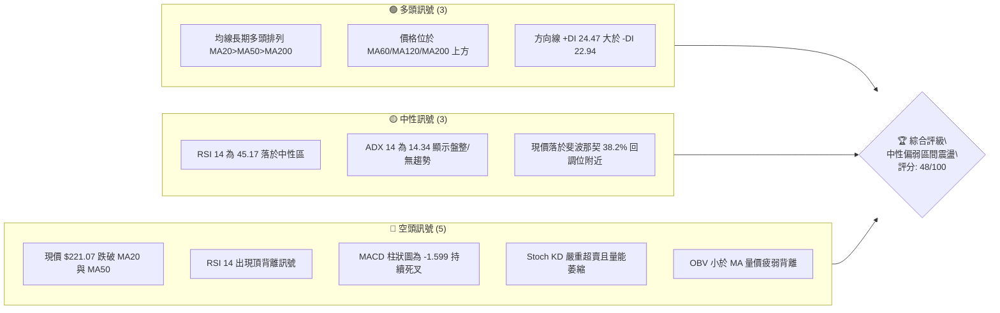
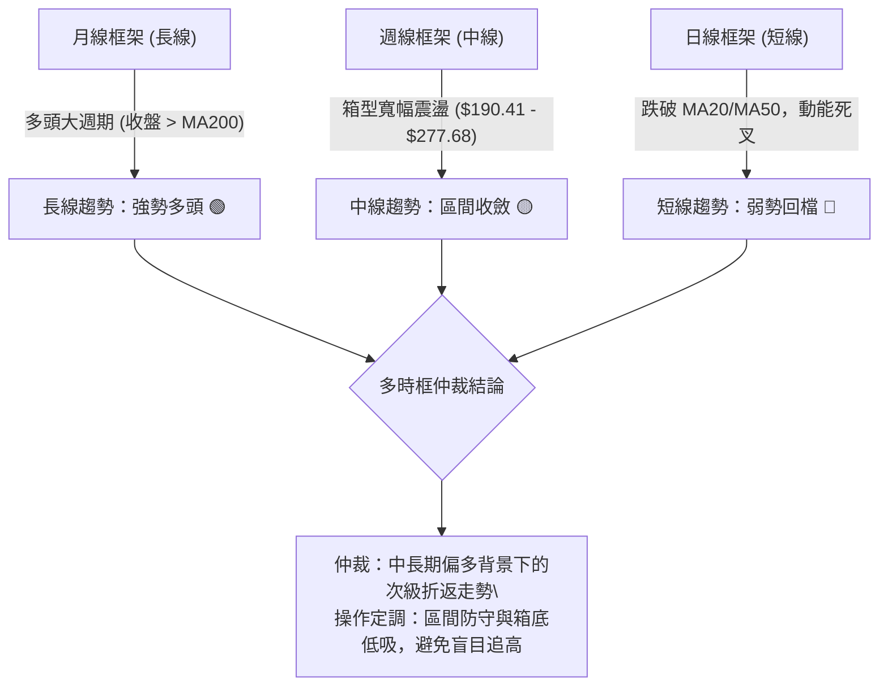
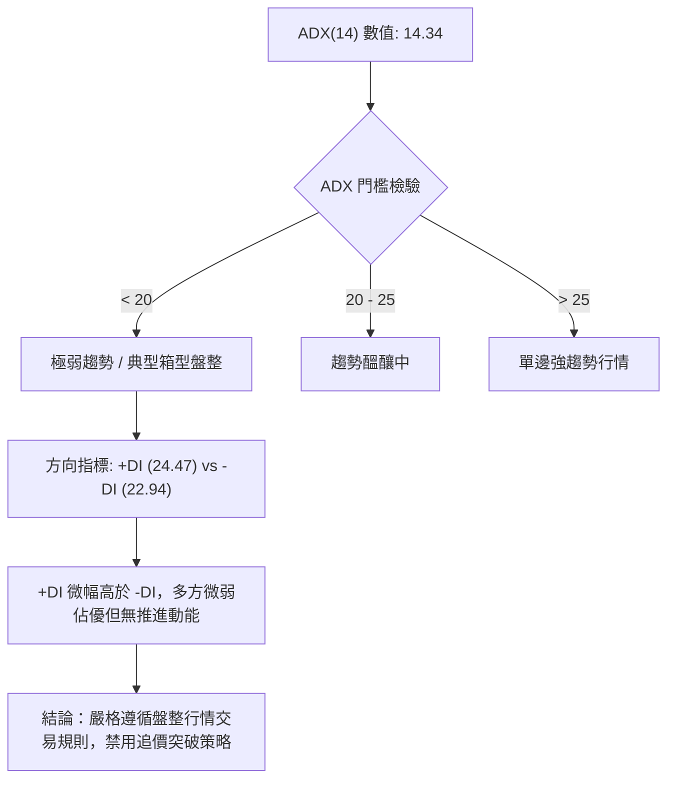
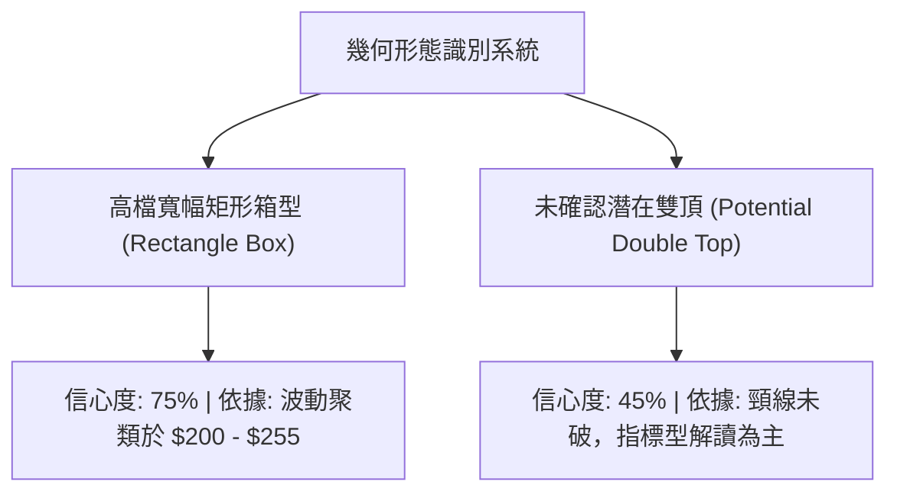
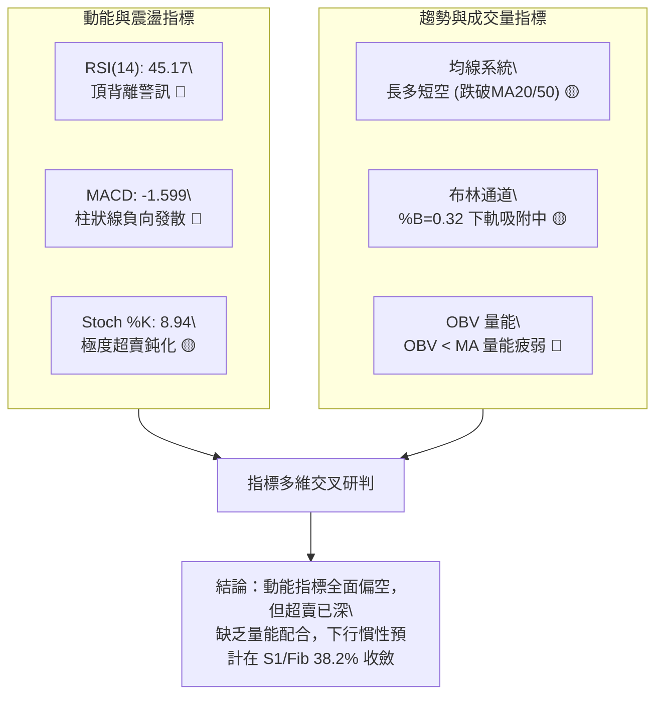
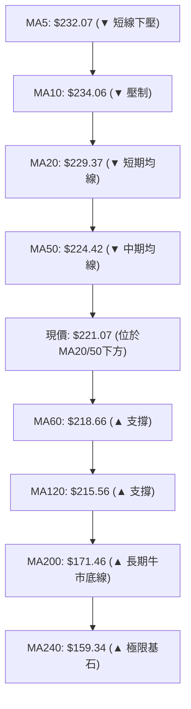
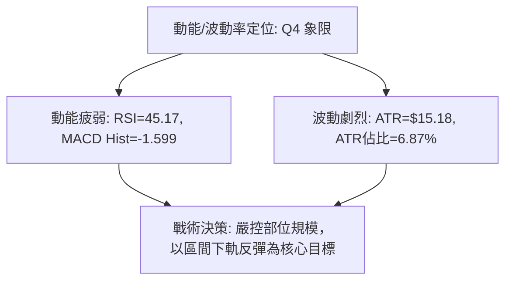
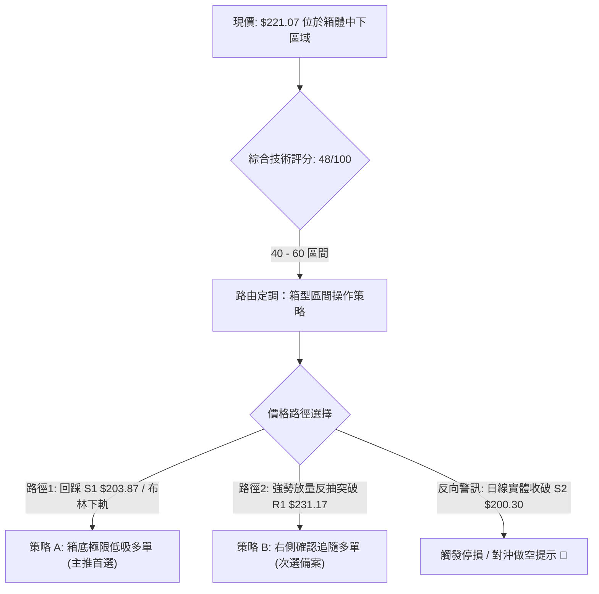
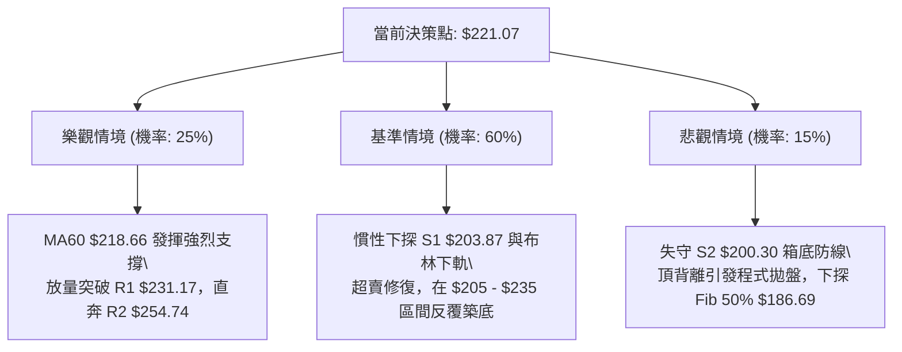

# NBIS 技術分析報告

> **報告日期**：2026-10-12 ｜ **語言**：繁體中文 ｜ **數據來源**：Yahoo Finance ｜ **當前價格**：$221.07

---

## 目錄

| 章節 | 內容 |
|------|------|
| [1. 技術面概覽](#1-技術面概覽) | 訊號儀表板、核心指標、評分卡 |
| [2. 趨勢分析](#2-趨勢分析) | 多時框趨勢、長中短期走勢、ADX解讀 |
| [3. 圖表形態分析](#3-圖表形態分析) | 形態識別信心度、K線組合、目標價計算 |
| [4. 支撐與阻力](#4-支撐與阻力) | 關鍵價位結構、阻力/支撐分析、斐波那契回調 |
| [5. 技術指標深度解讀](#5-技術指標深度解讀) | 均線系統、RSI背離、MACD、布林通道、成交量 |
| [6. 動能與波動率](#6-動能與波動率) | 動能四象限、ATR波動分析、Beta風險特徵 |
| [7. 多時框架總結](#7-多時框架總結) | 時框架矩陣、多時框收斂與權重仲裁 |
| [8. 交易策略建議](#8-交易策略建議) | 策略路由、價格階梯、主策略設定、風報比 |
| [9. 風險提示與監控](#9-風險提示與監控) | 監控Checklist、情境分析、風控倉位管理 |

---

## 1. 技術面概覽

### 🎯 技術訊號儀表板



### 📊 核心指標速覽表

| 指標類別 | 指標名稱 | 當前數值 | 訊號 | 解讀 |
|----------|----------|----------|------|------|
| **價格** | 當前收盤價 | $221.07 | 🟡 | 位於52週區間 65.2% 處，短線承壓拉回 |
| **均線** | 短期 MA20 | $229.37 | 🔴 | 現價位於 MA20 下方 -3.62%，短期動能走弱 |
| **均線** | 中期 MA50 | $224.42 | 🔴 | 現價跌破 MA50 下方，中期進入整理消化期 |
| **均線** | 長期 MA200 | $171.46 | 🟢 | 現價高於 MA200 達 +28.93%，長期牛市基調穩固 |
| **動能** | RSI(14) | 45.17 | 🔴 | 位於中性區但確認出現「頂背離」，多頭攻擊衰竭 |
| **動能** | MACD(12,26,9) | 2.437 / 4.036 | 🔴 | DIF < DEA，MACD 柱狀圖 -1.599，看空修正訊號 |
| **動能** | Stoch %K / %D | 8.94 / 24.72 | 🟡 | 進入極度超賣區間，短線存在技術性反抽需求 |
| **趨勢** | ADX(14) | 14.34 | 🟡 | 數值 < 25，表明非單邊強趨勢，當前為寬幅箱型盤整 |
| **通道** | 布林帶 (%B) | 0.32 | 🟡 | 價格運行於中軌（$229.37）與下軌（$205.86）之間 |
| **量能** | 20日成交量比 | 0.59x | 🔴 | 今日量 9.54M 低於均量 16.04M，OBV 疲軟未見承接買盤 |
| **波動** | ATR(14) | $15.18 | 🟡 | 佔現價 6.87%，每日波幅大，需設定寬幅停損 |

### 🏆 技術評分卡

```
╔══════════════════════════════════════════════════════════════════╗
║                 技術評分卡 — NBIS (2026-10-12)                   ║
╠══════════════════════════════════════════════════════════════════╣
║ 趨勢強度 (ADX/方向)   ██████░░░░░░░░░░░░░░  30/100  🔴 盤整無主導 ║
║ 動能指標 (RSI/MACD)   ████████░░░░░░░░░░░░  40/100  🔴 頂背離死叉 ║
║ 支撐穩定度 (S1/Fib)   ████████████░░░░░░░░  60/100  🟡 關鍵位在守 ║
║ 成交量配合 (OBV/Vol)  ██████░░░░░░░░░░░░░░  30/100  🔴 量縮價疲弱 ║
║ 形態完整度 (箱型/雙頂)██████████░░░░░░░░░░  50/100  🟡 箱型構築中 ║
║ 均線排列 (長多短空)   ██████████████░░░░░░  70/100  🟢 長期排列佳 ║
╠══════════════════════════════════════════════════════════════════╣
║ 綜合技術評分          ██████████░░░░░░░░░░  48/100  🟡 中性觀望   ║
╚══════════════════════════════════════════════════════════════════╝
```

---

## 2. 趨勢分析

### 🌐 多時框趨勢分析



### 📈 長期趨勢 — 12個月走勢圖（Unicode）

以下展示 NBIS 自 2025 年 11 月至 2026 年 10 月之月線收盤價演變圖，清晰反映自低檔爆發後於高檔構築大型震盪區間之歷程：

```
NBIS 月線收盤走勢圖（過去12個月）
價格軸 ($)
$280 ┤                                      ● (2026-06: $276.17)
$250 ┤                                  ●
$220 ┤                                      ●       ●←現價 $221.07
$190 ┤                                          ●
$160 ┤
$130 ┤                          ● (2026-04: $138.23)
$100 ┤  ● (2025-11: $94.87) ●   ●
$70  ┤      ●   ● (2026-01: $85.19)
     └─────────────────────────────────────────────────────────────
       11   12  01  02  03  04  05  06  07  08  09  10 (月份)
```

#### 走勢特徵分析表格

| 階段區間 | 時間區間 | 起訖價格 | 區間漲跌幅 | 形態與量價特徵 | 趨勢判定 |
|----------|----------|----------|------------|----------------|----------|
| **底部築底期** | 2025-11 ~ 2026-01 | $94.87 → $85.19 | -10.20% | 縮量築雙底支撐，確立 $73.52 52週低點不破 | 弱勢築底 🟡 |
| **主升初段** | 2026-02 ~ 2026-04 | $91.19 → $138.23 | +51.58% | 均線向上發散，突破百元心理大關 | 突破初升 🟢 |
| **主升爆發期** | 2026-04 ~ 2026-06 | $138.23 → $276.17 | +99.79% | 拋物線噴出，觸及 52週歷史高點 $299.86 | 強勢噴出 🟢 |
| **高檔回洗期** | 2026-06 ~ 2026-07 | $276.17 → $190.41 | -31.05% | 獲利回吐巨幅回調，月線收長陰 | 劇烈修正 🔴 |
| **寬幅箱型期** | 2026-07 ~ 2026-10 | $190.41 → $221.07 | +16.10% | 圍繞 $200-$250 進行巨幅拉鋸，動能衰減 | 區間震盪 🟡 |

### 📊 中期趨勢（週線分析）

中期走勢近 20 週收盤走勢顯示，NBIS 在 $177.71（2026-07-19）見底後拉出強勁反彈至 $277.68（2026-08-16），隨後未能刷新歷史高點 $299.86，轉為在 $209.18 至 $242.81 之間收斂。近期 2026-10-04 收盤 $242.81 再次受阻於阻力帶，2026-10-11 當週急跌至 $221.07，週 MACD 柱狀圖由正轉負（-1.599），RSI 急降至 45.2，顯示中期反彈動能遭遇強烈獲利了結壓制。

```
週線近期收斂三角 / 箱型示意圖：
阻力上軌：$277.68 ──────── $242.81 (高點漸降) ───► 強壓帶 $231.17 - $254.74
                                      現價 $221.07 (中軸下方)
支撐下軌：$177.71 ──────── $209.18 (低點漸墊高) ──► 強支撐帶 $203.87 - $200.30
```

### ⚡ 趨勢強度評估（ADX 解讀）



#### ADX 強度對照表

| 指標變數 | 當前讀數 | 判定級別 | 意涵與操作指導 |
|----------|----------|----------|----------------|
| **ADX(14)** | 14.34 | 弱趨勢/無趨勢 (極低) | 趨勢交易者應降低槓桿；市場處於均值回歸狀態 |
| **+DI** | 24.47 | 多頭動能中性 | 買方僅能守住局部陣地，無力發動跨級別推升 |
| **-DI** | 22.94 | 空頭動能中性 | 空方回擊亦未形成全面破位殺盤 |
| **DI 差值** | +1.53 | 多空僵持 | 雙方力量極度均衡，短線行情容易出現無序假突破 |

---

## 3. 圖表形態分析

### 🔍 形態識別系統



#### 形態信心度與目標價評估表

| 形態名稱 | 信心度 | 判斷依據（引用數據） | 完成度 | 目標價（附嚴格計算式） |
|----------|--------|----------------------|--------|------------------------|
| **高檔矩形箱型整理** | **75%** | 箱底獲支撐於 S1 $203.87 / S2 $200.30；箱頂受阻於 R2 $254.74（近一年高低點聚類） | 85% | **向上突破目標**：頸線 $254.74 + 箱高 ($254.74 - $200.30 = $54.44) = **$309.18**<br>**向下跌破目標**：箱底 $200.30 - 箱高 $54.44 = **$145.86** |
| **次級反彈雙重頂形態** | **42%** | 第一頂 $277.68（08-16週），第二頂 $242.81（10-04週）；頸線位於 08-30 低點 $209.18 | 35% (未成形) | *訊號不足，信心度低於50%，依規則不做幾何外推，僅做指標型超買回踩解讀* |

### 🕯️ 重要K線形態分析

| 週期/月份 | 收盤價 | 識別 K 線形態 | 專業解讀 | 訊號 |
|-----------|--------|---------------|----------|------|
| **2026-06** | $276.17 | 歷史高檔長上影十字星 | 向上測試 $299.86 後遭遇主力強烈派發，多頭動能竭盡 | 🔴 頂部警訊 |
| **2026-07** | $190.41 | 大陰線破位回洗 | 單月跌幅達 -31%，快速抹平前期暴漲利潤，確立高檔區間上限 | 🔴 空方釋放 |
| **2026-08** | $206.32 | 長下影錘頭回升線 | 測試 $177.71 週線低點後強勢拉回，長下影線確認買盤強勁托底 | 🟢 探底回升 |
| **2026-09** | $235.88 | 中陽線反彈受阻 | 反彈推進但未能吞噬 6 月陰線高點，量能出現收斂 | 🟡 中性修復 |
| **2026-10 (當前)** | $221.07 | 衝高回落小黑K | 月初衝刺 $242.81 後遭空方反撲，回落至均線糾結處 | 🔴 短線偏空 |

### 📉 ASCII 走勢形態示意圖

```
NBIS 高檔箱型震盪形態圖解
阻力位 R2 ($254.74) ───────┬───────────────────────────┬─────── 箱頂壓制
                           │      ● (08-16 $277.68)    │
                           │     / \                   ● (10-04 $242.81)
                           │    /   \                 / \
中軸 MA20 ($229.37) ───────┼───/─────\───────────────/───\─── 現價 $221.07
                           │  /       \             /     ▼
                           │ /         ● (08-30    /
支撐位 S1 ($203.87) ───────┴●           $209.18)  ● (09-06 $226.39)
                           (08-02 $190.41)
支撐位 S2 ($200.30) ─────────────────────────────────────────── 箱底防線
```

### 🎯 形態目標價計算

1. **矩形箱型垂直量度法則**：
   - 箱體上限（壓力基準取 R2）：$254.74
   - 箱體下限（支撐基準取 S2）：$200.30
   - 形態絕對高度 ($H$) = $254.74 - $200.30 = $54.44
2. **多頭向上對稱測幅**：
   - 若且唯若日線實體突破 R2 $254.74，目標價 = $254.74 + $54.44 = **$309.18**（高於 52W 高點 $299.86，吻合歷史突破延伸目標）
3. **空頭向下對稱測幅**：
   - 若有效收破 S2 $200.30，目標價 = $200.30 - $54.44 = **$145.86**（貼近斐波那契 61.8% 之 $159.98 關鍵回調緩衝區）

---

## 4. 支撐與阻力

### 🗺️ 關鍵價位分布圖（Unicode）

```
NBIS 價位結構分布圖 (由波段聚類與 Fibonacci OHLCV 計算)
══════════════════════════════════════════════════════════════════
$299.86 ║████████████████████████████████║ 52W High / 0.0% Fib
$279.83 ║████████████████████████        ║ 強阻力 R3 (+26.58%)
$254.74 ║████████████████████            ║ 重要阻力 R2 (+15.23%)
$246.44 ║▓▓▓▓▓▓▓▓▓▓▓▓▓▓▓▓▓▓              ║ 斐波那契 23.6% 回調位
$231.17 ║████████████████                ║ 近端阻力 R1 (+4.57%)
$229.37 ╟────────────────────────────────╢ 布林中軌 / MA20
$221.07 ╠════════════════════════════════╣ ◄ 當前價格 $221.07
$213.40 ║▓▓▓▓▓▓▓▓▓▓▓▓▓▓▓▓▓▓              ║ 斐波那契 38.2% 回調位
$205.86 ╟────────────────────────────────╢ 布林下軌
$203.87 ║████████████████                ║ 第一支撐 S1 (-7.78%)
$200.30 ║████████████████████            ║ 關鍵防守支撐 S2 (-9.40%)
$194.80 ║████████████████████████        ║ 極限防守 S3 (-11.88%)
$186.69 ║▓▓▓▓▓▓▓▓▓▓▓▓▓▓▓▓▓▓▓▓▓▓          ║ 斐波那契 50.0% 回調位
══════════════════════════════════════════════════════════════════
```

### 🚧 阻力位分析表

| 阻力級別 | 價位 | 形成原因（波段高點聚類） | 突破難度 | 重要性 |
|----------|------|--------------------------|----------|--------|
| **R1** | **$231.17** | 緊鄰 MA20 ($229.37) 與 MA5 ($232.07) 均線糾結帶，短線反彈首要套牢區 | 🟡 中等 | 短線多空分水嶺，站穩方能化解空頭下壓 |
| **R2** | **$254.74** | 接近布林帶上軌 ($252.88) 及 2026 年 8~10 月多次反彈折返高點聚類 | 🔴 困難 | 箱型震盪頂部，突破代表新一輪單邊牛市展開 |
| **R3** | **$279.83** | 2026-08-16 週線高點 $277.68 與 2026-06 收盤區高壓聚合區 | 🔴 極高 | 歷史高點前最後堡壘，存在極大獲利了結賣壓 |

### 🛡️ 支撐位分析表

| 支撐級別 | 價位 | 形成原因（波段低點聚類） | 守住機率 | 重要性 |
|----------|------|--------------------------|----------|--------|
| **S1** | **$203.87** | 貼近布林下軌 ($205.86) 與 9月初週線回測低點聚類 | 🟢 65% | 盤整行情多頭短線第一防線，防守反抽首選 |
| **S2** | **$200.30** | 整數心理關卡，2026 年 7-8 月多次下探止跌之密集成交平台 | 🟢 70% | 箱體下緣極限核心支撐，跌破將引發停損賣壓 |
| **S3** | **$194.80** | 2026-08-02 當月低點收盤支撐群 ($190.41) 之緩衝區 | 🟡 55% | 中期生命線，跌破預示週線級別趨勢轉向熊市 |

### 📐 斐波那契回調位分析

依據 52 週完整波動區間（低點 **$73.52** 至 高點 **$299.86**，極限垂直跨度 **$226.34**）進行精確測算：

| 斐波那契回調比例 | 精確對應價位 | 技術解讀與當前相對位置 |
|------------------|--------------|------------------------|
| **0.0% (52W High)** | **$299.86** | 歷史峰值，終極天花板阻力 |
| **23.6%** | **$246.44** | 強勢回檔位，現價已落於此位之下，反映強勢多頭動能降溫 |
| **38.2%** | **$213.40** | **關鍵黃金支撐位**；現價 ($221.07) 正位於 23.6% ($246.44) 與 38.2% ($213.40) 區間內 |
| **50.0%** | **$186.69** | 半數回撤位，貼近 2026-07 探底低點 $177.71~$190.41 |
| **61.8%** | **$159.98** | 深度回調黃金分割位，緊鄰 MA240 ($159.34) 長期防線 |
| **78.6%** | **$121.96** | 趨勢毀損警戒線 |
| **100.0% (52W Low)**| **$73.52** | 本輪超級AI浪潮起漲原點 |

**解讀**：現價 $221.07 位於斐波那契 23.6% ($246.44) 與 38.2% ($213.40) 之間，距離 38.2% 僅有 -3.47% 空間。在標準多頭回檔中，38.2%（$213.40）具備極強吸納承接力；若守穩此位，中長期結構仍屬良性健康回檔。

---

## 5. 技術指標深度解讀

### 🎛️ 指標訊號總覽



### 📈 移動平均線排列分析



#### 均線階梯分析
1. **短期死叉成形**：MA5 ($232.07) 下穿 MA10 ($234.06)，且現價 ($221.07) 均低於 MA20 ($229.37) 與 MA50 ($224.42)。短線空頭排列壓制明顯。
2. **中長期牛市防護網**：MA60 ($218.66) 與 MA120 ($215.56) 均保持向上傾斜（YoY 分別上移 +1.10% 與 +2.56%）。現價距離 MA60 僅 $2.41 (+1.1%)，此處將迅速迎來第一道多頭阻擊線。
3. **終極支撐**：長期 MA200 位於 $171.46，遠在現價下方 -22.4%，說明從長線架構來看，目前的回跌僅屬於高位獲利了結，尚未傷及長期牛市骨架。

### 📉 RSI(14) 分析

- **當前數值**：45.17
- **數值進度條**：`█████████░░░░░░░░░░░` 45.17% (位於中性偏弱區)
- **背離狀態確認**：⚠️ **確認存在頂背離 (Bearish Divergence)**。
  - **背離細節剖析**：回顧 2026-08-16，股價反彈至 $277.68 時，週線 RSI 達到 67.2；隨後在 2026-10-04 股價衝高至 $242.81 時，RSI 僅錄得 66.5；而日線層面高點不斷被空頭下壓，價格維持於高檔，但 RSI 峰值急劇下降，形成標準高檔頂背離結構。該訊號預警多頭推升力道耗盡，誘發了當前的破位修正走勢。

### 📊 MACD(12/26/9) 訊號解讀

- **DIF 快線**：2.437
- **DEA 慢線 (Signal)**：4.036
- **MACD 柱狀圖 (Histogram)**：-1.599 (持續擴大中 🔴)


當前 MACD 柱狀圖在零軸下方擴張至 -1.599，確認死叉成立。歷史數據顯示，當 NBIS MACD 柱狀圖落入 -2.0 以下時，修正往往接近尾聲（如 2026-06-28 柱狀圖 -2.706 後展開低檔盤整）。目前正處於動能釋放的中後段。

### 📦 布林通道分析

```
NBIS 布林通道位置示意圖 (通道寬度: $47.02)
上軌 (Upper Band):   $252.88 ──────────────────────────────────────
                                   
中軌 (MA20):         $229.37 ──────────────────────────────────────
                                   ◄ 現價 $221.07 (%B = 0.32)
下軌 (Lower Band):   $205.86 ──────────────────────────────────────
```

- **通道參數解讀**：
  - 帶寬 (Bandwidth) = ($252.88 - $205.86) / $229.37 = **20.50%**，呈現收斂後水平橫盤態勢。
  - **%B 指標** 為 **0.32**，價格落於中軌下方、下軌上方，偏向下軌運行。
  - 在 ADX < 25 的盤整市中，布林通道下軌（$205.86）具備天然的統計學支撐效應，與波段低點支撐 S1 ($203.87) 完美重疊，構成堅實的共振支撐區。

### 💹 成交量分析（量價配合度）

1. **量能縮減**：今日成交量僅 9,535,900 股，相較於 20 日均量 16,039,450 股，**量比僅為 0.59x**。下殺過程並未伴隨恐慌性拋售放量，屬於典型的「量縮陰跌」。
2. **OBV 走勢**：OBV < MA 表明資金處於淨流出狀態，追價買盤退潮。
3. **籌碼沉澱特徵**：機構持股佔比高達 69.8%，且空頭部位 (Short % Float) 達 19.8%（Short Ratio 2.76）。高空頭比例在量縮回檔至關鍵支撐時，容易因空頭回補而觸發軋空反彈。

---

## 6. 動能與波動率

### ⚡ 動能評估四象限

| 象限標記 | 動能狀態 | 波動率狀態 | NBIS 當前歸屬 | 戰術定位與交易指引 |
|----------|----------|------------|---------------|--------------------|
| **Q1 (最佳擴張)** | 強動能 (RSI>60) | 低波動 (ATR%<4%) | 否 | 順勢加碼推升，享受低風險單邊利潤 |
| **Q2 (盤整收斂)** | 弱動能 (RSI 40-50) | 低波動 (ATR%<5%) | 否 | 靜待三角收斂或突破方向確立 |
| **Q3 (強烈狂暴)** | 強動能 (MACD紅柱) | 高波動 (ATR%>6%) | 否 | 趨勢突破追擊，但回撤風險劇烈 |
| **Q4 (震盪下修)** | **弱動能 (MACD死叉)** | **高波動 (ATR%=6.87%)**| **✓ 當前歸屬** | **防禦性操作，嚴格執行箱型下緣低吸，杜絕半山腰追擊** |



### 📊 ATR 波動率分析

- **ATR(14) 絕對值**：**$15.18**
- **ATR 相對百分比**：**6.87%** (處於美股大型科技股偏高水準)
- **停損設定科學指引**：
  - **短線交易停損**：建議使用 1.0 × ATR = **$15.18** 緩衝空間。
  - **波段交易停損**：建議使用 1.5 × ATR = **$22.77** 緩衝空間。
  - 由於日均波動高達 $15 以上，進場點若偏離關鍵支撐，極易因隨機雜訊被掃出場，因此必須堅持「貼近支撐買進」原則。

### 📐 Beta 與市場相關性

- **Beta 係數**：**1.46**
- **市場特徵**：高彈性、高貝塔成長型 AI 基礎設施標的。當納斯達克大盤上漲 1% 時，該股預期上漲 1.46%；大盤回調時亦承擔 1.46 倍修正壓力。
- **高空頭比緩衝**：高達 19.8% 的空頭流通股比例（Short Interest），使得該標的具備極強的非對稱暴發力。一旦在 S1/S2 企穩並回踩完成，極易觸發逼空行情。

---

## 7. 多時框架總結

### 📋 時框架評分表

| 時框架 | 趨勢方向 | 動能指標 | 均線排列 | 形態結構 | 綜合評分 | 戰術建議 |
|--------|----------|----------|----------|----------|----------|----------|
| **月線 (長期)** | 🟢 多頭看漲 | 🟡 中性回調 | 🟢 完美多頭 (收盤>MA200) | 巨型階梯上升波 | **78/100** | 長線多單堅定續抱，無須恐慌 |
| **週線 (中期)** | 🟡 寬幅箱型 | 🔴 頂背離壓制 | 🟢 糾結偏多 (MA60上揚) | 收斂大箱型震盪 | **52/100** | 箱型區間操作，高拋低吸 |
| **日線 (短期)** | 🔴 震盪回落 | 🔴 MACD死叉擴大 | 🔴 跌破MA20/50 | 布林中下軌尋底 | **38/100** | 短線禁止追多，等待回踩確認 |

### 🔲 綜合訊號矩陣

```
╔══════════════════════════════════════════════════════════════════╗
║               NBIS 跨時框架訊號矩陣收斂表                         ║
╠══════════════════════════════════════════════════════════════════╣
║ 觀察維度        日線 (短期)       週線 (中期)       月線 (長期)   ║
╠══════════════════════════════════════════════════════════════════╣
║ 趨勢方向        🔴 震盪拉回       🟡 區間整理       🟢 強勢看多   ║
║ 動能強度        🔴 柱狀圖負發散   🔴 頂背離確認     🟡 高位鈍化   ║
║ 量能狀態        🔴 量縮無買盤     🟡 量能遞減       🟢 巨量沉澱   ║
║ 關鍵均線位置    🔴 MA20/50下方    🟢 MA60上方       🟢 MA200上方  ║
╠══════════════════════════════════════════════════════════════════╣
║ 最終權重裁決    權重: 20%         權重: 50%         權重: 30%     ║
║ 仲裁綜合得分                      48.2 / 100  (定調：中性觀望)   ║
╚══════════════════════════════════════════════════════════════════╝
```

### ⚖️ 多時框收斂結論

依據多時框收斂規則第 14 條執行仲裁：
1. **行情屬性判定**：當前 ADX(14) 僅為 **14.34**（遠低於 25 臨界值），**嚴格確認當前市場處於「盤整震盪行情」而非單邊趨勢行情**。
2. **主導層級選擇**：在盤整行情中，不可套用中長期趨勢無腦做多邏輯，應以日線布林通道上下軌（$205.86 ~ $252.88）及波段聚類支撐阻力為核心交易依據。
3. **唯一方向性結論**：**中性觀望（偏向箱底逢低吸納）**。短線日線空頭動能尚未耗盡，但下檔緊鄰 MA60 ($218.66)、Fib 38.2% ($213.40) 及 S1 ($203.87) 重重防線，空頭空間極其有限。因此，交易者應保持耐心，等待價格向箱底靠攏、動能指標落入極度超賣鈍化時，執行高盈虧比的逢低做多策略。

---

## 8. 交易策略建議

### 🗺️ 策略決策流程圖



### 🧭 策略路由（依評分卡分流）

**當前主策略方向 = 區間震盪低吸操作（依綜合評分 48/100，落於 40–60 中性區間，以布林上下軌與波段支撐為主要架構，等待關鍵支撐測試確認）。**

### 🎯 價格情境階梯（Price Scenarios）

所有價位均嚴格引用第 4 章波段聚類與斐波那契點位：

| 觸發條件 | 下一目標 | 後續延伸 | 情境技術含義 |
|----------|----------|----------|--------------|
| **強勢突破 R1 $231.17** | **R2 $254.74** | **R3 $279.83** | 短線擺脫均線壓制，重返布林上軌強勢區，箱型向上測試 |
| **站穩現價 $221.07 震盪** | **MA20 $229.37** | **R1 $231.17** | 於 MA60 ($218.66) 與 MA20 之間收斂蓄勢，消化浮額 |
| **回踩跌破 S1 $203.87** | **S2 $200.30** | **S3 $194.80** | 回踩箱體絕對底部，若破 S2 則宣告中線格局轉弱 |

### 📊 情境機率分佈

| 預測情境 | 發生機率 | 主要技術依據 |
|----------|----------|--------------|
| **情境一：下探 S1/布林下軌後回升 (箱型低吸)** | **55%** | ADX=14.34 箱型特徵顯著；KD 嚴重超賣 (%K=8.94)；Fib 38.2% ($213.40) 與 S1 ($203.87) 具強大買盤承接力 |
| **情境二：直接橫盤震盪化解指標死叉** | **30%** | 成交量極度萎縮 (量比 0.59x)，空方缺乏打壓籌碼，圍繞 MA60 進行窄幅拉鋸 |
| **情境三：跌破 S2 $200.30 展開深幅修正** | **15%** | 頂背離引發骨牌效應；若伴隨大盤重挫破位，將下探 Fib 50% ($186.69) |

### 🟢 主策略詳情（方向依上方路由）

依據中性偏區間震盪之架構，主推兩套順應箱型節奏之低吸與突破買入策略：

| 策略要素 | 策略 A（箱底左側伏擊 — 首選） | 策略 B（右側均線破位確認 — 次選） |
|----------|--------------------------------|------------------------------------|
| **策略核心邏輯** | 趁量縮回踩箱底 S1 與布林下軌時分批佈局 | 等待放量站上 R1 與 MA20，確認短線回調結束 |
| **進場條件** | 價格回測 $205.86~$203.87 區間且收下影線 | 日線實體突破 R1 $231.17，且量能放大至均量以上 |
| **進場價格** | **$203.87** (引用 S1 支撐位) | **$231.17** (引用 R1 阻力位突破點) |
| **目標價 T1** | **$229.37** (引用 MA20 / 布林中軌) | **$254.74** (引用 R2 阻力位) |
| **目標價 T2** | **$254.74** (引用 R2 / 箱頂阻力位) | **$279.83** (引用 R3 強阻力位) |
| **止損價格** | **$194.80** (引用 S3 極限支撐位) | **$218.66** (引用 MA60 動態支撐位) |
| **潛在空間** | T1: +$25.50 (+12.5%) / T2: +$50.87 (+25.0%) | T1: +$23.57 (+10.2%) / T2: +$48.66 (+21.1%) |
| **承擔風險** | -$9.07 (-4.45%) | -$12.51 (-5.41%) |
| **風險報酬比** | **2.81 : 1** (以T1計算) / **5.61 : 1** (以T2計) | **1.88 : 1** (以T1計算) / **3.89 : 1** (以T2計) |
| **預估勝率** | **65%** | **55%** |
| **建議倉位** | **15% - 20%** 總資金 | **10% - 15%** 總資金 |

### 🔴 反向風險觸發點（對沖提示）

- **多頭結構失效防線**：日線收盤價**跌破 S2 $200.30**。
- **對沖處置建議**：若跌破 S2，意味著長達數月的 $200-$255 高檔箱型徹底破位，形態轉化為大型複合頭部。此時應果斷清倉所有多頭部位，或反手建立少量空頭避險倉位，向下目標直指斐波那契 50.0% 之 **$186.69**。

### ⭐ 整體訊號強度評星

```
做多訊號強度：★★☆☆☆  (2.5/5星 — 短線指標偏空，需等待支撐回踩企穩)
做空訊號強度：★★☆☆☆  (2.0/5星 — 長期牛市基底完好，下行空間受限於強支撐)
整體可信度：  ★★★☆☆  (3.5/5星 — 盤整特徵明確，箱型邊界信號高度可靠)
```

---

## 9. 風險提示與監控

### ✅ 關鍵監控指標 Checklist

```
╔══════════════════════════════════════════════════════════════════╗
║                   NBIS 技術面每日監控清單 (Checklist)            ║
╠══════════════════════════════════════════════════════════════════╣
║ [ ] 1. S1 支撐守護度：收盤價是否嚴守 $203.87 關鍵支撐之上？      ║
║ [ ] 2. 布林下軌吸附：價格是否在 $205.86 處出現長下影止跌 K 線？   ║
║ [ ] 3. MACD 柱狀圖：Hist 是否由 -1.599 開始向上收斂鈍化？         ║
║ [ ] 4. Stoch KD 指標：%K (8.94) 是否在超賣區金叉向上穿越 %D？     ║
║ [ ] 5. 成交量配合度：反彈時成交量是否有效放大跨越 16.04M 均量？  ║
║ [ ] 6. MA60 動態防守：現價距 MA60 ($218.66) 僅 1.1%，能否即刻反抽？║
║ [ ] 7. 空頭回補動態：Short Float 19.8% 是否出現急劇回補跡象？   ║
╚══════════════════════════════════════════════════════════════════╝
```

### ⚠️ 風險場景分析



### 🛡️ 風險管理重要提醒

1. **嚴控部位規模**：NBIS 之 ATR 高達 $15.18（日波動 6.87%），Beta 為 1.46，屬於超高波動資產。在當前評分 48/100 的震盪環境下，單一交易策略配置之本金**絕對不可超過總投資組合的 15% - 20%**。
2. **切忌半山腰開倉**：當前價格 $221.07 正處於箱體正中央偏下位置，不上不下。在該位置貿然進場，停損幅度過大且風報比不佳。務必堅定執行「**不至 S1 $203.87 不開多，未過 R1 $231.17 不追價**」的鐵律。
3. **波動率緩衝停損法則**：止損點必須設定在主要支撐聚類下方至少 1.0 倍 ATR（約 $15）或關鍵價位外圍，防止日內高頻清洗盤將優質部位提前掃出場。

---

## 📋 報告總結

```
╔══════════════════════════════════════════════════════════════════╗
║                   NBIS 技術分析報告總結                          ║
╠══════════════════════════════════════════════════════════════════╣
║ 報告日期：2026-10-12                                             ║
║ 當前價格：$221.07                                                ║
║ 技術評分：48 / 100                                               ║
║ 分析評級：⚖️ 中性觀望 / 箱型區間交易 (Neutral / Range-Bound)       ║
║                                                                  ║
║ 關鍵結論：                                                       ║
║ ├─ 長期趨勢：🟢 穩固牛市 (價格遠高於 MA200 $171.46)              ║
║ ├─ 中期趨勢：🟡 寬幅箱型震盪 (受阻於 R2 $254.74，下托於 S2 $200) ║
║ ├─ 短期趨勢：🔴 弱勢回踩 (跌破 MA20/MA50，動能指標死叉發散)       ║
║ ├─ 關鍵支撐：S1 $203.87 │ S2 $200.30 │ Fib 38.2% $213.40        ║
║ ├─ 關鍵阻力：R1 $231.17 │ R2 $254.74 │ R3 $279.83               ║
║ └─ 分析師共識目標：$283.60 (分析師覆蓋共 20 位，評級為 Buy)      ║
║                                                                  ║
║ 最優策略組合：                                                   ║
║ 1. 🥇 最佳機會 (策略 A)：等待價格下測 S1 $203.87 附近分批低吸，   ║
║    嚴格停損設於 S3 $194.80，目標上看 T1 $229.37 / T2 $254.74，   ║
║    盈虧比高達 2.81 : 1 至 5.61 : 1。                             ║
║ 2. 🥈 次選機會 (策略 B)：右側放量突破 R1 $231.17 追隨進場，       ║
║    停損設於 MA60 $218.66，第一目標直指 R2 $254.74。              ║
║ 3. 🥉 保守選擇：在 ADX < 25 期間空倉觀望，待日線 MACD 出現第一根  ║
║    收斂紅柱且 KD 指標黃金交叉後再行介入。                        ║
╚══════════════════════════════════════════════════════════════════╝
```

---

> ⚠️ **免責聲明**：本報告為技術分析專用模型生成之專業研究內容，所有數據、圖表及價位推演均基於市場歷史行情。本報告**僅供研究與學術參考**，**不構成任何要約、招攬或投資建議**。市場有風險，交易決策需獨立評估並自負盈虧。

---

*報告生成時間：2026-10-12 ｜ 數據來源：Yahoo Finance ｜ 分析框架：多時框技術分析體系*