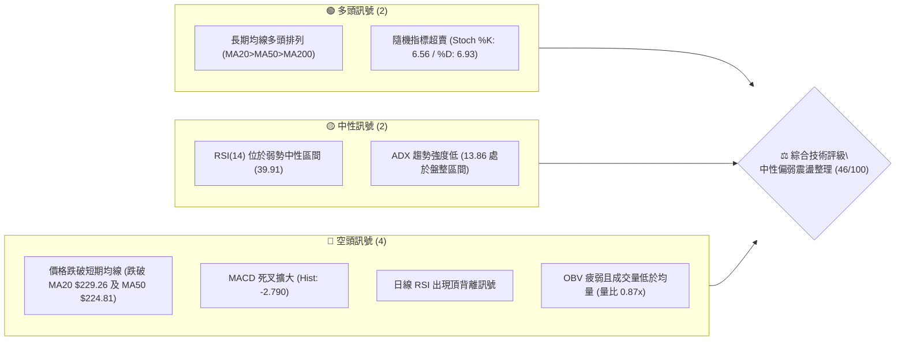
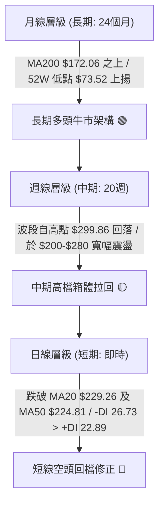
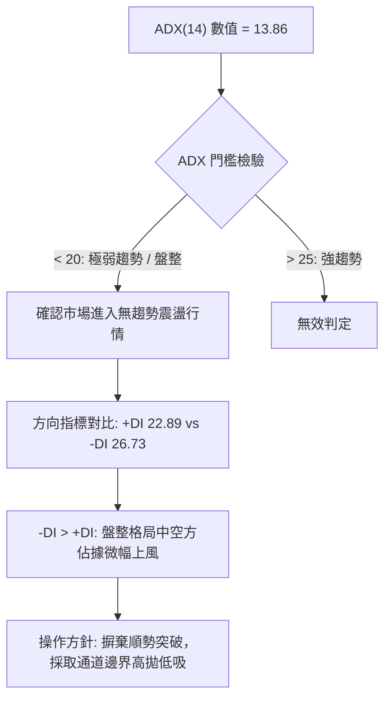
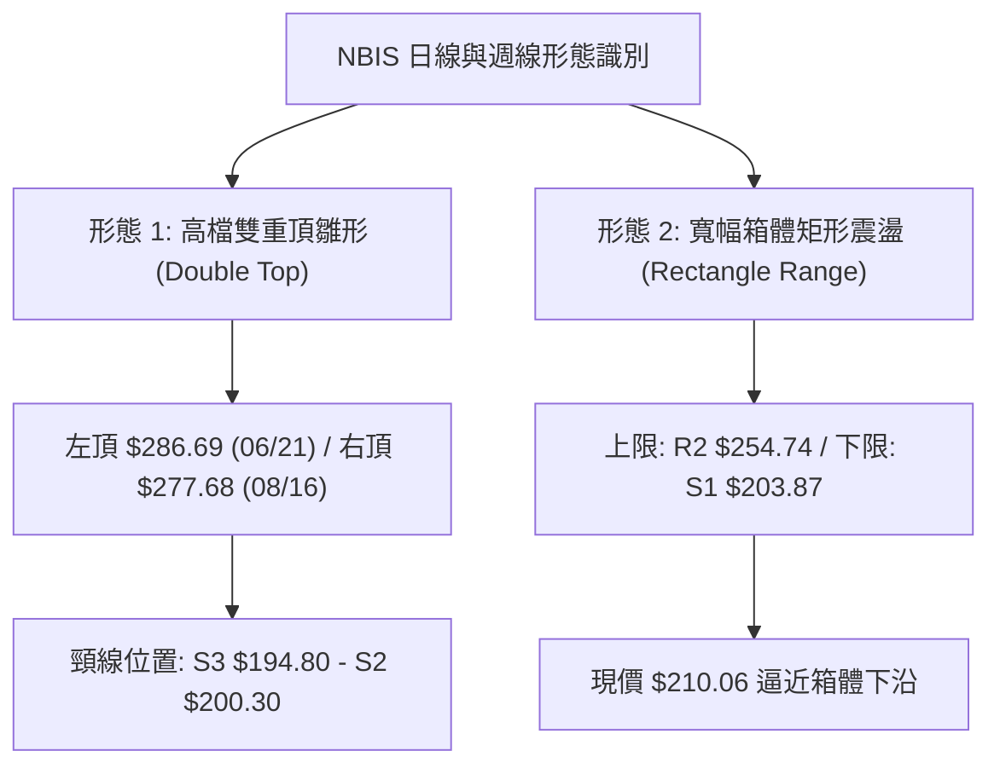
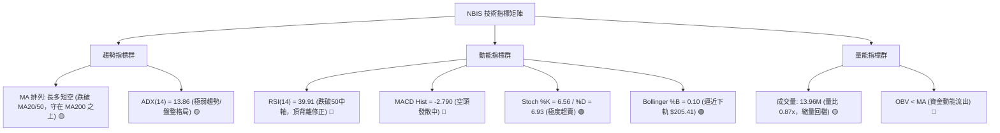
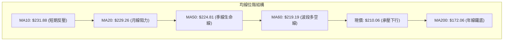
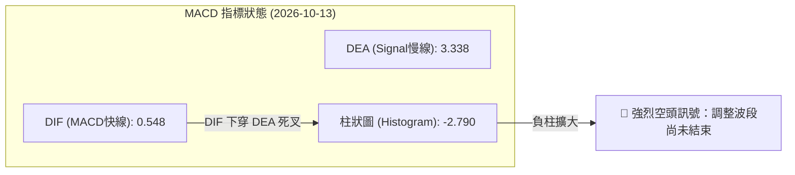
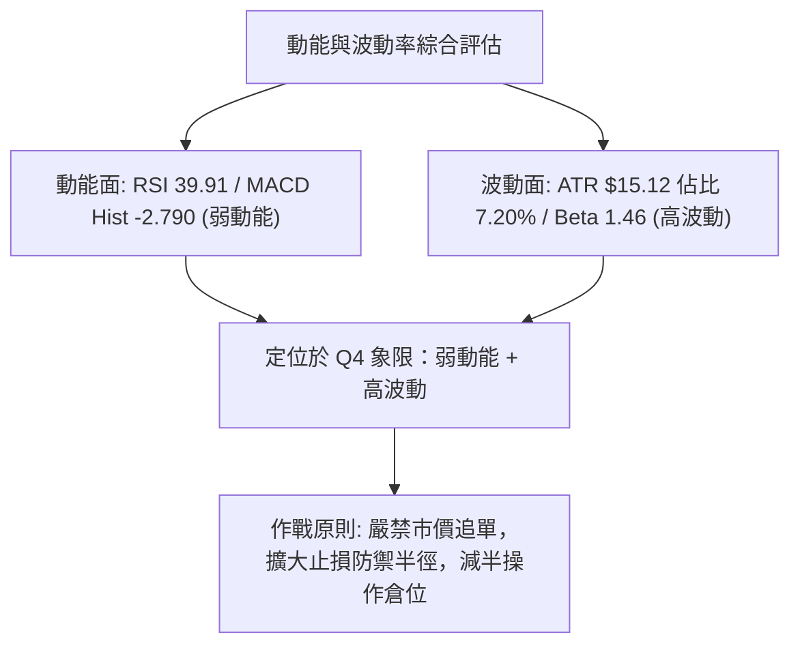
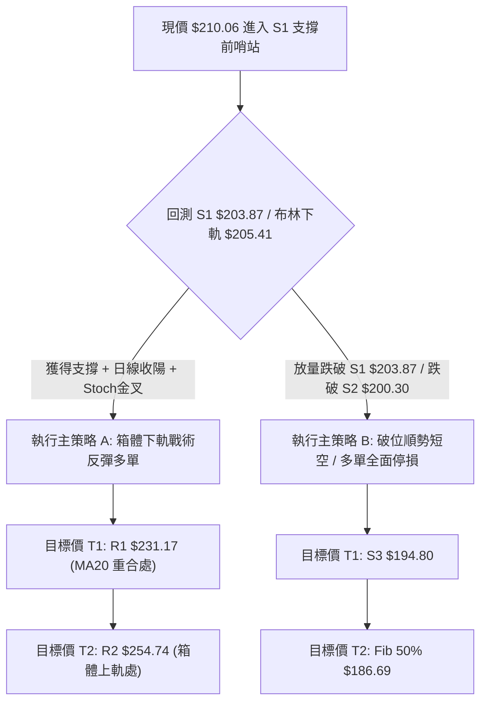
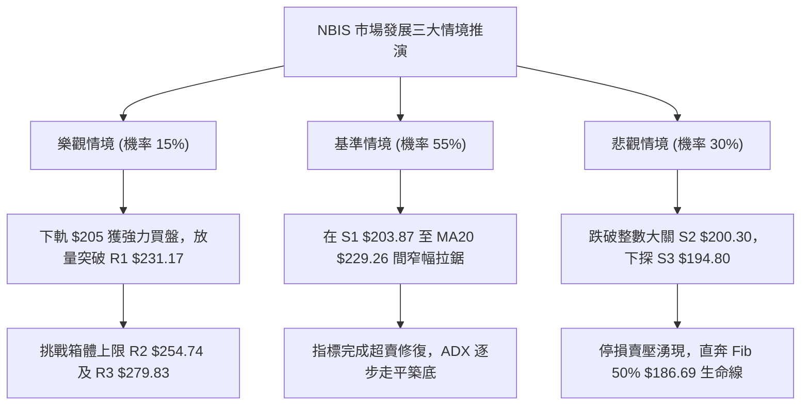

# NBIS 技術分析報告

> **報告日期**：2026-10-13 ｜ **語言**：繁體中文 ｜ **數據來源**：Yahoo Finance ｜ **當前價格**：$210.06

---

## 目錄

| 章節 | 內容 |
|------|------|
| [1. 技術面概覽](#1-技術面概覽) | 訊號儀表板、核心指標、評分卡 |
| [2. 趨勢分析](#2-趨勢分析) | 多時框趨勢、長中短期走勢、ADX強度 |
| [3. 圖表形態分析](#3-圖表形態分析) | 形態識別、K線組合、形態信心度 |
| [4. 支撐與阻力](#4-支撐與阻力) | 關鍵價位、斐波那契回調聚類 |
| [5. 技術指標深度解讀](#5-技術指標深度解讀) | 均線系統、RSI背離、MACD、布林通道、OBV |
| [6. 動能與波動率](#6-動能與波動率) | 動能四象限、ATR風控距離、Beta敏感度 |
| [7. 多時框架總結](#7-多時框架總結) | 時框矩陣、收斂規則與主導方向 |
| [8. 交易策略建議](#8-交易策略建議) | 策略路由、主策略詳情、風控點位 |
| [9. 風險提示與監控](#9-風險提示與監控) | 監控清單、情境推演、部位控管 |

---

## 1. 技術面概覽

### 🎯 技術訊號儀表板



---

### 📊 核心指標速覽表

| 指標類別 | 指標名稱 | 當前數值 | 訊號 | 解讀 |
|:---|:---|:---|:---:|:---|
| **價格** | 當前收盤價 | $210.06 | 🟡 | 位於52週區間 60.3% 位置，短線回檔中 |
| **短期均線** | MA20 | $229.26 | 🔴 | 現價低於 MA20 達 -8.38%，短線承壓 |
| **中期均線** | MA50 | $224.81 | 🔴 | 現價低於 MA50 達 -6.56%，跌破中期生命線 |
| **長期均線** | MA200 | $172.06 | 🟢 | 現價高於 MA200 達 +22.09%，長期牛市基底穩固 |
| **擺動動能** | RSI(14) | 39.91 | 🔴 | 跌破 50 中軸，伴隨頂背離修正，空方佔優 |
| **趨勢動能** | MACD(12,26,9) | 0.548 / 3.338 | 🔴 | 柱狀體為 -2.790，雙線死叉發散 |
| **通道位置** | Bollinger %B | 0.10 | 🟡 | 逼近下軌 $205.41，短線具備技術性反彈動能 |
| **趨勢強度** | ADX(14) | 13.86 | 🟡 | 數值低於 25，顯示當前為無主導趨勢之箱體震盪 |
| **波動率** | ATR(14) | $15.12 | 🔴 | 佔股價 7.20%，每日波動劇烈，需寬幅防守 |
| **量能狀態** | 成交量比 | 0.87x | 🔴 | 成交量 13.96M 低於 20日均量 16.05M，OBV疲弱 |

---

### 🏆 技術評分卡

```
╔══════════════════════════════════════════════════════════════════╗
║                 NBIS 技術面綜合評分儀表板 (2026-10-13)           ║
╠══════════════════════════════════════════════════════════════════╣
║ 趨勢強度 (ADX=13.86)   ████░░░░░░░░░░░░░░░░  25/100  🔴 無趨勢盤整 ║
║ 動能指標 (RSI/MACD)    ██████░░░░░░░░░░░░░░  32/100  🔴 空頭主導   ║
║ 支撐穩定度 (S1/Fib)    ██████████████░░░░░░  70/100  🟢 鄰近S1緩衝 ║
║ 成交量配合 (OBV<MA)    ███████░░░░░░░░░░░░░  35/100  🔴 量縮價跌   ║
║ 形態完整度 (箱體拉回)  ███████████░░░░░░░░░  55/100  🟡 區間收斂   ║
║ 均線排列 (長期多排)    ████████████░░░░░░░░  60/100  🟡 長多短空   ║
╠══════════════════════════════════════════════════════════════════╣
║ 綜合技術評分           █████████░░░░░░░░░░░  46/100  🟡 中性偏弱   ║
╚══════════════════════════════════════════════════════════════════╝
```

---

## 2. 趨勢分析

### 🌐 多時框趨勢分析



---

### 📈 長期趨勢 — 12個月走勢圖（Unicode）

以下為 NBIS 自 2025 年 11 月至 2026 年 10 月之月線收盤價歷史走勢圖：

```
NBIS 月線收盤走勢圖（過去12個月：2025-11 至 2026-10）
價格軸 ($)
$280 ┤                                      ● $276.17 (06月高點)
$250 ┤                                  ● $231.09
$220 ┤                                               ● $206.32   ● $210.06 (現價)
$190 ┤                                           ● $190.41   ● $235.88
$160 ┤                              ● $138.23
$130 ┤ ● $94.87 (11月)          ● $103.76
$100 ┤        ● $83.71     ● $91.19
$70  ┤             ● $85.19 (01月低點聚類)
     └───────────────────────────────────────────────────────────────
       11    12    01    02    03    04    05    06    07    08    09    10  (月份)
```

#### 走勢特徵分析表格

| 階段區間 | 月份起迄 | 收盤價變化 | 區間漲跌幅 | 走勢特徵與結構意涵 |
|:---|:---|:---:|:---:|:---|
| **築底蓄勢期** | 2025-11 ~ 2026-01 | $94.87 → $85.19 | -10.20% | 在 $80-$95 區間構築底部，消化 2025 年秋季漲幅 |
| **主升段起漲** | 2026-02 ~ 2026-04 | $91.19 → $138.23 | +51.58% | 突破百元關卡，均線呈現多頭發散，成交量逐週放大 |
| **加速噴出期** | 2026-05 ~ 2026-06 | $231.09 → $276.17 | +100.08% | 暴力拉升創下 52 週高點 $299.86，形成長期動能極值 |
| **高檔寬幅震盪**| 2026-07 ~ 2026-10 | $190.41 → $210.06 | -23.94% | 獲利了結賣壓湧現，價格回測 $190-$200 支撐帶，進入箱體重整 |

---

### 📊 中期趨勢（週線分析）

中期走勢呈現「高點逐波遞減，低點尋求支撐」的收斂整理格局：
- **頂部壓力帶**：2026年6月創下天花板 $299.86 後，8月中旬反彈收於 $277.68，10月初再次於 $242.81 受阻回落，中期波段高點呈現下移特徵。
- **底部支撐帶**：2026年7月19日當週下探低點 $177.71，隨後8月初收於 $190.41，確立 $180-$195 區間具備龐大逢低承接買盤。
- **當前位置**：自 10 月 4 日高點 $242.81 連續兩週收黑，目前回撤至 $210.06，逼近關鍵支撐 S1 $203.87。

---

### ⚡ 趨勢強度評估（ADX 解讀）



#### ADX 趨勢強度對照表

| 指標名稱 | 當前數值 | 參考標準區間 | 趨勢判定 | 市場環境與策略指導 |
|:---|:---:|:---:|:---:|:---|
| **ADX(14)** | **13.86** | < 20 (極弱) / 20-25 (弱) / >25 (強) | 弱勢盤整 | 趨勢動能匱乏，趨勢指標（如均線交叉）容易頻繁失真 |
| **+DI** | **22.89** | 0 ~ 100 | 多方力道 | 多頭推升力道偏弱，無法形成連續突破 |
| **-DI** | **26.73** | 0 ~ 100 | 空方力道 | 空方主導短期走勢，壓制價格位於短期均線下方 |
| **DI 差值** | **-3.84** | 正值多頭 / 負值空頭 | 偏空格局 | 弱勢震盪下行，逢支撐可能出現防守性反彈 |

---

## 3. 圖表形態分析

### 🔍 形態識別系統



#### 形態信心度與目標價評估表

| 形態名稱 | 信心度 | 判斷依據（引用數據） | 完成度 | 目標價（附計算式） |
|:---|:---:|:---|:---:|:---|
| **寬幅箱體整理** | **75%** | 價格在 S1 $203.87 至 R2 $254.74 區間震盪超過10週；ADX=13.86 確認無趨勢 | 85% | **箱體下軌反彈目標**：$203.87 + ($254.74 - $203.87) × 0.5 = **$229.31**（重合 MA20 $229.26） |
| **潛在雙重頂形態** | **45%** | 兩次高點未破前高（$286.69 與 $277.68），但尚未跌破頸線低點 $177.71 ~ S3 $194.80 | 40% | **頸線跌破理論空頭目標**：$194.80 - ($277.68 - $194.80) = **$111.92**（*註：信心度 <50%，未跌破前不採納*） |
| **指標型布林收斂** | **80%** | 布林帶寬收窄，%B 達 0.10，價格碰觸下軌 $205.41，量能降至 0.87x 形成量縮拉回 | 90% | **回歸均線目標**：BB 中軌 **$229.26** |

---

### 🕯️ 重要K線形態分析

| 週期/日期 | 收盤價 | K線形態名稱 | 技術解讀 | 訊號方向 |
|:---|:---:|:---|:---|:---:|
| **2026-08-16 (週線)** | $277.68 | 長陽突破伴隨爆量 | 單週爆量 1.67億股拉升，多頭竭盡全力測試前高失敗 | 🟢→🔴 |
| **2026-09-06 (週線)** | $226.39 | 縮量長下影陰十字 | 成交量急縮至 57.88M，在 $200 關卡上方獲得支撐 | 🟡 |
| **2026-10-04 (週線)** | $242.81 | 倒轉鎚頭線 (Shooting Star) | 衝高回落，受制於 R2 $254.74 前哨站，確認短線多頭乏力 | 🔴 |
| **2026-10-18 (本週即時)** | $210.06 | 實體中黑K下探 | 跌破 5日、10日、20日、60日均線，目前正測試布林下軌 $205.41 | 🔴 |

---

### 📉 ASCII 走勢形態示意圖

```
NBIS 箱體震盪與關鍵邊界示意圖
價格軸 ($)
$280 ┤       高點1: $286.69          高點2: $277.68 (波段高點聚類 R3 $279.83)
     │          ╭─╮                     ╭─╮
$255 ┤─────────╯─┴─╰─────────────────────╯─┴─╰─────────── [強阻力 R2: $254.74]
     │                                     反彈高點 $242.81
$230 ┤───────────────── MA20 / BB中軌: $229.26 ────────── [波段高點 R1: $231.17]
     │                                       ╲
$210 ┤════════════════════════════════════════● 現價 $210.06 ═ [Fib 38.2%: $213.40]
     │                                     ╱
$204 ┤────────────────────────────────────●────────────── [近一年低點 S1: $203.87]
$195 ┤─── 頸線/密集支撐: S2 $200.30 ─── S3 $194.80 ─────── [強支撐防線]
$177 ┤    ╰─ 週線波段最低 $177.71
```

---

### 🎯 形態目標價計算

1. **箱體均值回歸目標價（做多推算）**：
   - 箱體下邊界 = S1 **$203.87**
   - 箱體中軌軸心 = MA20 **$229.26**
   - 箱體上邊界 = R1 **$231.17**
   - 計算式：若 S1 $203.87 獲得確認防守，反彈第一目標為中軌 MA20 **$229.26**（潛在漲幅 +9.14%），第二目標為 R1 **$231.17**（潛在漲幅 +10.05%）。
2. **破位測幅目標價（空頭風險推算）**：
   - 觸發條件：收盤實體跌破強支撐 S2 **$200.30**。
   - 理論測幅：以現價至 S2 之跌幅延伸，下一級支撐直接下探 S3 **$194.80**，若失守則回測斐波那契 50.0% 回調位 **$186.69**。

---

## 4. 支撐與阻力

### 🗺️ 關鍵價位分布圖（Unicode）

```
NBIS 價位結構分布圖（引用 OHLCV 波段高低點與斐波那契點位）
═══════════════════════════════════════════════════════════════════
$299.86 ║ 52週歷史高點 (Fib 0.0%)
$279.83 ║██████████████████████████████║ 強阻力 R3 (+33.22%)
$254.74 ║████████████████████          ║ 關鍵阻力 R2 (+21.27%) / BB上軌 $253.11
$246.44 ║▓▓▓▓▓▓▓▓▓▓▓▓▓▓▓▓▓▓            ║ 斐波那契 23.6% 回調位
$231.17 ║████████████████████████      ║ 短線阻力 R1 (+10.05%) / MA20 $229.26
$213.40 ║▓▓▓▓▓▓▓▓▓▓▓▓▓▓▓▓▓▓▓▓▓▓        ║ 斐波那契 38.2% 回調位
$210.06 ╠══════════════════════════════╣ ◄ 當前市價 ($210.06)
$205.41 ║──────────────────────────────║ 布林通道下軌
$203.87 ║▓▓▓▓▓▓▓▓▓▓▓▓▓▓▓▓▓▓▓▓▓▓▓▓      ║ 短線支撐 S1 (-2.95%)
$200.30 ║████████████████████████████  ║ 整數心理關卡/強支撐 S2 (-4.65%)
$194.80 ║██████████████████████████████║ 核心防守支撐 S3 (-7.26%)
$186.69 ║▓▓▓▓▓▓▓▓▓▓▓▓▓▓▓▓▓▓▓▓▓▓▓▓▓▓▓▓  ║ 斐波那契 50.0% 多空分水嶺
═══════════════════════════════════════════════════════════════════
```

---

### 🚧 阻力位分析表

| 阻力級別 | 價位 | 形成原因 | 突破難度 | 重要性 |
|:---|:---:|:---|:---:|:---:|
| **R1** | **$231.17** | 近一年波段高點聚類、MA10 ($231.88) 及 MA20 ($229.26) 均線下壓密集區 | 🟡 中等 | ★★★★☆ |
| **R2** | **$254.74** | 近一年波段高點聚類、重合布林通道上軌 ($253.11) 與 Fib 23.6% ($246.44) 延伸壓力 | 🔴 極高 | ★★★★★ |
| **R3** | **$279.83** | 2026年6月至8月雙重波段天花板聚類 ($277.68 - $286.69)，空頭重兵集結 | 🔴 極難 | ★★★★★ |

---

### 🛡️ 支撐位分析表

| 支撐級別 | 價位 | 形成原因 | 守住機率 | 重要性 |
|:---|:---:|:---|:---:|:---:|
| **S1** | **$203.87** | 近一年波段低點聚類，與布林下軌 ($205.41) 形成共振支撐區 | 🟢 65% | ★★★★☆ |
| **S2** | **$200.30** | 近一年波段低點密集聚類、兩百元整數大關、機構逢低吸籌關鍵緩衝位 | 🟢 75% | ★★★★★ |
| **S3** | **$194.80** | 近一年重要波段低點聚類、中期箱體最後防線，失守將面臨深幅修正 | 🟢 85% | ★★★★★ |

---

### 📐 斐波那契回調位分析

依據 52 週絕對區間（低點 **$73.52** 至 高點 **$299.86**，全波段震幅 $226.34）計算：

| 斐波那契層級 | 精確點位 | 當前相對位置 | 結構意義解讀 |
|:---:|:---:|:---:|:---|
| **0.0% (52W High)** | **$299.86** | +42.75% | 本輪牛市歷史極值壓力 |
| **23.6%** | **$246.44** | +17.32% | 強勢拉回修正極限，當前價格已跌破此位，轉為上方強大解套阻力 |
| **38.2%** | **$213.40** | +1.59% | **關鍵多空過渡位**：現價 $210.06 剛剛微幅跌破此位，短線形成反壓 |
| **50.0%** | **$186.69** | -11.13% | **牛市半數回撤中軸**：中期多性格局的絕對生命防線，高於 MA200 |
| **61.8%** | **$159.98** | -23.84% | 黃金分割深幅回調位，重合 MA240 ($159.70) 強固結構支撐 |
| **78.6%** | **$121.96** | -41.94% | 破位空頭行情延伸目標 |
| **100.0% (52W Low)**| **$73.52** | -64.99% | 原始牛市起漲起點 |

**解讀結論**：當前現價 **$210.06** 恰好夾在 **38.2% ($213.40)** 與 **50.0% ($186.69)** 之間。在技術面回調中，38.2% 回調位往往是強勢震盪的關鍵分野；若股價數日內無法迅速收復 $213.40，回調走勢將順勢下探測試 50.0% 回調位 $186.69 及波段支撐 S3 $194.80。

---

## 5. 技術指標深度解讀

### 🎛️ 指標訊號總覽



---

### 📈 移動平均線排列分析



#### 均線數據深度解析

| 均線名稱 | 數值 | 現價差距 ($) | 現價差距 (%) | 走勢特徵與微型火花圖 | 狀態評估 |
|:---|:---:|:---:|:---:|:---|:---:|
| **MA 5** | $227.57 | -$17.51 | -7.70% | 陡峭下彎 ▂▁▁▁▁▃▅▆▇▆▅▃▃▂▃▅▆▇██████████▇▆ | 🔴 超跌下壓 |
| **MA 10** | $231.88 | -$21.82 | -9.41% | 下穿均線 ▃▁▁▁▁▂▂▃▃▃▃▃▄▄▄▄▄▄▄▅▆▇▇█████▇▇ | 🔴 空方控盤 |
| **MA 20** | $229.26 | -$19.20 | -8.38% | 走平轉下 ▄▃▃▃▄▆█▇▆▄▂▁▁▁▁▂▂▃▃▄▅▆▇███████ | 🔴 短期破位 |
| **MA 50** | $224.81 | -$14.75 | -6.56% | 跌破中期生命線，短中期均線形成蓋頭空頭反壓 | 🔴 中期轉弱 |
| **MA 60** | $219.19 | -$9.13 | -4.17% | 走平下彎 ████████▇▆▅▄▃▂▂▂▁▁▁▁▁▂▂▃▃▄▄▅▅▆ | 🔴 跌破反壓 |
| **MA 120**| $216.00 | -$5.94 | -2.75% | 上揚中 ▁▁▁▁▂▂▂▃▃▃▃▄▄▄▅▅▅▆▆▆▇▇▇▇██████ | 🟡 測試支撐 |
| **MA 200**| $172.06 | +$38.00 | +22.09% | 穩定上揚，長期多頭牛熊線，距離現價有充足安全墊 | 🟢 長期看多 |
| **MA 240**| $159.70 | +$50.36 | +31.54% | 強勁上揚 ▁▁▁▁▂▂▂▃▃▃▃▄▄▄▄▅▅▅▅▆▆▆▆▇▇▇████ | 🟢 基底雄厚 |

**核心結論**：中短期均線（MA5、10、20、50、60）全數位於現價上方，形成密集的向下反壓層帶；但 MA20 > MA50 > MA200 仍保留廣義長期多頭排列架構，屬於「中長期多頭格局下的次級折返修正」。

---

### 📉 RSI(14) 分析

```
RSI(14) 當前水平：39.91
0 ═══════════ 30 ═══════════ 50 ═══════════ 70 ══════════ 100
[  超賣區間  ]  [   當前 39.91   ]   [     中性格局     ]   [  超買區間  ]
░░░░░░░░░░░░░░  █████████░░░░░░░░░  ░░░░░░░░░░░░░░░░░░  ░░░░░░░░░░░░
```

- **數值解讀**：RSI(14) 當前為 **39.91**，已跌破 50 多空榮枯線，進入 30–50 之弱勢空方主導區間。
- **背離分析**：系統偵測到明確的 **⚠️ 頂背離 (Bearish Divergence)**。
  - *具體走勢比對*：2026年6月價格衝至 $286.69 時 RSI 達到 65.3；隨後8月中旬價格反彈至 $277.68（相近高點），RSI 雖衝至 67.2，但在 10 月 4 日價格反彈至 $242.81 時 RSI 出現急劇鈍化，隨後價格迅速崩落，指標高點未隨價格創高而同步發散，確認空頭頂背離賣壓正在釋放中。
- **隨機指標共振**：Stochastic %K 為 **6.56**，%D 為 **6.93**，雙雙處於 20 以下的極端超賣盲區，顯示短線下行殺跌動能已接近極限，隨時具備技術性死貓跳或觸底反彈之條件。

---

### 📊 MACD(12/26/9) 訊號解讀



- **MACD 線值**：0.548
- **訊號線 (Signal)**：3.338
- **柱狀體 (Histogram)**：-2.790（負值擴大）
- **技術解讀**：DIF 線自 9 月底高檔死叉跌破 Signal 線，柱狀體已連續兩週為負且絕對值由 -1.599 擴大至 -2.790。此型態表明空頭動能仍處於加速釋放階段，在柱狀體出現收斂（由長變短）之前，左側猜底風險極高。

---

### 📦 布林通道分析

```
NBIS 布林通道位置示意圖 (通道寬度: $47.70)
$253.11 ┤ ═════════════════════════════════ 上軌 (Upper Band)
        │
$229.26 ┤ --------------------------------- 中軌 / MA20 (Mid Band)
        │
$210.06 ┤ ◄ 現價 ($210.06, %B = 0.10)
$205.41 ┤ ═════════════════════════════════ 下軌 (Lower Band)
```

- **上軌**：$253.11
- **中軌 (MA20)**：$229.26
- **下軌**：$205.41
- **通道指標 %B**：**0.10**（0 = 下軌，$205.41；1 = 上軌，$253.11）
- **形態含義**：現價 $210.06 距離下軌 $205.41 僅剩 $4.65（約 2.2% 緩衝）。當 %B 接近 0.10 甚至跌破 0 時，通常意味著短期價格過度偏離均線，通道邊界將提供強大反彈支撐。

---

### 💹 成交量分析（量價配合度）

```
成交量動量對比
當日成交量:  13,962,800  [█████████████░░░░░░░]  (量比: 0.87x)
20日均量:   16,052,610  [███████████████░░░░░]
50日均量:   18,995,322  [███████████████████░]
```

- **量價關係**：最新單日成交量為 13,962,800 股，顯著低於 20 日均量（16,052,610 股）與 50 日均量（18,995,322 股），量比為 **0.87x**。
- **價跌量縮特徵**：回顧 8 月中旬突破時單週成交量高達 1.67 億股，而當前週成交量縮減至 8,600 萬至當前日均水準，顯示本輪下跌並非主力機構的大規模恐慌性出逃，而是「買盤縮手引發的無量陰跌與量縮拉回」。
- **能量潮 OBV**：當前系統判定 **OBV < MA**，指標曲線走平下傾，確認資金流入停滯。量能尚未出現「爆量承接」或「帶量突破」，因此缺乏向上 V 型反轉的燃料。

---

## 6. 動能與波動率

### ⚡ 動能評估四象限

| 象限代號 | 動能維度 (Momentum) | 波動率維度 (Volatility) | 當前判定狀態 | 策略指導方向 |
|:---:|:---:|:---:|:---:|:---|
| **Q1 (強動能 / 低波動)** | 強勁 (Bullish) | 低 (Stable) | ─ | 趨勢穩健加碼區，非當前型態 |
| **Q2 (弱動能 / 低波動)** | 疲弱 (Bearish) | 低 (Stable) | ─ | 沉悶磨底盤整 |
| **Q3 (強動能 / 高波動)** | 強勁 (Bullish) | 高 (Volatile) | ─ | 爆發型投機主升段 |
| **Q4 (弱動能 / 高波動)** | **疲弱 (Bearish)** | **高 (Volatile)** | **✓ [當前定位]** | **高風險高摩擦區：嚴格控制倉位，以通道邊界為主** |



---

### 📊 ATR 波動率分析

- **ATR(14) 數值**：**$15.12**
- **ATR 佔股價比重**：**7.20%**（$15.12 ÷ $210.06）
- **波動特性評估**：每日平均震幅逾 15 美元，屬於極高波動之成長股與雲端算力基礎設施類股特徵。
- **止損與風控距離建議**：
  - **超短線戰術止損 (1.0x ATR)**：距離進場點需預留 **$15.12** 空間，以避免被日內雜訊洗盤出場。
  - **波段標準止損 (1.5x ATR)**：距離進場點需預留 **$22.68** 空間（例如以 $210 進場，停損應設於 $187.38，重合 50% 斐波那契回調位 $186.69）。

---

### 📐 Beta 與市場相關性

- **Beta 係數**：**1.46**
- **市場敏感度分析**：NBIS 的系統性風險顯著高於大盤（標普500指數）。
  - 當大盤回檔 1% 時，NBIS 理論跌幅為 1.46%。
  - 當科技板塊與 AI 基礎設施遭遇資金退潮時，NBIS 具有更高的下行貝塔放大效應。
  - **避險要求**：多頭持倉需在科技板塊出現集體性疲軟時預留更深防禦空間。

---

## 7. 多時框架總結

### 📋 時框架評分表

| 時框架 | 趨勢方向 | 動能狀態 | 均線排列 | 圖表形態 | 綜合評分 | 操作建議 |
|:---|:---:|:---:|:---:|:---:|:---:|:---|
| **長期 (月線)** | 🟢 多頭牛市 | 🟡 高檔鈍化 | 🟢 MA200之上 | 突破後高位旗形整理 | **75/100** | 長線多頭底倉持有，未跌破 MA200 前無崩盤風險 |
| **中期 (週線)** | 🟡 箱體震盪 | 🔴 MACD負向 | 🟡 MA50附近震盪 | $200–$280 寬幅震盪箱體 | **48/100** | 區間思維操作，接近下軌 $200 布局，上軌減碼 |
| **短期 (日線)** | 🔴 弱勢修正 | 🔴 頂背離發酵 | 🔴 均線反壓密集 | 沿布林下軌貼軌下行 | **35/100** | 短線禁止盲目追多，等待 S1 支撐確認放量企穩 |

---

### 🔲 綜合訊號矩陣

```
╔══════════════════════════════════════════════════════════════════╗
║                    多時框多空訊號收斂矩陣                        ║
╠══════════════════╦══════════════╦══════════════╦═════════════════╣
║     指標維度     ║  短期 (日線) ║  中期 (週線) ║   長期 (月線)   ║
╠══════════════════╬══════════════╬══════════════╬═════════════════╣
║ 趨勢方向 (Trend) ║   🔴 看跌    ║   🟡 盤整    ║     🟢 看漲     ║
║ 動能指標 (Mom)   ║   🔴 空頭發散║   🔴 死叉    ║     🟢 強勢區   ║
║ 均線位階 (MAs)   ║   🔴 破MA20/50║  🟡 壓制     ║     🟢 多排     ║
║ 量能配合 (Vol)   ║   🔴 量能不足║   🟡 縮量    ║     🟢 溫和放大 ║
║ 形態位置 (Pattern║   🟡 逼近下軌║   🟡 箱體中下║     🟢 旗形整理 ║
╚══════════════════╩══════════════╩══════════════╩═════════════════╝
```

---

### ⚖️ 多時框收斂結論

依據多時框收斂規則（嚴格要求 14）：
1. **趨勢強度定性**：當前 **ADX(14) = 13.86 < 25**，嚴格定義為**盤整無趨勢行情**。
2. **主導規則取捨**：依據規則，在盤整行情中，**以日線布林通道上下軌（$205.41 – $253.11）與支撐阻力結構為主要交易依據**，中長期均線（MA50/MA200）僅作為大邊界防守參照。
3. **方向性收斂唯一結論**：**中性觀望偏短線防守反彈（Neutral-to-Cautious Bounce Setup）**。
   - 短期日線雖屬空頭主導（-DI 26.73 > +DI 22.89），但現價已跌至布林下軌 $205.41 與波段強支撐 S1 $203.87 核心防守區，且 Stochastic 出現小於 10 的極度超賣。因此，**空頭空間受到壓縮，盲目追空風險極大**；最優交易邏輯為在區間下軌尋求確認信號進行戰術性反彈博弈。此結論與第 8 章之交易策略完全收斂一致。

---

## 8. 交易策略建議

### 🗺️ 策略決策流程圖



---

### 🧭 策略路由

> **當前主策略方向 = 區間震盪下軌戰術反彈策略（依評分 46/100 判定為中性格局）**  
> 綜合評分 46 處於 40–60 中性區間，且 ADX 為 13.86。市場缺乏大級別單邊趨勢，交易主軸為「依托布林下軌 $205.41 與支撐位 S1 $203.87 尋找風險收益比極高的左側/次級折返進場點」。

---

### 🎯 價格情境階梯（Price Scenarios）

所有價位均嚴格引用第 4 章及數據庫計算之精確點位：

| 觸發條件 | 下一目標 | 後續延伸 | 情境含義與技術解讀 |
|:---|:---:|:---:|:---|
| **強勢突破 R1 $231.17** | **R2 $254.74** | **R3 $279.83** | **多頭反轉確立**：收復月線與季線，重啟波段挑戰箱體頂部 |
| **站穩現價 $210.06 ~ S1 $203.87** | **R1 $231.17** | **R2 $254.74** | **區間震盪反彈**：布林下軌獲利盤回補，展開均值回歸走勢 |
| **實體跌破 S1 $203.87** | **S2 $200.30** | **S3 $194.80** | **支撐下移**：測試兩百元整數大關與最後波段頸線 |
| **失守強支撐 S2 $200.30** | **S3 $194.80** | **Fib 50% $186.69** | **中期形態破位**：雙重頂成立，展開深度回調清算籌碼 |

---

### 📊 情境機率分佈

| 情境名稱 | 機率預估 | 主要技術指標依據 |
|:---|:---:|:---|
| **區間震盪 / 下軌反彈** | **55%** | ADX=13.86 表明無大趨勢；布林 %B=0.10 及 Stoch %K=6.56 極度超賣；S1 $203.87 具強力買盤支撐 |
| **陰跌破位 / 回測深幅支撐** | **30%** | MACD 負柱狀體持續發散 (-2.790)；RSI 頂背離尚未完全消化；OBV 疲軟低於均線 |
| **強勢爆量大漲 (V轉突破 R1)** | **15%** | 當前成交量僅 13.96M（量比 0.87x），市場缺乏足夠買盤推動直接 V 型反轉突破 |

---

### 🟢 主策略詳情

本策略專注於箱體邊界的高盈虧比交易，提供兩種風格配置：

| 策略要素 | 策略 A（下軌反彈短多 — 積極型） | 策略 B（R1 反彈受阻做空 — 穩健順勢型） |
|:---|:---:|:---:|
| **策略類型** | 均值回歸做多（Mean Reversion Long） | 短期趨勢順勢做空（Trend Fade Short） |
| **進場條件** | 股價回踩 S1 $203.87 附近且出現 15分/日線止跌長下影 | 股價反彈至 R1 $231.17 附近受阻，收出上影線確認受壓 |
| **進場價格** | **$205.40**（重合布林下軌） | **$230.50**（重合 MA20 $229.26 反壓區間） |
| **止損價格** | **$199.50**（嚴格跌破整數關卡 S2 $200.30） | **$236.00**（突破 R1 且收復短期均線帶） |
| **目標價 T1** | **$229.26**（回歸 BB 中軌與 MA20） | **$210.06**（回測當前價格位置） |
| **目標價 T2** | **$231.17**（測試關鍵阻力 R1） | **$203.87**（下探關鍵支撐 S1） |
| **風險報酬比 (R/R)**| **1 : 4.04**（風險 $5.90 / 潛在報酬 $23.86） | **1 : 3.72**（風險 $5.50 / 潛在報酬 $20.44） |
| **成功機率** | **60%** | **55%** |
| **建議倉位** | **8% - 10%**（高波動環境下輕倉操作） | **5% - 8%**（防範大級別牛市突襲） |

---

### 🔴 反向風險觸發點（對沖提示）

- **多單失效觸發點（全面止損避險）**：
  - 日線收盤價**實體跌破 $200.30 (S2)**。
  - 此訊號代表箱體下沿徹底失效，空頭空間打開至 S3 $194.80 及 50% 斐波那契 $186.69，所有多單必須無條件止損出局。
- **空單失效觸發點（空翻多信號）**：
  - 單日成交量放大超過 20日均量（>16.05M 股）且收盤價**實體突破 $231.17 (R1)**。
  - 此訊號代表日線級別頂背離修正結束，價格重新站上 MA20 與 MA50，空單必須立即平倉止損，轉向多頭布局。

---

### ⭐ 整體訊號強度評星

```
做多訊號強度：★★☆☆☆  (2.5/5星 — 僅限下軌超賣博弈，缺乏量能趨勢支持)
做空訊號強度：★★★☆☆  (3.0/5星 — 短線指標佔優，但面臨 S1/S2 強大下軌阻力)
整體可信度：  ★★★☆☆  (3.5/5星 — ADX 偏低導致訊號雜訊較多，區間有效性高)
```

---

## 9. 風險提示與監控

### ✅ 關鍵監控指標 Checklist

```
╔══════════════════════════════════════════════════════════════════╗
║                   NBIS 交易日常風險監控清單                      ║
╠══════════════════════════════════════════════════════════════════╣
║ [ ] 支撐防守測試：收盤價是否守穩 S1 $203.87 及 S2 $200.30       ║
║ [ ] 均線動態變化：MA20 $229.26 下行斜率是否減緩並走平          ║
║ [ ] 擺動指標超賣解除：Stoch %K 是否向上突破 %D 形成黃金交叉      ║
║ [ ] MACD 柱狀體監控：Hist (-2.790) 負值是否出現第一根縮短特徵   ║
║ [ ] 量能異動跟蹤：單日成交量是否異常放大至 2,000 萬股以上       ║
║ [ ] 通道突破狀態：%B 是否由 0.10 重新回升至 0.30 以上           ║
╚══════════════════════════════════════════════════════════════════╝
```

---

### ⚠️ 風險場景分析



---

### 🛡️ 風險管理重要提醒

1. **波動幅度極大（ATR = $15.12，7.20%）**：
   - NBIS 日內波動性極高，日常單日震盪即可能達到 $15 以上。禁止使用超過 3 倍以上槓桿工具，現貨交易者單筆持倉風險暴露（Max Risk per Trade）不應超過總投資組合淨值的 **1.5%**。
2. **高 Beta 係數（Beta = 1.46）**：
   - 本標的對半導體、AI 伺服器與納斯達克大盤具有顯著放大效應。若大盤指數遭遇系統性殺跌，個股技術支撐容易出現瞬間「假跌破」，操作進場應多看少動，以「日線收盤確認」而非盤中觸碰作為決策依據。
3. **空頭頂背離的後續威脅**：
   - 儘管當前隨機指標超賣，但 RSI 頂背離帶來的修正往往需要數週的震盪或兩次築底（Double Bottom）方能徹底消化。嚴禁在未見到明確底部止跌 K 線（如晨星、長下影錘頭）前大舉重倉抄底。

---

## 📋 報告總結

```
╔══════════════════════════════════════════════════════════════════╗
║                   NBIS 技術分析報告總結                          ║
╠══════════════════════════════════════════════════════════════════╣
║ 報告日期：2026-10-13                                             ║
║ 當前價格：$210.06                                                ║
║ 分析評級：⚖️ 中性觀望 / 區間下沿戰術防禦 (綜合評分: 46/100)       ║
║                                                                  ║
║ 關鍵技術維度結論：                                               ║
║ ├─ 長期趨勢：🟢 多頭穩固 (價格遠高於 MA200 $172.06，牛市結構完整)║
║ ├─ 中期趨勢：🟡 寬幅箱體 (介於 $195–$280 之間進行大級別能量消化) ║
║ ├─ 短期趨勢：🔴 弱勢修正 (跌破 MA20/MA50，受制於 MACD 負柱發散) ║
║ ├─ 關鍵支撐：S1: $203.87 ｜ S2: $200.30 ｜ S3: $194.80           ║
║ ├─ 關鍵阻力：R1: $231.17 ｜ R2: $254.74 ｜ R3: $279.83           ║
║ └─ 華爾街分析師目標價：均價 $283.60 (最高 $410.00 / 最低 $84.00) ║
║                                                                  ║
║ 最優交易策略組合：                                               ║
║ 1. 🥇 最佳機會：等待回踩 S1 $203.87-$205.40 區間輕倉博弈反彈，   ║
║                停損設於 $199.50，目標看至 MA20 $229.26。         ║
║ 2. 🥈 次選機會：若反彈受阻於 R1 $231.17 附近，順勢建立避險空單， ║
║                停損設於 $236.00，目標回看 $210.06。              ║
║ 3. 🥉 保守選擇：完全空倉觀望，等待日線實體突破 R1 $231.17 或回測 ║
║                S3 $194.80 築底完成後再行順勢介入。               ║
╚══════════════════════════════════════════════════════════════════╝
```

---

> ⚠️ **免責聲明**：本報告為技術分析研究，所有數據、圖表及價位推算均基於歷史量價資訊（Yahoo Finance）與客觀技術指標模型。本報告**僅供研究與學術參考**，**不構成任何個人化投資建議或買賣邀約**。金融市場具有高度風險，投資人應獨立評估自身財務狀況與風險承受能力，自負盈虧。

---

*報告生成時間：2026-10-13 ｜ 數據來源：Yahoo Finance ｜ 分析框架：多時框技術分析模型*