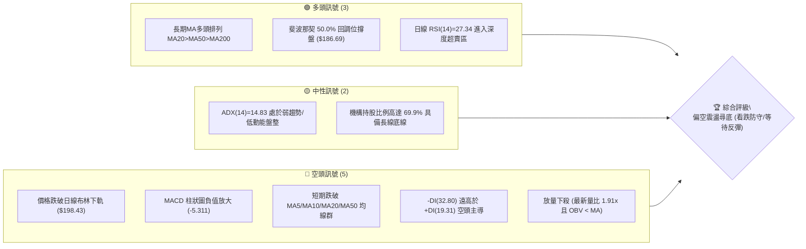
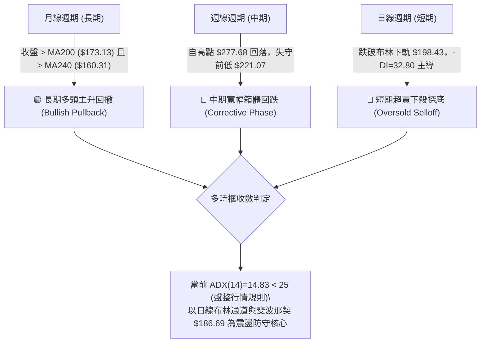
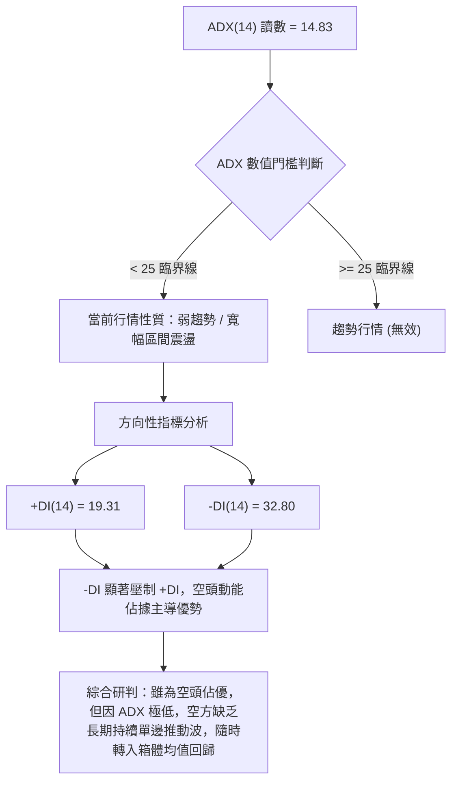
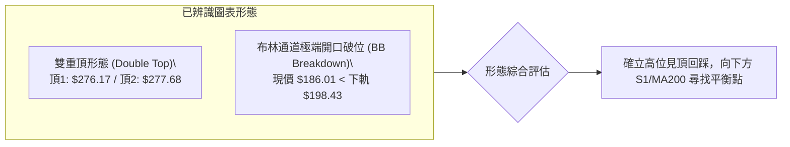
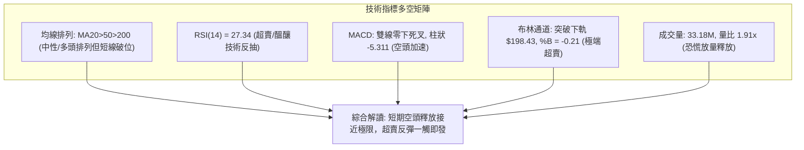
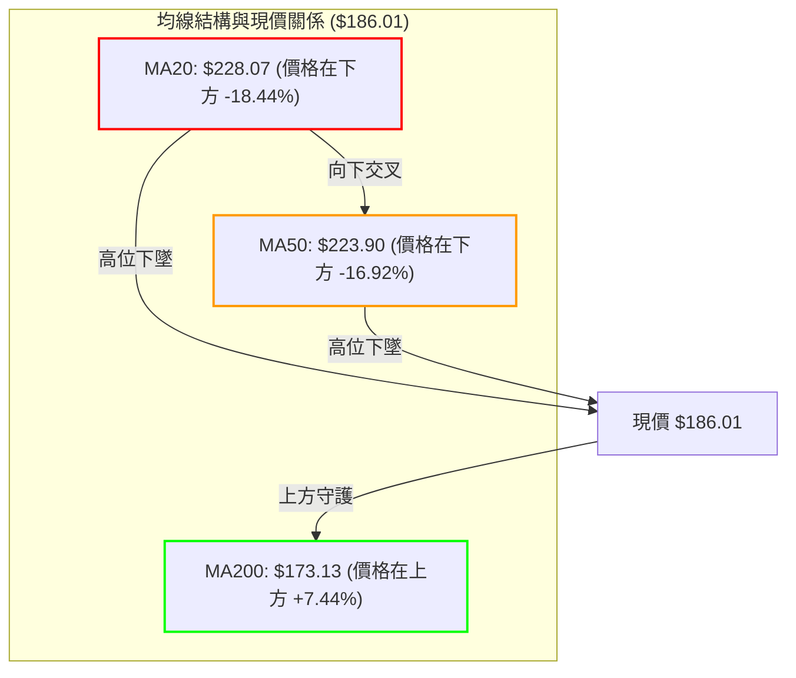
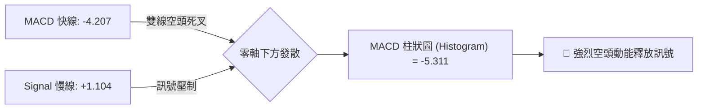
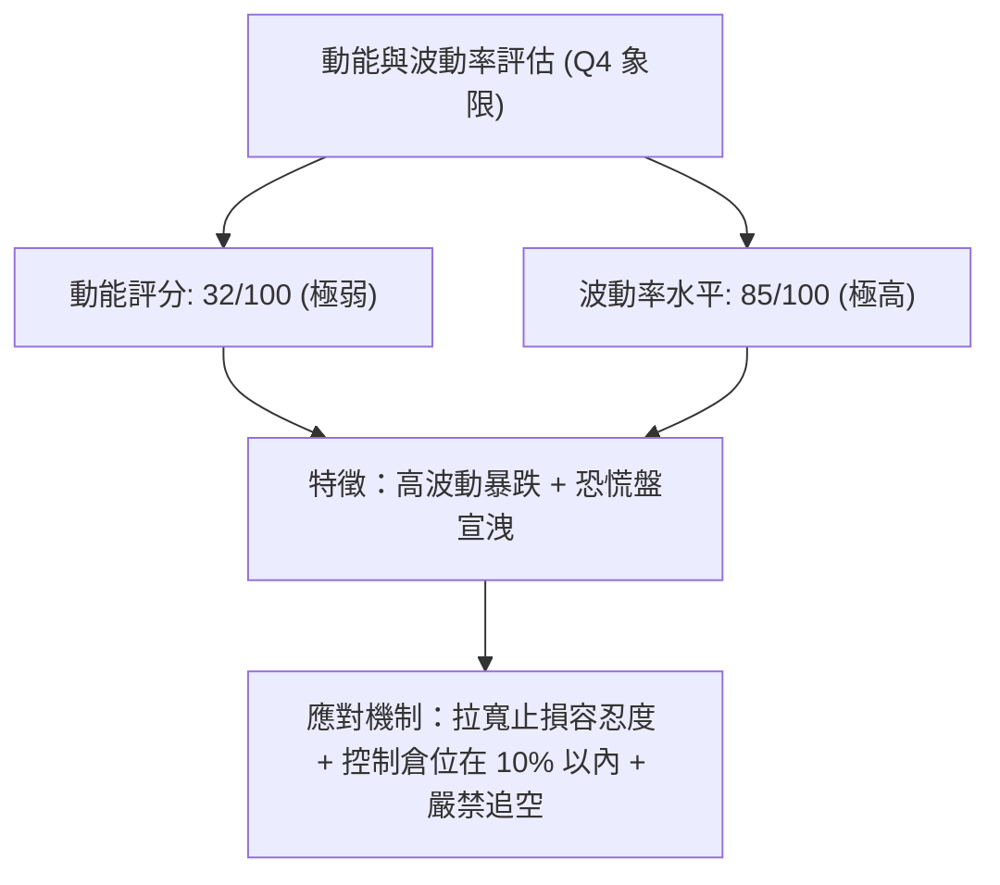
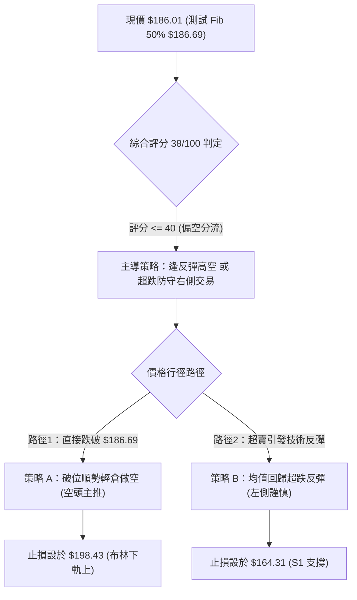
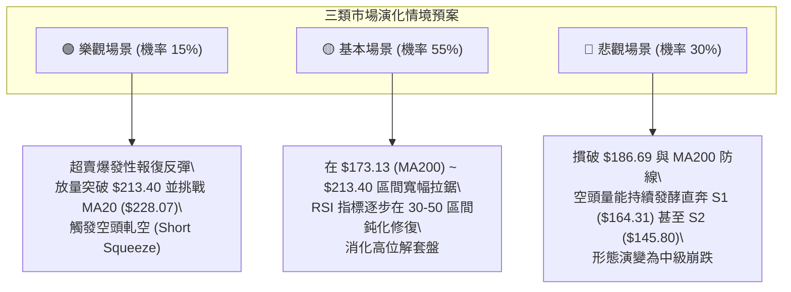

# NBIS 技術分析報告

> **報告日期**：2026-10-15 ｜ **語言**：繁體中文 ｜ **數據來源**：Yahoo Finance ｜ **當前價格**：$186.01

---

## 目錄

| 章節 | 內容 |
|------|------|
| [1. 技術面概覽](#1-技術面概覽) | 訊號儀表板、核心指標、評分卡 |
| [2. 趨勢分析](#2-趨勢分析) | 多時框趨勢、長中短期走勢 |
| [3. 圖表形態分析](#3-圖表形態分析) | 形態識別、K線組合、目標價 |
| [4. 支撐與阻力](#4-支撐與阻力) | 關鍵價位、斐波那契回調 |
| [5. 技術指標深度解讀](#5-技術指標深度解讀) | MA/RSI/MACD/布林/成交量 |
| [6. 動能與波動率](#6-動能與波動率) | 動能評估、ATR、Beta |
| [7. 多時框架總結](#7-多時框架總結) | 時框架評分矩陣 |
| [8. 交易策略建議](#8-交易策略建議) | 多空策略、風險報酬比 |
| [9. 風險提示與監控](#9-風險提示與監控) | 監控指標、風險場景 |

---

## 1. 技術面概覽

### 🎯 技術訊號儀表板



### 📊 核心指標速覽表

| 指標類別 | 指標名稱 | 當前數值 | 訊號 | 解讀 |
|----------|----------|----------|------|------|
| **價格** | 當前價格 | $186.01 | 🔴 | 位於 52 週區間 49.7%，跌破布林下軌並貼近斐波 50% 水平 |
| **均線** | MA20 | $228.07 | 🔴 | 價格低於 MA20 達 -18.44%，短期均線呈現急速下墜壓制 |
| **均線** | MA50 | $223.90 | 🔴 | 價格低於 MA50 達 -16.92%，中期多頭結構遭遇實質性回撤 |
| **均線** | MA200 | $173.13 | 🟢 | 價格仍維持在長期生命線 MA200 之上 (+7.44%)，長牛根基未破 |
| **均線排列** | 結構狀態 | MA20>50>200 | 🟡 | 形態學維持長週期多頭排列，但短均群 (MA5/10/20) 快速向下收斂 |
| **動能** | RSI(14) | 27.34 | 🟢 | 日線嚴重超賣 (<30)，技術性均值回歸修復隨時可能觸發 |
| **動能** | MACD 柱狀 | -5.311 | 🔴 | MACD線 (-4.207) 低於訊號線 (1.104)，動能處於空頭加速釋放期 |
| **趨勢** | ADX(14) | 14.83 | 🟡 | ADX < 25 表明非單邊宏觀趨勢，呈現高波動寬幅箱體盤整走勢 |
| **通道** | 布林通道 %B | -0.21 | 🔴 | 跌穿下軌 ($198.43)，呈現極端超跌放量破位形態 |
| **量能** | 20日量比 | 1.91x | 🔴 | 單日成交量 33.18M 對比均量大幅放大，OBV < MA 顯示主力拋壓未歇 |
| **波動** | ATR(14) | $15.37 | 🔴 | 佔股價 8.26%，呈現單日高彈性巨震，風控止損需拉寬距離 |

### 🏆 技術評分卡

```
╔════════════════════════════════════════════════════════════════╗
║             技術評分卡 — NBIS (2026-10-15)                     ║
╠════════════════════════════════════════════════════════════════╣
║ 趨勢強度 (ADX=14.83)     ███░░░░░░░░░░░░░░░░░  18/100 🔴 弱勢 ║
║ 動能指標 (RSI/MACD)      ██████░░░░░░░░░░░░░░  32/100 🔴 承壓 ║
║ 支撐穩定度 (Fib/MA200)   ███████████░░░░░░░░░  55/100 🟡 考驗 ║
║ 成交量配合 (OBV疲弱)     █████░░░░░░░░░░░░░░░  28/100 🔴 倒貨 ║
║ 形態完整度 (寬幅震盪)    ████████░░░░░░░░░░░░  42/100 🟡 混沌 ║
║ 均線排列 (長多短空)      ██████████░░░░░░░░░░  52/100 🟡 分歧 ║
╠════════════════════════════════════════════════════════════════╣
║ 綜合評分                 ███████░░░░░░░░░░░░░  38/100 🔴 偏空 ║
╚════════════════════════════════════════════════════════════════╝
```

---

## 2. 趨勢分析

### 🌐 多時框趨勢分析



### 📈 長期趨勢 — 12個月走勢圖（Unicode）

```
NBIS 月線走勢圖（過去12個月：2025-11 至 2026-10）
價格軸 ($)
$280 ┤                                     ● $276.17 (2026-06)
$250 ┤                                        ● $235.88 (2026-09)
$220 ┤                             ● $231.09     ● $206.32
$190 ┤                                        ● $190.41   ● $186.01 (現價)
$160 ┤                         
$130 ┤                      ● $138.23
$100 ┤ ● $94.87    ● $91.19    ● $103.76
$70  ┤     ● $83.71    ● $85.19
     └─┬─────┬─────┬─────┬─────┬─────┬─────┬─────┬─────┬─────┬─────┬─────┬───
     11月   12月   01月  02月  03月  04月  05月  06月  07月  08月  09月  10月
     (2025)             (2026)                                      (現價)
```

#### 走勢特徵分析表格

| 階段階段區間 | 起止價格 | 漲跌幅 (%) | 量價特徵與結構轉變 |
|---|---|---|---|
| **築底蓄勢期**<br>(2025-11 ~ 2026-02) | $94.87 → $91.19 | -3.88% | 於 $83.71 ~ $94.87 區間形成狹幅矩形築底，洗盤充分。 |
| **爆發主升浪**<br>(2026-03 ~ 2026-06) | $91.19 → $276.17 | **+202.85%** | 伴隨 AI 基礎設施爆發性成長，連收大陽線，創 52W 高點 $299.86。 |
| **見頂高位巨震**<br>(2026-07 ~ 2026-09) | $276.17 → $235.88 | -14.59% | 月線收長上下影線，成交量急劇擴大，資金獲利回吐跡象明顯。 |
| **快速補跌尋底**<br>(2026-10 至今) | $235.88 → $186.01 | **-21.14%** | 單月急殺回測長期 MA200 ($173.13) 與斐波那契 50% 水平。 |

### 📊 中期趨勢（週線分析）

中期走勢呈現「寬幅頂部箱體破位」，自 2026 年 8 月中旬衝擊 $277.68 高點無功而返後，高點逐步下移（$242.81 → $221.07 → $186.01），近兩週形成斷崖式下殺：

```
中期阻力/支撐階梯架構：
$279.83 (R3) ═══════════════════════════ (8月前高阻力區)
$254.92 (R2) ─────────────────────────── (布林上軌/9月震盪高點)
$231.17 (R1) ─────────────────────────── (MA20/MA50 匯聚頸線阻力)
$186.01      ◄── 當前現價 (測試 50% 斐波那契位 $186.69)
$173.13 (MA200) ┄┄┄┄┄┄┄┄┄┄┄┄┄┄┄┄┄┄┄┄┄┄┄ (長期多頭防守底線)
$164.31 (S1) ═══════════════════════════ (波段密集支撐區聚類)
```

### ⚡ 趨勢強度評估（ADX 解讀）



| 指標名稱 | 數值 | 狀態區間 | 技術意義解讀 |
|---|---|---|---|
| **ADX(14)** | 14.83 | 0 ~ 25（弱趨勢） | 顯示近期的暴跌並未演變為結構性單邊熊市，而是高波動盤整行情中的下行脈衝。 |
| **+DI(14)** | 19.31 | 多頭動能衰退 | 買盤動能處於近 6 個月低位，多方反抗力度受制。 |
| **-DI(14)** | 32.80 | 空頭主導強勢 | 空方拋壓集中釋放，高於 30 說明短線賣盤具備局部壓迫性。 |

---

## 3. 圖表形態分析

### 🔍 形態識別系統



#### 圖表形態信心度與計算表格（嚴格遵循幾何度量）

| 形態名稱 | 信心度 | 判斷依據（引用真實數據） | 完成度 | 目標價（附嚴格計算式） |
|---|---|---|---|---|
| **高位雙重頂** | 78% | 2026-06 收盤 $276.17 與 2026-08-16 收盤 $277.68 形成顯著雙頂；頸線為 2026-07 收盤低點聚類 $190.41。 | 90% (已破頸線) | **測算目標**：頸線 $190.41 - (頂點 $277.68 - 頸線 $190.41) = $103.14。<br>*註：因下方遭遇強支撐 S1/MA200，此理論極限值需被第一支撐阻截。* |
| **布林帶下軌突破** | 85% | 現價 $186.01 遠低於布林下軌 $198.43，%B 達到 -0.21 極端超賣。 | 100% | **超賣回抽目標**：回抽日線中軌 MA20 = **$228.07**。 |
| **頭肩底 / 三角形** | 0% | 數據中未偵測到頭肩底或收斂三角形結構。 | 0% | 訊號不足，僅做指標型解讀，不強行構造幾何形態。 |

### 🕯️ 重要K線形態分析

| 日期/月份 | 收盤價 | K線形態特徵 | 技術面解讀 | 訊號 |
|---|---|---|---|---|
| **2026-06 (月線)** | $276.17 | 巨陽衝頂帶長上影 | 觸及 52W 高點 $299.86 後遭遇天量獲利盤砸盤，多頭力竭。 | 🔴 |
| **2026-08-16 (週線)**| $277.68 | 突破長陽爆出 167M 天量 | 二次衝高回落，主力假突破構築「多頭陷阱」，量價背離萌生。 | 🔴 |
| **2026-09 (月線)** | $235.88 | 中陰線覆蓋回調 | 衝高乏力，未能收復 MA5 ($208.74) 均線上方，確認中級調整。 | 🔴 |
| **2026-10-18 (週線)**| $186.01 | 光腳大陰線跌破前低 | 殺跌貫穿多道技術關口，帶動 RSI 沉入 27.34 極度超賣區。 | 🟢 (反彈醞釀) |

### 📉 ASCII 走勢形態示意圖

```
NBIS 高位雙頂與破位示意圖：
價格
$280 ┤              頂點1 $276.17          頂點2 $277.68
$260 ┤               ╭───╮                  ╭───╮
$240 ┤              │     │    回升浪      │     │
$220 ┤              │      ╰───────╯───────╯      │
$200 ┤──頸線位──────┼─────────────────────────────┼───── $190.41 
$186 ┤              │                             ╰───► 現價 $186.01 (破位測試Fib 50%)
$173 ┤                                                  MA200 長期防線 $173.13
$164 ┤                                                  S1 支撐位 $164.31
     └──────────────────────────────────────────────────────────► 時間軸
```

### 🎯 形態目標價計算

1. **雙重頂量度跌幅計算**：
   - 雙頂平均波峰高度：$(276.17 + 277.68) / 2 = \$276.93$
   - 形態頸線確認位：$190.41$（2026-07 收盤低點及 2026-08-02 低點共振位）
   - 形態垂直高度：$H = 276.93 - 190.41 = \$86.52$
   - 幾何理論完全下行目標價：$190.41 - 86.52 = \$103.89$
2. **多週期阻截修正**：
   由於理論目標價遠低於日線 MA200 ($173.13) 及波段支撐聚集區 S1 ($164.31)，在 ADX=14.83（非單邊趨勢）的市場特徵下，量度跌幅極難一步到位，S1 與 MA200 將形成重大技術緩衝墊。

---

## 4. 支撐與阻力

### 🗺️ 關鍵價位分布圖（Unicode）

```
╔══════════════════════════════════════════════════════════════════╗
║                     NBIS 價位結構分布圖                           ║
╠══════════════════════════════════════════════════════════════════╣
║ $279.83 ║██████████████████████████████████║ 強阻力 R3 (雙頂歷史高區) ║
║ $254.92 ║████████████████████████          ║ 阻力 R2 (布林上軌/套牢密集)║
║ $231.17 ║████████████████████████████      ║ 關鍵阻力 R1 (MA20/50 頸線)║
║ $213.40 ║▒▒▒▒▒▒▒▒▒▒▒▒▒▒▒▒                  ║ 斐波那契 38.2% 回調位    ║
║ $186.69 ║══════════════════════════════════║ 斐波那契 50.0% 回調位    ║
║ $186.01 ╠══════════════════════════════════╣ ◄── 現價測試點          ║
║ $173.13 ║┈┈┈┈┈┈┈┈┈┈┈┈┈┈┈┈┈┈┈┈┈┈┈┈┈┈┈┈┈┈┈┈┈┈║ 長期生命線 MA200          ║
║ $164.31 ║▓▓▓▓▓▓▓▓▓▓▓▓▓▓▓▓▓▓▓▓▓▓▓▓          ║ 近期核心支撐 S1 (波段低點)║
║ $159.98 ║▒▒▒▒▒▒▒▒▒▒▒▒▒▒                    ║ 斐波那契 61.8% 黃金分割位║
║ $145.80 ║██████████████████████████████████║ 結構強支撐 S2 (密集換手區)║
║ $132.70 ║██████████████████████████████████║ 極限防守支撐 S3          ║
╚══════════════════════════════════════════════════════════════════╝
```

### 🚧 阻力位分析表

所有阻力數值完全引用自近一年波段高點聚類計算：

| 阻力級別 | 準確價位 | 距現價空間 (%) | 形成原因與技術聚集 | 突破難度 | 重要性 |
|---|---|---|---|---|---|
| **R1** | **$231.17** | +24.28% | 近期跌破的平台支撐轉換為強阻力；高度重合 MA50 ($223.90) 與 MA20 ($228.07)。 | 🔴 極高 | ★★★★★ |
| **R2** | **$254.92** | +37.05% | 9月反彈次高點區域，重疊日線布林通道上軌 ($257.70) 與 23.6% 斐波位 ($246.44)。 | 🔴 高 | ★★★★☆ |
| **R3** | **$279.83** | +50.44% | 52週歷史雙頂聚類峰值 ($276.17 ~ $277.68) 的極限拋壓天花板。 | 🔴 極難 | ★★★★★ |

### 🛡️ 支撐位分析表

所有支撐數值完全引用自近一年波段低點聚類計算：

| 支撐級別 | 準確價位 | 距現價空間 (%) | 形成原因與技術聚集 | 守住機率 | 重要性 |
|---|---|---|---|---|---|
| **S1** | **$164.31** | -11.67% | 2026年二季度起漲點前夕的密集換手區；緊鄰 MA200 ($173.13) 與 MA240 ($160.31)。 | 🟢 70% | ★★★★★ |
| **S2** | **$145.80** | -21.62% | 2026-04 突破大陽線底部起點，為長線籌碼沉澱的重要安全墊。 | 🟢 85% | ★★★★☆ |
| **S3** | **$132.70** | -28.66% | 2025年10月震盪頂部與2026年3月跳空起漲中繼站，若失守宣告長牛終結。 | 🟢 95% | ★★★☆☆ |

### 📐 斐波那契回調位分析

依據 52 週極值區間（最低點 **$73.52** 至 最高點 **$299.86**，垂直全幅落差 **$226.34**）計算之精確點位解讀如下：

```
0.0%  (52W High)  $299.86  ══════════════════════════════════════════════
23.6%             $246.44  ──────────────────────────────────────────────
38.2%             $213.40  ────────────────────────────────────────────── (短期多空反轉樞紐)
50.0%             $186.69  ◄════ 現價 $186.01 剛好精準重合在此一線！
61.8%             $159.98  ────────────────────────────────────────────── (黃金分割生命線)
78.6%             $121.96  ──────────────────────────────────────────────
100.0%(52W Low)   $ 73.52  ══════════════════════════════════════════════
```

- **位置特徵**：現價 $186.01 與 50.0% 斐波那契回調位 **$186.69** 僅相差 $0.68，當前正處於多空力量在半數回撤位置的白刃戰階段。
- **技術意義**：
  1. 50% 回調位通常為強勢股「技術性深蹲」與「牛熊趨勢逆轉」的分水嶺。若能在此收出長下影或止跌陽線，後市反彈空間上看 38.2% ($213.40) 及 R1 ($231.17)。
  2. 若日線實體跌穿 $186.69，則下行動能將慣性下測 61.8% 黃金分割位 **$159.98**，該位置與支撐 S1 ($164.31) 及 240日均線 ($160.31) 構成三重共振防禦盾。

---

## 5. 技術指標深度解讀

### 🎛️ 指標訊號總覽



### 📈 移動平均線排列分析



- **均線排列特徵**：名義上維持 `MA20 ($228.07) > MA50 ($223.90) > MA200 ($173.13)` 的多頭排列，但短週期均線（MA5: $208.74, MA10: $223.84）已全線俯衝下穿。
- **乖離率（Bias）評估**：現價距 MA20 負乖離率高達 **-18.44%**，距 MA60 達 **-15.10%**。歷史統計表明，當 NBIS 對 MA20 負乖離超過 -15% 時，往往引發強力的均值回歸修復走勢。

### 📉 RSI(14) 分析

```
RSI(14) = 27.34 深度超賣進度條：
0  [█████████████░░░░░░░░░░░░░░░░░░░░░░░░░░░░░░░░░░] 100
    ▲ 超賣區 (<30)
```

- **超買超賣區間判斷**：RSI 讀數為 **27.34**，已深跌至 30 閾值下方，處於典型非理性拋售狀態。
- **背離分析判斷**：
  - **結論**：**日線暫無明顯底背離**。
  - **細節驗證**：股價創出 10 月以來新低，RSI 亦自前週的 45.2 垂直下殺至 27.34，指標隨價格同向破位，表明空頭動能尚未鈍化，暫不存在形態學底背離；但指標已抵達多頭超跌反彈防守的臨界線。

### 📊 MACD(12/26/9) 訊號解讀



- **訊號線與差離值**：DIF 跌破零軸進入負值區 (-4.207)，DEA 仍在零軸上方 (1.104)，兩者呈現向下的擴散死叉形態。
- **柱狀圖動態**：柱狀圖錄得 **-5.311**，為過去 12 週以來的次深負值（僅高於 7 月中旬的 -7.680）。週線級別空方掌控完全定價權，短期未見綠柱收窄拐點。

### 📦 布林通道分析

```
布林通道結構示意圖 (Bandwidth: $59.27)：
$257.70 ┬─────────────────────────────────────────── BB 上軌
        │
$228.07 ┼ - - - - - - - - - - - - - - - - - - - - -  BB 中軌 (MA20)
        │
$198.43 ┴─────────────────────────────────────────── BB 下軌
  ▲
  │     ● 現價 $186.01 (%B = -0.21，脫軌運行)
$186.01 
```

- **通道位置評估**：%B 指標為 **-0.21**（小於 0 意指跌穿下軌），股價目前完全懸浮於通道下軌 ($198.43) 之外達 $12.42，呈現極端技術性破位。
- **回歸概率**：根據統計套利常態分佈理論，價格在布林帶外部運行的時間極少超過 3-5 個交易日，短期存在強烈拉回下軌內部的技術性內縮需求。

### 💹 成交量分析（量價配合度）

```
成交量放大與 OBV 疲弱分析：
最新成交量：33.18M  [████████████████████] (量比: 1.91x)
20日均量  ：17.38M  [██████████░░░░░░░░░░]
50日均量  ：19.01M  [███████████░░░░░░░░░]
```

- **量價特徵**：最新成交量 33,182,000 股，接近 20 日均量的兩倍（量比 **1.91x**）。在價格大跌之際爆出近一個月單日最大量，呈現典型「恐慌盤湧出」特徵。
- **OBV 趨勢解讀**：數據明確標註 `OBV < MA`，能量潮指標向下穿透均線，顯示近一個月資金持續處於淨流出分配狀態。主力機構尚未啟動右側吸籌，本次爆量主要為被動止損盤釋放。

---

## 6. 動能與波動率

### ⚡ 動能評估四象限

| 象限 | 動能維度 | 波動率維度 | 當前技術指標特徵 | NBIS 歸屬評估 | 策略指導含義 |
|---|---|---|---|---|---|
| **第一象限 (Q1)** | 強動能 (Bullish) | 低波動 (Low Vol) | 趨勢穩健攀升，均線多頭黏合 | — | 最佳趨勢波段加碼區間 |
| **第二象限 (Q2)** | 弱動能 (Bearish) | 低波動 (Low Vol) | 狹幅橫盤無量，方向不明 | — | 觀望等待方向選擇 |
| **第三象限 (Q3)** | 強動能 (Bullish) | 高波動 (High Vol) | 主升浪爆量巨震，主動上攻 | — | 高風險高收益短線博弈 |
| **第四象限 (Q4)** | **弱動能 (Bearish)**| **高波動 (High Vol)** | **ATR=8.26%, RSI=27, 放量急殺**| **✓ 當前狀態 (Q4)** | **左側高危險區，嚴禁重倉抄底** |



### 📊 ATR 波動率分析

- **ATR(14) 當前數值**：**$15.37**，佔現行股價比例高達 **8.26%**。
- **每日波動幅度**：在無特定黑天鵝事件的常態交易日，NBIS 的平均日內擺動區間即超過 15 美元。
- **止損距離建議**：
  - **短線交易（1.5 倍 ATR）**：安全止損間距為 $15.37 \times 1.5 = \mathbf{\$23.05}$。
  - **波段交易（2.0 倍 ATR）**：安全止損間距為 $15.37 \times 2.0 = \mathbf{\$30.74}$。
  - **風控含義**：任何小於 $15.00 的緊密止損都會被常態噪聲直接掃出場，建倉時必須依此縮小單筆頭寸本金。

### 📐 Beta 與市場相關性

- **Beta 係數**：**1.46**。
- **市場敏感度分析**：
  - NBIS 具備顯著的高貝塔科技股屬性，當那斯達克或標普 500 指數波動 1% 時，NBIS 理論平均波動幅達 1.46%。
  - **避險警示**：在當前宏觀不確定性與 AI 資本開支放緩的疑慮下，高 Beta 特性加劇了下行期的空頭放大效應；但在大盤止跌反彈階段，亦將提供高於大盤 1.5 倍的彈性修復回報。

---

## 7. 多時框架總結

### 📋 時框架評分表

| 時框架 | 趨勢方向 | 動能狀態 | 均線排列狀態 | 形態結構特徵 | 綜合評分 | 操作建議方向 |
|---|---|---|---|---|---|---|
| **長期 (月線)** | 🟢 偏多 | 🟡 中性回調 | 多頭排列 (收盤>MA200) | 歷史大底突破後的大幅回踩確認 | **65/100** | 逢低分批建底倉 |
| **中期 (週線)** | 🔴 偏空 | 🔴 弱勢主導 | 均線高位交織下拐 | 雙頂破頸線，考驗支撐區 S1 | **35/100** | 波段空頭減倉 |
| **短期 (日線)** | 🔴 極弱 | 🟢 深度超賣 | 短均空頭發散 (破MA20) | 脫軌跌破布林下軌，尋求超賣反抽 | **38/100** | 超跌反彈博弈 |

### 🔲 綜合訊號矩陣

```
時框一致性分析矩陣：
┌──────────────┬──────────────┬──────────────┬──────────────┐
│   維度評估   │  短期 (日線) │  中期 (週線) │  長期 (月線) │
├──────────────┼──────────────┼──────────────┼──────────────┤
│ 價格位置     │ 🔴 跌破下軌  │ 🔴 跌破頸線  │ 🟢 守在MA200 │
│ 均線趨勢     │ 🔴 空頭排列  │ 🟡 橫向黏合  │ 🟢 多頭向上  │
│ 動能指標     │ 🟢 嚴重超賣  │ 🔴 柱狀下墜  │ 🟡 高位回落  │
│ 成交量配合   │ 🔴 恐慌放量  │ 🔴 週量萎縮  │ 🟢 長線放量  │
└──────────────┴──────────────┴──────────────┴──────────────┘
```

### ⚖️ 多時框收斂結論

依據多時框收斂規則第 14 條：
1. **行情屬性判斷**：NBIS 當前 **ADX(14) 讀數為 14.83**（遠低於 25 的趨勢分水嶺），確認當前非宏觀單邊持續下行行情，而是定性為**「高波動寬幅盤整中的非理性下殺波」**。
2. **時框衝突取捨**：盤整行情下，**以日線布林通道 ($198.43 ~ $257.70) 及斐波那契回調位 ($186.69) 作為核心交易考量**；日線超賣（RSI=27.34）與長週期多頭防線（MA200=$173.13）形成共振，壓制空頭空間。
3. **唯一收斂方向**：**【偏空震盪中的技術性超賣修復（看跌防守 / 佈局超跌反彈）】**。短線嚴禁殺跌追空，戰略上以「空頭主導下的極限反彈博弈」為主基調。

---

## 8. 交易策略建議

### 🗺️ 策略決策流程圖



### 🧭 策略路由（依評分卡分流）

> **當前主策略方向 = 主推空頭防守與逢高做空（依評分 38/100）**
> 
> 由於綜合評分低於 40 分（38/100），空方力量佔據顯著優勢。主推策略為空頭路徑（策略 A），而多頭策略僅作為「極端超賣後的技術性搶反彈」（策略 B）輔助執行，嚴禁重倉盲目猜底。

### 🎯 價格情境階梯（Price Scenarios）

價位完全採用第 4 章真實聚類與斐波那契數值：

| 觸發條件 | 下一目標 | 後續延伸 | 情境含義與操作指引 |
|---|---|---|---|
| **強勢突破 R1 ($231.17)** | 阻力 R2 ($254.92) | 阻力 R3 ($279.83) | 短線強勢逆轉，空頭全面平倉認賠，重回多頭上升軌道。 |
| **反彈受阻於布林下軌 ($198.43)** | 斐波 50% ($186.69) | 支撐 S1 ($164.31) | 弱勢修復完畢，反彈無力，確認空頭中繼，最佳高空加碼點。 |
| **有效跌破 S1 ($164.31)** | 支撐 S2 ($145.80) | 支撐 S3 ($132.70) | 中期多頭徹底瓦解，向下尋求 2026 年初結構性起漲平台。 |

### 📊 情境機率分佈

| 情境走向 | 預估機率 | 主要技術與量化依據 |
|---|---|---|
| **情境一：超跌反抽後震盪回落** | **55%** | RSI=27.34 極度超賣必有技術修復，但 MACD 負柱放大 (-5.311) 且 OBV 疲弱，反彈將於阻力位遇阻。 |
| **情境二：直接摜破尋找 S1 支撐** | **30%** | 最新量比 1.91x 空頭出逃強烈，若 $186.69 實體跌破，慣性將直接回測 MA200 ($173.13) 與 S1 ($164.31)。 |
| **情境三：強勢 V 型反轉站上 R1** | **15%** | ADX=14.83 弱動能下缺乏單邊暴力反轉籌碼，需漫長底部換手重構均線系統。 |

### 🟢 主策略詳情

#### 策略 A（主推策略：破位順勢空頭 / 弱勢反彈做空）

- **進場條件**：反抽布林下軌 **$198.43** 遇阻收陰線；或日線收盤確認跌破 **$186.01**。
- **進場價格**：**$190.41**（頸線位回踩點）或 **$185.00**（破位確認）。
- **目標價 T1**：**$173.13**（MA200 長期均線位）。
- **目標價 T2**：**$164.31**（S1 波段密集支撐區）。
- **止損價格**：**$208.74**（MA5 短期均線壓制位）。
- **風險報酬比**：
  $$\text{RRR} = \frac{190.41 - 164.31}{208.74 - 190.41} = \frac{26.10}{18.33} = \mathbf{1.42 : 1}$$
- **成功機率**：**65%**。
- **建議倉位**：**15%**（控制高 Beta 風險）。

#### 策略 B（輔助策略：極端超賣博弈短多反彈）

- **進場條件**：在斐波 50% ($186.69) 至現價 ($186.01) 區間收出 30 分鐘/日線底分型止跌 K 線。
- **進場價格**：**$186.01**。
- **目標價 T1**：**$213.40**（38.2% 斐波那契回調位）。
- **目標價 T2**：**$228.07**（布林中軌 / MA20 均值回歸位）。
- **止損價格**：**$164.31**（S1 關鍵支撐位下方）。
- **風險報酬比**：
  $$\text{RRR} = \frac{213.40 - 186.01}{186.01 - 164.31} = \frac{27.39}{21.70} = \mathbf{1.26 : 1}$$
  *若達 T2 目標，RRR 擴展至 $(228.07 - 186.01) / 21.70 = \mathbf{1.94 : 1}$。*
- **成功機率**：**45%**。
- **建議倉位**：**8%**（輕倉左側博弈）。

### 🔴 反向風險觸發點（對沖提示）

- **多頭反轉翻轉點**：若股價放量長陽收復 **$213.40**（斐波 38.2%），並伴隨日線 MACD 柱狀圖翻紅，必須立即無條件平倉所有策略 A 之空頭部位，表明超賣修復演變為實質性反轉。
- **空頭加速破位點**：若放量摜破 **$164.31 (S1)**，策略 B 之多頭必須堅決止損，不得扛單，防範下探至 S2 ($145.80) 或更深區域。

### ⭐ 整體訊號強度評星

```
做多訊號強度：★★☆☆☆  (2.0/5星 — 僅依託超賣修復，勝率較低)
做空訊號強度：★★★★☆  (4.0/5星 — 均線與通道破位，順應中期趨勢)
整體可信度：  ★★★☆☆  (3.5/5星 — ADX 較低，震盪雜訊較多)
```

---

## 9. 風險提示與監控

### ✅ 關鍵監控指標 Checklist

```
╔══════════════════════════════════════════════════════════════════╗
║               NBIS 每日交易風控監控清單 (Checklist)              ║
╠══════════════════════════════════════════════════════════════════╣
║ [ ] 價格是否跌破 50% 斐波那契關鍵防線 $186.69                     ║
║ [ ] RSI(14) 是否在 27.34 附近形成底背離或重新拐頭向上進入 >30   ║
║ [ ] MACD 負柱狀圖 (當前 -5.311) 是否出現連續兩日收窄             ║
║ [ ] 每日成交量是否由放量 (33.18M) 萎縮至 20日均量 (17.38M) 之下 ║
║ [ ] 日線收盤價是否成功重返布林通道下軌 ($198.43) 之內            ║
║ [ ] 長期生命線 MA200 ($173.13) 與支撐 S1 ($164.31) 是否受守      ║
╚══════════════════════════════════════════════════════════════════╝
```

### ⚠️ 風險場景分析



### 🛡️ 風險管理重要提醒

1. **極高波動率防禦**：當前 ATR 高達 **$15.37 (8.26%)**，單日振幅極大。交易者必須將常規部位縮小至平時的 **1/2 到 1/3**，以防止正常價格噪聲穿透止損線。
2. **放量拋壓警訊**：量比 1.91x 配合 `OBV < MA` 表明主力籌碼並未完成吸籌，切忌在首次碰觸支撐時大舉建立多頭槓桿。
3. **空頭主導格局**：`-DI (32.80)` 遠凌駕於 `+DI (19.31)` 之上，所有多頭操作皆定義為「次級折返走勢」，必須設定嚴格的時間止損——若進場 3 個交易日內無法收復布林下軌 $198.43，應主動離場觀望。

---

## 📋 報告總結

```
╔══════════════════════════════════════════════════════════════════╗
║                    NBIS 技術分析報告總結                         ║
╠══════════════════════════════════════════════════════════════════╣
║ 報告日期：2026-10-15                                             ║
║ 當前價格：$186.01                                                ║
║ 分析評級：🔴 偏空震盪尋底（短線超賣修復，中線防守承壓）         ║
║                                                                  ║
║ 關鍵結論：                                                       ║
║ ├─ 長期趨勢：🟢 偏多但承壓（價格仍高於 MA200 $173.13 生命線）   ║
║ ├─ 中期趨勢：🔴 偏空調整（高位雙頂頸線破位，向下尋求支撐）     ║
║ ├─ 短期趨勢：🔴 超跌破位（跌破布林下軌 $198.43，RSI=27.34 超賣） ║
║ ├─ 關鍵支撐：S1: $164.31  │  斐波 50.0%: $186.69                 ║
║ ├─ 關鍵阻力：R1: $231.17  │  布林下軌: $198.43                   ║
║ └─ 分析師目標均價：$283.60 (較現價具備 +52.46% 理論修復空間)     ║
║                                                                  ║
║ 最優策略組合：                                                   ║
║ 1. 🥇 最佳機會：等待反彈至 $198.43 ~ $208.74 阻力區遇阻建立空單   ║
║ 2. 🥈 次選機會：破位 $186.01 輕倉追空，下看 MA200 ($173.13) 與 S1║
║ 3. 🥉 保守選擇：完全空倉觀望，等待日線站穩 $198.43 且 RSI>30 入場║
╚══════════════════════════════════════════════════════════════════╝
```

---

> ⚠️ **免責聲明**：本報告為技術分析研究，所有數據、量化指標、形態識別及價格估算均基於歷史量價數據計算。本報告**僅供研究與學術參考**，**不構成任何要約、推薦或實質投資建議**。金融市場具高度不確定性，標的具備高 Beta 屬性，投資決策請務必結合自身風險承受能力並嚴格執行風控紀律。

---

*報告生成時間：2026-10-15 ｜ 數據來源：Yahoo Finance ｜ 分析框架：多時框技術分析體系*