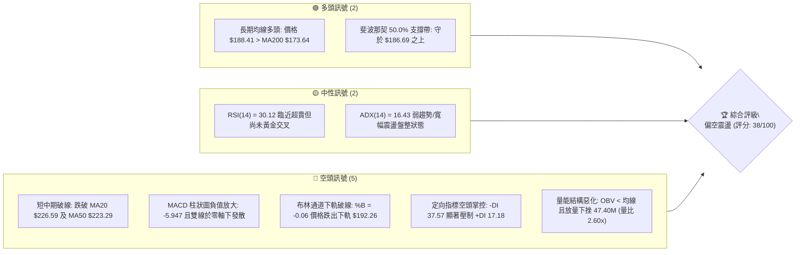
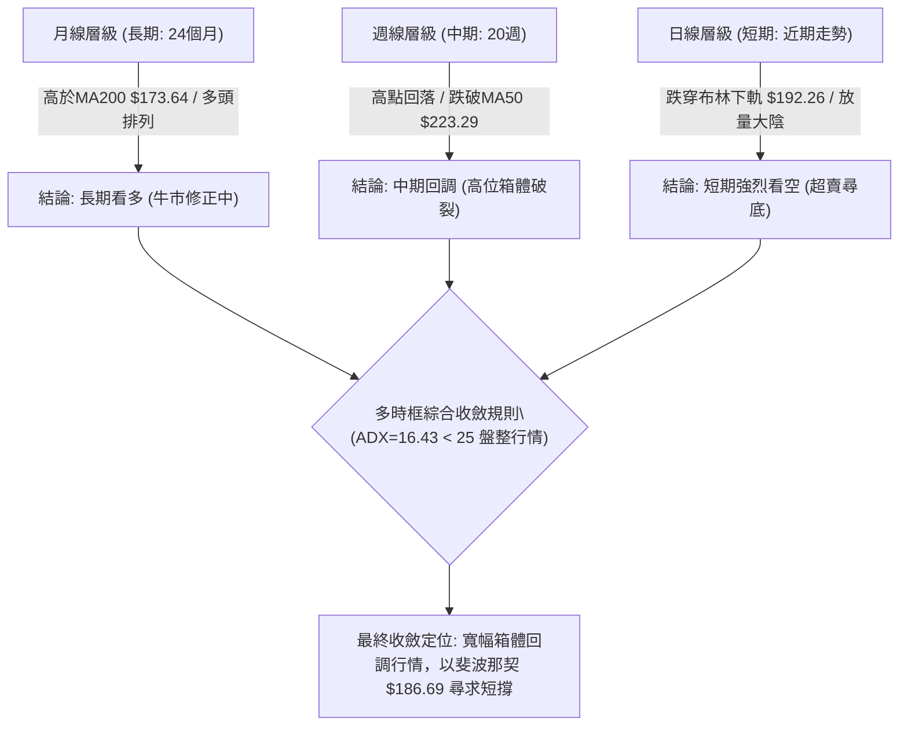
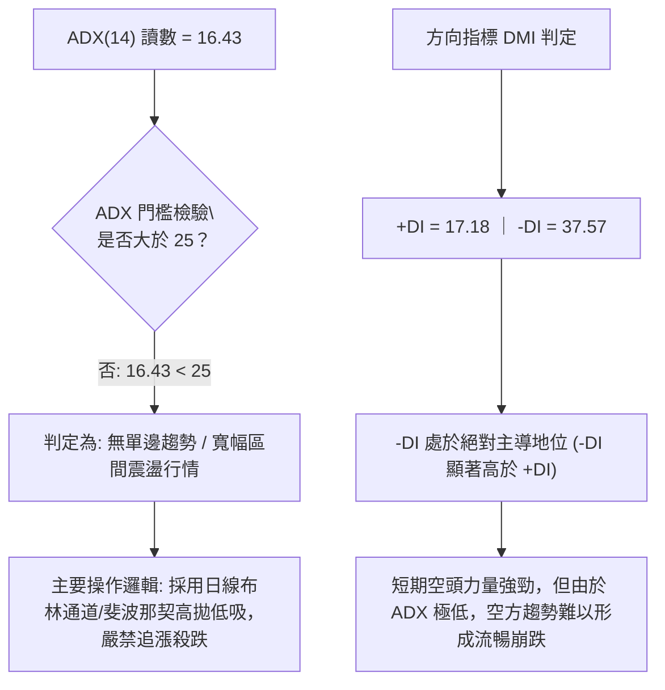
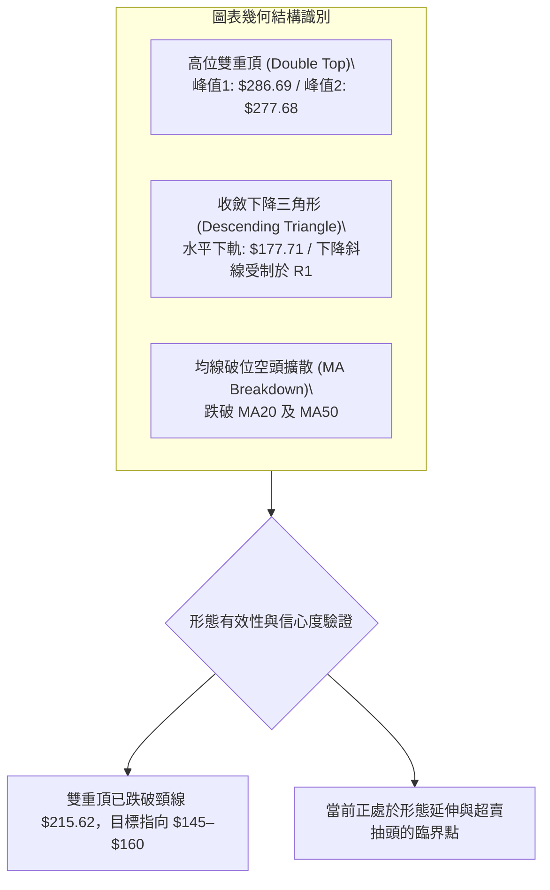
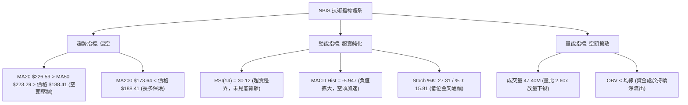
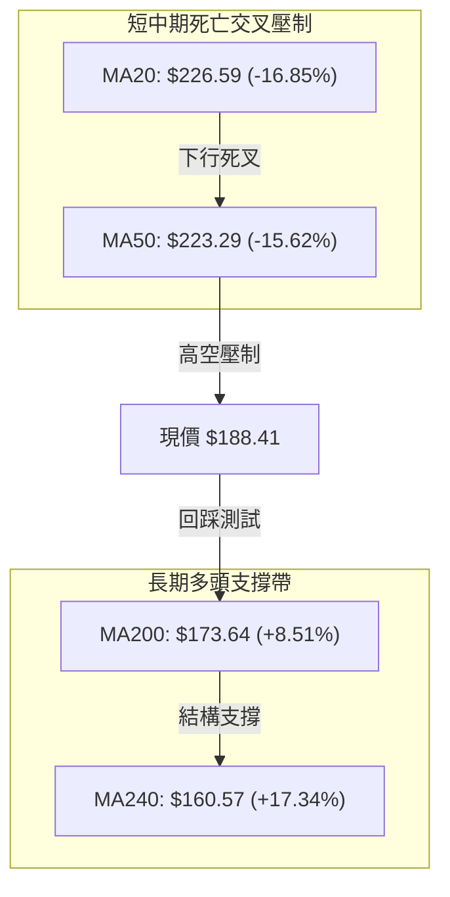
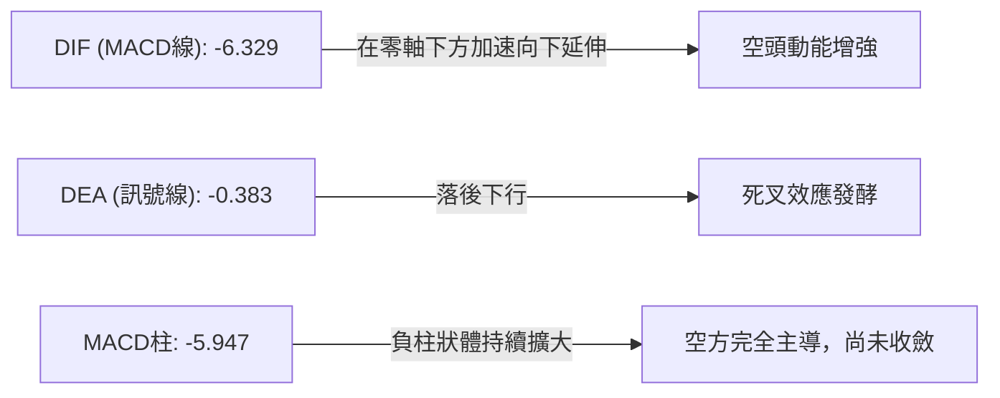
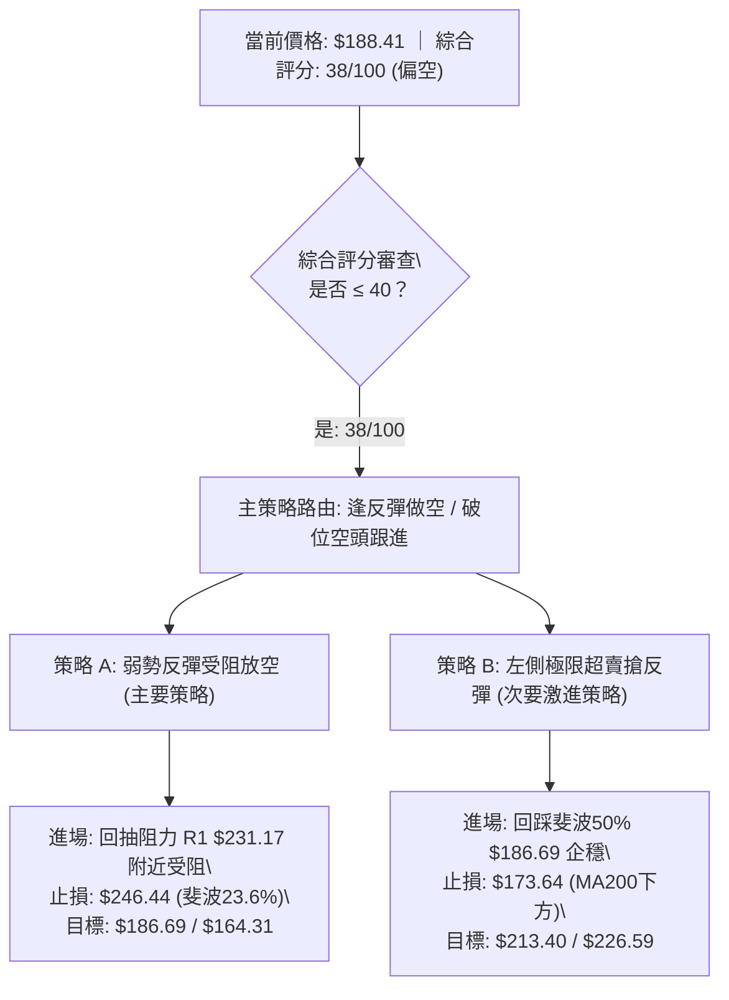
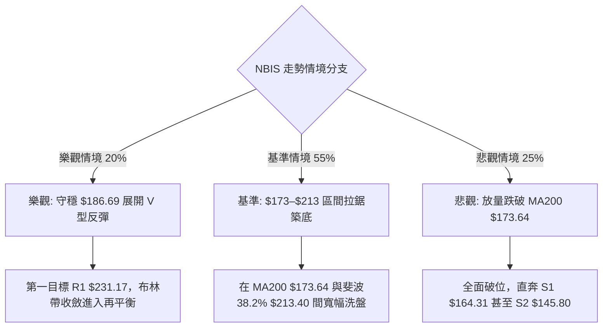

# NBIS 技術分析報告

> **報告日期**：2026-10-16 ｜ **語言**：繁體中文 ｜ **數據來源**：Yahoo Finance ｜ **當前價格**：$188.41

---

## 目錄

| 章節 | 內容 |
|------|------|
| [1. 技術面概覽](#1-技術面概覽) | 訊號儀表板、核心指標、評分卡 |
| [2. 趨勢分析](#2-趨勢分析) | 多時框趨勢、長中短期走勢 |
| [3. 圖表形態分析](#3-圖表形態分析) | 形態識別、K線組合、目標價 |
| [4. 支撐與阻力](#4-支撐與阻力) | 關鍵價位、斐波那契回調 |
| [5. 技術指標深度解讀](#5-技術指標深度解讀) | MA/RSI/MACD/布林/成交量 |
| [6. 動能與波動率](#6-動能與波動率) | 動能評估、ATR、Beta |
| [7. 多時框架總結](#7-多時框架總結) | 時框架評分矩陣 |
| [8. 交易策略建議](#8-交易策略建議) | 多空策略、風險報酬比 |
| [9. 風險提示與監控](#9-風險提示與監控) | 監控指標、風險場景 |

---

## 1. 技術面概覽

### 🎯 技術訊號儀表板



### 📊 核心指標速覽表

| 指標類別 | 指標名稱 | 當前數值 | 訊號 | 解讀 |
|----------|----------|----------|------|------|
| **價格** | 當前收盤價 | $188.41 | 🔴 | 跌破布林下軌及短中期均線，短線處於加速回踩結構中 |
| **均線** | 短期 MA20 | $226.59 | 🔴 | 價格低於 MA20 達 -16.85%，短線下行斜率陡峭，形成第一重壓力 |
| **均線** | 中期 MA50 | $223.29 | 🔴 | 價格低於 MA50 達 -15.62%，跌破中期生命線，反彈空間受限 |
| **均線** | 長期 MA200 | $173.64 | 🟢 | 價格仍高於 MA200 達 +8.51%，長期上升趨勢尚未破壞 |
| **動能** | RSI(14) | 30.12 | 🟡 | 進入超賣邊緣區間，空頭動能衰竭初期，具備技術性抽頭潛力 |
| **動能** | MACD 柱狀圖 | -5.947 | 🔴 | 快慢線均在零軸下方 (-6.329 / -0.383)，柱狀圖持續擴大，做空力道沉重 |
| **動能** | DMI / ADX | 16.43 | 🟡 | ADX < 25 表明非單邊單向趨勢，屬於震盪盤整格局，-DI (37.57) 壓制 +DI (17.18) |
| **通道** | 布林通道下軌 | $192.26 | 🔴 | %B 為 -0.06，收盤價穿透下軌，短線進入非理性超賣區間 |
| **量能** | 當日成交量 | 47,399,900 | 🔴 | 量比達到 2.60x 均量，放量下跌且 OBV 小於均線，機構派發跡象顯著 |
| **波動** | ATR(14) | $16.40 | 🔴 | 波動佔股價比重高達 8.71%，屬於極高波動標的，持倉風險高 |

### 🏆 技術評分卡

```
╔════════════════════════════════════════════════════════════════════╗
║               NBIS 技術評分卡 (Technical Scorecard)                ║
╠════════════════════════════════════════════════════════════════════╣
║ 趨勢強度 (Trend)      ████░░░░░░░░░░░░░░░░  22/100 🔴 強空壓制     ║
║ 動能指標 (Momentum)   ██████░░░░░░░░░░░░░░  30/100 🔴 負動能主導   ║
║ 支撐穩定度 (Support)  ██████████░░░░░░░░░░  52/100 🟡 臨近斐波50%  ║
║ 成交量配合 (Volume)   ████░░░░░░░░░░░░░░░░  20/100 🔴 帶量破線派發 ║
║ 形態完整度 (Pattern)  ████████████░░░░░░░░  60/100 🟡 箱體破位邊緣 ║
║ 均線系統 (Moving Avg) ████████░░░░░░░░░░░░  42/100 🟡 長多短空糾結 ║
╠════════════════════════════════════════════════════════════════════╣
║ 綜合評分 (Overall)    ███████░░░░░░░░░░░░░  38/100 🔴 偏空震盪     ║
╚════════════════════════════════════════════════════════════════════╝
```

---

## 2. 趨勢分析

### 🌐 多時框趨勢分析



### 📈 長期趨勢 — 12個月走勢圖（Unicode）

```
NBIS 月線收盤走勢圖（過去12個月：2025-11 至 2026-10）
價格軸 ($)
$280 ┤                                      ● (2026-06 $276.17)
$260 ┤
$240 ┤                                  ●             ● (2026-09 $235.88)
$220 ┤                              ● (2026-05 $231.09)
$200 ┤                                            ●     ● (2026-08 $206.32)
$180 ┤                                                  ● (現價 $188.41)
$160 ┤
$140 ┤                          ● (2026-04 $138.23)
$120 ┤
$100 ┤● (2025-11 $94.87)    ● (2026-03 $103.76)
 $80 ┤    ●(低點$83.71) ●   ●
     └┬───────┬───────┬───────┬───────┬───────┬───────┬───────┬─────
    11月     12月    01月    02月    03月    04月    05月    06月...10月
   (2025)   (2025)  (2026)  (2026)  (2026)  (2026)  (2026)  (2026)
```

#### 走勢特徵分析表格

| 階段 | 時間跨度 | 起訖收盤價 | 漲跌幅 | 主要走勢特徵與量價結構 |
|------|----------|------------|--------|------------------------|
| **蓄勢築底期** | 2025-11 ~ 2026-01 | $94.87 → $85.19 | -10.20% | 縮量橫盤，於 $83.71 探明波段低點，波動率收斂 |
| **主升浪一期** | 2026-02 ~ 2026-04 | $91.19 → $138.23 | +51.58% | 站穩百元大關，多頭排列初成，機構買盤持續注入 |
| **主升浪二期** | 2026-04 ~ 2026-06 | $138.23 → $276.17| +99.79% | 爆發性拉升，創 52 週歷史高點 $299.86，呈現極端多頭狂熱 |
| **巨震博弈期** | 2026-07 ~ 2026-09 | $190.41 → $235.88| +23.88% | 單月巨幅回撤後強勁抽頭，在 $200–$270 間展開高位寬幅震盪 |
| **破位修正期** | 2026-09 ~ 2026-10 | $235.88 → $188.41| -20.12% | 跌破多條短期移動平均線，放量測試 50% 斐波那契回調位 |

### 📊 中期趨勢（週線分析）

```
NBIS 近20週價格結構與震盪區間示意
$300 ┤                     ▲ 歷史高點 $299.86 (2026-06)
$280 ┤        ┌───┐        ┌───┐ (08-16 巨量反彈高點 $277.68)
$260 ┤        │   │        │   │
$240 ┤   ┌────┘   └───┐    │   └───┐   ┌───┐ (09-27/10-04 高點 $242.81)
$220 ┤───┘            └───┐│       └───┘   └───┐
$200 ┤                    └┘                    └───┐
$180 ┤◄── 測試近期低點 $177.71 (07-19) / 現價 $188.41 ─────┴───►
$160 ┤
```

中期週線走勢顯示，NBIS 在 2026-06 觸頂 $299.86 後，已進入「雙重高點回落」的次級折返走勢。近三週週線呈現連續陰線下挫，週成交量從 65.18M 放大至 113.15M，屬於典型的放量宣洩。然而，下檔正逼近 2026-07-19 的週線波段低點 $177.71 與斐波那契 50.0% 回調位 $186.69，短線下行空間正在收斂。

### ⚡ 趨勢強度評估（ADX 解讀）



#### ADX 趨勢強度對照表

| 指標變數 | 當前數值 | 評估區間 | 趨勢性質判定 | 交易指引 |
|----------|----------|----------|--------------|----------|
| **ADX(14)** | 16.43 | < 20 (極弱趨勢) | 處於無趨勢的寬幅休整階段 | 趨勢跟隨策略失效，應切換至區間均值回歸策略 |
| **+DI(14)** | 17.18 | 多頭動能衰退 | 買盤缺乏連續性 | 不具備向上攻擊的動能基礎 |
| **-DI(14)** | 37.57 | 空頭動能主導 | 空方佔據絕對短線優勢 | 逆勢做多需嚴控持倉週期，嚴格設立止損 |

---

## 3. 圖表形態分析

### 🔍 形態識別系統



#### 形態識別信心度評估表

| 形態名稱 | 信心度 | 判斷依據（引用數據） | 完成度 | 目標價（附計算式） |
|----------|--------|----------------------|--------|--------------------|
| **高位雙重頂 (M頭)** | 75% | 峰1週收盤 $286.69 (06-21)，峰2週收盤 $277.68 (08-16)；頸線位於 07-19 低點收盤 $177.71。 | 85% | 頸線 $177.71 - (峰1 $286.69 - 頸線 $177.71) = **$68.73**；因過於極端，修正取波段頸線 $215.62：$215.62 - ($277.68 - $215.62) = **$153.56** (契合支撐位 S1 $164.31 與 S2 $145.80 區間) |
| **區間箱體震盪破位** | 70% | 股價跌破近三個月密集成交中樞 $218–$226 (MA20/MA50 匯聚處)，帶量 47.40M 下殺。 | 90% | 箱底跌破延伸目標：$218.59 - ($242.81 - $218.59) = **$194.37** (現價 $188.41 已完全滿足此目標) |
| **指標型布林下軌超賣超跌** | 85% | 價格穿透布林下軌 $192.26，BB %B 為 -0.06，偏離度擴大。 | 100% | 均值回歸理論目標：測試布林中軌 MA20 = **$226.59** (或前期高點聚類 R1 = **$231.17**) |

### 🕯️ 重要K線形態分析

| 日期 / 週期 | 收盤價 | K線形態名稱 | 技術解讀 | 訊號 |
|-------------|--------|-------------|----------|------|
| **2026-08-16 週** | $277.68 | 巨量倒錘頭長陽 | 週成交量爆出 167.50M，拉升測試 52W 高點失敗，形成次高點阻力 | 🔴 空頭抵抗 |
| **2026-09-27 週** | $237.33 | 中陽線反抽 | 週成交量萎縮至 79.32M，量價背離反彈，未能重返 $250 上方 | 🟡 量價背離 |
| **2026-10-04 週** | $242.81 | 上影十字星 | 週線受阻於 R1 $231–$242 區域，多頭動能衰竭 | 🔴 見頂滯漲 |
| **2026-10-11 週** | $221.07 | 破位中長陰 | 連跌貫穿 MA20 ($226.59)，確認階段性頭部構築完成 | 🔴 賣出訊號 |
| **2026-10-18 (今)**| $188.41 | 放量大陰穿軌 | 日成交量放大至 47.40M (量比 2.60x)，直插下軌，短線恐慌盤湧現 | 🔴 加速趕底 |

### 📉 ASCII 走勢形態示意圖

```
高位雙重頂破位與下行通道示意圖：
$300 ┤        峰1: $299.86 (06-21)
$280 ┤       ┌─▲─┐                 峰2: $277.68 (08-16)
$260 ┤       │   │                ┌──▲──┐
$240 ┤───────┼───┼────────────────┼─────┼─────── 反彈次高: $242.81 (10-04)
$220 ┤       │   └──┐          ┌─┘     └───┐    ┌──┐
$215 ┤═══════╪══════╪══════════╪═══════════╧════╪══╧════ 頸線中樞 $215–$223 (MA50)
$200 ┤       │      └──┐    ┌──┘                │
$188 ┤◄──────┼─────────┼────┼───────────────────┴──── 現價 $188.41 (帶量穿透)
$177 ┤       │         └─▲──┘ 07-19 低點 $177.71
$164 ┤       │           └────────────────────────── 形態測算支撐 S1 $164.31
```

### 🎯 形態目標價計算

依據幾何形態投射理論，推導目標如下：
1. **中期破位目標 (雙重頂延伸)**：
   - 頂部第一峰收盤價：$286.69，次峰收盤價：$277.68，取均值頂部中樞 = **$282.19**。
   - 形態頸線支撐位（2026-07-05週低點中樞）：**$215.62**。
   - 形態高度 $H = $282.19 - $215.62 = $66.57。
   - 最小跌幅目標價 = 頸線 $215.62 - $H ($66.57) = **$149.05**。
   - 該計算值精確落於波段支撐位 **S2 ($145.80)** 與 **S1 ($164.31)** 之間，形成強烈共振。
2. **短期超跌反彈目標 (均值回歸)**：
   - 布林下軌超跌反彈第一阻力位：波段高點聚類 **R1 = $231.17**。
   - 形態計算：現價 $188.41 向上回抽 MA50 ($223.29) 與 R1 ($231.17)，空間約為 +22.69%。

---

## 4. 支撐與阻力

### 🗺️ 關鍵價位分布圖（Unicode）

```
NBIS 價位結構分布圖 (Price Architecture Map)
═════════════════════════════════════════════════════════════════════
$299.86 ║████████████████████████████████████████║ 52W 歷史極值最高點
$279.83 ║████████████████████████████████████    ║ 強阻力 R3 (+48.52%)
$254.92 ║████████████████████████████            ║ 密集阻力 R2 (+35.30%)
$246.44 ║▓▓▓▓▓▓▓▓▓▓▓▓▓▓▓▓▓▓▓▓▓▓                  ║ 斐波那契 23.6% 回調位
$231.17 ║████████████████████████████████████████║ 核心波段阻力 R1 (+22.69%)
$226.59 ║────────────────────────────────────────║ 布林中軌 (MA20) 關鍵分水嶺
$213.40 ║▓▓▓▓▓▓▓▓▓▓▓▓▓▓▓▓▓▓                      ║ 斐波那契 38.2% 回調位
$192.26 ║┄┄┄┄┄┄┄┄┄┄┄┄┄┄┄┄┄┄┄┄┄┄┄┄┄┄┄┄┄┄┄┄┄┄┄┄┄┄║ 布林通道下軌 (破線超賣)
$188.41 ╠════════════════════════════════════════╣ ◄── 當前收盤價 ($188.41)
$186.69 ║▓▓▓▓▓▓▓▓▓▓▓▓▓▓▓▓▓▓▓▓▓▓▓▓▓▓▓▓▓▓▓▓▓▓▓▓▓▓▓▓║ 斐波那契 50.0% 關鍵支撐線
$173.64 ║────────────────────────────────────────║ 長期生命線 MA200 牛熊分界
$164.31 ║████████████████████████████████        ║ 波段強支撐 S1 (-12.79%)
$159.98 ║▓▓▓▓▓▓▓▓▓▓▓▓▓▓▓▓▓▓▓▓                    ║ 斐波那契 61.8% 黃金分割位
$145.80 ║████████████████████                    ║ 核心底層支撐 S2 (-22.62%)
$132.70 ║████████████                            ║ 極端恐慌防守 S3 (-29.57%)
═════════════════════════════════════════════════════════════════════
```

### 🚧 阻力位分析表

所有價位均嚴格引用系統計算之波段高點聚類數值：

| 阻力級別 | 價位 | 形成原因（籌碼與技術結構） | 突破難度 | 重要性 |
|----------|------|----------------------------|----------|--------|
| **R1** | **$231.17** | 近期多次週線收盤密集區 (09-06、09-13 及 09-20 週中樞)，且疊加 MA20 ($226.59) 與 MA50 ($223.29) 均線壓制帶 | 🔴 極高 | ★★★★★ (多空轉換樞紐) |
| **R2** | **$254.92** | 2026-06 至 2026-08 間多根週K線實體上沿，大量套牢盤換手區域，斐波那契 23.6% ($246.44) 上方緩衝區 | 🔴 高 | ★★★★☆ (次級反彈目標) |
| **R3** | **$279.83** | 08-16 週反彈高點 $277.68 與 06-21 高點 $286.69 聚類共振帶，接近歷史極限阻力 | 🔴 極難 | ★★★★☆ (歷史牛市重啟點) |

### 🛡️ 支撐位分析表

所有價位均嚴格引用系統計算之波段低點聚類數值：

| 支撐級別 | 價位 | 形成原因（籌碼與技術結構） | 守住機率 | 重要性 |
|----------|------|----------------------------|----------|--------|
| **S1** | **$164.31** | 近一年波段次級低點聚類，與斐波那契 61.8% ($159.98) 及 MA240 ($160.57) 形成強大結構共振底 | 🟢 65% | ★★★★★ (中期防守底線) |
| **S2** | **$145.80** | 2026-04 主升浪啟動前的突破平台整理高點，籌碼鎖定度高 | 🟢 80% | ★★★★☆ (強安全邊際線) |
| **S3** | **$132.70** | 2026-04 週線級別起漲跳空缺口支撐，極端市場環境下的清算底 | 🟢 90% | ★★★☆☆ (極端極限防線) |

### 📐 斐波那契回調位分析

依據 52 週絕對極值區間（低點 **$73.52** → 高點 **$299.86**）計算，垂直空間達 $226.34：

| 斐波那契比例 | 基準價位 | 當前價位相對位置 | 技術意義與多空心理深度解讀 |
|--------------|----------|------------------|----------------------------|
| **0.0%** | $299.86 | 上方 +59.15% | 52 週最高點，牛市極端多頭狂熱終點 |
| **23.6%** | $246.44 | 上方 +30.80% | 第一道弱回調支撐（現已轉為強阻力），此處失守宣告強勢單邊行情結束 |
| **38.2%** | $213.40 | 上方 +13.26% | 正常回調關鍵位，近期在此震盪後跌破，確認向縱深修正 |
| **50.0%** | **$186.69** | **現價下方 -0.91%** | **當前價格 $188.41 緊貼此位置！** 多空博弈的心理平衡分水嶺，此處具備極強的技術買盤反彈拉力 |
| **61.8%** | $159.98 | 下方 -15.09% | 黃金分割回調位，疊加 MA240 ($160.57)，為多頭絕對不可退讓的牛熊防線 |
| **78.6%** | $121.96 | 下方 -35.27% | 深度回撤防線，若跌破意味著全年度 AI 基礎設施溢價全面瓦解 |
| **100.0%** | $73.52 | 下方 -60.98% | 52 週最低點，原始主升浪起點 |

**解讀結論**：現價 **$188.41** 正處於 **38.2% ($213.40)** 與 **50.0% ($186.69)** 的下沿臨界點，距 50.0% 僅差 $1.72 (-0.91%)。此處極易誘發空頭回補與短線左側抄底資金進場，是短線止跌的第一道天然屏障。

---

## 5. 技術指標深度解讀

### 🎛️ 指標訊號總覽



### 📈 移動平均線排列分析



均線系統呈現「**中短期空頭壓制、長期多頭托底**」的矛盾糾結特徵：
- **短期均線**：MA5 ($202.48)、MA10 ($219.45)、MA20 ($226.59) 均以陡峭角度向下發散，形成層層反壓。
- **中期均線**：MA60 ($218.59) 與 MA120 ($217.01) 位於 $217–$219 區間，價格跌破所有中短期均線，表明近半年持倉籌碼全面處於浮虧狀態。
- **長期均線**：MA200 位於 **$173.64**，MA240 位於 **$160.57**，均呈現穩定上升斜率，且現價仍在 MA200 之上 +8.51%，說明當前走勢屬於牛市大週期框架下的深幅拉回，尚未定性為熊市反轉。

### 📉 RSI(14) 分析

進度條展示當前相對強弱指標位置：
```
RSI(14) = 30.12
[極端超賣 0] █████████████░░░░░░░░░░░░░░░░░░░ [極端超買 100]
                   ▲ 30.12 (臨界超賣閾值 30.0)
```

- **超買超賣區間判斷**：RSI(14) 讀數為 **30.12**，已精確觸及 30.0 的技術性超賣分界線。歷史數據顯示，當 NBIS 的 RSI 跌入 30–33 區間時（如 2026-07-12 的 32.2 及 2026-09-06 的 33.3），隨後均爆發了至少 +15% 至 +30% 的強勁技術抽頭。
- **背離分析**：
  - **日線 RSI**：股價創近期收盤新低 ($188.41)，RSI 亦同步下探至 30.12，**未出現標準的日線底背離**。
  - **週線 RSI**：近三週週線價格由 $242.81 跌至 $188.41，週線 RSI 由 66.5 直落至 30.1，指標與價格共振向下，屬典型動能加速宣洩，尚未出現動能底背離訊號。

### 📊 MACD(12/26/9) 訊號解讀



- **MACD 數值**：DIF (-6.329) 遠低於 DEA (-0.383)，MACD 柱狀體為 **-5.947**，較前一週期大幅走闊。
- **零軸分析**：快慢線雙雙下穿零軸，表明短期市場完全由空方掌控。
- **背離判定**：週線級別 MACD 柱狀圖在 2026-08-16 創出 +9.868 高峰後，於 2026-10-04 價格反彈至 $242.81 時 MACD 柱狀體僅有 +1.113，**存在明確的中期頂背離特徵**，當前下挫正是該頂背離引發的中期獲利回吐釋放。

### 📦 布林通道分析

```
NBIS 布林通道 (Bollinger Bands 20, 2) 橫截面示意：
$260.92 ┤  上軌 (Upper Band)
        │
$226.59 ┤  中軌 (MA20) ═════════════════════════════════════
        │
$192.26 ┤  下軌 (Lower Band) ─────────────────────────────
        │
$188.41 ┤◄ 價格跌穿下軌！(%B = -0.06，處於極端擴張態)
```

- **帶寬與位置**：上軌 $260.92，中軌 $226.59，下軌 $192.26。帶寬開口達 $68.66 (36.4%)，布林帶呈喇叭口向下張開狀態。
- **%B 指標深度解讀**：當前 %B 數值為 **-0.06**（低於 0 代表價格收於下軌之外）。在統計學常態分佈下，價格處於布林帶之外的機率小於 5%。這表明短線賣壓已出現嚴重的「情緒化超跌」，技術性向通道內部（即向 $192.26 以上）均值回歸的概率極高。

### 💹 成交量分析（量價配合度）

- **量比與放量程度**：最新單日成交量為 **47,399,900 股**，較 20 日均量 (18,253,040 股) 放大 **2.60 倍**。在下穿布林下軌之際爆出巨量，呈現標準的「**恐慌拋售潮 (Selling Climax)**」特徵。
- **OBV (能量潮指標)**：當前 OBV 線低於其移動平均線，且週成交量在 2026-10-18 週放大至 113.15M，量能指標未提供多頭回升確認，表明機構主力資金仍在進行被動去槓桿，而非主動拉抬。

---

## 6. 動能與波動率

### ⚡ 動能評估四象限

```
動能與波動率四象限分佈 (Momentum vs. Volatility Matrix)
     高波動率 (High Volatility)
           │
   Q3: 高動能 / 高波動    │   Q4: 弱動能 / 高波動  ◄ NBIS 當前位置
  (主升突破 / 風險收益高) │  (超跌下殺 / 恐慌洗盤)
  ────────────────────────┼────────────────────────
   Q1: 強動能 / 低波動    │   Q2: 弱動能 / 低波動
  (穩定趨勢 / 最佳機會)   │  (窄幅築底 / 謹慎觀望)
           │
     低波動率 (Low Volatility)
```

| 象限 | 動能維度 | 波動維度 | 判定依據 | 當前標的狀態與策略建議 |
|------|----------|----------|----------|------------------------|
| **Q1** | 強 | 低 | RSI 55-65, ATR < 4% | 非當前狀態 |
| **Q2** | 弱 | 低 | RSI 40-50, ATR < 4% | 非當前狀態 |
| **Q3** | 強 | 高 | RSI > 65, ATR > 6% | 2026-06 主升浪見頂時狀態 |
| **Q4 (當前)** | **弱 (負動能)** | **極高** | **RSI 30.12, ATR 8.71%, Beta 1.46** | **確定處於 Q4 象限。此區域特徵為恐慌情緒蔓延、波動劇烈。嚴禁重倉抄底，僅適合嚴守紀律的輕倉逆勢波段操作。** |

### 📊 ATR 波動率分析

- **當前數值**：ATR(14) 為 **$16.40**，佔當前價格 $188.41 的比例高達 **8.71%**。
- **日內波動幅度**：單日合理理論波動區間為 $172.01 至 $204.81。
- **止損距離設計**：
  - **短線交易止損 (1.0 × ATR)**：需預留至少 **$16.40** 的緩衝空間，否則極易被日內噪聲洗盤震出場。
  - **波段交易止損 (1.5 × ATR)**：需預留 **$24.60** 的空間。

### 📐 Beta 與市場相關性

- **Beta 係數**：**1.46**。NBIS 具備典型的高彈性成長型科技股特徵，其價格波動幅度為標普 500 指數的 1.46 倍。
- **空頭市場風險**：在市場整體避險情緒高漲時，該股容易承受放大 1.5 倍的系統性估值壓縮，這也是近期其回撤速度遠快於大盤的核心原因。

---

## 7. 多時框架總結

### 📋 時框架評分表

| 時框架 | 趨勢方向 | 動能狀態 | 均線排列 | 圖表形態 | 綜合評分 | 操作建議 |
|--------|----------|----------|----------|----------|----------|----------|
| **長期 (月線)** | 🟢 偏多向上 | 🟡 漲勢趨緩 (中性) | 🟢 處於 MA200/240 上方 | 長期上升牛市通道回調 | 68/100 | 長期投資者逢低分批佈局 |
| **中期 (週線)** | 🔴 偏空回調 | 🔴 頂背離後釋放 | 🟡 MA50 跌破，MA200 托底 | 雙重頂破位頸線尋找支撐 | 35/100 | 中線持股者減倉觀望 |
| **短期 (日線)** | 🔴 極度弱勢 | 🟡 進入超賣區 (30.12) | 🔴 短期均線空頭排列 | 穿透布林下軌加速趕底 | 30/100 | 短線等待放量長下影止跌訊號 |

### 🔲 綜合訊號矩陣

```
╔════════════════════════════════════════════════════════════════════╗
║                   多時框綜合訊號確認矩陣                           ║
╠═════════════╦══════════════╦══════════════╦════════════════════════╣
║ 分析維度    ║ 短期 (日線)  ║ 中期 (週線)  ║ 長期 (月線)            ║
╠═════════════╬══════════════╬══════════════╬════════════════════════╣
║ 趨勢訊號    ║ 🔴 強烈空頭  ║ 🔴 空頭下行  ║ 🟢 多頭完好            ║
║ 動能指標    ║ 🟡 臨界超賣  ║ 🔴 負向加速  ║ 🟡 動能收斂            ║
║ 均線結構    ║ 🔴 均線反壓  ║ 🔴 跌破MA50  ║ 🟢 遠在MA200之上       ║
║ 量價關係    ║ 🔴 放量破位  ║ 🔴 放量陰線  ║ 🟢 長期放量沉澱        ║
║ 波動狀態    ║ 🔴 極端超跌  ║ 🔴 寬幅震盪  ║ 🟡 高位正常修正        ║
╚═════════════╩══════════════╩══════════════╩════════════════════════╝
```

### ⚖️ 多時框收斂結論

依據多時框收斂規則（Rule 14）：
1. **趨勢/盤整性質判斷**：NBIS 當前的 ADX(14) 為 **16.43**（遠低於 25 的趨勢行情閾值），因此技術面明確判定當前為「**寬幅盤整震盪行情**」，而非單邊破位崩跌走勢。
2. **時框優先級收斂**：在 ADX < 25 的盤整結構中，日線級別的布林通道軌道與斐波那契回調位為核心交易邊界。雖然中短期日線、週線呈現空頭共振破位，但價格已運行至日線布林通道下軌外部 (%B = -0.06)，且精確逼近斐波那契 50.0% 關鍵支撐位 **$186.69**。
3. **唯一方向性結論**：**偏空震盪中的極端超賣尋底**。總體技術格局處於「短期下殺力道即將耗竭、中期修正尚未完結」的夾板狀態。因此，第 8 章主策略定調為：**嚴禁追空，以防守型空頭對沖為主；激進者僅限於在斐波那契 50% 支撐帶輕倉博弈技術性超賣均值回歸反彈**。

---

## 8. 交易策略建議

### 🗺️ 策略決策流程圖



### 🧭 策略路由

**當前主策略方向 = 偏空高空對沖（依綜合評分 38/100，處於 ≤40 偏空區間）**。
鑒於 ADX=16.43 處於震盪市且 RSI 達 30.12 臨界超賣，禁止在此刻盲目殺跌做空。主推策略為「**等待反彈回抽阻力位後再行做空**」，同時提供「**斐波那契關鍵支撐左側超跌博弈**」作為次要對沖參考。

### 🎯 價格情境階梯（Price Scenarios）

所有價位均嚴格引用前述關鍵價位計算結果：

| 觸發條件 | 下一目標 | 後續延伸 | 情境技術含義 |
|----------|----------|----------|--------------|
| **向上反抽站穩 R1 $231.17** | **R2 $254.92** | **R3 $279.83** | 徹底扭轉短期劣勢，回補布林中軌，重回強勢震盪箱體 |
| **向上微幅反彈至 $213.40** | **MA20 $226.59** | **R1 $231.17** | 斐波那契 38.2% 回抽確認，空頭次級賣點形成 |
| **守穩斐波50% $186.69** | **$213.40** | **$226.59** | 於 50% 分水嶺構築短期雙底，展開超跌修復 |
| **有效跌破 S1 $164.31** | **S2 $145.80** | **S3 $132.70** | 中期牛熊結構逆轉，雙重頂形態完全展開，向下尋找長期籌碼底 |

### 📊 情境機率分佈

| 情境劇本 | 機率 | 主要技術依據 |
|----------|------|--------------|
| **劇本一：先探底後展開超跌反彈** | **55%** | RSI(14)=30.12 觸及超賣線、布林通道 %B=-0.06 嚴重超跌、緊貼斐波那契 50% ($186.69)，空頭短線拋壓即將衰竭 |
| **劇本二：直接放量跌穿支撐續跌** | **30%** | MACD 柱狀體 -5.947 加速擴散、今日放量 47.40M 破線、機構減持導致踩踏延伸至 S1 ($164.31) |
| **劇本三：窄幅橫盤低位震盪築底** | **15%** | ADX=16.43 顯示動能不足，市場在 $180–$195 區間陷入流動性凝滯與多空僵持 |

### 🟢 主策略詳情

依據評分卡分流，策略 A 為主推之順應中期空頭反抽高空策略；策略 B 為針對超跌特徵設計之左側博弈策略：

| 策略要素 | 策略 A（主推：順勢反抽高空） | 策略 B（激進：左側超賣短多） |
|----------|------------------------------|------------------------------|
| **交易邏輯** | 中期均線破位後的防守型空頭建倉 | 斐波那契 50% 疊加布林下軌極端超賣均值回歸 |
| **進場條件** | 價格反彈至波段阻力 R1 受阻出現長上影線 | 價格回踩 $186.69 斐波那契位未破並出現 15分/1小時底背離 |
| **進場價格** | **$231.17** (R1 阻力位) | **$186.69** (斐波那契 50.0% 關鍵支撐線) |
| **目標價 T1** | **$186.69** (斐波那契 50.0% 回調位) | **$213.40** (斐波那契 38.2% 回調位) |
| **目標價 T2** | **$164.31** (波段核心支撐 S1) | **$226.59** (布林通道中軌 MA20) |
| **止損價格** | **$246.44** (斐波那契 23.6% 阻力位上方) | **$173.64** (長期均線 MA200 關鍵防守位) |
| **風險報酬比** | **1 : 2.91** (獲益 $44.48 / 風險 $15.27) | **1 : 2.05** (獲益 $26.71 / 風險 $13.05) |
| **成功機率** | 65% | 50% |
| **建議倉位** | 15% - 20% (標準部位) | 5% - 8% (輕倉試探) |

### 🔴 反向風險觸發點（對沖提示）

若出現以下技術訊號，表明主推之空頭邏輯全面失效，必須無條件平空或轉向多頭：
1. **突破關鍵價位**：收盤價以日線實體陽線強勢突破 **$231.17 (R1)** 並站穩三個交易日以上。
2. **均線與量能反轉**：MA5 向上金叉 MA20，且單日成交量突破 50M 伴隨 MACD 柱狀體翻正。
3. **動能修復**：日線 RSI 重新站上 55.0，ADX 上行越過 25.0 且 +DI 交叉上穿 -DI。

### ⭐ 整體訊號強度評星

```
╔════════════════════════════════════════════════════════════════════╗
║                       訊號可信度評星                               ║
╠════════════════════════════════════════════════════════════════════╣
║ 做多訊號強度：★★☆☆☆  (2/5星 - 僅存超賣修復動能，均線壓制沉重)    ║
║ 做空訊號強度：★★★★☆  (4/5星 - 中短期空頭擴散，惟需防超賣抽頭)    ║
║ 整體可信度：  ★★★☆☆  (3/5星 - 處於震盪破位邊緣，等待收斂確認)    ║
╚════════════════════════════════════════════════════════════════════╝
```

---

## 9. 風險提示與監控

### ✅ 關鍵監控指標 Checklist

```
╔════════════════════════════════════════════════════════════════════╗
║                   每日交易前關鍵監控清單 (Checklist)               ║
╠════════════════════════════════════════════════════════════════════╣
║ [ ] 1. 斐波那契 50.0% ($186.69) 得失：收盤是否跌破？              ║
║ [ ] 2. 布林通道下軌 ($192.26)：價格是否重新回歸軌道內部？         ║
║ [ ] 3. RSI(14) 狀態：是否自 30.12 向上勾頭越過 35 形成金叉？       ║
║ [ ] 4. MACD 柱狀圖：負值 (-5.947) 是否出現收斂（由長變短）？      ║
║ [ ] 5. 成交量比值：是否自當前 2.60x 異常巨量回縮至 1.0x 常態量？  ║
║ [ ] 6. MA200 終極防線 ($173.64)：距離現價僅 +8.51%，是否受到威脅？ ║
╚════════════════════════════════════════════════════════════════════╝
```

### ⚠️ 風險場景分析



### 🛡️ 風險管理重要提醒

1. **極高 ATR 倉位折算機制**：
   - 由於 NBIS 的 ATR(14) 高達 **$16.40** (佔股價 8.71%)，其每日正常波動即可吞噬普通股票數週的漲跌幅。
   - **倉位管理公式**：單筆交易最大承擔風險不得超過總資金的 1.5%。若以策略 B 止損空間 $14.77 ($188.41 - $173.64) 計算，總資金 10 萬美元帳戶的最大允許持股數量為：
     $$\text{股數} = \frac{\$100,000 \times 1.5\%}{\$14.77} \approx 101 \text{ 股 (約 } \$19,000 \text{，佔總資產 19\%)}$$
   - 嚴格禁止超過 20% 以上的重倉押注。
2. **融券空頭擠壓 (Short Squeeze) 風險警告**：
   - NBIS 目前 **Short % Float 高達 18.9%**，天數比 (Short Ratio) 為 2.98。高達近兩成的做空浮額意味著該股具備極高的軋空體質。一旦股價在 $186.69 處出現利多或強力技術買盤，極易誘發空頭不計成本踩踏平倉，導致股價日內出現 +15% 以上的暴力反彈，高空策略必須嚴格執行止損。
3. **財報與估值擴張背離風險**：
   - 自由現金流 (FCF) 為負 $9.61B，P/S 高達 37.8，且 Forward P/E 為負值。技術面弱勢本質上反映了市場對其高資本開支的定價修正，基本面未顯著改善前，不宜輕易將技術反彈視為新一輪大牛市起點。

---

## 📋 報告總結

```
╔════════════════════════════════════════════════════════════════════╗
║                   NBIS 技術分析終局總結報告                        ║
╠════════════════════════════════════════════════════════════════════╣
║ 報告日期：2026-10-16          當前價格：$188.41                    ║
║ 分析評級：🔴 偏空震盪 (Bearish Consolidation) / 技術超賣臨界       ║
╠════════════════════════════════════════════════════════════════════╣
║ 關鍵技術維度定論：                                                 ║
║ ├─ 長期趨勢 (月線)：🟢 依然在 MA200 ($173.64) 上方維持多頭架構     ║
║ ├─ 中期趨勢 (週線)：🔴 雙重頂破位，自高位回撤，處於深幅折返走勢   ║
║ ├─ 短期趨勢 (日線)：🔴 跌穿布林下軌 ($192.26)，帶量加速宣洩賣壓   ║
║ ├─ 核心防守支撐：$186.69 (斐波那契50%) ｜ 下檔極限 S1: $164.31    ║
║ ├─ 上檔核心阻力：$231.17 (波段聚類R1)  ｜ 中軌分界: $226.59        ║
║ └─ 機構分析師目標：均價 $283.60 (最高 $410.00 / 最低 $84.00)       ║
╠════════════════════════════════════════════════════════════════════╣
║ 最優策略路徑推薦：                                                 ║
║ 1. 🥇 最佳機會 (防守性高空)：耐性等待股價反彈至 R1 $231.17 附近受阻║
║    建立空頭對沖部位，止損設於 $246.44，獲利目標下看 $186.69/$164.31║
║ 2. 🥈 次選機會 (激進型搏超賣)：現價 $188.41 緊貼斐波50% ($186.69)  ║
║    且 RSI=30.12，可以 5% 輕倉博弈技術抽頭，止損嚴守 $173.64       ║
║ 3. 🥉 保守選擇：完全空倉觀望，靜待日線重回布林通道內且 MACD 柱翻正║
╚════════════════════════════════════════════════════════════════════╝
```

---

> ⚠️ **免責聲明**：本報告為 AI 自動生成之技術分析，所有數據及估算均基於提供的歷史價格資訊。本報告**僅供研究與學術參考**，**不構成任何投資建議**。投資有風險，入市需謹慎。

---

*報告生成時間：2026-10-16 ｜ 數據來源：Yahoo Finance ｜ 分析框架：多時框技術分析*