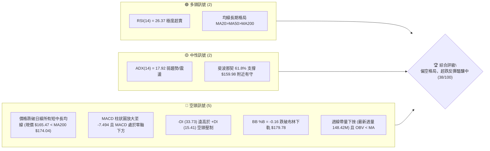
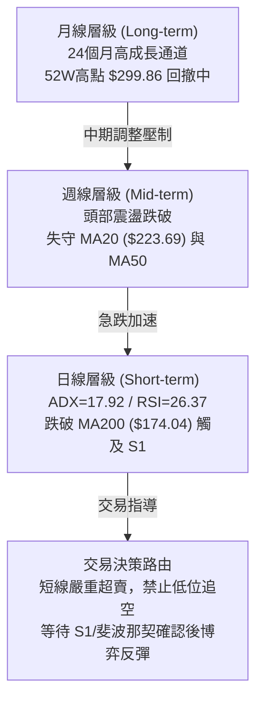
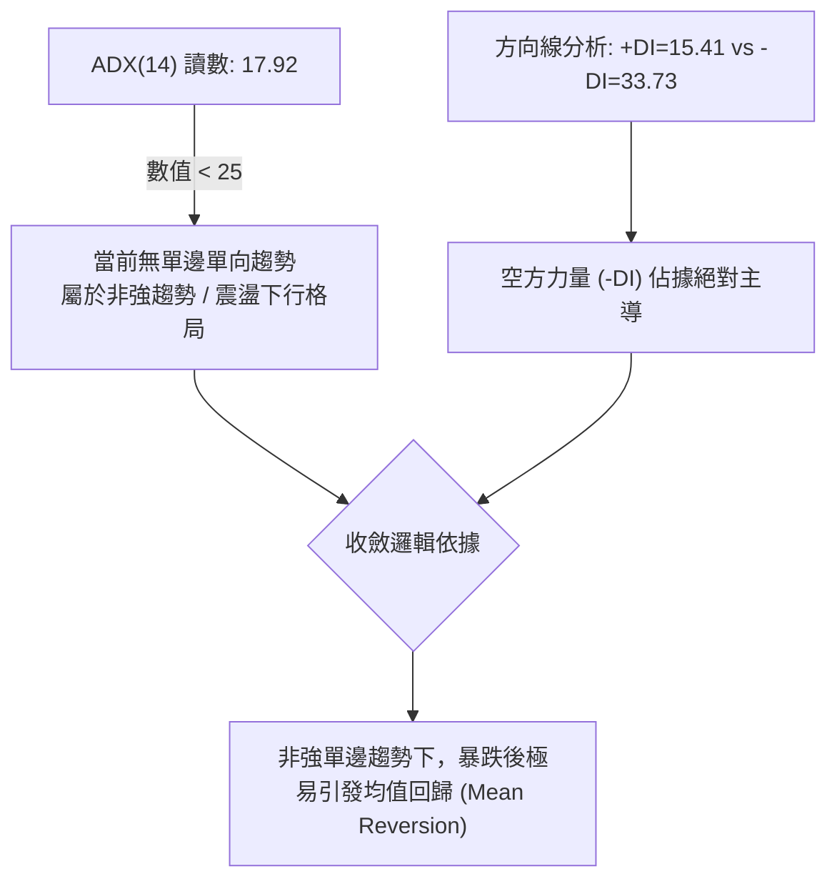
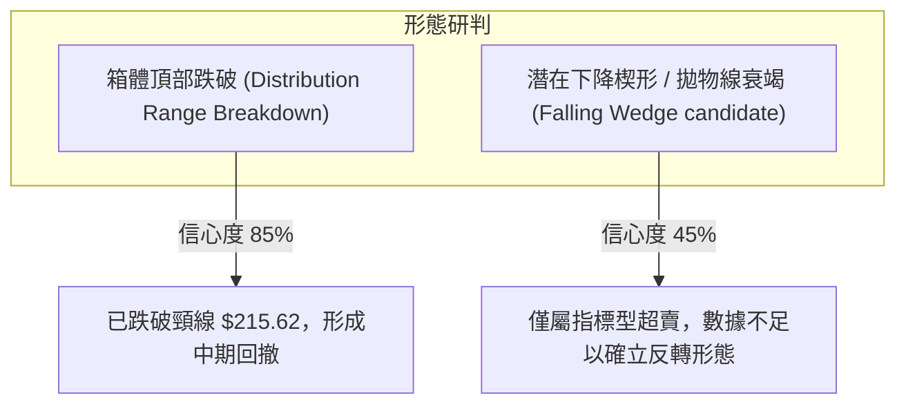
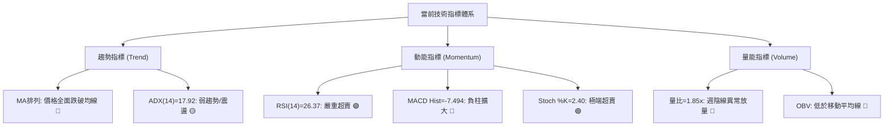
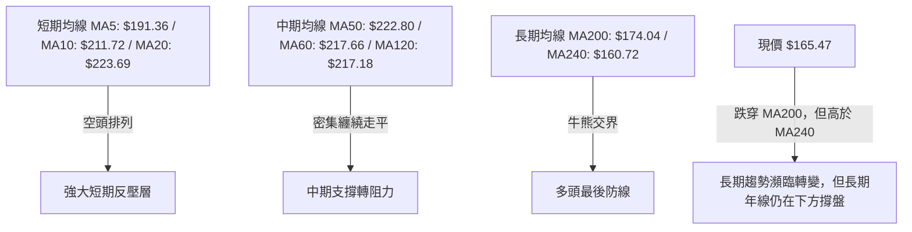
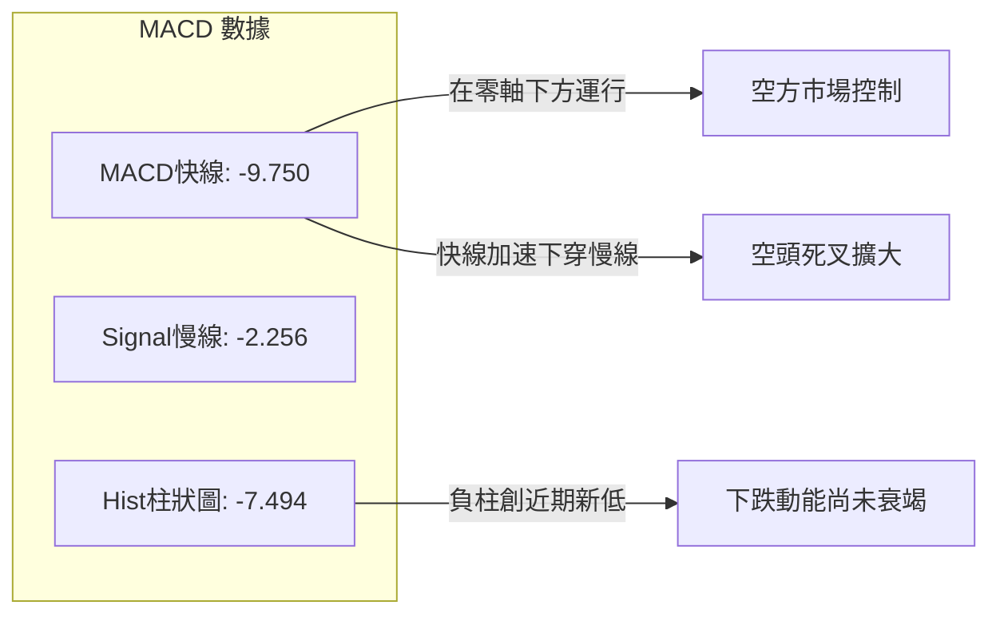
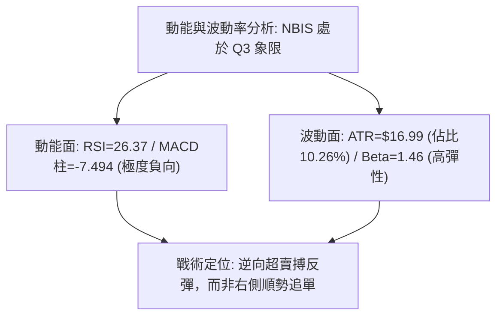
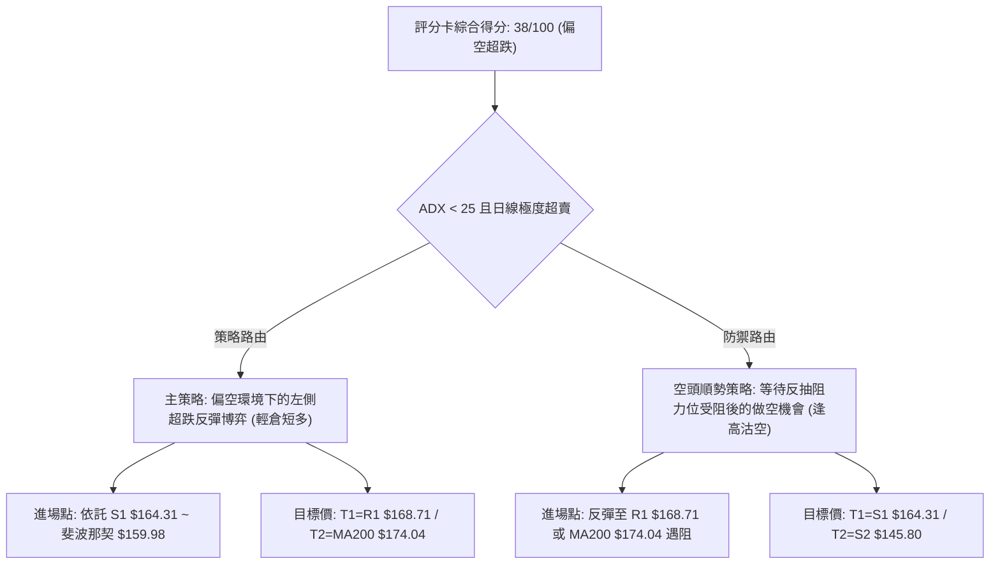
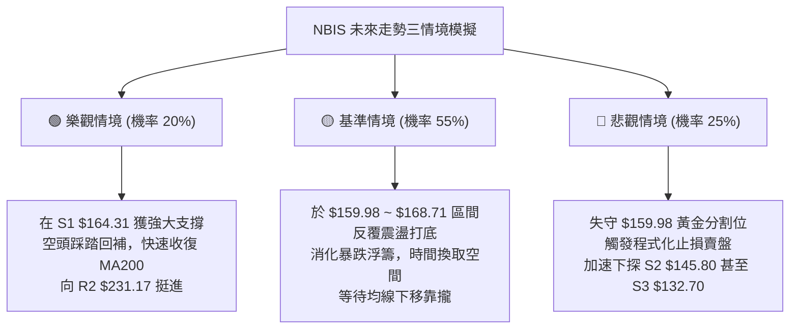

# NBIS 技術分析報告

> **報告日期**：2026-10-17 ｜ **語言**：繁體中文 ｜ **數據來源**：Yahoo Finance ｜ **當前價格**：$165.47

---

## 目錄

| 章節 | 內容 |
|------|------|
| [1. 技術面概覽](#1-技術面概覽) | 訊號儀表板、核心指標、評分卡 |
| [2. 趨勢分析](#2-趨勢分析) | 多時框趨勢、長中短期走勢 |
| [3. 圖表形態分析](#3-圖表形態分析) | 形態識別、K線組合、目標價 |
| [4. 支撐與阻力](#4-支撐與阻力) | 關鍵價位、斐波那契回調 |
| [5. 技術指標深度解讀](#5-技術指標深度解讀) | MA/RSI/MACD/布林/成交量 |
| [6. 動能與波動率](#6-動能與波動率) | 動能評估、ATR、Beta |
| [7. 多時框架總結](#7-多時框架總結) | 時框架評分矩陣 |
| [8. 交易策略建議](#8-交易策略建議) | 多空策略、風險報酬比 |
| [9. 風險提示與監控](#9-風險提示與監控) | 監控指標、風險場景 |

---

## 1. 技術面概覽

### 🎯 技術訊號儀表板



### 📊 核心指標速覽表

| 指標類別 | 指標名稱 | 當前數值 | 訊號 | 解讀 |
|----------|----------|----------|------|------|
| **價格** | 當前價格 | $165.47 | 🔴 | 位於 52 週區間 40.6% 分位，處於短線重挫破位狀態 |
| **均線** | MA20 | $223.69 | 🔴 | 現價低於 MA20 達 -26.03%，短線嚴重負乖離 |
| **均線** | MA50 | $222.80 | 🔴 | 現價低於 MA50，中期上升趨勢遭到嚴重破壞 |
| **均線** | MA200 | $174.04 | 🔴 | 跌破牛熊分界線 MA200 (-4.92%)，多頭長期防線受考驗 |
| **動能** | RSI(14) | 26.37 | 🟢 | 進入極度超賣區（<30），隨時可能出現技術性修正反彈 |
| **動能** | MACD | -9.750 | 🔴 | MACD 與 Signal (-2.256) 雙線在零軸下發散，動能偏空 |
| **動能** | Stoch %K/%D | 2.40 / 11.24 | 🟢 | 隨機指標進入個位數極端超賣，短線拋壓消耗殆盡 |
| **波動** | ATR(14) | $16.99 | 🔴 | 每日波動佔價格 10.26%，屬於極高波動性標的 |
| **趨勢** | ADX(14) | 17.92 | 🟡 | ADX < 25 表明非單邊趨勢行情，但 -DI 壓制呈現空頭主導 |
| **量能** | 20日量比 | 1.85x | 🔴 | 單日成交量 34.96M 伴隨週跌破放量，空頭洗盤或出貨加劇 |

### 🏆 技術評分卡

```
╔══════════════════════════════════════════════════════════════╗
║               技術評分卡 — NBIS (2026-10-17)                  ║
╠══════════════════════════════════════════════════════════════╣
║ 趨勢強度      ██████░░░░░░░░░░░░░░  30/100  🔴 空頭壓制中     ║
║ 動能指標      ████████░░░░░░░░░░░░  40/100  🟡 超賣醞釀反彈   ║
║ 支撐穩定度    ████████░░░░░░░░░░░░  40/100  🟡 臨近 S1/$164.31║
║ 成交量配合    ██████░░░░░░░░░░░░░░  30/100  🔴 放量下挫量能差 ║
║ 形態完整度    ██████████░░░░░░░░░░  50/100  🟡 頂部跌破測支撐 ║
║ 均線排列      ████████░░░░░░░░░░░░  40/100  🔴 價格全面破線   ║
╠══════════════════════════════════════════════════════════════╣
║ 綜合評分      ███████░░░░░░░░░░░░░  38/100  🔴 偏空（超跌）   ║
╚══════════════════════════════════════════════════════════════╝
```

---

## 2. 趨勢分析

### 🌐 多時框趨勢分析



### 📈 長期趨勢 — 12個月走勢圖（Unicode）

以下為 NBIS 自 2025 年 11 月至 2026 年 10 月共 12 個月的收盤價歷史走勢與關鍵高低點標注：

```
NBIS 月線走勢圖（過去12個月：2025-11 至 2026-10）
價格軸 ($)
$299.86 ┤                                              ● (52W High $299.86)
$276.17 ┤                                     ●
$235.88 ┤                                            ●        ●
$206.32 ┤                                                 ●
$165.47 ┤                                                       ●←【現在 $165.47】
$138.23 ┤                             ●
$103.76 ┤                     ●
$94.87  ┤●
$83.71  ┤    ●        ●
$73.52  ┤         ● (52W Low $73.52)
        └─┬────┬────┬────┬────┬────┬────┬────┬────┬────┬────┬────┬──
         M11  M12  M01  M02  M03  M04  M05  M06  M07  M08  M09  M10
         '25  '25  '26  '26  '26  '26  '26  '26  '26  '26  '26  '26
```

**走勢特徵分析表格**：

| 階段 | 時間區間 | 起始/結束價 | 漲跌幅 | 結構特徵與關鍵推動力 |
|------|----------|-------------|--------|----------------------|
| **底部構築期** | 2025-11 ~ 2026-01 | $94.87 → $85.19 | -10.20% | 在 52W 低點 $73.52 附近築雙重底，籌碼完成換手 |
| **爆發主升浪** | 2026-02 ~ 2026-06 | $91.19 → $276.17 | +202.85% | 伴隨營收大幅增長與 AI 基礎設施採購，單邊多頭井噴，創 52W 高點 $299.86 |
| **頂部高位震盪**| 2026-07 ~ 2026-09 | $190.41 → $235.88| +23.88% | 於 $190 ~ $277 形成寬幅震盪箱體，主力籌碼進行分發 |
| **加速殺跌破位**| 2026-10 (當前)    | $235.88 → $165.47| -29.85% | 單月長黑破位跌穿 MA200，週成交量暴增至 148.42M，呈現恐慌拋售 |

### 📊 中期趨勢（週線分析）

從近 20 週收盤走勢可見，2026 年 8 月中旬價格曾衝高至 $277.68，週 RSI 達到 67.2；隨後自 2026-10-04 之收盤價 $242.81 急轉直下，連續兩週以大陰線下殺至目前 $165.47。

```
NBIS 週線級別關鍵價位分佈示意
═════════════════════════════════════════════════════════════════
  $299.86 ─── 上方歷史天花板 (52W High)
       │
  $231.17 ─── [R2] 頸線阻力 / 原密集成交區底端
       │
  $174.04 ─── MA200 牛熊分界線 (目前已跌破)
  $168.71 ─── [R1] 短線反抽第一壓力位
  $165.47 ─── ★ 現價 (處於下軌外側，超跌)
  $164.31 ─── [S1] 短線關鍵支撐 (波段低點聚類)
       │
  $145.80 ─── [S2] 次級強支撐位
═════════════════════════════════════════════════════════════════
```

### ⚡ 趨勢強度評估（ADX 解讀）



**ADX 趨勢強度對照表**：

| 指標變數 | 當前數值 | 參考臨界值 | 狀態評估 | 實戰交易指引 |
|----------|----------|------------|----------|--------------|
| **ADX(14)** | **17.92** | 25.00 | 弱趨勢 / 震盪區間 | 雖然跌勢劇烈，但趨勢連續性低於單邊熊市，不宜殺跌 |
| **+DI** | **15.41** | 20.00 | 多頭衰竭 | 多方動能潰縮，需等待金叉向上拐頭 |
| **-DI** | **33.73** | 25.00 | 空方強勢 | -DI 衝破 30，顯示短線拋壓劇烈釋放，已進入發散尾聲 |

---

## 3. 圖表形態分析

### 🔍 形態識別系統



**形態信心度與目標價評估表**：

| 形態名稱 | 信心度 | 判斷依據（引用數據） | 完成度 | 目標價（附計算式） |
|----------|--------|----------------------|--------|--------------------|
| **高位箱體跌破** | **85%** | 2026-07 至 2026-09 於 $209.18~$242.81 反覆築頂，本週帶量 148.42M 跌穿箱底 | 100% (已觸發) | 形態高度 = $242.81 - $209.18 = $33.63。<br/>破位目標 = $209.18 - $33.63 = **$175.55** (已達成並超跌至現價 $165.47) |
| **頭肩頂形態** | **35%** | 數據中未偵測到標準左肩與右肩對稱結構，僅見雙重脈衝高點 ($276.17 與 $277.68) | 訊號不足 | 訊號不足，僅做指標型解讀，不預設延伸目標 |
| **雙底支撐測試** | **60%** | 現價逼近關鍵支撐 S1 ($164.31) 與斐波那契 61.8% ($159.98) | 40% (正在尋求支撐) | 若 S1 有守，以回抽破位頸線 R1 ($168.71) 及 MA200 ($174.04) 為第一反彈目標 |

### 🕯️ 重要K線形態分析

| 月份 | 收盤價 | K線形態 | 解讀 | 訊號 |
|------|--------|---------|------|------|
| **2026-06** | $276.17 | 長實體大陽線 | 多頭竭盡全力推升，月度漲幅過巨，形成天價區間 | 🟡 多頭短線滯漲 |
| **2026-07** | $190.41 | 長陰實體吞沒 | 空頭反撲，回撤近 $86，確立上方拋壓沉重 | 🔴 空頭反轉訊號 |
| **2026-08** | $206.32 | 帶長上影中陽線 | 盤中一度反彈至 $277.68 但遭逢密集解套盤打壓 | 🟡 假突破確認 |
| **2026-09** | $235.88 | 縮量十字/小陽 | 多空在高位展開僵持，月線成交量萎縮，買盤不濟 | 🟡 變盤前兆 |
| **2026-10** | $165.47 | 放量破位長黑棒 | 跌破所有短期均線及 MA200，形成斷頭鍘刀式殺跌 | 🔴 強烈空頭貫穿 |

### 📉 ASCII 走勢形態示意圖

```
NBIS 高位頂部跌破與破位下殺走勢結構：
$299.86 ┬                   ▲ [2026-06 52W High $299.86]
        │                  / \
$277.68 ┼                 /   \         ▲ [2026-08 衝高二次見頂]
        │                /     \       / \
$235.88 ┼               /       \     /   \  [2026-09 平台震盪]
        │              /         ▼───▼     \ 
$215.62 ┼─────────────/─────────────────────\────── 頸線關鍵破位點
        │            /                       \
$174.04 ┼───────────/─────────────────────────\─── MA200 牛熊分界 (跌破)
$168.71 ┼          /                           \   [R1 短線阻力]
$165.47 ┼現價 ────/─────────────────────────────● [2026-10-18 當前破位點]
$164.31 ┼        /                              ▼  [S1 關鍵支撐線]
        └───────┴────────────────────────────────────────────────
```

### 🎯 形態目標價計算

根據高位矩形分布形態（2026-08 至 2026-10 區間）：
- **頸線價位**：採用多次回測低點 $215.62。
- **形態頂部高度**：$242.81（近期波段反彈高點）- $215.62 = **$27.19**。
- **向下等幅測幅目標**：$215.62 - $27.19 = **$188.43**（此目標價於本週暴跌中被強力貫穿）。
- **次級波段延伸等幅下測**：若以 8 月高點 $277.68 至 頸線 $215.62 計算高度（$62.06），則 $215.62 - $62.06 = **$153.56**。此處極度接近下方斐波那契 61.8% 支撐位（$159.98）與波段支撐 S2（$145.80）之間的中樞緩衝帶。

---

## 4. 支撐與阻力

### 🗺️ 關鍵價位分布圖（Unicode）

```
NBIS 價位結構分布圖（引用 OHLCV 計算之關鍵價位）
═══════════════════════════════════════════════════════════════
$254.92 ║████████████████████████████████║ 強阻力 R3 (波段高點聚類)
$231.17 ║██████████████████████          ║ 阻力 R2 (反彈重壓/MA20區域)
$168.71 ║████████████████                ║ 關鍵短線阻力 R1 (+1.96%)
$165.47 ╠════════════════════════════════╣ ◄ 現價 ($165.47)
$164.31 ║▓▓▓▓▓▓▓▓▓▓▓▓▓▓▓▓                ║ 近期關鍵支撐 S1 (-0.70%)
$145.80 ║████████████████████            ║ 強支撐 S2 (-11.89%)
$132.70 ║████████████████████████        ║ 深層支撐 S3 (-19.80%)
═══════════════════════════════════════════════════════════════
```

### 🚧 阻力位分析表

所有價位均直接引用數據來源中由 OHLCV 計算之精確數值：

| 阻力級別 | 價位 | 形成原因 | 突破難度 | 重要性 |
|----------|------|----------|----------|--------|
| **R1** | **$168.71** | 近一年波段高點聚類下移之第一反壓，距離現價僅 +1.96% | 🟡 中等 (短線多空分水嶺) | ★★★☆☆ |
| **R2** | **$231.17** | 中期平台密集成交崩塌區，接近 MA20 ($223.69) 與 MA50 ($222.80) | 🔴 極高 (套牢籌碼沉重) | ★★★★★ |
| **R3** | **$254.92** | 歷史多頭反覆測試之波段頂部高點聚類 (+54.06%) | 🔴 極難 (牛市重啟標誌) | ★★★★☆ |

### 🛡️ 支撐位分析表

所有價位均直接引用數據來源中由 OHLCV 計算之精確數值：

| 支撐級別 | 價位 | 形成原因 | 守住機率 | 重要性 |
|----------|------|----------|----------|--------|
| **S1** | **$164.31** | 近一年波段低點聚類，距離現價僅 -0.70%，當前即時防線 | 🟡 55% (初次觸碰或有反彈) | ★★★★☆ |
| **S2** | **$145.80** | 近一年波段次級平台支撐聚類 (-11.89%) | 🟢 75% (中期價值買盤匯聚) | ★★★★★ |
| **S3** | **$132.70** | 2026年4月主升浪突破點聚類支撐 (-19.80%) | 🟢 90% (強大長期防守底線) | ★★★☆☆ |

### 📐 斐波那契回調位分析

依據 52 週波段低點 $73.52 至波段高點 $299.86 計算之精準黃金分割回調位：

```
0.0%  (52W High) ────────────────────────────────── $299.86
23.6%            ────────────────────────────────── $246.44
38.2%            ────────────────────────────────── $213.40 (原高位震盪平台)
50.0%            ────────────────────────────────── $186.69 (多空強弱分界)
現價位置 ($165.47) ──► 位於 50.0% 與 61.8% 之間
61.8% (黃金分割) ────────────────────────────────── $159.98 (關鍵防禦價位)
78.6%            ────────────────────────────────── $121.96
100.0% (52W Low) ────────────────────────────────── $ 73.52
```

**解讀**：
現價 $165.47 跌破了 50.0% 關鍵回調位（$186.69），目前正向 61.8% 關鍵黃金分割位（$159.98）靠攏。在經典技術分析中，61.8% 是牛市大級別回撤的最後一道多頭生命線。若 NBIS 能在 $159.98 ~ $164.31 (S1) 區間止跌，則此波段下跌仍屬健康的大週期回踩；若實體跌破 $159.98，行情將滑向 78.6%（$121.96），長期牛市格局將被宣告終結。

---

## 5. 技術指標深度解讀

### 🎛️ 指標訊號總覽



### 📈 移動平均線排列分析



**均線狀態分析表**：

| 均線名稱 | 當前價格 | 與現價乖離 | 走勢特徵 | 訊號 |
|----------|----------|------------|----------|------|
| **MA 5** | $191.36 | -13.53% | 陡峭向下俯衝，斜率極大 | 🔴 空頭壓制 |
| **MA 20** | $223.69 | -26.03% | 下穿 MA50，形成短期死叉壓力 | 🔴 中期轉弱 |
| **MA 50** | $222.80 | -25.73% | 走平後開始向下微幅拐頭 | 🔴 失去支撐 |
| **MA 200** | $174.04 | -4.92% | 現價剛剛跌破，面臨能否快速收復的考驗 | 🔴 跌破分界 |
| **MA 240** | $160.72 | +2.96% | 緩慢向上攀升，提供現價下方第一道均線支撐 | 🟢 下方有守 |

### 📉 RSI(14) 分析

```
RSI(14) 當前數值：26.37
0 ──────────── 30 ──────────────────────── 70 ─────────── 100
[███████░░░░░░░░░░░░░░░░░░░░░░░░░░░░░░░░░] 26.37 (極度超賣)
```

- **超買超賣判斷**：RSI 跌至 26.37，已深陷 30 以下的超賣禁區。過去 20 週內，僅有 2026-07-12（RSI 32.2）與 2026-09-06（RSI 33.3）接近此區，隨後均觸發了強勁的反彈波段。
- **背離分析**：
  - **結論**：**無明顯背離**（確認當前數據標注）。
  - **細節解讀**：價格創下近 5 個月新低（$165.47），RSI 同步滑落至 26.4 創下新低。此現象表明本輪下跌是由真實的賣盤推動，而非動能減弱的假摔，因此底背離尚未成型，多頭不宜盲目左側重倉抄底。

### 📊 MACD(12/26/9) 訊號解讀



- **MACD 解讀**：快線 -9.750 迅速擴大與慢線 -2.256 的負向距離，Hist 柱狀圖由上週的 -1.599 急劇下探至 -7.494。這是極為強烈的空頭擴散信號，顯示機構賣盤出逃堅決。在柱狀圖出現「收縮（縮頭）」之前，中長線趨勢性多頭買點尚未確認。

### 📦 布林通道分析

```
NBIS 布林通道 (20, 2) 結構圖
$267.59 ┬─────────────────────────────── 上軌 (BB Upper)
        │
$223.69 ┼─────────────────────────────── 中軌 (MA20)
        │
$179.78 ┼─────────────────────────────── 下軌 (BB Lower)
        │
$165.47 ┴─── ★ 現價 ($165.47，已穿破下軌，%B = -0.16)
```

- **BB %B 數值**：**-0.16**。在標準統計學中，%B < 0 代表價格已完全脫離通道下軌之外。
- **涵義**：NBIS 出現了統計學上的「極端波動事件」。一般情況下，價格在下軌之外停留的時間極短（通常為 1-3 個交易日），後續必然通過橫盤整理或強烈技術抽腳回歸軌道內部（回抽 $179.78 附近）。

### 💹 成交量分析（量價配合度）

- **最新日成交量**：34,962,100 股，相較於 20 日均量 18,949,640 股，**量比達 1.85 倍**。
- **最新週成交量**：高達 148,425,600 股，為近兩個月以來次高週天量。
- **OBV 能量潮判斷**：數據明確指出「OBV < MA → 量能疲弱」。
- **量價關係**：帶量暴跌突破了中長期支撐，且 OBV 無法維持在均線之上，這說明並非「縮量洗盤」，而是大量籌碼在恐慌中交割。高成交量與空頭陰線共振，確認了下跌的有效性，短期內上方解套賣壓將極度龐大。

---

## 6. 動能與波動率

### ⚡ 動能評估四象限

| 象限 | 動能維度 | 波動維度 | 當前狀態標記 | 戰術指引與特徵 |
|:---:|:---:|:---:|:---:|---|
| **Q1** | 強多頭動能 | 低波動率 |  | 穩健上升趨勢，最佳持股階段 |
| **Q2** | 弱多頭動能 | 低波動率 |  | 底部橫盤蓄勢，窄幅震盪 |
| **Q3** | 強空頭動能 | 高波動率 | **✓ [當前 NBIS 處於此象限]** | **恐慌殺跌與流動性釋放，高風險高收益博弈反彈區** |
| **Q4** | 弱空頭動能 | 高波動率 |  | 無序震盪，缺乏主線方向 |



### 📊 ATR 波動率分析

- **ATR(14)**：精確數值為 **$16.99**，佔當前價格比例高達 **10.26%**。
- **日內/波段波動意涵**：NBIS 單日的正常理論擺動幅度接近 $17 美元。這意味著普通股票 2%~3% 的止損空間在 NBIS 面臨極高的「雜訊掃損（Whipsaw）」風險。
- **止損距離建議**：
  - **日內/超短線**：建議採用 1.0 倍 ATR（約 **$17.00** 緩衝）。
  - **波段交易**：建議採用 1.5 倍 ATR（約 **$25.50** 緩衝）以規避劇烈洗盤。

### 📐 Beta 與市場相關性

- **Beta 係數**：**1.46**。
- **市場特徵**：屬於高 Beta 成長/科技板塊標的。當大盤（S&P 500 / Nasdaq）波動 1% 時，NBIS 平均波動 1.46%。在市場情緒高漲時具備強大的向上槓桿，但在市場流動性收緊或科技股估值回調時，其下行殺傷力亦顯著放大。當前高達 18.9% 的空頭浮動比率（Short % Float）與 2.98 的 Short Ratio 顯示市場做空情緒濃厚，但也積聚了一旦反彈可能引發的軋空動能。

---

## 7. 多時框架總結

### 📋 時框架評分表

| 時框架 | 趨勢方向 | 動能狀態 | 均線排列 | 形態結構 | 綜合評分 | 建議 |
|--------|----------|----------|----------|----------|:---:|------|
| **月線 (長期)** | 🟡 中性偏多 | 緩慢轉弱 | 多頭排列 (MA20>50>200) | 大週期回撤 61.8% | 55/100 | 長線底倉持有，暫停追高定投 |
| **週線 (中期)** | 🔴 偏空調整 | 負向增強 | 跌破 MA20 與 MA50 | 頂部箱體跌破 | 32/100 | 中線多頭離場觀望，等待回踩 S2 |
| **日線 (短期)** | 🟢 超跌反彈 | 極度超賣 | 全面跌破，均線空頭壓制 | 穿透布林下軌 (%B<0) | 42/100 | 短線左側超跌博弈，小倉快進快出 |

### 🔲 綜合訊號矩陣

| 維度 | 短期 (日線) | 中期 (週線) | 長期 (月線) | 訊號一致性評估 |
|------|-------------|-------------|-------------|----------------|
| **趨勢方向** | 🔴 空頭破位 | 🔴 空頭回撤 | 🟢 依然處於牛市回調浪 | 矛盾（長期牛市遭遇中短期強逆流） |
| **動能訊號** | 🟢 極度超賣 (反彈) | 🔴 MACD負向放大 | 🟡 動能自高位減速 | 短中衝突（日線超賣醞釀反抽，週線尚未見底） |
| **量能狀態** | 🔴 放量殺跌 | 🔴 帶量破位 | 🟢 歷史沉澱資金雄厚 | 中短高度一致（空頭放量宣洩中） |
| **關鍵位考驗** | 測試 S1 ($164.31) | 考驗 61.8% ($159.98) | 守衛 MA240 ($160.72) | **高度收斂於 $159.98 ~ $164.31 區間** |

### ⚖️ 多時框收斂結論

> **依據規則 14 執行多時框收斂**：
> 1. **趨勢強度定性**：當前 ADX(14) = **17.92 < 25**，明確判定當前**非單邊強趨勢行情，屬於由高位崩塌引發的「寬幅區間震盪與極端均值回歸」市場**。
> 2. **主導維度取捨**：依規則，當 ADX < 25 時，以**日線布林通道下軌與極值超賣**作為核心交易參考，防範在非趨勢行情中追空遭軋。雖然週線與均線系統破位呈現空頭壓制，但日線 RSI(14)=26.37、Stoch %K=2.40、布林 %B=-0.16 均已達到極限超賣狀態。
> 3. **唯一方向性結論**：**🔴 總體偏空格局，但嚴禁追空；短線定性為「極端超跌下的技術性修復行情」**。此結論作為第 8 章交易策略之唯一主幹。

---

## 8. 交易策略建議

### 🗺️ 策略決策流程圖



### 🧭 策略路由

**當前主策略方向 = 偏空背景下的「超跌反彈左側博弈（短多）」與「反彈逢高沽空（主空）」，整體評分 38/100 偏空。**
*註：因評分 ≤40，中長線投資者應維持空倉避險；進取型交易員則可利用極端超賣，嚴設止損參與短線均值回歸。*

### 🎯 價格情境階梯（Price Scenarios）

價位完全嚴格引用數據中 OHLCV 計算之阻力與支撐值：

| 觸發條件 | 下一目標 | 後續延伸 | 情境含義 |
|----------|----------|----------|----------|
| **強勢突破 R1 ($168.71)** | **MA200 ($174.04)** | **R2 ($231.17)** | 短線超跌反抽成型，修復布林帶外偏離，中線多頭喘息 |
| **守住 S1 ($164.31) 震盪** | **R1 ($168.71)** | **$160.00 區間整固** | 拋壓暫時遏制，形成低位弱勢橫盤底 |
| **實體跌破 S1 ($164.31)** | **S2 ($145.80)** | **S3 ($132.70)** | 跌破斐波那契 61.8% ($159.98)，開啟次級深幅崩跌 |

### 📊 情境機率分佈

| 情境 | 機率 | 主要依據 |
|------|:---:|----------|
| **超跌技術性反彈 (回抽R1/MA200)** | **50%** | RSI(14)=26.37 極度超賣，BB %B=-0.16 嚴重超跌，ADX=17.92 顯示非單邊連續崩跌 |
| **低位窄幅區間震盪 (S1~R1徘徊)** | **30%** | 空頭在 148M 週天量後需要籌碼重組，多空於整數關口拉鋸 |
| **直接貫穿支撐下殺 (再探S2)** | **20%** | 週線 MACD 柱大幅擴大 (-7.494)，OBV 疲軟，空頭勢能依然強勁 |

### 🟢 主策略詳情（方向依上方路由）

以下針對當前 38/100 偏空格局，提供兩套精準量化執行方案：

| 策略要素 | 策略 A（進取型：超跌反抽短多） | 策略 B（穩健型：反彈受阻順勢空） |
|----------|--------------------------------|-----------------------------------|
| **進場條件** | 盤中回踩 S1 不破並出現 15分K 底部吞沒 | 反彈至 R1 附近遇阻，或破位反抽確認 |
| **進場價格** | **$164.31** (S1 支撐位附近) | **$168.71** (R1 阻力位附近) |
| **目標價 T1** | **$168.71** (阻力位 R1，獲利 2.68%) | **$164.31** (支撐位 S1，獲利 2.61%) |
| **目標價 T2** | **$174.04** (MA200 牛熊線，獲利 5.92%) | **$145.80** (強支撐 S2，獲利 13.58%) |
| **止損價格** | **$159.98** (精確錨定斐波那契 61.8%) | **$174.04** (精確錨定 MA200 突破止損) |
| **風險報酬比** | **2.25 : 1** (以目標 T2 計算) | **4.38 : 1** (以目標 T2 計算) |
| **成功機率** | **55%** (短線勝率較高，空間有限) | **65%** (順應中期週線破位趨勢) |
| **建議倉位** | **5% - 8%** (輕倉博弈) | **10% - 15%** (標準波段倉位) |

*計算式驗證*：
- 策略 A：風險 = $164.31 - $159.98 = $4.33；報酬 (T2) = $174.04 - $164.31 = $9.73；RRR = 9.73 / 4.33 = 2.25。
- 策略 B：風險 = $174.04 - $168.71 = $5.33；報酬 (T2) = $168.71 - $145.80 = $22.91；RRR = 22.91 / 5.33 = 4.30。

### 🔴 反向風險觸發點（對沖提示）

- **多頭轉化警報**：若日線以大陽線強勢放量收復 **$174.04 (MA200)**，代表本次跌破為「空頭陷阱（Bear Trap）」，所有做空倉位必須立即無條件止損出局，並反手加碼多單。
- **空頭加速警報**：若日線收盤價跌破 **$159.98 (斐波那契 61.8%)**，表明長線牛市架構瓦解，短多策略必須立刻止損，行情將直奔 **$145.80 (S2)**。

### ⭐ 整體訊號強度評星

```
做多訊號強度：★★☆☆☆  (2/5星 — 僅限超賣反彈，缺乏形態支撐)
做空訊號強度：★★★★☆  (4/5星 — 中期均線與量能全面偏空)
整體可信度：  ★★★★☆  (4/5星 — 關鍵點位高度收斂，指標共振明確)
```

---

## 9. 風險提示與監控

### ✅ 關鍵監控指標 Checklist

```
╔══════════════════════════════════════════════════════════════╗
║                 NBIS 即時風控監測 Checklist                  ║
╠══════════════════════════════════════════════════════════════╣
║ [ ] 價格是否跌破斐波那契 61.8% 極限位 $159.98？             ║
║ [ ] RSI(14) 是否由 26.37 回升上穿 30 形成超賣解鎖？          ║
║ [ ] 日成交量是否顯著萎縮至 20日均量 ($18.95M) 以下完成沉澱？  ║
║ [ ] MACD 柱狀圖是否開始由 -7.494 出現向上收斂（縮頭）？      ║
║ [ ] 價格能否在 3 個交易日內迅速收復 MA200 ($174.04)？        ║
║ [ ] 空頭浮動比 (Short Float 18.9%) 是否引發空頭回補軋空？    ║
╚══════════════════════════════════════════════════════════════╝
```

### ⚠️ 風險場景分析



### 🛡️ 風險管理重要提醒

1. **ATR 極度放大風險**：NBIS 當前 ATR 高達 **$16.99**（日波動率 10.26%），禁止任何超過 2 倍槓桿的融資操作。單筆交易承受風險資金絕對不可超過總資產的 1.5%。
2. **基本面轉化與空頭踩踏**：雖然技術面遭遇破位下殺，但分析師目標均價高達 **$283.60**（高盛、花旗等機構覆蓋），且營收年增長達 454.0%，Short Float 高達 18.9%。一旦有利好消息刺激，極易出現單日 +15% 以上的暴力軋空，盲目在低位做空具備極高的不對稱風險。
3. **數據紀律守則**：若跌破 **$159.98**，絕不應有「股價已經很便宜」的僥倖心理，必須嚴格執行止損紀律。

---

## 📋 報告總結

```
╔══════════════════════════════════════════════════════════════╗
║                   NBIS 技術分析報告總結                      ║
╠══════════════════════════════════════════════════════════════╣
║ 報告日期：2026-10-17                                         ║
║ 當前價格：$165.47                                            ║
║ 分析評級：🔴 偏空調整，極度超賣 (綜合評分: 38/100)           ║
║                                                              ║
║ 關鍵結論：                                                   ║
║ ├─ 長期趨勢：🟡 中性偏多，52W大週期回撤 61.8% 關鍵考驗中     ║
║ ├─ 中期趨勢：🔴 空頭破位，高位頂部形態破位，均線全面下壓     ║
║ ├─ 短期趨勢：🟢 統計極端超賣 (RSI=26.37, BB %B=-0.16) 醞釀反彈║
║ ├─ 關鍵支撐：S1: $164.31  /  斐波那契61.8%: $159.98          ║
║ ├─ 關鍵阻力：R1: $168.71  /  MA200牛熊線: $174.04           ║
║ └─ 機構共識：分析師評級 Buy / 目標均價 $283.60               ║
║                                                              ║
║ 最優策略組合：                                               ║
║ 1. 🥇 最佳機會（短線客）：依託 $164.31 搏超跌反抽至 $174.04 ║
║ 2. 🥈 次選機會（波段客）：耐心等待反抽 $168.71 遇阻佈局空單  ║
║ 3. 🥉 保守選擇（長線客）：保持空倉觀望，待站穩 MA200 後介入 ║
╚══════════════════════════════════════════════════════════════╝
```

---

> ⚠️ **免責聲明**：本報告為 AI 自動生成之技術分析，所有數據及估算均基於提供的歷史價格資訊。本報告**僅供研究與學術參考**，**不構成任何投資建議**。投資有風險，入市需謹慎。

---

*報告生成時間：2026-10-17 ｜ 數據來源：Yahoo Finance ｜ 分析框架：多時框技術分析*